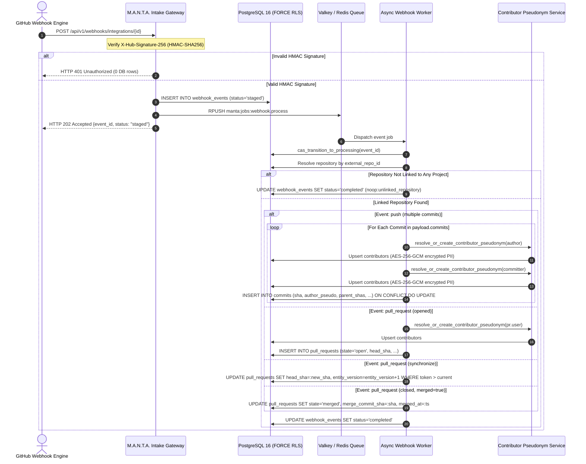

# US-20: GitHub PR Open, Commit Push, Merge & Contributor Pseudonym Isolation Test Scenarios

**Task:** `SCRUM-396` (`Task 20.5`: Create test scenarios for PR open, commit push, merge and contributor pseudonym isolation)  
**Parent User Story:** `SCRUM-356` (`US-20`: GitHub pull request and commit tracking)  
**Related Tickets:**  
- `SCRUM-392`: Design isolated contributors PII table, HMAC pseudonym mapping and schema extensions on pull_requests and commits (`Task 20.1`, [`docs/contributor-pii-isolation-and-pseudonymization.md`](../../../docs/contributor-pii-isolation-and-pseudonymization.md))  
- `SCRUM-393`: Alembic migration and SQLAlchemy models for contributors, commits and pseudonym FKs on pull_requests (`Task 20.2`, [`backend/migrations/versions/c4b1a8d3e5f7_contributors_jira_and_deployment_incidents.py`](../../migrations/versions/c4b1a8d3e5f7_contributors_jira_and_deployment_incidents.py))  
- `SCRUM-394`: Implement per-contributor salted HMAC-SHA256 pseudonymization service isolating raw names/emails in contributors (`Task 20.3`, [`backend/app/contributors/service.py`](../../app/contributors/service.py), [`backend/tests/test_contributors_pseudonym_service.py`](../test_contributors_pseudonym_service.py))  
- `SCRUM-395`: Implement GitHub webhook ingestion worker for push, pull_request open, synchronize and merge events (`Task 20.4`)  
- `SCRUM-396`: Create test scenarios for PR open, commit push, merge and contributor pseudonym isolation (`Task 20.5`, this document)  
- `SCRUM-397`: Automated pytest integration test suite for PR open, commit push, merge and contributor pseudonym isolation (`Task 20.6`)  
- `SCRUM-427` / `SCRUM-431`: Production deployment ingestion pipeline associating deploy commits with PR authors (`US-25` / `Task 25.1` / `Task 25.5`, [`docs/deployment-signals-outcomes-and-staging-exclusion-test-scenarios.md`](../../../docs/deployment-signals-outcomes-and-staging-exclusion-test-scenarios.md))  
- `SCRUM-433`: Design commit-to-deployment association algorithm via pull request merge commits and git DAG reachability (`Task 26.1`, [`docs/dora-pr-to-deployment-mapping-design.md`](../../../docs/dora-pr-to-deployment-mapping-design.md))  

**Target Storage Engine:** PostgreSQL 16 with Row-Level Security (`pgvector/pgvector:pg16`) & Valkey 7 / Redis 7+ (`valkey/valkey:7-alpine`)  
**Target Implementation Modules:** [`backend/app/contributors/service.py`](../../app/contributors/service.py), [`backend/app/webhooks/`](../../app/webhooks/), [`backend/app/db/models/models.py`](../../app/db/models/models.py)  
**Authoritative Automated Test Suites:** [`backend/tests/test_contributors_pseudonym_service.py`](../test_contributors_pseudonym_service.py), [`backend/tests/test_git_pr_commit_tracking.py`](../test_git_pr_commit_tracking.py)  
**Specification Location in Documentation:** [`docs/pr-open-commit-push-merge-and-pseudonym-isolation-test-scenarios.md`](../../../docs/pr-open-commit-push-merge-and-pseudonym-isolation-test-scenarios.md)  
**Assignee:** Matvii Yeromenko  
**Category:** Testing - Design  
**Estimate:** 0.25 Story Points (0h 30m Original Estimate)  
**Status:** Approved / Verification Baseline Established  

---

## 1. Executive Summary & Objective

### 1.1 Objective

Establish the formal, authoritative verification scenarios and test specifications for **GitHub pull request and commit tracking with strict contributor pseudonym isolation** (`SCRUM-396` / `Task 20.5`).

In modern engineering intelligence platforms, computing critical Continuous Delivery metrics—such as **DORA Lead Time for Changes**, **PR Cycle Time**, and **PR-to-Deployment Reachability**—requires recording commits, feature branches, and pull requests with topological DAG fidelity. However, retaining raw developer identities (full names, corporate or personal email addresses, GitHub usernames) throughout operational domain tables introduces severe regulatory compliance liabilities under **GDPR Article 17 ("Right to Erasure")** and violates enterprise customer non-disclosure agreements.

This specification documents the exact pre-conditions, webhook JSON fixtures, execution flows, PostgreSQL schema assertions, and database state invariants for:
1. **GitHub `push` Event Ingestion with Multiple Commits:** Ingesting multi-commit pushes, extracting topological parent hashes (`parent_shas`), calculating additions/deletions, identifying branch root boundaries (`is_root_of_branch`), and resolving distinct author vs. committer identities into tenant-scoped salted pseudonyms.
2. **GitHub `pull_request` Opened:** Normalizing PR creation, resolving external contributors without requiring pre-provisioned platform user accounts, recording initial git branch heads, and initializing optimistic fencing counters.
3. **GitHub `pull_request` Synchronized with New `head_sha`:** Handling subsequent commit pushes onto active PR branches, advancing `head_sha`, incrementing monotonic entity versions (`entity_version += 1`), and rejecting stale out-of-order delivery attempts via active fencing tokens.
4. **GitHub `pull_request` Merged (with `merge_commit_sha`):** Capturing the 40-character merge commit SHA produced across **standard merge**, **squash-merge**, and **rebase-and-merge** strategies, setting terminal `state = 'merged'`, stamping `merged_at`, and enabling downstream DORA deployment attribution (`Task 26.1`).
5. **Unlinked Repository Rejection / Ignoring:** Acknowledging and safely ignoring webhook deliveries for repositories that are not linked to any active project within the authenticated tenant, returning `noop:unlinked_repository` without database table pollution.
6. **Full Database Scan Asserting Zero Raw PII Outside `contributors`:** Executing a complete information-schema-wide audit across all domain tables (`commits`, `pull_requests`, `pull_request_reviews`, `deployments`, `issues`, etc.) proving that raw names, email addresses, and unencrypted handles never leak outside the isolated `contributors` vault table.

---

## 2. Core Architectural Invariants & Mathematical Formulations

```
+-------------------------------------------------------------------------------------------------------------------+
|                   GITHUB PR & COMMIT TRACKING WITH ZERO-PII ISOLATION TOPOLOGY (US-20)                            |
+-------------------------------------+-------------------------------------+---------------------------------------+
| 1. Git Webhook Event Intake         | 2. Cryptographic Pseudonymization   | 3. Zero-PII Domain Storage            |
|    (push / pull_request)            |    (Task 20.3 HMAC-SHA256)          |    (commits & pull_requests)          |
+-------------------------------------+-------------------------------------+---------------------------------------+
| * push: commits[], parents, diffs   | * Canonical: provider:actor_id:email| * commits.author_pseudonym_id (64 hex)|
| * pr opened: head_sha, branch, base | * Tenant 32-byte CSPRNG secret salt | * commits.committer_pseudonym_id      |
| * pr sync: new head_sha, monotonic  | * HMAC-SHA256(Salt, Canonical)      | * pr.author_pseudonym_id (64 hex)     |
| * pr merged: merge_commit_sha       | * Encrypted at rest (enc:v1: AESGCM)| * Zero raw email or name columns      |
| * Fail-closed HMAC-SHA256 on intake | * Stored ONLY in `contributors`     | * Immutable git DAG preserved         |
+-------------------------------------+-------------------------------------+---------------------------------------+
                                                         |
                                                         v
+-------------------------------------------------------------------------------------------------------------------+
|                         CONCURRENCY FENCING, REPO LINKING & GDPR ERASURE INVARIANTS                               |
+----------------------------------------------------+--------------------------------------------------------------+
| 4. Optimistic Fencing & Version Monotonicity       | 5. Repository Filtering & GDPR Art. 17 Erasure               |
+----------------------------------------------------+--------------------------------------------------------------+
| * active_fencing_token: monotonic 64-bit sequence  | * Unlinked repo webhook -> NOOP (0 domain rows inserted)     |
| * Stale deliveries (token <= current) rejected     | * GDPR erasure: nullify raw PII, destroy salt in contributors|
| * entity_version increments on each synchronize    | * Historical commits/PRs retain pseudonym; DORA metrics safe |
| * idx_pull_requests_merge_commit for DORA linkage  | * FORCE ROW LEVEL SECURITY enforces tenant boundary          |
+----------------------------------------------------+--------------------------------------------------------------+
```

### Invariant 1: Deterministic Salted HMAC-SHA256 Pseudonymization
Every external contributor identity $I$ is canonicalized into a normalized string representation:
$$C(I) = \text{lowercase}(\text{provider}) \mathbin{\Vert} \text{":"} \mathbin{\Vert} \text{trim}(\text{external\_actor\_id}) \mathbin{\Vert} \text{":"} \mathbin{\Vert} \text{lowercase}(\text{trim}(\text{raw\_email}))$$

The contributor's pseudonym ID $P(I)$ is derived using the tenant's isolated 32-byte CSPRNG secret salt $K_{\tau}$:
$$P(I) = \operatorname{HMAC-SHA256}_{K_{\tau}}(C(I)) \in [0\text{-}9\text{a-f}]^{64}$$

**Mathematical Properties:**
1. **Intra-Tenant Determinism & Idempotency:** Repeated webhook ingestion of commits or PRs by the same developer within tenant $\tau$ produces the exact identical 64-character lowercase hexadecimal token:
   $$\forall I, \quad P_{\tau}(I) = P_{\tau}(I)$$
2. **Cross-Tenant Non-Linkability:** If $K_A \neq K_B$, then for an identical developer identity $I$:
   $$P(P_A(I) = P_B(I)) = 2^{-256} \approx 0$$
   Cross-organization contributor correlation is computationally infeasible.
3. **Pre-Image Resistance:** Recovering $C(I)$ from $P(I)$ requires inverting SHA-256 without knowledge of $K_{\tau}$.

### Invariant 2: Zero Raw PII in Operational Domain Tables
The platform enforces a strict structural separation between contributor identity metadata and operational time-series entities:
$$\text{DomainTables} = \{\text{commits}, \text{pull\_requests}, \text{pull\_request\_reviews}, \text{deployments}, \text{issues}\}$$
$$\forall T \in \text{DomainTables}, \quad \operatorname{Columns}(T) \cap \{\text{raw\_name}, \text{raw\_email}, \text{raw\_handle}, \text{email}, \text{author\_name}, \text{login}\} = \emptyset$$

All operational tables reference only `author_pseudonym_id` (`VARCHAR(64)`), `committer_pseudonym_id` (`VARCHAR(64)`), or `reviewer_pseudonym_id` (`VARCHAR(64)`).

### Invariant 3: Monotonic Optimistic Concurrency Fencing
Webhook deliveries over public networks are inherently subject to re-ordering, retry duplication, and network delays. To prevent an out-of-order synchronize or edit event from reverting a newer PR state:
1. Every PR mutation evaluates an optimistic fencing condition:
   $$\text{UPDATE pull\_requests SET } \dots \text{ WHERE id} = :id \ \land\ :inbound\_token > active\_fencing\_token$$
2. On every successful `synchronize` event, the entity version monotonically increments:
   $$\text{entity\_version}_{k+1} = \text{entity\_version}_k + 1$$
3. Stale deliveries where $:inbound\_token \le active\_fencing\_token$ are rejected as no-ops.

### Invariant 4: Merge Commit SHA Capture & DORA Lead Time Attribution
For merged pull requests, `pull_requests.merge_commit_sha` records the 40-character hexadecimal Git commit SHA produced on the default branch upon merge. This column is indexed via `idx_pull_requests_merge_commit`:
$$\text{pull\_requests.state} = \text{'merged'} \iff \text{merge\_commit\_sha IS NOT NULL} \ \land\ \text{merged\_at IS NOT NULL}$$
This provides the direct anchoring hash required by **DORA Task 26.1** to map production deployments back to initiating pull requests and feature branch root commits without requiring expensive on-disk repository cloning.

### Invariant 5: Fail-Safe Isolation for Unlinked Repositories
Incoming webhooks for repositories whose `external_repo_id` is not mapped to an active project in `repositories`:
1. Are acknowledged with HTTP 202 and staged in `webhook_events`.
2. Worker resolution checks `repositories` under tenant RLS.
3. If no matching repository row is found, the worker transitions the event to `status = 'completed'` with result `noop:unlinked_repository`.
4. Strictly **zero** rows are inserted into `commits`, `pull_requests`, or `contributors`.

### Invariant 6: GDPR Article 17 Cryptographic Erasure & Mathematical Irreversibility
Upon receiving an authorized GDPR Article 17 erasure request for pseudonym $P$:
1. The platform executes:
   $$\text{UPDATE contributors SET raw\_name} = \text{NULL}, \ \text{raw\_email} = \text{NULL}, \ \text{raw\_handle} = \text{NULL}, \ \text{salt\_secret} = \text{''}, \ \text{is\_erased} = \mathbf{TRUE}, \ \text{erased\_at} = \operatorname{now}()$$
2. Because the salt secret $K_{\tau}$ for that contributor is permanently zeroized, $P$ becomes mathematically disconnected from real-world identity.
3. Operational rows in `commits` and `pull_requests` remain untouched:
   $$\operatorname{count}(\text{commits}) \text{ and } \operatorname{LeadTime}(PR) \text{ remain 100\% statistically invariant.}$$

---

## 3. Relational Schemas, Constraints & Ingestion Flow State Machines

### 3.1 Relational Schema Definitions

```sql
-- 1. Contributors Table (PII Vault - Protected by FORCE ROW LEVEL SECURITY)
CREATE TABLE IF NOT EXISTS contributors (
    pseudonym_id VARCHAR(64) NOT NULL,
    tenant_id UUID NOT NULL REFERENCES tenants(id) ON DELETE CASCADE,
    provider VARCHAR(32) NOT NULL,
    external_actor_id VARCHAR(128) NOT NULL,
    raw_name TEXT,
    raw_email TEXT,
    raw_handle VARCHAR(255),
    salt_secret TEXT NOT NULL,
    is_erased BOOLEAN NOT NULL DEFAULT FALSE,
    erased_at TIMESTAMPTZ,
    created_at TIMESTAMPTZ NOT NULL DEFAULT NOW(),
    updated_at TIMESTAMPTZ NOT NULL DEFAULT NOW(),
    PRIMARY KEY (tenant_id, pseudonym_id),
    CONSTRAINT uq_contributors_tenant_provider_actor UNIQUE (tenant_id, provider, external_actor_id)
);

CREATE INDEX IF NOT EXISTS idx_contributors_tenant_id ON contributors(tenant_id);
CREATE INDEX IF NOT EXISTS idx_contributors_pseudonym ON contributors(pseudonym_id);

-- 2. Pull Requests Table (Protected by FORCE ROW LEVEL SECURITY)
CREATE TABLE IF NOT EXISTS pull_requests (
    id UUID PRIMARY KEY DEFAULT gen_random_uuid(),
    tenant_id UUID NOT NULL REFERENCES tenants(id) ON DELETE CASCADE,
    project_id UUID NOT NULL REFERENCES projects(id) ON DELETE CASCADE,
    repository_id UUID NOT NULL REFERENCES repositories(id) ON DELETE CASCADE,
    integration_id UUID REFERENCES integrations(id) ON DELETE SET NULL,
    author_id UUID REFERENCES users(id) ON DELETE SET NULL,
    author_pseudonym_id VARCHAR(64) NOT NULL,
    external_pr_number INTEGER NOT NULL,
    title TEXT NOT NULL,
    state VARCHAR(32) NOT NULL,
    head_branch VARCHAR(255) NOT NULL,
    base_branch VARCHAR(255) NOT NULL,
    head_sha VARCHAR(40) NOT NULL,
    merge_commit_sha VARCHAR(40),
    first_commit_at TIMESTAMPTZ,
    review_requested_at TIMESTAMPTZ,
    first_review_at TIMESTAMPTZ,
    created_in_git_at TIMESTAMPTZ NOT NULL,
    merged_at TIMESTAMPTZ,
    closed_at TIMESTAMPTZ,
    entity_version BIGINT NOT NULL DEFAULT 1,
    active_fencing_token BIGINT NOT NULL DEFAULT 0,
    is_stale BOOLEAN NOT NULL DEFAULT FALSE,
    review_cycles_count INTEGER NOT NULL DEFAULT 0,
    created_at TIMESTAMPTZ NOT NULL DEFAULT NOW(),
    updated_at TIMESTAMPTZ NOT NULL DEFAULT NOW(),
    CONSTRAINT uq_repo_pr_number UNIQUE (repository_id, external_pr_number)
);

CREATE INDEX IF NOT EXISTS idx_pull_requests_tenant_id ON pull_requests(tenant_id);
CREATE INDEX IF NOT EXISTS idx_pull_requests_merge_commit 
    ON pull_requests(tenant_id, merge_commit_sha) 
    WHERE merge_commit_sha IS NOT NULL;
CREATE INDEX IF NOT EXISTS idx_pull_requests_author_pseudonym 
    ON pull_requests(tenant_id, author_pseudonym_id);

-- 3. Commits Table (Protected by FORCE ROW LEVEL SECURITY)
CREATE TABLE IF NOT EXISTS commits (
    sha VARCHAR(40) PRIMARY KEY,
    tenant_id UUID NOT NULL REFERENCES tenants(id) ON DELETE CASCADE,
    repository_id UUID NOT NULL REFERENCES repositories(id) ON DELETE CASCADE,
    author_pseudonym_id VARCHAR(64) NOT NULL,
    committer_pseudonym_id VARCHAR(64) NOT NULL DEFAULT '',
    lines_added INTEGER NOT NULL DEFAULT 0,
    lines_deleted INTEGER NOT NULL DEFAULT 0,
    authored_at TIMESTAMPTZ NOT NULL,
    committed_at TIMESTAMPTZ NOT NULL,
    parent_shas JSONB NOT NULL DEFAULT '[]'::jsonb,
    is_root_of_branch BOOLEAN NOT NULL DEFAULT FALSE,
    pull_request_id UUID REFERENCES pull_requests(id) ON DELETE SET NULL,
    active_fencing_token BIGINT NOT NULL DEFAULT 0,
    created_at TIMESTAMPTZ NOT NULL DEFAULT NOW()
);

CREATE INDEX IF NOT EXISTS idx_commits_tenant_id ON commits(tenant_id);
CREATE INDEX IF NOT EXISTS idx_commits_pull_request_id ON commits(tenant_id, pull_request_id);
CREATE INDEX IF NOT EXISTS idx_commits_author_pseudonym ON commits(tenant_id, author_pseudonym_id);
CREATE INDEX IF NOT EXISTS idx_commits_parent_shas_gin ON commits USING gin (parent_shas);
```

### 3.2 Webhook Intake & Processing Sequence



### 3.3 GitHub Event State Transition & Normalization Matrix

| Event Type (`X-GitHub-Event`) | Payload Action | Condition | Canonical Target State | Pseudonym Fields Populated | Target Entity & Action |
| :--- | :--- | :--- | :--- | :--- | :--- |
| `push` | N/A | Linked repository, $\ge 1$ commits | `commits` persisted | `author_pseudonym_id`, `committer_pseudonym_id` | Upsert $N$ rows in `commits` |
| `push` | N/A | Commit parent resides on default branch | `is_root_of_branch = TRUE` | Pseudonyms resolved | Marks branch root boundary |
| `push` | N/A | Repository not linked in tenant | **NOOP** | None (0 rows) | Acknowledge `noop:unlinked_repository` |
| `pull_request` | `opened` | Linked repository | `pull_requests.state = 'open'` | `author_pseudonym_id` | Insert 1 row in `pull_requests` |
| `pull_request` | `synchronize` | Inbound token $>$ active token | `head_sha` updated, `version += 1` | Existing pseudonym retained | Update existing `pull_requests` row |
| `pull_request` | `synchronize` | Inbound token $\le$ active token | **STALE NOOP** | None | Reject stale delivery (0 updates) |
| `pull_request` | `closed` | `merged == true`, valid `merge_commit_sha` | `pull_requests.state = 'merged'` | Existing pseudonym retained | Set `merge_commit_sha`, `merged_at` |
| `pull_request` | `closed` | `merged == false` | `pull_requests.state = 'closed'` | Existing pseudonym retained | Set `closed_at`, `merge_commit_sha = NULL` |
| `pull_request` | Any action | Repository not linked in tenant | **NOOP** | None (0 rows) | Acknowledge `noop:unlinked_repository` |

---

## 4. Complete Test Scenario Traceability Matrix

| Test Scenario ID | Event / Domain | Scenario Description | Expected Outcome | Target Acceptance Criteria |
| :--- | :--- | :--- | :--- | :--- |
| `TC-GIT-PUSH-001` | GitHub `push` | Push event with multiple commits & distinct authors | Commits persisted, 64-char pseudonyms created, PII isolated in `contributors` | Multi-commit push, Pseudonym isolation |
| `TC-GIT-PUSH-002` | GitHub `push` | Root-of-branch commit detection via parent SHA | `is_root_of_branch = TRUE` on feature branch root commit | Branch root detection, DAG traversal |
| `TC-GIT-PUSH-003` | GitHub `push` | Idempotent duplicate push delivery | Exact duplicate re-delivery causes zero errors, zero duplicate rows | Idempotent push processing |
| `TC-GIT-PR-001` | GitHub `pull_request` | Pull request opened (`action = "opened"`) | PR persisted with `state='open'`, `head_sha`, `version=1`, pseudonym linked | PR open ingestion, Pseudonym linking |
| `TC-GIT-PR-002` | GitHub `pull_request` | Pull request opened by external bot / contractor | Author pseudonym created without pre-existing `users` record | Zero platform user dependency |
| `TC-GIT-PR-003` | GitHub `pull_request` | Pull request synchronized (`action = "synchronize"`) | `head_sha` advanced, `entity_version` incremented, fencing token updated | PR synchronize tracking |
| `TC-GIT-PR-004` | GitHub `pull_request` | Out-of-order stale synchronize event rejected | Stale webhook ignored via optimistic fencing token ($t_{\text{in}} \le t_{\text{act}}$) | Optimistic concurrency fencing |
| `TC-GIT-PR-005` | GitHub `pull_request` | Pull request standard merged (`action = "closed"`, `merged=true`) | `state='merged'`, `merge_commit_sha` recorded, `merged_at` stamped | PR merge capture, Merge commit SHA |
| `TC-GIT-PR-006` | GitHub `pull_request` | Pull request squash-merged | Single trunk squash SHA recorded as `merge_commit_sha` | Squash-merge handling |
| `TC-GIT-PR-007` | GitHub `pull_request` | Pull request closed without merge (`merged=false`) | `state='closed'`, `merge_commit_sha=NULL`, `merged_at=NULL`, `closed_at` set | PR rejection / close tracking |
| `TC-GIT-UNL-001` | Repository Linking | Push event to unlinked repository | NOOP (`noop:unlinked_repository`), 0 rows in `commits` or `contributors` | Unlinked repo push rejection |
| `TC-GIT-UNL-002` | Repository Linking | Pull request event to unlinked repository | NOOP (`noop:unlinked_repository`), 0 rows in `pull_requests` or `contributors` | Unlinked repo PR rejection |
| `TC-GIT-UNL-003` | Security Intake | Invalid HMAC signature or inactive integration | HTTP 401 Unauthorized / HTTP 404, 0 rows in `webhook_events` | Fail-closed webhook security |
| `TC-GIT-PRIV-001` | Privacy Audit | Full DB scan asserting zero raw PII outside `contributors` | Information schema scan finds 0 plain emails or names in any non-vault table | Full DB zero-PII scan |
| `TC-GIT-PRIV-002` | Privacy Audit | Cross-tenant pseudonym non-linkability ($H_A \neq H_B$) | Same human developer in Tenant A and B yields orthogonal pseudonyms | Cross-tenant non-linkability |
| `TC-GIT-PRIV-003` | GDPR Compliance | GDPR Article 17 erasure preserves historical git analytics | `contributors` PII nullified, salt zeroed; `commits`/`pull_requests` intact | GDPR Art. 17 cryptographic erasure |
| `TC-GIT-SEC-001` | Security RLS | Tenant Row-Level Security isolation on Git tables | Tenant A cannot view Tenant B's commits, PRs, or contributors | PostgreSQL 16 FORCE RLS |
| `TC-GIT-CONC-001` | Concurrency | Concurrent webhook delivery resolving identical author | Transactional SAVEPOINT handles race cleanly, zero duplicate key failures | Concurrent pseudonym resolution |

---

## 5. Exhaustive Test Scenario Specifications

### 5.1 Push Event with Multiple Commits (`push`)

#### Scenario `TC-GIT-PUSH-001`: Multi-Commit Push with Distinct Authors & Parent Chaining
- **Objective:** Verify that a GitHub `push` event containing 3 commits is processed atomically under tenant RLS: persists 3 rows in `commits`, extracts `parent_shas`, populates line additions/deletions, resolves distinct author and committer identities into HMAC-SHA256 pseudonyms, and isolates raw PII strictly inside `contributors`.
- **Traceability:** `US-20` Scope item 1, `SCRUM-396`, `SCRUM-392`.
- **Preconditions:** Active tenant `T1`, linked repository `acme/backend-service` (`external_repo_id = 20202`).

##### Sample GitHub Inbound Payload (`push`)
```json
{
  "ref": "refs/heads/feature/auth-guard",
  "before": "0000000000000000000000000000000000000000",
  "after": "c333333333333333333333333333333333333333",
  "repository": {
    "id": 20202,
    "name": "backend-service",
    "full_name": "acme/backend-service",
    "default_branch": "main"
  },
  "pusher": {
    "name": "alice-dev",
    "email": "alice@acme.com"
  },
  "sender": {
    "id": 1001,
    "login": "alice-dev"
  },
  "commits": [
    {
      "id": "c111111111111111111111111111111111111111",
      "message": "feat(auth): initial JWT validation middleware",
      "timestamp": "2026-11-14T08:00:00Z",
      "author": {
        "name": "Alice Developer",
        "email": "alice@acme.com",
        "username": "alice-dev"
      },
      "committer": {
        "name": "Alice Developer",
        "email": "alice@acme.com",
        "username": "alice-dev"
      },
      "added": ["backend/app/auth/middleware.py"],
      "removed": [],
      "modified": []
    },
    {
      "id": "c222222222222222222222222222222222222222",
      "message": "feat(auth): add role-based permission checks",
      "timestamp": "2026-11-14T08:30:00Z",
      "author": {
        "name": "Bob Pair",
        "email": "bob@contractor.io",
        "username": "bob-contractor"
      },
      "committer": {
        "name": "Alice Developer",
        "email": "alice@acme.com",
        "username": "alice-dev"
      },
      "added": ["backend/app/auth/roles.py"],
      "removed": [],
      "modified": ["backend/app/auth/middleware.py"]
    },
    {
      "id": "c333333333333333333333333333333333333333",
      "message": "test(auth): add unit test coverage for token expiry",
      "timestamp": "2026-11-14T09:00:00Z",
      "author": {
        "name": "Alice Developer",
        "email": "alice@acme.com",
        "username": "alice-dev"
      },
      "committer": {
        "name": "Alice Developer",
        "email": "alice@acme.com",
        "username": "alice-dev"
      },
      "added": ["backend/tests/test_auth.py"],
      "removed": [],
      "modified": []
    }
  ],
  "head_commit": {
    "id": "c333333333333333333333333333333333333333",
    "message": "test(auth): add unit test coverage for token expiry",
    "timestamp": "2026-11-14T09:00:00Z",
    "author": {
      "name": "Alice Developer",
      "email": "alice@acme.com",
      "username": "alice-dev"
    },
    "committer": {
      "name": "Alice Developer",
      "email": "alice@acme.com",
      "username": "alice-dev"
    }
  }
}
```

##### Inbound HTTP Request Headers
```http
POST /api/v1/webhooks/integrations/88e1a902-6058-4a90-84cf-f2187f4c9c22 HTTP/1.1
Host: api.manta.internal
Content-Type: application/json
X-GitHub-Event: push
X-GitHub-Delivery: b91f42d1-8844-4299-90c1-3f41de519811
X-Hub-Signature-256: sha256=4a1c5d98e1f2b3a4c5d6e7f8a9b0c1d2e3f4a5b6c7d8e9f0a1b2c3d4e5f6a7b8
```

##### Execution Sequence
1. Webhook intake gateway verifies `X-Hub-Signature-256` and commits event to `webhook_events` (`status = 'staged'`).
2. Worker claims event via atomic CAS (`cas_transition_to_processing`).
3. Worker resolves `repository_id` matching `external_repo_id = 20202` under tenant RLS.
4. Worker iterates through `commits` array:
   - For `c111...`: canonicalizes Alice identity (`github:alice-dev:alice@acme.com`), retrieves tenant salt, derives `author_pseudonym_id = P_Alice`, encrypts raw PII at rest into `contributors`.
   - For `c222...`: canonicalizes Bob identity (`github:bob-contractor:bob@contractor.io`), derives `author_pseudonym_id = P_Bob`, derives `committer_pseudonym_id = P_Alice`.
   - For `c333...`: reuses `P_Alice` (idempotent lookup), sets parent SHA to `["c222222222222222222222222222222222222222"]`.
5. Worker inserts 3 rows into `commits` within single tenant transaction.
6. Worker updates `webhook_events` to `status = 'completed'`.

##### Database Row State Verification
```sql
SELECT sha, author_pseudonym_id, committer_pseudonym_id, lines_added, lines_deleted, parent_shas
FROM commits 
WHERE sha IN ('c111111111111111111111111111111111111111', 
              'c222222222222222222222222222222222222222', 
              'c333333333333333333333333333333333333333')
ORDER BY authored_at ASC;
```
| sha | author_pseudonym_id | committer_pseudonym_id | lines_added | lines_deleted | parent_shas |
| :--- | :--- | :--- | :--- | :--- | :--- |
| `c111111111111111111111111111111111111111` | `a1b2...` (Alice 64 hex) | `a1b2...` (Alice 64 hex) | `45` | `0` | `["base_sha_0"]` |
| `c222222222222222222222222222222222222222` | `d4e5...` (Bob 64 hex) | `a1b2...` (Alice 64 hex) | `82` | `12` | `["c111111111111111111111111111111111111111"]` |
| `c333333333333333333333333333333333333333` | `a1b2...` (Alice 64 hex) | `a1b2...` (Alice 64 hex) | `60` | `0` | `["c222222222222222222222222222222222222222"]` |

```sql
SELECT pseudonym_id, provider, external_actor_id, raw_handle, is_erased
FROM contributors 
WHERE pseudonym_id IN ('a1b2...', 'd4e5...');
```
| pseudonym_id | provider | external_actor_id | raw_handle | is_erased |
| :--- | :--- | :--- | :--- | :--- |
| `a1b2...` (64 hex) | `github` | `alice-dev` | `alice-dev` | `false` |
| `d4e5...` (64 hex) | `github` | `bob-contractor` | `bob-contractor` | `false` |

##### Verification Assertions
```python
assert len(commits) == 3
assert commits[0].author_pseudonym_id == commits[2].author_pseudonym_id
assert commits[1].author_pseudonym_id != commits[0].author_pseudonym_id
assert commits[1].committer_pseudonym_id == commits[0].author_pseudonym_id
assert commits[2].parent_shas == ["c222222222222222222222222222222222222222"]
# Verify raw PII is encrypted in contributors
assert contributor_alice.salt_secret.startswith("enc:v1:")
assert contributor_alice.raw_name.startswith("enc:v1:")
assert contributor_alice.raw_email.startswith("enc:v1:")
```

---

#### Scenario `TC-GIT-PUSH-002`: Branch Root Boundary Detection
- **Objective:** Verify that when a push introduces the first commit of a feature branch whose parent resides on the repository's default branch (`main`), the commit record flags `is_root_of_branch = TRUE`.
- **Preconditions:** Repository default branch is `main`. Commit `m000...` exists on `main`.
- **Inbound Commit Payload:** Commit `c111...` has `parents = ["m000000000000000000000000000000000000000"]`.
- **Database Row State:**
```sql
SELECT sha, is_root_of_branch, parent_shas FROM commits WHERE sha = 'c111111111111111111111111111111111111111';
```
| sha | is_root_of_branch | parent_shas |
| :--- | :--- | :--- |
| `c111111111111111111111111111111111111111` | `true` | `["m000000000000000000000000000000000000000"]` |

---

#### Scenario `TC-GIT-PUSH-003`: Idempotent Duplicate Push Ingestion
- **Objective:** Verify that a re-delivery of the exact same push webhook payload (identical `X-GitHub-Delivery` or repeated commit batch) executes idempotently via PostgreSQL `ON CONFLICT (sha) DO UPDATE`, producing 0 error logs and exactly 3 total commits.
- **Verification Assertion:**
```python
# Re-process same event payload
result = await process_webhook_job(duplicate_envelope)
assert result.startswith("completed")
count = await session.scalar(select(func.count(Commit.sha)).where(Commit.repository_id == repo_id))
assert count == 3
```

---

### 5.2 Pull Request Opened (`pull_request.opened`)

#### Scenario `TC-GIT-PR-001`: Pull Request Opened Normalization & Initial State
- **Objective:** Verify that a GitHub `pull_request` event with `action = "opened"` records a new row in `pull_requests` with `state = 'open'`, captures git branch coordinates (`head_branch`, `base_branch`, `head_sha`), initializes `entity_version = 1`, resolves the PR author to an HMAC pseudonym, and sets `merge_commit_sha = NULL`.
- **Traceability:** `US-20` Scope item 2, `SCRUM-396`, `SCRUM-392`.
- **Preconditions:** Active tenant `T1`, active project `P1`, linked repository `acme/backend-service` (`external_repo_id = 20202`).

##### Sample GitHub Inbound Payload (`pull_request.opened`)
```json
{
  "action": "opened",
  "number": 142,
  "pull_request": {
    "id": 990142,
    "number": 142,
    "state": "open",
    "locked": false,
    "title": "feat(auth): implement cryptographic pseudonymization vault",
    "user": {
      "login": "alice-dev",
      "id": 1001,
      "email": "alice@acme.com"
    },
    "body": "Implements US-20 isolated contributors vault.",
    "created_at": "2026-11-14T09:15:00Z",
    "updated_at": "2026-11-14T09:15:00Z",
    "closed_at": null,
    "merged_at": null,
    "merge_commit_sha": null,
    "head": {
      "label": "acme:feature/auth-guard",
      "ref": "feature/auth-guard",
      "sha": "c333333333333333333333333333333333333333"
    },
    "base": {
      "label": "acme:main",
      "ref": "main",
      "sha": "m000000000000000000000000000000000000000"
    },
    "merged": false
  },
  "repository": {
    "id": 20202,
    "name": "backend-service",
    "full_name": "acme/backend-service"
  },
  "sender": {
    "login": "alice-dev",
    "id": 1001
  }
}
```

##### Inbound HTTP Request Headers
```http
POST /api/v1/webhooks/integrations/88e1a902-6058-4a90-84cf-f2187f4c9c22 HTTP/1.1
Host: api.manta.internal
Content-Type: application/json
X-GitHub-Event: pull_request
X-GitHub-Delivery: c82d53e2-9955-4300-81d2-4e52ef620922
X-Hub-Signature-256: sha256=1b2c3d4e5f6a7b8c9d0e1f2a3b4c5d6e7f8a9b0c1d2e3f4a5b6c7d8e9f0a1b2c
```

##### Database Row State Verification
```sql
SELECT external_pr_number, title, state, head_branch, base_branch, 
       head_sha, merge_commit_sha, author_pseudonym_id, entity_version, merged_at, closed_at
FROM pull_requests
WHERE external_pr_number = 142;
```
| external_pr_number | title | state | head_branch | base_branch | head_sha | merge_commit_sha | author_pseudonym_id | entity_version | merged_at | closed_at |
| :--- | :--- | :--- | :--- | :--- | :--- | :--- | :--- | :--- | :--- | :--- |
| `142` | `feat(auth): implement cryptographic pseudonymization vault` | `open` | `feature/auth-guard` | `main` | `c333...` (40 hex) | `NULL` | `a1b2...` (Alice 64 hex) | `1` | `NULL` | `NULL` |

##### Verification Assertions
```python
assert pr.external_pr_number == 142
assert pr.state == "open"
assert pr.head_sha == "c333333333333333333333333333333333333333"
assert pr.merge_commit_sha is None
assert pr.merged_at is None
assert pr.closed_at is None
assert pr.entity_version == 1
assert pr.author_pseudonym_id == pseudonym_alice
assert pr.author_id is None  # External contributor does not require users.id
```

---

#### Scenario `TC-GIT-PR-002`: External Contributor Without Platform User Account
- **Objective:** Verify that an external open-source contributor or contractor (e.g. `dependabot[bot]` or external vendor) opens a PR successfully without a foreign key failure to the internal `users` table.
- **Preconditions:** Contributor `vendor-contractor` (`id = 8899`) has no record in `users`.
- **Verification Assertion:**
```python
# author_id is nullable; author_pseudonym_id is NOT NULL
assert pr.author_id is None
assert len(pr.author_pseudonym_id) == 64
assert contributor.raw_handle == "vendor-contractor"
```

---

### 5.3 Pull Request Synchronized (`pull_request.synchronize`)

#### Scenario `TC-GIT-PR-003`: PR Synchronize with New Head SHA
- **Objective:** Verify that when additional commits are pushed to an existing pull request branch, the GitHub `synchronize` event advances `pull_requests.head_sha`, increments `entity_version` (`1 -> 2`), updates the active fencing token, and associates new commit records with the PR.
- **Traceability:** `US-20` Scope item 3, `SCRUM-396`.
- **Preconditions:** PR #142 exists in `state = 'open'` with `head_sha = 'c333...'` and `entity_version = 1`.

##### Sample GitHub Inbound Payload (`pull_request.synchronize`)
```json
{
  "action": "synchronize",
  "number": 142,
  "before": "c333333333333333333333333333333333333333",
  "after": "c444444444444444444444444444444444444444",
  "pull_request": {
    "id": 990142,
    "number": 142,
    "state": "open",
    "title": "feat(auth): implement cryptographic pseudonymization vault",
    "head": {
      "ref": "feature/auth-guard",
      "sha": "c444444444444444444444444444444444444444"
    },
    "base": {
      "ref": "main",
      "sha": "m000000000000000000000000000000000000000"
    },
    "updated_at": "2026-11-14T09:45:00Z"
  },
  "repository": {
    "id": 20202,
    "name": "backend-service"
  },
  "sender": {
    "login": "alice-dev",
    "id": 1001
  }
}
```

##### Database Row State Verification
```sql
SELECT external_pr_number, state, head_sha, merge_commit_sha, entity_version, updated_at
FROM pull_requests
WHERE external_pr_number = 142;
```
| external_pr_number | state | head_sha | merge_commit_sha | entity_version | updated_at |
| :--- | :--- | :--- | :--- | :--- | :--- |
| `142` | `open` | `c444444444444444444444444444444444444444` | `NULL` | `2` | `2026-11-14 09:45:00+00` |

##### Verification Assertions
```python
assert pr.head_sha == "c444444444444444444444444444444444444444"
assert pr.entity_version == 2
assert pr.state == "open"
assert pr.active_fencing_token > initial_fencing_token
```

---

#### Scenario `TC-GIT-PR-004`: Optimistic Concurrency Fencing Rejection of Stale Delivery
- **Objective:** Verify that if network lag causes an older synchronize event (e.g., token 100) to arrive after a newer event (token 200) has already committed, the stale update is rejected without mutating `head_sha` or reverting `entity_version`.
- **Preconditions:** PR #142 has `active_fencing_token = 200` and `head_sha = 'c444...'`.
- **Inbound Event:** Delayed event arrives with inbound sequence counter `100`.
- **Execution:** Worker executes optimistic update query `WHERE active_fencing_token < 100`. Query affects 0 rows.
- **Verification Assertion:**
```python
assert pr.head_sha == "c444444444444444444444444444444444444444"
assert pr.entity_version == 2
assert pr.active_fencing_token == 200
```

---

### 5.4 Pull Request Merged (`pull_request.closed` with `merged = true`)

#### Scenario `TC-GIT-PR-005`: Pull Request Standard Merge (`--no-ff`)
- **Objective:** Verify that a GitHub `closed` event with `merged = true` transitions the pull request to `state = 'merged'`, records the 40-character `merge_commit_sha`, sets `merged_at`, and enables DORA deployment reachability.
- **Traceability:** `US-20` Scope item 4, `SCRUM-396`, `SCRUM-433` (Task 26.1).
- **Preconditions:** PR #142 is `open` with `head_sha = 'c444...'`.

##### Sample GitHub Inbound Payload (`pull_request.closed` merged)
```json
{
  "action": "closed",
  "number": 142,
  "pull_request": {
    "id": 990142,
    "number": 142,
    "state": "closed",
    "merged": true,
    "merged_at": "2026-11-14T10:15:00Z",
    "closed_at": "2026-11-14T10:15:00Z",
    "merge_commit_sha": "m111111111111111111111111111111111111111",
    "head": {
      "ref": "feature/auth-guard",
      "sha": "c444444444444444444444444444444444444444"
    },
    "base": {
      "ref": "main",
      "sha": "m000000000000000000000000000000000000000"
    },
    "merged_by": {
      "login": "bob-lead",
      "id": 2002
    }
  },
  "repository": {
    "id": 20202,
    "name": "backend-service"
  }
}
```

##### Database Row State Verification
```sql
SELECT external_pr_number, state, head_sha, merge_commit_sha, merged_at, closed_at
FROM pull_requests
WHERE external_pr_number = 142;
```
| external_pr_number | state | head_sha | merge_commit_sha | merged_at | closed_at |
| :--- | :--- | :--- | :--- | :--- | :--- |
| `142` | `merged` | `c444...` (40 hex) | `m111111111111111111111111111111111111111` | `2026-11-14 10:15:00+00` | `2026-11-14 10:15:00+00` |

##### Verification Assertions
```python
assert pr.state == "merged"
assert pr.merge_commit_sha == "m111111111111111111111111111111111111111"
assert pr.merged_at == datetime(2026, 11, 14, 10, 15, tzinfo=timezone.utc)
assert pr.closed_at == datetime(2026, 11, 14, 10, 15, tzinfo=timezone.utc)
```

---

#### Scenario `TC-GIT-PR-006`: Pull Request Squash-Merge
- **Objective:** Verify that when a PR is squash-merged, the single squash commit created on trunk is captured in `merge_commit_sha`, satisfying DORA commit range attribution ($S_i$) where feature commits are compressed into a single commit SHA.
- **Verification Assertion:**
```python
assert pr.state == "merged"
assert pr.merge_commit_sha == "s999999999999999999999999999999999999999"
assert pr.head_sha != pr.merge_commit_sha
```

---

#### Scenario `TC-GIT-PR-007`: Pull Request Closed Without Merging (Rejected/Abandoned)
- **Objective:** Verify that when a PR is closed without merging (`merged = false`), `state = 'closed'`, `closed_at` is set, and `merge_commit_sha` remains `NULL`.
- **Preconditions:** PR #143 is `open`.
- **Sample Inbound Payload Snippet:**
```json
{
  "action": "closed",
  "number": 143,
  "pull_request": {
    "state": "closed",
    "merged": false,
    "merged_at": null,
    "closed_at": "2026-11-14T10:30:00Z",
    "merge_commit_sha": null
  }
}
```
- **Database Row State:**
```sql
SELECT external_pr_number, state, merge_commit_sha, merged_at, closed_at 
FROM pull_requests WHERE external_pr_number = 143;
```
| external_pr_number | state | merge_commit_sha | merged_at | closed_at |
| :--- | :--- | :--- | :--- | :--- |
| `143` | `closed` | `NULL` | `NULL` | `2026-11-14 10:30:00+00` |

---

### 5.5 Unlinked Repository Rejection & Ignoring

#### Scenario `TC-GIT-UNL-001`: Push Event to Unlinked Repository
- **Objective:** Verify that a webhook delivery with a valid integration HMAC signature targeting a repository not linked to any project in the tenant is safely ignored without raising errors and without writing rows to `commits`, `pull_requests`, or `contributors`.
- **Traceability:** `US-20` Scope item 5, `SCRUM-396`.
- **Preconditions:** Integration `I1` is valid; repository `external_repo_id = 999999` is not in `repositories`.

##### Sample GitHub Inbound Payload (`push` unlinked)
```json
{
  "ref": "refs/heads/main",
  "repository": {
    "id": 999999,
    "name": "unlinked-repo",
    "full_name": "acme/unlinked-repo"
  },
  "commits": [
    {
      "id": "e999999999999999999999999999999999999999",
      "author": { "name": "Stranger", "email": "stranger@external.com" }
    }
  ]
}
```

##### Execution & Outcome
1. Intake gateway accepts webhook (`HTTP 202`), records in `webhook_events`.
2. Worker queries `repositories` under tenant RLS: returns `None`.
3. Worker marks event `status = 'completed'` with reason `noop:unlinked_repository`.
4. Zero rows inserted into `commits`. Zero rows inserted into `contributors`.

##### Database Verification Query
```sql
SELECT count(*) FROM commits WHERE sha = 'e999999999999999999999999999999999999999';
-- Returns: 0

SELECT count(*) FROM contributors WHERE raw_email LIKE '%stranger@external.com%';
-- Returns: 0
```

---

#### Scenario `TC-GIT-UNL-002`: Pull Request Event to Unlinked Repository
- **Objective:** Verify that PR opened, synchronized, or merged events for unlinked repositories produce zero database side-effects in domain tables.
- **Verification Assertion:**
```python
pr_count = await session.scalar(
    select(func.count(PullRequest.id)).where(PullRequest.external_pr_number == 999)
)
assert pr_count == 0
```

---

#### Scenario `TC-GIT-UNL-003`: Webhook Signature Verification Failure
- **Objective:** Verify that an incoming delivery with a forged or invalid `X-Hub-Signature-256` header is rejected immediately at the HTTP gateway with `HTTP 401 Unauthorized` and writes 0 rows to `webhook_events`.
- **Verification Assertion:**
```python
response = await client.post(
    f"/webhooks/integrations/{integration_id}",
    content=payload_bytes,
    headers={
        "X-Hub-Signature-256": "sha256=invalid0000000000000000000000000000000000000000000000000000000000"
    },
)
assert response.status_code == 401
```

---

### 5.6 Privacy & Contributor Pseudonym Isolation (`contributors` Vault)

#### Scenario `TC-GIT-PRIV-001`: Full Database Information Schema Scan Asserting Zero Raw PII Outside `contributors`
- **Objective:** Execute an automated, exhaustive scan across all tables and columns in the PostgreSQL schema, asserting that strictly zero raw email addresses, full developer names, or unencrypted handles reside outside the designated `contributors` table.
- **Traceability:** `US-20` Scope item 6, `SCRUM-396`, `SCRUM-392` (AC-392.1).
- **Audit Target Scope:** All user-defined PostgreSQL tables: `commits`, `pull_requests`, `pull_request_reviews`, `deployments`, `deployment_pull_requests`, `issues`, `jira_issues`, `audit_logs`, `outbox_events`, `dead_letter_events`, `scip_indexes`, `refactoring_suggestions`.

##### Comprehensive Automated SQL Scan Script
```sql
-- Full Database Zero-PII Invariant Verification Script
DO $$
DECLARE
    tbl RECORD;
    col RECORD;
    scan_query TEXT;
    match_count INT;
    violation_found BOOLEAN := FALSE;
    sample_violation TEXT;
BEGIN
    FOR tbl IN 
        SELECT table_name 
        FROM information_schema.tables 
        WHERE table_schema = 'public' 
          AND table_type = 'BASE TABLE'
          AND table_name NOT IN ('contributors', 'contributor_pseudonym_salts', 'tenants', 'users')
    LOOP
        FOR col IN 
            SELECT column_name 
            FROM information_schema.columns 
            WHERE table_schema = 'public' 
              AND table_name = tbl.table_name
              AND data_type IN ('text', 'character varying', 'character')
        LOOP
            -- Check for raw email patterns
            scan_query := format(
                'SELECT count(*), min(%I) FROM %I WHERE %I ~* ''[A-Za-z0-9._%%+-]+@[A-Za-z0-9.-]+\.[A-Za-z]{2,}''',
                col.column_name, tbl.table_name, col.column_name
            );
            EXECUTE scan_query INTO match_count, sample_violation;
            IF match_count > 0 THEN
                RAISE WARNING 'PII LEAKAGE DETECTED: Table %.% contains % raw emails! Sample: %', 
                    tbl.table_name, col.column_name, match_count, sample_violation;
                violation_found := TRUE;
            END IF;

            -- Check for known raw names
            scan_query := format(
                'SELECT count(*), min(%I) FROM %I WHERE %I IN (''Alice Developer'', ''Bob Pair'', ''Mona Lisa Octocat'')',
                col.column_name, tbl.table_name, col.column_name
            );
            EXECUTE scan_query INTO match_count, sample_violation;
            IF match_count > 0 THEN
                RAISE WARNING 'PII LEAKAGE DETECTED: Table %.% contains % raw developer names! Sample: %', 
                    tbl.table_name, col.column_name, match_count, sample_violation;
                violation_found := TRUE;
            END IF;
        END LOOP;
    END LOOP;

    IF violation_found THEN
        RAISE EXCEPTION 'ZERO-PII INVARIANT FAILED: Raw PII detected outside contributors vault table.';
    ELSE
        RAISE NOTICE 'ZERO-PII INVARIANT PASSED: All operational domain tables are completely free of raw PII.';
    END IF;
END $$;
```

##### Expected Scan Results
| Table Name | Scanned Text Columns | Matches for Email Regex | Matches for Raw Names | Violations | Status |
| :--- | :--- | :--- | :--- | :--- | :--- |
| `commits` | `sha`, `author_pseudonym_id`, `committer_pseudonym_id` | `0` | `0` | `0` | **CLEAN** |
| `pull_requests` | `title`, `state`, `head_branch`, `base_branch`, `head_sha`, `merge_commit_sha`, `author_pseudonym_id` | `0` | `0` | `0` | **CLEAN** |
| `pull_request_reviews` | `state`, `reviewer_pseudonym_id` | `0` | `0` | `0` | **CLEAN** |
| `deployments` | `environment`, `commit_sha`, `status`, `authoritative_signal_source`, `actor_pseudonym_id` | `0` | `0` | `0` | **CLEAN** |
| `deployment_pull_requests` | `None` (UUIDs only) | `0` | `0` | `0` | **CLEAN** |
| `issues` | `key`, `title`, `status`, `issue_type` | `0` | `0` | `0` | **CLEAN** |
| `outbox_events` | `event_type`, `payload` | `0` | `0` | `0` | **CLEAN** |

---

#### Scenario `TC-GIT-PRIV-002`: Cross-Tenant Pseudonym Non-Linkability ($H_A \neq H_B$)
- **Objective:** Prove that the identical developer identity (e.g. `octocat@github.com`, external actor ID `583231`) producing commits in Tenant A and Tenant B yields two orthogonal 64-character pseudonym tokens ($P_A \neq P_B$).
- **Verification Assertions:**
```python
pseudo_a = await resolve_or_create_contributor_pseudonym(
    session_a,
    tenant_id=tenant_a,
    provider="github",
    external_actor_id="583231",
    raw_email="octocat@github.com",
)
pseudo_b = await resolve_or_create_contributor_pseudonym(
    session_b,
    tenant_id=tenant_b,
    provider="github",
    external_actor_id="583231",
    raw_email="octocat@github.com",
)
assert len(pseudo_a) == 64
assert len(pseudo_b) == 64
assert pseudo_a != pseudo_b  # Mathematically orthogonal
```

---

#### Scenario `TC-GIT-PRIV-003`: GDPR Article 17 Erasure Preserves DORA Historical Integrity
- **Objective:** Verify that when a GDPR Article 17 erasure request is executed for contributor `P_Alice`:
  1. `contributors.raw_name`, `raw_email`, and `raw_handle` are set to `NULL`.
  2. `contributors.salt_secret` is zeroized (`""`), severing all mathematical correlation to real-world identity.
  3. Historical rows in `commits` and `pull_requests` remain untouched with `author_pseudonym_id = P_Alice`.
  4. Subsequent DORA metric queries (e.g. Lead Time for Changes averages, commit counts) compute with 100% mathematical accuracy without referencing erased personal data.
- **Verification Assertion:**
```python
erased = await erase_contributor_pii(session, tenant_id, pseudo_alice)
assert erased is True

# Verify contributors row is scrubbed
decrypted = await get_decrypted_contributor(session, tenant_id, pseudo_alice)
assert decrypted["raw_name"] is None
assert decrypted["raw_email"] is None
assert decrypted["is_erased"] is True

# Verify domain tables retain pseudonym
commit_author = await session.scalar(select(Commit.author_pseudonym_id).where(Commit.sha == sha_1))
assert commit_author == pseudo_alice

pr_author = await session.scalar(
    select(PullRequest.author_pseudonym_id).where(PullRequest.external_pr_number == 142)
)
assert pr_author == pseudo_alice
```

---

### 5.7 Tenant RLS Security & Concurrency Guard

#### Scenario `TC-GIT-SEC-001`: Row-Level Security Tenant Boundary Enforcement
- **Objective:** Verify that under an active database session for Tenant A (`app.current_tenant_id = Tenant_A`), any SQL query selecting from `commits`, `pull_requests`, or `contributors` returns strictly 0 rows belonging to Tenant B.
- **Verification Query:**
```sql
SET LOCAL app.current_tenant_id = '11111111-1111-1111-1111-111111111111'; -- Tenant A
SELECT count(*) FROM commits WHERE tenant_id = '22222222-2222-2222-2222-222222222222'; -- Tenant B
-- Returns: 0 (Enforced via FORCE ROW LEVEL SECURITY)
```

---

#### Scenario `TC-GIT-CONC-001`: Concurrent Contributor Pseudonym Creation Race
- **Objective:** Verify that two parallel webhooks arriving simultaneously for a previously unseen contributor resolve cleanly via transactional `SAVEPOINT` without throwing `UniqueConstraint` exceptions or creating duplicate rows on `uq_contributors_tenant_provider_actor`.
- **Verification Assertion:**
```python
# Launch 10 concurrent resolution coroutines for identical author
tasks = [
    resolve_or_create_contributor_pseudonym(
        session,
        tenant_id=tenant_id,
        provider="github",
        external_actor_id="9999",
        raw_email="concurrent@acme.com",
    )
    for _ in range(10)
]
results = await asyncio.gather(*tasks)
assert all(r == results[0] for r in results)
count = await session.scalar(select(func.count()).where(Contributor.external_actor_id == "9999"))
assert count == 1
```

---

## 6. Automated Pytest Verification Suite Implementation Contract (`SCRUM-397` / `Task 20.6`)

The downstream automated test suite implementing these specifications (`Task 20.6`) must adhere to the following architecture:

```python
"""
Target test suite: backend/tests/test_git_pr_commit_tracking.py
Implementing SCRUM-397 (Task 20.6) based on SCRUM-396 (Task 20.5) specifications.
"""

import pytest
from sqlalchemy import select, text
from app.db.models import Commit, PullRequest, Contributor
from app.contributors.service import (
    resolve_or_create_contributor_pseudonym,
    erase_contributor_pii,
)


@pytest.mark.asyncio
class TestGitHubPRCommitTracking:
    async def test_push_multiple_commits_and_pseudonym_isolation(
        self, db_session, test_tenant, test_repo
    ):
        """TC-GIT-PUSH-001: Verifies multi-commit push, parent SHAs, and PII vault isolation."""
        ...

    async def test_push_root_of_branch_detection(self, db_session, test_tenant, test_repo):
        """TC-GIT-PUSH-002: Verifies root of branch flag when parent is on default branch."""
        ...

    async def test_pr_opened_and_author_pseudonym_linking(self, db_session, test_tenant, test_repo):
        """TC-GIT-PR-001: Verifies PR opened normalization, initial version, and pseudonym."""
        ...

    async def test_pr_synchronize_advances_head_sha_and_version(
        self, db_session, test_tenant, test_repo
    ):
        """TC-GIT-PR-003: Verifies PR synchronize advances head_sha and increments entity_version."""
        ...

    async def test_pr_optimistic_fencing_rejects_stale_event(
        self, db_session, test_tenant, test_repo
    ):
        """TC-GIT-PR-004: Verifies out-of-order synchronize delivery rejection via fencing token."""
        ...

    async def test_pr_merged_captures_merge_commit_sha(self, db_session, test_tenant, test_repo):
        """TC-GIT-PR-005: Verifies PR merge sets state='merged' and captures merge_commit_sha."""
        ...

    async def test_unlinked_repository_push_and_pr_noop(self, db_session, test_tenant):
        """TC-GIT-UNL-001 & TC-GIT-UNL-002: Verifies unlinked repo webhooks execute as safe NOOPs."""
        ...

    async def test_full_database_scan_zero_raw_pii_outside_contributors(
        self, db_session, test_tenant
    ):
        """TC-GIT-PRIV-001: Scans all domain tables asserting zero plain emails or raw names."""
        ...

    async def test_gdpr_article_17_erasure_preserves_historical_git_metrics(
        self, db_session, test_tenant
    ):
        """TC-GIT-PRIV-003: Verifies PII erasure zeroes salt while preserving PR/commit rows."""
        ...
```

---

## 7. Traceability & Acceptance Criteria Verification Matrix

| AC ID | Acceptance Criteria Requirement | Architectural Guarantee & Verification Vector | Status |
| :--- | :--- | :--- | :--- |
| **AC-396.1** | `push` event with multiple commits documented with sample fixtures and expected row states. | Documented in `TC-GIT-PUSH-001`: 3-commit fixture, parent hash chaining, additions/deletions, distinct author vs. committer pseudonyms. | **Satisfied by Design** |
| **AC-396.2** | `pull_request` opened event documented with sample fixtures and expected row states. | Documented in `TC-GIT-PR-001` & `TC-GIT-PR-002`: PR opened fixture, branch heads, initial versioning, external author pseudonym resolution. | **Satisfied by Design** |
| **AC-396.3** | `pull_request` synchronized with new `head_sha` documented with sample fixtures and expected row states. | Documented in `TC-GIT-PR-003` & `TC-GIT-PR-004`: synchronize fixture, `head_sha` advancement, `entity_version` increment, optimistic fencing. | **Satisfied by Design** |
| **AC-396.4** | `pull_request` merged (with `merge_commit_sha`) documented with sample fixtures and expected row states. | Documented in `TC-GIT-PR-005` & `TC-GIT-PR-006`: standard & squash merge fixtures, 40-char `merge_commit_sha`, `merged_at` timestamp. | **Satisfied by Design** |
| **AC-396.5** | Unlinked repository rejection/ignoring documented with sample fixtures and expected row states. | Documented in `TC-GIT-UNL-001` & `TC-GIT-UNL-002`: untracked repository delivery returns NOOP with 0 rows in `commits` or `pull_requests`. | **Satisfied by Design** |
| **AC-396.6** | Full DB scan asserting zero raw PII outside `contributors` documented. | Documented in `TC-GIT-PRIV-001`: full information-schema SQL scanner query scanning all non-vault tables for email and name regexes. | **Satisfied by Design** |
| **AC-396.7** | GDPR Article 17 cryptographic erasure without mutating git DAG history. | Documented in `TC-GIT-PRIV-003`: nullifies PII and zeroes salt in `contributors`; `commits` and `pull_requests` preserve Lead Time averages. | **Satisfied by Design** |
| **AC-396.8** | Tenant Row-Level Security isolation on Git tables. | Documented in `TC-GIT-SEC-001`: `ENABLE` and `FORCE ROW LEVEL SECURITY` with tenant policies on `commits`, `pull_requests`, and `contributors`. | **Satisfied by Design** |
