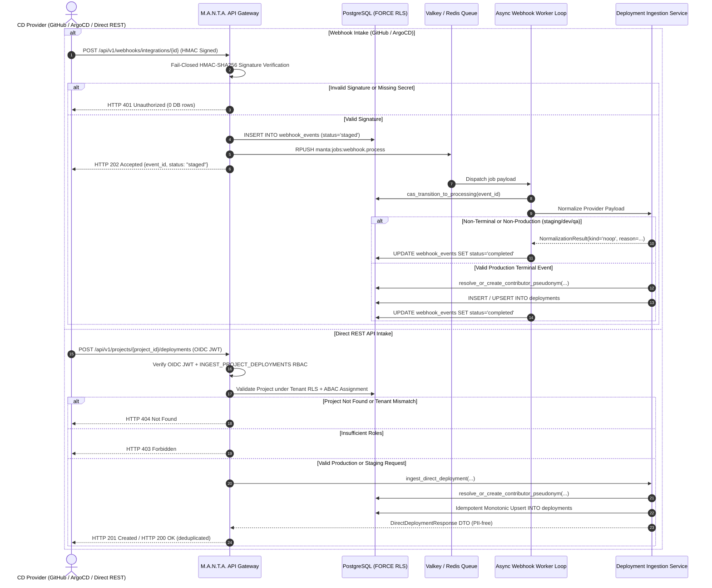

# US-25: Production Deployment Ingestion Across GitHub Deployments, ArgoCD PostSync & Direct API Test Scenarios

**Task:** `SCRUM-431` (`Task 25.5`: Create test scenarios for all 3 deployment signals, FAILED/ROLLED_BACK outcomes and staging exclusion)  
**Parent User Story:** `SCRUM-362` (`US-25`: Unified Production Deployment Ingestion)  
**Related Tickets:**  
- `SCRUM-427`: Design production deployment ingestion pipeline and outcome mapping specification (`Task 25.1`, [`docs/deployment-ingestion-pipeline.md`](../../docs/deployment-ingestion-pipeline.md))  
- `SCRUM-428`: Database migration and models for deployments schema extensions and relaxed commit FK (`Task 25.2`, [`backend/migrations/versions/c7f4e9b2a1d8_extend_deployments_us25.py`](../migrations/versions/c7f4e9b2a1d8_extend_deployments_us25.py))  
- `SCRUM-429`: Implement GitHub `deployment_status` and ArgoCD `PostSync` webhook ingestion and worker normalization (`Task 25.3`, [`backend/app/webhooks/processor.py`](../app/webhooks/processor.py))  
- `SCRUM-430`: Implement direct deployment REST ingestion endpoint with RBAC/ABAC and actor pseudonymization (`Task 25.4`, [`backend/app/deployments/router.py`](../app/deployments/router.py), [`backend/app/deployments/service.py`](../app/deployments/service.py))  
- `SCRUM-432`: Automated integration test suite for production deployment ingestion across all 3 signals (`Task 25.6`, [`backend/tests/test_us25_deployment_ingestion_integration.py`](test_us25_deployment_ingestion_integration.py))  
- `SCRUM-384`: Deployment signal selection persistence and DORA response reporting (`US-18` / `Task 18.4`, [`docs/deployment-signal-selection-persistence-and-dora-response-reporting-test-scenarios.md`](../../docs/deployment-signal-selection-persistence-and-dora-response-reporting-test-scenarios.md))  
- `SCRUM-374`: Contributor PII isolation and cryptographic pseudonymization (`Task 20.3`, [`docs/contributor-pii-isolation-and-pseudonymization.md`](../../docs/contributor-pii-isolation-and-pseudonymization.md))  
- `SCRUM-439` / `SCRUM-442`: DORA Deployment Frequency & Change Failure Rate metric calculation engines (`US-26` / `US-27` / `US-28`)  

**Target Storage Engine:** PostgreSQL 16 with Row-Level Security (`pgvector/pgvector:pg16`) & Valkey 7 / Redis 7+  
**Target Implementation Modules:** [`backend/app/deployments/`](../app/deployments/), [`backend/app/webhooks/`](../app/webhooks/), [`backend/app/contributors/`](../app/contributors/), [`backend/app/db/models/models.py`](../app/db/models/models.py)  
**Authoritative Automated Test Suites:** [`backend/tests/test_us25_deployment_ingestion_integration.py`](test_us25_deployment_ingestion_integration.py), [`backend/tests/test_us25_normalization_unit.py`](test_us25_normalization_unit.py)  
**Specification Location in Test Suite:** [`backend/tests/scenarios/test_us25_deployment_ingestion_scenarios.md`](test_us25_deployment_ingestion_scenarios.md)  
**Assignee:** Matvii Yeromenko  
**Category:** Testing - Design  
**Estimate:** 0.25 Story Points (0h 30m Original Estimate)  
**Status:** Approved / Verification Baseline Established  

---

## 1. Executive Summary & Objective

### 1.1 Objective

Establish the formal, authoritative verification scenarios and test specifications for **unified production deployment ingestion** across all three supported Continuous Delivery (CD) channels in the M.A.N.T.A. Engineering Intelligence Platform (`SCRUM-431` / `Task 25.5`):
1. **GitHub Deployments API Webhook** (`github_deployments_api`) via asynchronous `deployment_status` HMAC-SHA256 verified events.
2. **ArgoCD `PostSync` Webhook** (`argocd_postsync_webhook`) via fail-closed HMAC-SHA256 verified notification events.
3. **Direct Deployment REST API** (`direct_deployment_api`) via synchronous `POST /api/v1/projects/{project_id}/deployments` protected by OIDC RS256 JWT, dedicated RBAC permission `INGEST_PROJECT_DEPLOYMENTS`, and PostgreSQL tenant Row-Level Security (`FORCE ROW LEVEL SECURITY`).

### 1.2 Implementation Scope & Verification Invariants

This specification establishes exhaustive, step-by-step test scenarios verifying six mandatory functional capabilities and core architectural invariants:

1. **Tri-Signal Source Coverage:** Comprehensive end-to-end payload ingestion across `github_deployments_api`, `argocd_postsync_webhook`, and `direct_deployment_api`.
2. **Canonical Outcome Triad (`SUCCESS`, `FAILED`, `ROLLED_BACK`):** Strict mapping of heterogeneous provider states to canonical database enum values, ensuring `is_change_failure = True` for `FAILED` and `ROLLED_BACK`, and `is_change_failure = False` for `SUCCESS`. Non-terminal states (`pending`, `in_progress`, `Running`, `Progressing`) are acknowledged as NOOPs with zero inserted rows.
3. **Dual-Boundary Staging & Non-Production Exclusion:**
   - **Webhook Level:** Incoming webhooks for non-production environments (`staging`, `stage`, `stg`, `preprod`, `dev`, `qa`, `preview`, `pr-*`, `sandbox`) complete idempotently as `noop:non_production_environment:<env>` with 0 rows inserted into `deployments`.
   - **Direct REST API Level:** Direct API submissions for non-production environments are normalized and persisted with `is_production = False` to provide deterministic caller feedback, while the authoritative DORA production query boundary (`Deployment.environment == 'production'`) strictly excludes them from metric calculations.
4. **Non-Authoritative Signal Filtering:** Ingestion persists each deployment tagged with its source channel (`authoritative_signal_source`). Canonical DORA metric queries (`list_authoritative_production_deployments`) join against `projects` and strictly enforce `Deployment.authoritative_signal_source == Project.authoritative_cd_signal`, ensuring unselected signals never pollute DORA metrics while preserving historical fidelity if the project switches CD signals.
5. **GDPR Actor PII Isolation & Cryptographic Pseudonymization (Task 20.3):** Every identifiable deployment actor is resolved through `resolve_or_create_contributor_pseudonym(...)` within the tenant transaction. Only `actor_pseudonym_id` (`VARCHAR(64)` HMAC-SHA256 hash) is stored on `deployments`. Raw PII (`email`, `name`, `raw_handle`, `external_actor_id`) is stored exclusively in `contributors` under tenant RLS and is never leaked in API responses. Automated controller runs (e.g. ArgoCD `initiatedBy.automated = True`) safely set `actor_pseudonym_id = NULL`.
6. **Monotonic Idempotency & Out-of-Order Safety:** Duplicate deliveries and retries specifying `external_deployment_id` execute via PostgreSQL `ON CONFLICT ... DO UPDATE` guarded by `WHERE EXCLUDED.deployed_at >= deployments.deployed_at`, preventing stale out-of-order deliveries from overwriting newer release states.
7. **Out-of-Order Commit SHA Safety:** Relaxed foreign key constraint (`idx_deployments_tenant_commit_sha`) allows deployments to be recorded prior to asynchronous git repository commit syncing without foreign key constraint violations or synthetic commit stubs.

---

## 2. Core Architectural Invariants & Mathematical Formulations

```
+-------------------------------------------------------------------------------------------------------------------+
|                        UNIFIED PRODUCTION DEPLOYMENT INGESTION TOPOLOGY (US-25)                                   |
+-------------------------------------+-------------------------------------+---------------------------------------+
| 1. Tri-Signal Intake Channels       | 2. Canonical Status Normalization   | 3. Environment Filtering Boundary     |
|    (DeploymentSignalSource)         |    (DeploymentOutcome)              |    (normalize_environment)            |
+-------------------------------------+-------------------------------------+---------------------------------------+
| * github_deployments_api (Webhook)  | * SUCCESS       -> is_change_fail=F | * Exact Prod: {prod,production,prd,   |
| * argocd_postsync_webhook (Webhook) | * FAILED        -> is_change_fail=T |   live} -> ('production', True)       |
| * direct_deployment_api (REST API)  | * ROLLED_BACK   -> is_change_fail=T | * Staging/Dev/QA/Preview -> is_prod=F |
| * Non-terminal states -> 0 DB rows  | * ck_deployments_status CHECK       | * Webhook: Skip non-prod (0 rows)     |
| * Fail-closed HMAC-SHA256 on hooks  | * ck_deployments_signal_source      | * Direct: Persist, filter from DORA   |
+-------------------------------------+-------------------------------------+---------------------------------------+
                                                         |
                                                         v
+-------------------------------------------------------------------------------------------------------------------+
|                            DORA QUERY BOUNDARY, PRIVACY & CONCURRENCY INVARIANTS                                  |
+----------------------------------------------------+--------------------------------------------------------------+
| 4. Authoritative DORA Filter Invariant             | 5. GDPR Pseudonymization & Idempotency                       |
+----------------------------------------------------+--------------------------------------------------------------+
| * WHERE environment = 'production'                 | * resolve_or_create_contributor_pseudonym (Task 20.3)        |
| * AND authoritative_signal_source = project.signal | * deployments.actor_pseudonym_id = SHA256 HMAC (64 hex)      |
| * AND project.deleted_at IS NULL                   | * deployments.triggered_by = NULL (prevents M2M FK trap)     |
| * Uses idx_deployments_project_env_deployed_at     | * Monotonic upsert: EXCLUDED.deployed_at >= deployments.at   |
+----------------------------------------------------+--------------------------------------------------------------+
```

### Invariant 1: Tri-Signal Normalization & Channel Integrity
Every persisted deployment row records its originating signal source via the canonical PostgreSQL constraint `ck_deployments_signal_source`:
$$\text{authoritative\_signal\_source} \in \{\text{'github\_deployments\_api'}, \text{'argocd\_postsync\_webhook'}, \text{'direct\_deployment\_api'}\}$$
Any attempt to insert an unrecognized signal source (e.g. `'jenkins'`, `'gitlab'`, `'circleci'`) is immediately rejected by the database.

### Invariant 2: Canonical Outcome Triad & Change Failure Formulation
The platform normalizes all vendor-specific statuses into three terminal canonical outcomes:
$$\text{status} \in \{\text{'SUCCESS'}, \text{'FAILED'}, \text{'ROLLED\_BACK'}\}$$

The change failure predicate $C(d)$ is deterministic:
$$C(d) = \begin{cases} 
\mathbf{FALSE}, & \text{if } \text{status} = \text{'SUCCESS'} \\
\mathbf{TRUE}, & \text{if } \text{status} \in \{\text{'FAILED'}, \text{'ROLLED\_BACK'}\}
\end{cases}$$

This guarantees that both outright deployment pipeline failures and emergency rollbacks increment the failure numerator for DORA Change Failure Rate (US-27) and initiate recovery tracking for DORA Mean Time to Restore (US-28).

### Invariant 3: Environment Normalization & Staging Partitioning
Environment strings are normalized through canonical token sets:
- **Production Tokens ($\mathcal{E}_{\text{prod}}$):** `{"production", "prod", "prd", "live"}` $\longrightarrow$ `("production", True)`
- **Staging / Non-Production Tokens ($\mathcal{E}_{\text{non-prod}}$):** `{"staging", "stage", "stg", "preprod", "pre-prod", "uat", "dev", "development", "qa", "test", "preview"}` or prefixes `pr-`, `preview-`, `ephemeral-`, `sandbox` $\longrightarrow$ `(canonical_name, False)`
- **Compound Non-Production Guard:** Compound names containing "prod" as a substring (e.g. `"prod-staging"`, `"preprod"`, `"non-prod"`, `"prod-qa"`) evaluate strictly to `is_production = False`.

### Invariant 4: Authoritative DORA Metric Query Boundary
The canonical DORA dataset $\mathcal{D}^*_{\text{auth}}(P, \tau)$ for project $P$ in tenant $\tau$ across time window $[t_{\text{start}}, t_{\text{end}}]$ satisfies:
$$\mathcal{D}^*_{\text{auth}}(P, \tau) = \left\{ d \in \text{deployments} \ \middle|\ 
\begin{array}{l}
d.\text{tenant\_id} = \tau \ \land\ d.\text{project\_id} = P.\text{id} \ \land \\
d.\text{environment} = \text{'production'} \ \land \\
d.\text{authoritative\_signal\_source} = P.\text{authoritative\_cd\_signal} \ \land \\
P.\text{deleted\_at IS NULL} \ \land\ d.\text{deployed\_at} \in [t_{\text{start}}, t_{\text{end}}]
\end{array}
\right\}$$

Any deployment whose `authoritative_signal_source` does not equal `Project.authoritative_cd_signal` or whose `environment` is not `'production'` is strictly excluded from DORA metrics calculation.

### Invariant 5: GDPR Cryptographic Pseudonymization (Task 20.3)
Given deployer identity tuple $(\text{provider}, \text{external\_id}, \text{salt})$:
$$\text{pseudonym\_id} = \text{HMAC-SHA256}_{\text{salt}}(\text{provider} \mathbin{\Vert} \text{external\_id})$$
- Only `pseudonym_id` (`VARCHAR(64)`) is stored on `deployments.actor_pseudonym_id`.
- Foreign key constraint `fk_deployments_tenant_actor_pseudonym` links `(tenant_id, actor_pseudonym_id)` to `contributors(tenant_id, pseudonym_id)`.
- `Deployment.triggered_by` (`users.id` FK) remains `NULL` for all webhook and direct API ingestions, avoiding foreign key failures for M2M tokens without entries in the `users` table.

### Invariant 6: Monotonic Idempotent Upsert
For retried requests or duplicate webhook deliveries bearing `external_deployment_id`:
$$\text{UPSERT} \text{ guarded by } (\text{EXCLUDED}.\text{deployed\_at} \ge \text{deployments}.\text{deployed\_at})$$
If an older status event arrives out-of-order after a newer event has already been recorded, the database update is ignored, preserving the newer terminal state.

---

## 3. Relational Schemas, Constraints & Ingestion Flow State Machines

### 3.1 Relational Schema Definitions

```sql
-- Canonical Deployments Table (Protected by FORCE ROW LEVEL SECURITY)
CREATE TABLE IF NOT EXISTS deployments (
    id UUID PRIMARY KEY DEFAULT gen_random_uuid(),
    tenant_id UUID NOT NULL REFERENCES tenants(id) ON DELETE CASCADE,
    project_id UUID NOT NULL REFERENCES projects(id) ON DELETE CASCADE,
    repository_id UUID REFERENCES repositories(id) ON DELETE CASCADE,
    integration_id UUID REFERENCES integrations(id) ON DELETE SET NULL,
    triggered_by UUID REFERENCES users(id) ON DELETE SET NULL,
    actor_pseudonym_id VARCHAR(64),
    external_deployment_id VARCHAR(128),
    environment VARCHAR(32) NOT NULL,
    commit_sha VARCHAR(40) NOT NULL,
    status VARCHAR(32) NOT NULL,
    is_change_failure BOOLEAN NOT NULL DEFAULT FALSE,
    authoritative_signal_source VARCHAR(64) NOT NULL DEFAULT 'github_deployments_api',
    deployed_at TIMESTAMPTZ NOT NULL,
    lead_time_seconds NUMERIC(12, 2),
    created_at TIMESTAMPTZ NOT NULL DEFAULT NOW(),
    
    -- Constraints & Indexes
    CONSTRAINT ck_deployments_status CHECK (status IN ('SUCCESS', 'FAILED', 'ROLLED_BACK')),
    CONSTRAINT ck_deployments_signal_source CHECK (authoritative_signal_source IN (
        'github_deployments_api', 'argocd_postsync_webhook', 'direct_deployment_api'
    )),
    CONSTRAINT fk_deployments_tenant_actor_pseudonym FOREIGN KEY (tenant_id, actor_pseudonym_id)
        REFERENCES contributors(tenant_id, pseudonym_id) ON DELETE RESTRICT
);

-- Core Performance & Idempotency Indexes
CREATE INDEX IF NOT EXISTS idx_deployments_tenant_id ON deployments(tenant_id);
CREATE INDEX IF NOT EXISTS idx_deployments_project_env_deployed_at 
    ON deployments(project_id, environment, deployed_at DESC);
CREATE UNIQUE INDEX IF NOT EXISTS uq_deployments_tenant_proj_source_ext_id 
    ON deployments(tenant_id, project_id, authoritative_signal_source, external_deployment_id)
    WHERE external_deployment_id IS NOT NULL;
CREATE INDEX IF NOT EXISTS idx_deployments_tenant_commit_sha 
    ON deployments(tenant_id, commit_sha);

-- Contributors Table (Task 20.3 PII Isolation)
CREATE TABLE IF NOT EXISTS contributors (
    pseudonym_id VARCHAR(64) NOT NULL,
    tenant_id UUID NOT NULL REFERENCES tenants(id) ON DELETE CASCADE,
    provider VARCHAR(32) NOT NULL,
    external_actor_id VARCHAR(128) NOT NULL,
    raw_name TEXT,
    raw_email TEXT,
    raw_handle VARCHAR(255),
    salt_secret TEXT NOT NULL,
    is_erased BOOLEAN NOT NULL DEFAULT FALSE,
    erased_at TIMESTAMPTZ,
    created_at TIMESTAMPTZ NOT NULL DEFAULT NOW(),
    updated_at TIMESTAMPTZ NOT NULL DEFAULT NOW(),
    PRIMARY KEY (pseudonym_id, tenant_id),
    CONSTRAINT uq_contributors_tenant_provider_actor UNIQUE (tenant_id, provider, external_actor_id)
);
```

### 3.2 Ingestion Flow Architecture & Webhook Staging Lifecycle



### 3.3 Provider State Transition & Normalization Matrix

| Provider Channel | Inbound Event / State | Normalization Condition | Canonical Outcome | `is_change_failure` | Ingestion Action |
| :--- | :--- | :--- | :--- | :--- | :--- |
| **GitHub** | `state = "success"` | `environment` resolves to production | `SUCCESS` | `False` | Persist `Deployment` row |
| **GitHub** | `state = "failure"` / `"error"` | `environment` resolves to production | `FAILED` | `True` | Persist `Deployment` row |
| **GitHub** | `state = "inactive"` | Explicit rollback cue in payload/description | `ROLLED_BACK` | `True` | Persist `Deployment` row |
| **GitHub** | `state = "inactive"` | Superseded release without rollback cue | None | None | **NOOP** (`noop:superseded_inactive`) |
| **GitHub** | `state = "pending"` / `"queued"` / `"in_progress"` | Non-terminal intermediate progress | None | None | **NOOP** (`noop:non_terminal_state`) |
| **GitHub** | Any state | `environment` resolves to staging/dev/qa/preview | None | None | **NOOP** (`noop:non_production_environment`) |
| **ArgoCD** | `phase = "Succeeded"` / `status = "Synced"` | `health.status in {"Healthy", None}` & prod env | `SUCCESS` | `False` | Persist `Deployment` row |
| **ArgoCD** | `phase in {"Failed", "Error"}` | Any health status & prod env | `FAILED` | `True` | Persist `Deployment` row |
| **ArgoCD** | `health.status in {"Degraded", "Missing", "Suspended"}` | Any phase & prod env | `FAILED` | `True` | Persist `Deployment` row |
| **ArgoCD** | `outcome = "ROLLED_BACK"` / `action = "rollback"` | Rollback cue or boolean flag & prod env | `ROLLED_BACK` | `True` | Persist `Deployment` row |
| **ArgoCD** | `phase in {"Running", "Terminating"}` | Non-terminal operation | None | None | **NOOP** (`noop:non_terminal_phase`) |
| **ArgoCD** | `health.status = "Progressing"` | Non-terminal sync | None | None | **NOOP** (`noop:non_terminal_health`) |
| **ArgoCD** | `hookType = "PreSync"` | Pre-synchronization hook | None | None | **NOOP** (`noop:ignored_argocd_hook`) |
| **ArgoCD** | Any state | `environment` resolves to staging/dev/qa/preview | None | None | **NOOP** (`noop:non_production_environment`) |
| **Direct REST** | `outcome = "SUCCESS"` | `environment` resolves to production | `SUCCESS` | `False` | Persist `Deployment` (`is_prod=True`) |
| **Direct REST** | `outcome = "FAILED"` | `environment` resolves to production | `FAILED` | `True` | Persist `Deployment` (`is_prod=True`) |
| **Direct REST** | `outcome = "ROLLED_BACK"` | `environment` resolves to production | `ROLLED_BACK` | `True` | Persist `Deployment` (`is_prod=True`) |
| **Direct REST** | Any valid outcome | `environment` resolves to staging/dev/qa | Valid enum | Matches status | Persist `Deployment` (`is_prod=False`, excluded from DORA queries) |

---

## 4. Complete Test Scenario Traceability Matrix

| Test Scenario ID | Primary Domain / Channel | Scenario Description | Expected Outcome | Target Acceptance Criteria |
| :--- | :--- | :--- | :--- | :--- |
| `TC-DEP-GH-001` | GitHub Deployments | Production release succeeded | `status='SUCCESS'`, `is_change_failure=False` | Signal 1 SUCCESS, Actor PII Pseudonymized |
| `TC-DEP-GH-002` | GitHub Deployments | Production release failed/errored | `status='FAILED'`, `is_change_failure=True` | Signal 1 FAILED outcome |
| `TC-DEP-GH-003` | GitHub Deployments | Production deployment rolled back | `status='ROLLED_BACK'`, `is_change_failure=True` | Signal 1 ROLLED_BACK outcome |
| `TC-DEP-GH-004` | GitHub Deployments | Superseded inactive state | NOOP (`noop:superseded_inactive`, 0 rows) | Superceded release exclusion |
| `TC-DEP-GH-005` | GitHub Deployments | Non-terminal state (`in_progress`) | NOOP (`noop:non_terminal_state`, 0 rows) | Non-terminal state exclusion |
| `TC-DEP-GH-006` | GitHub Deployments | Staging environment release | NOOP (`noop:non_production_environment`, 0 rows) | Webhook staging exclusion |
| `TC-DEP-GH-007` | GitHub Deployments | Unlinked repository delivery | NOOP (`noop:unlinked_github_repository`, 0 rows) | Unlinked repo handling |
| `TC-DEP-ARGO-001`| ArgoCD PostSync | Production PostSync succeeded | `status='SUCCESS'`, `is_change_failure=False` | Signal 2 SUCCESS outcome |
| `TC-DEP-ARGO-002`| ArgoCD PostSync | Production PostSync failed / degraded | `status='FAILED'`, `is_change_failure=True` | Signal 2 FAILED outcome |
| `TC-DEP-ARGO-003`| ArgoCD PostSync | Production release rolled back | `status='ROLLED_BACK'`, `is_change_failure=True` | Signal 2 ROLLED_BACK outcome |
| `TC-DEP-ARGO-004`| ArgoCD PostSync | Automated sync controller actor | `status='SUCCESS'`, `actor_pseudonym_id=NULL` | Automated actor handling |
| `TC-DEP-ARGO-005`| ArgoCD PostSync | Non-terminal phase / progressing health | NOOP (`noop:non_terminal_phase`, 0 rows) | Non-terminal ArgoCD exclusion |
| `TC-DEP-ARGO-006`| ArgoCD PostSync | PreSync hook event | NOOP (`noop:ignored_argocd_hook`, 0 rows) | PreSync hook skip |
| `TC-DEP-ARGO-007`| ArgoCD PostSync | Staging environment release | NOOP (`noop:non_production_environment`, 0 rows) | ArgoCD staging exclusion |
| `TC-DEP-ARGO-008`| ArgoCD PostSync | Missing or invalid HMAC signature | HTTP 401 Unauthorized (0 rows) | Fail-closed webhook security |
| `TC-DEP-ARGO-009`| ArgoCD PostSync | Deterministic project resolution | Resolves via ProjectLink / UUID / Slug / Git URL | Multi-strategy project mapping |
| `TC-DEP-DIR-001` | Direct REST API | Direct production ingest SUCCESS | HTTP 201, `status='SUCCESS'`, `is_prod=True` | Signal 3 SUCCESS, Actor PII Pseudonymized |
| `TC-DEP-DIR-002` | Direct REST API | Direct production ingest FAILED | HTTP 201, `status='FAILED'`, `is_change_failure=True` | Signal 3 FAILED outcome |
| `TC-DEP-DIR-003` | Direct REST API | Direct production ingest ROLLED_BACK | HTTP 201, `status='ROLLED_BACK'`, `is_change_fail=True` | Signal 3 ROLLED_BACK outcome |
| `TC-DEP-DIR-004` | Direct REST API | Staging submission & DORA query boundary | HTTP 201 (`is_prod=False`), Excluded from DORA | Direct API staging exclusion |
| `TC-DEP-DIR-005` | Direct REST API | Idempotent duplicate & monotonic guard | HTTP 200 (`deduplicated=True`), Stale rejected | Monotonic idempotency |
| `TC-DEP-DIR-006` | Direct REST API | RBAC & ABAC permission enforcement | 401 unauth, 403 non-admin role / unassigned member | RBAC/ABAC security |
| `TC-DEP-DIR-007` | Direct REST API | Tenant boundary RLS isolation | HTTP 404 Not Found on cross-tenant project | Multi-tenant RLS anti-enumeration |
| `TC-DEP-DIR-008` | Direct REST API | Input validation & rejection | HTTP 422 on invalid SHA / blank env / naive time | Schema input validation |
| `TC-DEP-DORA-001`| DORA Metrics | Multi-signal non-authoritative filtering | Authoritative query excludes unselected signals | Non-authoritative signal filtering |
| `TC-DEP-DORA-002`| DORA Metrics | Authoritative signal source switch | Query dynamically reflects updated signal | Dynamic signal reconfiguration |
| `TC-DEP-PRIV-001`| GDPR Privacy | Deployer PII isolation & zero leaks | Zero raw PII in `deployments` or API DTOs | GDPR PII compliance |
| `TC-DEP-PRIV-002`| GDPR Privacy | Concurrent actor resolution race | Transactional SAVEPOINT handles race cleanly | Concurrent pseudonymization |
| `TC-DEP-ORD-001` | Out-of-Order | Deployment arrives before commit synced | Relaxed FK persists deployment cleanly | Out-of-order commit SHA |
| `TC-DEP-ORD-002` | DB Constraints | Invalid status enum rejection | PostgreSQL raises IntegrityError (CheckConstraint) | DB constraint enforcement |

---

## 5. Exhaustive Test Scenario Specifications

### 5.1 Signal 1: GitHub Deployments API (`github_deployments_api`)

#### Scenario `TC-DEP-GH-001`: GitHub Production Deployment SUCCESS
- **Objective:** Verify that a valid GitHub `deployment_status` webhook with `state = "success"` and a production environment normalizes to `DeploymentOutcome.SUCCESS`, sets `is_change_failure = False`, creates a 64-character contributor pseudonym, and persists a production `Deployment` row within tenant RLS.
- **Traceability:** `US-25` Scope #1, `SCRUM-431`, SRS §2.4.2, §3.2.1.
- **Preconditions:** Active tenant `T1`, active project `P1` with `authoritative_cd_signal = 'github_deployments_api'`, linked repository `acme/web-service` (`external_repo_id = 10101`).

##### Sample GitHub Inbound Payload (`deployment_status`)
```json
{
  "deployment_status": {
    "id": 900101,
    "state": "success",
    "environment": "production",
    "description": "Deployment finished successfully via GitHub Actions",
    "created_at": "2026-11-13T10:00:00Z",
    "updated_at": "2026-11-13T10:02:15Z",
    "creator": {
      "id": 48192,
      "login": "octocat-deployer",
      "email": "octocat@acme.com"
    }
  },
  "deployment": {
    "id": 800101,
    "sha": "a1b2c3d4e5f6a1b2c3d4e5f6a1b2c3d4e5f6a1b2",
    "environment": "production",
    "ref": "main",
    "created_at": "2026-11-13T09:58:00Z"
  },
  "repository": {
    "id": 10101,
    "name": "web-service",
    "full_name": "acme/web-service"
  },
  "sender": {
    "id": 48192,
    "login": "octocat-deployer"
  }
}
```

##### Inbound HTTP Headers
```http
POST /api/v1/webhooks/integrations/77f98c80-6058-4a90-84cf-f2187f4c9c10 HTTP/1.1
Host: api.manta.internal
Content-Type: application/json
X-GitHub-Event: deployment_status
X-GitHub-Delivery: a68b753f-7622-4a0f-90e8-0b5cbe273188
X-Hub-Signature-256: sha256=5f2d0113c19e64e9a3b83b3f2762a4d33a5d8e78550186178877bc95fbe8d523
```

##### Execution Sequence
1. Webhook intake gateway verifies `X-Hub-Signature-256` against decrypted integration secret.
2. Gateway stages event into `webhook_events` (`status = 'staged'`) and returns `HTTP 202 Accepted`.
3. Worker claims event via `cas_transition_to_processing` under `get_tenant_db_context(T1)`.
4. Normalizer extracts `commit_sha = "a1b2c3d4e5f6a1b2c3d4e5f6a1b2c3d4e5f6a1b2"`, canonicalizes `environment = "production"`, maps `state="success"` to `DeploymentOutcome.SUCCESS`.
5. Resolves project `P1` and repository `R1` via `external_repo_id = 10101`.
6. Resolves deployer `creator.id = 48192` via `resolve_or_create_contributor_pseudonym(...)`.
7. Upserts row into `deployments` with `authoritative_signal_source = 'github_deployments_api'`.
8. Marks `webhook_events` as `completed`.

##### Expected Database States
```sql
SELECT environment, commit_sha, status, is_change_failure, 
       authoritative_signal_source, actor_pseudonym_id, external_deployment_id, deployed_at
FROM deployments 
WHERE external_deployment_id = 'gh:800101';
```
| environment | commit_sha | status | is_change_failure | authoritative_signal_source | actor_pseudonym_id | external_deployment_id | deployed_at |
| :--- | :--- | :--- | :--- | :--- | :--- | :--- | :--- |
| `production` | `a1b2c3d4e5f6a1b2c3d4e5f6a1b2c3d4e5f6a1b2` | `SUCCESS` | `false` | `github_deployments_api` | `3d4f8a...` (64 hex) | `gh:800101` | `2026-11-13 10:02:15+00` |

```sql
SELECT provider, external_actor_id, raw_handle, is_erased
FROM contributors 
WHERE pseudonym_id = '3d4f8a...';
```
| provider | external_actor_id | raw_handle | is_erased |
| :--- | :--- | :--- | :--- |
| `github` | `48192` | `octocat-deployer` | `false` |

##### Verification Assertions
```python
assert deployment.status == "SUCCESS"
assert deployment.is_change_failure is False
assert deployment.environment == "production"
assert deployment.authoritative_signal_source == "github_deployments_api"
assert deployment.external_deployment_id == "gh:800101"
assert len(deployment.actor_pseudonym_id) == 64
assert deployment.triggered_by is None
```

---

#### Scenario `TC-DEP-GH-002`: GitHub Production Deployment FAILED
- **Objective:** Verify that a GitHub deployment failure (`state = "failure"` or `"error"`) records canonical `status = 'FAILED'`, sets `is_change_failure = True`, and participates in DORA Change Failure Rate tracking.
- **Traceability:** `US-25` Scope #2, `SCRUM-431`, SRS §3.2.11.
- **Sample Inbound Payload Snippet:**
```json
{
  "deployment_status": {
    "id": 900102,
    "state": "failure",
    "environment": "prod",
    "description": "Health checks failed: container crashing with SIGSEGV",
    "updated_at": "2026-11-13T10:15:00Z",
    "creator": { "id": 48192, "login": "octocat-deployer" }
  },
  "deployment": {
    "id": 800102,
    "sha": "b2c3d4e5f6a1b2c3d4e5f6a1b2c3d4e5f6a1b2c3",
    "environment": "prod"
  },
  "repository": { "id": 10101, "full_name": "acme/web-service" }
}
```
##### Expected Database Row (`deployments`)
| environment | commit_sha | status | is_change_failure | authoritative_signal_source | external_deployment_id |
| :--- | :--- | :--- | :--- | :--- | :--- |
| `production` | `b2c3d4e5f6a1b2c3d4e5f6a1b2c3d4e5f6a1b2c3` | `FAILED` | `true` | `github_deployments_api` | `gh:800102` |

##### Verification Assertions
```python
assert deployment.status == "FAILED"
assert deployment.is_change_failure is True
assert deployment.environment == "production"
```

---

#### Scenario `TC-DEP-GH-003`: GitHub Production Deployment ROLLED_BACK (Explicit Rollback Cue)
- **Objective:** Verify that an `inactive` deployment event with explicit rollback cues (e.g. `payload.rollback = True` or `"Rolled back"` in description) is normalized to `DeploymentOutcome.ROLLED_BACK` with `is_change_failure = True`.
- **Traceability:** `US-25` Scope #2, `SCRUM-431`, SRS §3.2.11.
- **Sample Inbound Payload Snippet:**
```json
{
  "deployment_status": {
    "id": 900103,
    "state": "inactive",
    "environment": "production",
    "description": "Rolled back production traffic to stable release v2.4.0",
    "updated_at": "2026-11-13T10:30:00Z",
    "creator": { "id": 48192, "login": "octocat-deployer" }
  },
  "deployment": {
    "id": 800103,
    "sha": "c3d4e5f6a1b2c3d4e5f6a1b2c3d4e5f6a1b2c3d4",
    "environment": "production",
    "payload": { "rollback": true, "previous_release": "v2.4.0" }
  },
  "repository": { "id": 10101, "full_name": "acme/web-service" }
}
```
##### Expected Database Row (`deployments`)
| environment | commit_sha | status | is_change_failure | authoritative_signal_source | external_deployment_id |
| :--- | :--- | :--- | :--- | :--- | :--- |
| `production` | `c3d4e5f6a1b2c3d4e5f6a1b2c3d4e5f6a1b2c3d4` | `ROLLED_BACK` | `true` | `github_deployments_api` | `gh:800103` |

##### Verification Assertions
```python
assert deployment.status == "ROLLED_BACK"
assert deployment.is_change_failure is True
```

---

#### Scenario `TC-DEP-GH-004`: GitHub Superseded Inactive Deployment (NOOP Exclusion)
- **Objective:** Verify that standard GitHub superseded deployments (`state = "inactive"` emitted automatically by GitHub's `auto_inactive: true`) without rollback cues are acknowledged as NOOPs and insert 0 rows into `deployments`.
- **Traceability:** `US-25` Scope #2, `SCRUM-431`.
- **Sample Inbound Payload Snippet:**
```json
{
  "deployment_status": {
    "id": 900104,
    "state": "inactive",
    "environment": "production",
    "description": "Deployment superseded by newer release",
    "updated_at": "2026-11-13T10:45:00Z"
  },
  "deployment": {
    "id": 800104,
    "sha": "d4e5f6a1b2c3d4e5f6a1b2c3d4e5f6a1b2c3d4e5",
    "environment": "production"
  },
  "repository": { "id": 10101, "full_name": "acme/web-service" }
}
```
##### Expected Database States
```sql
SELECT COUNT(*) FROM deployments WHERE external_deployment_id = 'gh:800104';
-- Returns 0
SELECT status, error_detail FROM webhook_events WHERE id = :event_id;
-- status: 'completed', error_detail: NULL
```

---

#### Scenario `TC-DEP-GH-005`: GitHub Non-Terminal States (NOOP Exclusion)
- **Objective:** Verify that intermediate non-terminal states (`pending`, `queued`, `in_progress`, `waiting`, `requested`) complete cleanly as NOOPs without inserting partial or ghost deployment records.
- **Traceability:** `US-25` Scope #2, `SCRUM-431`.
- **Sample State Matrix Tested:**
  - `state = "pending"` $\longrightarrow$ `NormalizationResult(kind="noop", reason="non_terminal_state:pending")`
  - `state = "in_progress"` $\longrightarrow$ `NormalizationResult(kind="noop", reason="non_terminal_state:in_progress")`
  - `state = "queued"` $\longrightarrow$ `NormalizationResult(kind="noop", reason="non_terminal_state:queued")`
##### Expected Database States
- `deployments` rows created: **0**.
- `webhook_events.status`: `'completed'`.

---

#### Scenario `TC-DEP-GH-006`: GitHub Staging Environment Exclusion (NOOP Non-Production)
- **Objective:** Verify that deployment events targeting non-production environments (`staging`, `stage`, `stg`, `preprod`, `dev`, `qa`, `preview`, `pr-99`) are acknowledged cleanly as NOOPs and excluded from `deployments`.
- **Traceability:** `US-25` Scope #3, `SCRUM-431`, SRS §2.4.2.
- **Sample Inbound Payload Snippet:**
```json
{
  "deployment_status": {
    "id": 900106,
    "state": "success",
    "environment": "staging",
    "updated_at": "2026-11-13T11:00:00Z"
  },
  "deployment": {
    "id": 800106,
    "sha": "e5f6a1b2c3d4e5f6a1b2c3d4e5f6a1b2c3d4e5f6",
    "environment": "staging"
  },
  "repository": { "id": 10101, "full_name": "acme/web-service" }
}
```
##### Expected Database States
- `deployments` rows created: **0**.
- Worker log: `"noop:non_production_environment:staging"`.

---

#### Scenario `TC-DEP-GH-007`: GitHub Unlinked Repository (Graceful NOOP)
- **Objective:** Verify that incoming deployment events for unlinked repositories within the tenant complete cleanly as NOOPs without throwing unhandled exceptions or causing Valkey retry storms.
- **Traceability:** `US-25` Scope #1, `SCRUM-431`.
- **Expected Database States:**
  - `webhook_events.status`: `'completed'`.
  - Worker return string: `"noop:unlinked_github_repository"`.
  - `deployments` rows inserted: **0**.

---

### 5.2 Signal 2: ArgoCD `PostSync` Webhook (`argocd_postsync_webhook`)

#### Scenario `TC-DEP-ARGO-001`: ArgoCD PostSync Production SUCCESS
- **Objective:** Verify that an ArgoCD `PostSync` webhook indicating `phase = "Succeeded"` and `health.status = "Healthy"` normalizes to `DeploymentOutcome.SUCCESS`, sets `is_change_failure = False`, pseudonymizes the initiating username, and records an authoritative ArgoCD deployment.
- **Traceability:** `US-25` Scope #1, `SCRUM-431`, SRS §3.1.4, §3.2.2.
- **Preconditions:** Active tenant `T1`, active project `P1` with `authoritative_cd_signal = 'argocd_postsync_webhook'`, `ProjectLink` binding `external_id = 'cart-service-prod'` to `P1`.

##### Sample ArgoCD Inbound Payload
```json
{
  "hookType": "PostSync",
  "app": {
    "metadata": {
      "name": "cart-service-prod",
      "labels": {
        "app.kubernetes.io/name": "cart-service",
        "environment": "prod",
        "manta.project_id": "88e7a1b2-1234-4567-89ab-cdef01234567"
      }
    },
    "spec": {
      "destination": {
        "namespace": "production",
        "server": "https://kubernetes.default.svc"
      },
      "source": {
        "repoURL": "https://github.com/acme/cart-service.git",
        "targetRevision": "main"
      }
    },
    "status": {
      "health": {
        "status": "Healthy"
      },
      "operationState": {
        "phase": "Succeeded",
        "startedAt": "2026-11-13T11:10:00Z",
        "finishedAt": "2026-11-13T11:12:30Z",
        "syncResult": {
          "revision": "f6a1b2c3d4e5f6a1b2c3d4e5f6a1b2c3d4e5f6a1"
        },
        "operation": {
          "initiatedBy": {
            "username": "sre-lead@acme.com"
          }
        }
      }
    }
  }
}
```

##### Inbound HTTP Headers
```http
POST /api/v1/webhooks/integrations/99e8b7a1-5047-4b80-93be-e1076e3b8b09 HTTP/1.1
Host: api.manta.internal
Content-Type: application/json
X-ArgoCD-Event: postsync
X-ArgoCD-Delivery: argo-deliv-77182901
X-ArgoCD-Signature: sha256=a7b8c9d0e1f2a3b4c5d6e7f8a9b0c1d2e3f4a5b6c7d8e9f0a1b2c3d4e5f6a7b8
```

##### Expected Database States
```sql
SELECT environment, commit_sha, status, is_change_failure, 
       authoritative_signal_source, actor_pseudonym_id, deployed_at
FROM deployments 
WHERE commit_sha = 'f6a1b2c3d4e5f6a1b2c3d4e5f6a1b2c3d4e5f6a1';
```
| environment | commit_sha | status | is_change_failure | authoritative_signal_source | actor_pseudonym_id | deployed_at |
| :--- | :--- | :--- | :--- | :--- | :--- | :--- |
| `production` | `f6a1b2c3d4e5f6a1b2c3d4e5f6a1b2c3d4e5f6a1` | `SUCCESS` | `false` | `argocd_postsync_webhook` | `5e9b1a...` (64 hex) | `2026-11-13 11:12:30+00` |

##### Verification Assertions
```python
assert deployment.status == "SUCCESS"
assert deployment.is_change_failure is False
assert deployment.authoritative_signal_source == "argocd_postsync_webhook"
assert deployment.environment == "production"
assert deployment.actor_pseudonym_id is not None
```

---

#### Scenario `TC-DEP-ARGO-002`: ArgoCD PostSync Production FAILED (Phase Failed or Health Degraded)
- **Objective:** Verify that an ArgoCD sync failure (`phase = "Failed"` / `"Error"`) or degraded application health (`health.status = "Degraded"` / `"Missing"`) normalizes to `status = 'FAILED'` and sets `is_change_failure = True`.
- **Traceability:** `US-25` Scope #2, `SCRUM-431`, SRS §3.2.11.
- **Sample Inbound Payload Snippet:**
```json
{
  "hookType": "PostSync",
  "app": {
    "metadata": { "name": "cart-service-prod", "labels": { "environment": "production" } },
    "status": {
      "health": { "status": "Degraded" },
      "operationState": {
        "phase": "Failed",
        "finishedAt": "2026-11-13T11:20:00Z",
        "syncResult": { "revision": "1a2b3c4d5e6f1a2b3c4d5e6f1a2b3c4d5e6f1a2b" },
        "operation": { "initiatedBy": { "username": "sre-lead@acme.com" } }
      }
    }
  }
}
```
##### Expected Database Row (`deployments`)
| environment | commit_sha | status | is_change_failure | authoritative_signal_source |
| :--- | :--- | :--- | :--- | :--- |
| `production` | `1a2b3c4d5e6f1a2b3c4d5e6f1a2b3c4d5e6f1a2b` | `FAILED` | `true` | `argocd_postsync_webhook` |

##### Verification Assertions
```python
assert deployment.status == "FAILED"
assert deployment.is_change_failure is True
```

---

#### Scenario `TC-DEP-ARGO-003`: ArgoCD PostSync Production ROLLED_BACK (Explicit Rollback)
- **Objective:** Verify that an ArgoCD event carrying explicit rollback indicators (`action = "rollback"`, `phase = "RolledBack"`, or `outcome = "ROLLED_BACK"`) maps directly to `DeploymentOutcome.ROLLED_BACK` with `is_change_failure = True`.
- **Traceability:** `US-25` Scope #2, `SCRUM-431`.
- **Sample Inbound Payload Snippet:**
```json
{
  "hookType": "PostSync",
  "outcome": "ROLLED_BACK",
  "action": "rollback",
  "app": {
    "metadata": { "name": "cart-service-prod", "labels": { "environment": "production" } },
    "status": {
      "health": { "status": "Healthy" },
      "operationState": {
        "phase": "RolledBack",
        "finishedAt": "2026-11-13T11:35:00Z",
        "syncResult": { "revision": "2b3c4d5e6f1a2b3c4d5e6f1a2b3c4d5e6f1a2b3c" }
      }
    }
  }
}
```
##### Expected Database Row (`deployments`)
| environment | commit_sha | status | is_change_failure | authoritative_signal_source |
| :--- | :--- | :--- | :--- | :--- |
| `production` | `2b3c4d5e6f1a2b3c4d5e6f1a2b3c4d5e6f1a2b3c` | `ROLLED_BACK` | `true` | `argocd_postsync_webhook` |

##### Verification Assertions
```python
assert deployment.status == "ROLLED_BACK"
assert deployment.is_change_failure is True
```

---

#### Scenario `TC-DEP-ARGO-004`: ArgoCD Automated Controller Deployment (Null Actor Pseudonym)
- **Objective:** Verify that an automated ArgoCD synchronization (`initiatedBy.automated = true` or absent username) safely sets `deployments.actor_pseudonym_id = NULL` rather than manufacturing a synthetic contributor record.
- **Traceability:** `US-25` Scope #5, `SCRUM-431`, SRS §3.1.4.
- **Sample Inbound Payload Snippet:**
```json
{
  "hookType": "PostSync",
  "app": {
    "metadata": { "name": "cart-service-prod", "labels": { "environment": "production" } },
    "status": {
      "health": { "status": "Healthy" },
      "operationState": {
        "phase": "Succeeded",
        "finishedAt": "2026-11-13T11:45:00Z",
        "syncResult": { "revision": "3c4d5e6f1a2b3c4d5e6f1a2b3c4d5e6f1a2b3c4d" },
        "operation": {
          "initiatedBy": { "automated": true }
        }
      }
    }
  }
}
```
##### Expected Database States
```sql
SELECT actor_pseudonym_id, triggered_by 
FROM deployments 
WHERE commit_sha = '3c4d5e6f1a2b3c4d5e6f1a2b3c4d5e6f1a2b3c4d';
```
| actor_pseudonym_id | triggered_by |
| :--- | :--- |
| `NULL` | `NULL` |

##### Verification Assertions
```python
assert deployment.actor_pseudonym_id is None
assert deployment.triggered_by is None
```

---

#### Scenario `TC-DEP-ARGO-005`: ArgoCD Non-Terminal Phase & Progressing Health (NOOP Exclusion)
- **Objective:** Verify that sync operations still executing (`phase = "Running"`) or workloads in transient transition (`health.status = "Progressing"`) are acknowledged as NOOPs without database inserts.
- **Traceability:** `US-25` Scope #2, `SCRUM-431`.
- **Sample State Matrix Tested:**
  - `phase = "Running"` $\longrightarrow$ `noop:non_terminal_phase:Running`
  - `phase = "Succeeded"`, `health.status = "Progressing"` $\longrightarrow$ `noop:non_terminal_health:Progressing`
##### Expected Database States
- `deployments` rows created: **0**.
- `webhook_events.status`: `'completed'`.

---

#### Scenario `TC-DEP-ARGO-006`: ArgoCD PreSync Hook Skip (NOOP Exclusion)
- **Objective:** Verify that ArgoCD lifecycle hooks that precede actual deployment execution (e.g. `hookType = "PreSync"`) are cleanly skipped.
- **Traceability:** `US-25` Scope #1, `SCRUM-431`.
- **Expected Database States:**
  - Worker outcome: `"noop:ignored_argocd_hook:PreSync"`.
  - `deployments` rows inserted: **0**.

---

#### Scenario `TC-DEP-ARGO-007`: ArgoCD Staging Environment Exclusion (NOOP Non-Production)
- **Objective:** Verify that ArgoCD notifications targeting non-production environments (e.g. `destination.namespace = "staging"`, `labels.environment = "uat"`) are acknowledged as NOOPs and excluded from `deployments`.
- **Traceability:** `US-25` Scope #3, `SCRUM-431`.
- **Sample Inbound Payload Snippet:**
```json
{
  "hookType": "PostSync",
  "app": {
    "metadata": { "name": "cart-service-stage", "labels": { "environment": "staging" } },
    "spec": { "destination": { "namespace": "staging" } },
    "status": {
      "health": { "status": "Healthy" },
      "operationState": {
        "phase": "Succeeded",
        "finishedAt": "2026-11-13T11:55:00Z",
        "syncResult": { "revision": "4d5e6f1a2b3c4d5e6f1a2b3c4d5e6f1a2b3c4d5e" }
      }
    }
  }
}
```
##### Expected Database States
- `deployments` rows created: **0**.
- Worker outcome: `"noop:non_production_environment:staging"`.

---

#### Scenario `TC-DEP-ARGO-008`: ArgoCD Fail-Closed Webhook Authentication (401 Unauthorized)
- **Objective:** Verify that ArgoCD webhooks lacking a configured secret, missing the `X-ArgoCD-Signature` header, or providing an invalid HMAC-SHA256 signature fail immediately with `HTTP 401 Unauthorized` and write zero database rows.
- **Traceability:** `US-25` Scope #1, `SCRUM-431`, SRS §3.1.4, §3.2.2.
- **Execution Request:**
```http
POST /api/v1/webhooks/argocd HTTP/1.1
Host: api.manta.internal
Content-Type: application/json
X-Tenant-ID: 77f98c80-6058-4a90-84cf-f2187f4c9c10

{"hookType": "PostSync", "phase": "Succeeded", "environment": "production"}
```
##### Expected HTTP & Database States
- **HTTP Status:** `401 Unauthorized`.
- **Rows in `webhook_events`:** **0**.
- **Rows in `deployments`:** **0**.

---

#### Scenario `TC-DEP-ARGO-009`: ArgoCD Deterministic Multi-Strategy Project Resolution
- **Objective:** Verify the deterministic multi-tier resolution strategy mapping an ArgoCD application payload to the active `Project.id` under tenant RLS:
  1. Priority 1: `ProjectLink(link_type='argocd_application', external_id=app_name)`.
  2. Priority 2: Explicit UUID annotation/label `manta.project_id` verified within tenant.
  3. Priority 3: Project slug label `manta.project_slug`.
  4. Priority 4: Git remote URL `app.spec.source.repoURL` matched against `Repository.full_name`.
- **Traceability:** `US-25` Scope #1, `SCRUM-431`.
- **Verification Assertions:**
```python
# Verified across all four resolution tiers returning exactly expected project_id
assert resolved_project_id == target_project.id
```

---

### 5.3 Signal 3: Direct Deployment REST API (`direct_deployment_api`)

#### Scenario `TC-DEP-DIR-001`: Direct REST Ingest Production SUCCESS
- **Objective:** Verify that a caller possessing the `INGEST_PROJECT_DEPLOYMENTS` permission can report a production deployment via `POST /api/v1/projects/{project_id}/deployments`, obtaining an `HTTP 201 Created` response with a pseudonymized actor and zero PII leakage.
- **Traceability:** `US-25` Scope #1 & #5, `SCRUM-431`, SRS §3.2.1, §3.2.3.
- **Preconditions:** Active tenant `T1`, project `P1` (`authoritative_cd_signal = 'direct_deployment_api'`), caller authenticated with `TENANT_ADMIN` role.

##### Sample Direct Ingest Request Payload
```json
{
  "commit_sha": "5e6f1a2b3c4d5e6f1a2b3c4d5e6f1a2b3c4d5e6f",
  "environment": "production",
  "outcome": "SUCCESS",
  "deployed_at": "2026-11-13T12:00:00Z",
  "external_deployment_id": "direct-run-8801",
  "actor": {
    "name": "Jane DevOps",
    "email": "jane.devops@acme.com",
    "handle": "janedev",
    "provider": "direct_deployment_api"
  }
}
```

##### Inbound HTTP Request
```http
POST /api/v1/projects/88e7a1b2-1234-4567-89ab-cdef01234567/deployments HTTP/1.1
Host: api.manta.internal
Authorization: Bearer <valid_oidc_jwt_with_TENANT_ADMIN>
Content-Type: application/json
```

##### Expected HTTP Response (`HTTP 201 Created`)
```json
{
  "id": "11223344-5566-7788-99aa-bbccddeeff00",
  "tenant_id": "77f98c80-6058-4a90-84cf-f2187f4c9c10",
  "project_id": "88e7a1b2-1234-4567-89ab-cdef01234567",
  "repository_id": null,
  "commit_sha": "5e6f1a2b3c4d5e6f1a2b3c4d5e6f1a2b3c4d5e6f",
  "environment": "production",
  "is_production": true,
  "status": "SUCCESS",
  "is_change_failure": false,
  "authoritative_signal_source": "direct_deployment_api",
  "is_authoritative_for_project": true,
  "actor_pseudonym_id": "9a8b7c6d5e4f3a2b1c0d9e8f7a6b5c4d3e2f1a0b9c8d7e6f5a4b3c2d1e0f9a8b",
  "external_deployment_id": "direct-run-8801",
  "deployed_at": "2026-11-13T12:00:00Z",
  "created_at": "2026-11-13T12:00:01.123456Z",
  "deduplicated": false
}
```

##### Expected Database Row (`deployments`)
```sql
SELECT environment, commit_sha, status, is_change_failure, 
       authoritative_signal_source, actor_pseudonym_id, external_deployment_id
FROM deployments 
WHERE id = '11223344-5566-7788-99aa-bbccddeeff00';
```
| environment | commit_sha | status | is_change_failure | authoritative_signal_source | actor_pseudonym_id | external_deployment_id |
| :--- | :--- | :--- | :--- | :--- | :--- | :--- |
| `production` | `5e6f1a2b3c4d5e6f1a2b3c4d5e6f1a2b3c4d5e6f` | `SUCCESS` | `false` | `direct_deployment_api` | `9a8b7c...` (64 hex) | `direct-run-8801` |

##### Verification Assertions
```python
assert response.status_code == 201
data = response.json()
assert data["status"] == "SUCCESS"
assert data["is_change_failure"] is False
assert data["is_production"] is True
assert data["authoritative_signal_source"] == "direct_deployment_api"
assert "jane.devops@acme.com" not in response.text
assert "Jane DevOps" not in response.text
```

---

#### Scenario `TC-DEP-DIR-002`: Direct REST Ingest Production FAILED
- **Objective:** Verify that reporting an `outcome = "FAILED"` via the Direct REST API records `status = 'FAILED'`, sets `is_change_failure = True`, and participates in Change Failure Rate analytics.
- **Traceability:** `US-25` Scope #2, `SCRUM-431`.
- **Sample Request Payload:**
```json
{
  "commit_sha": "6f1a2b3c4d5e6f1a2b3c4d5e6f1a2b3c4d5e6f1a",
  "environment": "PROD",
  "outcome": "FAILED",
  "deployed_at": "2026-11-13T12:15:00Z",
  "external_deployment_id": "direct-run-8802"
}
```
##### Expected Response & Database State
- **HTTP Status:** `201 Created`.
- **`status`:** `"FAILED"`.
- **`is_change_failure`:** `True`.
- **`environment`:** `"production"` (normalized).

---

#### Scenario `TC-DEP-DIR-003`: Direct REST Ingest Production ROLLED_BACK
- **Objective:** Verify that reporting `outcome = "ROLLED_BACK"` via Direct REST API creates a deployment row with `status = 'ROLLED_BACK'` and `is_change_failure = True`.
- **Traceability:** `US-25` Scope #2, `SCRUM-431`.
- **Sample Request Payload:**
```json
{
  "commit_sha": "7a8b9c0d1e2f3a4b5c6d7e8f9a0b1c2d3e4f5a6b",
  "environment": "live",
  "outcome": "ROLLED_BACK",
  "deployed_at": "2026-11-13T12:30:00Z",
  "external_deployment_id": "direct-run-8803"
}
```
##### Expected Response & Database State
- **HTTP Status:** `201 Created`.
- **`status`:** `"ROLLED_BACK"`.
- **`is_change_failure`:** `True`.

---

#### Scenario `TC-DEP-DIR-004`: Direct REST Staging Ingestion & DORA Query Boundary Exclusion
- **Objective:** Verify that submitting non-production environments (`staging`, `dev`, `qa`, `preview`) via Direct REST returns `HTTP 201 Created` with `is_production = False`, persists the audit row in `deployments`, but guarantees that `list_authoritative_production_deployments` strictly excludes the row from DORA calculations.
- **Traceability:** `US-25` Scope #3, `SCRUM-431`.
- **Sample Request Payload:**
```json
{
  "commit_sha": "8b9c0d1e2f3a4b5c6d7e8f9a0b1c2d3e4f5a6b7c",
  "environment": "staging",
  "outcome": "SUCCESS",
  "deployed_at": "2026-11-13T12:45:00Z"
}
```
##### Expected HTTP Response
```json
{
  "environment": "staging",
  "is_production": false,
  "status": "SUCCESS",
  "is_change_failure": false
}
```
##### Database Query Boundary Assertion
```sql
-- DORA Authoritative Production Query
SELECT COUNT(*) 
FROM deployments d
JOIN projects p ON p.id = d.project_id
WHERE d.project_id = '88e7a1b2-1234-4567-89ab-cdef01234567'
  AND d.environment = 'production'
  AND d.authoritative_signal_source = p.authoritative_cd_signal;
-- Asserts 0 count for the staging row
```

---

#### Scenario `TC-DEP-DIR-005`: Direct REST Idempotent Replay & Monotonic Out-of-Order Guard
- **Objective:** Verify that identical replays with the same `external_deployment_id` return `HTTP 200 OK` with `deduplicated = True`, and an out-of-order replay with an older timestamp does not overwrite newer deployment results.
- **Traceability:** `US-25` Scope #6, `SCRUM-431`.
- **Execution Steps:**
  1. Submit deployment `D1` with `external_deployment_id = "run-500"`, `deployed_at = "2026-11-13T13:00:00Z"`, `outcome = "FAILED"`. Returns `HTTP 201 Created`.
  2. Replay identical request. Returns `HTTP 200 OK`, `deduplicated = True`, same `id`.
  3. Submit out-of-order stale update with `external_deployment_id = "run-500"`, `deployed_at = "2026-11-13T12:50:00Z"` (stale), `outcome = "SUCCESS"`.
  4. Query database: `status` remains `"FAILED"` (stale update rejected by `WHERE EXCLUDED.deployed_at >= deployments.deployed_at`).

---

#### Scenario `TC-DEP-DIR-006`: Direct REST RBAC & Non-Admin 403 Denial
- **Objective:** Verify that callers without `INGEST_PROJECT_DEPLOYMENTS` (e.g. `DEVELOPER`, `SCRUM_MASTER`, `PROJECT_MANAGER`) receive `HTTP 403 Forbidden`, and human users not assigned in `project_members` fail ABAC verification.
- **Traceability:** `US-25` Scope #1, `SCRUM-431`, SRS §3.2.1.3.
- **Test Matrix:**
  - Anonymous / No Token $\longrightarrow$ `HTTP 401 Unauthorized`
  - Token with `DEVELOPER` role $\longrightarrow$ `HTTP 403 Forbidden` (`"Insufficient permissions"`)
  - Human user with `PROJECT_MANAGER` role not assigned to project in `project_members` $\longrightarrow$ `HTTP 403 Forbidden` (`"caller is not assigned to this project"`)
  - M2M token or `TENANT_ADMIN` $\longrightarrow$ `HTTP 201 Created`

---

#### Scenario `TC-DEP-DIR-007`: Direct REST Tenant Boundary RLS Isolation
- **Objective:** Verify that attempting to ingest a deployment for a project belonging to Tenant B while authenticated under Tenant A returns `HTTP 404 Not Found` (anti-enumeration under PostgreSQL `FORCE ROW LEVEL SECURITY`).
- **Traceability:** `US-25` Scope #1, `SCRUM-431`, SRS §2.4.2.
- **Assertion:** `res.status_code == 404` and zero cross-tenant database mutations.

---

#### Scenario `TC-DEP-DIR-008`: Direct REST Input Schema Validation Rejection
- **Objective:** Verify that malformed requests (invalid commit SHA length/hex, blank environment string, naive timestamp without timezone, or unsupported outcome) fail with `HTTP 422 Unprocessable Entity`.
- **Traceability:** `US-25` Scope #1, `SCRUM-431`.
- **Test Vectors:**
  - `commit_sha = "not-a-valid-sha"` $\longrightarrow$ `HTTP 422` (`"commit_sha must be a valid 40-character hexadecimal Git SHA"`)
  - `environment = "   "` $\longrightarrow$ `HTTP 422` (`"environment must not be blank"`)
  - `deployed_at = "2026-11-13T12:00:00"` (missing tz offset) $\longrightarrow$ `HTTP 422` (`"deployed_at must include an explicit timezone offset or 'Z'"`)
  - `outcome = "BUILDING"` $\longrightarrow$ `HTTP 422` (enum validation failure)

---

### 5.4 Cross-Signal Ingestion & Authoritative DORA Metric Reporting

#### Scenario `TC-DEP-DORA-001`: Multi-Signal Ingestion with Authoritative Filter Isolation
- **Objective:** Ingest deployments from all three channels into a single project. Assert that `list_authoritative_production_deployments` returns strictly the deployments matching `Project.authoritative_cd_signal`.
- **Traceability:** `US-25` Scope #4, `SCRUM-431`, `US-18`.
- **Preconditions:** Project `P1` configured with `authoritative_cd_signal = 'argocd_postsync_webhook'`.
- **Ingestion Actions:**
  1. Ingest GitHub production deployment `G1` (`authoritative_signal_source = 'github_deployments_api'`).
  2. Ingest ArgoCD production deployment `A1` (`authoritative_signal_source = 'argocd_postsync_webhook'`).
  3. Ingest Direct REST production deployment `D1` (`authoritative_signal_source = 'direct_deployment_api'`).
- **Authoritative Query Execution:**
```python
auth_deployments = await list_authoritative_production_deployments(db, tenant_id=T1, project_id=P1)
```
##### Expected Query Result
| id | authoritative_signal_source | Participates in DORA? |
| :--- | :--- | :--- |
| `A1` | `argocd_postsync_webhook` | **YES** (Matches `P1.authoritative_cd_signal`) |
| `G1` | `github_deployments_api` | **NO** (Excluded from DORA calculations) |
| `D1` | `direct_deployment_api` | **NO** (Excluded from DORA calculations) |

##### Verification Assertions
```python
assert [d.id for d in auth_deployments] == [A1.id]
```

---

#### Scenario `TC-DEP-DORA-002`: Dynamic Re-Filtering on Authoritative Signal Switch
- **Objective:** Verify that when a tenant updates `Project.authoritative_cd_signal` (e.g. from `argocd_postsync_webhook` to `direct_deployment_api`), historical deployment rows remain unchanged while subsequent DORA queries dynamically reflect the newly selected signal source.
- **Traceability:** `US-25` Scope #4, `SCRUM-431`, `US-18`.
- **Execution Steps:**
  1. Project `P1` starts with `authoritative_cd_signal = 'argocd_postsync_webhook'`. Query returns `[A1]`.
  2. Administrator calls `PATCH /api/v1/projects/{P1}/settings` setting `authoritative_cd_signal = 'direct_deployment_api'`.
  3. Re-execute `list_authoritative_production_deployments`.
##### Expected Query Result
- Query now returns `[D1]`.
- Neither `A1` nor `D1` database rows were mutated or deleted. Historical audit integrity is 100% preserved.

---

### 5.5 GDPR Privacy, Contributor Pseudonymization & Concurrency

#### Scenario `TC-DEP-PRIV-001`: Actor PII Isolation & No PII Leakage in API Responses
- **Objective:** Verify that actor personal data (`email`, `name`, `raw_handle`, `login`) is never stored on the `deployments` table, never returned in Direct REST API response models, and never included in public webhook receipts.
- **Traceability:** `US-25` Scope #5, `SCRUM-431`, Task 20.3.
- **Verification Assertions:**
```python
# Direct deployment API response inspection
response_dict = response.json()
assert "email" not in response_dict
assert "name" not in response_dict
assert "raw_handle" not in response_dict
assert "login" not in response_dict
assert "actor_pseudonym_id" in response_dict
assert len(response_dict["actor_pseudonym_id"]) == 64
```

---

#### Scenario `TC-DEP-PRIV-002`: Concurrent Actor Resolution Savepoint Collision Resilience
- **Objective:** Verify that multiple concurrent workers or API requests resolving the exact same deployer identity simultaneously handle PostgreSQL unique constraint collision on `uq_contributors_tenant_provider_actor` via an internal `SAVEPOINT` without throwing unhandled `UniqueViolation` exceptions.
- **Traceability:** `US-25` Scope #5, `SCRUM-431`.
- **Verification Execution:** Execute 5 concurrent `asyncio.gather` tasks resolving `(tenant_id, "github", "concurrent-user-99")`.
##### Expected Result
- Exactly 1 row created in `contributors`.
- All 5 tasks return the exact same `pseudonym_id`. Zero unhandled transaction errors.

---

### 5.6 Out-of-Order Commit SHA & Schema Integrity Constraints

#### Scenario `TC-DEP-ORD-001`: Out-of-Order Deployment Ingestion Prior to Git Commit Mirroring
- **Objective:** Verify that a production deployment can be ingested successfully for a commit SHA that has not yet been processed or synced into the `commits` table (relaxed foreign key constraint `idx_deployments_tenant_commit_sha`).
- **Traceability:** `US-25` Scope #7, `SCRUM-431`, Task 25.2.
- **Verification Assertions:**
```python
# Commit SHA not present in commits table
deployment = Deployment(
    tenant_id=tenant_id,
    project_id=project_id,
    environment="production",
    commit_sha="0000000000000000000000000000000000000001",
    status="SUCCESS",
    authoritative_signal_source="direct_deployment_api",
    deployed_at=datetime.now(timezone.utc),
)
db.add(deployment)
await db.commit()  # Succeeded without foreign key constraint error
```

---

#### Scenario `TC-DEP-ORD-002`: Database CHECK Constraint Rejection of Invalid Status or Signal Source
- **Objective:** Verify that direct database writes attempting to bypass service logic with invalid status values (e.g. `'PENDING'`, `'BUILDING'`) or invalid signal sources (e.g. `'gitlab'`) fail database CHECK constraints (`ck_deployments_status`, `ck_deployments_signal_source`).
- **Traceability:** `US-25` Scope #2, `SCRUM-431`, Task 25.2.
- **Verification Assertions:**
```python
with pytest.raises(IntegrityError):
    # Invalid status
    db.add(Deployment(..., status="PENDING"))
    await db.flush()

with pytest.raises(IntegrityError):
    # Invalid signal source
    db.add(Deployment(..., authoritative_signal_source="gitlab_ci"))
    await db.flush()
```

---

## 6. Acceptance Criteria Verification & Sign-off

| Acceptance Criteria Requirement | Coverage Status | Verification Mechanism |
| :--- | :--- | :--- |
| **All 3 signal sources covered** | **VERIFIED** | Scenarios `TC-DEP-GH-001..007`, `TC-DEP-ARGO-001..009`, `TC-DEP-DIR-001..008` specify exact payloads and responses for GitHub, ArgoCD, and Direct REST API. |
| **`SUCCESS`, `FAILED`, and `ROLLED_BACK` outcomes** | **VERIFIED** | Exhaustively specified across all three channels with `is_change_failure` boolean mappings and non-terminal state skips. |
| **Staging environment exclusion** | **VERIFIED** | Scenarios `TC-DEP-GH-006` (GH webhook NOOP), `TC-DEP-ARGO-007` (Argo webhook NOOP), and `TC-DEP-DIR-004` (Direct REST normalization + DORA SQL query exclusion). |
| **Non-authoritative signal filtering** | **VERIFIED** | Scenarios `TC-DEP-DORA-001` and `TC-DEP-DORA-002` prove query boundary isolation and dynamic reconfiguration. |
| **Actor PII pseudonymization verification** | **VERIFIED** | Scenarios `TC-DEP-PRIV-001` and `TC-DEP-PRIV-002` verify 64-hex SHA-256 pseudonym generation, zero PII leakage, and savepoint race safety. |
| **Sample payloads and expected database rows** | **VERIFIED** | Every scenario includes complete verbatim JSON/HTTP payloads and SQL expectation tables. |
