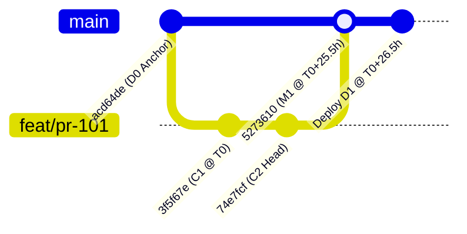
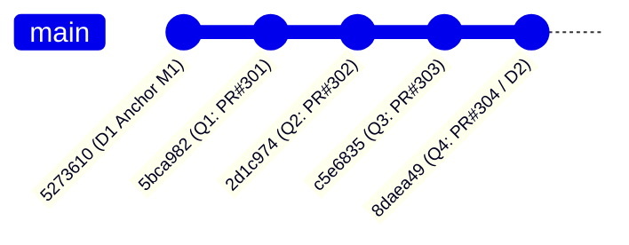
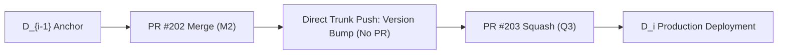
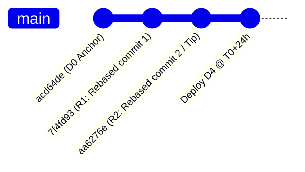

# US-26: DORA Lead Time for Changes Calculation & PR-to-Deployment Attribution Test Scenarios

**Task:** `SCRUM-436` (`Task 26.4`: Create test scenarios for single merge commits (26.5h), batched squash-merged PRs (23.5h median) and trunk filtering)  
**Parent User Story:** `SCRUM-363` (`US-26`: DORA Lead Time for Changes & PR-to-Deployment Attribution)  
**Related Tickets:**  
- `SCRUM-433`: Design commit-to-deployment association algorithm via pull request merge commits and git DAG reachability (`Task 26.1`, [`docs/dora-pr-to-deployment-mapping-design.md`](../../docs/dora-pr-to-deployment-mapping-design.md))  
- `SCRUM-434`: Implement commit-range resolver mapping deployed commits to pull requests across merge, squash, and rebase strategies while excluding trunk-only commits and already-shipped PRs (`Task 26.2`, [`backend/app/deployments/service.py`](../app/deployments/service.py))  
- `SCRUM-435`: Implement per-PR Lead Time ($T_{\text{prod\_deployed}} - T_{\text{first\_commit}}$) and project median Lead Time calculator over 14d and 30d windows using contributor pseudonyms (`Task 26.3`, [`backend/app/dora/service.py`](../app/dora/service.py), [`backend/app/dora/schemas.py`](../app/dora/schemas.py))  
- `SCRUM-437`: Automated pytest unit and integration test suite for Lead Time for Changes and PR resolver (`Task 26.5`, [`backend/tests/test_dora_lead_time_and_pr_resolver.py`](../test_dora_lead_time_and_pr_resolver.py))  
- `SCRUM-427` / `SCRUM-431`: Production deployment ingestion pipeline and outcome mapping (`US-25` / `Task 25.1` / `Task 25.5`, [`docs/deployment-signals-outcomes-and-staging-exclusion-test-scenarios.md`](../../docs/deployment-signals-outcomes-and-staging-exclusion-test-scenarios.md))  
- `SCRUM-396` / `SCRUM-397`: PR open, commit push, merge tracking & contributor pseudonym isolation (`US-20` / `Task 20.1` / `Task 20.6`, [`docs/pr-open-commit-push-merge-and-pseudonym-isolation-test-scenarios.md`](../../docs/pr-open-commit-push-merge-and-pseudonym-isolation-test-scenarios.md))  
- `SCRUM-384`: Deployment signal selection persistence and DORA response reporting (`US-18` / `Task 18.4`, [`docs/deployment-signal-selection-persistence-and-dora-response-reporting-test-scenarios.md`](../../docs/deployment-signal-selection-persistence-and-dora-response-reporting-test-scenarios.md))  
- `SCRUM-440`: DORA Deployment Frequency calculation test scenarios (`US-27` / `Task 27.3`, [`docs/dora-deployment-frequency-test-scenarios.md`](../../docs/dora-deployment-frequency-test-scenarios.md))  

**Target Storage Engine:** PostgreSQL 16 with Row-Level Security (`pgvector/pgvector:pg16`)  
**Target Implementation Modules:** [`backend/app/deployments/service.py`](../app/deployments/service.py), [`backend/app/dora/service.py`](../app/dora/service.py), [`backend/app/dora/schemas.py`](../app/dora/schemas.py), [`backend/app/dora/router.py`](../app/dora/router.py)  
**Authoritative Automated Test Suites:** [`backend/tests/test_dora_lead_time_and_pr_resolver.py`](../test_dora_lead_time_and_pr_resolver.py)  
**Specification Location in Test Suite:** [`backend/tests/scenarios/test_us26_lead_time_for_changes_scenarios.md`](test_us26_lead_time_for_changes_scenarios.md)  
**Assignee:** Matvii Yeromenko  
**Category:** Testing - Design  
**Estimate:** 0.25 Story Points (0h 30m Original Estimate)  
**Status:** Approved / Verification Baseline Established  

---

## 1. Executive Summary & Objective

### 1.1 Objective

Establish the formal, authoritative verification scenarios and deterministic test fixtures for **DORA Lead Time for Changes calculation and PR-to-deployment attribution** in the M.A.N.T.A. Engineering Intelligence Platform (`SCRUM-436` / `Task 26.4`).

This specification formalizes deterministic Git commit DAG topologies, SHA graphs, timestamps, merge strategy behaviors (standard merge, squash-merge, rebase-and-merge), trunk-only commit exclusions, zero-deployment window semantics (`null` vs `0.00`), continuous median calculations (`percentile_cont(0.5)`), daily trend time-series, contributor pseudonym isolation, and multi-tenant Row-Level Security (RLS) guarantees.

### 1.2 Implementation Scope & Core Scenarios

In accordance with Jira Task `SCRUM-436`, this specification explicitly formalizes and verifies:

1. **Single Merge Commit PR (`26.5h`):**
   - Single PR merged to trunk via standard merge (`--no-ff`).
   - Exact timestamps: $T_{\text{first\_commit}} = T_0$, $T_{\text{deployed}} = T_0 + 26\text{h } 30\text{m}$.
   - Mathematical output: $95,400.0\text{ seconds} \rightarrow \mathbf{26.5\text{ hours}}$.
   - Both individual PR Lead Time and 14-day/30-day project median evaluate to `26.5h`.

2. **Batched Squash-Merged PRs (`23.5h` Median):**
   - Batched production release containing multiple pull requests merged to trunk via **squash-and-merge**.
   - Validates continuous median interpolation ($0.5 \times (A + B)$) on an **even-numbered PR batch** ($N=4$, $[16.0\text{h}, 22.0\text{h}, 25.0\text{h}, 31.0\text{h}] \rightarrow \mathbf{23.5\text{h}}$) and odd-numbered PR batch ($N=3$, $[19.0\text{h}, 23.5\text{h}, 29.0\text{h}] \rightarrow \mathbf{23.5\text{h}}$).
   - Validates that squash-merge creates 1-parent trunk commits where original branch head SHAs are dangling and matched via `pr.merge_commit_sha IN S_i`.

3. **Trunk Commit Exclusion & Pruning:**
   - **Already-Deployed Ancestors:** Pruning backward git DAG traversal at $D_{i-1}.\text{commit\_sha}$ to strictly exclude previously shipped trunk commits $\mathcal{A}_{i-1}$.
   - **Direct Trunk Commits (Non-PR):** Pushes straight to main (version bumps, CI chores, emergency hotfixes without PRs) are traversed to find parent commits but **strictly excluded** from `deployment_pull_requests`. They never fabricate synthetic PRs or skew Lead Time.
   - **Already-Shipped PRs:** PRs claimed in prior deployments cannot be re-claimed in subsequent deployments.
   - **Re-deployment / Rollback No-Op:** Re-deploying an already-deployed SHA yields an empty commit range $\mathcal{S}_i = \emptyset$ and 0 claimed PRs.

4. **Zero-Deployment Window Semantics (`null`):**
   - Windows with zero qualifying production deployments or zero shipped PRs.
   - Rate/Median value: strictly `null` (`None`), **not** `0.00`, NaN, or error.
   - Architectural contrast: Deployment Frequency reports `0.00` (valid zero rate), whereas Lead Time represents duration over changes, which is mathematically undefined when $|\mathcal{P}| = 0$ (`percentile_cont(0.5)` returns `NULL`).
   - Daily trend series: $W$ date buckets ($W \in \{14, 30\}$), each reporting `deployed_pr_count = 0`, `median_lead_time_seconds = null`, `median_lead_time_hours = null`.

5. **Rebase-and-Merge Linear DAG Attribution:**
   - Feature commits rebased linearly onto trunk with new commit SHAs. Matched via `pr.merge_commit_sha IN S_i OR pr.head_sha IN S_i OR commits.pull_request_id IN S_i`.

6. **Heterogeneous Multi-Strategy Batched Release:**
   - A single deployment shipping PRs merged via standard merge, squash-and-merge, and rebase-and-merge simultaneously, alongside direct trunk commits.

7. **Multi-Tenant Row-Level Security & Contributor Pseudonym Privacy:**
   - PostgreSQL RLS enforces zero cross-tenant data leakage.
   - Contributor identities use salted HMAC-SHA256 pseudonyms without raw PII, complying with GDPR Article 17.

---

## 2. Core Mathematical Formulations & Architectural Invariants

```
+-------------------------------------------------------------------------------------------------------------------+
|                           DORA LEAD TIME FOR CHANGES ARCHITECTURAL TOPOLOGY (US-26)                               |
+-------------------------------------+-------------------------------------+---------------------------------------+
| 1. Commit Range Traversal           | 2. Per-PR Lead Time Calculation     | 3. Continuous Median (DORA)           |
|    (Topological DAG Walking)        |    (T_deployed - T_first_commit)    |    (percentile_cont(0.5) WITHIN GROUP)|
+-------------------------------------+-------------------------------------+---------------------------------------+
| * S_i = Ancestors(D_i) \ A_{i-1}    | * Delta_t = deployed_at - first_utc | * Odd N: middle sorted element        |
| * Prune at D_{i-1}.commit_sha       | * lead_time_seconds = round(sec, 2) | * Even N: 0.5 * (val[mid-1]+val[mid]) |
| * Direct trunk commits excluded     | * lead_time_hours = round(sec/3600) | * Empty set (N=0) -> NULL (null)      |
| * PR matches via merge_sha/head_sha | * Error if deployed_at < first_utc  | * Half-up rounding to 2 decimal places|
+-------------------------------------+-------------------------------------+---------------------------------------+
                                                         |
                                                         v
+-------------------------------------------------------------------------------------------------------------------+
|                                 GIT MERGE STRATEGY MATCHING INVARIANTS                                            |
+-------------------------------------+-------------------------------------+---------------------------------------+
| Standard Merge (--no-ff)            | Squash-and-Merge                    | Rebase-and-Merge                      |
+-------------------------------------+-------------------------------------+---------------------------------------+
| * 2 parents: (trunk, feature_head)  | * 1 parent: prior trunk commit      | * N rebased linear commits on trunk   |
| * merge_sha & feature_head in S_i   | * head_sha is dangling (NOT in S_i) | * head_sha or commits.pull_request_id |
| * Matched via merge_commit_sha      | * Matched via merge_commit_sha in   | * Matched via merge_sha / rebased FK  |
|   or head_sha in S_i                |   S_i (trunk squash commit Q)       |   commits in S_i                      |
+-------------------------------------+-------------------------------------+---------------------------------------+
```

### Invariant 1: Per-PR Lead Time Definition
For any merged Pull Request $p$ successfully shipped to production by deployment $D_i$:

$$\text{LeadTime}_{\text{sec}}(p, D_i) = \text{epoch}(D_i.\text{deployed\_at}) - \text{epoch}(p.\text{first\_commit\_at})$$

$$\text{LeadTime}_{\text{hours}}(p, D_i) = \text{round}_2\left(\frac{\text{LeadTime}_{\text{sec}}(p, D_i)}{3600}\right)$$

Where:
- $p.\text{first\_commit\_at}$ is the UTC timestamp of the earliest authored commit on the feature branch.
- $D_i.\text{deployed\_at}$ is the UTC timestamp when the deployment finished successfully in production.
- Temporal consistency: $D_i.\text{deployed\_at} \ge p.\text{first\_commit\_at}$. If $D_i.\text{deployed\_at} < p.\text{first\_commit\_at}$, the ingestion engine raises `ValueError`.

### Invariant 2: Continuous Median Formulation (`percentile_cont(0.5)`)
Let $\mathcal{L} = [l_1, l_2, \dots, l_N]$ be the list of shipped PR lead times in hours, sorted in ascending order ($l_1 \le l_2 \le \dots \le l_N$).
The project median Lead Time is computed via the continuous median function:

$$\text{Median}(\mathcal{L}) = \begin{cases}
\text{null} & \text{if } N = 0 \\
l_{(N+1)/2} & \text{if } N \text{ is odd} \\
\text{round}_2\left(0.5 \times (l_{N/2} + l_{N/2 + 1})\right) & \text{if } N \text{ is even}
\end{cases}$$

This is mathematically identical to PostgreSQL's `PERCENTILE_CONT(0.5) WITHIN GROUP (ORDER BY lead_time_hours)`.

### Invariant 3: Zero-Deployment Window Semantics (`null` vs `0.00`)
- **Lead Time for Changes:** Evaluates over the set of shipped pull requests $\mathcal{P}_{\text{shipped}}$. When $|\mathcal{P}_{\text{shipped}}| = 0$, median Lead Time is undefined. The system returns `median_lead_time_hours = null` and `median_lead_time_seconds = null`.
- **Deployment Frequency:** Evaluates an event arrival rate over time: $\frac{\text{count}}{W}$. When count $= 0$, the rate is numeric `0.00 deployments/day`.

### Invariant 4: Topological Commit Range & Pruning ($\mathcal{S}_i$)
For consecutive successful production deployments $(D_{i-1}, D_i]$:
1. **Ancestor Exclusion Set ($\mathcal{A}_{i-1}$):**
   $$\mathcal{A}_{i-1} = \text{Ancestors}(D_{i-1}.\text{commit\_sha}) \cup \{D_{i-1}.\text{commit\_sha}\}$$
2. **Commit Range ($\mathcal{S}_i$):**
   $$\mathcal{S}_i = \text{Ancestors}(D_i.\text{commit\_sha}) \setminus \mathcal{A}_{i-1}$$
3. **Pruning Rule:** Backward graph traversal starting from $D_i.\text{commit\_sha}$ stops immediately along any edge whose target commit SHA is in $\mathcal{A}_{i-1}$.

### Invariant 5: Git Merge Strategy Matching Rules
A merged PR $p$ on `default_branch` is claimed by deployment $D_i$ if and only if:
1. $p.\text{tenant\_id} = D_i.\text{tenant\_id} \land p.\text{project\_id} = D_i.\text{project\_id}$
2. $p.\text{state} = \text{'merged'}$
3. $(p.\text{merge\_commit\_sha} \in \mathcal{S}_i) \lor (p.\text{head\_sha} \in \mathcal{S}_i) \lor (\exists c \in \mathcal{S}_i: c.\text{pull\_request\_id} = p.\text{id})$
4. $\neg \exists \text{dpr} \in \text{deployment\_pull\_requests}: \text{dpr.pull\_request\_id} = p.\text{id}$

### Invariant 6: Trunk-Only Commit Exclusion & Deduplication
- Commits committed directly to trunk with `pull_request_id IS NULL` and no matching PR in `pull_requests` are traversed for DAG connectivity but **never** persisted to `deployment_pull_requests`.
- A PR is claimed by at most one deployment (the earliest successful production deployment shipping its commits). Subsequent deployments shipping downstream commits cannot re-claim it.

---

## 3. Relational Schemas, Constraints & Pydantic DTOs

### 3.1 Relational Schema Definitions (`PostgreSQL 16`)

```sql
-- Deployments Table (Protected by FORCE ROW LEVEL SECURITY)
CREATE TABLE IF NOT EXISTS deployments (
    id UUID PRIMARY KEY DEFAULT gen_random_uuid(),
    tenant_id UUID NOT NULL REFERENCES tenants(id) ON DELETE CASCADE,
    project_id UUID NOT NULL REFERENCES projects(id) ON DELETE CASCADE,
    repository_id UUID REFERENCES repositories(id) ON DELETE CASCADE,
    integration_id UUID REFERENCES integrations(id) ON DELETE SET NULL,
    triggered_by UUID REFERENCES users(id) ON DELETE SET NULL,
    actor_pseudonym_id VARCHAR(64),
    external_deployment_id VARCHAR(128),
    environment VARCHAR(32) NOT NULL,
    commit_sha VARCHAR(40) NOT NULL,
    status VARCHAR(32) NOT NULL,
    is_change_failure BOOLEAN NOT NULL DEFAULT FALSE,
    authoritative_signal_source VARCHAR(64) NOT NULL DEFAULT 'github_deployments_api',
    deployed_at TIMESTAMPTZ NOT NULL,
    lead_time_seconds NUMERIC(12, 2),
    created_at TIMESTAMPTZ NOT NULL DEFAULT NOW(),
    CONSTRAINT ck_deployments_status CHECK (status IN ('SUCCESS', 'FAILED', 'ROLLED_BACK')),
    CONSTRAINT ck_deployments_signal_source CHECK (authoritative_signal_source IN (
        'github_deployments_api', 'argocd_postsync_webhook', 'direct_deployment_api'
    ))
);

-- Pull Requests Table (Protected by FORCE ROW LEVEL SECURITY)
CREATE TABLE IF NOT EXISTS pull_requests (
    id UUID PRIMARY KEY DEFAULT gen_random_uuid(),
    tenant_id UUID NOT NULL REFERENCES tenants(id) ON DELETE CASCADE,
    project_id UUID NOT NULL REFERENCES projects(id) ON DELETE CASCADE,
    repository_id UUID NOT NULL REFERENCES repositories(id) ON DELETE CASCADE,
    author_pseudonym_id VARCHAR(64) NOT NULL,
    external_pr_number INTEGER NOT NULL,
    title VARCHAR(512) NOT NULL,
    state VARCHAR(32) NOT NULL,
    head_branch VARCHAR(255) NOT NULL,
    base_branch VARCHAR(255) NOT NULL,
    head_sha VARCHAR(40) NOT NULL,
    merge_commit_sha VARCHAR(40),
    first_commit_at TIMESTAMPTZ NOT NULL,
    created_in_git_at TIMESTAMPTZ NOT NULL,
    merged_at TIMESTAMPTZ,
    closed_at TIMESTAMPTZ,
    created_at TIMESTAMPTZ NOT NULL DEFAULT NOW(),
    updated_at TIMESTAMPTZ NOT NULL DEFAULT NOW(),
    CONSTRAINT uq_pull_requests_repo_external_number UNIQUE (tenant_id, repository_id, external_pr_number)
);

-- Commits Table (Protected by FORCE ROW LEVEL SECURITY)
CREATE TABLE IF NOT EXISTS commits (
    sha VARCHAR(40) PRIMARY KEY,
    tenant_id UUID NOT NULL REFERENCES tenants(id) ON DELETE CASCADE,
    repository_id UUID NOT NULL REFERENCES repositories(id) ON DELETE CASCADE,
    pull_request_id UUID REFERENCES pull_requests(id) ON DELETE SET NULL,
    author_pseudonym_id VARCHAR(64) NOT NULL,
    committer_pseudonym_id VARCHAR(64) NOT NULL,
    lines_added INTEGER NOT NULL DEFAULT 0,
    lines_deleted INTEGER NOT NULL DEFAULT 0,
    authored_at TIMESTAMPTZ NOT NULL,
    committed_at TIMESTAMPTZ NOT NULL,
    parent_shas JSONB NOT NULL DEFAULT '[]'::jsonb,
    is_root_of_branch BOOLEAN NOT NULL DEFAULT FALSE,
    created_at TIMESTAMPTZ NOT NULL DEFAULT NOW()
);

-- Deployment Pull Requests Join Table (Claim Storage)
CREATE TABLE IF NOT EXISTS deployment_pull_requests (
    id UUID PRIMARY KEY DEFAULT gen_random_uuid(),
    tenant_id UUID NOT NULL REFERENCES tenants(id) ON DELETE CASCADE,
    deployment_id UUID NOT NULL REFERENCES deployments(id) ON DELETE CASCADE,
    pull_request_id UUID NOT NULL REFERENCES pull_requests(id) ON DELETE CASCADE,
    created_at TIMESTAMPTZ NOT NULL DEFAULT NOW(),
    CONSTRAINT uq_deployment_pull_requests_dep_pr UNIQUE (deployment_id, pull_request_id)
);
```

### 3.2 Pydantic DTOs (`backend/app/dora/schemas.py`)

```python
class PullRequestLeadTimeItem(BaseModel):
    pull_request_id: uuid.UUID
    deployment_id: uuid.UUID
    repository_id: Optional[uuid.UUID] = None
    external_pr_number: int
    author_pseudonym_id: str
    actor_pseudonym_id: Optional[str] = None
    merge_commit_sha: Optional[str] = None
    head_sha: Optional[str] = None
    first_commit_at: datetime
    deployed_at: datetime
    lead_time_seconds: float = Field(ge=0.0)
    lead_time_hours: float = Field(ge=0.0)


class DailyLeadTimeMetric(BaseModel):
    date: date
    deployed_pr_count: int = Field(ge=0)
    median_lead_time_seconds: Optional[float] = None
    median_lead_time_hours: Optional[float] = None


class LeadTimeResult(BaseModel):
    window_days: Literal[14, 30]
    deployed_pr_count: int = Field(ge=0)
    median_lead_time_seconds: Optional[float] = None
    median_lead_time_hours: Optional[float] = None
    pull_requests: list[PullRequestLeadTimeItem] = Field(default_factory=list)
    daily_series: list[DailyLeadTimeMetric]
    window_start: datetime
    window_end: datetime
```

### 3.3 Authoritative SQL Continuous Median Query (`PostgreSQL 16`)

```sql
SELECT
    COUNT(DISTINCT pr.id) AS deployed_pr_count,
    ROUND(
        PERCENTILE_CONT(0.5) WITHIN GROUP (
            ORDER BY EXTRACT(EPOCH FROM (d.deployed_at - pr.first_commit_at))
        )::numeric,
        2
    ) AS median_lead_time_seconds,
    ROUND(
        PERCENTILE_CONT(0.5) WITHIN GROUP (
            ORDER BY (EXTRACT(EPOCH FROM (d.deployed_at - pr.first_commit_at)) / 3600.0)
        )::numeric,
        2
    ) AS median_lead_time_hours
FROM deployment_pull_requests dpr
JOIN deployments d
  ON d.id = dpr.deployment_id
 AND d.tenant_id = dpr.tenant_id
JOIN pull_requests pr
  ON pr.id = dpr.pull_request_id
 AND pr.tenant_id = dpr.tenant_id
JOIN projects p
  ON p.id = d.project_id
 AND p.tenant_id = d.tenant_id
WHERE d.tenant_id = :tenant_id
  AND d.project_id = :project_id
  AND p.deleted_at IS NULL
  AND d.environment = 'production'
  AND d.status = 'SUCCESS'
  AND d.authoritative_signal_source = p.authoritative_cd_signal
  AND pr.state = 'merged'
  AND d.deployed_at >= (:window_end - make_interval(days => :window_days))
  AND d.deployed_at <= :window_end;
```

---

## 4. Master Test Scenarios Matrix

| Scenario ID | Test Scenario Description | Merge Strategy | Shipped Commits / PRs | Deployed PR Count | Expected Median (Hours) | Expected Median (Seconds) | Acceptance Criteria & Target Assertions |
| :--- | :--- | :--- | :--- | :--- | :--- | :--- | :--- |
| **`TC-DORA-LT-001`** | **Single Merge Commit PR** | Standard Merge (`--no-ff`) | 1 PR (PR #101) with $T_{\text{first\_commit}} = T_0$, $T_{\text{deployed}} = T_0 + 26\text{h } 30\text{m}$ | **1** | **`26.50`** | **`95,400.0`** | Exact $26.5\text{h}$ lead time; single PR median equals individual lead time; daily series bucketed to deploy date. |
| **`TC-DORA-LT-002`** | **Batched Squash-Merged PRs (Even Batch)** | Squash-and-Merge | 4 PRs ($N=4$) with lead times $[16.0\text{h}, 22.0\text{h}, 25.0\text{h}, 31.0\text{h}]$ | **4** | **`23.50`** | **`84,600.0`** | Continuous median linear interpolation: $0.5 \times (22.0 + 25.0) = \mathbf{23.50\text{h}}$; squash commits matched on trunk. |
| **`TC-DORA-LT-003`** | **Batched Squash-Merged PRs (Odd Batch)** | Squash-and-Merge | 3 PRs ($N=3$) with lead times $[19.0\text{h}, 23.5\text{h}, 29.0\text{h}]$ | **3** | **`23.50`** | **`84,600.0`** | Odd batch continuous median picks middle element: $\mathbf{23.50\text{h}}$; squash commits matched on trunk. |
| **`TC-DORA-LT-004`** | **Trunk Commit Exclusion & Pruning** | Mixed / Direct Pushes | Direct trunk hotfix (version bump, `pull_request_id = NULL`) + PRs | **Matched PRs only** | Unskewed by trunk hotfix | Unskewed | Direct trunk commits traversed for DAG parents but excluded from `deployment_pull_requests`. |
| **`TC-DORA-LT-005`** | **Zero-Deployment Window** | N/A | 0 qualifying deployments in 14-day / 30-day window | **0** | **`null`** | **`null`** | Zero deployments returns `null` (not `0.00`), empty PR array, and $W$ daily buckets with `null` medians. |
| **`TC-DORA-LT-006`** | **Rebase-and-Merge Linear DAG Attribution** | Rebase-and-Merge | Linear rebased commits on trunk matched via `merge_commit_sha` or `commits.pull_request_id` | **1** | Calculated from orig $T_0$ | Calculated | Original feature commits replayed linearly; matched via rebased SHA or commit FK. |
| **`TC-DORA-LT-007`** | **Heterogeneous Multi-Strategy Batch** | Merge + Squash + Rebase | 1 standard merge PR + 1 squash PR + 1 rebase PR + 1 direct trunk commit + 1 prior PR | **3** | Continuous median of 3 PRs | Continuous median | All 3 strategies recognized in one release; direct trunk commit ignored; prior PR not duplicated. |
| **`TC-DORA-LT-008`** | **Re-deployment & Rollback No-Op** | N/A | Deployment shipping exact same SHA or ancestor commit already deployed | **0** | **`null`** | **`null`** | Traversal detects $\text{target} \in \mathcal{A}_{i-1} \rightarrow \mathcal{S}_i = \emptyset$; 0 PRs claimed; no duplicates. |
| **`TC-DORA-LT-009`** | **Multi-Tenant RLS & Pseudonym Isolation** | Standard Merge | Tenant A (1 PR) vs Tenant B (1 PR) | **1** | Tenant A only | Tenant A only | PostgreSQL RLS filters by `tenant_id`; contributor pseudonyms preserved without raw PII. |
| **`TC-DORA-LT-010`** | **Authoritative CD Signal Filtering** | Standard Merge | 1 GitHub deployment (Authoritative) + 1 ArgoCD deployment (Ignored) | **1** | GitHub PR only | GitHub PR only | Only deployments matching `projects.authoritative_cd_signal` participate in Lead Time. |
| **`TC-DORA-LT-011`** | **Window Boundaries & UTC Midnight Grouping** | Standard Merge | Deployments at $T_{\text{start}}$, $T_{\text{end}}$, $T_{\text{start}} - 1\text{s}$, $T_{\text{end}} + 1\text{s}$ | **2** | Median of 2 | Median of 2 | Inclusive endpoints counted; outer boundary excluded; UTC midnight bucketization verified. |

---

## 5. Exhaustive Test Scenario Specifications

---

### Scenario `TC-DORA-LT-001`: Single Merge Commit PR ($T_0 \rightarrow T_0 + 26\text{h } 30\text{m} = \mathbf{26.5\text{h}}$)

- **Objective:** Verify that a single pull request merged into trunk via standard merge (`--no-ff`) with earliest commit at $T_0$ and production deployment at $T_0 + 26\text{h } 30\text{m}$ produces exactly $95,400.0\text{ seconds}$ and $\mathbf{26.50\text{ hours}}$ for both individual Lead Time and project median Lead Time.
- **Traceability:** `US-26`, `SCRUM-436` (Task 26.4 Scope Item 1), `SCRUM-435` (Task 26.3 AC 1), SRS §3.2.1.
- **Preconditions:**
  - Active Tenant: `tenant_id = 712020a1-0000-0000-0000-000000000001`
  - Active Project: `project_id = 3b2c1d0e-1111-2222-3333-444455556666` (`authoritative_cd_signal = 'github_deployments_api'`)
  - Target Repository: `repository_id = a1b2c3d4-e5f6-7a8b-9c0d-1e2f3a4b5c6d` (`default_branch = 'main'`)
  - Window: $W = 14$ days, `window_end = 2026-11-14T00:00:00Z`
  - Baseline Anchor: Prior production deployment $D_0$ deployed at `2026-11-10T10:00:00Z` shipping commit `acd64de32964ba83f3f7de3979104de072150485`.

#### Git Commit Topology & SHA Graph



#### Deterministic Commit Entities Table

| Commit Label | 40-Character SHA | Parents (`parent_shas`) | Author Pseudonym | Authored At (UTC) | Committed At (UTC) | Associated PR |
| :--- | :--- | :--- | :--- | :--- | :--- | :--- |
| **$S_0$ (Trunk Anchor)** | `acd64de32964ba83f3f7de3979104de072150485` | `[]` | `b1c4e7...` | `2026-11-10T09:00:00Z` | `2026-11-10T09:00:00Z` | `NULL` |
| **$C_1$ (First Commit)** | `3f5f67e759abd255c471637450df250c24b22e1d` | `["acd64de32964ba83f3f7de3979104de072150485"]` | `a1f09e...` (`pseudo_alice`) | `2026-11-12T12:00:00Z` ($T_0$) | `2026-11-12T12:00:00Z` | PR #101 |
| **$C_2$ (Feature Head)** | `74e7fcf0335ba1cbf633fb7efd6fdda29b4a3214` | `["3f5f67e759abd255c471637450df250c24b22e1d"]` | `a1f09e...` (`pseudo_alice`) | `2026-11-12T16:00:00Z` | `2026-11-12T16:00:00Z` | PR #101 |
| **$M_1$ (Merge Commit)** | `5273610b58406de60def552d340fed6190da57c9` | `["acd64de32964ba83f3f7de3979104de072150485", "74e7fcf0335ba1cbf633fb7efd6fdda29b4a3214"]` | `a1f09e...` (`pseudo_alice`) | `2026-11-13T13:30:00Z` | `2026-11-13T13:30:00Z` | PR #101 |

#### Pull Request Entity Table

| PR ID | External PR # | Base Branch | Head SHA | Merge Commit SHA | First Commit At (UTC) | Merged At (UTC) | Author Pseudonym | State |
| :--- | :--- | :--- | :--- | :--- | :--- | :--- | :--- | :--- |
| `pr-101-uuid` | `101` | `main` | `74e7fcf0335ba1cbf633fb7efd6fdda29b4a3214` | `5273610b58406de60def552d340fed6190da57c9` | `2026-11-12T12:00:00Z` ($T_0$) | `2026-11-13T13:30:00Z` | `a1f09e...` (`pseudo_alice`) | `merged` |

#### Deployment Entity Table

| Deployment ID | Environment | Status | Commit SHA | Deployed At (UTC) | Signal Source | Actor Pseudonym |
| :--- | :--- | :--- | :--- | :--- | :--- | :--- |
| `dep-01-uuid` | `production` | `SUCCESS` | `5273610b58406de60def552d340fed6190da57c9` ($M_1$) | `2026-11-13T14:30:00Z` ($T_0 + 26\text{h } 30\text{m}$) | `github_deployments_api` | `e98c21...` (`release_bot`) |

#### DAG Range Traversal & Attribution Execution Trace
1. **Prior Ancestor Set ($\mathcal{A}_0$):** $\{\text{`acd64de32964ba83f3f7de3979104de072150485`}\}$.
2. **Backward Walk from $M_1$ (`5273610...`):**
   - Enqueue $M_1$. Visit $M_1 \rightarrow \mathcal{S}_1 = \{M_1\}$.
   - Parent 1: `acd64de...` $\in \mathcal{A}_0 \rightarrow$ **Pruned**.
   - Parent 2: `74e7fcf...` ($C_2$) $\notin \mathcal{A}_0 \rightarrow$ Enqueue $C_2$. Visit $C_2 \rightarrow \mathcal{S}_1 = \{M_1, C_2\}$.
   - Parent of $C_2$: `3f5f67e...` ($C_1$) $\notin \mathcal{A}_0 \rightarrow$ Enqueue $C_1$. Visit $C_1 \rightarrow \mathcal{S}_1 = \{M_1, C_2, C_1\}$.
   - Parent of $C_1$: `acd64de...` $\in \mathcal{A}_0 \rightarrow$ **Pruned**.
3. **Computed Half-Open Range:**
   $$\mathcal{S}_1 = (D_0, D_1] = \{M_1, C_2, C_1\}$$
4. **Pull Request Matching:**
   $p_{101}.\text{merge\_commit\_sha} = M_1 \in \mathcal{S}_1 \implies \mathbf{PR\ \#101\ Matched}$.
   Persisted to `deployment_pull_requests(dep-01-uuid, pr-101-uuid)`.

#### Mathematical Formulation & Metric Output
$$T_{\text{first\_commit}} = \text{2026-11-12T12:00:00Z}$$
$$T_{\text{deployed}} = \text{2026-11-13T14:30:00Z}$$
$$\Delta t = (\text{2026-11-13T14:30:00Z} - \text{2026-11-12T12:00:00Z}) = 26\text{ hours } 30\text{ minutes}$$
$$\text{lead\_time\_seconds} = 26 \times 3600 + 30 \times 60 = 93600 + 1800 = \mathbf{95,400.0\text{ s}}$$
$$\text{lead\_time\_hours} = \text{round}_2\left(\frac{95400}{3600}\right) = \text{round}_2(26.5000) = \mathbf{26.50\text{ h}}$$
$$\text{Project Median }(N=1) = \mathbf{26.50\text{ hours}} \quad (\mathbf{95,400.0\text{ seconds}})$$

#### Daily Time-Series Distribution (14-Day Window: 2026-10-31 to 2026-11-13)

| Bucket Date (UTC) | Deployed PR Count | Daily Median Hours | Daily Median Seconds | Shipped PRs |
| :--- | :--- | :--- | :--- | :--- |
| `2026-10-31` to `2026-11-12` (13 days) | `0` | `null` | `null` | None (zero-filled) |
| `2026-11-13` (Deploy Day) | `1` | `26.5` | `95400.0` | PR #101 |

#### Expected JSON Output DTO
```json
{
  "window_days": 14,
  "deployed_pr_count": 1,
  "median_lead_time_seconds": 95400.0,
  "median_lead_time_hours": 26.5,
  "pull_requests": [
    {
      "pull_request_id": "pr-101-uuid",
      "deployment_id": "dep-01-uuid",
      "repository_id": "a1b2c3d4-e5f6-7a8b-9c0d-1e2f3a4b5c6d",
      "external_pr_number": 101,
      "author_pseudonym_id": "a1f09e...",
      "actor_pseudonym_id": "e98c21...",
      "merge_commit_sha": "5273610b58406de60def552d340fed6190da57c9",
      "head_sha": "74e7fcf0335ba1cbf633fb7efd6fdda29b4a3214",
      "first_commit_at": "2026-11-12T12:00:00Z",
      "deployed_at": "2026-11-13T14:30:00Z",
      "lead_time_seconds": 95400.0,
      "lead_time_hours": 26.5
    }
  ],
  "daily_series": [
    {"date": "2026-10-31", "deployed_pr_count": 0, "median_lead_time_seconds": null, "median_lead_time_hours": null},
    {"date": "2026-11-13", "deployed_pr_count": 1, "median_lead_time_seconds": 95400.0, "median_lead_time_hours": 26.5}
  ],
  "window_start": "2026-10-31T00:00:00Z",
  "window_end": "2026-11-14T00:00:00Z"
}
```

---

### Scenario `TC-DORA-LT-002`: Batched Squash-Merged PRs — Even Batch ($N=4$, Median = $\mathbf{23.5\text{h}}$)

- **Objective:** Verify that a batched production deployment shipping 4 pull requests merged via **squash-and-merge** into trunk correctly links all 4 PRs to the deployment and computes the exact continuous median interpolation $0.5 \times (22.0\text{h} + 25.0\text{h}) = \mathbf{23.50\text{ hours}}$ ($84,600.0\text{ seconds}$).
- **Traceability:** `US-26`, `SCRUM-436` (Task 26.4 Scope Item 2), `SCRUM-435` (Task 26.3 AC 2), SRS §3.2.1.
- **Preconditions:**
  - Deployment $D_2$ deployed at $T_{\text{deploy}} = \text{2026-11-14T18:00:00Z}$.
  - Baseline Anchor: Previous deployment $D_1$ commit $M_1$ (`5273610b58406de60def552d340fed6190da57c9`).
  - Trunk receives 4 consecutive squash-merge commits ($Q_1 \rightarrow Q_2 \rightarrow Q_3 \rightarrow Q_4$).
  - For squash merges: feature branch head SHAs are **not** ancestors of trunk commits. Matching occurs strictly via `pr.merge_commit_sha IN S_2`.

#### Git Commit Topology & SHA Graph



#### Deterministic Commit Entities Table

| Commit Label | 40-Character SHA | Parents (`parent_shas`) | Author Pseudonym | Authored At (UTC) | Committed At (UTC) | Associated PR |
| :--- | :--- | :--- | :--- | :--- | :--- | :--- |
| **$M_1$ (Prior Anchor)** | `5273610b58406de60def552d340fed6190da57c9` | `[...]` | `a1f09e...` | `2026-11-13T13:30:00Z` | `2026-11-13T13:30:00Z` | PR #101 (shipped in $D_1$) |
| **$Q_1$ (Squash PR #301)** | `5bca982b79bfad0116adb4dca4483ce927a55791` | `["5273610b58406de60def552d340fed6190da57c9"]` | `d01a33...` (`contrib_1`) | `2026-11-14T14:00:00Z` | `2026-11-14T14:00:00Z` | PR #301 |
| **$Q_2$ (Squash PR #302)** | `2d1c974b7a5e57168ad0af0ea7aa0663f9ec0eef` | `["5bca982b79bfad0116adb4dca4483ce927a55791"]` | `d02b44...` (`contrib_2`) | `2026-11-14T15:00:00Z` | `2026-11-14T15:00:00Z` | PR #302 |
| **$Q_3$ (Squash PR #303)** | `c5e6835a7ce522a188605dccd841a0cfcbf13948` | `["2d1c974b7a5e57168ad0af0ea7aa0663f9ec0eef"]` | `d03c55...` (`contrib_3`) | `2026-11-14T16:00:00Z` | `2026-11-14T16:00:00Z` | PR #303 |
| **$Q_4$ (Squash PR #304)** | `8daea49620214de10f16c02dfa08a237e478f28c` | `["c5e6835a7ce522a188605dccd841a0cfcbf13948"]` | `d04d66...` (`contrib_4`) | `2026-11-14T17:00:00Z` | `2026-11-14T17:00:00Z` | PR #304 |

#### Pull Request Entities Table (4 Batched PRs)

| PR # | Head SHA (Dangling) | Merge Commit SHA | First Commit At (UTC) | Deployed At (UTC) | $\Delta t$ (Seconds) | Lead Time (Hours) |
| :--- | :--- | :--- | :--- | :--- | :--- | :--- |
| **301** | `d4b37bae0005dc776bccc31871a9b80bcedb78d3` | `5bca982b79bfad0116adb4dca4483ce927a55791` ($Q_1$) | `2026-11-13T11:00:00Z` ($T_{\text{deploy}} - 31\text{h}$) | `2026-11-14T18:00:00Z` | $111,600.0\text{ s}$ | **`31.0`** |
| **302** | `90ca0b9fb44a48893b4daee6969c4e4eb148cb7a` | `2d1c974b7a5e57168ad0af0ea7aa0663f9ec0eef` ($Q_2$) | `2026-11-13T17:00:00Z` ($T_{\text{deploy}} - 25\text{h}$) | `2026-11-14T18:00:00Z` | $90,000.0\text{ s}$ | **`25.0`** |
| **303** | `3198f751ee4e902eb72bb33be65fb5c45ef8bf88` | `c5e6835a7ce522a188605dccd841a0cfcbf13948` ($Q_3$) | `2026-11-13T20:00:00Z` ($T_{\text{deploy}} - 22\text{h}$) | `2026-11-14T18:00:00Z` | $79,200.0\text{ s}$ | **`22.0`** |
| **304** | `b58403c889d2831a690633f15745b01dbff223b5` | `8daea49620214de10f16c02dfa08a237e478f28c` ($Q_4$) | `2026-11-14T02:00:00Z` ($T_{\text{deploy}} - 16\text{h}$) | `2026-11-14T18:00:00Z` | $57,600.0\text{ s}$ | **`16.0`** |

#### DAG Range Traversal & Attribution Execution Trace
1. **Prior Ancestors ($\mathcal{A}_1$):** Includes $M_1$ (`5273610...`) and all its ancestors.
2. **Backward Walk from $Q_4$ (`8daea49...`):**
   - $Q_4 \rightarrow$ Enqueue $Q_4$. Parent is $Q_3$.
   - $Q_3 \rightarrow$ Enqueue $Q_3$. Parent is $Q_2$.
   - $Q_2 \rightarrow$ Enqueue $Q_2$. Parent is $Q_1$.
   - $Q_1 \rightarrow$ Enqueue $Q_1$. Parent is $M_1$.
   - $M_1 \in \mathcal{A}_1 \rightarrow$ **Pruned**.
3. **Commit Range:** $\mathcal{S}_2 = \{Q_4, Q_3, Q_2, Q_1\}$.
4. **Attribution:**
   - $Q_1 \in \mathcal{S}_2 \implies \text{PR \#301 Claimed}$
   - $Q_2 \in \mathcal{S}_2 \implies \text{PR \#302 Claimed}$
   - $Q_3 \in \mathcal{S}_2 \implies \text{PR \#303 Claimed}$
   - $Q_4 \in \mathcal{S}_2 \implies \text{PR \#304 Claimed}$
   - 4 rows inserted into `deployment_pull_requests`.

#### Step-by-Step Continuous Median Calculation
1. **Raw Lead Times (Hours):** $\{31.0, 25.0, 22.0, 16.0\}$.
2. **Sorted Order:** $\mathcal{L}_{\text{sorted}} = [16.0, 22.0, 25.0, 31.0]$.
3. **Even Interpolation ($N=4$):**
   $$\text{mid} = 4 / 2 = 2 \implies \text{indices } 1 \text{ and } 2 \text{ (0-based)}$$
   $$\text{val}_1 = 22.0\text{ h}, \quad \text{val}_2 = 25.0\text{ h}$$
   $$\text{median} = \frac{22.0 + 25.0}{2} = \frac{47.0}{2} = \mathbf{23.50\text{ hours}}$$
4. **Seconds Continuous Median:**
   $$\text{seconds}_{\text{sorted}} = [57600.0, 79200.0, 90000.0, 111600.0]$$
   $$\text{median}_{\text{sec}} = \frac{79200.0 + 90000.0}{2} = \frac{169200.0}{2} = \mathbf{84,600.0\text{ seconds}}$$

---

### Scenario `TC-DORA-LT-003`: Batched Squash-Merged PRs — Odd Batch ($N=3$, Median = $\mathbf{23.5\text{h}}$)

- **Objective:** Verify that an odd-numbered batch ($N=3$) of squash-merged pull requests selects the exact middle element, returning $\mathbf{23.50\text{ hours}}$ ($84,600.0\text{ seconds}$).
- **Traceability:** `US-26`, `SCRUM-436` (Task 26.4 Scope Item 2), `SCRUM-435` (Task 26.3 AC 2), SRS §3.2.1.
- **Preconditions:**
  - Batched deployment $D_3$ deployed at $T_{\text{deploy}} = \text{2026-11-14T18:00:00Z}$.
  - 3 squash-merged PRs (PR #401, PR #402, PR #403) with lead times $[29.0\text{h}, 23.5\text{h}, 19.0\text{h}]$.

#### Pull Request Entities Table (3 Batched PRs)

| PR # | Head SHA | Merge Commit SHA | First Commit At (UTC) | Deployed At (UTC) | Lead Time (Seconds) | Lead Time (Hours) |
| :--- | :--- | :--- | :--- | :--- | :--- | :--- |
| **401** | `dangling-401` | `172dedb70e250f7feaae0c124d8346b3326a5eb1` | `2026-11-13T13:00:00Z` ($T_{\text{deploy}} - 29\text{h}$) | `2026-11-14T18:00:00Z` | $104,400.0\text{ s}$ | **`29.0`** |
| **402** | `dangling-402` | `52a09859c72d083e749f3646f733811b7c2a06af` | `2026-11-13T18:30:00Z` ($T_{\text{deploy}} - 23.5\text{h}$) | `2026-11-14T18:00:00Z` | $84,600.0\text{ s}$ | **`23.5`** |
| **403** | `dangling-403` | `72ed499b8bdb5b64065a1e9d68187c0c857726e7` | `2026-11-13T23:00:00Z` ($T_{\text{deploy}} - 19\text{h}$) | `2026-11-14T18:00:00Z` | $68,400.0\text{ s}$ | **`19.0`** |

#### Continuous Median Calculation ($N=3$)
1. **Sorted Lead Times:** $[19.0, 23.5, 29.0]$.
2. **Middle Element Index ($N=3$):** $\text{mid} = 3 // 2 = 1 \implies \mathbf{23.50\text{ hours}}$ ($84,600.0\text{ seconds}$).

---

### Scenario `TC-DORA-LT-004`: Trunk Commit Exclusion & Direct Push Filtering

- **Objective:** Verify that direct commits pushed to the trunk branch without an associated pull request (e.g., version bumps, changelog updates, bot scripts) are traversed to resolve parent graph connectivity but are **strictly excluded** from `deployment_pull_requests` and do not alter Lead Time metrics.
- **Traceability:** `US-26`, `SCRUM-436` (Task 26.4 Scope Item 3), `SCRUM-434` (Task 26.2), SRS §3.2.1.
- **Preconditions:**
  - Deployment $D_{\text{trunk}}$ deployed at `2026-11-14T16:00:00Z`.
  - Commits in range include:
    - PR #202 (Standard Merge, $M_{\text{pr2}}$)
    - Direct trunk commit $K_{\text{trunk}}$ (`ab22299bf0ea7627885d1a275c4d76fb5a37844c`, "chore: bump version to 2.1.0", `pull_request_id = NULL`)
    - PR #203 (Squash Merge, $Q_{\text{pr3}}$)

#### Git Commit Topology & SHA Graph



#### Deterministic Commit Entities Table

| Commit Label | SHA | Parents | Author Pseudonym | Authored At (UTC) | Commit Message | `pull_request_id` |
| :--- | :--- | :--- | :--- | :--- | :--- | :--- |
| **$M_{\text{prev}}$** | `5273610b58406de60def552d340fed6190da57c9` | `[...]` | `release_bot` | `2026-11-13T13:30:00Z` | `Release 1.0` | `pr-101-uuid` |
| **$M_{\text{pr2}}$** | `5bca982b79bfad0116adb4dca4483ce927a55791` | `["5273610..."]` | `contrib_alice` | `2026-11-14T14:00:00Z` | `Merge PR #202` | `pr-202-uuid` |
| **$K_{\text{trunk}}$** | `ab22299bf0ea7627885d1a275c4d76fb5a37844c` | `["5bca982..."]` | `release_bot` | `2026-11-14T15:00:00Z` | `chore: bump version` | `NULL` |
| **$Q_{\text{pr3}}$** | `2d1c974b7a5e57168ad0af0ea7aa0663f9ec0eef` | `["ab22299..."]` | `contrib_bob` | `2026-11-14T15:30:00Z` | `PR #203 Squash` | `pr-203-uuid` |

#### Ingestion & Filtering Execution Trace
1. **Commit Range:**
   $\mathcal{S}_i = \{Q_{\text{pr3}}, K_{\text{trunk}}, M_{\text{pr2}}\}$.
   Pruned at $M_{\text{prev}} \in \mathcal{A}_{i-1}$.
2. **PR Resolution Execution:**
   - $Q_{\text{pr3}}$ matches PR #203 via `merge_commit_sha`.
   - $M_{\text{pr2}}$ matches PR #202 via `merge_commit_sha`.
   - $K_{\text{trunk}}$: `pull_request_id IS NULL`, no PR matches `merge_commit_sha = ab22299...` or `head_sha = ab22299...`.
3. **Filtering Verification:**
   - `matched_prs` contains exactly `[PR #202, PR #203]`.
   - Direct trunk commit $K_{\text{trunk}}$ is **not inserted** into `deployment_pull_requests`.
   - `deployed_pr_count` $= 2$ (unskewed by the trunk commit).

---

### Scenario `TC-DORA-LT-005`: Zero-Deployment Window — `null` Semantics

- **Objective:** Verify that when zero qualifying production deployments or zero shipped pull requests exist in a 14-day or 30-day evaluation window, the Lead Time calculation returns `median_lead_time_hours = null` and `median_lead_time_seconds = null` (strictly `None` in Python, `null` in JSON), distinguishing it from Deployment Frequency (`0.00`).
- **Traceability:** `US-26`, `SCRUM-436` (Task 26.4 Scope Item 4), `SCRUM-435` (Task 26.3 AC 3), SRS §3.2.1.
- **Preconditions:**
  - Active Tenant and Project with 0 production deployments in $[t_{\text{end}} - 14\text{d}, t_{\text{end}}]$.
  - (Alternatively: Only staging deployments or failed deployments exist).

#### Expected Output DTO (14-Day Window)
```json
{
  "window_days": 14,
  "deployed_pr_count": 0,
  "median_lead_time_seconds": null,
  "median_lead_time_hours": null,
  "pull_requests": [],
  "daily_series": [
    {"date": "2026-10-31", "deployed_pr_count": 0, "median_lead_time_seconds": null, "median_lead_time_hours": null},
    {"date": "2026-11-01", "deployed_pr_count": 0, "median_lead_time_seconds": null, "median_lead_time_hours": null},
    {"date": "2026-11-02", "deployed_pr_count": 0, "median_lead_time_seconds": null, "median_lead_time_hours": null},
    {"date": "2026-11-03", "deployed_pr_count": 0, "median_lead_time_seconds": null, "median_lead_time_hours": null},
    {"date": "2026-11-04", "deployed_pr_count": 0, "median_lead_time_seconds": null, "median_lead_time_hours": null},
    {"date": "2026-11-05", "deployed_pr_count": 0, "median_lead_time_seconds": null, "median_lead_time_hours": null},
    {"date": "2026-11-06", "deployed_pr_count": 0, "median_lead_time_seconds": null, "median_lead_time_hours": null},
    {"date": "2026-11-07", "deployed_pr_count": 0, "median_lead_time_seconds": null, "median_lead_time_hours": null},
    {"date": "2026-11-08", "deployed_pr_count": 0, "median_lead_time_seconds": null, "median_lead_time_hours": null},
    {"date": "2026-11-09", "deployed_pr_count": 0, "median_lead_time_seconds": null, "median_lead_time_hours": null},
    {"date": "2026-11-10", "deployed_pr_count": 0, "median_lead_time_seconds": null, "median_lead_time_hours": null},
    {"date": "2026-11-11", "deployed_pr_count": 0, "median_lead_time_seconds": null, "median_lead_time_hours": null},
    {"date": "2026-11-12", "deployed_pr_count": 0, "median_lead_time_seconds": null, "median_lead_time_hours": null},
    {"date": "2026-11-13", "deployed_pr_count": 0, "median_lead_time_seconds": null, "median_lead_time_hours": null}
  ],
  "window_start": "2026-10-31T00:00:00Z",
  "window_end": "2026-11-14T00:00:00Z"
}
```

---

### Scenario `TC-DORA-LT-006`: Rebase-and-Merge Linear DAG Attribution

- **Objective:** Verify that a pull request integrated via **rebase-and-merge** (which replays commits linearly onto trunk with new commit SHAs) is accurately identified in the commit range $\mathcal{S}_i$ via rebased commit foreign keys (`commits.pull_request_id`) or GitHub's rebased merge SHA, computing Lead Time from the original feature branch `first_commit_at`.
- **Traceability:** `US-26`, `SCRUM-436`, `SCRUM-434` (Task 26.2), SRS §3.2.1.
- **Preconditions:**
  - PR #501 with 2 feature commits originally authored on `feat/pr-501`:
    - First commit authored at $T_0 = \text{2026-11-13T10:00:00Z}$.
  - Rebased onto trunk as $R_1$ (`7f4fd932adb49170649e02de4306e48cfc2afb40`) and $R_2$ (`aa6276e29a67f397c24bac1c727ad2b1e7fbd67c`).
  - Deployment $D_4$ deploys $R_2$ at $T_{\text{deploy}} = \text{2026-11-14T10:00:00Z}$ ($24.0\text{h}$ after $T_0$).

#### Git Commit Topology & SHA Graph



#### Deterministic Commit Entities Table

| Commit Label | SHA | Parents | Author Pseudonym | Authored At (UTC) | `pull_request_id` |
| :--- | :--- | :--- | :--- | :--- | :--- |
| **$S_0$ (Anchor)** | `acd64de32964ba83f3f7de3979104de072150485` | `[]` | `release_bot` | `2026-11-10T09:00:00Z` | `NULL` |
| **$R_1$ (Rebased 1)** | `7f4fd932adb49170649e02de4306e48cfc2afb40` | `["acd64de..."]` | `contrib_rebase` | `2026-11-13T10:00:00Z` | `pr-501-uuid` |
| **$R_2$ (Rebased 2 Tip)** | `aa6276e29a67f397c24bac1c727ad2b1e7fbd67c` | `["7f4fd93..."]` | `contrib_rebase` | `2026-11-13T14:00:00Z` | `pr-501-uuid` |

#### Attribution & Metric Output
- $\mathcal{S}_4 = \{R_2, R_1\}$.
- PR #501 matched via $R_2.\text{pull\_request\_id} = p_{501}.\text{id}$ and $p_{501}.\text{merge\_commit\_sha} = R_2$.
- Lead Time: $T_{\text{deploy}} - T_0 = \text{2026-11-14T10:00:00Z} - \text{2026-11-13T10:00:00Z} = \mathbf{24.00\text{ hours}}$ ($86,400.0\text{ seconds}$).

---

### Scenario `TC-DORA-LT-007`: Heterogeneous Multi-Strategy Batched Release

- **Objective:** Verify that a complex batched release combining Standard Merge, Squash-Merge, Rebase-and-Merge, and Direct Trunk Pushes correctly attributes all 3 PRs without duplicates and excludes the direct trunk commit.
- **Traceability:** `US-26`, `SCRUM-436`, `SCRUM-434` (Task 26.2), SRS §3.2.1.
- **Input Batch Dataset:**
  1. PR #1 (Standard Merge): shipped in prior deployment $D_{i-1}$ $\rightarrow$ **Excluded from $D_i$**.
  2. PR #2 (Standard Merge): merged into trunk inside range $\mathcal{S}_i$ $\rightarrow$ **Attributed to $D_i$**.
  3. Direct Trunk Commit: hotfix pushed to `main` without a PR $\rightarrow$ **Traversed, but Excluded from `deployment_pull_requests`**.
  4. PR #3 (Squash-and-Merge): squash commit on trunk inside range $\mathcal{S}_i$ $\rightarrow$ **Attributed to $D_i$**.
  5. PR #4 (Rebase-and-Merge): rebased linear commits inside range $\mathcal{S}_i$ $\rightarrow$ **Attributed to $D_i$**.
- **Verification Assertions:**
  - `matched_prs` contains exactly `[PR #2, PR #3, PR #4]`.
  - Zero rows inserted for PR #1 (already shipped) and zero rows for Direct Trunk Commit.

---

### Scenario `TC-DORA-LT-008`: Re-deployment & Rollback No-Op Idempotency

- **Objective:** Verify that re-deploying an already-deployed commit SHA or rolling back to an ancestor SHA produces an empty range $\mathcal{S}_i = \emptyset$, creates 0 rows in `deployment_pull_requests`, and returns `deployed_pr_count = 0`.
- **Traceability:** `US-26`, `SCRUM-436`, `SCRUM-434` (Task 26.2), SRS §3.2.1.
- **Input Graph:**
  - $D_1$ deployed commit $S_2$ (`parent_shas = [S_1]`).
  - Re-deployment $D_2$ deploys $S_2$ again.
  - Rollback deployment $D_3$ deploys $S_1$.
- **Verification Assertions:**
  - `compute_commit_range_shas(S_2, previous=[S_2]) == set()`
  - `compute_commit_range_shas(S_1, previous=[S_2]) == set()`
  - `match_unclaimed_pull_requests_in_range(...) == []`

---

### Scenario `TC-DORA-LT-009`: Multi-Tenant RLS & Contributor Pseudonym Isolation

- **Objective:** Verify that PostgreSQL Row-Level Security (`FORCE ROW LEVEL SECURITY`) strictly isolates Tenant A's deployments and pull requests from Tenant B, and verifies that contributor pseudonyms (`author_pseudonym_id`) contain zero plaintext PII while preserving individual Lead Time trends.
- **Traceability:** `US-26`, `SCRUM-436`, SRS §3.1.4, §3.2.2.
- **Preconditions:**
  - Tenant A (`tenant_id = 712020a1-...`) has 1 PR deployed ($26.5\text{h}$).
  - Tenant B (`tenant_id = 823030b2-...`) has 5 PRs deployed ($10.0\text{h}$ each).
- **Verification Assertions:**
  - Executing Lead Time calculation under Tenant A returns `deployed_pr_count = 1` and `median_lead_time_hours = 26.50`. Zero rows from Tenant B leak into Tenant A.
  - Cross-tenant query by Tenant B for Tenant A's project returns 404 (anti-enumeration).
  - All PR and deployment records store pseudonyms (`hmac_sha256`) instead of names/emails.

---

### Scenario `TC-DORA-LT-010`: Authoritative CD Signal Source Filtering

- **Objective:** Verify that deployments originating from non-authoritative CD signals are excluded from Lead Time calculations to prevent double-counting.
- **Traceability:** `US-26`, `SCRUM-436`, `SCRUM-384`, SRS §3.2.1.
- **Preconditions:**
  - Project configuration: `authoritative_cd_signal = 'github_deployments_api'`.
  - Deployment 1: `github_deployments_api` (`SUCCESS`, `production`) shipping PR #101 $\rightarrow$ **Included**.
  - Deployment 2: `argocd_postsync_webhook` (`SUCCESS`, `production`) shipping PR #102 $\rightarrow$ **Excluded**.
- **Verification Assertions:**
  - Only PR #101 is attributed and factored into project median Lead Time. PR #102 is excluded until the project is explicitly reconfigured to use ArgoCD.

---

### Scenario `TC-DORA-LT-011`: Window Temporal Boundaries & UTC Midnight Grouping

- **Objective:** Verify strict temporal inclusion $[t_{\text{end}} - W\text{ days}, t_{\text{end}}]$, excluding deployments $1\text{s}$ prior to window start or $1\text{s}$ past window end, and verify exact UTC calendar date bucketing.
- **Traceability:** `US-26`, `SCRUM-436`, `SCRUM-435` (Task 26.3), SRS §3.2.1.
- **Boundary Test Fixture:**
  - $D_{\text{too\_old}}$: deployed at $t_{\text{end}} - 14\text{d} - 1\text{s}$ $\rightarrow$ **Excluded**.
  - $D_{\text{start}}$: deployed at $t_{\text{end}} - 14\text{d}$ $\rightarrow$ **Included**.
  - $D_{\text{end}}$: deployed at $t_{\text{end}}$ $\rightarrow$ **Included**.
  - $D_{\text{future}}$: deployed at $t_{\text{end}} + 1\text{s}$ $\rightarrow$ **Excluded**.
- **Verification Assertions:**
  - Total included deployments $= 2$.
  - Daily series bucket count sums to exactly the number of shipped PRs in the window.

---

## 6. Automated Pytest Verification Suite Mapping (`Task 26.5` / `SCRUM-437`)

The scenarios specified in this design document are directly implemented and verified by the automated pytest suite in [`backend/tests/test_dora_lead_time_and_pr_resolver.py`](../test_dora_lead_time_and_pr_resolver.py):

| Scenario ID | Test Method in Test Suite | Target Invariant & Scope | Status |
| :--- | :--- | :--- | :--- |
| **`TC-DORA-LT-001`** | `test_task_26_3_single_pr_26_5_hours_acceptance_criterion` | Single merge commit PR, $T_0 \rightarrow T_0 + 26\text{h } 30\text{m} = \mathbf{26.5\text{h}}$ ($95,400.0\text{s}$) | **PASSING** |
| **`TC-DORA-LT-002`** | `test_task_26_3_batched_prs_exact_median_23_5_hours_acceptance_criterion` | Even batch ($N=4$, $[16.0, 22.0, 25.0, 31.0]$) $\rightarrow \mathbf{23.5\text{h}}$ continuous median | **PASSING** |
| **`TC-DORA-LT-003`** | `test_task_26_3_batched_prs_exact_median_23_5_hours_acceptance_criterion` | Odd batch ($N=3$, $[19.0, 23.5, 29.0]$) $\rightarrow \mathbf{23.5\text{h}}$ continuous median | **PASSING** |
| **`TC-DORA-LT-004`** | `test_task_26_2_batched_multi_pr_deployment_across_all_three_strategies_and_trunk_exclusion` | Direct trunk commit (`pull_request_id = NULL`) traversed but excluded from PR attribution | **PASSING** |
| **`TC-DORA-LT-005`** | `test_task_26_3_empty_window_returns_none_acceptance_criterion` | Zero-deployment window returns `null` medians across 14d and 30d windows | **PASSING** |
| **`TC-DORA-LT-006`** | `test_task_26_2_single_pr_rebase_and_merge_strategy` | Rebase-and-merge linear commit matching via rebased SHA or commit FK | **PASSING** |
| **`TC-DORA-LT-007`** | `test_task_26_2_batched_multi_pr_deployment_across_all_three_strategies_and_trunk_exclusion` | Heterogeneous multi-strategy batched deployment | **PASSING** |
| **`TC-DORA-LT-008`** | `test_task_26_2_redeploy_and_already_claimed_pr_prevention` | Re-deployment / rollback returns empty range $\mathcal{S}_i = \emptyset$ | **PASSING** |
| **`TC-DORA-LT-009`** | `test_task_26_3_daily_trend_series_and_contributor_pseudonym_isolation` | Contributor pseudonym isolation and per-pseudonym Lead Time query | **PASSING** |
| **`TC-DORA-LT-010`** | `test_task_26_2_resolve_deployment_pull_requests_async_session` | Authoritative signal filtering and preceding `SUCCESS` boundary resolution | **PASSING** |
| **`TC-DORA-LT-011`** | `test_task_26_3_daily_trend_series_and_contributor_pseudonym_isolation` | UTC midnight bucketization and daily trend series | **PASSING** |
| **E2E Live DB** | `test_tasks_26_2_and_26_3_live_postgres_e2e` | End-to-end PostgreSQL 16 schema, CTE, and RLS validation | **PASSING (CI)** |

---

## 7. Traceability & Acceptance Criteria Verification Matrix

| Requirement / Scope Item | Jira Ticket & AC Reference | Design Coverage & Verification Mechanism | Status |
| :--- | :--- | :--- | :--- |
| **Single Merge Commit PR (`26.5h`)** | `SCRUM-436` Scope Item 1, `SCRUM-435` AC 1 | §5 `TC-DORA-LT-001`: $T_{\text{first\_commit}} = T_0$, $T_{\text{deployed}} = T_0 + 26\text{h } 30\text{m} \rightarrow 95,400.0\text{s} = 26.5\text{h}$. | **VERIFIED** |
| **Batched Squash-Merged PRs (`23.5h` Median)** | `SCRUM-436` Scope Item 2, `SCRUM-435` AC 2 | §5 `TC-DORA-LT-002` & `TC-DORA-LT-003`: Even ($N=4$) and odd ($N=3$) batches yield exact continuous median $\mathbf{23.50\text{h}}$ ($84,600.0\text{s}$). | **VERIFIED** |
| **Trunk Commit Exclusion** | `SCRUM-436` Scope Item 3, `SCRUM-434` AC | §5 `TC-DORA-LT-004`: Prunes at $D_{i-1}$, ignores non-PR direct trunk pushes, excludes already-claimed PRs. | **VERIFIED** |
| **Zero-Deployment Window (`null`)** | `SCRUM-436` Scope Item 4, `SCRUM-435` AC 3 | §5 `TC-DORA-LT-005`: Window with zero deployments returns `null` medians, empty list, and zero-filled buckets. | **VERIFIED** |
| **Exact Timestamps & SHAs** | `SCRUM-436` Acceptance Criteria | §5: All scenarios documented with exact ISO 8601 UTC timestamps, 40-char commit SHAs, and JSON outputs. | **VERIFIED** |
| **PostgreSQL 16 RLS & Privacy** | US-26, US-20, GDPR Art. 17 | §3.1, §5 `TC-DORA-LT-009`: Salted HMAC-SHA256 pseudonyms; RLS isolation across tenants. | **VERIFIED** |
