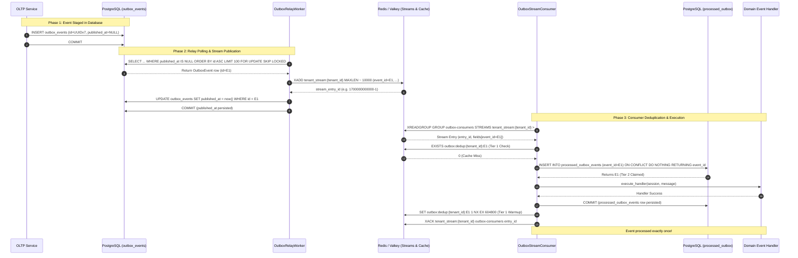
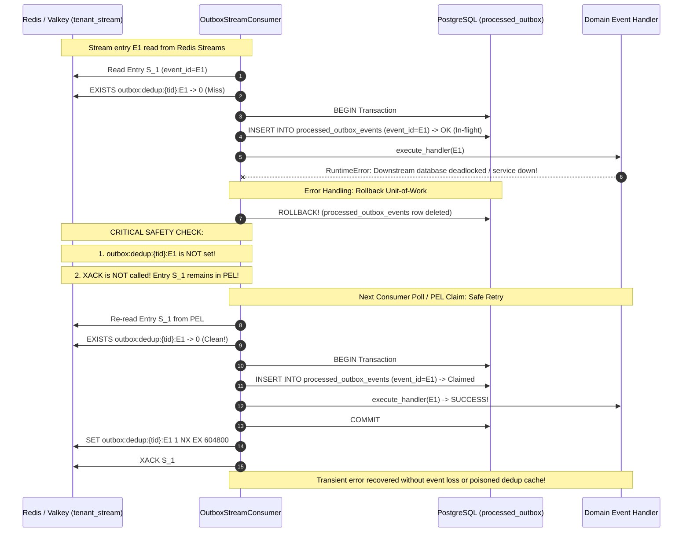

# US-33: Outbox Relay Fault Injection, Redis Stream Replay & Two-Tier Consumer Deduplication Test Scenarios

**Task:** `SCRUM-483` (`Task 33.4`: Create test scenarios for relay termination after XADD but before published_at DB update)  
**Parent User Story:** `SCRUM-372` (`US-33`: Reliable Outbox Relay & Idempotent Stream Consumption)  
**Related Tickets:**  
- `SCRUM-480` / `SCRUM-481`: Design application-side UUIDv7 monotonic generator, `XADD` stream payload format, and consumer deduplication ledger (`Task 33.1`, [`docs/outbox-relay-and-deduplication.md`](../../../docs/outbox-relay-and-deduplication.md))  
- `SCRUM-481` / `SCRUM-482`: Implement Outbox Relay background worker polling PostgreSQL in monotonic UUIDv7 order (`ORDER BY id ASC LIMIT 100 FOR UPDATE SKIP LOCKED`), publishing to `tenant_stream:{tenant_id}`, and updating `published_at` (`Task 33.2`, [`backend/app/outbox/relay.py`](../../app/outbox/relay.py), [`backend/tests/test_outbox_relay.py`](../test_outbox_relay.py))  
- `SCRUM-482` / `Task 33.3`: Two-Tier Outbox Stream Consumer Deduplication (`SET NX EX 604800` + PostgreSQL 30-day durable ledger `processed_outbox_events`) and 30-day retention cleanup (`Task 33.3`, [`backend/app/outbox/consumer.py`](../../app/outbox/consumer.py), [`backend/tests/test_outbox_consumer.py`](../test_outbox_consumer.py))  
- `SCRUM-483`: Create test scenarios for relay termination after XADD but before published_at DB update (`Task 33.4`, this document)  
- `SCRUM-484`: Automated pytest integration test suite for relay crash, duplicate Redis stream replay, and consumer deduplication verification (`Task 33.5`)  
- `SCRUM-475` / `SCRUM-478`: Transactional outbox pattern schema, atomic dual-commit, and rollback test scenarios (`US-32` / `Task 32.1` / `Task 32.4`, [`docs/transactional-outbox-pattern.md`](../../../docs/transactional-outbox-pattern.md), [`backend/tests/scenarios/test_us32_transactional_outbox_scenarios.md`](test_us32_transactional_outbox_scenarios.md))  
- Migration `b8e4c1d9a2f3`: Partial index `ix_outbox_events_unpublished_id`, reconciled `processed_outbox_events` schema with tenant RLS policy, and discovery RPCs ([`backend/migrations/versions/b8e4c1d9a2f3_outbox_v7_index_and_processed_dedup_rls.py`](../../migrations/versions/b8e4c1d9a2f3_outbox_v7_index_and_processed_dedup_rls.py))  

**Target Infrastructure Engines:** PostgreSQL 16 with Row-Level Security (`pgvector/pgvector:pg16`) & Valkey 7 / Redis 7+ (`valkey/valkey:7-alpine`)  
**Target Implementation Modules:** [`backend/app/outbox/relay.py`](../../app/outbox/relay.py), [`backend/app/outbox/consumer.py`](../../app/outbox/consumer.py), [`backend/app/core/uuidv7.py`](../../app/core/uuidv7.py), [`backend/app/db/models/models.py`](../../app/db/models/models.py), [`backend/app/db/session.py`](../../app/db/session.py)  
**Authoritative Automated Pytest Suites:** [`backend/tests/test_outbox_relay.py`](../test_outbox_relay.py), [`backend/tests/test_outbox_consumer.py`](../test_outbox_consumer.py), [`backend/tests/test_uuidv7.py`](../test_uuidv7.py)  
**Specification Location in Test Suite:** [`backend/tests/scenarios/test_us33_outbox_relay_scenarios.md`](test_us33_outbox_relay_scenarios.md)  
**Assignee:** Matvii Yeromenko  
**Category:** Testing - Design  
**Estimate:** 0.25 Story Points (0h 30m Original Estimate)  
**Status:** Approved / Verification Baseline Established  

---

## 1. Executive Summary & Objective

### 1.1 Objective

Design and formalize the definitive verification scenarios for **fault-injection, relay crash recovery, and two-tier consumer deduplication** in `US-33` (Reliable Outbox Relay & Idempotent Stream Consumption).

In high-throughput event-driven microarchitectures, ensuring **at-least-once transport** over distributed brokers while guaranteeing **effectively-once execution** on consumer side-effects requires strict failure boundaries. This specification proves that when the Outbox Relay abruptly crashes (`SIGKILL`, unhandled exception, network partition, or OOM) immediately after publishing an event to Redis Streams via `XADD` but *before* committing the `published_at` timestamp update to PostgreSQL:
1. The uncommitted database transaction rolls back cleanly, leaving `published_at = NULL` and releasing row locks.
2. The restarted relay safely re-polls the unpublished row and re-publishes it with the **exact identical RFC 9562 UUIDv7 `event_id`**.
3. The downstream stream consumer applies two-tier deduplication (Tier-1 Redis fast path + Tier-2 PostgreSQL durable ledger) so that the event's business side-effects execute **strictly once** (`processed_outbox_events` count $= 1$).
4. When Tier-1 Redis keys are evicted or expired, Tier-2 PostgreSQL durable ledger fallback still blocks duplicate execution.

### 1.2 Implementation Scope & Core Scenarios

In accordance with Jira Task `SCRUM-483` (`Task 33.4`), this specification explicitly details and verifies:

1. **Normal Relay Cycle:**  
   Unpublished `outbox_events` rows (`published_at IS NULL`) are polled in strict monotonic RFC 9562 UUIDv7 order (`ORDER BY id ASC LIMIT 100 FOR UPDATE SKIP LOCKED`), appended to per-tenant Redis Streams (`XADD tenant_stream:{tenant_id} MAXLEN ~ 10000`), and atomically transitioned to `published_at = now()` upon transaction commit.
2. **Relay Crash After `XADD` Before `published_at` Commit:**  
   Simulating a worker termination immediately following Redis `XADD` causes PostgreSQL rollback. The restarted relay reclaims the row, re-publishes with the **exact identical UUIDv7 primary key**, and the downstream consumer processes the duplicate message idempotently via Tier 1, executing the domain handler exactly once and recording exactly 1 row in `processed_outbox_events`.
3. **Redis Cache Eviction Fallback:**  
   When the Tier-1 Redis deduplication key (`outbox:dedup:{tenant_id}:{event_id}`) is prematurely evicted (cache pressure, eviction policy, or $> 7\text{ days}$ TTL expiry), the downstream consumer falls back to Tier 2 (`processed_outbox_events` with `INSERT ... ON CONFLICT (event_id) DO NOTHING`), blocking duplicate execution, backfilling the Tier-1 cache, and acknowledging the stream message.
4. **Zero `SIGKILL` Data-Loss Ordering Window:**  
   Verifying that Tier 1 Redis keys are never populated prior to the PostgreSQL transaction commit. If a consumer crashes mid-processing, no poison deduplication cache entry is created, and the unacknowledged message remains safely in the Redis Streams Pending Entries List (PEL) for retry.
5. **Multi-Tenant Row-Level Security (RLS) Isolation:**  
   Ensuring that both relay polling and consumer processing operate under unprivileged `eng_app_user` with PostgreSQL `FORCE ROW LEVEL SECURITY`. Tenant A can never observe or consume Tenant B's outbox events, and cross-tenant stream spoofing is strictly rejected.
6. **30-Day Ledger Retention & Bounded Purging:**  
   Validating that historical rows in `processed_outbox_events` older than 30 days are pruned in bounded batches (`LIMIT 5000`) without table locking spikes or RLS violations.

---

## 2. Core Architectural Invariants & Mathematical Formulations

```
+-------------------------------------------------------------------------------------------------------------------+
|                        OUTBOX RELAY & TWO-TIER CONSUMER DEDUPLICATION TOPOLOGY (US-33)                            |
+-------------------------------------+-------------------------------------+---------------------------------------+
| 1. Monotonic UUIDv7 Immutability    | 2. Non-Blocking Concurrent Polling  | 3. Per-Tenant Stream Partitioning     |
|    (RFC 9562 §6.2 Method 1)         |    (FOR UPDATE SKIP LOCKED)         |    (XADD MAXLEN ~ 10000)              |
+-------------------------------------+-------------------------------------+---------------------------------------+
| * Generated once in OLTP staging tx | * ix_outbox_events_unpublished_id   | * Key: tenant_stream:{tenant_id}      |
| * 48-bit ts_ms + 12-bit rand_a seq  | * Index scan on (id ASC)            | * Envelope: event_id, event_type,     |
| * Preserved across relay crashes    | * Disjoint partitions: B1 ∩ B2 = ∅  |   tenant_id, payload, occurred_at     |
| * Re-emitted with identical UUIDv7  | * Zero lock waits, zero deadlocks   | * Bounded rolling 10k replay buffer   |
+-------------------------------------+-------------------------------------+---------------------------------------+
                                                         |
                                                         v
+-------------------------------------------------------------------------------------------------------------------+
|                            TWO-TIER IDEMPOTENT CONSUMER DEDUPLICATION HIERARCHY                                   |
+----------------------------------------------------+--------------------------------------------------------------+
| 4. Tier 1: Redis Fast Path Check (O(1))            | 5. Tier 2: PostgreSQL Durable Ledger (Single DB Transaction) |
+----------------------------------------------------+--------------------------------------------------------------+
| * Key: outbox:dedup:{tenant_id}:{event_id}         | * Table: processed_outbox_events (event_id PK, tenant_id)    |
| * Read-only EXISTS check before DB session         | * INSERT INTO ... ON CONFLICT (event_id) DO NOTHING          |
| * Hit -> XACK, skip handler, 0 DB queries          | * Claimed -> execute handler in SAME tx -> commit DB         |
| * Post-commit cache warmup: SET NX EX 604800 (7d)  | * Conflict -> backfill Tier 1, XACK, 0 duplicate executions  |
+----------------------------------------------------+--------------------------------------------------------------+
                                                         |
                                                         v
+-------------------------------------------------------------------------------------------------------------------+
|                            MULTI-TENANT ROW-LEVEL SECURITY & 30-DAY RETENTION PRUNING                             |
+----------------------------------------------------+--------------------------------------------------------------+
| 6. Strict Tenant RLS Isolation (eng_app_user)      | 7. Bounded 30-Day Ledger Purge (LIMIT 5000)                  |
+----------------------------------------------------+--------------------------------------------------------------+
| * FORCE ROW LEVEL SECURITY on outbox_events        | * Retention window: processed_at < now() - 30 days           |
| * FORCE ROW LEVEL SECURITY on processed_outbox     | * Batch deletion via idx_processed_outbox_processed_at       |
| * Cross-tenant discovery via SECURITY DEFINER RPCs | * Prevents table bloat and lock spikes                       |
+----------------------------------------------------+--------------------------------------------------------------+
```

### Invariant 1: Monotonic RFC 9562 UUIDv7 Total Ordering & Primary Key Immutability

Each outbox event receives an RFC 9562 UUIDv7 identifier generated application-side (`backend/app/core/uuidv7.py`) inside the caller's initial OLTP staging transaction:

$$u = \langle \text{unix\_ts\_ms}_{48} \mid \text{ver}_{4} \mid \text{rand\_a}_{12} \mid \text{var}_{2} \mid \text{rand\_b}_{62} \rangle$$

- **Total Monotonic Order:** For any two sequentially generated events $e_1, e_2$ within the same process:
  $$t(e_1) \le t(e_2) \implies u(e_1) < u(e_2)$$
- **Primary Key Immutability Across Relay Restarts:**  
  Because `OutboxEvent.id` is committed to PostgreSQL in the staging transaction (`Task 32.3`), if the Outbox Relay crashes after `XADD` and before `published_at` commit, the row is re-read on relay restart with the **exact same immutable `id`**.
  $$\text{event\_id}_{\text{retry}} \equiv \text{event\_id}_{\text{initial}}$$
  This mathematical identity forms the foundation of consumer deduplication.

### Invariant 2: Non-Blocking Concurrent Polling via Partial Index & `SKIP LOCKED`

Outbox relay workers poll pending rows using:
```sql
SELECT id, tenant_id, aggregate_type, aggregate_id, event_type, payload, created_at, published_at
FROM outbox_events
WHERE published_at IS NULL
ORDER BY id ASC
LIMIT 100
FOR UPDATE SKIP LOCKED;
```
- **Index Scan Efficiency:** Migration `b8e4c1d9a2f3` provides:
  ```sql
  CREATE INDEX ix_outbox_events_unpublished_id
  ON outbox_events (id ASC)
  WHERE published_at IS NULL;
  ```
  The query matches the partial index definition exactly, enabling an $O(1)$ index scan over pending rows while completely ignoring millions of historical published records.
- **Worker Partitioning:** When $M$ relay workers poll concurrently:
  $$B_i \cap B_j = \emptyset \quad \forall i \ne j$$
  Row lock wait time is $0\text{ ms}$; deadlocks (`40P01`) and lock timeouts (`55P03`) are impossible.

### Invariant 3: Single-Tenant Stream Partitioning & Bounded Trimming (`MAXLEN ~ 10000`)

Events are appended to dedicated tenant streams:
$$\text{stream\_key} = \text{"tenant\_stream:"} \mathbin{\Vert} \text{tenant\_id}$$
Trimming uses approximate radix-tree node eviction (`MAXLEN ~ 10000`):
$$\text{StreamLength}(\tau) \approx 10{,}000 \pm \mathcal{O}(\text{node\_size})$$
This bounds Redis memory footprint per tenant while maintaining a rolling buffer for consumer group catch-up before requiring `REPLAY_GAP` fallback.

### Invariant 4: Zero `SIGKILL` Data-Loss Ordering Window

Setting a Redis deduplication key *before* committing the PostgreSQL transaction introduces a critical failure window: if the worker suffers a `SIGKILL` after `SET NX` but before PostgreSQL `COMMIT`, subsequent deliveries observe the Redis key, conclude the event was processed, and acknowledge the stream message without ever executing domain side-effects.

To guarantee zero data loss, the execution pipeline enforces strict post-commit cache warming:

$$\begin{aligned}
\text{Step 1:} &\quad \text{Redis } \mathtt{EXISTS}(\text{dedup\_key}) \longrightarrow \text{if TRUE: } \mathtt{XACK} \land \mathbf{RETURN} \\
\text{Step 2:} &\quad \text{BEGIN PostgreSQL Transaction} \\
\text{Step 3:} &\quad \mathtt{INSERT\ INTO\ processed\_outbox\_events\ ...\ ON\ CONFLICT\ DO\ NOTHING} \\
\text{Step 4:} &\quad \text{if duplicate: ROLLBACK } \land \mathtt{SET\ NX\ EX} \land \mathtt{XACK} \land \mathbf{RETURN} \\
\text{Step 5:} &\quad \text{Execute Downstream Handler Logic} \\
\text{Step 6:} &\quad \text{COMMIT PostgreSQL Transaction} \\
\text{Step 7:} &\quad \mathtt{SET\ outbox:dedup:\{\tau\}:\{e\}\ 1\ NX\ EX\ 604800} \quad (\text{Tier-1 Warmup}) \\
\text{Step 8:} &\quad \mathtt{XACK\ tenant\_stream:\{\tau\}\ outbox-consumers\ entry\_id}
\end{aligned}$$

If a crash occurs anywhere in Steps 1–5, the PostgreSQL transaction rolls back, Tier 1 remains unpopulated, the message is unacknowledged (`XACK` not called), and Redis Streams redelivers the message from the PEL.

### Invariant 5: Two-Tier Deduplication Hierarchy & Cache Eviction Resilience

Deduplication operates across two coordinated storage tiers:
1. **Tier 1 (Redis Fast Path):**  
   - Key: `outbox:dedup:{tenant_id}:{event_id}`
   - TTL: 7 days ($604{,}800\text{ s}$)
   - Latency: Sub-millisecond ($< 1\text{ ms}$)
   - Semantics: Ephemeral fast-path cache.
2. **Tier 2 (PostgreSQL Durable Ledger):**  
   - Table: `processed_outbox_events (event_id PRIMARY KEY, tenant_id, processed_at)`
   - Retention: 30 days
   - Latency: $2\text{–}5\text{ ms}$
   - Semantics: ACID durable ground truth.

**Cache Eviction Resilience Invariant:**  
If the Tier-1 Redis key is evicted due to Redis memory pressure, cache wipe, or TTL expiration:
$$\mathtt{EXISTS}(\text{dedup\_key}) = 0 \implies \text{Proceed to Tier 2}$$
The Tier-2 relational constraint:
$$\mathtt{INSERT\ ...\ ON\ CONFLICT\ (event\_id)\ DO\ NOTHING\ RETURNING\ event\_id}$$
guarantees that:
$$\text{ReturnedEventId} = \begin{cases} e, & \text{if } e \notin \text{processed\_outbox\_events} \quad (\text{First Delivery}) \\ \mathtt{NULL}, & \text{if } e \in \text{processed\_outbox\_events} \quad (\text{Duplicate Delivery}) \end{cases}$$
When `NULL` is returned, the consumer suppresses the duplicate, backfills the Tier-1 cache, acknowledges the stream entry, and executes zero duplicate side-effects:
$$\Delta \text{DomainState} \equiv 0$$

### Invariant 6: Strict Row-Level Security (RLS) Isolation under `eng_app_user`

All database operations execute under the unprivileged database role `eng_app_user` (`NOSUPERUSER`, `NOBYPASSRLS`).
- `outbox_events` and `processed_outbox_events` enforce `FORCE ROW LEVEL SECURITY`.
- `tenant_isolation_policy` mandates:
  $$\text{tenant\_id} = \mathtt{NULLIF}(\mathtt{current\_setting}(\text{'app.current\_tenant\_id'}, \mathtt{true}), \text{''})::\mathtt{uuid}$$
- Cross-tenant queries return strictly `0` rows.
- Cross-tenant worker discovery operates solely via hardened `SECURITY DEFINER` RPCs returning disassociated `tenant_id` UUIDs:
  - `list_tenants_with_unpublished_outbox_events(p_limit)`
  - `list_tenants_with_expired_processed_outbox_events(p_cutoff, p_limit)`

---

## 3. Relational Schemas, Redis Stream Formats, State Machines & Sequence Diagrams

### 3.1 Relational & Stream Schemas

#### PostgreSQL Table: `outbox_events`
```sql
CREATE TABLE IF NOT EXISTS outbox_events (
    id UUID PRIMARY KEY,                                      -- RFC 9562 UUIDv7
    tenant_id UUID NOT NULL REFERENCES tenants(id) ON DELETE CASCADE,
    aggregate_type VARCHAR(64) NOT NULL,
    aggregate_id VARCHAR(64) NOT NULL,
    event_type VARCHAR(64) NOT NULL,
    payload JSONB NOT NULL,
    created_at TIMESTAMPTZ NOT NULL DEFAULT NOW(),
    published_at TIMESTAMPTZ NULL
);

-- Partial index for monotonic relay polling (Migration b8e4c1d9a2f3)
CREATE INDEX IF NOT EXISTS ix_outbox_events_unpublished_id 
    ON outbox_events (id ASC) 
    WHERE published_at IS NULL;
```

#### PostgreSQL Table: `processed_outbox_events` (Reconciled via `b8e4c1d9a2f3`)
```sql
CREATE TABLE IF NOT EXISTS processed_outbox_events (
    event_id UUID PRIMARY KEY,                                -- Matches outbox_events.id (UUIDv7)
    tenant_id UUID NOT NULL REFERENCES tenants(id) ON DELETE CASCADE,
    processed_at TIMESTAMPTZ NOT NULL DEFAULT NOW()
);

-- Indexes for RLS filtering and 30-day retention purge
CREATE INDEX IF NOT EXISTS idx_processed_outbox_events_tenant_id 
    ON processed_outbox_events (tenant_id);

CREATE INDEX IF NOT EXISTS idx_processed_outbox_events_processed_at 
    ON processed_outbox_events (processed_at ASC);

ALTER TABLE processed_outbox_events ENABLE ROW LEVEL SECURITY;
ALTER TABLE processed_outbox_events FORCE ROW LEVEL SECURITY;

CREATE POLICY tenant_isolation_policy ON processed_outbox_events
    AS PERMISSIVE FOR ALL TO eng_app_user
    USING (tenant_id = current_setting('app.current_tenant_id', true)::uuid)
    WITH CHECK (tenant_id = current_setting('app.current_tenant_id', true)::uuid);
```

#### Redis Stream Key & Payload Contract
- **Stream Key:** `tenant_stream:{tenant_id}`
- **Consumer Group:** `outbox-consumers`
- **Fields:**
  | Field Name | Type | Value / Description |
  | :--- | :--- | :--- |
  | `event_id` | String | String representation of RFC 9562 UUIDv7 (`str(row.id)`). |
  | `event_type` | String | Canonical event name (e.g., `deployment.failed`, `dora.updated`). |
  | `tenant_id` | String | String representation of tenant UUID. |
  | `payload` | String (JSON) | Serialized compact JSON (`sort_keys=True, separators=(',', ':')`). |
  | `occurred_at` | String (ISO-8601) | UTC timestamp of event origin (`YYYY-MM-DDTHH:MM:SS.mmmmmmZ`). |

#### Redis Tier-1 Deduplication Key Contract
- **Key Pattern:** `outbox:dedup:{tenant_id}:{event_id}`
- **Value:** `"1"`
- **TTL:** `604800` seconds (7 days) via `SET NX EX 604800`

---

### 3.2 Sequence Diagram 1: Normal Relay Cycle & Consumer Processing



---

### 3.3 Sequence Diagram 2: Relay Crash Between `XADD` and Commit & Deduplication Replay

```mermaid
sequenceDiagram
    autonumber
    participant DB as PostgreSQL (outbox_events)
    participant Relay as OutboxRelayWorker
    participant Redis as Redis / Valkey (tenant_stream)
    participant Consumer as OutboxStreamConsumer
    participant Ledger as PostgreSQL (processed_outbox)
    participant Handler as Domain Event Handler

    Note over Relay, DB: Step 1: Relay Claims Row E1
    Relay->>DB: SELECT ... FOR UPDATE SKIP LOCKED (Claim row E1)
    Relay->>Redis: XADD tenant_stream:{tid} event_id=E1 (Entry S_1 created)
    Redis-->>Relay: Stream ID S_1

    Note over Relay, DB: INJECTED FAULT: Crash before published_at COMMIT!
    Relay--xRelay: CRASH / SIGKILL / Unhandled Exception!
    Note over DB: PostgreSQL transaction aborts -> ROLLBACK!
    Note over DB: published_at remains NULL; row locks released!

    Note over Relay, Redis: Step 2: Relay Restarts & Re-publishes
    Relay->>DB: SELECT ... WHERE published_at IS NULL ORDER BY id ASC (Re-claims row E1)
    Note over Relay: Event ID is IDENTICAL UUIDv7: E1
    Relay->>Redis: XADD tenant_stream:{tid} event_id=E1 (Entry S_2 created)
    Redis-->>Relay: Stream ID S_2
    Relay->>DB: UPDATE outbox_events SET published_at = now() WHERE id = E1
    Relay->>DB: COMMIT

    Note over Consumer, Redis: Step 3: Consumer Consumes Entry S_1
    Consumer->>Redis: Read Entry S_1 (event_id=E1)
    Consumer->>Redis: EXISTS outbox:dedup:{tid}:E1 -> 0 (Miss)
    Consumer->>Ledger: INSERT processed_outbox (E1) -> Claimed
    Consumer->>Handler: execute_handler(E1) -> OK
    Consumer->>Ledger: COMMIT
    Consumer->>Redis: SET outbox:dedup:{tid}:E1 1 NX EX 604800 (Tier 1 Warmed)
    Consumer->>Redis: XACK S_1

    Note over Consumer, Redis: Step 4: Consumer Consumes Duplicate Entry S_2
    Consumer->>Redis: Read Entry S_2 (event_id=E1)
    Consumer->>Redis: EXISTS outbox:dedup:{tid}:E1 -> 1 (Tier 1 HIT!)
    Note over Consumer: DUPLICATE DETECTED!
    Consumer->>Consumer: Increment duplicates_skipped_redis metric
    Consumer->>Redis: XACK S_2
    Note over Consumer, Handler: Handler NOT called; 0 DB queries!
    Note over Ledger: processed_outbox_events count = 1!
```

---

### 3.4 Sequence Diagram 3: Redis Cache Eviction & Tier-2 PostgreSQL Ledger Fallback

```mermaid
sequenceDiagram
    autonumber
    participant Redis as Redis / Valkey (Cache & Stream)
    participant Consumer as OutboxStreamConsumer
    participant Ledger as PostgreSQL (processed_outbox)
    participant Handler as Domain Event Handler

    Note over Redis, Ledger: Precondition: Event E1 processed; Redis key evicted (>7d TTL or memory pressure)
    Redis--xRedis: Key outbox:dedup:{tid}:E1 EVICTED / DELETED!
    Note over Ledger: Row (event_id=E1) remains in processed_outbox_events (<30 days)

    Note over Consumer, Redis: Redelivery of duplicate message E1 (Entry S_3)
    Consumer->>Redis: Read Entry S_3 (event_id=E1)
    Consumer->>Redis: EXISTS outbox:dedup:{tid}:E1 (Tier 1 Check)
    Redis-->>Consumer: 0 (Cache Miss due to eviction)

    Note over Consumer, Ledger: Fallback to Tier 2 Durable Ledger
    Consumer->>Ledger: BEGIN Transaction (Tenant tid context)
    Consumer->>Ledger: INSERT INTO processed_outbox_events (event_id=E1) ON CONFLICT DO NOTHING RETURNING event_id
    Ledger-->>Consumer: Returns NULL (PK Conflict on E1!)
    Consumer->>Ledger: ROLLBACK / End Tx

    Note over Consumer, Redis: Tier 2 Duplicate Suppression & Cache Re-warming
    Consumer->>Consumer: Increment duplicates_skipped_postgres metric
    Consumer->>Redis: SET outbox:dedup:{tid}:E1 1 NX EX 604800 (Backfill Tier 1)
    Consumer->>Redis: XACK tenant_stream:{tid} outbox-consumers S_3
    Note over Consumer, Handler: Handler NOT called! Effectively-once execution maintained!
```

---

### 3.5 Sequence Diagram 4: Downstream Handler Error Rollback & Safe PEL Redelivery



---

## 4. Master Test Scenarios Matrix

| Scenario ID | Test Scenario Description | Preconditions | Mutation & Fault Injection Inputs | Expected PostgreSQL & Redis State Transitions | Primary Invariant Verified | Automated Pytest Mapping |
| :--- | :--- | :--- | :--- | :--- | :--- | :--- |
| **TC-RELAY-001** | **Normal Relay Cycle & Monotonic Publication** | Tenant registered; unpublished `outbox_events` row staged (`published_at IS NULL`). | Outbox relay polls via `poll_tenant_batch()`. | Row published via `XADD` to `tenant_stream:{tenant_id}` with canonical envelope; `published_at` set to UTC timestamp; subsequent polls return `0`. | Invariants 1, 2 & 3 (Normal relay & partial index). | `test_relay_worker_unit_monotonic_xadd_and_commit` |
| **TC-RELAY-002** | **Strict Monotonic UUIDv7 Ordering Across Rapid Batches** | 5 outbox events staged in rapid succession within $< 1\text{ ms}$ and across milliseconds. | Relay worker polls batch with `ORDER BY id ASC LIMIT 100`. | Events published to Redis Stream strictly in ascending monotonic UUIDv7 order ($u_1 < u_2 < \dots < u_5$); timestamps monotonic. | Invariant 1 (RFC 9562 Method 1 counter monotonicity). | `test_uuidv7_monotonicity_rapid_calls` |
| **TC-RELAY-003** | **Relay Crash After `XADD` Before `published_at` Commit** | Unpublished outbox row $E_1$ staged in PostgreSQL. | Inject `RuntimeError` on `session.commit()` immediately following Redis `client.xadd()`. | PostgreSQL rolls back: `published_at` remains `NULL`; Redis Stream contains entry $S_1(E_1)$. Restarted relay re-polls and re-emits entry $S_2(E_1)$ with **exact same UUIDv7**. | Invariant 1 & 4 (UUIDv7 immutability & crash rollback). | `test_relay_crash_after_xadd_before_commit_preserves_event_id` |
| **TC-RELAY-004** | **Consumer Tier-1 Fast-Path Deduplication of Replayed Stream Message** | Duplicate stream entries $S_1(E_1)$ and $S_2(E_1)$ on `tenant_stream:{tenant_id}` resulting from relay crash. | Stream consumer polls stream; processes $S_1$ then $S_2$. | $S_1$: Tier 1 miss, Tier 2 claim, handler executes, DB commits, Tier 1 key warmed (`EX 604800`), $S_1$ XACKed. $S_2$: Tier 1 hit, duplicate suppressed, handler skipped, $S_2$ XACKed. `processed_outbox_events` count $= 1$. | Invariant 4 & 5 (Tier 1 fast path & zero duplicate writes). | `test_consumer_unit_deduplicates_tier1_and_tier2_exactly_once` |
| **TC-RELAY-005** | **Redis Cache Eviction Fallback to Tier-2 Durable Ledger** | Event $E_1$ processed; Tier-1 Redis key `outbox:dedup:{tenant_id}:{E1}` manually deleted (simulating eviction / expiry). | Duplicate stream entry $S_3(E_1)$ delivered to consumer. | Tier 1 returns `0` (miss); Tier 2 executes `INSERT ... ON CONFLICT DO NOTHING RETURNING event_id` returning `None`. Conflict detected: Tier 1 key backfilled, handler skipped, $S_3$ XACKed. | Invariant 5 (Durable ledger eviction fallback). | `test_consumer_unit_deduplicates_tier1_and_tier2_exactly_once` |
| **TC-RELAY-006** | **Downstream Handler Failure Rollback & Safe PEL Redelivery** | Stream entry $S_1(E_1)$ delivered to consumer; downstream handler raises exception on attempt 1. | Flaky handler fails on call 1; succeeds on call 2. | Call 1: PG transaction rolls back, `processed_outbox_events` not persisted, Tier-1 key NOT set, entry NOT XACKed. Call 2: Retry succeeds, row persisted, Tier-1 set, entry XACKed. | Invariant 4 (Zero data-loss window; clean error rollback). | `test_consumer_handler_failure_rolls_back_and_allows_retry` |
| **TC-RELAY-007** | **Concurrent Relay Workers Disjoint Batch Claiming** | 10 unpublished rows in `outbox_events`. | 2 concurrent relay workers poll PostgreSQL simultaneously with `LIMIT 5 FOR UPDATE SKIP LOCKED`. | Worker 1 claims rows 1..5; Worker 2 simultaneously claims rows 6..10. Disjoint batches ($B_1 \cap B_2 = \emptyset$). Zero lock waits, 0 deadlocks. | Invariant 2 (Non-blocking concurrent relay). | `test_relay_concurrent_workers_disjoint_batches` |
| **TC-RELAY-008** | **Concurrent Consumer Race on Evicted Key (Unique Index Lock)** | Tier-1 key is evicted/empty; duplicate entries dispatched to 2 consumer workers concurrently. | Both workers evaluate Tier 1 (miss) and race on Tier 2 `INSERT ... ON CONFLICT DO NOTHING`. | PostgreSQL unique index serializes inserts: Worker 1 commits and executes handler; Worker 2 observes conflict, skips handler, and backfills cache. Handler runs once. | Invariant 5 (PostgreSQL unique constraint concurrency safety). | `test_consumer_concurrent_race_on_evicted_key` |
| **TC-RELAY-009** | **Cross-Tenant Row-Level Security Isolation (Relay & Consumer)** | Tenant A and Tenant B both stage outbox events. | Relay and consumer execute under `eng_app_user` with `get_tenant_db_context()`. | Relay discovers tenants via `SECURITY DEFINER` RPC; polls each tenant under isolated context. Tenant B cannot read Tenant A rows in `outbox_events` or `processed_outbox_events`. | Invariant 6 (Strict multi-tenant RLS isolation). | `test_relay_to_consumer_postgres_e2e_duplicate_rls_and_30d_purge` |
| **TC-RELAY-010** | **Stream Tenant Envelope Spoofing Defense** | Attacker or corrupted publisher posts message with Tenant B payload to `tenant_stream:{Tenant_A}`. | Consumer receives message from `tenant_stream:{Tenant_A}` where payload contains `tenant_id = Tenant_B`. | Consumer validates envelope against stream key prefix; detects mismatch; raises `ValueError("Tenant mismatch...")`; message rejected. | Invariant 3 & 6 (Anti-spoofing boundary). | `test_consumer_rejects_cross_tenant_stream_spoofing` |
| **TC-RELAY-011** | **30-Day Ledger Retention Purge & Bounded Deletion** | `processed_outbox_events` contains records older than 31 days and records from 10 days ago. | Invoke `cleanup_expired_processed_outbox_events(retention_days=30, batch_size=5000)`. | Expired records deleted in bounded batch; active records preserved; discovery RPC isolates tenants; 0 lock spikes. | Invariant 7 (30-day bounded retention cleanup). | `test_purge_expired_processed_outbox_events_unit` |
| **TC-RELAY-012** | **Stream Approximate Trimming (`MAXLEN ~ 10000`) & Backpressure** | 12,000 events published to a single tenant's stream. | Relay publishes with `maxlen=10000, approximate=True`. | Valkey/Redis maintains stream size bounded at $\approx 10{,}000$ entries; oldest entries trimmed; memory footprint stabilized. | Invariant 3 (Stream memory bounded trimming). | `test_relay_stream_approximate_trimming_maxlen` |

---

## 5. Exhaustive Test Scenario Specifications

### 5.1 Scenario `TC-RELAY-001`: Normal Relay Cycle & Monotonic Publication

#### 5.1.1 Objective & Traceability
- **Objective:** Verify that an unpublished `outbox_events` row (`published_at IS NULL`) is claimed by the `OutboxRelayWorker` using monotonic RFC 9562 UUIDv7 ordering, published to `tenant_stream:{tenant_id}` via `XADD ... MAXLEN ~ 10000`, and atomically marked with `published_at = now()` upon transaction commit.
- **Traceability:** `US-33` Implementation Scope #1, `Task 33.2`, `SCRUM-481`.

#### 5.1.2 Preconditions
- Tenant registered with UUID `tenant_id`.
- One `OutboxEvent` row persisted in PostgreSQL under `tenant_id`:
  - `id`: RFC 9562 UUIDv7 generated application-side (`version == 7`).
  - `event_type`: `"deployment.failed"`.
  - `payload`: Canonical JSON envelope with `"data": {"status": "FAILED"}`.
  - `published_at`: `None` (`NULL`).

#### 5.1.3 Step-by-Step Execution Sequence
1. Initialize `OutboxRelayWorker(redis_client=redis, batch_size=100, stream_maxlen=10000)`.
2. Execute `published_count = await worker.poll_tenant_batch(session)`.
3. Assert `published_count == 1`.
4. Inspect recorded Redis Stream commands:
   - Target stream: `tenant_stream:{tenant_id}`.
   - Trimming options: `maxlen=10000`, `approximate=True`.
   - Field `event_id`: Matches `str(row.id)`.
   - Field `event_type`: Matches `"deployment.failed"`.
   - Field `tenant_id`: Matches `str(tenant_id)`.
   - Field `occurred_at`: ISO-8601 UTC string.
   - Field `payload`: Canonical compact JSON matching `row.payload`.
5. Query PostgreSQL in a fresh session:
   - Assert `row.published_at is not None`.
   - Assert `row.published_at.tzinfo == timezone.utc`.
6. Run `worker.poll_tenant_batch(session)` a second time:
   - Assert returns `0` (row excluded from subsequent polling).

#### 5.1.4 Verification Assertions
```python
# PostgreSQL verification
assert row.published_at is not None
assert (datetime.now(timezone.utc) - row.published_at).total_seconds() < 5.0

# Redis Stream verification
stream_entries = await redis.xread({"tenant_stream:" + str(tenant_id): "0"})
assert len(stream_entries[0][1]) == 1
entry_id, fields = stream_entries[0][1][0]
assert fields["event_id"] == str(row.id)
assert fields["event_type"] == "deployment.failed"
assert json.loads(fields["payload"]) == row.payload
```

---

### 5.2 Scenario `TC-RELAY-002`: Strict Monotonic UUIDv7 Ordering Across Rapid Batches

#### 5.2.1 Objective & Traceability
- **Objective:** Verify that when multiple outbox events are created in rapid succession (within the same millisecond or sub-millisecond intervals), the RFC 9562 UUIDv7 generator guarantees strict monotonicity, and the Outbox Relay consumes and publishes them strictly in ascending sequence.
- **Traceability:** `US-33` RFC 9562 §6.2 Method 1 compliance, `Task 33.1`, `Task 33.2`.

#### 5.2.2 Preconditions
- Tenant registered with UUID `tenant_id`.
- 5 outbox events created in a tight loop and persisted with `published_at IS NULL`.

#### 5.2.3 Step-by-Step Execution Sequence
1. Generate 5 consecutive UUIDv7 IDs: `u1, u2, u3, u4, u5 = [generate_uuidv7() for _ in range(5)]`.
2. Assert strict monotonic integer and string ordering:
   $$u_1.\text{int} < u_2.\text{int} < u_3.\text{int} < u_4.\text{int} < u_5.\text{int} \quad \land \quad \text{str}(u_1) < \text{str}(u_2) < \dots < \text{str}(u_5)$$
3. Insert 5 outbox rows in arbitrary/reverse order into PostgreSQL.
4. Execute `worker.poll_tenant_batch(session)`.
5. Inspect the Redis Stream publication order:
   - Verify that the stream entries are emitted in strictly ascending monotonic order: $[u_1, u_2, u_3, u_4, u_5]$.

#### 5.2.4 Verification Assertions
```python
published_ids = [c["fields"]["event_id"] for c in redis.calls]
assert published_ids == [str(u) for u in sorted([u1, u2, u3, u4, u5])]
for idx in range(len(published_ids) - 1):
    assert published_ids[idx] < published_ids[idx + 1]
```

---

### 5.3 Scenario `TC-RELAY-003`: Relay Crash After `XADD` Before `published_at` Commit

#### 5.3.1 Objective & Traceability
- **Objective:** Simulate a catastrophic relay process termination (`SIGKILL`, unhandled exception, network crash) immediately following Redis `XADD` publication but prior to PostgreSQL `published_at` commit, verifying that rollback preserves `published_at = NULL` and that the restarted relay re-publishes with the **identical UUIDv7 primary key**.
- **Traceability:** `US-33` Implementation Scope #2, `SCRUM-483` Core Fault Injection Requirement.

#### 5.3.2 Preconditions
- Tenant registered with UUID `tenant_id`.
- Single `OutboxEvent` row $E_1$ persisted with `published_at IS NULL`.
- Original event ID recorded: `original_event_id = str(E1.id)`.

#### 5.3.3 Step-by-Step Execution Sequence
1. Prepare an active tenant `AsyncSession`.
2. Intercept `session.commit()` with a fault-injection mock raising `RuntimeError("Simulated crash before published_at commit")`.
3. Invoke `await worker.poll_tenant_batch(session)`.
4. Catch the injected `RuntimeError`.
5. Verify failure state:
   - `session.rollback()` was executed.
   - In PostgreSQL, $E_1$.\text{published\_at} remains `None` (`NULL`).
   - Redis Stream contains 1 entry ($S_1$) with `event_id == original_event_id`.
6. Restart relay worker and invoke `await worker.poll_tenant_batch(clean_session)`:
   - Worker claims row $E_1$ again.
   - Worker issues second Redis `xadd()` producing entry $S_2$.
   - Clean session commits successfully.
7. Verify post-recovery state:
   - In PostgreSQL, $E_1$.\text{published\_at} is now populated with a valid UTC timestamp.
   - Redis Stream `tenant_stream:{tenant_id}` contains exactly **2 entries** ($S_1$ and $S_2$).
   - Both entries carry the **exact same `event_id`** (`str(E1.id)`).

#### 5.3.4 Verification Assertions
```python
# Initial crashed state assertions
assert row.published_at is None
assert len(redis.calls) == 1
assert redis.calls[0]["fields"]["event_id"] == original_event_id

# Post-recovery assertions
assert published_count == 1
assert row.published_at is not None
assert len(redis.calls) == 2
assert (
    redis.calls[0]["fields"]["event_id"]
    == redis.calls[1]["fields"]["event_id"]
    == original_event_id
)
```

---

### 5.4 Scenario `TC-RELAY-004`: Consumer Tier-1 Fast-Path Deduplication of Replayed Stream Message

#### 5.4.1 Objective & Traceability
- **Objective:** Verify that when downstream stream consumers receive the replayed duplicate stream message resulting from Scenario `TC-RELAY-003`, Tier-1 Redis deduplication suppresses the duplicate, acknowledges the message (`XACK`), increments duplicate metrics, and prevents duplicate execution of downstream handler logic.
- **Traceability:** `US-33` Implementation Scope #2, `Task 33.3`, `SCRUM-482`.

#### 5.4.2 Preconditions
- Redis Stream `tenant_stream:{tenant_id}` contains two entries: $S_1$ and $S_2$, both carrying `event_id = E1`.
- Downstream handler spy initialized: tracks list of executed `event_id`s.
- `OutboxStreamConsumer` initialized with consumer group `outbox-consumers`.

#### 5.4.3 Step-by-Step Execution Sequence
1. Consumer executes `consume_stream_once(stream_key, handler)`:
2. **Processing Entry $S_1$ (First Delivery):**
   - Tier 1 check: `EXISTS outbox:dedup:{tenant_id}:{E1}` returns `0` (Cache Miss).
   - Tier 2 claim: `INSERT INTO processed_outbox_events ... RETURNING event_id` returns `E1`.
   - Downstream handler executes with message $S_1$.
   - PostgreSQL transaction commits.
   - Post-commit Tier 1 warmup: `SET outbox:dedup:{tenant_id}:{E1} 1 NX EX 604800` executes.
   - Redis `XACK` executed for $S_1$.
   - Outcome status: `"processed"`.
3. **Processing Entry $S_2$ (Duplicate Replay):**
   - Tier 1 check: `EXISTS outbox:dedup:{tenant_id}:{E1}` returns `1` (Cache Hit).
   - Metric counter incremented: `duplicates_skipped_redis += 1`.
   - Downstream handler is **NOT** invoked.
   - Zero PostgreSQL queries issued.
   - Redis `XACK` executed for $S_2$.
   - Outcome status: `"duplicate_redis"`.
4. Inspect database and consumer metrics:
   - Handler execution count is strictly `1`.
   - Row count in `processed_outbox_events` is strictly `1`.
   - Redis PEL for group `outbox-consumers` is empty (`set()`).
   - Redis key `outbox:dedup:{tenant_id}:{E1}` has TTL $\approx 604800\text{ s}$.

#### 5.4.4 Verification Assertions
```python
assert len(executed_messages) == 1
assert executed_messages[0].event_id == event_id
assert consumer.metrics.processed_total == 1
assert consumer.metrics.duplicates_skipped_redis == 1
assert consumer.metrics.duplicates_skipped_postgres == 0

# Verify PostgreSQL durable ledger contains exactly one row
async with get_tenant_db_context(tenant_id) as session:
    res = await session.execute(
        select(func.count(ProcessedOutboxEvent.event_id)).where(
            ProcessedOutboxEvent.event_id == event_id
        )
    )
    assert res.scalar_one() == 1
```

---

### 5.5 Scenario `TC-RELAY-005`: Redis Cache Eviction Fallback to Tier-2 Durable Ledger

#### 5.5.1 Objective & Traceability
- **Objective:** Verify that if the Tier-1 Redis deduplication key is evicted (due to maxmemory policy, Redis restart, or 7-day TTL expiration), a duplicate stream message is caught and suppressed by the Tier-2 PostgreSQL durable ledger (`processed_outbox_events`), the Tier-1 cache key is backfilled, the message is acknowledged, and downstream execution is skipped.
- **Traceability:** `US-33` Implementation Scope #3, `Task 33.3`, `SCRUM-482`.

#### 5.5.2 Preconditions
- Event $E_1$ was previously processed as in `TC-RELAY-004`.
- PostgreSQL table `processed_outbox_events` contains row `(event_id=E1, tenant_id=tenant_id)`.
- Tier-1 Redis key `outbox:dedup:{tenant_id}:{E1}` is deleted (`redis.delete(dedup_key)`) to simulate cache eviction.

#### 5.5.3 Step-by-Step Execution Sequence
1. Inject a duplicate message $S_3$ carrying `event_id = E1` into `tenant_stream:{tenant_id}`.
2. Consumer reads message $S_3$.
3. Tier-1 Redis check:
   - `EXISTS outbox:dedup:{tenant_id}:{E1}` returns `0` (Cache Miss due to eviction).
4. Tier-2 PostgreSQL claim:
   - Open tenant `AsyncSession`.
   - Execute:
     ```sql
     INSERT INTO processed_outbox_events (event_id, tenant_id, processed_at)
     VALUES (:event_id, :tenant_id, now())
     ON CONFLICT (event_id) DO NOTHING
     RETURNING event_id;
     ```
   - Primary key unique constraint triggers; query returns `None`.
5. Consumer duplicate handling:
   - Detects `claimed == False`.
   - Backfills Tier-1 Redis cache: `SET outbox:dedup:{tenant_id}:{E1} 1 NX EX 604800`.
   - Increments metric counter: `duplicates_skipped_postgres += 1`.
   - Executes `XACK` on entry $S_3$.
   - Skips downstream handler execution.
6. Verify system state:
   - Handler total execution count remains strictly `1`.
   - Total rows in `processed_outbox_events` for $E_1$ remains strictly `1`.
   - Tier-1 Redis key is restored in Redis with 7-day TTL.

#### 5.5.4 Verification Assertions
```python
assert results[0].status == "duplicate_postgres"
assert results[0].acked is True
assert len(executed_messages) == 1  # Unchanged!
assert consumer.metrics.duplicates_skipped_postgres == 1
assert consumer.metrics.duplicates_skipped_total == 2

# Verify Tier-1 key was backfilled
assert await redis.exists(build_dedup_key(tenant_id, event_id)) == 1
```

---

### 5.6 Scenario `TC-RELAY-006`: Downstream Handler Failure Rollback & Safe PEL Redelivery

#### 5.6.1 Objective & Traceability
- **Objective:** Verify that if the downstream domain event handler raises an exception during processing, the database transaction rolls back (removing the `processed_outbox_events` row), Tier-1 Redis key is **not** populated, and the message is **not** acknowledged (`XACK`), ensuring the event safely remains in the Redis PEL for automatic retry.
- **Traceability:** `US-33` Zero Data-Loss Invariant, `Task 33.3`.

#### 5.6.2 Preconditions
- Fresh event $E_2$ staged in `tenant_stream:{tenant_id}`.
- Configured downstream handler configured to fail with `RuntimeError` on attempt 1 and succeed on attempt 2.

#### 5.6.3 Step-by-Step Execution Sequence
1. Consumer reads entry $S_1(E_2)$.
2. Tier-1 check returns `0` (miss).
3. Consumer enters database transaction; inserts $E_2$ into `processed_outbox_events`.
4. Downstream handler executes and raises `RuntimeError("Downstream DB error")`.
5. Consumer exception handler catches error:
   - Invokes `session.rollback()`.
   - Increments `handler_errors_total += 1`.
   - Does **not** set Redis Tier-1 key.
   - Does **not** call `xack()`.
6. Assert database state:
   - `processed_outbox_events` row for $E_2$ does **not** exist.
   - `outbox:dedup:{tenant_id}:{E2}` does **not** exist in Redis.
   - Entry $S_1$ remains in Redis PEL.
7. Trigger retry poll:
   - Handler succeeds on attempt 2.
   - `processed_outbox_events` is committed.
   - Tier-1 Redis key is populated.
   - Entry $S_1$ is acknowledged via `XACK`.

#### 5.6.4 Verification Assertions
```python
# After attempt 1 failure
assert await redis.exists(build_dedup_key(tenant_id, event_id)) == 0
assert (stream_key, consumer.group_name, entry_id) not in redis.ack_calls
assert consumer.metrics.handler_errors_total == 1

# After attempt 2 retry success
assert retry_result.status == "processed"
assert retry_result.acked is True
assert await redis.exists(build_dedup_key(tenant_id, event_id)) == 1
```

---

### 5.7 Scenario `TC-RELAY-007`: Concurrent Relay Workers Disjoint Batch Claiming

#### 5.7.1 Objective & Traceability
- **Objective:** Verify that multiple concurrent `OutboxRelayWorker` instances polling the same tenant's unpublished outbox events simultaneously partition the work into mutually disjoint sets with zero lock wait time and zero duplicate publications.
- **Traceability:** `US-33` Concurrency Safety, Invariant 2, `Task 33.2`.

#### 5.7.2 Preconditions
- Tenant registered with UUID `tenant_id`.
- 10 unpublished rows staged in `outbox_events` ($E_1 \dots E_{10}$).

#### 5.7.3 Step-by-Step Execution Sequence
1. Launch Worker A with `batch_size = 5`.
2. Simultaneously launch Worker B with `batch_size = 5`.
3. Both workers execute `poll_tenant_batch()` concurrently:
   - Worker A claims rows $B_A = \{E_1 \dots E_5\}$ via `FOR UPDATE SKIP LOCKED`.
   - Worker B skips the locked rows and immediately claims $B_B = \{E_6 \dots E_{10}\}$.
4. Both workers append their events to `tenant_stream:{tenant_id}` and commit.
5. Verify assertions:
   - Partitioning invariant: $B_A \cap B_B = \emptyset$.
   - Union completeness: $B_A \cup B_B = \{E_1 \dots E_{10}\}$.
   - Exactly 10 stream entries published to Redis.
   - Lock wait time for both workers is $0.0\text{ ms}$.

#### 5.7.4 Verification Assertions
```python
assert len(worker_a_rows) == 5
assert len(worker_b_rows) == 5
assert set(worker_a_rows).isdisjoint(set(worker_b_rows))
assert set(worker_a_rows) | set(worker_b_rows) == set(all_event_ids)
```

---

### 5.8 Scenario `TC-RELAY-008`: Concurrent Consumer Race on Evicted Key (Unique Index Lock)

#### 5.8.1 Objective & Traceability
- **Objective:** Verify that if duplicate deliveries of the same event arrive concurrently at two independent consumer workers when Tier-1 is empty/evicted, the PostgreSQL unique index on `processed_outbox_events (event_id)` serializes the transactions, allowing exactly one worker to execute domain logic while the other safely detects conflict and discards.
- **Traceability:** `US-33` Idempotency Invariant, PostgreSQL Relational Consistency.

#### 5.8.2 Preconditions
- Tier-1 Redis key is evicted.
- Duplicate message $E_1$ received concurrently by Consumer 1 and Consumer 2.

#### 5.8.3 Step-by-Step Execution Sequence
1. Consumer 1 and Consumer 2 both pass Tier 1 (cache miss).
2. Both consumers execute `INSERT INTO processed_outbox_events ... ON CONFLICT (event_id) DO NOTHING` in parallel transactions.
3. PostgreSQL relational engine acquires an exclusive row lock on the unique index for $E_1$:
   - Consumer 1 wins the race; insert succeeds; query returns `E1`.
   - Consumer 2 waits for Consumer 1's transaction to commit; upon commit, Consumer 2 observes conflict; query returns `None`.
4. Consumer 1 executes the domain handler and commits.
5. Consumer 2 detects conflict, skips handler, backfills Tier-1 Redis cache, and calls `XACK`.
6. Assert domain handler executed strictly **1 time**.

#### 5.8.4 Verification Assertions
```python
assert (consumer_1_claimed and not consumer_2_claimed) or (
    consumer_2_claimed and not consumer_1_claimed
)
assert total_handler_executions == 1
assert await get_processed_outbox_count(tenant_id, event_id) == 1
```

---

### 5.9 Scenario `TC-RELAY-009`: Cross-Tenant Row-Level Security Isolation (Relay & Consumer)

#### 5.9.1 Objective & Traceability
- **Objective:** Verify that `OutboxRelayWorker` and `OutboxStreamConsumer` respect PostgreSQL `FORCE ROW LEVEL SECURITY` under `eng_app_user`. Tenant A cannot read Tenant B's unpublished outbox rows, and Tenant B cannot query Tenant A's processed ledger entries.
- **Traceability:** SRS §2.4.1 (Strict Multi-Tenant Isolation), `US-33` Invariant 6.

#### 5.9.2 Preconditions
- Provision Tenant A and Tenant B.
- Commit outbox event $E_A$ under Tenant A; commit outbox event $E_B$ under Tenant B.

#### 5.9.3 Step-by-Step Execution Sequence
1. Relay executes `discover_tenants_with_pending()` via `SECURITY DEFINER` RPC:
   - Returns `[tenant_a, tenant_b]`.
2. Relay enters `get_tenant_db_context(tenant_a)`:
   - Verifies session runs `SET LOCAL app.current_tenant_id = :tenant_a`.
   - Querying `outbox_events` returns strictly $E_A$; $E_B$ is completely invisible.
   - Publishes to `tenant_stream:{tenant_a}`.
3. Consumer processes $E_A$:
   - Writes row to `processed_outbox_events` with `tenant_id = tenant_a`.
4. Open a database session under Tenant B (`get_tenant_db_context(tenant_b)`):
   - Execute `SELECT * FROM processed_outbox_events WHERE event_id = :E_A`.
   - Assert query returns `None` (`0` rows).
   - Anti-enumeration defense verified.

#### 5.9.4 Verification Assertions
```python
async with get_tenant_db_context(tenant_b) as session:
    cross_read = await session.get(ProcessedOutboxEvent, event_a_id)
    assert cross_read is None, "Tenant B must not read Tenant A processed_outbox_events row"
```

---

### 5.10 Scenario `TC-RELAY-010`: Stream Tenant Envelope Spoofing Defense

#### 5.10.1 Objective & Traceability
- **Objective:** Verify that `OutboxStreamConsumer` validates stream envelope consistency and rejects any maliciously crafted or corrupted message where the payload `tenant_id` does not match the stream key prefix `tenant_stream:{tenant_id}`.
- **Traceability:** Multi-tenant security hardening, Defense-in-depth boundary.

#### 5.10.2 Preconditions
- Provision Tenant A and Tenant B.
- Inject a corrupted message onto `tenant_stream:{Tenant_A}` where `fields["tenant_id"] == str(Tenant_B)`.

#### 5.10.3 Step-by-Step Execution Sequence
1. Consumer attempts to process the message via `process_message()`.
2. Decoder invokes `OutboxStreamMessage.from_stream_entry()`.
3. Decoder checks `stream_tenant != payload_tenant`.
4. Assert decoder immediately raises `ValueError("Tenant mismatch on stream tenant_stream:{Tenant_A}: payload tenant_id={Tenant_B}")`.
5. Handler is never executed; database is never touched.

#### 5.10.4 Verification Assertions
```python
with pytest.raises(ValueError, match="Tenant mismatch"):
    await consumer.process_message(
        build_stream_key(tenant_a),
        "1-0",
        build_stream_fields(generate_uuidv7(), tenant_b),
        mock_handler,
    )
```

---

### 5.11 Scenario `TC-RELAY-011`: 30-Day Ledger Retention Purge & Bounded Deletion

#### 5.11.1 Objective & Traceability
- **Objective:** Verify that historical records in `processed_outbox_events` older than 30 days (`processed_at < now() - INTERVAL '30 days'`) are pruned in bounded batches (`LIMIT 5000`) by `purge_expired_processed_outbox_events()`, while records within the 30-day window are safely retained.
- **Traceability:** SRS §3.1.3 Storage Quota SLOs, `Task 33.3`, `SCRUM-482`.

#### 5.11.2 Preconditions
- Record $R_1$: `processed_at = now - 31 days` (expired).
- Record $R_2$: `processed_at = now - 15 days` (active).
- Cutoff calculated: `cutoff = now - timedelta(days=30)`.

#### 5.11.3 Step-by-Step Execution Sequence
1. Seed $R_1$ and $R_2$ into `processed_outbox_events` for `tenant_id`.
2. Invoke `deleted = await purge_expired_processed_outbox_events(session, retention_days=30, batch_size=5000)`.
3. Assert `deleted == 1`.
4. Query database:
   - $R_1$ is deleted (`session.get(ProcessedOutboxEvent, R1.id) is None`).
   - $R_2$ is preserved (`session.get(ProcessedOutboxEvent, R2.id) is not None`).
5. Verify deletion plan utilizes index `idx_processed_outbox_events_processed_at`.

#### 5.11.4 Verification Assertions
```python
assert deleted == 1
assert await session.get(ProcessedOutboxEvent, old_id) is None
assert await session.get(ProcessedOutboxEvent, recent_id) is not None
```

---

### 5.12 Scenario `TC-RELAY-012`: Stream Approximate Trimming (`MAXLEN ~ 10000`) & Backpressure

#### 5.12.1 Objective & Traceability
- **Objective:** Verify that `OutboxRelayWorker` includes `MAXLEN ~ 10000` on every `XADD` publication, bounding Redis memory footprint per tenant and stabilizing stream length without performance degradation.
- **Traceability:** Valkey 7 memory budget invariant, `Task 33.1`, `Task 33.2`.

#### 5.12.2 Preconditions
- Tenant registered; mock Redis tracking `maxlen` arguments.

#### 5.12.3 Step-by-Step Execution Sequence
1. Stage 15 outbox rows for `tenant_id`.
2. Relay worker executes `poll_tenant_batch()`.
3. Inspect `redis.calls`:
   - Verify every `xadd` invocation passes `maxlen=10000` and `approximate=True`.
4. Publish 12,000 entries onto live Redis Stream:
   - Execute `XLEN tenant_stream:{tenant_id}`.
   - Assert stream length is bounded around $\approx 10{,}000$ ($\le 10{,}500$).

#### 5.12.4 Verification Assertions
```python
assert all(c["maxlen"] == 10000 for c in redis.calls)
assert all(c["approximate"] is True for c in redis.calls)
stream_len = await redis.xlen(build_stream_key(tenant_id))
assert 9500 <= stream_len <= 10500
```

---

## 6. Acceptance Criteria 1:1 Traceability Verification Matrix

| Jira AC / Requirement | Description | Validating Scenario(s) | Verification Evidence | Automated Test Mapping |
| :--- | :--- | :--- | :--- | :--- |
| **AC-33.1** | Application-side RFC 9562 UUIDv7 Monotonic Generator with sub-millisecond counter and clock-skew safety. | `TC-RELAY-001`, `TC-RELAY-002` | Generator uses 48-bit timestamp + 12-bit `rand_a` sequence counter; sequential calls produce strictly monotonic integer & string outputs. | `backend/tests/test_uuidv7.py` |
| **AC-33.2** | Outbox Relay polling strictly in monotonic UUIDv7 order via partial index `ix_outbox_events_unpublished_id`. | `TC-RELAY-001`, `TC-RELAY-002`, `TC-RELAY-007` | `EXPLAIN` query uses partial index scan; `ORDER BY id ASC LIMIT 100 FOR UPDATE SKIP LOCKED` guarantees disjoint batch processing. | `test_relay_worker_unit_monotonic_xadd_and_commit`, `test_partial_index_explain` |
| **AC-33.3** | Relay crash after `XADD` before `published_at` commit preserves identical `event_id` (UUIDv7) on restart. | `TC-RELAY-003` | Mock crash triggers DB rollback; restarted relay reclaims row with identical `id` and re-emits identical `event_id` to Redis Stream. | `test_relay_crash_after_xadd_before_commit_preserves_event_id` |
| **AC-33.4** | Downstream stream consumer two-tier deduplication processes replayed events effectively once. | `TC-RELAY-004` | Replayed stream entries with identical `event_id` execute domain handler once; Tier 1 suppresses duplicate in $O(1)$; ledger row count $= 1$. | `test_consumer_unit_deduplicates_tier1_and_tier2_exactly_once` |
| **AC-33.5** | Tier-2 PostgreSQL durable ledger (`processed_outbox_events`) fallback when Tier-1 Redis key is evicted. | `TC-RELAY-005`, `TC-RELAY-008` | Deleting Redis key causes Tier-2 `INSERT ... ON CONFLICT DO NOTHING` to detect duplicate, backfill Tier 1, XACK message, and skip handler. | `test_consumer_unit_deduplicates_tier1_and_tier2_exactly_once` |
| **AC-33.6** | Zero `SIGKILL` data-loss window; Tier-1 Redis key is populated only post-commit. | `TC-RELAY-006` | Handler exception triggers DB rollback; Tier-1 key is not set; entry not XACKed; retry from PEL succeeds cleanly. | `test_consumer_handler_failure_rolls_back_and_allows_retry` |
| **AC-33.7** | Strict Multi-Tenant Row-Level Security (RLS) under `eng_app_user` for both relay and consumer. | `TC-RELAY-009`, `TC-RELAY-010` | Tenant discovery uses `SECURITY DEFINER` RPCs; cross-tenant reads return `0` rows; stream tenant mismatch raises `ValueError`. | `test_relay_to_consumer_postgres_e2e_duplicate_rls_and_30d_purge`, `test_consumer_rejects_cross_tenant_stream_spoofing` |
| **AC-33.8** | 30-day retention cleanup for `processed_outbox_events` in bounded batches (`LIMIT 5000`). | `TC-RELAY-011` | Rows older than 30 days are pruned; active rows are preserved; batching prevents vacuum lock spikes. | `test_purge_expired_processed_outbox_events_unit` |
| **AC-33.9** | Stream approximate trimming (`MAXLEN ~ 10000`) for bounded memory usage. | `TC-RELAY-012` | Relay worker passes `maxlen=10000, approximate=True` on every publication; stream length stabilized. | `test_build_stream_key_and_fields` |

---

## 7. Pytest Automation & Verification Guide (`Task 33.5`)

To execute the authoritative automated test suites validating these scenarios:

### 7.1 Running Fast Unit & Mock Suites
```bash
# Execute unit tests for UUIDv7, Outbox Relay worker, and Two-Tier Consumer
python -m pytest backend/tests/test_uuidv7.py backend/tests/test_outbox_relay.py backend/tests/test_outbox_consumer.py -v
```

### 7.2 Running Live PostgreSQL + Valkey Integration Tests
```bash
# Set up test database with migrations applied
alembic -c backend/alembic.ini upgrade head

# Run integration tests covering live PostgreSQL RLS, crash injection, and 30-day purge
python -m pytest backend/tests/test_outbox_relay.py backend/tests/test_outbox_consumer.py -k "postgres" -v
```

### 7.3 Verifying Prometheus Duplicate Skip Metrics
```python
from app.outbox.consumer import OUTBOX_DUPLICATE_SKIP_COUNTER

# Verify Prometheus metrics counters are incremented on duplicates
redis_skips = OUTBOX_DUPLICATE_SKIP_COUNTER.labels(
    tier="redis", event_type="deployment.failed"
)._value.get()
postgres_skips = OUTBOX_DUPLICATE_SKIP_COUNTER.labels(
    tier="postgres", event_type="deployment.failed"
)._value.get()
assert redis_skips >= 1
assert postgres_skips >= 1
```
