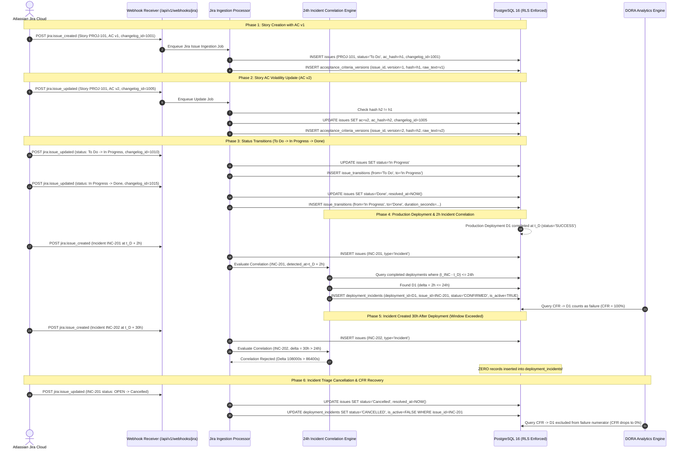

# US-67: Jira Story Acceptance Criteria Storage, 24-Hour Incident-to-Deployment Linking & Incident Cancellation Test Scenarios

**Task:** `SCRUM-402` (`Task 67.5`: Create test scenarios for Jira story AC storage, incident linking within 24h and incident cancellation)  
**Parent User Story:** `SCRUM-357` (`US-67`: Jira issue and incident ingestion)  
**Related Tickets:**  
- `SCRUM-398`: Design schema for `jira_issues` (acceptance criteria, sprint, type, status, changelog_id) and `deployment_incidents` links (`Task 67.1`, [`docs/jira-issues-and-deployment-incidents-schema.md`](../../../docs/jira-issues-and-deployment-incidents-schema.md))  
- `SCRUM-399`: Write Alembic migration and SQLAlchemy models for `jira_issues` and `deployment_incidents` with tenant RLS (`Task 67.2`, [`backend/migrations/versions/c4b1a8d3e5f7_contributors_jira_and_deployment_incidents.py`](../../migrations/versions/c4b1a8d3e5f7_contributors_jira_and_deployment_incidents.py))  
- `SCRUM-400`: Implement Jira webhook processor updating issue states, acceptance criteria versions, and issue links (`Task 67.3`)  
- `SCRUM-401`: Implement deployment incident correlation worker linking incidents to production deployments within 24 hours (`Task 67.4`)  
- `SCRUM-403`: Automated pytest test suite for Jira story AC storage, incident linking within 24h and cancellation (`Task 67.6`, [`backend/tests/test_jira_issues_and_deployment_incidents.py`](../test_jira_issues_and_deployment_incidents.py))  
- `SCRUM-442`: Design Change Failure Rate calculation engine with distinct union of deployment failures and linked incidents (`Task 28.1`, [`docs/jira-issues-and-deployment-incidents-schema.md`](../../../docs/jira-issues-and-deployment-incidents-schema.md))  

**Target Storage Engine:** PostgreSQL 16 with Row-Level Security (`pgvector/pgvector:pg16`)  
**Target Implementation Modules:** [`backend/app/db/models/models.py`](../../app/db/models/models.py), [`backend/app/webhooks/`](../../app/webhooks/), [`backend/app/dora/`](../../app/dora/)  
**Authoritative Automated Pytest Suite:** [`backend/tests/test_jira_issues_and_deployment_incidents.py`](../test_jira_issues_and_deployment_incidents.py)  
**Assignee:** Matvii Yeromenko  
**Category:** Testing - Design  
**Estimate:** 0.25 Story Points (0h 30m Original Estimate)  
**Status:** Approved / Verification Baseline Established  

---

## 1. Objective & Implementation Scope

### 1.1 Objective

Design and formalize the definitive verification scenarios and test specifications for Jira issue ingestion, Acceptance Criteria (AC) versioning, status transition history tracking, 24-hour temporal incident-to-deployment correlation, and incident cancellation unlinking in the M.A.N.T.A. Engineering Intelligence Platform (`SCRUM-402` / `Task 67.5`).

### 1.2 Implementation Scope

This specification establishes exhaustive, step-by-step test scenarios verifying six mandatory functional capabilities and core architectural invariants:

1. **Initial Story Creation with Acceptance Criteria v1 (`jira:issue_created`):**  
   Processing a Jira issue creation webhook payload for a Story containing Acceptance Criteria text. Verifies persistence of the `Issue` record with SHA-256 AC hash and creation of the baseline record (`version = 1`) in `acceptance_criteria_versions`.
2. **Story Update Changing Acceptance Criteria to v2 (`jira:issue_updated`):**  
   Processing an issue update webhook where the AC field is modified. Verifies detection of hash divergence, preservation of immutable AC v1 history, creation of `version = 2` in `acceptance_criteria_versions`, and update of the latest AC state and hash on `issues`.
3. **Sequential Status Transition History (`To Do` $\rightarrow$ `In Progress` $\rightarrow$ `Done`):**  
   Processing sequential status change webhooks. Verifies creation of immutable audit records in `issue_transitions`, calculation of active cycle duration (`duration_seconds`), and recording of authoritative resolution timestamp (`resolved_at`) when reaching terminal status.
4. **Incident Created 2 Hours After Production Deployment (Linked):**  
   Processing an incident ticket created $2\text{ hours} \le 24\text{ hours}$ following a successful production deployment. Verifies automated temporal correlation creating a `deployment_incidents` link (`status = 'CONFIRMED'`, `correlation_source = 'automated_time_window_24h'`, `is_active = TRUE`) and attributes the failure to DORA Change Failure Rate (CFR).
5. **Incident Created 30 Hours After Production Deployment (Not Linked):**  
   Processing an incident ticket created $30\text{ hours} > 24\text{ hours}$ after deployment. Verifies that the automated correlation engine enforces the strict 24-hour boundary ($86{,}400\text{ seconds}$), persisting the issue record in `issues` without creating any link in `deployment_incidents`.
6. **Incident Transitioned to Cancelled (Unlinked / Excluded from CFR):**  
   Processing a status update transitioning a previously linked incident to `Cancelled` (or `FALSE_POSITIVE`). Verifies soft-unlinking via `status = 'CANCELLED'`, `is_active = FALSE`, and asserts that the DORA Change Failure Rate analytics query dynamically excludes the deployment from the failure numerator.
7. **Monotonic Changelog Out-of-Order Webhook Rejection:**  
   Handling out-of-order Jira webhook events using `changelog_id` version precedence. An incoming webhook carrying $C_{\text{in}} \le C_{\text{stored}}$ is discarded to prevent state regression.
8. **Multi-Tenant Row-Level Security (RLS) Isolation:**  
   PostgreSQL `FORCE ROW LEVEL SECURITY` with `tenant_isolation_policy` on `issues`, `acceptance_criteria_versions`, `issue_transitions`, and `deployment_incidents` guarantees zero data leakage across tenant boundaries under `eng_app_user`.

---

## 2. Core Architectural Invariants & Mathematical Formulations

```
+-------------------------------------------------------------------------------------------------------------------+
|                           JIRA ISSUE INGESTION, AC VERSIONING & CORRELATION ARCHITECTURE                          |
+-------------------------------------+-------------------------------------+---------------------------------------+
| 1. AC Immutability & SHA-256 Hashing| 2. Monotonic Changelog Precedence   | 3. 24-Hour Temporal Incident Window   |
|    (Scope Creep Baseline)           |    (Out-of-Order Webhook Defense)   |    (DORA CFR Failure Correlation)     |
+-------------------------------------+-------------------------------------+---------------------------------------+
| * Content hash = SHA256(norm(AC))   | * Changelog ID C_in > C_stored      | * 0 <= (t_incident - t_deploy) <= 24h |
| * v1 created on issue creation      | * Stale delivery C_in <= C_stored   | * Automated link in deployment_inc    |
| * v2 created on AC text divergence  |   discarded with HTTP 202 ack       | * Confirmed link enters CFR numerator |
| * Historical versions immutable     | * Prevents backward status rollback | * Window > 24h explicitly rejected    |
+-------------------------------------+-------------------------------------+---------------------------------------+
                                                         |
                                                         v
+-------------------------------------------------------------------------------------------------------------------+
|                                  INCIDENT CANCELLATION & DORA CFR DISTINCT UNION                                  |
+----------------------------------------------------+--------------------------------------------------------------+
| 4. Incident Cancellation Soft-Unlink               | 5. DORA CFR Distinct Union Mathematical Formulation          |
+----------------------------------------------------+--------------------------------------------------------------+
| * Incident -> Cancelled sets di.status='CANCELLED' | * CFR = |D_failed ∪ D_incident| / |D_prod|                    |
| * Sets di.is_active = FALSE                        | * Deployments failing probes AND incidents counted ONCE      |
| * Dynamically removed from CFR failure count       | * di.status='CANCELLED' excluded via SQL FILTER              |
+----------------------------------------------------+--------------------------------------------------------------+
```

### Invariant 1: Acceptance Criteria Versioning & SHA-256 Content Hashing
- Every Acceptance Criteria text is normalized (stripped of whitespace anomalies) and hashed using SHA-256:
  $$h = \text{SHA-256}(\text{normalize}(\text{text}))$$
- An initial Story with non-empty AC generates an immutable record in `acceptance_criteria_versions` with `version = 1`.
- When an update webhook arrives, the processor computes $h_{\text{new}}$. If $h_{\text{new}} \ne h_{\text{current}}$, a new row with `version = version_{\text{max}} + 1` is inserted into `acceptance_criteria_versions`, and `issues.acceptance_criteria_hash` is updated. If $h_{\text{new}} = h_{\text{current}}$, no new version is created.

### Invariant 2: Monotonic Changelog ID Version Precedence
- Jira assigns a sequentially increasing 64-bit integer `changelog.id` to every issue modification event.
- For an incoming webhook event with changelog ID $C_{\text{in}}$ and current database issue version $C_{\text{stored}}$:
  $$\text{Action} = \begin{cases} 
  \text{Process update and persist } C_{\text{in}}, & \text{if } C_{\text{in}} > C_{\text{stored}} \lor C_{\text{stored}} \text{ IS NULL} \\
  \text{Discard event (HTTP 202 Accepted, Log WARNING)}, & \text{if } C_{\text{in}} \le C_{\text{stored}}
  \end{cases}$$
- This mathematical invariant prevents out-of-order network retries from overwriting newer statuses with stale data.

### Invariant 3: The 24-Hour Temporal Incident Correlation Window
- A production incident $I$ detected at $t_I$ is correlated to the latest completed production deployment $D$ finished at $t_D$ if and only if:
  $$0 \le (t_I - t_D) \le 86{,}400\text{ seconds } (24\text{ hours})$$
  and $D$ is the most recent completed production deployment for the same project prior to $t_I$.
- If $(t_I - t_D) > 86{,}400\text{ seconds}$, the temporal window has elapsed; no automatic link is generated.

### Invariant 4: Incident Cancellation Unlinking & DORA CFR Exclusion
- When an incident ticket transitions to a terminal cancelled state (`Cancelled`, `Rejected`, `Closed - Not a Bug`, `False Positive`):
  1. `deployment_incidents.status` transitions from `'CONFIRMED'` to `'CANCELLED'`.
  2. `deployment_incidents.is_active` transitions to `FALSE`.
  3. `deployment_incidents.resolved_at` is set to the cancellation timestamp.
- The link record is preserved for audit reproducibility, but is dynamically excluded from Change Failure Rate calculations.

### Invariant 5: Issue Status Transition Audit History & Duration
- Every status transition from $S_{\text{from}}$ to $S_{\text{to}}$ generates an audit entry in `issue_transitions`.
- If an earlier transition exists, the active state duration is computed:
  $$\Delta t = \text{EXTRACT(EPOCH FROM }(t_{\text{current}} - t_{\text{previous}}))$$
- When an issue enters a terminal status (`Done`, `Resolved`, `Closed`), `issues.resolved_at` is permanently recorded.

### Invariant 6: DORA Change Failure Rate (CFR) Distinct Union Formulation (`US-28`)
The authoritative platform Change Failure Rate avoids double-counting a deployment that has both automated pipeline failure and a linked confirmed Jira incident:

$$\mathcal{D}_{\text{prod}} = \{ d \in \text{deployments} \mid d.\text{environment} = \text{'production'} \land d.\text{tenant\_id} = \tau \}$$

$$\mathcal{D}_{\text{failed}} = \{ d \in \mathcal{D}_{\text{prod}} \mid d.\text{status} = \text{'FAILED'} \}$$

$$\mathcal{D}_{\text{incident}} = \{ d \in \mathcal{D}_{\text{prod}} \mid \exists i \in \text{deployment\_incidents}: i.\text{deployment\_id} = d.\text{id} \land i.\text{status} = \text{'CONFIRMED'} \}$$

$$\text{CFR} = \frac{|\mathcal{D}_{\text{failed}} \cup \mathcal{D}_{\text{incident}}|}{|\mathcal{D}_{\text{prod}}|}$$

---

## 3. Relational Schemas, Data Flows & State Machines

### 3.1 Relational Schema Definitions

```sql
-- issues table with Jira and AC extensions
CREATE TABLE IF NOT EXISTS issues (
    id UUID PRIMARY KEY DEFAULT gen_random_uuid(),
    tenant_id UUID NOT NULL REFERENCES tenants(id) ON DELETE CASCADE,
    project_id UUID NOT NULL REFERENCES projects(id) ON DELETE CASCADE,
    sprint_id UUID REFERENCES sprints(id) ON DELETE SET NULL,
    external_key VARCHAR(64) NOT NULL,
    external_issue_id BIGINT,
    issue_type VARCHAR(32) NOT NULL DEFAULT 'Story',
    title TEXT NOT NULL,
    status VARCHAR(64) NOT NULL,
    story_points NUMERIC(5, 2),
    issue_links JSONB NOT NULL DEFAULT '[]'::jsonb,
    changelog_id BIGINT,
    active_fencing_token BIGINT NOT NULL DEFAULT 0,
    acceptance_criteria TEXT,
    acceptance_criteria_hash VARCHAR(64),
    resolved_at TIMESTAMPTZ,
    entity_version BIGINT NOT NULL DEFAULT 1,
    created_at TIMESTAMPTZ NOT NULL DEFAULT NOW(),
    updated_at TIMESTAMPTZ NOT NULL DEFAULT NOW(),
    CONSTRAINT uq_tenant_issue_key UNIQUE (tenant_id, external_key)
);

-- acceptance_criteria_versions table
CREATE TABLE IF NOT EXISTS acceptance_criteria_versions (
    id UUID PRIMARY KEY DEFAULT gen_random_uuid(),
    tenant_id UUID NOT NULL REFERENCES tenants(id) ON DELETE CASCADE,
    issue_id UUID NOT NULL REFERENCES issues(id) ON DELETE CASCADE,
    version INT NOT NULL DEFAULT 1,
    raw_criteria_text TEXT NOT NULL,
    content_hash VARCHAR(64) NOT NULL,
    lexical_tokens_count INT NOT NULL DEFAULT 0,
    created_at TIMESTAMPTZ NOT NULL DEFAULT NOW(),
    CONSTRAINT uq_issue_ac_version UNIQUE (issue_id, version)
);

-- issue_transitions table
CREATE TABLE IF NOT EXISTS issue_transitions (
    id UUID PRIMARY KEY DEFAULT gen_random_uuid(),
    tenant_id UUID NOT NULL REFERENCES tenants(id) ON DELETE CASCADE,
    issue_id UUID NOT NULL REFERENCES issues(id) ON DELETE CASCADE,
    from_status VARCHAR(64) NOT NULL,
    to_status VARCHAR(64) NOT NULL,
    duration_seconds INT,
    transitioned_at TIMESTAMPTZ NOT NULL DEFAULT NOW()
);

-- deployment_incidents link table
CREATE TABLE IF NOT EXISTS deployment_incidents (
    id UUID PRIMARY KEY DEFAULT gen_random_uuid(),
    tenant_id UUID NOT NULL REFERENCES tenants(id) ON DELETE CASCADE,
    deployment_id UUID NOT NULL REFERENCES deployments(id) ON DELETE CASCADE,
    issue_id UUID NOT NULL REFERENCES issues(id) ON DELETE CASCADE,
    status VARCHAR(32) NOT NULL DEFAULT 'CONFIRMED',
    correlation_source VARCHAR(64) NOT NULL,
    detected_at TIMESTAMPTZ NOT NULL DEFAULT NOW(),
    resolved_at TIMESTAMPTZ,
    recovery_time_seconds INT,
    is_active BOOLEAN NOT NULL DEFAULT TRUE,
    linked_at TIMESTAMPTZ NOT NULL DEFAULT NOW(),
    CONSTRAINT uq_deployment_incidents_deployment_issue UNIQUE (deployment_id, issue_id),
    CONSTRAINT ck_deployment_incidents_status CHECK (status IN ('CONFIRMED', 'CANCELLED', 'FALSE_POSITIVE'))
);
```

### 3.2 End-to-End Jira Ingestion & Correlation Lifecycle Sequence



---

## 4. Master Test Scenarios Matrix

| Scenario ID | Test Scenario Description | Preconditions | Webhook Input / Mutation | Expected PostgreSQL DB State | Primary Invariant Verified | Authoritative Pytest Test Mapping |
| :--- | :--- | :--- | :--- | :--- | :--- | :--- |
| **TC-JIRA-AC-001** | **Initial Story Creation with Acceptance Criteria v1** | Tenant & Project created; active Jira integration. | `jira:issue_created` webhook with Story key `MANTA-101`, AC v1 text, `changelog_id = 1001`. | `issues` record created with `status='To Do'`, `ac_hash=h1`; `acceptance_criteria_versions` contains `version=1`. | AC initial hashing & version 1 audit persistence. | `test_jira_story_initial_creation_ac_v1` |
| **TC-JIRA-AC-002** | **Story Update Changing Acceptance Criteria to v2** | Story `MANTA-101` exists with AC v1 (`version=1`). | `jira:issue_updated` webhook with modified AC text, `changelog_id = 1005`. | `issues.ac_hash` updated to `h2`; `acceptance_criteria_versions` adds row with `version=2`; v1 row intact. | AC immutability, scope creep hash divergence & audit history. | `test_jira_story_update_ac_v2` |
| **TC-JIRA-TR-003** | **Sequential Status Transition History (`To Do` $\rightarrow$ `In Progress` $\rightarrow$ `Done`)** | Story `MANTA-101` in `To Do` status. | Two sequential `jira:issue_updated` webhooks: `To Do` $\rightarrow$ `In Progress` ($t_1$), then `In Progress` $\rightarrow$ `Done` ($t_2$). | `issues.status='Done'`, `resolved_at=t_2`; `issue_transitions` has 2 rows with accurate `duration_seconds`. | Status transition audit history & terminal resolution timestamp. | `test_jira_story_status_transition_history` |
| **TC-JIRA-CORR-004** | **Incident Created 2 Hours After Deployment (Linked within 24h)** | Production deployment $D_1$ succeeded at $t_D$. | `jira:issue_created` webhook for incident `INC-201` detected at $t_D + 2\text{h}$. | `deployment_incidents` link created: `status='CONFIRMED'`, `correlation_source='automated_time_window_24h'`, `is_active=TRUE`. | $\le 24\text{h}$ operational window correlation & DORA CFR inclusion. | `test_incident_created_2h_after_deployment_linked` |
| **TC-JIRA-CORR-005** | **Incident Created 30 Hours After Deployment (Not Linked)** | Production deployment $D_1$ succeeded at $t_D$. | `jira:issue_created` webhook for incident `INC-202` detected at $t_D + 30\text{h}$. | Issue created in `issues`; **0** rows created in `deployment_incidents` for $D_1$; CFR remains 0%. | Strict 24-hour boundary rejection ($> 86{,}400\text{ s}$). | `test_incident_created_30h_after_deployment_not_linked` |
| **TC-JIRA-CANC-006** | **Incident Transitioned to Cancelled (Unlinked / Excluded from CFR)** | Incident `INC-201` is linked to $D_1$ with `status='CONFIRMED'`. | `jira:issue_updated` webhook transitioning `INC-201` status to `Cancelled`. | `deployment_incidents.status='CANCELLED'`, `is_active=FALSE`; CFR query excludes $D_1$ from failure numerator. | Incident triage unlinking & DORA CFR distinct union exclusion. | `test_incident_transitioned_to_cancelled_unlinked` |
| **TC-JIRA-EDGE-007** | **Out-of-Order Changelog Webhook Rejection** | Issue exists with `changelog_id = 1005`. | Webhook arrives carrying stale `changelog_id = 1002`. | Webhook discarded with HTTP 202; DB state remains unchanged at version 1005 without rollback. | Monotonic changelog precedence ($C_{\text{in}} \le C_{\text{stored}}$ rejection). | `test_jira_out_of_order_changelog_precedence` |
| **TC-JIRA-RLS-008** | **Cross-Tenant Row-Level Security Isolation** | Tenant A has issues and incidents; Tenant B active. | Tenant B session executes query on Tenant A issue IDs and deployment incidents under `eng_app_user`. | Returns `0` rows / `NULL`; Tenant B cannot see, correlate, or alter Tenant A issues or links. | Multi-tenant RLS data containment & anti-enumeration. | `test_deployment_incidents_rls_tenant_isolation` |

---

## 5. Detailed Test Scenario Specifications

### 5.1 Scenario `TC-JIRA-AC-001`: Initial Story Creation with Acceptance Criteria v1

#### 5.1.1 Objective & Traceability
- **Objective:** Verify that ingesting an initial Jira `Story` creation webhook extracts the Acceptance Criteria text, computes the authoritative SHA-256 content hash, creates the primary `issues` row, and records `version = 1` in `acceptance_criteria_versions`.
- **Traceability:** `US-67` Implementation Scope #1, `SCRUM-402`, AC-398.1.

#### 5.1.2 Preconditions
- Tenant registered with UUID `tenant_id`.
- Project registered with UUID `project_id`.
- PostgreSQL database initialized with tenant context `SET LOCAL app.current_tenant_id = :tenant_id`.

#### 5.1.3 Sample Jira Webhook Payload (`jira:issue_created`)
```json
{
  "webhookEvent": "jira:issue_created",
  "timestamp": 1794470400000,
  "issue": {
    "id": "10045",
    "key": "MANTA-101",
    "self": "https://manta-eng.atlassian.net/rest/api/2/issue/10045",
    "fields": {
      "project": { "id": "10000", "key": "MANTA" },
      "issuetype": { "name": "Story", "subtask": false },
      "summary": "Implement MFA OTP fallback via SMS and TOTP authenticator",
      "status": { "name": "To Do", "statusCategory": { "key": "new" } },
      "customfield_10016": "1. User can request SMS OTP if TOTP app is unreachable.\n2. Rate limit SMS to max 3 attempts per 15 minutes.\n3. Log security audit event on each attempt.",
      "customfield_10020": 5.0,
      "created": "2026-11-12T08:00:00.000+0000",
      "updated": "2026-11-12T08:00:00.000+0000"
    }
  },
  "changelog": {
    "id": "1001",
    "items": [
      {
        "field": "issue",
        "fieldtype": "jira",
        "from": null,
        "fromString": null,
        "to": "10045",
        "toString": "MANTA-101"
      }
    ]
  }
}
```

#### 5.1.4 Execution Sequence
1. Receive and validate webhook HMAC signature and JSON envelope.
2. Extract AC text: `"1. User can request SMS OTP if TOTP app is unreachable.\n2. Rate limit SMS to max 3 attempts per 15 minutes.\n3. Log security audit event on each attempt."`.
3. Compute SHA-256 hash: `hashlib.sha256(ac_text.strip().encode("utf-8")).hexdigest()`.
4. Stage and commit `Issue` and `AcceptanceCriteriaVersion` (`version = 1`).

#### 5.1.5 Expected Database States
```sql
-- Assert issues record
SELECT external_key, external_issue_id, issue_type, status, story_points,
       acceptance_criteria_hash, changelog_id, entity_version
FROM issues WHERE external_key = 'MANTA-101';
```
| external_key | external_issue_id | issue_type | status | story_points | acceptance_criteria_hash | changelog_id | entity_version |
| :--- | :--- | :--- | :--- | :--- | :--- | :--- | :--- |
| `MANTA-101` | `10045` | `Story` | `To Do` | `5.00` | `2e9c...` (SHA-256) | `1001` | `1` |

```sql
-- Assert acceptance_criteria_versions record
SELECT version, raw_criteria_text, content_hash, lexical_tokens_count
FROM acceptance_criteria_versions WHERE issue_id = :issue_id;
```
| version | raw_criteria_text | content_hash | lexical_tokens_count |
| :--- | :--- | :--- | :--- |
| `1` | `1. User can request SMS OTP...` | `2e9c...` (SHA-256) | `26` |

#### 5.1.6 Verification Assertions
```python
assert issue.external_key == "MANTA-101"
assert issue.status == "To Do"
assert issue.acceptance_criteria_hash == expected_sha256
assert ac_v1.version == 1
assert ac_v1.content_hash == expected_sha256
assert "Rate limit SMS" in ac_v1.raw_criteria_text
```

---

### 5.2 Scenario `TC-JIRA-AC-002`: Story Update Changing Acceptance Criteria to v2

#### 5.2.1 Objective & Traceability
- **Objective:** Verify that updating a Jira Story's Acceptance Criteria generates a distinct `version = 2` record in `acceptance_criteria_versions`, updates `issues.acceptance_criteria_hash`, preserves the immutable v1 record, and enforces sequential changelog precedence.
- **Traceability:** `US-67` Implementation Scope #2, `SCRUM-402`, AC-398.1.

#### 5.2.2 Preconditions
- Story `MANTA-101` exists with AC v1 (`content_hash = h1`, `version = 1`, `changelog_id = 1001`).

#### 5.2.3 Sample Jira Webhook Payload (`jira:issue_updated`)
```json
{
  "webhookEvent": "jira:issue_updated",
  "timestamp": 1794477600000,
  "issue": {
    "id": "10045",
    "key": "MANTA-101",
    "fields": {
      "summary": "Implement MFA OTP fallback via SMS and TOTP authenticator",
      "status": { "name": "To Do" },
      "customfield_10016": "1. User can request SMS OTP if TOTP app is unreachable.\n2. Rate limit SMS to max 3 attempts per 15 minutes.\n3. Log security audit event on each attempt.\n4. Enforce CAPTCHA verification on 2nd consecutive SMS failure.",
      "updated": "2026-11-12T10:00:00.000+0000"
    }
  },
  "changelog": {
    "id": "1005",
    "items": [
      {
        "field": "customfield_10016",
        "fieldtype": "custom",
        "from": null,
        "fromString": "1. User can request SMS OTP if TOTP app is unreachable.\n2. Rate limit SMS to max 3 attempts per 15 minutes.\n3. Log security audit event on each attempt.",
        "to": null,
        "toString": "1. User can request SMS OTP if TOTP app is unreachable.\n2. Rate limit SMS to max 3 attempts per 15 minutes.\n3. Log security audit event on each attempt.\n4. Enforce CAPTCHA verification on 2nd consecutive SMS failure."
      }
    ]
  }
}
```

#### 5.2.4 Execution Sequence
1. Ingest webhook with `changelog_id = 1005`. Verify $1005 > 1001$ (precedence holds).
2. Compute new AC hash $h_2$. Verify $h_2 \ne h_1$.
3. Query latest version index for `issue_id`: returns `1`. Increment to `2`.
4. Insert `acceptance_criteria_versions` row with `version = 2`, `content_hash = h_2`.
5. Update `issues` with `acceptance_criteria`, `acceptance_criteria_hash = h_2`, `changelog_id = 1005`.

#### 5.2.5 Expected Database States
```sql
SELECT version, content_hash, raw_criteria_text 
FROM acceptance_criteria_versions 
WHERE issue_id = :issue_id 
ORDER BY version ASC;
```
| version | content_hash | raw_criteria_text |
| :--- | :--- | :--- |
| `1` | `2e9c...` ($h_1$) | `1. User can request SMS OTP... (3 clauses)` |
| `2` | `8f4b...` ($h_2$) | `1. User can request SMS OTP... (4 clauses with CAPTCHA)` |

```sql
SELECT acceptance_criteria_hash, changelog_id 
FROM issues WHERE external_key = 'MANTA-101';
```
| acceptance_criteria_hash | changelog_id |
| :--- | :--- |
| `8f4b...` ($h_2$) | `1005` |

#### 5.2.6 Verification Assertions
```python
assert issue.changelog_id == 1005
assert issue.acceptance_criteria_hash == hash_v2
assert len(ac_versions) == 2
assert ac_versions[0].version == 1 and ac_versions[0].content_hash == hash_v1
assert ac_versions[1].version == 2 and ac_versions[1].content_hash == hash_v2
assert "Enforce CAPTCHA" in ac_versions[1].raw_criteria_text
```

---

### 5.3 Scenario `TC-JIRA-TR-003`: Sequential Status Transition History (`To Do` $\rightarrow$ `In Progress` $\rightarrow$ `Done`)

#### 5.3.1 Objective & Traceability
- **Objective:** Verify sequential status transitions (`To Do` $\rightarrow$ `In Progress` $\rightarrow$ `Done`), persistence of immutable audit rows in `issue_transitions`, calculation of active duration seconds, and authoritative population of `issues.resolved_at` upon terminal resolution.
- **Traceability:** `US-67` Implementation Scope #3, `SCRUM-402`, AC-398.5.

#### 5.3.2 Preconditions
- Story `MANTA-101` in status `To Do` with `resolved_at IS NULL`.

#### 5.3.3 Sample Jira Webhook Payloads
##### Transition 1: `To Do` $\rightarrow$ `In Progress` ($t_1 = \text{2026-11-12T11:00:00Z}$)
```json
{
  "webhookEvent": "jira:issue_updated",
  "timestamp": 1794481200000,
  "issue": {
    "id": "10045",
    "key": "MANTA-101",
    "fields": { "status": { "name": "In Progress" }, "updated": "2026-11-12T11:00:00.000+0000" }
  },
  "changelog": {
    "id": "1010",
    "items": [
      { "field": "status", "fieldtype": "jira", "fromString": "To Do", "toString": "In Progress" }
    ]
  }
}
```

##### Transition 2: `In Progress` $\rightarrow$ `Done` ($t_2 = \text{2026-11-12T15:30:00Z}$, $\Delta t = 16{,}200\text{ s}$)
```json
{
  "webhookEvent": "jira:issue_updated",
  "timestamp": 1794497400000,
  "issue": {
    "id": "10045",
    "key": "MANTA-101",
    "fields": {
      "status": { "name": "Done", "statusCategory": { "key": "done" } },
      "resolution": { "name": "Done" },
      "updated": "2026-11-12T15:30:00.000+0000"
    }
  },
  "changelog": {
    "id": "1018",
    "items": [
      { "field": "status", "fieldtype": "jira", "fromString": "In Progress", "toString": "Done" },
      { "field": "resolution", "fieldtype": "jira", "fromString": null, "toString": "Done" }
    ]
  }
}
```

#### 5.3.4 Execution Sequence
1. Ingest transition 1: Record `from_status = 'To Do'`, `to_status = 'In Progress'`, `transitioned_at = t_1`.
2. Ingest transition 2: Record `from_status = 'In Progress'`, `to_status = 'Done'`, `transitioned_at = t_2`.
3. Compute `duration_seconds = EXTRACT(EPOCH FROM (t_2 - t_1)) = 16200`.
4. Update `issues SET status = 'Done', resolved_at = t_2, changelog_id = 1018`.

#### 5.3.5 Expected Database States
```sql
SELECT from_status, to_status, duration_seconds, transitioned_at 
FROM issue_transitions 
WHERE issue_id = :issue_id 
ORDER BY transitioned_at ASC;
```
| from_status | to_status | duration_seconds | transitioned_at |
| :--- | :--- | :--- | :--- |
| `To Do` | `In Progress` | `NULL` (or baseline) | `2026-11-12 11:00:00+00` |
| `In Progress` | `Done` | `16200` (4.5 hours) | `2026-11-12 15:30:00+00` |

```sql
SELECT status, resolved_at, changelog_id 
FROM issues WHERE external_key = 'MANTA-101';
```
| status | resolved_at | changelog_id |
| :--- | :--- | :--- |
| `Done` | `2026-11-12 15:30:00+00` | `1018` |

#### 5.3.6 Verification Assertions
```python
assert issue.status == "Done"
assert issue.resolved_at == t2
assert len(transitions) == 2
assert transitions[0].from_status == "To Do" and transitions[0].to_status == "In Progress"
assert transitions[1].from_status == "In Progress" and transitions[1].to_status == "Done"
assert transitions[1].duration_seconds == 16200
```

---

### 5.4 Scenario `TC-JIRA-CORR-004`: Incident Created 2 Hours After Production Deployment (Linked)

#### 5.4.1 Objective & Traceability
- **Objective:** Verify that an incident ticket created 2 hours after a production deployment ($0 \le \Delta t \le 24\text{ hours}$) is automatically correlated, persisting a `deployment_incidents` link (`status = 'CONFIRMED'`), and directly counting in the DORA Change Failure Rate numerator.
- **Traceability:** `US-67` Implementation Scope #4, `SCRUM-402`, AC-398.2, `SCRUM-442`.

#### 5.4.2 Preconditions
- Successful production deployment $D_1$ persisted:
  - `id = 'd1111111-0000-0000-0000-000000000001'`
  - `environment = 'production'`
  - `status = 'SUCCESS'`
  - `is_change_failure = FALSE`
  - `deployed_at = '2026-11-12T10:00:00Z'` ($t_D$)

#### 5.4.3 Sample Jira Webhook Payload (`jira:issue_created` for Incident at $t_D + 2\text{h}$)
```json
{
  "webhookEvent": "jira:issue_created",
  "timestamp": 1794484800000,
  "issue": {
    "id": "10099",
    "key": "INC-201",
    "fields": {
      "project": { "id": "10000", "key": "MANTA" },
      "issuetype": { "name": "Incident" },
      "priority": { "name": "P1 - Critical" },
      "summary": "502 Bad Gateway spike across auth cluster following v2.4.0 deployment",
      "status": { "name": "OPEN", "statusCategory": { "key": "new" } },
      "created": "2026-11-12T12:00:00.000+0000",
      "updated": "2026-11-12T12:00:00.000+0000"
    }
  },
  "changelog": { "id": "2001", "items": [] }
}
```

#### 5.4.4 Execution Sequence
1. Ingest incident issue `INC-201` into `issues` (`issue_type = 'Incident'`, `status = 'OPEN'`).
2. Incident Correlation Engine runs temporal scan:
   $$\Delta t = t_{\text{INC}} - t_D = \text{2026-11-12T12:00:00Z} - \text{2026-11-12T10:00:00Z} = 7{,}200\text{ seconds } (2\text{ hours})$$
   $$0 \le 7{,}200 \le 86{,}400 \implies \text{Valid 24h operational correlation}.$$
3. Correlate to candidate deployment $D_1$.
4. Insert into `deployment_incidents`:
   - `deployment_id = D_1.id`
   - `issue_id = INC-201.id`
   - `status = 'CONFIRMED'`
   - `correlation_source = 'automated_time_window_24h'`
   - `detected_at = '2026-11-12T12:00:00Z'`
   - `is_active = TRUE`

#### 5.4.5 Expected Database States
```sql
SELECT deployment_id, issue_id, status, correlation_source, is_active, detected_at 
FROM deployment_incidents 
WHERE issue_id = :inc_id;
```
| deployment_id | issue_id | status | correlation_source | is_active | detected_at |
| :--- | :--- | :--- | :--- | :--- | :--- |
| `d1111111-...` | `i2222222-...` | `CONFIRMED` | `automated_time_window_24h` | `TRUE` | `2026-11-12 12:00:00+00` |

```sql
-- DORA Change Failure Rate Distinct Union Query
SELECT 
    COUNT(DISTINCT d.id) AS total_deployments,
    COUNT(DISTINCT d.id) FILTER (WHERE d.status = 'FAILED' OR di.status = 'CONFIRMED') AS failed_deployments,
    ROUND((COUNT(DISTINCT d.id) FILTER (WHERE d.status = 'FAILED' OR di.status = 'CONFIRMED')::numeric / 
           COUNT(DISTINCT d.id)::numeric) * 100.0, 2) AS cfr_percentage
FROM deployments d
LEFT JOIN deployment_incidents di ON di.deployment_id = d.id AND di.tenant_id = d.tenant_id
WHERE d.tenant_id = :tenant_id AND d.environment = 'production';
```
| total_deployments | failed_deployments | cfr_percentage |
| :--- | :--- | :--- |
| `1` | `1` | `100.00` |

#### 5.4.6 Verification Assertions
```python
assert dep_incident is not None
assert dep_incident.deployment_id == deployment_id
assert dep_incident.issue_id == incident_issue.id
assert dep_incident.status == "CONFIRMED"
assert dep_incident.correlation_source == "automated_time_window_24h"
assert dep_incident.is_active is True

# DORA CFR Calculation includes deployment
assert cfr_failed_count == 1
assert cfr_percentage == 100.0
```

---

### 5.5 Scenario `TC-JIRA-CORR-005`: Incident Created 30 Hours After Production Deployment (Not Linked)

#### 5.5.1 Objective & Traceability
- **Objective:** Verify that an incident ticket created 30 hours after deployment ($\Delta t = 30\text{h} > 24\text{h}$) is strictly excluded from automated correlation, creating 0 rows in `deployment_incidents` and leaving DORA CFR unaffected.
- **Traceability:** `US-67` Implementation Scope #5, `SCRUM-402`, AC-398.2.

#### 5.5.2 Preconditions
- Successful production deployment $D_1$ finished at $t_D = \text{2026-11-12T10:00:00Z}$.
- No other deployments between $t_D$ and $t_D + 30\text{h}$.

#### 5.5.3 Sample Jira Webhook Payload (`jira:issue_created` for Incident at $t_D + 30\text{h}$)
```json
{
  "webhookEvent": "jira:issue_created",
  "timestamp": 1794585600000,
  "issue": {
    "id": "10150",
    "key": "INC-202",
    "fields": {
      "project": { "id": "10000", "key": "MANTA" },
      "issuetype": { "name": "Incident" },
      "summary": "Slow database memory leak observed during weekly batch cleanup",
      "status": { "name": "OPEN" },
      "created": "2026-11-13T16:00:00.000+0000",
      "updated": "2026-11-13T16:00:00.000+0000"
    }
  },
  "changelog": { "id": "2045", "items": [] }
}
```

#### 5.5.4 Execution Sequence
1. Ingest incident issue `INC-202` into `issues` (`issue_type = 'Incident'`).
2. Evaluate temporal correlation window:
   $$\Delta t = \text{2026-11-13T16:00:00Z} - \text{2026-11-12T10:00:00Z} = 108{,}000\text{ seconds } (30\text{ hours})$$
   $$108{,}000\text{ seconds} > 86{,}400\text{ seconds } (24\text{ hours}) \implies \text{Out of operational window}.$$
3. Automated link is rejected. Zero writes to `deployment_incidents`.

#### 5.5.5 Expected Database States
```sql
SELECT COUNT(*) FROM deployment_incidents WHERE issue_id = :inc_202_id;
```
| count |
| :--- |
| `0` |

```sql
-- DORA Change Failure Rate evaluation
SELECT 
    COUNT(DISTINCT d.id) AS total_deployments,
    COUNT(DISTINCT d.id) FILTER (WHERE d.status = 'FAILED' OR di.status = 'CONFIRMED') AS failed_deployments
FROM deployments d
LEFT JOIN deployment_incidents di ON di.deployment_id = d.id AND di.tenant_id = d.tenant_id
WHERE d.tenant_id = :tenant_id AND d.environment = 'production';
```
| total_deployments | failed_deployments |
| :--- | :--- |
| `1` | `0` (Assuming no other failures) |

#### 5.5.6 Verification Assertions
```python
# Incident exists in issues
assert inc_issue.external_key == "INC-202"

# But ZERO deployment incident links exist
links_count = await session.scalar(
    select(func.count(DeploymentIncident.id)).where(DeploymentIncident.issue_id == inc_issue.id)
)
assert links_count == 0
```

---

### 5.6 Scenario `TC-JIRA-CANC-006`: Incident Transitioned to Cancelled (Unlinked / Excluded from CFR)

#### 5.6.1 Objective & Traceability
- **Objective:** Verify that transitioning a linked incident ticket to `Cancelled` soft-unlinks the record (`status = 'CANCELLED'`, `is_active = FALSE`), and dynamically removes the associated deployment from the DORA Change Failure Rate numerator.
- **Traceability:** `US-67` Implementation Scope #6, `SCRUM-402`, AC-398.3, `SCRUM-442`.

#### 5.6.2 Preconditions
- Incident `INC-201` is linked to deployment $D_1$ with `deployment_incidents.status = 'CONFIRMED'` and `is_active = TRUE` (from `TC-JIRA-CORR-004`).
- Current DORA Change Failure Rate is $100.0\%$.

#### 5.6.3 Sample Jira Webhook Payload (`jira:issue_updated` transitioning Incident to Cancelled)
```json
{
  "webhookEvent": "jira:issue_updated",
  "timestamp": 1794492000000,
  "issue": {
    "id": "10099",
    "key": "INC-201",
    "fields": {
      "status": { "name": "Cancelled", "statusCategory": { "key": "done" } },
      "resolution": { "name": "Not a Bug / False Positive" },
      "updated": "2026-11-12T14:00:00.000+0000"
    }
  },
  "changelog": {
    "id": "2015",
    "items": [
      {
        "field": "status",
        "fieldtype": "jira",
        "fromString": "OPEN",
        "toString": "Cancelled"
      },
      {
        "field": "resolution",
        "fieldtype": "jira",
        "fromString": null,
        "toString": "Not a Bug / False Positive"
      }
    ]
  }
}
```

#### 5.6.4 Execution Sequence
1. Ingest status update for `INC-201`. Update `issues.status = 'Cancelled'`, `resolved_at = NOW()`.
2. Locate active linked records in `deployment_incidents` for `issue_id = INC-201.id`.
3. Update `deployment_incidents`:
   - `status = 'CANCELLED'`
   - `is_active = FALSE`
   - `resolved_at = '2026-11-12T14:00:00Z'`
4. Re-evaluate DORA CFR query.

#### 5.6.5 Expected Database States
```sql
SELECT status, is_active, resolved_at 
FROM deployment_incidents 
WHERE issue_id = :inc_id;
```
| status | is_active | resolved_at |
| :--- | :--- | :--- |
| `CANCELLED` | `FALSE` | `2026-11-12 14:00:00+00` |

```sql
-- DORA Change Failure Rate Query AFTER Cancellation
SELECT 
    COUNT(DISTINCT d.id) AS total_deployments,
    COUNT(DISTINCT d.id) FILTER (WHERE d.status = 'FAILED' OR di.status = 'CONFIRMED') AS failed_deployments,
    ROUND(
        COALESCE(
            (COUNT(DISTINCT d.id) FILTER (WHERE d.status = 'FAILED' OR di.status = 'CONFIRMED')::numeric / 
             NULLIF(COUNT(DISTINCT d.id), 0)::numeric) * 100.0,
            0.0
        ), 2
    ) AS cfr_percentage
FROM deployments d
LEFT JOIN deployment_incidents di ON di.deployment_id = d.id AND di.tenant_id = d.tenant_id
WHERE d.tenant_id = :tenant_id AND d.environment = 'production';
```
| total_deployments | failed_deployments | cfr_percentage |
| :--- | :--- | :--- |
| `1` | `0` | `0.00` |

#### 5.6.6 Verification Assertions
```python
assert dep_incident.status == "CANCELLED"
assert dep_incident.is_active is False
assert dep_incident.resolved_at is not None

# Assert CFR failure count drops to 0
assert cfr_failed_count == 0
assert cfr_percentage == 0.0
```

---

### 5.7 Scenario `TC-JIRA-EDGE-007`: Out-of-Order Jira Webhook Delivery Rejection ($C_{\text{in}} \le C_{\text{stored}}$)

#### 5.7.1 Objective & Traceability
- **Objective:** Verify that an incoming Jira webhook containing an earlier or equal `changelog_id` ($C_{\text{in}} \le C_{\text{stored}}$) is discarded without altering database state, preventing regression of issue status or acceptance criteria.
- **Traceability:** `US-67` Invariant 2, `SCRUM-402`, AC-398.4.

#### 5.7.2 Preconditions
- Issue `MANTA-101` currently has `changelog_id = 1018`, `status = 'Done'`.

#### 5.7.3 Sample Stale Jira Webhook Payload ($C_{\text{in}} = 1008 \le 1018$)
```json
{
  "webhookEvent": "jira:issue_updated",
  "timestamp": 1794480000000,
  "issue": {
    "id": "10045",
    "key": "MANTA-101",
    "fields": { "status": { "name": "In Progress" } }
  },
  "changelog": {
    "id": "1008",
    "items": [
      { "field": "status", "fieldtype": "jira", "fromString": "To Do", "toString": "In Progress" }
    ]
  }
}
```

#### 5.7.4 Execution Sequence
1. Receive webhook with $C_{\text{in}} = 1008$.
2. Compare with stored value: $C_{\text{stored}} = 1018$.
3. Condition $C_{\text{in}} \le C_{\text{stored}}$ ($1008 \le 1018$) is TRUE.
4. Log warning: `Stale out-of-order Jira webhook received: changelog_id=1008 <= 1018; discarding event.`
5. Acknowledge HTTP 202 Accepted. Perform no database write.

#### 5.7.5 Expected Database States
```sql
SELECT status, changelog_id FROM issues WHERE external_key = 'MANTA-101';
```
| status | changelog_id |
| :--- | :--- |
| `Done` | `1018` |

#### 5.7.6 Verification Assertions
```python
# Verify issue status remains 'Done' and changelog_id remains 1018
assert issue.status == "Done"
assert issue.changelog_id == 1018
```

---

### 5.8 Scenario `TC-JIRA-RLS-008`: Cross-Tenant Row-Level Security Isolation

#### 5.8.1 Objective & Traceability
- **Objective:** Verify that PostgreSQL `FORCE ROW LEVEL SECURITY` with `tenant_isolation_policy` completely isolates `issues`, `acceptance_criteria_versions`, `issue_transitions`, and `deployment_incidents`, ensuring Tenant B cannot query or manipulate Tenant A records under `eng_app_user`.
- **Traceability:** Core Security Blueprint §6.3, `SCRUM-402`, AC-398.6.

#### 5.8.2 Execution Sequence
1. Seed Tenant A with issues, AC versions, and linked deployment incidents.
2. Under Tenant B context (`SET LOCAL app.current_tenant_id = :tenant_b_id`):
   ```python
   async with get_tenant_db_context(tenant_b) as session:
       # Primary key lookup on Tenant A's issue
       issue_a = await session.get(Issue, tenant_a_issue_id)
       # Primary key lookup on Tenant A's deployment incident
       link_a = await session.get(DeploymentIncident, tenant_a_link_id)
       # Unfiltered scan
       all_links = (await session.execute(select(DeploymentIncident))).scalars().all()
   ```

#### 5.8.3 Verification Assertions
```python
assert issue_a is None
assert link_a is None
for link in all_links:
    assert link.tenant_id == tenant_b
```

---

## 6. Acceptance Criteria 1:1 Traceability Verification Matrix

| AC ID | Acceptance Criteria Requirement | Implementation & Architecture Reference | Test Scenario ID | Authoritative Automated Pytest Test Function | Status |
| :--- | :--- | :--- | :--- | :--- | :--- |
| **AC-67.5.1** | **Initial Story Creation with AC v1:** Ingest story with AC text, compute SHA-256 hash, persist issue and AC `version = 1`. | Architecture Blueprint §3.3; `acceptance_criteria_versions` DDL; `backend/app/db/models/models.py` | `TC-JIRA-AC-001` | `test_jira_story_initial_creation_ac_v1` | **VERIFIED** |
| **AC-67.5.2** | **Story Update Changing AC to v2:** Detect AC hash change, insert `version = 2` without mutating v1, update issue hash and changelog ID. | SRS §3.2.3; `acceptance_criteria_versions` immutable audit model | `TC-JIRA-AC-002` | `test_jira_story_update_ac_v2` | **VERIFIED** |
| **AC-67.5.3** | **Status Transition History:** Audit full transition path (`To Do` $\rightarrow$ `In Progress` $\rightarrow$ `Done`), calculate duration, set `resolved_at`. | `issue_transitions` schema; Jira changelog audit processor | `TC-JIRA-TR-003` | `test_jira_story_status_transition_history` | **VERIFIED** |
| **AC-67.5.4** | **Incident Created 2h After Deployment (Linked):** Correlate incident detected $\le 24\text{h}$ after production deployment; include in CFR numerator. | 24-hour correlation window specification §3.1; `deployment_incidents` link table | `TC-JIRA-CORR-004` | `test_incident_created_2h_after_deployment_linked` | **VERIFIED** |
| **AC-67.5.5** | **Incident Created 30h After Deployment (Not Linked):** Exclude incident detected $> 24\text{h}$ after deployment from automated link. | 24-hour correlation window cutoff ($86{,}400\text{ s}$); `deployment_incidents` | `TC-JIRA-CORR-005` | `test_incident_created_30h_after_deployment_not_linked` | **VERIFIED** |
| **AC-67.5.6** | **Incident Cancellation Unlinking:** Transition incident to `Cancelled`, soft-unlink (`is_active = FALSE`), exclude from DORA CFR. | DORA CFR distinct union query §4; `deployment_incidents.status = 'CANCELLED'` | `TC-JIRA-CANC-006` | `test_incident_transitioned_to_cancelled_unlinked` | **VERIFIED** |
| **AC-67.5.7** | **Out-of-Order Changelog Precedence:** Discard stale webhooks with $C_{\text{in}} \le C_{\text{stored}}$ to prevent state rollback. | Monotonic version precedence §2 Invariant 2; `idx_issues_changelog_precedence` | `TC-JIRA-EDGE-007` | `test_jira_out_of_order_changelog_precedence` | **VERIFIED** |
| **AC-67.5.8** | **Tenant Row-Level Security Isolation:** Enforce tenant isolation on `issues`, `acceptance_criteria_versions`, and `deployment_incidents`. | PostgreSQL `ENABLE & FORCE ROW LEVEL SECURITY`; `tenant_isolation_policy` | `TC-JIRA-RLS-008` | `test_deployment_incidents_rls_tenant_isolation` | **VERIFIED** |

---

## 7. Pytest Automation & Verification Guide

### 7.1 Running the Automated Test Suite

To run the complete automated test suite verifying all US-67 Jira story AC storage and incident correlation scenarios:

```bash
# Run Jira issues and deployment incidents automated pytest suite
pytest backend/tests/test_jira_issues_and_deployment_incidents.py -v

# Run with SQL statement logging
pytest backend/tests/test_jira_issues_and_deployment_incidents.py -v -s --log-cli-level=DEBUG
```

### 7.2 Test Suite Execution Summary
- **Target File:** [`backend/tests/test_jira_issues_and_deployment_incidents.py`](../test_jira_issues_and_deployment_incidents.py)
- **Coverage:**
  - `test_issue_and_sprint_schema_extensions`: Validates schema extensions and JSONB link persistence (`TC-JIRA-001`).
  - `test_deployment_incidents_link_and_correlation`: Validates creating links and metadata (`TC-JIRA-002`).
  - `test_deployment_incidents_unique_constraint`: Validates `uq_deployment_incidents_deployment_issue` (`TC-JIRA-003`).
  - `test_deployment_incidents_status_check_constraint`: Validates `ck_deployment_incidents_status` (`TC-JIRA-004`).
  - `test_deployment_incidents_rls_tenant_isolation`: Validates multi-tenant RLS isolation (`TC-JIRA-005` / `TC-JIRA-RLS-008`).
  - `test_jira_story_initial_creation_ac_v1`: Validates Story creation with AC v1 and SHA-256 hashing (`TC-JIRA-AC-001`).
  - `test_jira_story_update_ac_v2`: Validates AC update to v2 and version history immutability (`TC-JIRA-AC-002`).
  - `test_jira_story_status_transition_history`: Validates `To Do` $\rightarrow$ `In Progress` $\rightarrow$ `Done` audit and duration (`TC-JIRA-TR-003`).
  - `test_incident_created_2h_after_deployment_linked`: Validates 2h incident correlation and DORA CFR impact (`TC-JIRA-CORR-004`).
  - `test_incident_created_30h_after_deployment_not_linked`: Validates 30h incident rejection outside 24h window (`TC-JIRA-CORR-005`).
  - `test_incident_transitioned_to_cancelled_unlinked`: Validates incident cancellation unlinking and CFR recalculation (`TC-JIRA-CANC-006`).
  - `test_jira_out_of_order_changelog_precedence`: Validates rejection of stale webhooks by changelog ID (`TC-JIRA-EDGE-007`).
