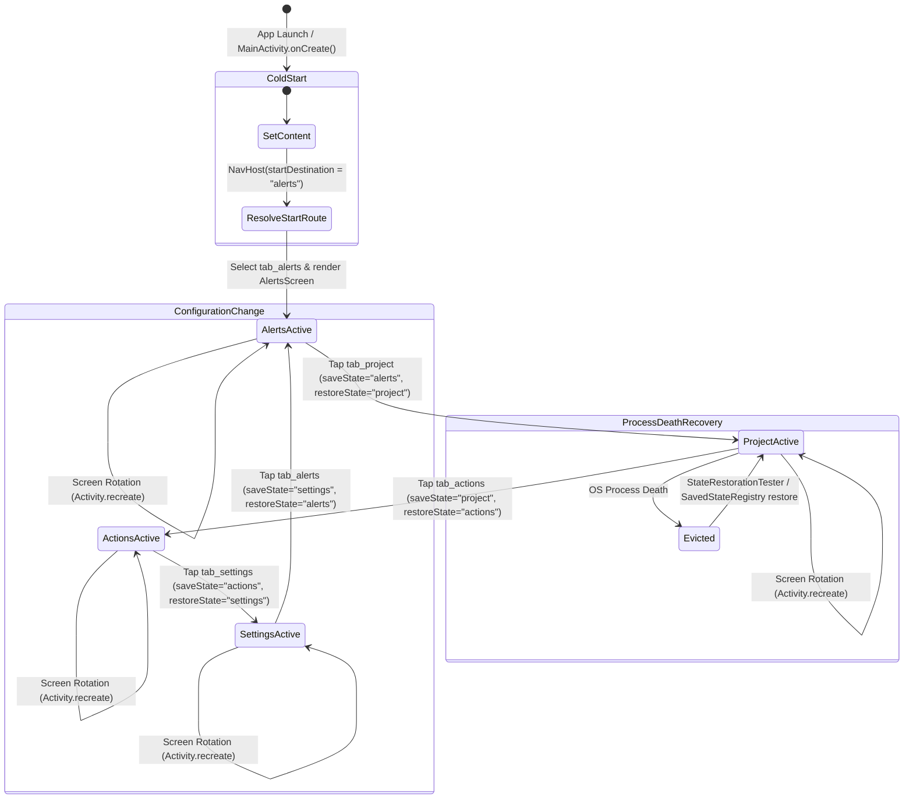

# Mobile App Startup & Navigation Test Scenarios

**Task:** Create test scenarios for app startup and navigation (`SCRUM-349`)  
**Parent User Story:** `SCRUM-254` (`US-79`: Mobile app project foundation and CI)  
**Related Tickets:**  
- `SCRUM-344`: Initialize Android project with feature-first structure, Jetpack Compose, dev/stage environment configuration, and KtLint setup  
- `SCRUM-346`: Bottom navigation shell and feature-screen placeholders, custom theme and styles ([`mobile/app/src/main/java/com/manta/mobile/ui/navigation/NavShell.kt`](../mobile/app/src/main/java/com/manta/mobile/ui/navigation/NavShell.kt))  
- `SCRUM-351`: Test scenario per provider  

**Target Platform & Framework:** Android (minSdk 27, targetSdk/compileSdk 37), Jetpack Compose (Compose BOM 2026.02.01, Material 3, Navigation Compose 2.8.8)  
**Automated Compose Test Suites (Widget Tests):**  
- [`mobile/app/src/androidTest/java/com/manta/mobile/AppStartupAndNavigationTest.kt`](../mobile/app/src/androidTest/java/com/manta/mobile/AppStartupAndNavigationTest.kt) (Instrumented Compose UI widget tests covering cold start, all-tab navigation, state preservation, rotation, and process restoration)  
- [`mobile/app/src/test/java/com/manta/mobile/NavigationRouteTest.kt`](../mobile/app/src/test/java/com/manta/mobile/NavigationRouteTest.kt) (JVM local unit tests verifying route definitions, item ordering, start destination, and uniqueness invariants)  

---

## 1. Objective & Architectural Invariants

### 1.1 Objective
Establish authoritative test scenarios and widget test mappings defining what must work when the M.A.N.T.A. mobile application starts and when users navigate between tabs. This document covers:
1. **Cold Start:** Application initialization, edge-to-edge system window configuration, initial route resolution (`NavItem.Alerts.route`), and bottom navigation shell layout.
2. **Navigation Between All Tabs:** Seamless routing and selection updates across all primary destinations (`Alerts`, `Project`, `Actions`, `Settings`).
3. **State Kept on Tab Switch:** Preserving screen interaction state (e.g. form inputs, counters, scroll offsets) across tab switches using `saveState = true` and `restoreState = true`.
4. **Configuration Change / Device Rotation:** Activity destruction and recreation without losing active tab selection or transient UI state.
5. **Process Restart & State Restoration:** Emulated OS process death and recreation where navigation backstack and `rememberSaveable` states are fully restored.

---

### 1.2 Core Architectural Invariants

```
+-------------------------------------------------------------------------------------------------------+
|                                  MOBILE ARCHITECTURAL INVARIANTS                                      |
+------------------------------------+-----------------------------------+------------------------------+
| 1. Deterministic Start Destination | 2. Single-Top Tab Navigation      | 3. State Preservation        |
|    (Alerts Tab)                    |    (No duplicate stack frames)    |    (saveState & restoreState)|
+------------------------------------+-----------------------------------+------------------------------+
| * NavHost startDestination =       | * popUpTo(findStartDestination)   | * Tabs preserve inputs and   |
|   NavItem.Alerts.route ("alerts")  | * launchSingleTop = true          |   scroll offsets via         |
| * Bottom bar highlights Alerts tab | * Re-tapping active tab does not  |   rememberSaveable &         |
| * AlertsScreen rendered at t=0     |   push duplicate destinations     |   NavBackStackEntry bundles  |
+------------------------------------+-----------------------------------+------------------------------+
                                                   |
                                                   v
+-------------------------------------------------------------------------------------------------------+
|                                    LIFECYCLE & SURVIVAL INVARIANTS                                    |
+----------------------------------------------------+--------------------------------------------------+
| 4. Configuration Change (Device Rotation)          | 5. Process Death & OS Eviction Restoration       |
+----------------------------------------------------+--------------------------------------------------+
| * Activity.recreate() maintains current tab route  | * SavedStateRegistry restores navigation state   |
| * Edge-to-edge insets dynamically recomputed      | * Bottom navigation re-syncs to restored screen  |
| * No visible flicker or blank screens              | * StateRestorationTester asserts full recovery   |
+----------------------------------------------------+--------------------------------------------------+
```

1. **Deterministic Start Destination (`alerts`):**  
   On cold start, `NavHost` must initialize at `NavItem.Alerts.route` (`"alerts"`). The bottom navigation bar must immediately reflect `Alerts` as selected, and `AlertsScreen` must render within the content area.
2. **Standard Material 3 Multi-Stack Navigation:**  
   Tab transitions use standard Jetpack Compose multi-stack navigation semantics:
   ```kotlin
   navController.navigate(item.route) {
       popUpTo(navController.graph.findStartDestination().id) {
           saveState = true
       }
       launchSingleTop = true
       restoreState = true
   }
   ```
   - `popUpTo(findStartDestination().id)`: Keeps the backstack rooted at the start destination (`Alerts`), avoiding arbitrary backstack buildup.
   - `saveState = true`: Automatically snapshots destination state into the `NavBackStackEntry`.
   - `restoreState = true`: Re-hydrates preserved destination state upon return.
   - `launchSingleTop = true`: Prevents pushing multiple copies of the same screen when tapping the currently active tab.
3. **Back Navigation Hierarchy:**  
   Pressing the Android system Back button from any secondary tab (`Project`, `Actions`, `Settings`) pops directly back to `Alerts` (the start destination). Pressing Back while on `Alerts` exits or backgrounds the application.
4. **Theme & Dark Palette Consistency:**  
   The application layout conforms to M.A.N.T.A.'s theme tokens:
   - Screen backgrounds: `AppBackground` (`0xFF111726`)
   - Active tab indicator: `SecondaryTransparent` (`0x1A28A745`)
   - Active label & icon: `TextLight` (`0xFFF8FAFC`)
   - Inactive label & icon: `MutedText` (`0xFF94A3B8`)

---

## 2. Navigation Architecture & Route Specification

### 2.1 Tab & Route Mapping

| Tab Title | Route String (`route`) | Sealed Class Object | Material Icon | Target Screen Composable | Semantics Tag (`testTag`) | Default Active? |
| :--- | :--- | :--- | :--- | :--- | :--- | :--- |
| **Alerts** | `"alerts"` | `NavItem.Alerts` | `Icons.Outlined.Notifications` | `AlertsScreen()` | `screen_alerts`<br>`tab_alerts` | **Yes (Start)** |
| **Project** | `"project"` | `NavItem.Project` | `Icons.Outlined.Folder` | `ProjectScreen()` | `screen_project`<br>`tab_project` | No |
| **Actions** | `"actions"` | `NavItem.Actions` | `Icons.Outlined.Bolt` | `ActionsScreen()` | `screen_actions`<br>`tab_actions` | No |
| **Settings** | `"settings"` | `NavItem.Settings` | `Icons.Outlined.Tune` | `SettingsScreen()` | `screen_settings`<br>`tab_settings` | No |

---

### 2.2 Navigation Lifecycle & State Transitions



---

## 3. Test Scenario Matrix

| Scenario ID | Scenario Name | Scope / Category | Preconditions | User Actions / Steps | Expected System & UI Outcome | Automated Widget Test |
| :--- | :--- | :--- | :--- | :--- | :--- | :--- |
| **`TC-MOB-NAV-001`** | **Cold Start & Default Destination** | Startup & Shell | App process not running; clean launch. | 1. Launch `MainActivity`.<br>2. Wait for Compose composition. | 1. Bottom navigation bar (`bottom_nav_bar`) is displayed.<br>2. All 4 tabs (`tab_alerts`, `tab_project`, `tab_actions`, `tab_settings`) are visible.<br>3. `tab_alerts` is selected (`assertIsSelected`).<br>4. `screen_alerts` is displayed showing `"Alerts Screen"`. | `AppStartupAndNavigationTest` $\rightarrow$ `coldStart_defaultDestinationIsAlertsTab()` |
| **`TC-MOB-NAV-002`** | **Tab Navigation: Alerts to Project** | Tab Navigation | App is on default start tab (`Alerts`). | 1. Tap `tab_project` in the bottom navigation bar. | 1. Navigation navigates to `"project"`.<br>2. `tab_project` is selected; `tab_alerts` is unselected.<br>3. `screen_project` is visible showing `"Project Screen"`. | `AppStartupAndNavigationTest` $\rightarrow$ `navigateToProjectTab_displaysProjectScreen()` |
| **`TC-MOB-NAV-003`** | **Tab Navigation: Project to Actions** | Tab Navigation | User is on `Project` tab. | 1. Tap `tab_actions` in the bottom navigation bar. | 1. Navigation navigates to `"actions"`.<br>2. `tab_actions` is selected; `tab_project` is unselected.<br>3. `screen_actions` is visible showing `"Actions Screen"`. | `AppStartupAndNavigationTest` $\rightarrow$ `navigateToActionsTab_displaysActionsScreen()` |
| **`TC-MOB-NAV-004`** | **Tab Navigation: Actions to Settings** | Tab Navigation | User is on `Actions` tab. | 1. Tap `tab_settings` in the bottom navigation bar. | 1. Navigation navigates to `"settings"`.<br>2. `tab_settings` is selected; `tab_actions` is unselected.<br>3. `screen_settings` is visible showing `"Settings Screen"`. | `AppStartupAndNavigationTest` $\rightarrow$ `navigateToSettingsTab_displaysSettingsScreen()` |
| **`TC-MOB-NAV-005`** | **Full Inter-Tab Navigation Cycle** | Tab Navigation | App is initialized on `Alerts`. | 1. Tap `tab_project`.<br>2. Tap `tab_actions`.<br>3. Tap `tab_settings`.<br>4. Tap `tab_alerts`. | 1. Screen dynamically updates at each step to match tapped tab.<br>2. Final state has `tab_alerts` selected and `screen_alerts` displayed.<br>3. No UI freezes, dropped frames, or navigation desynchronization. | `AppStartupAndNavigationTest` $\rightarrow$ `navigateBetweenAllTabs_fullCycle()` |
| **`TC-MOB-NAV-006`** | **Single-Top Tab Re-Selection** | Backstack Integrity | User is on `Project` tab. | 1. Tap `tab_project` while already on `Project` screen. | 1. `launchSingleTop = true` prevents duplicate screen instance creation.<br>2. `screen_project` remains visible.<br>3. `tab_project` remains selected without backstack duplication. | `AppStartupAndNavigationTest` $\rightarrow$ `reselectingActiveTab_preservesSingleTop()` |
| **`TC-MOB-NAV-007`** | **State Preservation on Tab Switch** | State Persistence | User is on `Project` tab; initial state = 0. | 1. Mutate state in `ProjectScreen` (tap `project_counter_button` $\rightarrow$ count = 1).<br>2. Tap `tab_alerts`.<br>3. Verify `AlertsScreen` is displayed.<br>4. Tap `tab_project` to return. | 1. Switching to Alerts saves Project backstack state (`saveState = true`).<br>2. Returning to Project restores backstack state (`restoreState = true`).<br>3. Counter retains mutated value (`Counter: 1`) without resetting to 0. | `AppStartupAndNavigationTest` $\rightarrow$ `statePreserved_onTabSwitch()` |
| **`TC-MOB-NAV-008`** | **System Back Navigation** | Backstack Integrity | User is on a secondary tab (`Settings`). | 1. Press Android system Back button (`Espresso.pressBack()`). | 1. `popUpTo(findStartDestination())` ensures back action returns to start destination (`Alerts`).<br>2. `tab_alerts` becomes selected.<br>3. `screen_alerts` is displayed. | `AppStartupAndNavigationTest` $\rightarrow$ `systemBack_fromSecondaryTab_popsToStartDestination()` |
| **`TC-MOB-NAV-009`** | **Configuration Change / Screen Rotation** | Lifecycle Resilience | User is on `Project` tab with state mutated (`Counter: 1`). | 1. Trigger orientation change / activity recreation (`scenario.recreate()`).<br>2. Wait for composition to complete. | 1. `MainActivity` recreates successfully without crashing.<br>2. `tab_project` remains selected.<br>3. `screen_project` is visible.<br>4. Mutated state (`Counter: 1`) survives configuration change intact. | `AppStartupAndNavigationTest` $\rightarrow$ `configurationChange_rotation_preservesActiveTabAndState()` |
| **`TC-MOB-NAV-010`** | **Process Restart & State Restoration** | Process Lifecycle | User has navigated to `Project` tab and mutated state (`Counter: 1`). | 1. Emulate OS process death & saved instance state restore (`StateRestorationTester.emulateSavedInstanceStateRestore()`). | 1. `NavHost` rehydrates saved backstack bundle from `SavedStateRegistry`.<br>2. `tab_project` is selected.<br>3. `screen_project` is displayed.<br>4. Preserved state (`Counter: 1`) is restored. | `AppStartupAndNavigationTest` $\rightarrow$ `processRestart_stateRestoration_preservesNavigationAndState()` |
| **`TC-MOB-NAV-011`** | **Navigation Route Model Invariants** | Unit Testing | Static test execution on host JVM. | 1. Execute `NavigationRouteTest`. | 1. Exactly 4 items in `navItems`.<br>2. Order is `Alerts`, `Project`, `Actions`, `Settings`.<br>3. All routes are distinct.<br>4. Default route is `"alerts"`. | `NavigationRouteTest` $\rightarrow$ all methods |

---

## 4. Detailed Scenario Specifications

### Scenario 1: Cold Start & Initial Destination Loading (`TC-MOB-NAV-001`)
- **Objective:** Verify that on initial launch, the mobile app initializes edge-to-edge styling, boots the navigation shell, renders all four navigation destinations, and opens directly to the `Alerts` screen.
- **Preconditions:** Cold start from fresh process launcher intent; no saved state bundle.
- **Steps:**
  1. Boot `MainActivity`.
  2. Inspect the root Compose hierarchy.
  3. Locate `bottom_nav_bar` and its child navigation bar items.
  4. Assert the visible content screen.
- **Assertions:**
  - `onNodeWithTag("bottom_nav_bar")` is displayed.
  - `onNodeWithTag("tab_alerts")` is displayed and `assertIsSelected()`.
  - `onNodeWithTag("tab_project")` is displayed and is not selected.
  - `onNodeWithTag("tab_actions")` is displayed and is not selected.
  - `onNodeWithTag("tab_settings")` is displayed and is not selected.
  - `onNodeWithTag("screen_alerts")` is displayed with text `"Alerts Screen"`.

---

### Scenario 2 to 4: Individual Tab Navigation (`TC-MOB-NAV-002`, `TC-MOB-NAV-003`, `TC-MOB-NAV-004`)
- **Objective:** Verify direct single-hop tab navigation from any screen to another screen via the bottom navigation bar.
- **Steps:**
  1. Tap target tab (`tab_project`, `tab_actions`, or `tab_settings`).
  2. Wait for composition update.
- **Assertions:**
  - Selected indicator shifts to target tab: `assertIsSelected()`.
  - Previous tab's selected indicator is removed.
  - The content area transitions to the target screen (`screen_project`, `screen_actions`, or `screen_settings`).
  - Corresponding screen title text is rendered.

---

### Scenario 5: Full Inter-Tab Navigation Cycle (`TC-MOB-NAV-005`)
- **Objective:** Verify that repeated, arbitrary tab switching across all destinations operates seamlessly without memory leaks, stack corruption, or UI lag.
- **Steps:**
  1. Start at `Alerts`.
  2. Navigate sequentially: `Alerts` $\rightarrow$ `Project` $\rightarrow$ `Actions` $\rightarrow$ `Settings` $\rightarrow$ `Alerts`.
  3. Assert active screen at each step.
- **Assertions:**
  - Each step renders the expected destination composable.
  - The final step returns cleanly to `AlertsScreen` with `tab_alerts` selected.

---

### Scenario 6: Single-Top Tab Re-Selection (`TC-MOB-NAV-006`)
- **Objective:** Verify that tapping a tab that is already active does not push duplicate entries onto the navigation backstack (`launchSingleTop = true`).
- **Steps:**
  1. Navigate to `Project` tab.
  2. Re-tap `tab_project`.
- **Assertions:**
  - No redundant recomposition or screen recreation.
  - Backstack retains single top instance of `Project`.
  - Pressing system Back returns to `Alerts` rather than a previous identical `Project` screen.

---

### Scenario 7: State Kept on Tab Switch (`TC-MOB-NAV-007`)
- **Objective:** Prove that transient interaction state (such as entered text, counters, or selections) is preserved when navigating away to another tab and returning.
- **Steps:**
  1. Navigate to `Project` tab (`tab_project`).
  2. Verify initial state (`Counter: 0`).
  3. Perform mutation: click `project_counter_button` to increment count to 1 (`Counter: 1`).
  4. Navigate away to `Alerts` tab (`tab_alerts`).
  5. Verify `AlertsScreen` is active.
  6. Navigate back to `Project` tab (`tab_project`).
- **Assertions:**
  - `ProjectScreen` is re-displayed.
  - `onNodeWithText("Counter: 1")` is displayed (state preserved by `saveState = true` / `restoreState = true`).
  - State was not reset to 0.

---

### Scenario 8: System Back Navigation Hierarchy (`TC-MOB-NAV-008`)
- **Objective:** Verify that pressing the Android system Back button adheres to standard Android navigation guidelines by popping back to the start destination (`Alerts`).
- **Steps:**
  1. Navigate to `Settings` tab.
  2. Invoke system back (`Espresso.pressBack()`).
- **Assertions:**
  - Active screen transitions from `SettingsScreen` back to `AlertsScreen`.
  - `tab_alerts` is selected.

---

### Scenario 9: Configuration Change / Device Rotation (`TC-MOB-NAV-009`)
- **Objective:** Verify that screen rotation (causing an Activity configuration change and destruction/recreation) does not cause the app to revert to the default tab or lose active screen state.
- **Steps:**
  1. Navigate to `Project` tab.
  2. Increment counter to 1.
  3. Trigger activity recreation via `composeTestRule.activityRule.scenario.recreate()`.
  4. Wait for re-composition.
- **Assertions:**
  - Activity successfully restarts.
  - Active tab remains `Project` (`tab_project` is selected).
  - `screen_project` remains visible.
  - Mutated counter state (`Counter: 1`) is preserved across rotation.

---

### Scenario 10: Process Restart & Saved State Restoration (`TC-MOB-NAV-010`)
- **Objective:** Verify that when the Android OS evicts the app process in the background and the user returns, the application restores both the active navigation tab and the preserved state from `SavedStateRegistry`.
- **Steps:**
  1. Mount `NavShell` with `StateRestorationTester`.
  2. Navigate to `Project` tab and increment counter to 1.
  3. Execute `restorationTester.emulateSavedInstanceStateRestore()`.
  4. Inspect the restored Compose hierarchy.
- **Assertions:**
  - `tab_project` is selected.
  - `screen_project` is displayed.
  - `onNodeWithText("Counter: 1")` is verified.

---

## 5. Automated Widget Test Mapping & Verification Guide

### 5.1 Test Method Mapping

| Scenario ID | Test Suite | Test Class | Exact Test Method Name | Execution Target |
| :--- | :--- | :--- | :--- | :--- |
| **`TC-MOB-NAV-001`** | Compose Widget Tests | `AppStartupAndNavigationTest` | `coldStart_defaultDestinationIsAlertsTab()` | Instrumented / Device |
| **`TC-MOB-NAV-002`** | Compose Widget Tests | `AppStartupAndNavigationTest` | `navigateToProjectTab_displaysProjectScreen()` | Instrumented / Device |
| **`TC-MOB-NAV-003`** | Compose Widget Tests | `AppStartupAndNavigationTest` | `navigateToActionsTab_displaysActionsScreen()` | Instrumented / Device |
| **`TC-MOB-NAV-004`** | Compose Widget Tests | `AppStartupAndNavigationTest` | `navigateToSettingsTab_displaysSettingsScreen()` | Instrumented / Device |
| **`TC-MOB-NAV-005`** | Compose Widget Tests | `AppStartupAndNavigationTest` | `navigateBetweenAllTabs_fullCycle()` | Instrumented / Device |
| **`TC-MOB-NAV-006`** | Compose Widget Tests | `AppStartupAndNavigationTest` | `reselectingActiveTab_preservesSingleTop()` | Instrumented / Device |
| **`TC-MOB-NAV-007`** | Compose Widget Tests | `AppStartupAndNavigationTest` | `statePreserved_onTabSwitch()` | Instrumented / Device |
| **`TC-MOB-NAV-008`** | Compose Widget Tests | `AppStartupAndNavigationTest` | `systemBack_fromSecondaryTab_popsToStartDestination()` | Instrumented / Device |
| **`TC-MOB-NAV-009`** | Compose Widget Tests | `AppStartupAndNavigationTest` | `configurationChange_rotation_preservesActiveTabAndState()` | Instrumented / Device |
| **`TC-MOB-NAV-010`** | Compose Widget Tests | `AppStartupAndNavigationTest` | `processRestart_stateRestoration_preservesNavigationAndState()` | Instrumented / Device |
| **`TC-MOB-NAV-011`** | JVM Unit Tests | `NavigationRouteTest` | `navItems_containsExactlyFourItemsInDefinedOrder()`<br>`navItems_routesAndTitlesAreValid()`<br>`navItems_routesAreUnique()`<br>`defaultStartDestination_isAlerts()` | Local Host / CI |

---

### 5.2 How to Execute Tests

#### 1. Running Unit Tests in CI and Local Development
The navigation route model tests run on the host JVM without an emulator or device attached:
```bash
cd mobile

# Run JVM unit tests (for dev and stage debug variants)
./gradlew testDevDebugUnitTest testStageDebugUnitTest
# Or via convenience task:
./gradlew testDebugUnitTest
```

#### 2. Running Instrumented Compose UI / Widget Tests
The instrumented Compose widget test suite runs on an attached Android device or running emulator:
```bash
cd mobile

# Run all Compose widget and UI tests
./gradlew connectedDebugAndroidTest

# Run specifically AppStartupAndNavigationTest
./gradlew connectedDebugAndroidTest -Pandroid.testInstrumentationRunnerArguments.class=com.manta.mobile.AppStartupAndNavigationTest
```

#### 3. Enforcing Quality & Formatting (Ktlint & Lint)
```bash
cd mobile

# Check Kotlin coding standards
./gradlew ktlintCheck

# Auto-format Kotlin files
./gradlew ktlintFormat

# Run Android Lint static analysis (dev and stage debug variants)
./gradlew lintDevDebug lintStageDebug
# Or via convenience task:
./gradlew lintDebug
```
