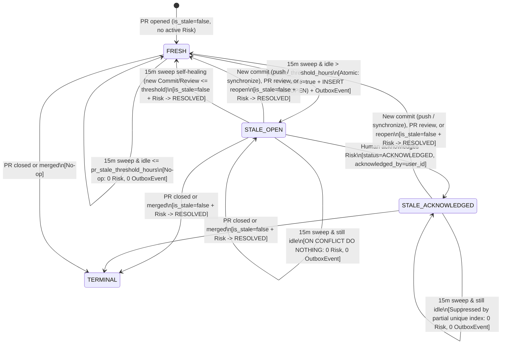
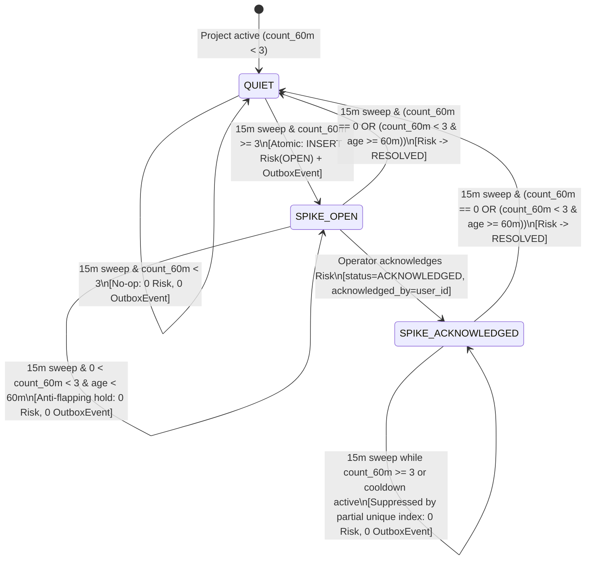

# US-71: Automated Blocker Detection (`>48h` Stale PRs & `3-Incident / 60m` Spikes) — BDD Specifications & Deduplication State-Reset Rules

**Task:** `TASK-307-0` (`SCRUM-542`: Author BDD specs & deduplication state-reset rules for `>48h` stale PRs & `3-incident/60m` spikes)  
**Parent User Story:** `SCRUM-507` (`STORY-307 — US-71`: Automated Operational Blocker & Incident Spike Detection)  
**Wave 2 Implementation Task:** `TASK-307-1` (`SCRUM-543`: Implement scheduled ARQ blocker detector — `SECURITY DEFINER` tenant sweep, atomic `Risk` upsert & `OutboxEvent` emit)  
**Target Storage Engine:** PostgreSQL 16 (`pgvector/pgvector:pg16`) with `FORCE ROW LEVEL SECURITY` (`eng_app_user`)  
**Target Scheduler:** ARQ 15-minute cron (`minute={0, 15, 30, 45}`) + Valkey / Redis 7  
**Target Implementation Modules:**
- `backend/app/blockers/service.py` (core detection engine, atomic `Risk` + `OutboxEvent` dual-write, PR staleness reset helper)
- `backend/workers/blocker_detector.py` (`SECURITY DEFINER` active-tenant pagination, per-tenant `get_tenant_db_context` sweep, ARQ cron entrypoint, daemon loop)
- `backend/workers/worker.py` (`WorkerSettings.cron_jobs`, `WorkerSettings.functions`, `dispatch_worker_job`, daemon task)
- `backend/app/git/normalization.py`, `backend/app/git/service.py`, `backend/app/git/webhook_handler.py` (`pull_request_review` ingestion & `is_stale = false` activity resets on `push`, `pull_request`, `pull_request_review`)
- `backend/app/webhooks/processor.py`, `backend/app/webhooks/git_processor.py` (webhook routing & secondary Git ingestion parity)
- `backend/migrations/versions/b4d7e2f9c1a3_blocker_detector_indexes_and_active_tenants_rpc.py` (`list_active_tenants` `SECURITY DEFINER` RPC & `uq_risks_active_condition` partial unique index)
- `backend/tests/test_blocker_detector.py` (automated unit, state-machine, and live PostgreSQL RLS integration test suite)

**QA Scenarios Mirror:** [`backend/tests/scenarios/test_us71_blocker_detection_stale_pr_and_incident_spike_scenarios.md`](../backend/tests/scenarios/test_us71_blocker_detection_stale_pr_and_incident_spike_scenarios.md)  
**Status:** Authoritative Wave 1 Specification (Baseline for Wave 2 Backend & QA Teams)

---

## 1. Executive Summary & Objective

M.A.N.T.A. automatically detects two high-signal delivery blockers across every active tenant on a 15-minute cadence:

1. **Stale Pull Requests (`STALE_PR`):** Open pull requests whose most recent engineering activity (PR creation/update, commit push, or pull request review) is **strictly older** than the owning project's configured `Project.pr_stale_threshold_hours` (default `48` hours, configurable `1..720`).
2. **Production Incident Spikes (`INCIDENT_SPIKE`):** Active projects experiencing **`>= 3` incidents** whose `started_at` timestamp falls inside the rolling **60-minute** lookback window `[T - 60m, T]`.

Without strict deduplication and state-reset rules, a 15-minute scheduled detector would fire 4 duplicate alerts per hour per stale PR or active incident storm, causing severe **alert fatigue** for Scrum Masters, Project Managers, and Delivery Directors. Conversely, permanent suppression would mask genuine recurrences when a PR goes stale a second time after a commit/review or when a new outage burst strikes hours later.

This specification establishes:
- Exact mathematical detection predicates and boundary semantics.
- Deterministic **deduplication & state-reset state machines** for `STALE_PR` and `INCIDENT_SPIKE`.
- Storage-level concurrency guarantees (`uq_risks_active_condition` partial unique index + `INSERT ... ON CONFLICT DO NOTHING RETURNING id`).
- Atomic dual-commit invariants pairing each newly created `Risk` row with exactly one `OutboxEvent` (`event_type = "risk.detected"`) inside a single tenant-isolated PostgreSQL transaction (`get_tenant_db_context`).
- Event-driven and sweep-reconciled `is_stale = false` reset rules for commit pushes, PR synchronize/reopen/close events, and PR review submissions (while preserving `PullRequest.updated_at` when flagging `is_stale = true` and ignoring out-of-order stale webhook deliveries).
- Complete **Gherkin BDD scenarios** (`TC-BLOCKER-001` through `TC-BLOCKER-018`) ready for automated verification.

---

## 2. Canonical Domain Contracts & Mathematical Invariants

### 2.1 Canonical `Risk` & `OutboxEvent` Taxonomy

| Blocker Condition | `Risk.type` | `Risk.severity` | `Risk.subject_type` | `Risk.subject_id` | Initial `Risk.status` | `OutboxEvent.event_type` | `OutboxEvent.aggregate_type` |
| :--- | :--- | :--- | :--- | :--- | :--- | :--- | :--- |
| Stale Pull Request (`idle > pr_stale_threshold_hours`) | `STALE_PR` | `HIGH` | `pull_request` | `str(pull_request.id)` | `OPEN` | `risk.detected` | `risk` |
| Incident Spike (`>= 3` incidents in rolling `60m`) | `INCIDENT_SPIKE` | `CRITICAL` | `project` | `str(project.id)` | `OPEN` | `risk.detected` | `risk` |

**Active vs. Terminal `Risk.status` values:**
- **Active (suppressing duplicates):** `OPEN`, `ACKNOWLEDGED`.
- **Resolved (re-armed for future recurrence):** `RESOLVED`.

### 2.2 Mathematical Invariant 1 — Stale PR Activity & Strict Inequality Boundary

For any active, non-deleted project $P$ (`projects.is_active = true AND projects.deleted_at IS NULL`) with threshold $H_P = \max(1, P.\text{pr\_stale\_threshold\_hours})$ (default $48$), and any open pull request $R$ belonging to $P$:

1. **Open PR Eligibility (case-insensitive across ingestion paths):**
   $$\text{IsOpen}(R) \iff \text{lower}(R.\text{state}) = \text{"open"} \land R.\text{merged\_at} \text{ is NULL} \land R.\text{closed\_at} \text{ is NULL}$$
2. **Last Engineering Activity Timestamp:**
   $$t_{\text{activity}}(R) = \max\Big(\{\, R.\text{created\_in\_git\_at},\; R.\text{updated\_at},\; R.\text{first\_review\_at},\; \max_{c \in \text{Commits}(R)} \max(c.\text{committed\_at}, c.\text{authored\_at}),\; \max_{v \in \text{Reviews}(R)} v.\text{submitted\_at} \,\} \setminus \{\text{NULL}\}\Big)$$
3. **Strict Staleness Predicate at Evaluation Time $T$:**
   $$\text{IdleDuration}(R, T) = T - t_{\text{activity}}(R)$$
   $$\text{IsStaleCondition}(R, T) \iff \text{IdleDuration}(R, T) > \text{timedelta}(\text{hours}=H_P)$$
   - At exact boundary $\text{IdleDuration}(R, T) = H_P$ (e.g., `48h 00m 00s`): **NOT stale** (`false`).
   - At $\text{IdleDuration}(R, T) = H_P + 1\text{s}$ (e.g., `48h 00m 01s`): **STALE** (`true`).
4. **Timestamp Preservation Invariant (ORM `onupdate` Guard):**
   Setting `pull_requests.is_stale = true` during detection MUST NOT modify `pull_requests.updated_at`. Because SQLAlchemy's `PullRequest.updated_at` declares `onupdate=datetime.utcnow`, detector updates MUST explicitly pin `updated_at = PullRequest.updated_at` in SQL `UPDATE`.

### 2.3 Mathematical Invariant 2 — Rolling 60-Minute Incident Spike Window

For any active, non-deleted project $P$ at evaluation time $T$, with rolling window $W = 60\text{ minutes}$ and threshold $K = 3$:

1. **Qualifying Window (inclusive bounds):**
   $$I_{60}(P, T) = \big\{\, i \in \text{incidents} \;\big|\; i.\text{tenant\_id} = P.\text{tenant\_id} \land i.\text{project\_id} = P.\text{id} \land T - 60\text{m} \le i.\text{started\_at} \le T \,\big\}$$
   - Both `OPEN` (`resolved_at IS NULL`) and recently resolved (`resolved_at IS NOT NULL`) incidents whose `started_at` lies in $[T - 60\text{m}, T]$ are counted (a rapidly flapping service that fails and recovers 3 times in 40 minutes is an active incident spike).
   - Incidents with `started_at < T - 60m` (e.g., `60m 01s` old) or future timestamps `started_at > T` are excluded.
   - Aggregation is strictly per `(tenant_id, project_id)` — incidents from Project A never combine with Project B.
2. **Spike Trigger Predicate:**
   $$\text{IsSpikeCondition}(P, T) \iff |I_{60}(P, T)| \ge 3$$

### 2.4 Mathematical Invariant 3 — Anti-Flapping Cooldown & State-Reset Rule for `INCIDENT_SPIKE`

To eliminate boundary flapping (where 1 of 3 incidents ages out leaving `count = 2` and a single subsequent incident immediately re-triggers a duplicate alert), an active `INCIDENT_SPIKE` `Risk` row $r$ (`r.status IN ('OPEN', 'ACKNOWLEDGED')`) automatically transitions to `status = 'RESOLVED'` if and only if:

$$\text{ShouldResetIncidentSpike}(P, r, T) \iff \big(|I_{60}(P, T)| = 0\big) \;\lor\; \big(|I_{60}(P, T)| < 3 \;\land\; (T - r.\text{created\_at}) \ge 60\text{ minutes}\big)$$

Consequences:
- **Continuous storm (`|I_60| >= 3`):** Never resolves, never re-emits (`1 Risk + 1 OutboxEvent` for the entire storm).
- **Boundary dip (`1 <= |I_60| <= 2` within `< 60m` of `r.created_at`):** Remains active and suppressed, preventing alert fatigue if 1 new incident occurs before the 60m cooldown expires.
- **Full quiet window (`|I_60| == 0`):** Immediately resolves `r` to `RESOLVED`, cleanly re-arming for any disjoint future 3-incident spike.
- **Sub-threshold after cooldown (`|I_60| < 3` and `T - r.created_at >= 60m`):** Resolves `r` to `RESOLVED` so a low-rate drip (`1` incident/hour) cannot permanently suppress a genuine future 3-incident burst.

### 2.5 Mathematical Invariant 4 — Storage-Level Deduplication & Atomic Dual-Commit

PostgreSQL enforces uniqueness of active risks at the storage layer via a partial unique index:

```sql
CREATE UNIQUE INDEX uq_risks_active_condition
    ON risks (tenant_id, project_id, type, subject_type, subject_id)
    WHERE status IN ('OPEN', 'ACKNOWLEDGED');
```

Every blocker detection writes atomically inside `async with get_tenant_db_context(tenant_id) as session:`:

```sql
INSERT INTO risks (id, tenant_id, project_id, type, severity, status, subject_type, subject_id, created_at)
VALUES (:id, :tenant_id, :project_id, :type, :severity, 'OPEN', :subject_type, :subject_id, :created_at)
ON CONFLICT (tenant_id, project_id, type, subject_type, subject_id)
WHERE status IN ('OPEN', 'ACKNOWLEDGED')
DO NOTHING
RETURNING id;
```

- **When `RETURNING id` yields a UUID (new active risk inserted):** Stage `OutboxEvent(event_type="risk.detected", aggregate_type="risk", aggregate_id=str(risk_id), ...)` via `record_outbox_event()` in the **same transaction**. On commit, `PullRequest.is_stale = true` (if `STALE_PR`), `Risk`, and `OutboxEvent` persist atomically. On any error before commit, all three roll back together (`0` partial rows).
- **When `RETURNING id` yields `NULL` (conflict with existing `OPEN` or `ACKNOWLEDGED` risk):** Emit **zero** `OutboxEvent` rows. Concurrent ARQ worker executions racing on the same tenant serialize on the unique index so strictly **one** worker emits the outbox event.

### 2.6 Mathematical Invariant 5 — `SECURITY DEFINER` Discovery & Tenant RLS Isolation

Application sessions connect as `eng_app_user` (`NOSUPERUSER`, `NOBYPASSRLS`) against tables enforcing `FORCE ROW LEVEL SECURITY` (`tenants`, `projects`, `pull_requests`, `pull_request_reviews`, `commits`, `incidents`, `risks`, `outbox_events`):

```sql
CREATE OR REPLACE FUNCTION list_active_tenants(
    p_limit INT DEFAULT 1000,
    p_after_id UUID DEFAULT NULL
)
RETURNS TABLE (tenant_id UUID)
LANGUAGE plpgsql
STABLE
SECURITY DEFINER
SET search_path = public, pg_temp
AS $$
BEGIN
    RETURN QUERY
    SELECT t.id
    FROM tenants t
    WHERE LOWER(t.status) = 'active'
      AND (p_after_id IS NULL OR t.id > p_after_id)
    ORDER BY t.id ASC
    LIMIT p_limit;
END;
$$;

REVOKE ALL ON FUNCTION list_active_tenants(INT, UUID) FROM PUBLIC;
GRANT EXECUTE ON FUNCTION list_active_tenants(INT, UUID) TO eng_app_user;
```

- Discovery returns **only** `tenant_id UUID` values for tenants with `LOWER(status) = 'active'`, paginated via keyset cursor `p_after_id`.
- Every subsequent query/mutation executes exclusively inside `async with get_tenant_db_context(tenant_id) as session:` (`set_config('app.current_tenant_id', :tenant_id, true)`).
- Failures in one tenant's transaction are caught, logged, counted in sweep stats, and isolated so remaining active tenants complete cleanly.

---

## 3. Deduplication & State-Reset State Machines

### 3.1 `STALE_PR` State Machine



#### `STALE_PR` Transition Matrix

| Current State | Trigger / Event | Guard Condition | Next State | `PullRequest.is_stale` | `Risk` Mutation | `OutboxEvent` Emitted |
| :--- | :--- | :--- | :--- | :---: | :--- | :---: |
| `FRESH` | 15m ARQ sweep | `idle <= threshold` | `FRESH` | `false` | None | `0` |
| `FRESH` | 15m ARQ sweep | `idle > threshold` | `STALE_OPEN` | `true` (`updated_at` preserved) | `INSERT` (`OPEN`) | **`1`** (`risk.detected`) |
| `STALE_OPEN` | 15m ARQ sweep | `idle > threshold` | `STALE_OPEN` | `true` | `ON CONFLICT DO NOTHING` | `0` |
| `STALE_OPEN` | Human ACK | Manager sets `ACKNOWLEDGED` | `STALE_ACKNOWLEDGED` | `true` | `status = 'ACKNOWLEDGED'` | `0` |
| `STALE_ACKNOWLEDGED` | 15m ARQ sweep | `idle > threshold` | `STALE_ACKNOWLEDGED` | `true` | `ON CONFLICT DO NOTHING` | `0` |
| `STALE_OPEN` / `STALE_ACK` | GitHub `push` on PR branch | `saved_commits > 0` | `FRESH` | **`false`** (`updated_at` advanced) | Active `STALE_PR` -> `RESOLVED` | `0` |
| `STALE_OPEN` / `STALE_ACK` | GitHub `pull_request` (`synchronize` / `reopened`) | Passes version & fencing guard | `FRESH` | **`false`** (`updated_at` advanced) | Active `STALE_PR` -> `RESOLVED` | `0` |
| `STALE_OPEN` / `STALE_ACK` | GitHub `pull_request` (out-of-order stale event) | `entity_version <= stored` or stale token | Unchanged | `true` (preserved) | Unchanged | `0` |
| `STALE_OPEN` / `STALE_ACK` | GitHub `pull_request_review` (`submitted` / `edited`) | PR is open | `FRESH` | **`false`** (`updated_at` advanced) | Active `STALE_PR` -> `RESOLVED` | `0` |
| `STALE_OPEN` / `STALE_ACK` | GitHub `pull_request` (`closed` / `merged`) | Passes version & fencing guard | `TERMINAL` | **`false`** | Active `STALE_PR` -> `RESOLVED` | `0` |
| `STALE_OPEN` / `STALE_ACK` | 15m ARQ sweep reconciliation | PR closed/merged OR `idle <= threshold` | `TERMINAL` / `FRESH` | **`false`** | Active `STALE_PR` -> `RESOLVED` | `0` |
| `FRESH` (after reset) | Subsequent 15m sweep | New `idle > threshold` | `STALE_OPEN` | `true` | New `INSERT` (`OPEN`); prior `RESOLVED` kept | **`1`** (`risk.detected`) |

---

### 3.2 `INCIDENT_SPIKE` State Machine



#### `INCIDENT_SPIKE` Transition Matrix

| Current State | Trigger / Event | Guard Condition | Next State | `Risk` Mutation | `OutboxEvent` Emitted |
| :--- | :--- | :--- | :--- | :--- | :---: |
| `QUIET` | 15m ARQ sweep | `count_60m < 3` | `QUIET` | None | `0` |
| `QUIET` | 15m ARQ sweep | `count_60m >= 3` | `SPIKE_OPEN` | `INSERT` (`OPEN`) | **`1`** (`risk.detected`) |
| `SPIKE_OPEN` | 15m ARQ sweep | `count_60m >= 3` (even 4th/5th incident) | `SPIKE_OPEN` | `ON CONFLICT DO NOTHING` | `0` |
| `SPIKE_OPEN` / `SPIKE_ACK` | 15m ARQ sweep | `1 <= count_60m <= 2` AND `now - created_at < 60m` | Unchanged | Held active (anti-flapping) | `0` |
| `SPIKE_OPEN` | Human ACK | Operator sets `ACKNOWLEDGED` | `SPIKE_ACKNOWLEDGED` | `status = 'ACKNOWLEDGED'` | `0` |
| `SPIKE_OPEN` / `SPIKE_ACK` | 15m ARQ sweep | `count_60m == 0` | `QUIET` | Active `INCIDENT_SPIKE` -> `RESOLVED` | `0` |
| `SPIKE_OPEN` / `SPIKE_ACK` | 15m ARQ sweep | `count_60m < 3` AND `now - created_at >= 60m` | `QUIET` | Active `INCIDENT_SPIKE` -> `RESOLVED` | `0` |
| `QUIET` (after reset) | Subsequent 15m sweep | New `count_60m >= 3` | `SPIKE_OPEN` | New `INSERT` (`OPEN`); prior `RESOLVED` kept | **`1`** (`risk.detected`) |

---

## 4. Canonical `OutboxEvent` Payload Envelopes

All emitted outbox rows are staged via `app.outbox.service.record_outbox_event()` with `published_at = NULL`, `id = generate_uuidv7()`, `aggregate_type = "risk"`, `aggregate_id = str(risk.id)`, and `event_type = "risk.detected"`.

### 4.1 `STALE_PR` Canonical Outbox Payload

```json
{
  "event_id": "019a0c8d-4f10-7abc-8123-456789abcdef",
  "event_type": "risk.detected",
  "schema_version": "1.0",
  "tenant_id": "11111111-1111-1111-1111-111111111111",
  "project_id": "22222222-2222-2222-2222-222222222222",
  "occurred_at": "2026-11-25T12:00:00+00:00",
  "data": {
    "risk_id": "33333333-3333-3333-3333-333333333333",
    "risk_type": "STALE_PR",
    "severity": "HIGH",
    "status": "OPEN",
    "subject_type": "pull_request",
    "subject_id": "44444444-4444-4444-4444-444444444444",
    "project_id": "22222222-2222-2222-2222-222222222222",
    "pull_request_id": "44444444-4444-4444-4444-444444444444",
    "repository_id": "55555555-5555-5555-5555-555555555555",
    "external_pr_number": 42,
    "pr_title": "feat: add checkout retry policy",
    "author_pseudonym_id": "a1b2c3d4e5f6...",
    "threshold_hours": 48,
    "idle_hours": 50.25,
    "last_activity_at": "2026-11-23T09:45:00+00:00",
    "detected_at": "2026-11-25T12:00:00+00:00"
  }
}
```
> **PII Isolation Invariant:** `OutboxEvent.payload` MUST contain strictly `author_pseudonym_id` (64-char hex HMAC pseudonym) and NEVER raw GitHub usernames, names, or email addresses.

### 4.2 `INCIDENT_SPIKE` Canonical Outbox Payload

```json
{
  "event_id": "019a0c8d-4f12-7def-9456-abcdef012345",
  "event_type": "risk.detected",
  "schema_version": "1.0",
  "tenant_id": "11111111-1111-1111-1111-111111111111",
  "project_id": "22222222-2222-2222-2222-222222222222",
  "occurred_at": "2026-11-25T12:00:00+00:00",
  "data": {
    "risk_id": "66666666-6666-6666-6666-666666666666",
    "risk_type": "INCIDENT_SPIKE",
    "severity": "CRITICAL",
    "status": "OPEN",
    "subject_type": "project",
    "subject_id": "22222222-2222-2222-2222-222222222222",
    "project_id": "22222222-2222-2222-2222-222222222222",
    "incident_count": 3,
    "threshold_count": 3,
    "window_minutes": 60,
    "window_start": "2026-11-25T11:00:00+00:00",
    "window_end": "2026-11-25T12:00:00+00:00",
    "incident_ids": [
      "77777777-7777-7777-7777-777777777771",
      "77777777-7777-7777-7777-777777777772",
      "77777777-7777-7777-7777-777777777773"
    ],
    "detected_at": "2026-11-25T12:00:00+00:00"
  }
}
```

---

## 5. Complete Gherkin BDD Feature Specifications

```gherkin
Feature: Automated Blocker Detection for Stale Pull Requests and Production Incident Spikes (US-71)
  As a Scrum Master, Project Manager, or Delivery Director
  I want MANTA to detect pull requests idle beyond Project.pr_stale_threshold_hours
  and production incident spikes of >= 3 incidents in 60 minutes every 15 minutes
  with strict deduplication and clean state-reset rules
  So that delivery blockers are surfaced atomically without causing alert fatigue.

  Background:
    Given PostgreSQL enforces FORCE ROW LEVEL SECURITY on all tenant-scoped tables for role "eng_app_user"
    And the SECURITY DEFINER function "list_active_tenants" is granted exclusively to "eng_app_user"
    And the partial unique index "uq_risks_active_condition" enforces at most one active Risk with status IN ('OPEN', 'ACKNOWLEDGED') per (tenant_id, project_id, type, subject_type, subject_id)
    And an active tenant "Tenant Alpha" exists with active project "Project Core" having pr_stale_threshold_hours = 48

  # ---------------------------------------------------------------------------
  # GROUP 1: STALE PULL REQUEST DETECTION & THRESHOLD BOUNDARIES
  # ---------------------------------------------------------------------------

  @TC-BLOCKER-001 @stale_pr @atomic_outbox
  Scenario: Flag open PR idle > 48h with atomic Risk upsert and OutboxEvent commit
    Given an open pull request #101 in "Project Core" with is_stale = false
    And the pull request's latest activity timestamp is 49 hours before evaluation time T
    When the scheduled 15-minute blocker detector sweep runs at T
    Then pull request #101 is updated to is_stale = true
    And pull request #101 preserves its original updated_at timestamp without bumping to T
    And exactly 1 Risk row is committed with type = "STALE_PR", severity = "HIGH", status = "OPEN", subject_type = "pull_request", subject_id = pull_request.id
    And exactly 1 OutboxEvent row is committed in the same transaction with event_type = "risk.detected", aggregate_type = "risk", aggregate_id = risk.id, published_at = NULL
    And the OutboxEvent payload contains data.risk_type = "STALE_PR", data.threshold_hours = 48, and zero raw PII

  @TC-BLOCKER-002 @stale_pr @boundary
  Scenario Outline: Enforce strict greater-than threshold boundary and custom Project.pr_stale_threshold_hours
    Given an active project with pr_stale_threshold_hours = <threshold_hours>
    And an open pull request whose last activity was <idle_seconds> seconds before T
    When the blocker detector sweep runs at T
    Then pull request is_stale is <expected_stale>
    And the count of newly created STALE_PR Risk rows is <expected_risks>
    And the count of newly created OutboxEvent rows is <expected_risks>

    Examples:
      | threshold_hours | idle_seconds | expected_stale | expected_risks |
      | 48              | 172799       | false          | 0              |
      | 48              | 172800       | false          | 0              |
      | 48              | 172801       | true           | 1              |
      | 24              | 86400        | false          | 0              |
      | 24              | 108000       | true           | 1              |
      | 72              | 180000       | false          | 0              |
      | 72              | 262800       | true           | 1              |

  @TC-BLOCKER-003 @stale_pr @activity_sources
  Scenario: Recent Commit or PullRequestReview prevents PR from being flagged stale
    Given an open pull request #102 created 72 hours before T in "Project Core" (threshold 48h)
    And a linked Commit or PullRequestReview exists on pull request #102 with timestamp 10 hours before T
    When the blocker detector sweep runs at T
    Then pull request #102 remains is_stale = false
    And 0 STALE_PR Risk rows and 0 OutboxEvent rows are created

  @TC-BLOCKER-004 @stale_pr @deduplication
  Scenario: Repeated 15-minute sweeps suppress duplicate Risks and OutboxEvents for OPEN and ACKNOWLEDGED stale PRs
    Given pull request #101 was flagged STALE_PR at T with 1 OPEN Risk and 1 OutboxEvent
    When the blocker detector sweep runs again at T + 15m and T + 30m while PR #101 remains idle
    Then total STALE_PR Risk rows for PR #101 remain strictly 1
    And total OutboxEvent rows for PR #101 remain strictly 1
    When a Scrum Master acknowledges the Risk setting status = "ACKNOWLEDGED"
    And the blocker detector sweep runs again at T + 45m while PR #101 remains idle
    Then total STALE_PR Risk rows for PR #101 remain strictly 1 with status = "ACKNOWLEDGED"
    And total OutboxEvent rows for PR #101 remain strictly 1

  @TC-BLOCKER-005 @stale_pr @concurrency
  Scenario: Concurrent worker sweep races produce strictly one Risk and one OutboxEvent via partial unique index
    Given an open pull request #103 idle 60 hours in "Project Core"
    When two blocker detector workers evaluate "Tenant Alpha" concurrently at T
    Then PostgreSQL partial unique index "uq_risks_active_condition" permits exactly one INSERT ... ON CONFLICT DO NOTHING RETURNING id to succeed
    And strictly 1 STALE_PR Risk row and strictly 1 OutboxEvent row exist after both workers complete

  # ---------------------------------------------------------------------------
  # GROUP 2: STALE PR STATE-RESET & RE-ARMING RULES
  # ---------------------------------------------------------------------------

  @TC-BLOCKER-006 @stale_pr @state_reset @commit
  Scenario: New commit activity via GitHub push or pull_request synchronize resets is_stale = false and resolves Risk
    Given open pull request #101 is flagged is_stale = true with an active STALE_PR Risk (status = "OPEN")
    When a GitHub "push" webhook with new commits on PR #101's head_branch OR a valid "pull_request" action = "synchronize" webhook is processed
    Then pull request #101 is updated to is_stale = false
    And the active STALE_PR Risk for PR #101 transitions to status = "RESOLVED"
    And 0 new OutboxEvent rows are emitted by the reset

  @TC-BLOCKER-007 @stale_pr @state_reset @review
  Scenario: New PR review activity via GitHub pull_request_review resets is_stale = false with zero raw PII
    Given open pull request #101 is flagged is_stale = true with an active STALE_PR Risk (status = "ACKNOWLEDGED")
    When a GitHub "pull_request_review" webhook with action = "submitted" (state = "CHANGES_REQUESTED" or "COMMENTED" or "APPROVED") is processed
    Then a PullRequestReview row is persisted with a 64-char HMAC reviewer_pseudonym_id and zero raw PII
    And pull request #101 is updated to is_stale = false with updated_at >= review.submitted_at
    And the active STALE_PR Risk for PR #101 transitions to status = "RESOLVED"

  @TC-BLOCKER-008 @stale_pr @state_reset @out_of_order
  Scenario: Stale or out-of-order GitHub webhook rejected by version/fencing guard does NOT reset is_stale
    Given open pull request #101 has entity_version = 2000 and is_stale = true with an OPEN STALE_PR Risk
    When a delayed out-of-order "pull_request" synchronize webhook arrives with entity_version = 1500
    Then the webhook is rejected as "noop:stale_pr_version:101"
    And pull request #101 remains is_stale = true
    And the STALE_PR Risk remains status = "OPEN"

  @TC-BLOCKER-009 @stale_pr @state_reset @rearm
  Scenario: Reset PR cleanly re-arms and emits a fresh Risk + OutboxEvent if it goes idle > threshold again
    Given pull request #101 was flagged STALE_PR at T0, then reset to is_stale = false (Risk #1 -> RESOLVED) by a new commit at T0 + 2h
    When 50 additional hours elapse with zero new commits or reviews (evaluation time T1 = T0 + 52h)
    And the blocker detector sweep runs at T1
    Then pull request #101 is flagged is_stale = true again
    And a second STALE_PR Risk (#2, status = "OPEN") is inserted while historical Risk #1 remains "RESOLVED"
    And a second OutboxEvent ("risk.detected") referencing Risk #2 is committed atomically

  @TC-BLOCKER-010 @stale_pr @terminal_cleanup
  Scenario: Closed or merged PRs are excluded from stale detection and clear prior stale flags
    Given pull request #104 was flagged is_stale = true with an OPEN STALE_PR Risk
    When pull request #104 transitions to state = "MERGED" or "CLOSED"
    Then pull request #104 has is_stale = false and its STALE_PR Risk transitions to status = "RESOLVED"
    And subsequent 15-minute sweeps ignore PR #104 even if merged_at is > 48 hours ago

  # ---------------------------------------------------------------------------
  # GROUP 3: 3-INCIDENT / 60-MINUTE SPIKE DETECTION & ANTI-FLAPPING RESET
  # ---------------------------------------------------------------------------

  @TC-BLOCKER-011 @incident_spike @atomic_outbox
  Scenario: Flag >= 3 incidents within rolling 60-minute window with atomic Risk + OutboxEvent commit
    Given "Project Core" has 3 incidents with started_at at T - 45m, T - 20m, and T - 5m
    When the blocker detector sweep runs at T
    Then exactly 1 Risk row is committed with type = "INCIDENT_SPIKE", severity = "CRITICAL", status = "OPEN", subject_type = "project", subject_id = project.id
    And exactly 1 OutboxEvent row is committed in the same transaction with event_type = "risk.detected", aggregate_type = "risk", aggregate_id = risk.id
    And the OutboxEvent payload reports data.incident_count = 3, data.window_minutes = 60, and lists all 3 incident_ids

  @TC-BLOCKER-012 @incident_spike @boundary
  Scenario: Sub-threshold (< 3), expired (> 60m), and cross-project incident distributions do NOT trigger a spike
    Given "Project Core" has 2 incidents at T - 30m and T - 10m, plus 1 expired incident at T - 60m01s
    And sibling active project "Project Billing" has 2 incidents at T - 15m and T - 5m
    When the blocker detector sweep runs at T
    Then 0 INCIDENT_SPIKE Risk rows are created for "Project Core"
    And 0 INCIDENT_SPIKE Risk rows are created for "Project Billing"
    And 0 OutboxEvent rows are created

  @TC-BLOCKER-013 @incident_spike @deduplication
  Scenario: Ongoing incident storm and acknowledged spikes emit zero duplicate alerts across repeated runs
    Given "Project Core" triggered an INCIDENT_SPIKE Risk at T (3 incidents in 60m)
    When a 4th incident occurs at T + 10m and sweeps execute at T + 15m and T + 30m
    And an operator sets the Risk status = "ACKNOWLEDGED" before the T + 45m sweep
    Then strictly 1 INCIDENT_SPIKE Risk row and strictly 1 OutboxEvent row exist across all sweeps

  @TC-BLOCKER-014 @incident_spike @anti_flapping @rearm
  Scenario: Incident spike holds during 60m cooldown when count dips to 2, resolves after quiet window or cooldown, and re-arms for a new burst
    Given "Project Core" had incidents at 10:00, 10:05, and 10:10 and fired INCIDENT_SPIKE Risk #1 at 10:15 (created_at = 10:15)
    When a sweep runs at 11:02 (incident at 10:00 aged out -> count_60m = 2, risk age = 47m < 60m)
    Then Risk #1 remains active (status = "OPEN") so a single incident at 11:04 does NOT create a duplicate Risk #2
    When no new incidents occur and a sweep runs at 11:15 (count_60m = 0 and risk age = 60m)
    Then Risk #1 transitions to status = "RESOLVED"
    When 3 brand-new incidents occur at 11:20, 11:25, and 11:30 and a sweep runs at 11:30
    Then a new INCIDENT_SPIKE Risk #2 (status = "OPEN") and 1 new OutboxEvent are committed atomically

  # ---------------------------------------------------------------------------
  # GROUP 4: ATOMIC ROLLBACK, MULTI-TENANT RLS & SCHEDULED ARQ EXECUTION
  # ---------------------------------------------------------------------------

  @TC-BLOCKER-015 @atomicity @rollback
  Scenario: Failure prior to commit rolls back PullRequest.is_stale, Risk, and OutboxEvent atomically
    Given open pull request #105 is idle 60 hours in "Project Core"
    And an exception is raised inside the tenant transaction after Risk + OutboxEvent staging but prior to commit
    When the transaction exits
    Then pull request #105 remains is_stale = false
    And 0 Risk rows and 0 OutboxEvent rows are persisted in PostgreSQL

  @TC-BLOCKER-016 @security @rls @multi_tenant
  Scenario: SECURITY DEFINER discovery sweeps only active tenants under strict FORCE ROW LEVEL SECURITY
    Given active tenants "Tenant Alpha" and "Tenant Beta", plus suspended tenant "Tenant Gamma" (status = "suspended")
    And "Tenant Alpha" has a 60h stale PR, "Tenant Beta" has 3 incidents in 60m, and "Tenant Gamma" has both
    When "sweep_all_active_tenants" runs under "eng_app_user"
    Then "list_active_tenants" returns "Tenant Alpha" and "Tenant Beta" and excludes "Tenant Gamma"
    And "Tenant Alpha" session writes 1 STALE_PR Risk + 1 OutboxEvent visible ONLY under Tenant Alpha RLS context
    And "Tenant Beta" session writes 1 INCIDENT_SPIKE Risk + 1 OutboxEvent visible ONLY under Tenant Beta RLS context
    And "Tenant Gamma" has 0 Risk rows and 0 OutboxEvent rows written

  @TC-BLOCKER-017 @fault_isolation
  Scenario: Exception while sweeping one tenant does not abort sweeps for remaining active tenants
    Given active tenants "Tenant Alpha" (simulated DB error) and "Tenant Beta" (healthy with 3 incidents/60m)
    When "sweep_all_active_tenants" runs
    Then "Tenant Alpha" records 1 tenant_error in BlockerSweepResult without crashing the sweep
    And "Tenant Beta" still commits its INCIDENT_SPIKE Risk + OutboxEvent cleanly

  @TC-BLOCKER-018 @arq @schedule
  Scenario: ARQ WorkerSettings registers a unique 15-minute cron schedule for the blocker detector
    Given the backend ARQ worker module "workers.worker"
    When inspecting "WorkerSettings.cron_jobs"
    Then a CronJob named "blocker_detector_15m" is registered targeting "run_blocker_detector_cron"
    And its minute schedule equals {0, 15, 30, 45} with second = 0 and unique = true
```

---

## 6. QA Traceability Matrix

| Scenario ID | Acceptance Criterion | Component Under Test | Automated Test Mapping (`backend/tests/test_blocker_detector.py`) |
| :--- | :--- | :--- | :--- |
| `TC-BLOCKER-001` | 1 `Risk` + 1 `OutboxEvent` atomic commit for `>48h` stale PR; `updated_at` preserved | `app.blockers.service.detect_stale_prs_in_session` | `test_stale_pr_detection_atomic_risk_and_outbox_preserves_updated_at` |
| `TC-BLOCKER-002` | Strict `>` boundary & custom `Project.pr_stale_threshold_hours` (`24h`/`48h`/`72h`) | `app.blockers.service.detect_stale_prs_in_session` | `test_stale_pr_threshold_boundary_and_custom_project_hours` |
| `TC-BLOCKER-003` | Recent Commit / `PullRequestReview` keeps PR fresh | `app.blockers.service.compute_pr_last_activity_at` | `test_recent_commit_or_review_prevents_stale_flagging` |
| `TC-BLOCKER-004` | Duplicate suppression across repeated 15m runs (`OPEN` & `ACKNOWLEDGED`) | `app.blockers.service.upsert_blocker_risk_with_outbox` | `test_stale_pr_duplicate_suppression_open_and_acknowledged` |
| `TC-BLOCKER-005` | Storage-level partial unique index `uq_risks_active_condition` race guard | Migration `b4d7e2f9c1a3` + `Risk` | `test_live_pg_partial_unique_index_suppresses_concurrent_duplicates` |
| `TC-BLOCKER-006` | New commit (`push` / `pull_request.synchronize`) resets `is_stale = false` + resolves Risk | `app.git.service` & `app.webhooks.git_processor` | `test_push_and_synchronize_reset_is_stale_and_resolve_risk` |
| `TC-BLOCKER-007` | New review (`pull_request_review`) resets `is_stale = false`, zero raw PII | `app.git.normalization`, `app.git.service`, `app.webhooks.processor` | `test_pull_request_review_webhook_resets_is_stale_without_pii` |
| `TC-BLOCKER-008` | Out-of-order stale PR webhook rejected without resetting `is_stale` | `app.git.service.process_pull_request` | `test_out_of_order_stale_pr_webhook_does_not_reset_is_stale` |
| `TC-BLOCKER-009` | Reset PR cleanly re-arms after another `> threshold` idle window | `app.blockers.service` | `test_stale_pr_rearms_cleanly_after_reset_and_new_idle_period` |
| `TC-BLOCKER-010` | Closed/merged PRs excluded and clear stale flag / active Risk | `app.git.service` & `app.blockers.service` | `test_closed_and_merged_prs_clear_stale_flag_and_resolve_risk` |
| `TC-BLOCKER-011` | `>= 3` incidents in rolling 60m commits 1 `Risk` + 1 `OutboxEvent` atomically | `app.blockers.service.detect_incident_spikes_in_session` | `test_incident_spike_three_in_60m_commits_risk_and_outbox` |
| `TC-BLOCKER-012` | `< 3` incidents, `60m01s` expired, or cross-project split produce 0 alerts | `app.blockers.service.detect_incident_spikes_in_session` | `test_incident_spike_subthreshold_expired_and_cross_project_ignored` |
| `TC-BLOCKER-013` | Ongoing storm (4th/5th incident) & `ACKNOWLEDGED` risk suppress duplicates | `app.blockers.service.detect_incident_spikes_in_session` | `test_incident_spike_suppresses_duplicates_during_storm_and_ack` |
| `TC-BLOCKER-014` | Anti-flapping cooldown hold, quiet/cooldown reset, and clean re-arming | `app.blockers.service.detect_incident_spikes_in_session` | `test_incident_spike_anti_flapping_cooldown_reset_and_rearm` |
| `TC-BLOCKER-015` | Rollback atomicity leaves 0 partial writes across PR, Risk, OutboxEvent | `get_tenant_db_context` + `app.blockers.service` | `test_atomic_rollback_prevents_partial_risk_or_outbox_writes` |
| `TC-BLOCKER-016` | `SECURITY DEFINER` `list_active_tenants` + `FORCE ROW LEVEL SECURITY` isolation | `workers.blocker_detector` + Migration `b4d7e2f9c1a3` | `test_discover_active_tenants_pagination` & `test_live_pg_multi_tenant_rls_sweep_isolation` |
| `TC-BLOCKER-017` | Per-tenant failure isolation during multi-tenant sweep | `workers.blocker_detector.sweep_all_active_tenants` | `test_sweep_all_active_tenants_isolates_single_tenant_failure` |
| `TC-BLOCKER-018` | 15-minute ARQ `WorkerSettings.cron_jobs` registration (`{0, 15, 30, 45}`) | `workers.worker.WorkerSettings` | `test_arq_worker_settings_registers_15m_blocker_cron` |
