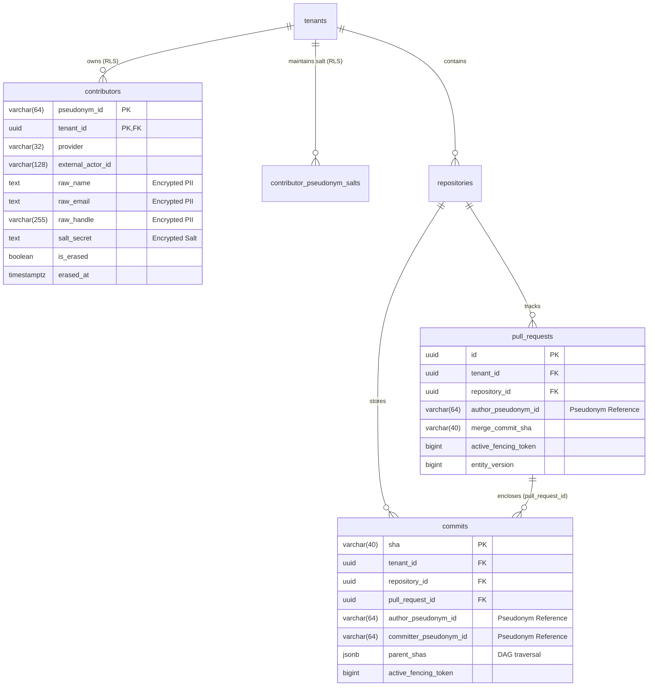

# Isolated Contributors PII Table, HMAC-SHA256 Pseudonym Mapping & DORA Pull Requests/Commits Schema Extensions Specification

**Parent User Story:** `US-20` (`SCRUM-356` GitHub pull request and commit tracking)  
**Task:** `SCRUM-392` (`Task 20.1` Design isolated contributors PII table, HMAC pseudonym mapping and schema extensions on pull_requests and commits)  
**Category:** Design  
**Assignee:** Maksym Bielei (Back-end. Database Architect)  
**Estimate:** 0.75 Story Points (1h 30m Original Estimate)  
**Status:** Approved / Design Baseline Established  
**Architecture Reference:** AI-Augmented Engineering Intelligence Platform Blueprint v3.0, §3.2, §5.1, §14.2, §16.4; Software Requirements Specification (SRS) v1.0, §1.2, §2.4.1, §3.2.11  
**Target Storage Engine:** PostgreSQL 16 with Row-Level Security (`pgvector/pgvector:pg16`)  
**Target Implementation Modules:** [`backend/app/db/models/models.py`](../backend/app/db/models/models.py), [`backend/app/contributors/service.py`](../backend/app/contributors/service.py), [`backend/migrations/versions/`](../backend/migrations/versions/)  
**Dependencies:**
- **Is Blocked By:**
  - `SCRUM-238` (`US-2` Core PostgreSQL schema & tenant RLS infrastructure — [`02ec69277327_initial_core_schema.py`](../backend/migrations/versions/02ec69277327_initial_core_schema.py))
- **Blocks / Enables:**
  - `SCRUM-393` (`Task 20.2` Write Alembic migration and SQLAlchemy models for contributors, commits and pseudonym FKs on pull_requests)
  - `SCRUM-394` (`Task 20.3` Implement per-contributor salted HMAC-SHA256 pseudonymization service isolating raw names/emails in contributors)
  - `SCRUM-396` (`Task 20.5` Create test scenarios for contributor pseudonym isolation, salt generation, and PII erasure)
  - `SCRUM-427` (`Task 25.1` Design production deployment ingestion pipeline associating deploy commits with PR authors)
  - `SCRUM-433` (`Task 26.1` Design commit-to-deployment association algorithm via pull request merge commits and git DAG reachability)

---

## 1. Executive Summary & GDPR Problem Statement

In enterprise DevOps analytics platforms, calculating **DORA Lead Time for Changes** and tracking pull request review cycles requires linking commits, pull requests, reviews, and deployments to specific individual software contributors. However, storing raw human identities (names, personal email addresses, GitHub/Jira handles) throughout operational time-series and git DAG tables introduces severe security, compliance, and regulatory liabilities:

1. **GDPR Article 17 ("Right to Erasure" / "Right to be Forgotten"):** If an external developer leaves a client organization or submits a GDPR erasure request, deleting or updating historical `commits`, `pull_requests`, or `deployments` rows would mutate the git DAG history, invalidate immutable event logs, and break historical DORA metrics (e.g., Lead Time for Changes averages, deployment frequencies).
2. **Zero-PII Storage Guarantee in Analytics Models:** Client Master Services Agreements (MSAs) and strict non-disclosure agreements (NDAs) forbid the exposure of personal identifiable information (PII) in cross-tenant caches, vector search partitions, or analytical aggregation pipelines.
3. **External Contributors Lack Internal User Accounts:** Unlike organization employees who authenticate via Keycloak SSO and possess a platform [`User`](../backend/app/db/models/models.py#L32-L55) row, external GitHub contributors, open-source maintainers, bot accounts (`dependabot[bot]`), and vendor contractors do not authenticate into M.A.N.T.A. and must not require pre-provisioned `users` records.

### 1.1 The Architectural Solution: Cryptographic Salted Pseudonym Vault

To reconcile immutable engineering analytics with GDPR Article 17 compliance, M.A.N.T.A. establishes an **isolated, tenant-scoped Contributor PII Vault**:

```
 [Raw Webhook Payload] (GitHub PR / Commit / Jira)
           │
           │ raw_email, raw_name, external_actor_id
           ▼
 ┌──────────────────────────────────────────────────────────────┐
 │              CONTRIBUTOR PSEUDONYM SERVICE                   │
 │                                                              │
 │   1. Retrieve or generate 32-byte CSPRNG Tenant Salt         │
 │   2. Canonicalize identity string                            │
 │   3. Compute HMAC-SHA256(Salt, CanonicalIdentity)           │
 │   4. Store encrypted raw PII ONLY in `contributors` table    │
 └──────────────────────────────┬───────────────────────────────┘
                                │
             pseudonym_id (64-char hex string)
                                │
        ┌───────────────────────┴───────────────────────┐
        ▼                                               ▼
 ┌──────────────┐                                ┌──────────────┐
 │ pull_requests│ (author_pseudonym_id)          │   commits    │ (author_pseudonym_id,
 └──────────────┘                                └──────────────┘  committer_pseudonym_id)
        │                                               │
        └───────────────┬───────────────────────────────┘
                        ▼
    ┌───────────────────────────────────────┐
    │  ZERO RAW PII IN DOMAIN TABLES        │
    │  DORA Lead Time & CFR computations    │
    │  remain statistically 100% accurate   │
    └───────────────────────────────────────┘
```

1. **Separation of Concerns:** Raw PII (`raw_name`, `raw_email`, `raw_handle`) is strictly sequestered inside a dedicated [`contributors`](#21-the-contributors-pii-vault-table) table protected by Row-Level Security (RLS) and cryptographic envelope encryption.
2. **Immutable Domain Entities:** Operational domain tables (`commits`, `pull_requests`, `pull_request_reviews`, `issues`, `deployments`) reference **only** the 64-character hexadecimal `author_pseudonym_id` and `committer_pseudonym_id`. They store zero raw names, emails, or usernames.
3. **Cryptographic Erasure (GDPR Art. 17):** Upon receiving an erasure request, the platform permanently nullifies the raw identity columns in `contributors`, zeroizes the associated salt secret, and marks `is_erased = TRUE`. Because the pseudonym hash was computed with a tenant-unique salt that is now destroyed or severed, the historical `pseudonym_id` remaining in `commits` and `pull_requests` becomes mathematically non-invertible, preserving historical aggregate metrics without retaining personal data.

---

## 2. Relational Schema Architecture & PostgreSQL 16 DDL

### 2.1 The `contributors` PII Vault Table

The `contributors` table serves as the sole authoritative repository of external contributor identities. It maps an external provider's actor ID to a tenant-scoped `pseudonym_id`.

```sql
CREATE TABLE IF NOT EXISTS contributors (
    pseudonym_id VARCHAR(64) NOT NULL,
    tenant_id UUID NOT NULL,
    provider VARCHAR(32) NOT NULL,
    external_actor_id VARCHAR(128) NOT NULL,
    raw_name TEXT,
    raw_email TEXT,
    raw_handle VARCHAR(255),
    salt_secret TEXT NOT NULL,
    is_erased BOOLEAN NOT NULL DEFAULT FALSE,
    erased_at TIMESTAMPTZ,
    created_at TIMESTAMPTZ NOT NULL DEFAULT NOW(),
    updated_at TIMESTAMPTZ NOT NULL DEFAULT NOW(),
    
    CONSTRAINT pk_contributors PRIMARY KEY (tenant_id, pseudonym_id),
    CONSTRAINT fk_contributors_tenant FOREIGN KEY (tenant_id)
        REFERENCES tenants(id) ON DELETE CASCADE,
    CONSTRAINT uq_contributors_tenant_provider_actor 
        UNIQUE (tenant_id, provider, external_actor_id)
);

-- Index for tenant-scoped lookups
CREATE INDEX idx_contributors_tenant_id ON contributors(tenant_id);
CREATE INDEX idx_contributors_pseudonym ON contributors(pseudonym_id);
```

#### Field Specifications:
- `pseudonym_id`: 64-character lowercase hexadecimal string representing the deterministic HMAC-SHA256 digest of the canonical identity under the tenant's salt.
- `tenant_id`: Scopes the contributor record to the authenticated tenant. Enforced via PostgreSQL RLS.
- `provider`: VCS or issue tracker identifier (`github`, `gitlab`, `jira`).
- `external_actor_id`: Numeric or alphanumeric string assigned by the provider (e.g., GitHub numeric user ID `583231`, Jira `accountId`).
- `raw_name`: Contributor's display name or git author name (encrypted at rest). Nullified upon GDPR erasure.
- `raw_email`: Contributor's canonical email address (encrypted at rest). Nullified upon GDPR erasure.
- `raw_handle`: Contributor's username/handle (e.g., `octocat`). Nullified upon GDPR erasure.
- `salt_secret`: 32-byte CSPRNG salt (encrypted via AES-256-GCM / Fernet using the application's master vault key).
- `is_erased`: Set to `TRUE` when an erasure operation is executed.
- `erased_at`: Audit timestamp of the erasure execution.

---

### 2.2 The `contributor_pseudonym_salts` Table

To prevent rainbow-table attacks across multiple organizations, each tenant maintains an isolated cryptographic salt configuration:

```sql
CREATE TABLE IF NOT EXISTS contributor_pseudonym_salts (
    tenant_id UUID NOT NULL,
    salt_vault_ref TEXT NOT NULL,
    created_at TIMESTAMPTZ NOT NULL DEFAULT NOW(),
    rotated_at TIMESTAMPTZ,
    
    CONSTRAINT pk_contributor_pseudonym_salts PRIMARY KEY (tenant_id),
    CONSTRAINT fk_pseudonym_salts_tenant FOREIGN KEY (tenant_id)
        REFERENCES tenants(id) ON DELETE CASCADE
);

CREATE INDEX idx_contributor_pseudonym_salts_tenant 
    ON contributor_pseudonym_salts(tenant_id);
```

---

### 2.3 Schema Extensions on `pull_requests`

To satisfy US-20 and enable DORA Lead Time computation without PII:

```sql
ALTER TABLE pull_requests 
    ADD COLUMN IF NOT EXISTS author_pseudonym_id VARCHAR(64) NOT NULL DEFAULT '',
    ADD COLUMN IF NOT EXISTS merge_commit_sha VARCHAR(40),
    ADD COLUMN IF NOT EXISTS active_fencing_token BIGINT NOT NULL DEFAULT 0;

-- Ensure index exists for filtering pull requests by author pseudonym
CREATE INDEX IF NOT EXISTS idx_pull_requests_author_pseudonym 
    ON pull_requests(tenant_id, author_pseudonym_id);

CREATE INDEX IF NOT EXISTS idx_pull_requests_merge_commit 
    ON pull_requests(tenant_id, merge_commit_sha) 
    WHERE merge_commit_sha IS NOT NULL;
```

#### Purpose of Additions:
- `author_pseudonym_id`: Replaces any reliance on raw usernames. Links directly to the `contributors` vault.
- `merge_commit_sha`: The 40-character Git SHA of the commit produced when the PR was merged into the target branch. Required by DORA Task 26.1 to link production deployment artifacts back to the initiating PR.
- `active_fencing_token`: Monotonic 64-bit sequence counter (enforcing Kleppmann optimistic fencing) preventing out-of-order webhook writes from overwriting newer PR states.

---

### 2.4 Schema Extensions on `commits`

To satisfy US-20 and enable Git DAG traversal for root-of-branch detection:

```sql
ALTER TABLE commits 
    ADD COLUMN IF NOT EXISTS author_pseudonym_id VARCHAR(64) NOT NULL DEFAULT '',
    ADD COLUMN IF NOT EXISTS committer_pseudonym_id VARCHAR(64) NOT NULL DEFAULT '',
    ADD COLUMN IF NOT EXISTS parent_shas JSONB NOT NULL DEFAULT '[]'::jsonb,
    ADD COLUMN IF NOT EXISTS pull_request_id UUID,
    ADD COLUMN IF NOT EXISTS active_fencing_token BIGINT NOT NULL DEFAULT 0;

ALTER TABLE commits 
    ADD CONSTRAINT fk_commits_pull_request FOREIGN KEY (pull_request_id)
        REFERENCES pull_requests(id) ON DELETE SET NULL;

CREATE INDEX IF NOT EXISTS idx_commits_author_pseudonym 
    ON commits(tenant_id, author_pseudonym_id);

CREATE INDEX IF NOT EXISTS idx_commits_pull_request_id 
    ON commits(tenant_id, pull_request_id) 
    WHERE pull_request_id IS NOT NULL;

CREATE INDEX IF NOT EXISTS idx_commits_parent_shas_gin 
    ON commits USING gin (parent_shas);
```

#### Purpose of Additions:
- `author_pseudonym_id`: Salted HMAC-SHA256 pseudonym of the original code author.
- `committer_pseudonym_id`: Salted HMAC-SHA256 pseudonym of the committer/rebaser.
- `parent_shas`: JSONB array of SHA strings (`["a1b2c3...", "d4e5f6..."]`). Critical for:
  - Identifying branch root commits (the first commit on a feature branch where parent commit resides on the default branch).
  - Traversing merge commit graphs without requiring live cloning of proprietary customer repositories onto disk.
- `pull_request_id`: Explicit relationship linking a commit to its enclosing PR when known.
- `active_fencing_token`: Protects commit metadata against worker preemption.

---

## 3. Cryptographic Pseudonymization Specification

### 3.1 Canonical Identity Representation

To guarantee deterministic hashing and prevent duplicate pseudonym creation across varying casing, whitespace, or git client formats, incoming identities must be canonicalized prior to HMAC computation:

```python
def canonicalize_contributor_identity(
    provider: str,
    external_actor_id: str | int,
    raw_email: str | None,
) -> str:
    """
    Produces an unambiguous canonical string representation of an external contributor.
    Format: '<provider>:<external_actor_id>:<normalized_email>'
    """
    clean_provider = provider.strip().lower()
    clean_actor_id = str(external_actor_id).strip()
    clean_email = (raw_email or "").strip().lower()
    return f"{clean_provider}:{clean_actor_id}:{clean_email}"
```

### 3.2 HMAC-SHA256 Derivation Algorithm

```
  ┌──────────────────────────────────────────────────────────────┐
  │                 HMAC-SHA256 DERIVATION                       │
  │                                                              │
  │   Key:   Tenant Salt Secret (32 bytes CSPRNG)                │
  │   Msg:   Canonical Identity String                           │
  │   Func:  HMAC-SHA256                                         │
  │   Out:   64-character lowercase hex digest                   │
  └──────────────────────────────────────────────────────────────┘
```

1. **Algorithm:** Keyed-Hash Message Authentication Code using SHA-256 (`HMAC-SHA256`, RFC 2104).
2. **Key Material:** A 32-byte cryptographically secure pseudorandom number generator (CSPRNG) salt generated via `secrets.token_bytes(32)`. The salt is unique to the tenant and encrypted using the platform's AES-256 master key before storage in `contributor_pseudonym_salts`.
3. **Output:** 64-character lowercase ASCII hexadecimal string.

### 3.3 Mathematical Properties & Security Proofs

1. **Deterministic Idempotency:**
   $$\forall \text{ identity } I, \quad \operatorname{HMAC}_{K_{\text{tenant}}}(I) = \operatorname{HMAC}_{K_{\text{tenant}}}(I)$$
   Ensures that repeated webhook ingestion of commits or PRs by the same developer produces the identical `pseudonym_id` without creating duplicate records.
2. **Cross-Tenant Collision Resistance & Non-Linkability:**
   $$\text{If } K_{A} \neq K_{B}, \quad P(\operatorname{HMAC}_{K_A}(I) = \operatorname{HMAC}_{K_B}(I)) = 2^{-256} \approx 0$$
   Even if Developer $X$ contributes to Organization $A$ and Organization $B$ using the identical email address `dev@example.com`, their derived pseudonyms in Tenant $A$ and Tenant $B$ are completely uncorrelated. Cross-tenant user tracking is mathematically impossible.
3. **Pre-Image Resistance:** Given a `pseudonym_id`, an attacker cannot invert the SHA-256 compression function to recover the developer's raw email or identity without possessing the secret key $K_{\text{tenant}}$.

---

## 4. GDPR Article 17 Erasure Contract

When a Tenant Administrator or Data Protection Officer (DPO) issues a GDPR Article 17 data erasure request for a specific contributor:

```
  ┌────────────────────────────────────────────────────────────────┐
  │                   GDPR ERASURE WORKFLOW                        │
  │                                                                │
  │ 1. Find contributor by (tenant_id, pseudonym_id)               │
  │ 2. Nullify PII columns:                                        │
  │    UPDATE contributors SET                                     │
  │        raw_name = NULL,                                        │
  │        raw_email = NULL,                                       │
  │        raw_handle = NULL,                                      │
  │        salt_secret = 'ERASED:' || gen_random_uuid(),           │
  │        is_erased = TRUE,                                       │
  │        erased_at = NOW()                                       │
  │    WHERE tenant_id = :tenant_id AND pseudonym_id = :p_id;      │
  │ 3. Leave `commits` and `pull_requests` unchanged               │
  │ 4. Historical DORA Lead Time & MTTR statistics remain intact   │
  └────────────────────────────────────────────────────────────────┘
```

### Guarantees of the Erasure Protocol:
1. **Irreversibility:** Overwriting `salt_secret` with random tombstone bytes severs the cryptographic link forever. Even if the platform database backup is subsequently compromised, the contributor's pseudonym cannot be matched back to their real-world identity.
2. **Data Integrity:** Historical pull request review durations, branch lead times, and commit counts remain intact. DORA metrics for past quarters are never corrupted by an employee offboarding or erasure request.

---

## 5. PostgreSQL Row-Level Security (RLS) Policy

All access to the `contributors` vault and `contributor_pseudonym_salts` table by the application role `eng_app_user` is governed by PostgreSQL Row-Level Security:

```sql
-- 1. Enable and Force RLS
ALTER TABLE contributors ENABLE ROW LEVEL SECURITY;
ALTER TABLE contributors FORCE ROW LEVEL SECURITY;

ALTER TABLE contributor_pseudonym_salts ENABLE ROW LEVEL SECURITY;
ALTER TABLE contributor_pseudonym_salts FORCE ROW LEVEL SECURITY;

-- 2. Tenant Isolation Policies
CREATE POLICY tenant_isolation_policy ON contributors
    AS PERMISSIVE
    FOR ALL
    TO eng_app_user
    USING (tenant_id = NULLIF(current_setting('app.current_tenant_id', true), '')::uuid)
    WITH CHECK (tenant_id = NULLIF(current_setting('app.current_tenant_id', true), '')::uuid);

CREATE POLICY tenant_isolation_policy ON contributor_pseudonym_salts
    AS PERMISSIVE
    FOR ALL
    TO eng_app_user
    USING (tenant_id = NULLIF(current_setting('app.current_tenant_id', true), '')::uuid)
    WITH CHECK (tenant_id = NULLIF(current_setting('app.current_tenant_id', true), '')::uuid);

-- 3. Grant Explicit Table Permissions to non-superuser app role
GRANT SELECT, INSERT, UPDATE, DELETE ON contributors TO eng_app_user;
GRANT SELECT, INSERT, UPDATE ON contributor_pseudonym_salts TO eng_app_user;
```

---

## 6. Entity Relationship Diagram (ERD)



---

## 7. Downstream Implementation Contract (Python & SQLAlchemy)

### 7.1 SQLAlchemy Model Definitions (`Task 20.2` / `SCRUM-393`)

```python
# backend/app/db/models/models.py additions


class Contributor(Base):
    __tablename__ = "contributors"
    __table_args__ = (
        Index("idx_contributors_tenant_id", "tenant_id"),
        Index("idx_contributors_pseudonym", "pseudonym_id"),
        UniqueConstraint(
            "tenant_id",
            "provider",
            "external_actor_id",
            name="uq_contributors_tenant_provider_actor",
        ),
    )

    pseudonym_id: Mapped[str] = mapped_column(String(64), primary_key=True)
    tenant_id: Mapped[uuid.UUID] = mapped_column(
        UUID(as_uuid=True), ForeignKey("tenants.id", ondelete="CASCADE"), primary_key=True
    )
    provider: Mapped[str] = mapped_column(String(32), nullable=False)
    external_actor_id: Mapped[str] = mapped_column(String(128), nullable=False)
    raw_name: Mapped[Optional[str]] = mapped_column(Text)
    raw_email: Mapped[Optional[str]] = mapped_column(Text)
    raw_handle: Mapped[Optional[str]] = mapped_column(String(255))
    salt_secret: Mapped[str] = mapped_column(Text, nullable=False)
    is_erased: Mapped[bool] = mapped_column(Boolean, default=False, nullable=False)
    erased_at: Mapped[Optional[datetime]] = mapped_column(DateTime(timezone=True))
    created_at: Mapped[datetime] = mapped_column(
        DateTime(timezone=True), default=datetime.utcnow, nullable=False
    )
    updated_at: Mapped[datetime] = mapped_column(
        DateTime(timezone=True), default=datetime.utcnow, onupdate=datetime.utcnow, nullable=False
    )
```

### 7.2 Pseudonym Service Interface (`Task 20.3` / `SCRUM-394`)

```python
# backend/app/contributors/service.py

from typing import Protocol
import uuid
from sqlalchemy.ext.asyncio import AsyncSession


class ContributorPseudonymServiceProtocol(Protocol):
    async def resolve_or_create_contributor_pseudonym(
        self,
        session: AsyncSession,
        *,
        tenant_id: uuid.UUID,
        provider: str,
        external_actor_id: str | int,
        raw_email: str | None = None,
        raw_name: str | None = None,
        raw_handle: str | None = None,
    ) -> str:
        """
        Resolves or creates a deterministic HMAC-SHA256 pseudonym_id for a contributor.
        Guarantees:
        1. Repeated calls with identical inputs return identical 64-char hex token.
        2. External PII is stored exclusively in `contributors`.
        3. Returns the 64-character lowercase hex pseudonym string.
        """
        ...

    async def erase_contributor_pii(
        self,
        session: AsyncSession,
        *,
        tenant_id: uuid.UUID,
        pseudonym_id: str,
    ) -> bool:
        """
        Executes GDPR Article 17 erasure: nullifies raw name, email, handle, and severs salt secret.
        """
        ...
```

---

## 8. Traceability & Acceptance Criteria Verification Matrix

| AC ID | Acceptance Criteria Requirement | Architectural Guarantee & Verification Vector | Status |
|:---|:---|:---|:---|
| **AC-392.1** | Zero raw PII in operational domain tables (`commits`, `pull_requests`, `pull_request_reviews`, `issues`, `deployments`). | Domain tables store exclusively 64-char hex `author_pseudonym_id` and `committer_pseudonym_id`. No `name` or `email` columns exist. | **Satisfied by Design** |
| **AC-392.2** | External authors do not require platform `users` record. | `contributors` references only `tenants.id`. Foreign key to `users.id` is eliminated. | **Satisfied by Design** |
| **AC-392.3** | Deterministic pseudonym mapping per tenant. | Calling `resolve_or_create_contributor_pseudonym` twice with identical `(tenant_id, identity)` returns identical `pseudonym_id`. | **Satisfied by Design** |
| **AC-392.4** | Cross-tenant non-linkability. | Different tenant salts guarantee orthogonal hashes ($H_A \neq H_B$) for identical email addresses. | **Satisfied by Design** |
| **AC-392.5** | GDPR Article 17 cryptographic erasure without breaking DORA history. | Nullifying PII and tombstoning salt severs real-world link; historical pseudonyms preserve Lead Time averages. | **Satisfied by Design** |
| **AC-392.6** | Tenant Row-Level Security isolation. | `ENABLE` + `FORCE ROW LEVEL SECURITY` with `tenant_isolation_policy` on `contributors`. | **Satisfied by Design** |
