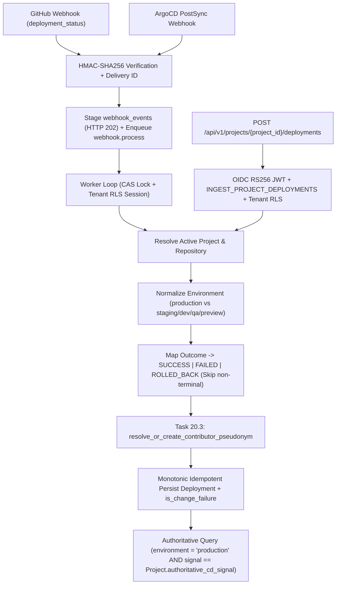

# Production Deployment Ingestion Pipeline & Outcome Mapping Specification (US-25 / Task 25.1)

**Parent User Story:** US-25 — Unified Production Deployment Ingestion  
**Task:** Task 25.1 (Design)  
**Blocks:** Tasks 25.2, 25.3, 25.4, 25.5, 26.1, 27.1, 28.1  
**Authoritative References:**
- M.A.N.T.A. Software Requirements Specification (SRS) V1.0 (§2.4.2, §3.1.4, §3.2.1, §3.2.2, §3.2.3, §3.2.11) — **takes priority on any specification conflict**
- Architectural Blueprint v3.0 (§4.3–§4.5, §6.2–§6.3, §8.1–§8.2, §10.3)
- [Contributor PII Isolation & Pseudonymization](contributor-pii-isolation-and-pseudonymization.md) (Task 20.3)
- [Deployment Signal Selection & DORA Reporting](deployment-signal-selection-persistence-and-dora-response-reporting-test-scenarios.md) (US-18)
- [Deployment Signals, Outcomes & Staging Exclusion Test Scenarios](deployment-signals-outcomes-and-staging-exclusion-test-scenarios.md) (Task 25.5 / SCRUM-431)
- [Poison Payload 5x Retry, DLQ Quarantine & One-Click Re-drive Test Scenarios](poison-payload-5x-retry-dlq-navigation-badge-and-redrive-test-scenarios.md) (Task 23.5 / SCRUM-419)

---

## 1. Overview & Unified Ingestion Flow

M.A.N.T.A. ingests production deployment outcomes from three heterogeneous CD signal channels and normalizes them into a single canonical PostgreSQL `deployments` table protected by `FORCE ROW LEVEL SECURITY`:

1. **GitHub Deployments API Webhook** (`github_deployments_api`): Asynchronous `deployment_status` webhook events verified by HMAC-SHA256, staged into `webhook_events`, and processed via Valkey queue + `run_worker_fetch_loop`.
2. **ArgoCD `PostSync` Webhook** (`argocd_postsync_webhook`): Asynchronous ArgoCD notification / `PostSync` webhook events verified fail-closed via HMAC-SHA256, staged into `webhook_events`, and processed via worker loop.
3. **Direct Deployment REST API** (`direct_deployment_api`): Synchronous `POST /api/v1/projects/{project_id}/deployments` endpoint protected by OIDC RS256 JWT authentication, dedicated RBAC permission `INGEST_PROJECT_DEPLOYMENTS`, and PostgreSQL tenant RLS (`app.current_tenant_id`).

---

## 2. Canonical Data Model & Outcome Mapping

### 2.1 Canonical Outcome Enum (`DeploymentOutcome`)
All persisted rows in `deployments.status` MUST satisfy `status IN ('SUCCESS', 'FAILED', 'ROLLED_BACK')`:

| Canonical Status | `is_change_failure` | Meaning | DORA Impact |
| :--- | :--- | :--- | :--- |
| `SUCCESS` | `False` | Deployment completed and verified healthy in target environment. | Eligible for Deployment Frequency & Lead Time for Changes (US-26). |
| `FAILED` | `True` | Deployment errored, sync failed, or health degraded. | Increments Change Failure Rate (US-27) & triggers MTTR tracking (US-28). |
| `ROLLED_BACK` | `True` | Production release reverted due to defect or explicit rollback action. | Increments Change Failure Rate (US-27) & triggers MTTR tracking (US-28). |

- Non-terminal provider states are **never** persisted to `deployments` (acknowledged cleanly on webhook intake without inserting a deployment row).

### 2.2 Canonical Signal Sources (`authoritative_signal_source`)
Every `Deployment` row records the ingestion channel that produced it, constrained in PostgreSQL to:
- `github_deployments_api`
- `argocd_postsync_webhook`
- `direct_deployment_api`

*(Per SRS V1.0 and existing `DeploymentSignalType`, `direct_deployment_api` is canonical rather than the older `direct_cd_api` string in Blueprint §12.1.)*

### 2.3 Provider-Specific Payload & Status Normalization

#### A. GitHub Deployments API (`github_deployments_api`)
- **Trigger Event**: `X-GitHub-Event == "deployment_status"` (`deployment` creation events alone are skipped as `noop_non_terminal`).
- **Status Mapping (`deployment_status.state`)**:
  - `"success"` → `SUCCESS`
  - `"failure"`, `"error"` → `FAILED`
  - `"inactive"` → **Ignored (`noop`) by default**, because GitHub automatically marks superseded deployments `inactive` whenever a newer deployment succeeds on the same environment (`auto_inactive: true`). Treated as `ROLLED_BACK` **only** when explicit rollback metadata is present (e.g. `deployment_status.payload.rollback is True` / `is_rollback is True` / `description` explicitly indicates a rollback).
  - `"pending"`, `"queued"`, `"in_progress"`, `"waiting"`, `"requested"` → Non-terminal (`noop`, webhook marked `completed` without `Deployment` insert).
- **Field Extraction**:
  - `commit_sha`: `deployment.sha` (lowercase 40-char git hex SHA)
  - `raw_environment`: `deployment_status.environment` or `deployment.environment`
  - `deployed_at`: `deployment_status.updated_at` or `deployment_status.created_at` or `deployment.created_at` (UTC)
  - `external_deployment_id`: `f"gh:{deployment.id}"` (monotonic upsert by `deployed_at`)
  - `actor`: `deployment_status.creator` (fallback `sender` or `deployment.creator`) -> `provider="github"`, `external_actor_id=str(actor.id)` (fallback `actor.login`), `raw_handle=actor.login`

#### B. ArgoCD `PostSync` Webhook (`argocd_postsync_webhook`)
- **Trigger Event**: ArgoCD webhook (`X-ArgoCD-Event` / `postsync` / ArgoCD application sync payload).
- **Status Mapping (Strict Precedence)**:
  1. **Rollback cues** (`outcome == "ROLLED_BACK"`, `phase == "RolledBack"`, `status == "RolledBack"`, `action == "rollback"`, or boolean `is_rollback` / `rollback`) → `ROLLED_BACK`
  2. **Failure / degradation cues** (`operationState.phase in {"Failed", "Error"}`, top-level `status in {"Failed", "Error", "OutOfSync"}`, or `health.status in {"Degraded", "Missing", "Suspended"}`) → `FAILED`
  3. **Success cues** (`operationState.phase == "Succeeded"` or top-level `status == "Synced"`, with `health.status in {"Healthy", None}`) → `SUCCESS`
  4. **Non-terminal cues** (`operationState.phase in {"Running", "Terminating"}` or `health.status == "Progressing"` without terminal `phase`) → Non-terminal (`noop`)
- **Field Extraction** (supporting both nested ArgoCD Notifications `app.*` payloads and flat webhook schemas):
  - `commit_sha`: `operationState.syncResult.revision` / `app.status.operationState.syncResult.revision` / `app.status.sync.revision` / top-level `commit_sha` / `revision`
  - `raw_environment`: `environment` / `destination_env` / `app.metadata.labels["environment"]` / `app.metadata.labels["app.kubernetes.io/environment"]` / `app.spec.destination.namespace` / `app.spec.destination.name`
  - `deployed_at`: `operationState.finishedAt` / `app.status.operationState.finishedAt` / top-level `deployed_at` / `webhook_events.received_at` (UTC)
  - `external_deployment_id`: explicit `external_deployment_id` or deterministic `f"argo:{app_name}:{operation_uid_or_revision_and_ts}"[:128]`
  - `actor`: `operationState.operation.initiatedBy.username` (omitted when `automated == True` or username absent -> `actor_pseudonym_id = None`); `provider="argocd"`

#### C. Direct REST API (`direct_deployment_api`)
- **Endpoint**: `POST /api/v1/projects/{project_id}/deployments`
- **Accepted Fields**:
  - `commit_sha`: validated 40-char lowercase hexadecimal SHA
  - `environment`: normalized string (non-empty)
  - `outcome`: strict `DeploymentOutcome` enum (`SUCCESS`, `FAILED`, `ROLLED_BACK`)
  - `deployed_at`: timezone-aware ISO-8601 UTC timestamp
  - `actor`: optional string identifier or structured `{external_id, email, name, handle, provider}` -> pseudonymized synchronously on intake via Task 20.3
  - `external_deployment_id`: optional caller-supplied idempotency key (`<= 128` chars)
  - `repository_id`: optional UUID (verified against `repositories` under `tenant_id` & `project_id`)

---

## 3. Environment Normalization & Production Filtering

`normalize_environment(raw_env: str) -> tuple[str, bool]` returns `(canonical_environment, is_production)`:

1. Strip leading/trailing whitespace and lowercase. Empty values fail validation (`422` on Direct API; skipped on webhooks).
2. **Exact Production Tokens (`is_production = True`)**: `{"production", "prod", "prd", "live"}` → `("production", True)`.
   - Compound or pre-release names such as `"preprod"`, `"prod-staging"`, `"non-prod"`, `"prod-qa"` are **never** classified as production.
3. **Normalized Non-Production Aliases (`is_production = False`)**:
   - `{"staging", "stage", "stg", "preprod", "pre-prod", "uat"}` → `("staging", False)`
   - `{"dev", "development", "local"}` → `("dev", False)`
   - `{"qa", "test", "testing"}` → `("qa", False)`
   - `{"preview"}` or prefixes `pr-`, `preview-`, `ephemeral-`, `sandbox` → `("preview", False)`
   - Any other non-empty environment token → `(cleaned[:32], False)`
4. **Channel Persistence vs. Query Boundary**:
   - **Webhooks (Task 25.3)**: Persist `Deployment` records **only when `is_production is True`** (stored as `environment = "production"`). Non-production webhooks (`staging`, `dev`, `qa`, `preview`) complete idempotently as `noop_non_production`.
   - **Direct REST API (Task 25.4)**: Normalizes and stores valid submissions across environments (so API callers receive deterministic feedback and audit records while normalized `"staging"` rows are preserved in storage if inspected), while the authoritative production query boundary (`list_authoritative_production_deployments`) strictly filters **`Deployment.environment == "production"`**—preventing staging, dev, QA, or preview releases from polluting DORA metrics.

---

## 4. Project Resolution, Out-of-Order Commits, & `authoritative_cd_signal` Matching

### 4.1 Deterministic Project Resolution (All Tenant-RLS Scoped, `Project.deleted_at IS NULL`)
- **GitHub Webhooks**: Resolve `Repository` by `(tenant_id, external_repo_id = payload.repository.id)` (fallback normalized `repository.full_name`), then join active `Project`. Populate `Deployment.repository_id`. If unlinked in the tenant, mark the webhook `completed` (`noop_unlinked_repository`) so unrelated organization repositories do not trigger retry storms.
- **ArgoCD Webhooks**: Resolve active `Project` using deterministic precedence:
  1. `ProjectLink` where `link_type = "argocd_application"` and `external_id = app_name`
  2. Explicit UUID label/annotation/payload (`manta.project_id` / `project_id`) or slug (`manta.project_slug`) verified within `tenant_id`
  3. Normalized Git URL (`app.spec.source.repoURL` canonicalized to `owner/repo`) matched unambiguously against `Repository.full_name`
  If unmapped, mark webhook `completed` (`noop_unmapped_project`) with a structured warning.
- **Direct REST API**: Validate path `project_id` exists in the current tenant with `deleted_at IS NULL` (`HTTP 404` otherwise, enforced by PostgreSQL RLS).

### 4.2 Authoritative CD Signal Matching (US-18 Integration)
- Each `Deployment` row records its source channel in `Deployment.authoritative_signal_source`.
- Incoming webhooks for valid production deployments are persisted tagged with their source (`github_deployments_api` or `argocd_postsync_webhook`), preserving history if a tenant switches `Project.authoritative_cd_signal` via `PATCH /api/v1/projects/{id}/deployment-signal`.
- **Authoritative DORA / Deployment Queries** (`list_authoritative_production_deployments`) join `deployments` to `projects` and filter on **all three** invariants simultaneously (leveraging composite index `(project_id, environment, deployed_at DESC)`):
  1. `Deployment.environment == "production"`
  2. `Deployment.authoritative_signal_source == Project.authoritative_cd_signal`
  3. `Project.deleted_at.is_(None)`

### 4.3 Out-of-Order Commit Safety & Idempotent Upsert
- Because `commits` requires `NOT NULL repository_id`, `author_pseudonym_id`, `authored_at`, and `committed_at`, `deployments_commit_sha_fkey` is dropped in Task 25.2 (indexed instead via `idx_deployments_tenant_commit_sha`) rather than inserting synthetic `commits` stubs that would corrupt Lead Time calculations. Task 25.5 handles later PR/commit correlation.
- Duplicate webhook deliveries or retried Direct API requests specifying `external_deployment_id` use PostgreSQL partial unique index `uq_deployments_tenant_proj_source_ext_id` (`WHERE external_deployment_id IS NOT NULL`) with a monotonic guard (`WHERE EXCLUDED.deployed_at >= deployments.deployed_at`) so older out-of-order status events never overwrite newer outcomes.

---

## 5. Security, Privacy & Failure Handling

- **GDPR Actor Pseudonymization (Task 20.3)**: Every identifiable deployment actor is passed through `resolve_or_create_contributor_pseudonym(...)` inside the tenant RLS transaction (protected by a `SAVEPOINT` against concurrent inserts on `uq_contributors_tenant_provider_actor`). Only `actor_pseudonym_id` (`String(64)`) is written to `deployments`; raw names, handles, and emails are never stored on `Deployment` or returned in API responses.
- **No `triggered_by` M2M FK Trap**: `Deployment.triggered_by` (`users.id` FK) remains `NULL` for webhook and Direct API ingestions so Keycloak M2M `client_credentials` tokens without `users` rows never cause foreign-key violations.
- **Fail-Closed ArgoCD Webhooks**: Requests targeting `argocd` without a configured/provided secret or valid HMAC-SHA256 signature fail immediately with `HTTP 401` and write zero database rows (SRS §3.1.4, §3.2.2).
- **Worker Retry & DLQ Contract**: Inside `run_worker_fetch_loop` / `process_webhook_event`, `cas_transition_to_processing` guards execution under `get_tenant_db_context(tenant_id)`, `complete_webhook_event` finalizes handled or `noop` events, and unexpected exceptions propagate cleanly to `handle_job_failure` for exponential backoff retries (`attempts 1..4`) and `dead_letter_events` quarantine (`attempt 5`).
- **Failed / Rolled-Back Production Signal**: Authoritative `FAILED` and `ROLLED_BACK` deployments persist with `is_change_failure = True` and their exact canonical `status` (`"FAILED"` or `"ROLLED_BACK"`), remaining compatible with downstream US-27 Change Failure Rate queries and US-28 MTTR / `outbox_events` workflows without mutating `"ROLLED_BACK"` rows back to `"FAILED"`.
