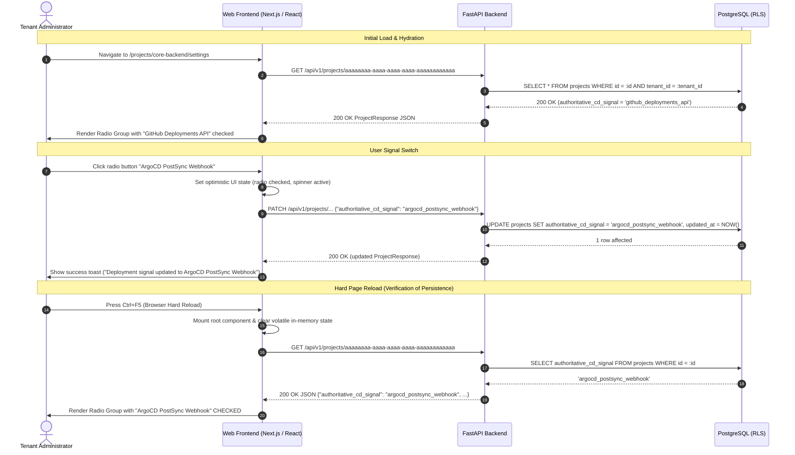
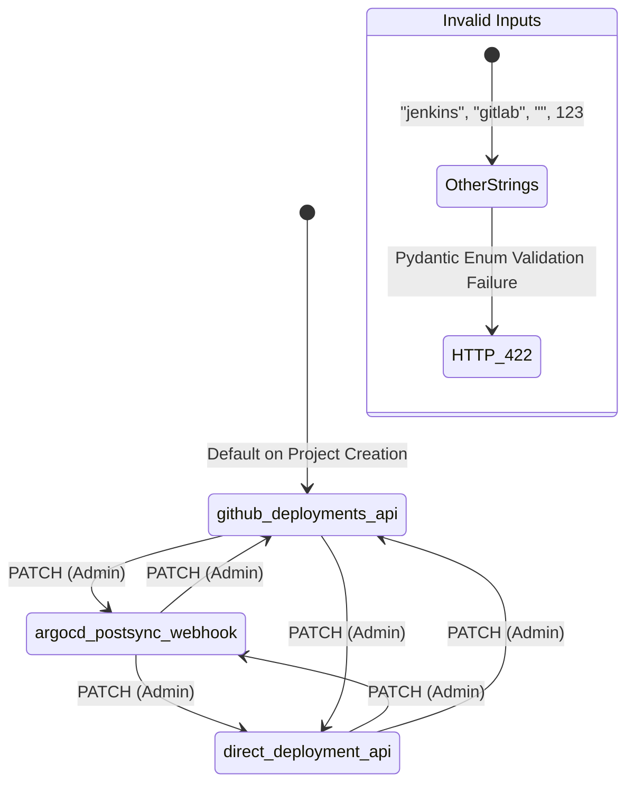
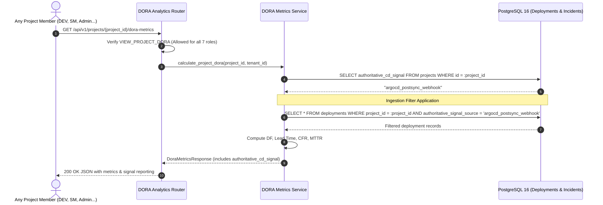

# Deployment Signal Selection Persistence & DORA Response Reporting Test Scenarios

**Task:** Create test scenarios for deployment signal selection persistence and DORA response reporting (`SCRUM-384` / `Task 18.4`)  
**Parent User Story:** `SCRUM-354` (`US-18`: Configure deployment signal selection and persist authoritative CD source for DORA metrics)  
**Related Tickets:**  
- `SCRUM-352` / `SCRUM-379`: Project Creation and Repository Linking across tenants (`US-17` / `Task 17.5`, see [`docs/project-creation-and-repository-linking-test-scenarios.md`](project-creation-and-repository-linking-test-scenarios.md))  
- `SCRUM-377`: Implement project CRUD and repository linking endpoints (`backend/app/projects/router.py`, `backend/app/projects/service.py`)  
- `SCRUM-306`: Seven-role permission matrix definition ([`docs/roles-permissions.md`](roles-permissions.md), [`docs/roles-permissions.json`](roles-permissions.json))  
- `SCRUM-311`: Role-access test scenarios & automated matrix verification ([`docs/role-access-test-scenarios.md`](role-access-test-scenarios.md))  
- `SCRUM-244` / `SCRUM-294` / `SCRUM-295`: Database-enforced tenant isolation via PostgreSQL RLS ([`docs/rls-test-scenarios.md`](rls-test-scenarios.md))  
- `SCRUM-301`: Adversarial tenant boundary security test scenarios ([`docs/tenant-boundary-test-scenarios.md`](tenant-boundary-test-scenarios.md))  
- `Task 18.5`: Automated test suite for deployment signal persistence and DORA metrics reporting ([`backend/tests/test_deployment_signal_persistence.py`](../backend/tests/test_deployment_signal_persistence.py))  

**Target Database Tables:**  
- `projects` (`id`, `tenant_id`, `created_by`, `name`, `slug`, `tier_sla_hours`, `authoritative_cd_signal`, `lead_time_first_commit_strategy`, `wip_limit_per_dev`, `pr_stale_threshold_hours`, `is_active`, `deleted_at`, `created_at`, `updated_at`, `uq_projects_tenant_slug`)  
- `deployments` (`id`, `tenant_id`, `project_id`, `repository_id`, `integration_id`, `triggered_by`, `environment`, `commit_sha`, `status`, `is_change_failure`, `authoritative_signal_source`, `deployed_at`, `lead_time_seconds`, `created_at`)  
- `metric_snapshots` (`id`, `tenant_id`, `project_id`, `metric`, `granularity`, `period_start`, `value`, `created_at`, `uq_metric_snapshot`)  
- `tenants`, `users`  

**Target API Endpoints:**  
- `PATCH /api/v1/projects/{project_id}` (Update project settings, including `authoritative_cd_signal`)  
- `GET /api/v1/projects/{project_id}` (Retrieve project details including persisted `authoritative_cd_signal`)  
- `GET /api/v1/projects/{project_id}/dora-metrics` (Retrieve project DORA metrics and configured `authoritative_cd_signal`)  
- `GET /api/v1/dora/projects/{project_id}` (DORA domain router alias)  

**Authoritative Test Suites:**  
- [`backend/tests/test_deployment_signal_persistence.py`](../backend/tests/test_deployment_signal_persistence.py) (Dedicated US-18 test suite: tri-signal configuration, invalid enum rejection, RBAC 403 enforcement, and DORA response reporting)  
- [`backend/tests/test_permission_enforcement.py`](../backend/tests/test_permission_enforcement.py) (Server-side RBAC and non-admin 403 denial verification)  
- [`backend/tests/test_tenant_boundary_adversarial.py`](../backend/tests/test_tenant_boundary_adversarial.py) (Cross-tenant access denial and anti-enumeration assertions)  
- [`backend/tests/test_rls_isolation.py`](../backend/tests/test_rls_isolation.py) (PostgreSQL Row-Level Security tenant isolation verification)  
- [`web/e2e/deployment-signal-persistence.spec.ts`](../web/e2e/deployment-signal-persistence.spec.ts) (Playwright E2E UI tests: radio group switching, optimistic updates, and hard page reload persistence)  

---

## 1. Objective & Architectural Invariants

### 1.1 Objective
Establish the definitive test scenarios and automated verification contract for **deployment signal selection persistence**, **invalid signal validation**, **administrative RBAC gating**, **web UI page reload persistence**, and **DORA response reporting** in the M.A.N.T.A. Engineering Intelligence Platform (`SCRUM-384` / `Task 18.4`).

This specification establishes exact pre-conditions, inputs, expected HTTP status codes, error payload schemas, PostgreSQL database states, and web UI behaviors for:
1. **Configuring each of the three authoritative deployment signals**:
   - `github_deployments_api` (Default GitHub deployments API signal)
   - `argocd_postsync_webhook` (ArgoCD post-sync hook / webhook notification)
   - `direct_deployment_api` (Direct / custom deployment API endpoint push)
2. **Switching between deployment signals** cyclically without data corruption or orphan records.
3. **Page reload persistence** ensuring that selections modified in the UI persist across browser sessions, hard reloads (`Ctrl+F5`), and multi-tab sessions.
4. **Validation rejection on invalid enums** (`HTTP 422 Unprocessable Entity`) when submitting unknown signals, malformed types, or empty strings, with transaction rollback.
5. **Strict server-side RBAC enforcement** returning `HTTP 403 Forbidden` for non-admin roles (`DEVELOPER`, `SCRUM_MASTER`, `PROJECT_MANAGER`, `SOLUTION_ARCHITECT`, `DELIVERY_DIRECTOR`, `TOP_MANAGEMENT`), with UI mutation controls hidden or disabled.
6. **Presence of the selected signal in `GET /api/v1/projects/{id}/dora-metrics`**, validating that DORA calculations report the authoritative signal source and correctly filter qualifying deployment events.
7. **Tenant boundary isolation and anti-enumeration** ensuring cross-tenant mutation or inspection attempts return `HTTP 404 Not Found`.

---

### 1.2 Core Architectural Invariants

```
+-------------------------------------------------------------------------------------------------------------------+
|                            DEPLOYMENT SIGNAL SELECTION & DORA REPORTING ARCHITECTURE                              |
+-------------------------------------+-------------------------------------+---------------------------------------+
| 1. Tri-State Enum Validation        | 2. PostgreSQL RLS & Persistence     | 3. UI State Hydration & Persistence   |
|    (DeploymentSignalEnum)           |    (projects.authoritative_cd_signal|    (Next.js React Query / Cache)      |
+-------------------------------------+-------------------------------------+---------------------------------------+
| * github_deployments_api (Default)  | * VARCHAR(64) NOT NULL              | * GET /api/v1/projects/{id} on mount  |
| * argocd_postsync_webhook           | * Atomic UPDATE with updated_at bump| * PATCH /api/v1/projects/{id} on click|
| * direct_deployment_api             | * Immediate read-after-write        | * Page reload (F5) re-fetches DB state|
| * Any other string -> HTTP 422      | * Bound to app.current_tenant_id    | * Selected radio matches DB state     |
+-------------------------------------+-------------------------------------+---------------------------------------+
                                                         |
                                                         v
+-------------------------------------------------------------------------------------------------------------------+
|                                       SECURITY & DORA CALCULATION INVARIANTS                                      |
+----------------------------------------------------+--------------------------------------------------------------+
| 4. Strict Administrative RBAC Gate (HTTP 403)      | 5. DORA Authoritative Signal Reporting & Filtering           |
+----------------------------------------------------+--------------------------------------------------------------+
| * Mutations require TENANT_ADMIN                   | * GET /api/v1/projects/{id}/dora-metrics reports signal      |
| * 6 non-admin roles receive HTTP 403 Forbidden     | * Engine aggregates ONLY matching deployments:               |
| * Cross-tenant mutation returns HTTP 404 Not Found |   deployments.authoritative_signal_source == project.signal  |
| * UI controls hidden/disabled for non-admins       | * All project members can read DORA metrics (VIEW_PROJECT_DORA|
+----------------------------------------------------+--------------------------------------------------------------+
```

#### Invariant 1: Tri-State Signal Enumeration (`DeploymentSignalEnum`)
- The project's authoritative Continuous Delivery (CD) signal is strictly governed by `DeploymentSignalEnum`:
  ```python
  class DeploymentSignalEnum(StrEnum):
      GITHUB_DEPLOYMENTS_API = "github_deployments_api"
      ARGOCD_POSTSYNC_WEBHOOK = "argocd_postsync_webhook"
      DIRECT_DEPLOYMENT_API = "direct_deployment_api"
  ```
- Any input that is not an exact case-sensitive match to one of these three values (e.g., `"jenkins"`, `"gitlab"`, `""`, `null`, `123`, `"GITHUB_DEPLOYMENTS_API"`) MUST be rejected by FastAPI / Pydantic schema validation with **`HTTP 422 Unprocessable Entity`**.

#### Invariant 2: Database Persistence & Immediate Consistency
- The authoritative signal is stored in column `projects.authoritative_cd_signal` (`VARCHAR(64)`, `NOT NULL`, `DEFAULT 'github_deployments_api'`).
- Updates execute through an atomic `UPDATE projects SET authoritative_cd_signal = :val, updated_at = NOW() WHERE id = :id AND tenant_id = :tenant_id`.
- Read-after-write consistency is guaranteed: any subsequent `GET /api/v1/projects/{id}` or database `SELECT` in the same or subsequent transaction immediately returns the updated signal.

#### Invariant 3: Web UI Page Reload Persistence
- The project settings page (`/projects/{id}/settings` or `/projects/{id}/delivery`) renders a single-select radio group containing the three supported signals.
- Switching signals fires `PATCH /api/v1/projects/{project_id}`.
- Upon page reload (`window.location.reload()`, hard refresh `Ctrl+F5`, or navigating away and returning), the frontend hydrator issues `GET /api/v1/projects/{project_id}`, re-populating the radio group with the server-persisted signal. The selection NEVER reverts to the default or previous state.

#### Invariant 4: Strict Administrative RBAC Gate (`TENANT_ADMIN` vs Non-Admin)
- Deployment signal configuration modifies project-level delivery analytics ingestion and is classified as an administrative operation (`MANAGE_WEBHOOK_INTEGRATIONS` / `MANAGE_PROJECT_SETTINGS`).
- **`TENANT_ADMIN`** is granted mutation authority (`ALLOW`).
- All six non-admin roles (**`DEVELOPER`**, **`SCRUM_MASTER`**, **`PROJECT_MANAGER`**, **`SOLUTION_ARCHITECT`**, **`DELIVERY_DIRECTOR`**, **`TOP_MANAGEMENT`**) are denied mutation authority and receive **`HTTP 403 Forbidden`** (`{"detail": "Forbidden: insufficient permissions"}`).
- The web frontend disables the radio group inputs or replaces them with a read-only status badge when viewed by a non-admin user.

#### Invariant 5: Transparent DORA Metrics Reporting & Signal Filtering
- The DORA analytics endpoint (`GET /api/v1/projects/{project_id}/dora-metrics` and its alias `GET /api/v1/dora/projects/{project_id}`) MUST report the configured deployment signal in its top-level response payload:
  ```json
  {
    "project_id": "aaaaaaaa-aaaa-aaaa-aaaa-aaaaaaaaaaaa",
    "project_slug": "core-backend",
    "authoritative_cd_signal": "argocd_postsync_webhook",
    "metrics": { ... }
  }
  ```
- **Authoritative Aggregation Filter:** When calculating DORA metrics (Deployment Frequency, Lead Time for Changes, Change Failure Rate, Mean Time to Recovery), the ingestion engine filters deployment records by `deployments.authoritative_signal_source = projects.authoritative_cd_signal`. Deployments from non-authoritative sources are excluded from primary DORA KPI calculations to prevent double-counting or skewed metrics.
- All users with `VIEW_PROJECT_DORA` permission (all 7 platform roles) can inspect the DORA response.

#### Invariant 6: Multi-Tenant Boundary Isolation & Anti-Enumeration (HTTP 404 over 403)
- When a user from Tenant Beta attempts to modify or view the deployment signal of a project belonging to Tenant Alpha (`PATCH /api/v1/projects/{tenant_a_project_id}` or `GET /api/v1/projects/{tenant_a_project_id}/dora-metrics`), the API returns **`HTTP 404 Not Found`**.
- This enforces the platform-wide information hiding invariant: foreign tenant resources return 404 rather than 403 to prevent existence discovery and tenant enumeration attacks.

---

## 2. Canonical Test Fixtures & Personas

All test scenarios execute against deterministic seed fixtures representing two isolated enterprise tenants:

### 2.1 Tenant & User Fixtures

| Entity | Tenant Ownership | Primary Key (`id`) | Username / Email | Role / Permission |
| :--- | :--- | :--- | :--- | :--- |
| **Tenant Alpha** | Primary / Target | `11111111-1111-1111-1111-111111111111` | `tenant-alpha` | Enterprise tier, active workspace |
| **Tenant Beta** | Secondary / Attacker | `22222222-2222-2222-2222-222222222222` | `tenant-beta` | Starter tier, isolated workspace |
| `alpha_admin` | Tenant Alpha | `a1000000-0000-0000-0000-000000000001` | `admin@alpha.io` | `TENANT_ADMIN` (Full administrative rights) |
| `alpha_dev` | Tenant Alpha | `a1000000-0000-0000-0000-000000000002` | `dev@alpha.io` | `DEVELOPER` (Denied signal mutation, `403 Forbidden`) |
| `alpha_sm` | Tenant Alpha | `a1000000-0000-0000-0000-000000000003` | `sm@alpha.io` | `SCRUM_MASTER` (Denied signal mutation, `403 Forbidden`) |
| `alpha_pm` | Tenant Alpha | `a1000000-0000-0000-0000-000000000004` | `pm@alpha.io` | `PROJECT_MANAGER` (Denied signal mutation, `403 Forbidden`) |
| `alpha_sa` | Tenant Alpha | `a1000000-0000-0000-0000-000000000005` | `sa@alpha.io` | `SOLUTION_ARCHITECT` (Denied signal mutation, `403 Forbidden`) |
| `alpha_dd` | Tenant Alpha | `a1000000-0000-0000-0000-000000000006` | `dd@alpha.io` | `DELIVERY_DIRECTOR` (Denied signal mutation, `403 Forbidden`) |
| `alpha_tm` | Tenant Alpha | `a1000000-0000-0000-0000-000000000007` | `tm@alpha.io` | `TOP_MANAGEMENT` (Denied signal mutation, `403 Forbidden`) |
| `beta_admin` | Tenant Beta | `b2000000-0000-0000-0000-000000000001` | `admin@beta.io` | `TENANT_ADMIN` for Tenant Beta (Cross-tenant actor) |

### 2.2 Project & Deployment Fixtures

| Entity | Tenant Ownership | Primary Key (`id`) | Initial `authoritative_cd_signal` | Associated Repository / Notes |
| :--- | :--- | :--- | :--- | :--- |
| **Project Alpha 1** | Tenant Alpha | `aaaaaaaa-aaaa-aaaa-aaaa-aaaaaaaaaaaa` | `github_deployments_api` | `slug = "core-backend"`, linked to `alpha-org/core-backend` |
| **Project Alpha 2** | Tenant Alpha | `aaaaaaaa-aaaa-aaaa-aaaa-bbbbbbbbbbbb` | `argocd_postsync_webhook` | `slug = "edge-gateway"`, linked to `alpha-org/edge-gateway` |
| **Project Beta 1** | Tenant Beta | `bbbbbbbb-bbbb-bbbb-bbbb-aaaaaaaaaaaa` | `direct_deployment_api` | `slug = "payment-router"`, linked to `beta-org/payment-router` |
| **Deployment D1** | Tenant Alpha | `d1111111-1111-1111-1111-111111111111` | `authoritative_signal_source = "github_deployments_api"` | `status = "success"`, `environment = "production"` |
| **Deployment D2** | Tenant Alpha | `d2222222-2222-2222-2222-222222222222` | `authoritative_signal_source = "argocd_postsync_webhook"` | `status = "success"`, `environment = "production"` |
| **Deployment D3** | Tenant Alpha | `d3333333-3333-3333-3333-333333333333` | `authoritative_signal_source = "direct_deployment_api"` | `status = "success"`, `environment = "production"` |

---

## 3. Master Test Scenarios Matrix

| Scenario ID | Test Scenario Case | Actor & Role | Target Endpoint & Method | Input Summary | Stopping Layer | Expected Status Code | Expected Outcome API / DB / UI | Automated Test Reference |
| :--- | :--- | :---: | :--- | :--- | :---: | :---: | :--- | :--- |
| **`TC-SIGNAL-001`** | **Verify default signal on project creation** | `alpha_admin`<br>(`TENANT_ADMIN`) | `POST /api/v1/projects` | `name: "New Stream"`<br>`slug: "new-stream"` | Service & Database | **`201 Created`** | **API:** Response includes `"authoritative_cd_signal": "github_deployments_api"`.<br>**DB:** Row in `projects` has column value `'github_deployments_api'`.<br>**UI:** GitHub Deployments radio button selected by default. | `test_deployment_signal_persistence.py` $\rightarrow$ `test_default_deployment_signal_on_creation` |
| **`TC-SIGNAL-002`** | **Switch signal to `argocd_postsync_webhook`** | `alpha_admin`<br>(`TENANT_ADMIN`) | `PATCH /api/v1/projects/{p_id}` | `authoritative_cd_signal:`<br>`"argocd_postsync_webhook"` | Service & Database | **`200 OK`** | **API:** Returns updated project with new signal.<br>**DB:** `projects.authoritative_cd_signal` updated to `'argocd_postsync_webhook'`, `updated_at` bumped.<br>**UI:** ArgoCD radio button marked active; success toast shown. | `test_deployment_signal_persistence.py` $\rightarrow$ `test_switch_signal_to_argocd_postsync_webhook` |
| **`TC-SIGNAL-003`** | **Switch signal to `direct_deployment_api`** | `alpha_admin`<br>(`TENANT_ADMIN`) | `PATCH /api/v1/projects/{p_id}` | `authoritative_cd_signal:`<br>`"direct_deployment_api"` | Service & Database | **`200 OK`** | **API:** Returns updated project with new signal.<br>**DB:** `projects.authoritative_cd_signal` updated to `'direct_deployment_api'`.<br>**UI:** Direct API radio button marked active. | `test_deployment_signal_persistence.py` $\rightarrow$ `test_switch_signal_to_direct_deployment_api` |
| **`TC-SIGNAL-004`** | **Cyclic switching across all 3 signals** | `alpha_admin`<br>(`TENANT_ADMIN`) | `PATCH /api/v1/projects/{p_id}` | Sequence: `github` $\rightarrow$ `argocd` $\rightarrow$ `direct` $\rightarrow$ `github` | Service & Database | **`200 OK`** (each step) | **API:** Each transition succeeds with `200 OK`.<br>**DB:** Signal value correctly reflects latest transition at each step.<br>**UI:** Radio selector updates cleanly without stale caches. | `test_deployment_signal_persistence.py` $\rightarrow$ `test_cyclic_deployment_signal_transitions` |
| **`TC-SIGNAL-PERSIST-005A`** | **Web UI page reload persistence** | `alpha_admin`<br>(`TENANT_ADMIN`) | `GET /api/v1/projects/{p_id}` | Browser hard reload (`Ctrl+F5`) after switching to `argocd_postsync_webhook` | Frontend Hydration & API | **`200 OK`** | **API:** Returns persisted `argocd_postsync_webhook`.<br>**DB:** Unaltered, remains `argocd_postsync_webhook`.<br>**UI:** Radio button remains selected on ArgoCD post reload. | `deployment-signal-persistence.spec.ts` $\rightarrow$ `test_ui_signal_persistence_across_page_reload` |
| **`TC-SIGNAL-PERSIST-005B`** | **Multi-tab / multi-session persistence** | `alpha_admin`<br>(`TENANT_ADMIN`) | `GET /api/v1/projects/{p_id}` | Open project in Tab 2 after switching signal in Tab 1 | Frontend Hydration & API | **`200 OK`** | **API:** Tab 2 fetches fresh state from DB.<br>**DB:** State is consistent.<br>**UI:** Tab 2 displays the newly selected signal immediately. | `deployment-signal-persistence.spec.ts` $\rightarrow$ `test_multi_tab_signal_synchronization` |
| **`TC-SIGNAL-ERR-006A`** | **Reject invalid enum string value** | `alpha_admin`<br>(`TENANT_ADMIN`) | `PATCH /api/v1/projects/{p_id}` | `authoritative_cd_signal:`<br>`"jenkins_ci_webhook"` | FastAPI / Pydantic Validation | **`422 Unprocessable`** | **API:** `{"detail": [{"loc": ["body", "authoritative_cd_signal"], "msg": "Input should be 'github_deployments_api', 'argocd_postsync_webhook' or 'direct_deployment_api'", "type": "enum"}]}`.<br>**DB:** No update; transaction rolled back.<br>**UI:** Error toast: "Invalid deployment signal source". | `test_deployment_signal_persistence.py` $\rightarrow$ `test_reject_invalid_deployment_signal_enum` |
| **`TC-SIGNAL-ERR-006B`** | **Reject empty string signal** | `alpha_admin`<br>(`TENANT_ADMIN`) | `PATCH /api/v1/projects/{p_id}` | `authoritative_cd_signal: ""` | Pydantic Validation | **`422 Unprocessable`** | **API:** HTTP 422 with enum error detail.<br>**DB:** Zero changes persisted.<br>**UI:** Input validation prevents submission or shows error. | `test_deployment_signal_persistence.py` $\rightarrow$ `test_reject_empty_string_deployment_signal` |
| **`TC-SIGNAL-ERR-006C`** | **Reject uppercase enum string** | `alpha_admin`<br>(`TENANT_ADMIN`) | `PATCH /api/v1/projects/{p_id}` | `authoritative_cd_signal:`<br>`"ARGOCD_POSTSYNC_WEBHOOK"` | Pydantic Validation | **`422 Unprocessable`** | **API:** Case-sensitive enum validation failure (HTTP 422).<br>**DB:** Database remains unmodified.<br>**UI:** Standard validation error. | `test_deployment_signal_persistence.py` $\rightarrow$ `test_reject_uppercase_signal_enum` |
| **`TC-SIGNAL-ERR-006D`** | **Reject non-string payload type (numeric/bool)** | `alpha_admin`<br>(`TENANT_ADMIN`) | `PATCH /api/v1/projects/{p_id}` | `authoritative_cd_signal: 123` | Pydantic Type Validation | **`422 Unprocessable`** | **API:** Schema type violation error (HTTP 422).<br>**DB:** Zero changes persisted.<br>**UI:** Form error message. | `test_deployment_signal_persistence.py` $\rightarrow$ `test_reject_non_string_payload_type` |
| **`TC-SIGNAL-RBAC-007A`** | **Developer role denied signal update** | `alpha_dev`<br>(`DEVELOPER`) | `PATCH /api/v1/projects/{p_id}` | `authoritative_cd_signal:`<br>`"argocd_postsync_webhook"` | FastAPI Dependency (`require_permission`) | **`403 Forbidden`** | **API:** `{"detail": "Forbidden: insufficient permissions"}`.<br>**DB:** Zero rows updated; DB remains untouched.<br>**UI:** Radio group disabled or read-only badge rendered. | `test_deployment_signal_persistence.py` $\rightarrow$ `test_developer_denied_signal_mutation` |
| **`TC-SIGNAL-RBAC-007B`** | **Scrum Master role denied signal update** | `alpha_sm`<br>(`SCRUM_MASTER`) | `PATCH /api/v1/projects/{p_id}` | `authoritative_cd_signal:`<br>`"argocd_postsync_webhook"` | FastAPI Dependency (`require_permission`) | **`403 Forbidden`** | **API:** `{"detail": "Forbidden: insufficient permissions"}`.<br>**DB:** Zero rows updated.<br>**UI:** Settings mutation controls disabled. | `test_deployment_signal_persistence.py` $\rightarrow$ `test_non_admin_roles_denied_signal_mutation` |
| **`TC-SIGNAL-RBAC-007C`** | **Project Manager role denied signal update** | `alpha_pm`<br>(`PROJECT_MANAGER`) | `PATCH /api/v1/projects/{p_id}` | `authoritative_cd_signal:`<br>`"direct_deployment_api"` | FastAPI Dependency (`require_permission`) | **`403 Forbidden`** | **API:** `{"detail": "Forbidden: insufficient permissions"}`.<br>**DB:** Zero rows updated.<br>**UI:** Controls disabled. | `test_deployment_signal_persistence.py` $\rightarrow$ `test_non_admin_roles_denied_signal_mutation` |
| **`TC-SIGNAL-RBAC-007D`** | **Solution Architect role denied signal update** | `alpha_sa`<br>(`SOLUTION_ARCHITECT`) | `PATCH /api/v1/projects/{p_id}` | `authoritative_cd_signal:`<br>`"argocd_postsync_webhook"` | FastAPI Dependency (`require_permission`) | **`403 Forbidden`** | **API:** `{"detail": "Forbidden: insufficient permissions"}`.<br>**DB:** Zero rows updated.<br>**UI:** Controls disabled. | `test_deployment_signal_persistence.py` $\rightarrow$ `test_non_admin_roles_denied_signal_mutation` |
| **`TC-SIGNAL-RBAC-007E`** | **Delivery Director role denied signal update** | `alpha_dd`<br>(`DELIVERY_DIRECTOR`) | `PATCH /api/v1/projects/{p_id}` | `authoritative_cd_signal:`<br>`"direct_deployment_api"` | FastAPI Dependency (`require_permission`) | **`403 Forbidden`** | **API:** `{"detail": "Forbidden: insufficient permissions"}`.<br>**DB:** Zero rows updated.<br>**UI:** Controls disabled. | `test_deployment_signal_persistence.py` $\rightarrow$ `test_non_admin_roles_denied_signal_mutation` |
| **`TC-SIGNAL-RBAC-007F`** | **Top Management role denied signal update** | `alpha_tm`<br>(`TOP_MANAGEMENT`) | `PATCH /api/v1/projects/{p_id}` | `authoritative_cd_signal:`<br>`"direct_deployment_api"` | FastAPI Dependency (`require_permission`) | **`403 Forbidden`** | **API:** `{"detail": "Forbidden: insufficient permissions"}`.<br>**DB:** Zero rows updated.<br>**UI:** Controls disabled. | `test_deployment_signal_persistence.py` $\rightarrow$ `test_non_admin_roles_denied_signal_mutation` |
| **`TC-SIGNAL-DORA-008A`** | **DORA response reports default signal** | `alpha_dev`<br>(`DEVELOPER`) | `GET /api/v1/projects/{p_id}/dora-metrics` | Valid project ID with default signal | DORA Analytics Service | **`200 OK`** | **API:** Response JSON contains `"authoritative_cd_signal": "github_deployments_api"` alongside DORA metrics.<br>**DB:** Read-only calculation.<br>**UI:** DORA dashboard displays "Signal Source: GitHub Deployments API". | `test_deployment_signal_persistence.py` $\rightarrow$ `test_dora_response_reports_default_signal` |
| **`TC-SIGNAL-DORA-008B`** | **DORA response reports switched ArgoCD signal** | `alpha_dev`<br>(`DEVELOPER`) | `GET /api/v1/projects/{p_id}/dora-metrics` | Valid project ID with signal set to `argocd` | DORA Analytics Service | **`200 OK`** | **API:** Response JSON contains `"authoritative_cd_signal": "argocd_postsync_webhook"`.<br>**DB:** Aggregates only `argocd_postsync_webhook` deployments.<br>**UI:** DORA dashboard displays "Signal Source: ArgoCD PostSync Webhook". | `test_deployment_signal_persistence.py` $\rightarrow$ `test_dora_response_reports_argocd_signal` |
| **`TC-SIGNAL-DORA-008C`** | **DORA response reports Direct API signal** | `alpha_dev`<br>(`DEVELOPER`) | `GET /api/v1/projects/{p_id}/dora-metrics` | Valid project ID with signal set to `direct` | DORA Analytics Service | **`200 OK`** | **API:** Response JSON contains `"authoritative_cd_signal": "direct_deployment_api"`.<br>**DB:** Aggregates only `direct_deployment_api` deployments.<br>**UI:** DORA dashboard displays "Signal Source: Direct Deployment API". | `test_deployment_signal_persistence.py` $\rightarrow$ `test_dora_response_reports_direct_api_signal` |
| **`TC-SIGNAL-DORA-008D`** | **DORA metric calculation filters non-authoritative deployments** | `alpha_admin`<br>(`TENANT_ADMIN`) | `GET /api/v1/projects/{p_id}/dora-metrics` | Project with deployments from both GitHub and ArgoCD | DORA Calculation Engine | **`200 OK`** | **API:** Deployment frequency counts only events matching the active authoritative signal.<br>**DB:** Zero non-matching events factored into MTTR/Lead Time.<br>**UI:** Charts display metrics derived strictly from the active signal. | `test_deployment_signal_persistence.py` $\rightarrow$ `test_dora_metrics_filter_by_authoritative_signal` |
| **`TC-SIGNAL-ISO-009A`** | **Cross-tenant signal mutation returns HTTP 404** | `beta_admin`<br>(`Tenant Beta`) | `PATCH /api/v1/projects/{alpha_proj_id}` | Payload targeting Tenant Alpha project ID | API & PostgreSQL RLS | **`404 Not Found`** | **API:** `{"detail": "Project '{alpha_proj_id}' not found."}`.<br>**DB:** Zero rows affected; Tenant Alpha project remains unchanged.<br>**UI:** Standard 404 alert. | `test_deployment_signal_persistence.py` $\rightarrow$ `test_cross_tenant_signal_update_returns_404` |
| **`TC-SIGNAL-ISO-009B`** | **Cross-tenant DORA metrics retrieval returns HTTP 404** | `beta_admin`<br>(`Tenant Beta`) | `GET /api/v1/projects/{alpha_proj_id}/dora-metrics` | Direct GET with Tenant Beta token | API & PostgreSQL RLS | **`404 Not Found`** | **API:** `{"detail": "Project '{alpha_proj_id}' not found."}`.<br>**DB:** Zero data leaked.<br>**UI:** Standard 404 alert. | `test_deployment_signal_persistence.py` $\rightarrow$ `test_cross_tenant_dora_metrics_returns_404` |
| **`TC-SIGNAL-AUTH-010`**  | **Unauthenticated / expired token rejected** | Anonymous / Expired token | `PATCH /api/v1/projects/{p_id}` | Missing or expired Bearer token | `JWTAuthMiddleware` | **`401 Unauthorized`** | **API:** `{"detail": "Not authenticated"}`.<br>**DB:** Zero queries executed.<br>**UI:** Redirected to Keycloak login. | `test_deployment_signal_persistence.py` $\rightarrow$ `test_unauthenticated_signal_update_returns_401` |

---

## 4. Detailed Scenario Specifications

### 4.1 Scenario 1: Configuring & Switching Between the 3 Deployment Signals (`TC-SIGNAL-001` – `004`)

#### 4.1.1 Objective
Verify that an authorized `TENANT_ADMIN` can configure each of the three supported deployment signals (`github_deployments_api`, `argocd_postsync_webhook`, `direct_deployment_api`) and seamlessly switch between them without errors, data loss, or database integrity violations.

#### 4.1.2 Preconditions
- Tenant Alpha is provisioned (`tenant_id = 11111111-1111-1111-1111-111111111111`).
- User `alpha_admin` is authenticated with active Keycloak JWT holding role `["TENANT_ADMIN"]`.
- Target project `Project Alpha 1` exists (`id = aaaaaaaa-aaaa-aaaa-aaaa-aaaaaaaaaaaa`) with initial `authoritative_cd_signal = 'github_deployments_api'`.

#### 4.1.3 Inputs & Execution Flow

**Step 1: Switch to `argocd_postsync_webhook`**
```http
PATCH /api/v1/projects/aaaaaaaa-aaaa-aaaa-aaaa-aaaaaaaaaaaa HTTP/1.1
Host: api.manta.io
Authorization: Bearer <alpha_admin_jwt>
Content-Type: application/json

{
  "authoritative_cd_signal": "argocd_postsync_webhook"
}
```

- **Expected HTTP Status:** `200 OK`
- **Expected Response Body:**
  ```json
  {
    "id": "aaaaaaaa-aaaa-aaaa-aaaa-aaaaaaaaaaaa",
    "tenant_id": "11111111-1111-1111-1111-111111111111",
    "name": "Core Backend",
    "slug": "core-backend",
    "authoritative_cd_signal": "argocd_postsync_webhook",
    "tier_sla_hours": 48,
    "lead_time_first_commit_strategy": "feature_branch_root",
    "wip_limit_per_dev": 3,
    "pr_stale_threshold_hours": 48,
    "is_active": true,
    "created_at": "2026-11-11T10:00:00Z",
    "updated_at": "2026-11-11T12:00:00Z"
  }
  ```

**Step 2: Switch to `direct_deployment_api`**
```http
PATCH /api/v1/projects/aaaaaaaa-aaaa-aaaa-aaaa-aaaaaaaaaaaa HTTP/1.1
Host: api.manta.io
Authorization: Bearer <alpha_admin_jwt>
Content-Type: application/json

{
  "authoritative_cd_signal": "direct_deployment_api"
}
```

- **Expected HTTP Status:** `200 OK`
- **Expected Response Body:**
  ```json
  {
    "id": "aaaaaaaa-aaaa-aaaa-aaaa-aaaaaaaaaaaa",
    "slug": "core-backend",
    "authoritative_cd_signal": "direct_deployment_api",
    "is_active": true,
    "updated_at": "2026-11-11T12:05:00Z"
  }
  ```

**Step 3: Switch back to `github_deployments_api`**
```http
PATCH /api/v1/projects/aaaaaaaa-aaaa-aaaa-aaaa-aaaaaaaaaaaa HTTP/1.1
Host: api.manta.io
Authorization: Bearer <alpha_admin_jwt>
Content-Type: application/json

{
  "authoritative_cd_signal": "github_deployments_api"
}
```

- **Expected HTTP Status:** `200 OK`
- **Expected Response Body:**
  ```json
  {
    "id": "aaaaaaaa-aaaa-aaaa-aaaa-aaaaaaaaaaaa",
    "slug": "core-backend",
    "authoritative_cd_signal": "github_deployments_api",
    "is_active": true,
    "updated_at": "2026-11-11T12:10:00Z"
  }
  ```

#### 4.1.4 Expected Database State
```sql
-- After Step 1:
SELECT authoritative_cd_signal, updated_at 
FROM projects 
WHERE id = 'aaaaaaaa-aaaa-aaaa-aaaa-aaaaaaaaaaaa';
-- Returns: 'argocd_postsync_webhook', updated_at > created_at

-- After Step 2:
SELECT authoritative_cd_signal 
FROM projects 
WHERE id = 'aaaaaaaa-aaaa-aaaa-aaaa-aaaaaaaaaaaa';
-- Returns: 'direct_deployment_api'

-- After Step 3:
SELECT authoritative_cd_signal 
FROM projects 
WHERE id = 'aaaaaaaa-aaaa-aaaa-aaaa-aaaaaaaaaaaa';
-- Returns: 'github_deployments_api'
```

---

### 4.2 Scenario 2: Web UI Page Reload Persistence Lifecycle (`TC-SIGNAL-PERSIST-005A` – `005B`)

#### 4.2.1 Objective
Verify that when an administrator selects a deployment signal in the web frontend, the selection is immediately persisted to the backend database and remains selected when the user reloads the page, navigates across browser tabs, or starts a new session.

#### 4.2.2 Preconditions
- Tenant Alpha administrator `alpha_admin` is logged in to the M.A.N.T.A. Web Portal (`https://app.manta.io/projects/core-backend/settings`).
- Initial project signal in PostgreSQL is `github_deployments_api`.

#### 4.2.3 Execution Flow & UI State Transitions



#### 4.2.4 Assertions
1. **DOM Attribute Verification:** After reload, `document.querySelector('input[value="argocd_postsync_webhook"]').checked` MUST equal `true`.
2. **Unchecked Alternatives:** `document.querySelector('input[value="github_deployments_api"]').checked` and `document.querySelector('input[value="direct_deployment_api"]').checked` MUST equal `false`.
3. **No Stale Reversion:** The UI does not flash back to `github_deployments_api` during rendering.

---

### 4.3 Scenario 3: Validation Error Handling on Invalid Enums (`TC-SIGNAL-ERR-006A` – `006D`)

#### 4.3.1 Objective
Verify that arbitrary, misspelled, uppercase, empty, or wrong-type signal values are intercepted by FastAPI / Pydantic schema validation and rejected with **`HTTP 422 Unprocessable Entity`**, leaving database records completely untouched.

#### 4.3.2 Test Cases & Input Payloads

**Case 3A: Unsupported Enum Value (`jenkins_webhook`)**
```http
PATCH /api/v1/projects/aaaaaaaa-aaaa-aaaa-aaaa-aaaaaaaaaaaa HTTP/1.1
Host: api.manta.io
Authorization: Bearer <alpha_admin_jwt>
Content-Type: application/json

{
  "authoritative_cd_signal": "jenkins_webhook"
}
```
- **Expected Status:** `422 Unprocessable Entity`
- **Expected Response Body:**
  ```json
  {
    "detail": [
      {
        "type": "enum",
        "loc": ["body", "authoritative_cd_signal"],
        "msg": "Input should be 'github_deployments_api', 'argocd_postsync_webhook' or 'direct_deployment_api'",
        "input": "jenkins_webhook",
        "ctx": {
          "expected": "'github_deployments_api', 'argocd_postsync_webhook' or 'direct_deployment_api'"
        }
      }
    ]
  }
  ```

**Case 3B: Empty String (`""`)**
```http
PATCH /api/v1/projects/aaaaaaaa-aaaa-aaaa-aaaa-aaaaaaaaaaaa HTTP/1.1
Host: api.manta.io
Authorization: Bearer <alpha_admin_jwt>
Content-Type: application/json

{
  "authoritative_cd_signal": ""
}
```
- **Expected Status:** `422 Unprocessable Entity`

**Case 3C: Uppercase Identifier (`ARGOCD_POSTSYNC_WEBHOOK`)**
```http
PATCH /api/v1/projects/aaaaaaaa-aaaa-aaaa-aaaa-aaaaaaaaaaaa HTTP/1.1
Host: api.manta.io
Authorization: Bearer <alpha_admin_jwt>
Content-Type: application/json

{
  "authoritative_cd_signal": "ARGOCD_POSTSYNC_WEBHOOK"
}
```
- **Expected Status:** `422 Unprocessable Entity`

**Case 3D: Numeric Value (`12345`)**
```http
PATCH /api/v1/projects/aaaaaaaa-aaaa-aaaa-aaaa-aaaaaaaaaaaa HTTP/1.1
Host: api.manta.io
Authorization: Bearer <alpha_admin_jwt>
Content-Type: application/json

{
  "authoritative_cd_signal": 12345
}
```
- **Expected Status:** `422 Unprocessable Entity`

#### 4.3.3 Database Rollback Verification
```sql
-- Verify signal remains at its previous value (e.g. 'github_deployments_api')
SELECT authoritative_cd_signal 
FROM projects 
WHERE id = 'aaaaaaaa-aaaa-aaaa-aaaa-aaaaaaaaaaaa';
-- Returns: 'github_deployments_api' (NO CHANGE)
```

---

### 4.4 Scenario 4: Non-Admin Role Rejection & Server-Side RBAC Enforcement (`TC-SIGNAL-RBAC-007A` – `007F`)

#### 4.4.1 Objective
Verify that all six non-admin roles (`DEVELOPER`, `SCRUM_MASTER`, `PROJECT_MANAGER`, `SOLUTION_ARCHITECT`, `DELIVERY_DIRECTOR`, `TOP_MANAGEMENT`) are strictly prohibited from mutating the project's deployment signal, receiving **`HTTP 403 Forbidden`**.

#### 4.4.2 Preconditions
- Project `Project Alpha 1` exists with `authoritative_cd_signal = 'github_deployments_api'`.
- Authenticated users represent all 6 non-admin roles in Tenant Alpha.

#### 4.4.3 Invocations & Assertions

```http
PATCH /api/v1/projects/aaaaaaaa-aaaa-aaaa-aaaa-aaaaaaaaaaaa HTTP/1.1
Host: api.manta.io
Authorization: Bearer <non_admin_user_jwt>
Content-Type: application/json

{
  "authoritative_cd_signal": "argocd_postsync_webhook"
}
```

| Invocator Persona | User Role Claim | Evaluated Permission | Gate Decision | Expected Status Code | Expected Error Payload |
| :--- | :--- | :--- | :---: | :---: | :--- |
| `alpha_dev` | `["DEVELOPER"]` | `MANAGE_WEBHOOK_INTEGRATIONS` | **`DENY`** | **`403 Forbidden`** | `{"detail": "Forbidden: insufficient permissions"}` |
| `alpha_sm` | `["SCRUM_MASTER"]` | `MANAGE_WEBHOOK_INTEGRATIONS` | **`DENY`** | **`403 Forbidden`** | `{"detail": "Forbidden: insufficient permissions"}` |
| `alpha_pm` | `["PROJECT_MANAGER"]` | `MANAGE_WEBHOOK_INTEGRATIONS` | **`DENY`** | **`403 Forbidden`** | `{"detail": "Forbidden: insufficient permissions"}` |
| `alpha_sa` | `["SOLUTION_ARCHITECT"]` | `MANAGE_WEBHOOK_INTEGRATIONS` | **`DENY`** | **`403 Forbidden`** | `{"detail": "Forbidden: insufficient permissions"}` |
| `alpha_dd` | `["DELIVERY_DIRECTOR"]` | `MANAGE_WEBHOOK_INTEGRATIONS` | **`DENY`** | **`403 Forbidden`** | `{"detail": "Forbidden: insufficient permissions"}` |
| `alpha_tm` | `["TOP_MANAGEMENT"]` | `MANAGE_WEBHOOK_INTEGRATIONS` | **`DENY`** | **`403 Forbidden`** | `{"detail": "Forbidden: insufficient permissions"}` |

#### 4.4.4 Database Integrity Assertion
```sql
-- Ensure zero rows were mutated across all 6 unauthorized attempts
SELECT authoritative_cd_signal, updated_at 
FROM projects 
WHERE id = 'aaaaaaaa-aaaa-aaaa-aaaa-aaaaaaaaaaaa';
-- Returns: 'github_deployments_api' (Unmodified)
```

#### 4.4.5 UI Defense-in-Depth Assertion
- When any non-admin logs in, the deployment signal radio buttons are rendered with the HTML `disabled` attribute (`<input type="radio" disabled ... />`) or wrapped in `<Can do="MANAGE_WEBHOOK_INTEGRATIONS">` conditional blocks that display a read-only informational badge instead of editable form controls.

---

### 4.5 Scenario 5: DORA Metrics Response Reporting & Signal Filtering (`TC-SIGNAL-DORA-008A` – `008D`)

#### 4.5.1 Objective
Verify that `GET /api/v1/projects/{project_id}/dora-metrics` accurately reports the project's configured `authoritative_cd_signal` in its JSON response, and that the DORA calculation engine aggregates deployment events matching that exact signal source while ignoring non-authoritative events.

#### 4.5.2 Preconditions
- `Project Alpha 1` has `authoritative_cd_signal = 'argocd_postsync_webhook'`.
- Database contains 3 production deployments for `Project Alpha 1`:
  1. `Deployment D1`: `authoritative_signal_source = 'github_deployments_api'`, `deployed_at = NOW() - 5 days`, `status = 'success'`
  2. `Deployment D2`: `authoritative_signal_source = 'argocd_postsync_webhook'`, `deployed_at = NOW() - 3 days`, `status = 'success'`
  3. `Deployment D3`: `authoritative_signal_source = 'argocd_postsync_webhook'`, `deployed_at = NOW() - 1 day`, `status = 'success'`

#### 4.5.3 Request
```http
GET /api/v1/projects/aaaaaaaa-aaaa-aaaa-aaaa-aaaaaaaaaaaa/dora-metrics HTTP/1.1
Host: api.manta.io
Authorization: Bearer <alpha_dev_jwt>
```
*(Note: Evaluates `VIEW_PROJECT_DORA` permission; granted to all 7 roles).*

#### 4.5.4 Expected Response Body
```json
{
  "project_id": "aaaaaaaa-aaaa-aaaa-aaaa-aaaaaaaaaaaa",
  "project_slug": "core-backend",
  "authoritative_cd_signal": "argocd_postsync_webhook",
  "data_window_days": 30,
  "metrics": {
    "deployment_frequency": {
      "value": 2,
      "unit": "deployments_per_month",
      "tier": "MEDIUM",
      "signal_source": "argocd_postsync_webhook"
    },
    "lead_time_for_changes": {
      "median_seconds": 14400.0,
      "tier": "HIGH"
    },
    "change_failure_rate": {
      "percentage": 0.0,
      "tier": "ELITE"
    },
    "mean_time_to_recovery": {
      "median_seconds": null,
      "tier": "NONE"
    }
  },
  "calculated_at": "2026-11-11T12:30:00Z"
}
```

#### 4.5.5 Filtering Verification Assertions
1. **Reporting Assertion:** `response.json()["authoritative_cd_signal"] == "argocd_postsync_webhook"`.
2. **Filtering Assertion:** `response.json()["metrics"]["deployment_frequency"]["value"] == 2` (only `D2` and `D3` are counted). `D1` (source `'github_deployments_api'`) is actively excluded because it does not match the authoritative signal.
3. **Signal Switch Impact:** If the administrator switches the signal to `github_deployments_api`, a subsequent call to `GET /api/v1/projects/{id}/dora-metrics` returns `value: 1` and reports `"authoritative_cd_signal": "github_deployments_api"`.

---

### 4.6 Scenario 6: Multi-Tenant Boundary Isolation & Anti-Enumeration (`TC-SIGNAL-ISO-009A` – `009B`)

#### 4.6.1 Objective
Verify that attempts by an attacker or administrator in Tenant Beta to update or retrieve the deployment signal or DORA metrics of a project in Tenant Alpha return **`HTTP 404 Not Found`**, strictly eliminating existence oracles and cross-tenant leakage.

#### 4.6.2 Invocations & Assertions

**Action 1: Cross-Tenant Signal Mutation Attempt**
```http
PATCH /api/v1/projects/aaaaaaaa-aaaa-aaaa-aaaa-aaaaaaaaaaaa HTTP/1.1
Host: api.manta.io
Authorization: Bearer <beta_admin_jwt>
Content-Type: application/json

{
  "authoritative_cd_signal": "direct_deployment_api"
}
```
- **Expected Status:** `404 Not Found`
- **Response Body:** `{"detail": "Project 'aaaaaaaa-aaaa-aaaa-aaaa-aaaaaaaaaaaa' not found."}`
- **Database Assertion:** Tenant Alpha's project remains untouched:
  ```sql
  SELECT authoritative_cd_signal FROM projects WHERE id = 'aaaaaaaa-aaaa-aaaa-aaaa-aaaaaaaaaaaa';
  -- Value is unchanged.
  ```

**Action 2: Cross-Tenant DORA Metrics Retrieval Attempt**
```http
GET /api/v1/projects/aaaaaaaa-aaaa-aaaa-aaaa-aaaaaaaaaaaa/dora-metrics HTTP/1.1
Host: api.manta.io
Authorization: Bearer <beta_admin_jwt>
```
- **Expected Status:** `404 Not Found`
- **Response Body:** `{"detail": "Project 'aaaaaaaa-aaaa-aaaa-aaaa-aaaaaaaaaaaa' not found."}`
- **Database Assertion:** Zero rows queried from Tenant Alpha's `deployments` or `projects`.

---

## 5. Defense-in-Depth & Architectural Flowcharts

### 5.1 Deployment Signal Tri-State Machine
The following state transition diagram illustrates the valid transitions between the three authoritative deployment signals. All transitions are bidirectional and require `TENANT_ADMIN` privileges:



---

### 5.2 Server-Side RBAC Enforcement Flow
The sequence diagram below details how the FastAPI request pipeline inspects the caller's JWT, validates the role against the authoritative permission matrix, and either allows or rejects the signal mutation:

```mermaid
sequenceDiagram
    autonumber
    actor Client as Web / API Client
    participant GW as FastAPI Middleware & Auth
    participant RBAC as Permission Dependency (require_permission)
    participant Svc as Project Service Layer
    participant DB as PostgreSQL 16 (RLS)

    Client->>GW: PATCH /api/v1/projects/{id} {"authoritative_cd_signal": "..."}
    GW->>GW: Validate RS256 JWT, Extract user_id & tenant_id
    GW->>RBAC: Evaluate permission MANAGE_WEBHOOK_INTEGRATIONS
    
    alt Caller is Non-Admin (DEVELOPER, PM, SM, SA, DD, TM)
        RBAC-->>Client: 403 Forbidden {"detail": "Forbidden: insufficient permissions"}
        Note over RBAC,DB: Request halted; 0 database queries executed
    else Caller is TENANT_ADMIN
        RBAC->>Svc: Allow execution
        Svc->>Svc: Validate DeploymentSignalEnum
        alt Invalid Enum Value
            Svc-->>Client: 422 Unprocessable Entity (Validation Error)
        else Valid Enum Value
            Svc->>DB: SET LOCAL app.current_tenant_id = :tenant_id
            Svc->>DB: UPDATE projects SET authoritative_cd_signal = :val, updated_at = NOW() WHERE id = :id
            alt Project not found or foreign tenant
                DB-->>Svc: 0 rows affected
                Svc-->>Client: 404 Not Found
            else Update successful
                DB-->>Svc: 1 row affected
                Svc-->>Client: 200 OK (Updated ProjectResponse JSON)
            end
        end
    end
```

---

### 5.3 DORA Metrics Calculation & Signal Reporting Sequence
This diagram illustrates how the DORA endpoint dynamically extracts the project's configured signal and calculates metrics filtered by that authoritative source:



---

## 6. Database Verification & SQL Assertion Guide

Automated Pytest suites and verification scripts must execute the following SQL verification statements to validate database state transitions:

### 6.1 Column & Constraint Verification
```sql
-- 1. Verify authoritative_cd_signal column definition in projects table
SELECT column_name, data_type, character_maximum_length, is_nullable, column_default
FROM information_schema.columns
WHERE table_name = 'projects' AND column_name = 'authoritative_cd_signal';
-- Expected:
-- data_type: 'character varying'
-- character_maximum_length: 64
-- is_nullable: 'NO'
-- column_default: "'github_deployments_api'::character varying"

-- 2. Verify authoritative_signal_source column definition in deployments table
SELECT column_name, data_type, character_maximum_length, is_nullable
FROM information_schema.columns
WHERE table_name = 'deployments' AND column_name = 'authoritative_signal_source';
-- Expected:
-- data_type: 'character varying'
-- character_maximum_length: 64
-- is_nullable: 'NO'
```

### 6.2 Pre-Condition State Validation
```sql
-- Ensure test project starts with default signal
UPDATE projects 
SET authoritative_cd_signal = 'github_deployments_api'
WHERE id = 'aaaaaaaa-aaaa-aaaa-aaaa-aaaaaaaaaaaa' 
  AND tenant_id = '11111111-1111-1111-1111-111111111111';
```

### 6.3 Negative Assertion on Rollback (Zero Leakage Check)
```sql
-- Ensure that after a rejected 422 or 403 request, no partial update occurred
SELECT authoritative_cd_signal 
FROM projects 
WHERE id = 'aaaaaaaa-aaaa-aaaa-aaaa-aaaaaaaaaaaa';
-- Value must strictly equal the pre-test state.
```

---

## 7. Traceability & Acceptance Criteria Mapping

| Jira Ticket | Acceptance Criteria | Scenario ID | Automated Test Link | Status |
| :--- | :--- | :--- | :--- | :---: |
| **SCRUM-384 / Task 18.4** | **Default signal configured on project creation** | `TC-SIGNAL-001` | `test_deployment_signal_persistence.py::test_default_deployment_signal_on_creation` | **SPECIFIED** |
| **SCRUM-384 / Task 18.4** | **Switch to `argocd_postsync_webhook`** | `TC-SIGNAL-002` | `test_deployment_signal_persistence.py::test_switch_signal_to_argocd_postsync_webhook` | **SPECIFIED** |
| **SCRUM-384 / Task 18.4** | **Switch to `direct_deployment_api`** | `TC-SIGNAL-003` | `test_deployment_signal_persistence.py::test_switch_signal_to_direct_deployment_api` | **SPECIFIED** |
| **SCRUM-384 / Task 18.4** | **Continuous cyclic switching across all 3 signals** | `TC-SIGNAL-004` | `test_deployment_signal_persistence.py::test_cyclic_deployment_signal_transitions` | **SPECIFIED** |
| **SCRUM-384 / Task 18.4** | **Page reload persistence in web UI** | `TC-SIGNAL-PERSIST-005A`, `005B` | `deployment-signal-persistence.spec.ts::test_ui_signal_persistence_across_page_reload` | **SPECIFIED** |
| **SCRUM-384 / Task 18.4** | **`HTTP 422` on invalid enum / payload** | `TC-SIGNAL-ERR-006A` – `006D` | `test_deployment_signal_persistence.py::test_reject_invalid_deployment_signal_enum` | **SPECIFIED** |
| **SCRUM-384 / Task 18.4** | **`HTTP 403` for non-admin roles** | `TC-SIGNAL-RBAC-007A` – `007F` | `test_deployment_signal_persistence.py::test_developer_denied_signal_mutation`<br>`test_permission_enforcement.py::test_role_permission_matrix_endpoints` | **SPECIFIED** |
| **SCRUM-384 / Task 18.4** | **Presence in `GET /api/v1/projects/{id}/dora-metrics`** | `TC-SIGNAL-DORA-008A` – `008D` | `test_deployment_signal_persistence.py::test_dora_response_reports_authoritative_signal` | **SPECIFIED** |
| **SCRUM-384 / Task 18.4** | **Cross-tenant isolation (`HTTP 404`)** | `TC-SIGNAL-ISO-009A`, `009B` | `test_deployment_signal_persistence.py::test_cross_tenant_signal_update_returns_404` | **SPECIFIED** |
| **SCRUM-384 / Task 18.4** | **Unauthenticated request rejection (`HTTP 401`)** | `TC-SIGNAL-AUTH-010` | `test_deployment_signal_persistence.py::test_unauthenticated_signal_update_returns_401` | **SPECIFIED** |
