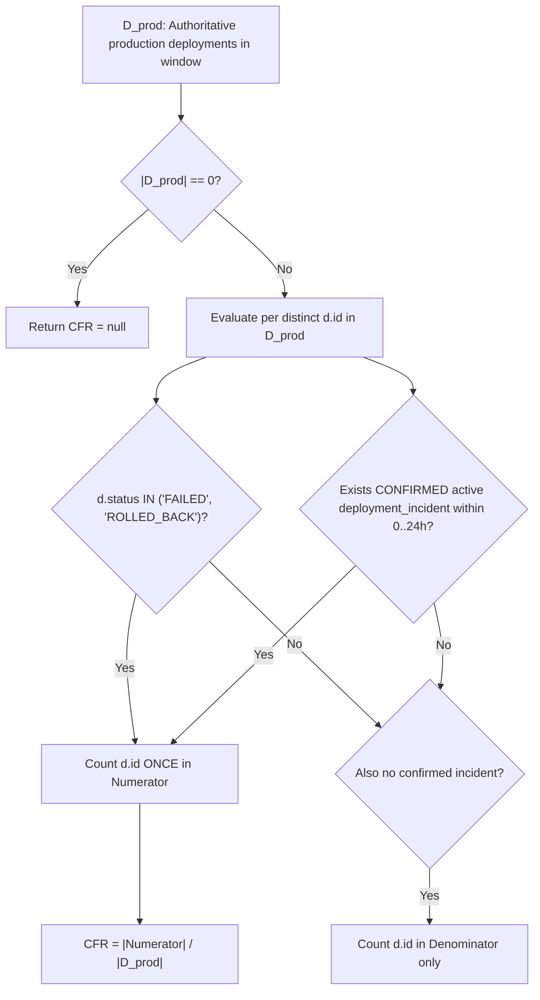

# Change Failure Rate (CFR) Distinct Union Rule Design (US-28 / Task 28.1 / SCRUM-442)

**Parent User Story:** US-28 — DORA Change Failure Rate  
**Task:** Task 28.1 (Design / SCRUM-442)  
**Is Blocked By:** Task 67.1 ([Jira Issues & Deployment Incidents Schema](jira-issues-and-deployment-incidents-schema.md)), Task 25.1 ([Production Deployment Ingestion Pipeline](deployment-ingestion-pipeline.md))  
**Blocks / Enables:** Task 28.2, Task 28.3, Task 30.1  
**Authoritative References:**
- M.A.N.T.A. Software Requirements Specification (SRS) V1.0 (§3.2.1, §3.2.2)
- [Production Deployment Ingestion Pipeline](deployment-ingestion-pipeline.md) (Task 25.1)
- [Jira Issues & Deployment Incidents Schema](jira-issues-and-deployment-incidents-schema.md) (Task 67.1)
- [ORM Models](file:///c:/Users/idusc/Desktop/MANTA/dev/backend/app/db/models/models.py) (`Deployment`, `DeploymentIncident`, `Project`)

---

## 1. Objective

Specify the Change Failure Rate (CFR) formula using a **strictly distinct set union** over failed deployment outcomes (`FAILED`, `ROLLED_BACK`) and confirmed $\le 24\text{h}$ Jira incidents (`US-67`), ensuring a deployment that both failed/rolled back and triggered a linked Jira incident is counted **exactly once** in the numerator, and returning `null` when zero production deployments exist in the window.

> [!NOTE]
> **Supersedes Draft Query in [jira-issues-and-deployment-incidents-schema.md](jira-issues-and-deployment-incidents-schema.md#L221-L260):**  
> That earlier schema doc illustrated `d.status = 'FAILED'` and `0.0` on empty windows. Per **Task 28.1** acceptance criteria, the authoritative CFR rule includes both `FAILED` and `ROLLED_BACK`, filters by `Project.authoritative_cd_signal` and `d.deployed_at`, and returns **`null`** when $|D_{\text{prod}}| = 0$.

---

## 2. Canonical Mathematical Formula

Let $\mathcal{D}_{\text{prod}}$ be the set of authoritative production deployments for `(tenant_id, project_id)` within the evaluation window $[t_{\text{start}}, t_{\text{end}}]$:

$$\mathcal{D}_{\text{prod}} = \left\{ d \in \text{deployments} \;\middle|\; d.\text{tenant\_id} = \tau \land d.\text{project\_id} = p \land d.\text{environment} = \text{'production'} \land d.\text{authoritative\_signal\_source} = \text{project.authoritative\_cd\_signal} \land d.\text{deployed\_at} \in [t_{\text{start}}, t_{\text{end}}] \right\}$$

Let $\text{has\_confirmed\_incident}_{\le 24\text{h}}(d)$ be the predicate:

$$\text{has\_confirmed\_incident}_{\le 24\text{h}}(d) \iff \exists\, di \in \text{deployment\_incidents}:\; \left(di.\text{tenant\_id} = d.\text{tenant\_id} \land di.\text{deployment\_id} = d.\text{id} \land di.\text{status} = \text{'CONFIRMED'} \land di.\text{is\_active} = \text{TRUE} \land 0 \le (di.\text{detected\_at} - d.\text{deployed\_at}) \le 24\text{ hours}\right)$$

Then:

$$\text{CFR} = \begin{cases} \text{null} & \text{if } |\mathcal{D}_{\text{prod}}| = 0 \\[6pt] \dfrac{\left|\left\{ d \in \mathcal{D}_{\text{prod}} \;\middle|\; d.\text{status} \in \{\text{'FAILED'}, \text{'ROLLED\_BACK'}\} \lor \text{has\_confirmed\_incident}_{\le 24\text{h}}(d) \right\}\right|}{|\mathcal{D}_{\text{prod}}|} & \text{if } |\mathcal{D}_{\text{prod}}| > 0 \end{cases}$$

---

## 3. Distinct Union & Anti-Double-Counting Invariants



1. **No Double-Counting Across Signals:**  
   If deployment $d$ has `d.status = 'FAILED'` (or `'ROLLED_BACK'`) **and** also has 1 or more linked `CONFIRMED` Jira incidents in `deployment_incidents`, `COUNT(DISTINCT d.id)` guarantees $d$ contributes **1** (not 2+) to the numerator.
2. **Multiple Incidents on One Deployment:**  
   If a `SUCCESS` deployment $d$ triggers 3 separate `CONFIRMED` Jira incidents within 24 hours, $d$ still contributes **1** to the numerator (`LEFT JOIN` + `COUNT(DISTINCT d.id)`).
3. **Cancelled & False-Positive Incidents Excluded:**  
   Rows in `deployment_incidents` with `status IN ('CANCELLED', 'FALSE_POSITIVE')` or `is_active = FALSE` do **not** satisfy $\text{has\_confirmed\_incident}_{\le 24\text{h}}(d)$. If $d.\text{status} = \text{'SUCCESS'}$, $d$ is treated as a successful (non-failed) deployment.
4. **24-Hour Correlation Window:**  
   Incident `detected_at` must satisfy `0 <= EXTRACT(EPOCH FROM (di.detected_at - d.deployed_at)) <= 86400`.
5. **Null-Window Behavior:**  
   When $|\mathcal{D}_{\text{prod}}| = 0$, the engine MUST return `null` (never `0` or `0.0`), distinguishing "no production deployments occurred" from "0% failure rate across $\ge 1$ deployments".

---

## 4. Representation & Rounding

- **Ratio ($\text{CFR} \in [0, 1]$):** Rounded to **4 decimal places** (`ROUND(..., 4)`), e.g., `1 / 3 = 0.3333`.
- **Percentage ($\text{CFR}_{\%} = \text{CFR} \times 100 \in [0, 100]$):** Rounded to **2 decimal places** (`ROUND(..., 2)`), e.g., `33.33`.
- Both `failed_deployment_count` (numerator) and `total_deployment_count` (denominator) are returned alongside `cfr` / `cfr_percentage` (which are `null` when `total_deployment_count = 0`).

---

## 5. Authoritative PostgreSQL 16 Query

```sql
WITH prod_deployments AS (
    SELECT
        d.id,
        d.tenant_id,
        d.status,
        d.deployed_at
    FROM deployments d
    JOIN projects p
      ON p.id = d.project_id
     AND p.tenant_id = d.tenant_id
    WHERE d.tenant_id = :tenant_id
      AND d.project_id = :project_id
      AND p.deleted_at IS NULL
      AND d.environment = 'production'
      AND d.authoritative_signal_source = p.authoritative_cd_signal
      AND d.deployed_at >= :window_start
      AND d.deployed_at <= :window_end
)
SELECT
    COUNT(DISTINCT d.id) AS total_production_deployments,
    COUNT(DISTINCT d.id) FILTER (
        WHERE d.status IN ('FAILED', 'ROLLED_BACK')
           OR (
               di.id IS NOT NULL
               AND di.status = 'CONFIRMED'
               AND di.is_active = TRUE
               AND di.detected_at >= d.deployed_at
               AND di.detected_at <= d.deployed_at + INTERVAL '24 hours'
           )
    ) AS distinct_failed_deployments,
    CASE
        WHEN COUNT(DISTINCT d.id) = 0 THEN NULL
        ELSE ROUND(
            COUNT(DISTINCT d.id) FILTER (
                WHERE d.status IN ('FAILED', 'ROLLED_BACK')
                   OR (
                       di.id IS NOT NULL
                       AND di.status = 'CONFIRMED'
                       AND di.is_active = TRUE
                       AND di.detected_at >= d.deployed_at
                       AND di.detected_at <= d.deployed_at + INTERVAL '24 hours'
                   )
            )::numeric / COUNT(DISTINCT d.id)::numeric,
            4
        )
    END AS cfr_ratio,
    CASE
        WHEN COUNT(DISTINCT d.id) = 0 THEN NULL
        ELSE ROUND(
            (
                COUNT(DISTINCT d.id) FILTER (
                    WHERE d.status IN ('FAILED', 'ROLLED_BACK')
                       OR (
                           di.id IS NOT NULL
                           AND di.status = 'CONFIRMED'
                           AND di.is_active = TRUE
                           AND di.detected_at >= d.deployed_at
                           AND di.detected_at <= d.deployed_at + INTERVAL '24 hours'
                       )
                )::numeric / COUNT(DISTINCT d.id)::numeric
            ) * 100.0,
            2
        )
    END AS cfr_percentage
FROM prod_deployments d
LEFT JOIN deployment_incidents di
  ON di.deployment_id = d.id
 AND di.tenant_id = d.tenant_id;
```

---

## 6. Acceptance Criteria Traceability

| Requirement | Design Coverage |
| :--- | :--- |
| Distinct union `FAILED` $\cup$ `ROLLED_BACK` $\cup$ confirmed $\le 24\text{h}$ Jira incident | §2 & §5 — `COUNT(DISTINCT d.id) FILTER (WHERE d.status IN ('FAILED', 'ROLLED_BACK') OR ...)` |
| Failed/rolled-back deployment with linked Jira incident counted once | §3 — `COUNT(DISTINCT d.id)` over `LEFT JOIN deployment_incidents`. |
| `null` return when `|D_prod| = 0` | §2, §3, §5 — `CASE WHEN COUNT(DISTINCT d.id) = 0 THEN NULL ...`. |
