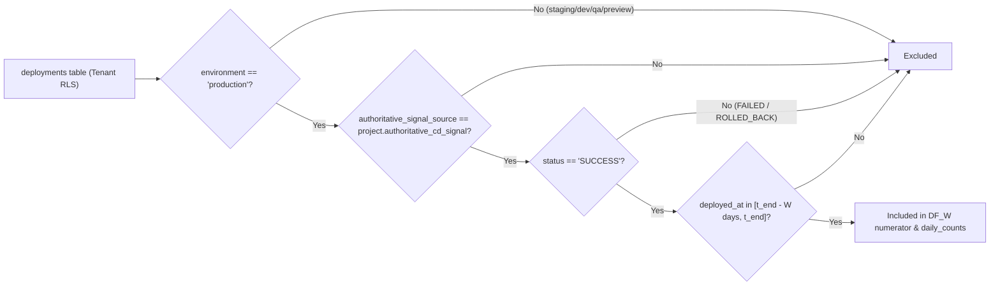

# Rolling 14-Day & 30-Day Deployment Frequency Formula Design (US-27 / Task 27.1 / SCRUM-438)

**Parent User Story:** US-27 — DORA Deployment Frequency  
**Task:** Task 27.1 (Design / SCRUM-438)  
**Is Blocked By:** Task 25.1 ([Production Deployment Ingestion Pipeline](deployment-ingestion-pipeline.md))  
**Blocks / Enables:** Task 27.2, Task 27.3, Task 30.1  
**Authoritative References:**
- M.A.N.T.A. Software Requirements Specification (SRS) V1.0 (§3.2.1, §3.2.2)
- [Production Deployment Ingestion Pipeline](deployment-ingestion-pipeline.md) (Task 25.1)
- [Authoritative Deployment Query](file:///c:/Users/idusc/Desktop/MANTA/dev/backend/app/deployments/service.py#L415-L459) (`build_authoritative_production_deployments_query`)

---

## 1. Objective

Specify the exact mathematical formula, authoritative filtering rules, daily bucketization, rounding precision, and zero-deployment behavior for rolling **14-day** and **30-day** Deployment Frequency ($\text{DF}_W$).

---

## 2. Canonical Mathematical Formula

Let $\mathcal{D}_{\text{prod}}$ be the set of production deployments for a given `(tenant_id, project_id)` within the rolling window $[t_{\text{end}} - W\text{ days},\ t_{\text{end}}]$:

$$\mathcal{D}_{\text{prod}}(W) = \left\{ d \in \text{deployments} \;\middle|\; d.\text{tenant\_id} = \tau \land d.\text{project\_id} = p \land d.\text{environment} = \text{'production'} \land d.\text{deployed\_at} \in [t_{\text{end}} - W\text{ days},\ t_{\text{end}}] \right\}$$

The rolling Deployment Frequency for window $W \in \{14, 30\}$ (measured in **successful production deployments per day**) is:

$$\text{DF}_W = \text{round}_2\!\left(\frac{\text{count}\!\left(d \in \mathcal{D}_{\text{prod}}(W) \;\middle|\; d.\text{status} = \text{'SUCCESS'} \land d.\text{authoritative\_signal\_source} = \text{project.authoritative\_cd\_signal}\right)}{W}\right)$$

### 2.1 Daily Deployment Counts
For time-series visualization across the $W$-day window, deployments are grouped by UTC calendar day:

$$\text{daily\_count}(day) = \text{count}\!\left(d \in \mathcal{D}_{\text{prod}}(W) \;\middle|\; d.\text{status} = \text{'SUCCESS'} \land d.\text{authoritative\_signal\_source} = \text{project.authoritative\_cd\_signal} \land \text{DATE}_{\text{UTC}}(d.\text{deployed\_at}) = day\right)$$

- Every day in the $W$-day series MUST be emitted (zero-filled to `0` if no successful production deployments occurred on that UTC date).

---

## 3. Filtering & Exclusion Rules



1. **Environment Exclusion:** Strictly `d.environment = 'production'`. All `staging`, `dev`, `qa`, `preview`, or custom non-production environments are excluded.
2. **Outcome Exclusion:** Strictly `d.status = 'SUCCESS'`. Deployments with `FAILED` or `ROLLED_BACK` do **not** increment Deployment Frequency (they are captured by Change Failure Rate in US-28).
3. **Authoritative Signal Exclusion:** Strictly `d.authoritative_signal_source = projects.authoritative_cd_signal` (where `projects.deleted_at IS NULL`), preventing double-counting when multiple CD integrations emit events for the same release.
4. **Window Boundary:** `d.deployed_at >= t_end - INTERVAL ':W days'` AND `d.deployed_at <= t_end` (default `t_end = NOW()` in UTC).

---

## 4. Rounding & Zero-Deployment Behavior

| Rule | Specification | Example |
| :--- | :--- | :--- |
| **Rounding Precision** | **2 decimal places** using standard half-up rounding (`ROUND(val, 2)` in PostgreSQL / `Decimal.quantize(Decimal("0.01"), rounding=ROUND_HALF_UP)` in Python). | `6 / 14 = 0.428571...` $\rightarrow$ **`0.43`**; `15 / 30 = 0.50` |
| **Zero-Deployment Behavior** | When `count = 0` in the window, $\text{DF}_W = 0.00$ (numeric zero, **not** `null`). All $W$ daily count buckets return `0`. | `0 / 14` $\rightarrow$ **`0.00`** |
| **Window Parameter Validation** | Only $W \in \{14, 30\}$ are supported for rolling DORA DF. | `W = 14`, `W = 30` |

---

## 5. Authoritative PostgreSQL 16 Queries

### 5.1 Rolling Deployment Frequency ($\text{DF}_W$)
```sql
SELECT
    COUNT(*) AS successful_deployment_count,
    ROUND((COUNT(*)::numeric / :window_days::numeric), 2) AS deployment_frequency
FROM deployments d
JOIN projects p
  ON p.id = d.project_id
 AND p.tenant_id = d.tenant_id
WHERE d.tenant_id = :tenant_id
  AND d.project_id = :project_id
  AND p.deleted_at IS NULL
  AND d.environment = 'production'
  AND d.status = 'SUCCESS'
  AND d.authoritative_signal_source = p.authoritative_cd_signal
  AND d.deployed_at >= (:window_end - make_interval(days => :window_days))
  AND d.deployed_at <= :window_end;
```

### 5.2 Daily Deployment Counts (Zero-Filled UTC Series)
```sql
WITH days AS (
    SELECT generate_series(
        DATE_TRUNC('day', (:window_end AT TIME ZONE 'UTC') - make_interval(days => :window_days - 1)),
        DATE_TRUNC('day', (:window_end AT TIME ZONE 'UTC')),
        INTERVAL '1 day'
    )::date AS day_utc
),
counts AS (
    SELECT
        (d.deployed_at AT TIME ZONE 'UTC')::date AS day_utc,
        COUNT(*) AS deployment_count
    FROM deployments d
    JOIN projects p
      ON p.id = d.project_id
     AND p.tenant_id = d.tenant_id
    WHERE d.tenant_id = :tenant_id
      AND d.project_id = :project_id
      AND p.deleted_at IS NULL
      AND d.environment = 'production'
      AND d.status = 'SUCCESS'
      AND d.authoritative_signal_source = p.authoritative_cd_signal
      AND d.deployed_at >= (:window_end - make_interval(days => :window_days))
      AND d.deployed_at <= :window_end
    GROUP BY 1
)
SELECT
    days.day_utc AS date,
    COALESCE(counts.deployment_count, 0) AS count
FROM days
LEFT JOIN counts USING (day_utc)
ORDER BY days.day_utc ASC;
```

---

## 6. Acceptance Criteria Traceability

| Requirement | Design Coverage |
| :--- | :--- |
| Exact formula for $W \in \{14, 30\}$ | §2 — $\text{DF}_W = \text{count}(\dots) / W$. |
| Daily deployment counts | §2.1 & §5.2 — Zero-filled UTC daily series. |
| Rounding to 2 decimal places (`6 / 14 = 0.43`) | §4 — `ROUND(..., 2)` / `ROUND_HALF_UP`. |
| Staging & failed deployment exclusion | §3 — `environment = 'production'`, `status = 'SUCCESS'`, `authoritative_signal_source = p.authoritative_cd_signal`. |
| Zero-deployment behavior | §4 — Returns `0.00` (not `null`) and `0` for every daily bucket. |
