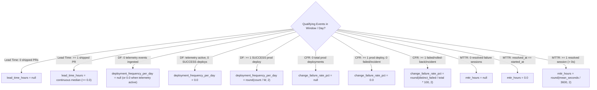

# OpenAPI 3.1 Contract: Project DORA Metrics Endpoint (US-30 / Task 30.1)

**Parent User Story:** US-30 — DORA Metrics REST API  
**Task:** Task 30.1 (Design)  
**Is Blocked By:**
- Task 26.1 ([PR-to-Deployment Mapping & Lead Time Design](dora-pr-to-deployment-mapping-design.md))
- Task 27.1 ([Rolling 14d & 30d Deployment Frequency Formula Design](dora-deployment-frequency-formula-design.md))
- Task 28.1 ([Change Failure Rate Distinct Union Rule Design](dora-change-failure-rate-design.md))
- Task 29.1 ([Mean Time to Recovery Interval Pairing & Null-Window Design](dora-mttr-calculation-design.md))

**Blocks / Enables:** Task 30.2 (Endpoint Implementation), Task 30.3 (Test Scenarios), Task 30.4 (Automated Tests), Task 31.4 (Web Portal DORA API Adapter)  
**Authoritative Pydantic Schemas:** [`backend/app/dora/schemas.py`](../backend/app/dora/schemas.py) (`DoraMetricsResponse`, `DoraAggregates`, `DoraDailyPoint`, `DoraWindow`, `DoraTimeframeDays`)

---

## 1. Objective & Scope

Define the canonical **OpenAPI 3.1.0** (JSON Schema 2020-12) Pydantic v2 contract for retrieving verified rolling-window DORA metrics and daily trend series for a project:

- **Primary Endpoint:** `GET /api/v1/projects/{project_id}/dora-metrics`
- **DORA Domain Alias:** `GET /api/v1/dora/projects/{project_id}`

Both routes expose the exact same query parameters, security/RBAC gates, tenant isolation semantics, and `DoraMetricsResponse` schema.

> [!NOTE]
> **Reconciliation with Earlier Draft Specifications:**
> - Supersedes the draft `Blueprint §12.1` contract (`direct_cd_api`, flat aggregate keys, singular `calculation_notes: str`, non-nullable fields). Canonical CD signal values come from `DeploymentSignalSource` (`github_deployments_api`, `argocd_postsync_webhook`, `direct_deployment_api`).
> - Supersedes the draft response shape in [`deployment-signal-selection-persistence-and-dora-response-reporting-test-scenarios.md`](deployment-signal-selection-persistence-and-dora-response-reporting-test-scenarios.md#L512-L540) (`authoritative_cd_signal`, nested `metrics.*`). Per **US-18** and **Task 30.1**, the canonical field name is `authoritative_deployment_signal`, with `window`, `aggregates`, `notes: list[str]`, and `trend: list[DoraDailyPoint]`.

---

## 2. Endpoint Contract, Security & Error Matrix

### 2.1 Request Parameters

| Parameter | Location | Type | Required | Default | Constraints & Validation |
| :--- | :--- | :--- | :---: | :---: | :--- |
| `project_id` | Path | `string` (`uuid`) | Yes | — | Target project UUID. Malformed UUID fails with `422 Unprocessable Entity`. |
| `timeframe_days` | Query | `integer` | No | `30` | Enum `[14, 30]`. Maps to response `window` (`14` $\rightarrow$ `"14d"`, `30` $\rightarrow$ `"30d"`). Unsupported values (e.g. `7`, `45`, `0`) fail closed with `422`. |

### 2.2 Authorization, Multi-Tenancy & Responses

| HTTP Status | Condition | Payload / Semantics |
| :---: | :--- | :--- |
| **`200 OK`** | Valid RS256 OIDC JWT, caller role permits `VIEW_PROJECT_DORA` (`docs/roles-permissions.json`), active project exists under `app.current_tenant_id` (`projects.deleted_at IS NULL`). | `DoraMetricsResponse` JSON matching OpenAPI 3.1 schema below. |
| **`401 Unauthorized`** | Missing, expired, or invalid Bearer JWT (`JWTAuthMiddleware`). | `{"detail": "Not authenticated"}` (or token error detail). |
| **`403 Forbidden`** | Caller holds no recognized role or lacks `VIEW_PROJECT_DORA`. | `{"detail": "Forbidden: insufficient permissions"}`. |
| **`404 Not Found`** | Project does not exist, is soft-deleted, or belongs to a **foreign tenant** (PostgreSQL RLS + anti-enumeration). | `{"detail": "Project '{project_id}' not found."}`. |
| **`422 Unprocessable Entity`** | Invalid `project_id` UUID or invalid `timeframe_days` (not in `{14, 30}`). | Standard FastAPI validation error payload. |

---

## 3. Nullability Semantics: `null` vs `0.0`

A core invariant of Task 30.1 is **explicitly distinguishing an undefined metric (`null`) from a measured zero (`0.0`)**. In Pydantic v2 / OpenAPI 3.1:
- All four fields in `DoraAggregates` and all four metric fields in `DoraDailyPoint` are typed `float | None` **without** default `= None` (`Field(...)`).
- Consequently, every metric key is listed in OpenAPI `"required"` (never omitted from JSON) and uses JSON Schema 2020-12 `"anyOf": [{"type": "number", ...}, {"type": "null"}]`.
- `allow_inf_nan=False` is enforced so `NaN` or `Infinity` can never be serialized.



| Metric Field | When `null` (Undefined / No Events) | When `0.0` (Measured Zero) | Unit & Bounds |
| :--- | :--- | :--- | :--- |
| `lead_time_hours` | `deployed_pr_count == 0` in the window or on that UTC day. | Shipped PR has `deployed_at == first_commit_at` (`0s` delta). | Hours (`>= 0.0`), rounded to 2 decimals. |
| `deployment_frequency_per_day` | Project/day has no deployment telemetry (e.g., no events ingested under authoritative signal). | Telemetry active with `0` `SUCCESS` production deployments (e.g., only `FAILED`/`ROLLED_BACK` deployments occurred, or active day with 0 deploys). | Deploys/day (`>= 0.0`), rounded to 2 decimals. |
| `change_failure_rate_pct` | `total_deployment_count == 0` in the window or on that UTC day. | `total_deployment_count >= 1` and `failed_deployment_count == 0` (`0.0%` CFR). | Percentage `[0.0, 100.0]`, rounded to 2 decimals. |
| `mttr_hours` | `resolved_outage_count == 0` in the window or on that UTC day (including when only open/unresolved outages exist). | Resolved outage has `resolved_at == started_at` (instantaneous `0s` restoration). | Hours (`>= 0.0`), rounded to 2 decimals. |

---

## 4. OpenAPI 3.1.0 Specification

```yaml
openapi: 3.1.0
info:
  title: Engineering Intelligence Platform — DORA Metrics Contract
  version: 3.0.0
paths:
  /api/v1/projects/{project_id}/dora-metrics:
    get:
      summary: Get Project DORA Metrics
      description: >
        Retrieve verified rolling 14-day or 30-day DORA metrics (nullable aggregates
        and contiguous UTC daily trend series) filtered strictly by the project's
        configured authoritative_deployment_signal under PostgreSQL tenant RLS.
      security:
        - BearerAuth: []
      parameters:
        - name: project_id
          in: path
          required: true
          schema:
            type: string
            format: uuid
        - name: timeframe_days
          in: query
          required: false
          schema:
            type: integer
            enum: [14, 30]
            default: 30
      responses:
        "200":
          description: Verified project DORA aggregates and daily trend series
          content:
            application/json:
              schema:
                $ref: "#/components/schemas/DoraMetricsResponse"
        "401":
          description: Not authenticated
        "403":
          description: Forbidden (missing VIEW_PROJECT_DORA permission)
        "404":
          description: Project not found or belongs to another tenant
        "422":
          description: Validation error (invalid UUID or unsupported timeframe_days)
  /api/v1/dora/projects/{project_id}:
    get:
      summary: Get Project DORA Metrics (DORA domain alias)
      description: Alias for GET /api/v1/projects/{project_id}/dora-metrics.
      security:
        - BearerAuth: []
      parameters:
        - name: project_id
          in: path
          required: true
          schema:
            type: string
            format: uuid
        - name: timeframe_days
          in: query
          required: false
          schema:
            type: integer
            enum: [14, 30]
            default: 30
      responses:
        "200":
          description: Verified project DORA aggregates and daily trend series
          content:
            application/json:
              schema:
                $ref: "#/components/schemas/DoraMetricsResponse"
        "401":
          description: Not authenticated
        "403":
          description: Forbidden (missing VIEW_PROJECT_DORA permission)
        "404":
          description: Project not found or belongs to another tenant
        "422":
          description: Validation error
components:
  schemas:
    DeploymentSignalSource:
      type: string
      enum:
        - github_deployments_api
        - argocd_postsync_webhook
        - direct_deployment_api
      title: DeploymentSignalSource
    DoraAggregates:
      type: object
      title: DoraAggregates
      required:
        - lead_time_hours
        - deployment_frequency_per_day
        - change_failure_rate_pct
        - mttr_hours
      properties:
        lead_time_hours:
          anyOf:
            - type: number
              minimum: 0.0
            - type: "null"
        deployment_frequency_per_day:
          anyOf:
            - type: number
              minimum: 0.0
            - type: "null"
        change_failure_rate_pct:
          anyOf:
            - type: number
              minimum: 0.0
              maximum: 100.0
            - type: "null"
        mttr_hours:
          anyOf:
            - type: number
              minimum: 0.0
            - type: "null"
    DoraDailyPoint:
      type: object
      title: DoraDailyPoint
      required:
        - date
        - lead_time_hours
        - deployment_frequency_per_day
        - change_failure_rate_pct
        - mttr_hours
      properties:
        date:
          type: string
          format: date
        lead_time_hours:
          anyOf:
            - type: number
              minimum: 0.0
            - type: "null"
        deployment_frequency_per_day:
          anyOf:
            - type: number
              minimum: 0.0
            - type: "null"
        change_failure_rate_pct:
          anyOf:
            - type: number
              minimum: 0.0
              maximum: 100.0
            - type: "null"
        mttr_hours:
          anyOf:
            - type: number
              minimum: 0.0
            - type: "null"
    DoraMetricsResponse:
      type: object
      title: DoraMetricsResponse
      required:
        - project_id
        - window
        - authoritative_deployment_signal
        - aggregates
        - trend
      properties:
        project_id:
          type: string
          format: uuid
        window:
          type: string
          enum: ["14d", "30d"]
        authoritative_deployment_signal:
          $ref: "#/components/schemas/DeploymentSignalSource"
        aggregates:
          $ref: "#/components/schemas/DoraAggregates"
        notes:
          type: array
          items:
            type: string
        trend:
          type: array
          items:
            $ref: "#/components/schemas/DoraDailyPoint"
```

---

## 5. Canonical Payload Examples

### 5.1 Partial Telemetry (`0.0%` CFR vs `null` MTTR)

All 6 production deployments succeeded with 0 failures (`0.0%` CFR) and 0 resolved health failure sessions (`mttr_hours: null`):

```json
{
  "project_id": "aaaaaaaa-aaaa-aaaa-aaaa-aaaaaaaaaaaa",
  "window": "14d",
  "authoritative_deployment_signal": "github_deployments_api",
  "aggregates": {
    "lead_time_hours": 23.5,
    "deployment_frequency_per_day": 0.43,
    "change_failure_rate_pct": 0.0,
    "mttr_hours": null
  },
  "notes": [
    "mttr_hours is null: 0 resolved production health failure sessions in the 14d window.",
    "change_failure_rate_pct is 0.0%: 6 production deployments succeeded with 0 failures or linked incidents."
  ],
  "trend": [
    {
      "date": "2026-11-16",
      "lead_time_hours": 23.5,
      "deployment_frequency_per_day": 2.0,
      "change_failure_rate_pct": 0.0,
      "mttr_hours": null
    }
  ]
}
```

### 5.2 Zero-Event Project (Empty Window)

```json
{
  "project_id": "bbbbbbbb-bbbb-bbbb-bbbb-bbbbbbbbbbbb",
  "window": "30d",
  "authoritative_deployment_signal": "argocd_postsync_webhook",
  "aggregates": {
    "lead_time_hours": null,
    "deployment_frequency_per_day": null,
    "change_failure_rate_pct": null,
    "mttr_hours": null
  },
  "notes": [
    "No authoritative production deployments recorded under signal 'argocd_postsync_webhook' in the 30d window."
  ],
  "trend": [
    {
      "date": "2026-11-16",
      "lead_time_hours": null,
      "deployment_frequency_per_day": null,
      "change_failure_rate_pct": null,
      "mttr_hours": null
    }
  ]
}
```

---

## 6. Downstream Integration Guide (Tasks 30.2, 30.3, 30.4, 31.4)

### 6.1 Backend Service Assembly (Task 30.2)

Map the outputs of the four existing DORA calculators in [`backend/app/dora/service.py`](../backend/app/dora/service.py) into `DoraMetricsResponse`:

| `DoraMetricsResponse` Field | Source in Existing Domain Services |
| :--- | :--- |
| `project_id` | `project.id` (verified under tenant RLS, `deleted_at IS NULL`) |
| `window` | `f"{timeframe_days}d"` (`"14d"` or `"30d"`) |
| `authoritative_deployment_signal` | `DeploymentSignalSource(project.authoritative_cd_signal)` |
| `aggregates.lead_time_hours` | `LeadTimeResult.median_lead_time_hours` |
| `aggregates.deployment_frequency_per_day` | `DeploymentFrequencyResult.deployments_per_day` (or `None` when total deployment telemetry is absent) |
| `aggregates.change_failure_rate_pct` | `ChangeFailureRateResult.change_failure_rate_percentage` |
| `aggregates.mttr_hours` | `MTTRResult.mttr_hours` |
| `trend[i].lead_time_hours` | `LeadTimeResult.daily_series[i].median_lead_time_hours` |
| `trend[i].deployment_frequency_per_day` | `float(DeploymentFrequencyResult.daily_series[i].count)` (or `None` when telemetry absent) |
| `trend[i].change_failure_rate_pct` | `ChangeFailureRateResult.daily_series[i].change_failure_rate_percentage` |
| `trend[i].mttr_hours` | `MTTRResult.daily_series[i].mttr_hours` |

> [!NOTE]
> When Task 30.2 replaces the `[STUB]` handler on `GET /api/v1/dora/projects/{project_id}` in [`backend/app/dora/router.py`](../backend/app/dora/router.py) and adds `GET /api/v1/projects/{project_id}/dora-metrics` in [`backend/app/projects/router.py`](../backend/app/projects/router.py), remember to graduate `Permission.VIEW_PROJECT_DORA` from `stub_permissions` to `real_permissions` in [`backend/tests/test_permission_enforcement.py`](../backend/tests/test_permission_enforcement.py).

### 6.2 Frontend Web Adapter Mapping (Task 31.4)

In [`web/src/lib/dora/dora-api.ts`](../web/src/lib/dora/dora-api.ts), map `DoraMetricsResponse` to [`DoraDashboardViewModel`](../web/src/types/dora.ts):
- Request `GET /api/v1/projects/${projectId}/dora-metrics?timeframe_days=${days}` (`days: 14 | 30`).
- Map `aggregates.lead_time_hours`, `aggregates.deployment_frequency_per_day`, `aggregates.change_failure_rate_pct` directly (`null` preserves `"No data"`, `0` renders `0`).
- Convert `mttr_hours` to minutes (`mttr_hours * 60`) if displaying `unit: "minutes"` per `DORA_METRIC_META.mttr` (preserving `null` as `null`).
- Map `trend` array by UTC `date` into each metric's `DoraTrendPoint[]` (`null` creates chart gaps; `0` plots zero).
