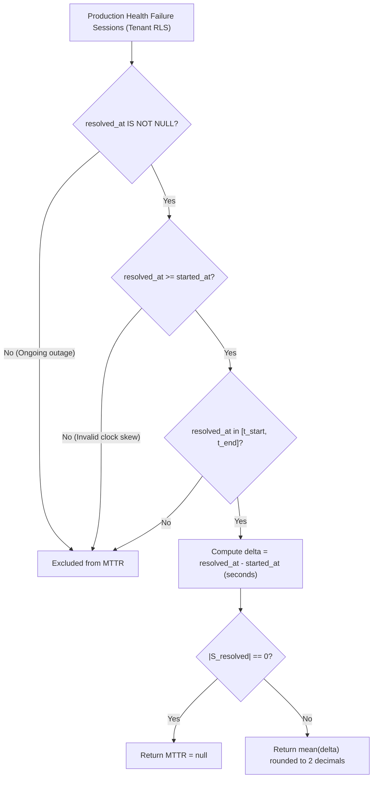

# Mean Time to Recovery (MTTR) Interval Pairing & Null-Window Design (US-29 / Task 29.1)

**Parent User Story:** US-29 — DORA Mean Time to Recovery (MTTR)  
**Task:** Task 29.1 (Design)  
**Is Blocked By:** Task 68.1 (Production Health Failure Sessions — US-68)  
**Blocks / Enables:** Task 29.2, Task 29.3, Task 30.1  
**Authoritative References:**
- M.A.N.T.A. Software Requirements Specification (SRS) V1.0 (§3.2.1, §3.2.2)
- [ORM Models](file:///c:/Users/idusc/Desktop/MANTA/dev/backend/app/db/models/models.py#L1018-L1040) (`Incident` — `started_at`, `resolved_at`, `recovery_time_seconds`)

---

## 1. Objective

Design the Mean Time to Recovery (MTTR) calculation rules based **strictly on resolved production health failure sessions** (`US-68`), defining exact interval pairing math ($T_{\text{restore}} - T_{\text{failure\_detected}}$), **explicit independence from PR merge timestamps**, and **`null`-window behavior** when zero resolved failure sessions exist.

---

## 2. Canonical Mathematical Formula

Let $\mathcal{S}_{\text{resolved}}$ be the set of **resolved** production health failure sessions for `(tenant_id, project_id)` whose restoration timestamp falls within the evaluation window $[t_{\text{start}}, t_{\text{end}}]$:

$$\mathcal{S}_{\text{resolved}} = \left\{ s \in \text{health\_failure\_sessions} \;\middle|\; s.\text{tenant\_id} = \tau \land s.\text{project\_id} = p \land s.\text{resolved\_at} \neq \text{NULL} \land s.\text{resolved\_at} \ge s.\text{started\_at} \land s.\text{resolved\_at} \in [t_{\text{start}}, t_{\text{end}}] \right\}$$

*(Note: In the current ORM schema [`Incident`](file:///c:/Users/idusc/Desktop/MANTA/dev/backend/app/db/models/models.py#L1018-L1040), `s.started_at` corresponds to $T_{\text{failure\_detected}}$ and `s.resolved_at` corresponds to $T_{\text{restore}}$; any dedicated US-68 table introduced in Task 68.1 must expose the same `started_at` / `resolved_at` contract.)*

For each session $s \in \mathcal{S}_{\text{resolved}}$, the restoration interval duration in seconds is:

$$\Delta t(s) = \text{EXTRACT}\!\left(\text{EPOCH FROM } (s.\text{resolved\_at} - s.\text{started\_at})\right) \ge 0$$

The Mean Time to Recovery is:

$$\text{MTTR}_{\text{seconds}} = \begin{cases} \text{null} & \text{if } |\mathcal{S}_{\text{resolved}}| = 0 \\[6pt] \text{round}_2\!\left(\dfrac{1}{|\mathcal{S}_{\text{resolved}}|} \displaystyle\sum_{s \in \mathcal{S}_{\text{resolved}}} \Delta t(s)\right) & \text{if } |\mathcal{S}_{\text{resolved}}| > 0 \end{cases}$$

---

## 3. Interval Pairing & Exclusion Rules



1. **Strict Session Pairing ($T_{\text{restore}} - T_{\text{failure\_detected}}$):**
   - Each failure session pairs its own failure-detection start timestamp (`s.started_at`) with its own restoration timestamp (`s.resolved_at`).
   - Overlapping or consecutive outages are **not** cross-paired; each session's `[started_at, resolved_at]` is self-contained.
2. **Explicit Independence from PR Merge Timestamps:**
   - MTTR **MUST NOT** read, join, or depend on `pull_requests.merged_at`, `commits.committed_at`, or `deployments.deployed_at` as a proxy for failure start or restoration.
   - Even if a hotfix PR is merged at $t_{\text{merge}}$, the failure session ends only when production health is verified restored at `s.resolved_at`.
3. **Unresolved / Ongoing Sessions:**
   - Sessions with `s.resolved_at IS NULL` are excluded from MTTR until they resolve (they may be surfaced separately as active incidents, but never with `NOW() - started_at` in historical MTTR).
4. **Null-Window Behavior:**
   - When $|\mathcal{S}_{\text{resolved}}| = 0$ in the window, MTTR **MUST return `null`** (never `0` or `0.0`), preserving the distinction between "no production failures occurred" and "0-second recovery".
5. **Non-Negative Guard:**
   - Any anomalous record with `s.resolved_at < s.started_at` is excluded from aggregation (and flagged as data-integrity anomaly).

---

## 4. Authoritative PostgreSQL 16 Query

```sql
SELECT
    COUNT(*) AS resolved_failure_session_count,
    CASE
        WHEN COUNT(*) = 0 THEN NULL
        ELSE ROUND(
            AVG(EXTRACT(EPOCH FROM (s.resolved_at - s.started_at)))::numeric,
            2
        )
    END AS mttr_seconds
FROM incidents s
JOIN projects p
  ON p.id = s.project_id
 AND p.tenant_id = s.tenant_id
WHERE s.tenant_id = :tenant_id
  AND s.project_id = :project_id
  AND p.deleted_at IS NULL
  AND s.resolved_at IS NOT NULL
  AND s.resolved_at >= s.started_at
  AND s.resolved_at >= :window_start
  AND s.resolved_at <= :window_end;
```

*(If US-68 introduces a dedicated `health_failure_sessions` table, Task 29.2 substitutes `health_failure_sessions` for `incidents` while preserving the exact `started_at` / `resolved_at` / `tenant_id` / `project_id` predicate.)*

---

## 5. Acceptance Criteria Traceability

| Requirement | Design Coverage |
| :--- | :--- |
| Exact interval math (`s.resolved_at - s.started_at`) | §2 & §4 — `EXTRACT(EPOCH FROM (s.resolved_at - s.started_at))` averaged over $\mathcal{S}_{\text{resolved}}$. |
| Independence from PR merge timestamps | §3.2 — Explicitly forbids `pull_requests.merged_at` / `commits.committed_at` in MTTR calculation. |
| `null` return when zero resolved failure sessions exist | §2, §3.4, §4 — `CASE WHEN COUNT(*) = 0 THEN NULL ...`. |
