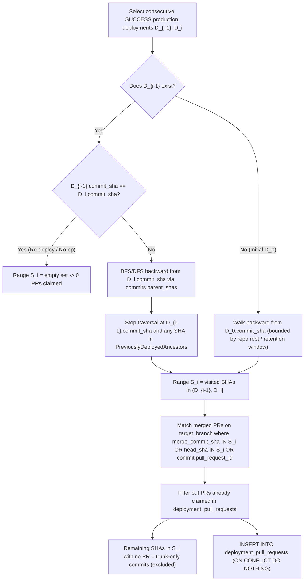

# PR-to-Deployment Commit Mapping & Trunk Exclusion Design (US-26 / Task 26.1)

**Parent User Story:** US-26 — DORA Lead Time for Changes & PR-to-Deployment Attribution  
**Task:** Task 26.1 (Design)  
**Is Blocked By:** Task 20.1 (Git/PR/Commit Schema), Task 25.1 ([Production Deployment Ingestion Pipeline](deployment-ingestion-pipeline.md))  
**Blocks / Enables:** Task 26.2, Task 26.3, Task 26.4, Task 30.1  
**Authoritative References:**
- M.A.N.T.A. Software Requirements Specification (SRS) V1.0 (§3.2.1, §3.2.2)
- [Production Deployment Ingestion Pipeline](deployment-ingestion-pipeline.md) (Task 25.1)
- [ORM Models](file:///c:/Users/idusc/Desktop/MANTA/dev/backend/app/db/models/models.py) (`Deployment`, `DeploymentPullRequest`, `PullRequest`, `Commit`, `Project`, `Repository`)
- [Authoritative Deployment Query](file:///c:/Users/idusc/Desktop/MANTA/dev/backend/app/deployments/service.py#L415-L459) (`build_authoritative_production_deployments_query`)

---

## 1. Objective

Define the deterministic algorithm that maps commits shipped between consecutive successful production deployments $(D_{i-1}, D_i]$ to merged Pull Requests across **standard merge**, **squash-merge**, and **rebase-and-merge** Git strategies, while **excluding trunk-only / already-deployed ancestor commits** and preventing duplicate PR claims in `deployment_pull_requests`.

---

## 2. Authoritative Input Domain & Ordering

### 2.1 Eligible Deployments
Only deployments satisfying the authoritative production filter (`build_authoritative_production_deployments_query`) and having a successful terminal outcome participate in PR attribution:

- `deployments.tenant_id = :tenant_id` (enforced via PostgreSQL `FORCE ROW LEVEL SECURITY`)
- `deployments.project_id = :project_id`
- `deployments.environment = 'production'`
- `deployments.authoritative_signal_source = projects.authoritative_cd_signal`
- `deployments.status = 'SUCCESS'`
- `projects.deleted_at IS NULL`

Deployments are ordered chronologically per `(project_id, repository_id)` (or per `project_id` when `repository_id IS NULL`):

$$(D_0, D_1, \dots, D_k) \quad \text{ordered by } (\text{deployed\_at ASC}, \text{id ASC})$$

> [!NOTE]
> **Why `FAILED` and `ROLLED_BACK` deployments are skipped as range boundaries:**  
> A failed or rolled-back deployment $D_{\text{fail}}$ did not successfully ship changes to production. When the next successful deployment $D_i$ lands, its half-open range $(D_{i-1}, D_i]$ is anchored to the **preceding `SUCCESS` deployment** $D_{i-1}$ so that PRs from the failed attempt are properly attributed when they finally succeed in $D_i$.

### 2.2 Eligible Pull Requests
Only merged Pull Requests targeting the repository's trunk/release branch are eligible:
- `pull_requests.tenant_id = :tenant_id`
- `pull_requests.project_id = :project_id`
- `pull_requests.repository_id = D_i.repository_id` (when `D_i.repository_id IS NOT NULL`)
- `pull_requests.state = 'merged'` (and `pull_requests.merged_at IS NOT NULL`)
- `pull_requests.base_branch = :target_branch` (e.g., `repositories.default_branch`, typically `main` or `master`)
- **Unclaimed invariant:** `NOT EXISTS` a row in `deployment_pull_requests` for `(tenant_id, pull_request_id)` under an earlier deployment (or enforced idempotently via `UNIQUE (deployment_id, pull_request_id)` + prior-claim exclusion).

---

## 3. Commit Range & Trunk Exclusion Algorithm



### 3.1 Half-Open Commit Range $(D_{i-1}, D_i]$
Given `commits(sha, parent_shas, repository_id, pull_request_id)`:

1. **Ancestor Exclusion Set ($\mathcal{A}_{i-1}$):**  
   Compute the reachable ancestor set from $D_{i-1}.\text{commit\_sha}$ (or reuse the materialized/cached set of SHAs already covered by $D_0 \dots D_{i-1}$).
2. **Range Set ($\mathcal{S}_i$):**  
   Traverse `commits.parent_shas` (JSONB array of parent SHAs) backward starting at $D_i.\text{commit\_sha}$:
   - If a SHA is in $\mathcal{A}_{i-1}$ (which includes $D_{i-1}.\text{commit\_sha}$ and all of its ancestors), **prune that branch of the traversal immediately**.
   - Otherwise, add the SHA to $\mathcal{S}_i$ and enqueue its `parent_shas`.
   - Thus $\mathcal{S}_i = \text{Ancestors}(D_i.\text{commit\_sha}) \setminus \text{Ancestors}(D_{i-1}.\text{commit\_sha})$.
3. **Trunk-Only Commit Exclusion:**
   - Any SHA in $\mathcal{A}_{i-1}$ is an **already-deployed trunk ancestor** and is never revisited or attributed to $D_i$.
   - Any SHA in $\mathcal{S}_i$ that is a direct push to trunk (no associated merged PR in `pull_requests` via `merge_commit_sha`, `head_sha`, or `commits.pull_request_id`) is **excluded** from `deployment_pull_requests` (it does not fabricate a synthetic PR, nor does it block PRs in the same batch).

### 3.2 Initial Deployment ($D_0$) Boundary
When $D_i = D_0$ has no preceding `SUCCESS` production deployment ($D_{i-1}$ is absent):
- $\mathcal{A}_{-1} = \emptyset$.
- To avoid scanning unbounded historical commits on onboarding, traversal from $D_0.\text{commit\_sha}$ is bounded by `commits` present for the repository and PRs with `merged_at <= D_0.deployed_at` (and not already claimed).

---

## 4. Handling Git Merge Strategies

| Strategy | Git Graph Behavior | How `pull_requests` & `commits` Represent It | Matching Rule in $\mathcal{S}_i$ |
| :--- | :--- | :--- | :--- |
| **Standard Merge** (`--no-ff`) | Creates a 2-parent merge commit $M$ on trunk; feature branch commits remain reachable via parent 2. | `pr.merge_commit_sha = M`, `pr.head_sha = H` (last commit on feature branch). Both $M$ and $H$ are in $\mathcal{S}_i$. | `pr.merge_commit_sha IN S_i` (primary) |
| **Squash-Merge** | Creates a single new commit $Q$ on trunk with 1 parent (`D_{i-1}` or prior trunk commit). Feature branch `head_sha` $H$ is **not** an ancestor of $Q$. | `pr.merge_commit_sha = Q`, `pr.head_sha = H`. Only $Q \in \mathcal{S}_i$; $H \notin \mathcal{S}_i$. | `pr.merge_commit_sha IN S_i` (matches $Q$) |
| **Rebase-and-Merge** | Replays feature commits $C'_1 \dots C'_m$ linearly onto trunk with new SHAs. Some providers set `merge_commit_sha = C'_m`; others leave `merge_commit_sha` equal to the tip or `NULL` while `head_sha` may match $C_m$ or $C'_m$. | `pr.merge_commit_sha = C'_m` (GitHub sets this to the final rebased commit SHA) and/or `pr.head_sha` / `commits.pull_request_id`. | `pr.merge_commit_sha IN S_i OR pr.head_sha IN S_i OR EXISTS (c IN S_i: c.pull_request_id = pr.id)` |

### 4.1 Canonical PR Selection Predicate
A merged PR $p$ is claimed by deployment $D_i$ if and only if **all** of the following hold:
1. $p.\text{tenant\_id} = D_i.\text{tenant\_id} \land p.\text{project\_id} = D_i.\text{project\_id}$
2. $(D_i.\text{repository\_id IS NULL} \lor p.\text{repository\_id} = D_i.\text{repository\_id})$
3. $p.\text{state} = \text{'merged'} \land p.\text{base\_branch} = \text{target\_branch}$
4. $(p.\text{merge\_commit\_sha} \in \mathcal{S}_i \lor p.\text{head\_sha} \in \mathcal{S}_i \lor \exists c \in \mathcal{S}_i: c.\text{pull\_request\_id} = p.\text{id})$
5. $\neg \exists \text{dpr} \in \text{deployment\_pull\_requests}: \text{dpr.tenant\_id} = D_i.\text{tenant\_id} \land \text{dpr.pull\_request\_id} = p.\text{id}$

### 4.2 Single-PR vs. Multi-PR Batched Releases
- **Single-PR release:** $\mathcal{S}_i$ contains the merge/squash/rebased commit(s) of 1 PR $\rightarrow$ 1 row inserted into `deployment_pull_requests`.
- **Multi-PR batched release:** Multiple PRs merged to trunk between $D_{i-1}$ and $D_i$ all have their `merge_commit_sha` / `head_sha` inside $\mathcal{S}_i$ $\rightarrow$ all $N$ unclaimed PRs are linked to $D_i$ in `deployment_pull_requests`.
- **Idempotency:** `INSERT INTO deployment_pull_requests (...) ON CONFLICT (deployment_id, pull_request_id) DO NOTHING`.

---

## 5. Reference SQL (PostgreSQL 16 Recursive CTE)

```sql
WITH RECURSIVE
prior_ancestors AS (
    -- Walk backward from D_{i-1}.commit_sha to form A_{i-1} (already-deployed trunk)
    SELECT c.sha, c.parent_shas
    FROM commits c
    WHERE c.tenant_id = :tenant_id
      AND c.repository_id = :repository_id
      AND c.sha = :prev_deployment_commit_sha
    UNION
    SELECT p.sha, p.parent_shas
    FROM commits p
    JOIN prior_ancestors pa
      ON p.sha = ANY (SELECT jsonb_array_elements_text(pa.parent_shas))
    WHERE p.tenant_id = :tenant_id
      AND p.repository_id = :repository_id
),
range_commits AS (
    -- Walk backward from D_i.commit_sha, stopping at any SHA in prior_ancestors
    SELECT c.sha, c.parent_shas, c.pull_request_id
    FROM commits c
    WHERE c.tenant_id = :tenant_id
      AND c.repository_id = :repository_id
      AND c.sha = :curr_deployment_commit_sha
      AND NOT EXISTS (SELECT 1 FROM prior_ancestors pa WHERE pa.sha = c.sha)
    UNION
    SELECT p.sha, p.parent_shas, p.pull_request_id
    FROM commits p
    JOIN range_commits rc
      ON p.sha = ANY (SELECT jsonb_array_elements_text(rc.parent_shas))
    WHERE p.tenant_id = :tenant_id
      AND p.repository_id = :repository_id
      AND NOT EXISTS (SELECT 1 FROM prior_ancestors pa WHERE pa.sha = p.sha)
)
SELECT DISTINCT pr.id AS pull_request_id
FROM pull_requests pr
WHERE pr.tenant_id = :tenant_id
  AND pr.project_id = :project_id
  AND pr.repository_id = :repository_id
  AND pr.state = 'merged'
  AND pr.base_branch = :target_branch
  AND (
      pr.merge_commit_sha IN (SELECT sha FROM range_commits)
      OR pr.head_sha IN (SELECT sha FROM range_commits)
      OR pr.id IN (
          SELECT pull_request_id FROM range_commits WHERE pull_request_id IS NOT NULL
      )
  )
  AND NOT EXISTS (
      SELECT 1
      FROM deployment_pull_requests dpr
      WHERE dpr.tenant_id = :tenant_id
        AND dpr.pull_request_id = pr.id
  );
```

---

## 6. Acceptance Criteria Traceability

| Requirement | Design Coverage |
| :--- | :--- |
| Single-PR releases | §4.2 — 1 PR matched in $\mathcal{S}_i$ and persisted to `deployment_pull_requests`. |
| Multi-PR batched releases | §4.2 — All $N$ merged PRs in $(D_{i-1}, D_i]$ matched and linked to $D_i$. |
| Standard merge, squash-merge, rebase-and-merge | §4 — `merge_commit_sha IN S_i OR head_sha IN S_i OR commits.pull_request_id`. |
| Excludes already-deployed trunk ancestors | §3.1 & §5 — `prior_ancestors` pruning + `NOT EXISTS` in `deployment_pull_requests`. |
