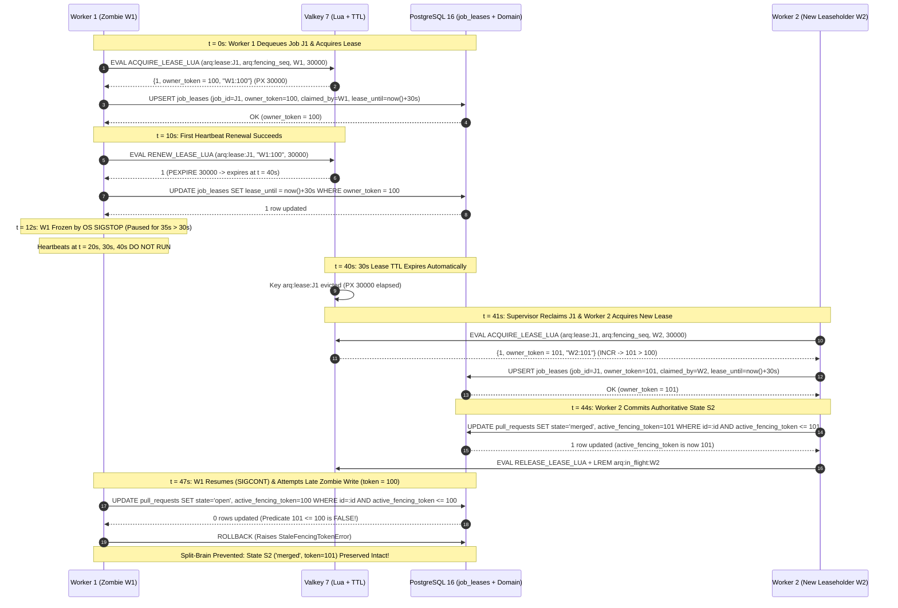
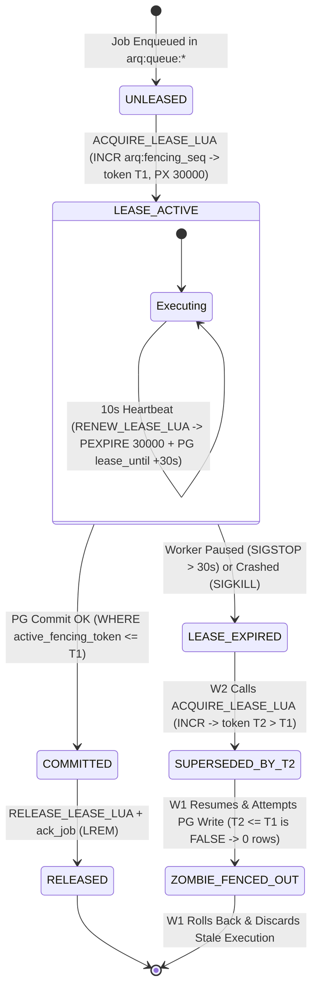

# Monotonic `owner_token` Sequence, 30-Second Lease Contract & PostgreSQL Optimistic Fencing Specification

**Parent User Story:** `US-22` (Worker Lease Management & Split-Brain Prevention)  
**Task:** `SCRUM-409` (`Task 22.1` Design monotonic `owner_token` sequence, 30s lease contract and PostgreSQL optimistic fencing assertion)  
**Category:** Design  
**Assignee:** Vadim Karban  
**Estimate:** 0.75 Story Points (1h 30m Original Estimate)  
**Status:** Approved / Design Baseline Established  
**Architecture Reference:** AI-Augmented Engineering Intelligence Platform Blueprint v3.0, §2.2, §6.4, §15.2, §15.3  
**Target Infrastructure Engines:** Valkey 7 (`valkey/valkey:7-alpine`) / Redis 7+ & PostgreSQL 16 (`pgvector/pgvector:pg16`)  
**Target Implementation Modules:** [`backend/workers/worker.py`](../backend/workers/worker.py), [`backend/app/db/models/models.py`](../backend/app/db/models/models.py)  
**Dependencies:**
- **Is Blocked By:**
  - `SCRUM-238` (`US-2` `job_leases` table — [`JobLease`](../backend/app/db/models/models.py#L406-L421) in [`02ec69277327_initial_core_schema.py`](../backend/migrations/versions/02ec69277327_initial_core_schema.py#L64-L74))
  - `SCRUM-404` (`Task 21.1` [Valkey / Redis 7 Reliable FIFO Queue Topology & High-Priority Preemption Specification](./fifo-queue-topology.md))
- **Blocks / Enables:**
  - `Task 22.2` (Implement Redis Lua lease acquisition, 10-second heartbeat renewal, and 30-second expiration reclamation)
  - `Task 22.3` (Implement PostgreSQL optimistic fencing assertion `WHERE active_fencing_token <= :worker_claimed_token` and `job_leases` synchronization)
  - `Task 22.4` (Create test scenarios for paused zombie worker `SIGSTOP > 30s`, heartbeat renewal, and split-brain write rejection)
  - `Task 22.5` (Write automated `pytest` tests verifying monotonic fencing tokens, lease expiration reclamation, and zombie worker write rejection)

---

## 1. Executive Summary & Problem Statement

In distributed asynchronous worker architectures (such as M.A.N.T.A.'s Valkey/ARQ webhook ingestion, DORA metric computation, and AI analysis pipelines), **time-bounded leases alone cannot prevent split-brain data corruption**.

### 1.1 The Zombie Worker Hazard (`SIGSTOP > 30s`)

Consider a standard distributed queue with a 30-second visibility timeout or TTL lease, **without** monotonic fencing tokens:
1. **Lease Acquisition ($t = 0\text{s}$):** Worker 1 ($W_1$) pops job $J_1$ (e.g., a GitHub `pull_request.closed` webhook or Jira issue transition) and acquires a 30-second lease.
2. **Process Pause ($t = 5\text{s}$):** $W_1$ prepares its SQL `UPDATE` statement in memory, but just before sending the packet to PostgreSQL, the process is frozen for $35\text{s}$ due to:
   - An OS-level `SIGSTOP` signal or hypervisor VM live-migration pause,
   - A stop-the-world garbage collection (GC) or swap thrashing stall,
   - An asymmetric network delay or TCP socket stall.
3. **Lease Expiration & Reclamation ($t = 30\text{s} \rightarrow 31\text{s}$):** Because $W_1$'s background heartbeat loop is also frozen inside the paused process, the 30-second lease expires at $t = 30\text{s}$. At $t = 31\text{s}$, the recovery supervisor re-queues $J_1$, and Worker 2 ($W_2$) claims $J_1$ under a fresh lease.
4. **Legitimate Commit ($t = 35\text{s}$):** $W_2$ completes execution (and potentially processes a subsequent event on the same entity) and commits the authoritative state $S_2$ to PostgreSQL.
5. **Zombie Awakening & Split-Brain Corruption ($t = 40\text{s}$):** $W_1$ receives `SIGCONT` (resumes execution). Unaware that wall-clock time advanced by $35\text{s}$ and its lease expired, $W_1$ flushes its pre-constructed SQL `UPDATE` over its still-open PostgreSQL connection, **silently overwriting $W_2$'s newer state $S_2$ with stale state $S_1$**.

### 1.2 Architectural Solution: Kleppmann Monotonic Fencing + Optimistic SQL Assertions

To eliminate this failure mode mathematically, M.A.N.T.A. combines three interlocking mechanisms:
1. **Monotonic Redis Fencing Sequence (`arq:fencing_seq`):** Every lease acquisition atomically increments a global 64-bit integer counter (`INCR arq:fencing_seq`) inside a Redis Lua script, issuing a strictly increasing `owner_token` ($\tau_1 < \tau_2 < \dots < \tau_k$).
2. **30-Second Lease with 10-Second Heartbeat Renewal (`arq:lease:{job_id}` & `job_leases`):** Active workers renew their lease every $10\text{s}$ (`PEXPIRE 30000` in Valkey and `lease_until = now() + interval '30 seconds'` in PostgreSQL `job_leases`). Any worker paused for $> 30\text{s}$ loses its lease cleanly.
3. **PostgreSQL Optimistic Fencing Assertion (`WHERE active_fencing_token <= :worker_claimed_token`):** The storage engine itself acts as the final arbiter. Every state-mutating SQL statement on domain tables and `job_leases` asserts that the target row's `active_fencing_token` is less than or equal to the worker's `:worker_claimed_token`, while simultaneously advancing the stored token to `:worker_claimed_token`.

---

## 2. Data Structures & State Storage Architecture

```
 ┌───────────────────────────────────────────────────────────────────────────────────┐
 │                     SPLIT-BRAIN FENCING & LEASE TOPOLOGY                          │
 │                                                                                   │
 │   ┌───────────────────────────────────┐   ┌───────────────────────────────────┐   │
 │   │       VALKEY 7 / REDIS 7          │   │          POSTGRESQL 16            │   │
 │   │  (Fast Coordination & Sequence)   │   │  (Durable Authority & Enforcement)│   │
 │   ├───────────────────────────────────┤   ├───────────────────────────────────┤   │
 │   │ 1. arq:fencing_seq                │   │ 1. Table: job_leases              │   │
 │   │    Type:   String (64-bit Int)    │   │    PK:    job_id VARCHAR(255)     │   │
 │   │    Op:     INCR (monotonic +1)    │   │    Col:   tenant_id UUID (RLS)    │   │
 │   │    Policy: AOF + noeviction       │   │    Col:   owner_token BIGINT      │   │
 │   │                                   │   │    Col:   claimed_by VARCHAR(128) │   │
 │   │ 2. arq:lease:{job_id}             │   │    Col:   lease_until TIMESTAMPTZ │   │
 │   │    Type:   String                 │   │    Col:   created_at TIMESTAMPTZ  │   │
 │   │    Value:  "{worker_id}:{token}"  │   │                                   │   │
 │   │    TTL:    PX 30000 (30 seconds)  │   │ 2. Domain Tables                  │   │
 │   │    Renew:  PEXPIRE 30000 @ 10s    │   │    Predicate:                     │   │
 │   │                                   │   │    WHERE active_fencing_token     │   │
 │   │ 3. arq:in_flight:{worker_id}      │   │          <= :worker_claimed_token │   │
 │   │    Type:   List (from Task 21.1)  │   │                                   │   │
 │   └───────────────────────────────────┘   └───────────────────────────────────┘   │
 └───────────────────────────────────────────────────────────────────────────────────┘
```

### 2.1 Valkey / Redis 7 Fencing & Lease Keys

| Key Pattern | Redis Type | Value Format | TTL / Persistence | Mutating Operations |
|---|---|---|---|---|
| `arq:fencing_seq` | `String` (64-bit signed integer) | Decimal integer string (e.g. `"1042"`) | Persistent (`noeviction`, AOF `everysec`); **never expires** | Mutated exclusively via `redis.call('INCR', 'arq:fencing_seq')` inside `ACQUIRE_LEASE_LUA` (or `SET` higher floor on recovery bootstrap) |
| `arq:lease:{job_id}` | `String` | `"{worker_id}:{owner_token}"` (e.g. `"manta-worker-0:1042"`) | `PX 30000` ($30,000\text{ ms} = 30\text{s}$) | Created via `ACQUIRE_LEASE_LUA`; extended every $10\text{s}$ via `RENEW_LEASE_LUA` (`PEXPIRE 30000`); removed on completion via `RELEASE_LEASE_LUA` (`DEL`) |

> [!IMPORTANT]
> **64-Bit Monotonic Sequence Capacity & Cold-Start Bootstrap Guard:**
> - Redis `INCR` operates on signed 64-bit integers ($\text{max} = 2^{63} - 1 \approx 9.22 \times 10^{18}$). Even at $100,000$ lease acquisitions per second, `arq:fencing_seq` will not overflow for $> 2.9 \times 10^6$ years.
> - **Valkey Cold-Start / AOF Recovery Floor:** On worker startup (`on_startup`), before processing jobs, the worker queries PostgreSQL `SELECT COALESCE(MAX(owner_token), 0) FROM job_leases` (via an administrative or tenant-scoped bootstrap check) and ensures `arq:fencing_seq` is at least that floor using a conditional Lua check (`if tonumber(redis.call('GET', KEYS[1]) or '0') < floor then redis.call('SET', KEYS[1], floor) end`). This guarantees strict monotonicity even if Valkey suffers a total volume loss and restarts from an empty state.

### 2.2 PostgreSQL `job_leases` Table Contract

Defined in [`backend/app/db/models/models.py`](../backend/app/db/models/models.py#L406-L421) (`JobLease`) and [`02ec69277327_initial_core_schema.py`](../backend/migrations/versions/02ec69277327_initial_core_schema.py#L64-L74):

| Column | PostgreSQL Type | Constraints | Architectural Role |
|---|---|---|---|
| `job_id` | `VARCHAR(255)` | `PRIMARY KEY`, `NOT NULL` | Unique identifier of the job (matches `MantaJobEnvelope.job_id` from [Task 21.1](./fifo-queue-topology.md#3-canonical-job-payload-schema-serialized-envelope)) |
| `tenant_id` | `UUID` | `FOREIGN KEY (tenants.id) ON DELETE CASCADE`, `NOT NULL`, indexed via `idx_job_leases_tenant_id` | Enforces multi-tenant isolation under `FORCE ROW LEVEL SECURITY` (`tenant_isolation_policy`) |
| `owner_token` | `BIGINT` | `NOT NULL`, default `1` | Monotonic fencing token issued by `INCR arq:fencing_seq` upon lease acquisition |
| `claimed_by` | `VARCHAR(128)` | `NOT NULL` | Canonical `{worker_id}` of the current leaseholder (`<hostname>-<pid>-<uuid_hex[:8]>`) |
| `lease_until` | `TIMESTAMPTZ` | `NOT NULL` | Authoritative database expiration timestamp (`now() + interval '30 seconds'`) |
| `created_at` | `TIMESTAMPTZ` | `NOT NULL`, default `now()` | Initial lease creation timestamp for auditability |

---

## 3. Redis Lua Lease Acquisition Contract (30-Second Lease)

When a worker pops a job from `arq:queue:high` or `arq:queue:default` into `arq:in_flight:{worker_id}` (per [Task 21.1 §5.2](./fifo-queue-topology.md#52-the-two-phase-polling-protocol)), it MUST immediately acquire a 30-second lease and monotonic `owner_token` before executing any business logic.

### 3.1 Atomic Redis Lua Acquisition Script (`ACQUIRE_LEASE_LUA`)

Checking whether an active lease exists, incrementing `arq:fencing_seq`, and setting `arq:lease:{job_id}` with a 30-second TTL MUST execute as a single, indivisible server-side operation in Valkey/Redis:

```lua
-- Script Name: ACQUIRE_LEASE_LUA
-- KEYS[1]: arq:lease:{job_id}
-- KEYS[2]: arq:fencing_seq
-- ARGV[1]: worker_id (e.g., "manta-worker-node1-4192-a1b2c3d4")
-- ARGV[2]: lease_ttl_ms (30000 for 30-second lease)
-- ARGV[3]: min_token_floor (optional PostgreSQL known floor, default "0")

local existing_lease = redis.call('GET', KEYS[1])
if existing_lease ~= false then
    -- Lease is currently active and has not expired.
    -- Parse existing owner_token after the last ':' delimiter for diagnostics.
    local sep = string.find(existing_lease, ':[^:]*$')
    local current_token = 0
    if sep ~= nil then
        current_token = tonumber(string.sub(existing_lease, sep + 1)) or 0
    end
    return {0, current_token, existing_lease}
end

-- Ensure arq:fencing_seq respects any known PostgreSQL floor before incrementing
local floor_val = tonumber(ARGV[3]) or 0
if floor_val > 0 then
    local current_seq = tonumber(redis.call('GET', KEYS[2]) or '0')
    if current_seq < floor_val then
        redis.call('SET', KEYS[2], tostring(floor_val))
    end
end

-- Atomically increment global monotonic sequence
local owner_token = redis.call('INCR', KEYS[2])

-- Construct composite lease value "{worker_id}:{owner_token}" and set 30s TTL
local lease_value = ARGV[1] .. ':' .. tostring(owner_token)
local ttl_ms = tonumber(ARGV[2]) or 30000
redis.call('SET', KEYS[1], lease_value, 'PX', ttl_ms)

return {1, owner_token, lease_value}
```

#### Return Contract of `ACQUIRE_LEASE_LUA`:
- **Success (`{1, owner_token, lease_value}`):**
  - Element `[1] == 1`: Lease acquired by caller `ARGV[1]`.
  - Element `[2] == owner_token` (`int`): Newly issued monotonic fencing token $\tau$, strictly greater than all previously issued tokens.
  - Element `[3] == "{worker_id}:{owner_token}"`: Composite lease identifier stored under `arq:lease:{job_id}` for `30000` ms.
- **Contention / Rejection (`{0, current_token, existing_lease}`):**
  - Element `[1] == 0`: Another worker currently holds an unexpired lease on `{job_id}`.
  - `arq:fencing_seq` is **not** incremented on rejected attempts, avoiding unnecessary sequence churn.
  - The caller aborts execution of `{job_id}` and removes its duplicate in-flight entry (`LREM`).

### 3.2 Companion PostgreSQL `job_leases` Acquisition Upsert

Immediately after `ACQUIRE_LEASE_LUA` returns `{1, owner_token, lease_value}`, the worker persists the lease into PostgreSQL `job_leases` within the tenant's RLS context (`SET LOCAL app.current_tenant_id = :tenant_id`):

```sql
INSERT INTO job_leases (
    job_id,
    tenant_id,
    owner_token,
    claimed_by,
    lease_until,
    created_at
) VALUES (
    :job_id,
    :tenant_id,
    :worker_claimed_token,
    :worker_id,
    now() + INTERVAL '30 seconds',
    now()
)
ON CONFLICT (job_id) DO UPDATE
SET owner_token = EXCLUDED.owner_token,
    claimed_by  = EXCLUDED.claimed_by,
    lease_until = now() + INTERVAL '30 seconds'
WHERE job_leases.owner_token < EXCLUDED.owner_token
  AND (
      job_leases.lease_until <= now()
      OR job_leases.claimed_by = EXCLUDED.claimed_by
  )
RETURNING job_id, owner_token, claimed_by, lease_until;
```

> [!NOTE]
> **Why Both Valkey and PostgreSQL Track the Lease:**
> - **Valkey (`arq:lease:{job_id}`, `PX 30000`)** provides sub-millisecond atomic coordination, automatic TTL key eviction after $30,000\text{ ms}$, and global monotonic sequence generation (`INCR arq:fencing_seq`).
> - **PostgreSQL (`job_leases`)** provides durable, transactional relational enforcement scoped by Row-Level Security (`tenant_isolation_policy`), allowing SQL statements to verify lease ownership and fencing tokens using PostgreSQL's own transaction clock (`now()`), completely immune to clock skew between worker hosts.

---

## 4. 10-Second Heartbeat Renewal Contract (`PEXPIRE` & `lease_until` Extension)

### 4.1 Timing Parameters & Safety Ratio

| Parameter | Symbol | Canonical Value | Rationale |
|---|---|---|---|
| **Lease Duration (TTL)** | $T_{\text{lease}}$ | $30\text{ seconds}$ (`30000 ms`) | Upper bound on failover recovery delay when a worker stalls (`SIGSTOP`) or crashes (`SIGKILL`) |
| **Heartbeat Interval** | $T_{\text{heartbeat}}$ | $10\text{ seconds}$ (`10000 ms`) | $\frac{1}{3} T_{\text{lease}}$ — gives a healthy worker **2 full retry opportunities** ($t = 10\text{s}, 20\text{s}$) before expiration at $t = 30\text{s}$ |
| **Renewal Quantum** | $\Delta T_{\text{extend}}$ | $+30\text{ seconds}$ (`PEXPIRE 30000`) | Slides the expiration window forward to $t_{\text{now}} + 30\text{s}$ on each successful heartbeat |

### 4.2 Atomic Redis Lua Heartbeat Renewal Script (`RENEW_LEASE_LUA`)

A worker MUST NEVER blindly run `PEXPIRE arq:lease:{job_id} 30000`, because if its lease already expired and was acquired by $W_2$, an unconditional `PEXPIRE` would inadvertently extend $W_2$'s lease while misleading $W_1$ into believing it still owns the job. Instead, renewal uses an atomic compare-and-extend Lua script:

```lua
-- Script Name: RENEW_LEASE_LUA
-- KEYS[1]: arq:lease:{job_id}
-- ARGV[1]: expected_lease_value ("{worker_id}:{owner_token}")
-- ARGV[2]: lease_ttl_ms (30000)

local current_val = redis.call('GET', KEYS[1])
if current_val == false then
    -- Lease already expired (30s TTL elapsed)
    return 0
end

if current_val ~= ARGV[1] then
    -- Lease was reclaimed by a newer leaseholder with a higher owner_token
    return -1
end

-- Ownership and exact fencing token verified; extend TTL by 30,000 ms
redis.call('PEXPIRE', KEYS[1], tonumber(ARGV[2]) or 30000)
return 1
```

#### Return Contract of `RENEW_LEASE_LUA`:
- **`1` (Renewed):** Caller is verified as the active owner with matching `owner_token`; Redis TTL is reset to `30000` ms.
- **`0` (Expired):** Key `arq:lease:{job_id}` no longer exists (30s TTL elapsed).
- **`-1` (Superseded / Preempted):** Key `arq:lease:{job_id}` exists but holds a different `{worker_id}:{owner_token}`.

### 4.3 PostgreSQL `lease_until` Extension Statement

Immediately following `RENEW_LEASE_LUA == 1`, the heartbeat task extends `job_leases.lease_until` in PostgreSQL:

```sql
UPDATE job_leases
SET lease_until = now() + INTERVAL '30 seconds'
WHERE job_id = :job_id
  AND tenant_id = :tenant_id
  AND claimed_by = :worker_id
  AND owner_token = :worker_claimed_token
  AND lease_until > now()
RETURNING job_id, owner_token, lease_until;
```

### 4.4 Cooperative Self-Fencing on Heartbeat Failure

If `RENEW_LEASE_LUA` returns `<= 0` **OR** the PostgreSQL `UPDATE job_leases` affects `0` rows:
1. The heartbeat task logs a structured `WARNING` (`event="lease_lost_self_fencing"`, `job_id`, `worker_id`, `owner_token`).
2. The heartbeat task immediately calls `execution_task.cancel()` on the worker's in-flight `asyncio.Task` to abort ongoing processing cooperatively.
3. Even if the worker process cannot process the cancellation signal (because the entire OS process is frozen by `SIGSTOP`), the database-level optimistic fencing assertion (§6) guarantees that any subsequent write when the process wakes up will be rejected.

---

## 5. 30-Second Expiration Reclamation & Normal Lease Release

### 5.1 30-Second Lease Expiration Reclamation Protocol

When a worker $W_1$ holding `(job_id, token = T_1)` experiences `SIGSTOP > 30s`, `SIGKILL`, or host failure:
1. **At $t = t_{\text{last\_heartbeat}} + 30.000\text{s}$:**
   - Valkey automatically evicts `arq:lease:{job_id}` via its millisecond `PX 30000` timer.
   - In PostgreSQL, `job_leases.lease_until <= now()` becomes `TRUE`.
2. **In-Flight Reclamation:**
   - The recovery supervisor (or worker startup sweep from [Task 21.1 §8.2](./fifo-queue-topology.md#82-recovery-handshake-task-213-interface)) detects that `arq:lease:{job_id}` has expired (or `arq:worker:{w1}:heartbeat` has expired) while the job payload remains in `arq:in_flight:{w1}`.
   - The stranded job is atomically returned to the head of its priority queue:
     ```redis
     LMOVE arq:in_flight:{w1} arq:queue:{priority} RIGHT LEFT
     ```
3. **New Lease Acquisition by $W_2$:**
   - Worker $W_2$ pops the job from `arq:queue:{priority}` into `arq:in_flight:{w2}`.
   - $W_2$ executes `ACQUIRE_LEASE_LUA`, which increments `arq:fencing_seq` to issue $T_2 \ge T_1 + 1$ ($T_2 > T_1$) and sets `arq:lease:{job_id} = "{w2}:{T_2}"` with `PX 30000`.
   - $W_2$ executes the PostgreSQL `job_leases` upsert (§3.2). Because `job_leases.owner_token < T_2` ($T_1 < T_2$) and `job_leases.lease_until <= now()`, the row in `job_leases` is atomically updated to `(owner_token = T_2, claimed_by = w2, lease_until = now() + 30s)`.

### 5.2 Normal Lease Release Contract (`RELEASE_LEASE_LUA`)

When a worker completes a job and its PostgreSQL transaction has **committed**, it releases its Redis lease using an ownership-verified Lua script before acknowledging (`LREM`) the in-flight queue item:

```lua
-- Script Name: RELEASE_LEASE_LUA
-- KEYS[1]: arq:lease:{job_id}
-- ARGV[1]: expected_lease_value ("{worker_id}:{owner_token}")

if redis.call('GET', KEYS[1]) == ARGV[1] then
    return redis.call('DEL', KEYS[1])
end
return 0
```

---

## 6. PostgreSQL Optimistic Fencing Assertion on Domain Tables

Redis lease checks and heartbeats are advisory across network boundaries; **PostgreSQL is the ultimate consistency boundary**. Every worker mutation to domain state MUST include an optimistic fencing predicate verified atomically by PostgreSQL during tuple modification.

### 6.1 Canonical SQL Optimistic Fencing Predicate

All worker-driven `UPDATE` statements on fenced domain tables MUST enforce the predicate:

```sql
WHERE active_fencing_token <= :worker_claimed_token
```

And in the `SET` clause, advance the stored token to `:worker_claimed_token`:

```sql
UPDATE <domain_table>
SET <domain_column_1> = :val_1,
    <domain_column_2> = :val_2,
    active_fencing_token = :worker_claimed_token,
    updated_at = now()
WHERE id = :entity_id
  AND tenant_id = :tenant_id
  AND active_fencing_token <= :worker_claimed_token
RETURNING id, active_fencing_token;
```

#### Why `<=` (Less Than or Equal To) Instead of `<`?
- **Multi-Step Mutations Within the Same Lease (`==`):** A single job execution holding `:worker_claimed_token` ($\tau$) may perform multiple sequential updates or idempotent retries on the same entity within the same lease lifetime. Using `<=` allows the current leaseholder ($\tau = \text{active\_fencing\_token}$) to update the entity repeatedly, while **strictly rejecting** any stale zombie worker holding $\tau_{\text{zombie}} < \text{active\_fencing\_token}$.
- **Monotonic Advancement (`<`):** When a newer worker holding $\tau_{\text{new}} > \text{active\_fencing\_token}$ updates the row, $\text{active\_fencing\_token} \le \tau_{\text{new}}$ evaluates to `TRUE`, and `SET active_fencing_token = :worker_claimed_token` ratchets the high-water mark up to $\tau_{\text{new}}$. Once ratcheted to $\tau_{\text{new}}$, no token $\tau_{\text{old}} < \tau_{\text{new}}$ can ever satisfy `active_fencing_token <= :worker_claimed_token` again.

### 6.2 Upsert (`INSERT ... ON CONFLICT DO UPDATE`) Fencing Contract

When a worker ingests an external entity (such as a GitHub Pull Request or Jira Issue) that may be either newly created or updated:

```sql
INSERT INTO <domain_table> (
    id,
    tenant_id,
    ...,
    active_fencing_token,
    created_at,
    updated_at
) VALUES (
    :id,
    :tenant_id,
    ...,
    :worker_claimed_token,
    now(),
    now()
)
ON CONFLICT (<natural_unique_constraint>) DO UPDATE
SET <domain_columns> = EXCLUDED.<domain_columns>,
    active_fencing_token = EXCLUDED.active_fencing_token,
    updated_at = now()
WHERE <domain_table>.active_fencing_token <= :worker_claimed_token
RETURNING id, active_fencing_token;
```

If an existing row already has `active_fencing_token > :worker_claimed_token`, the `ON CONFLICT DO UPDATE ... WHERE` clause evaluates to `FALSE`, PostgreSQL performs a no-op (`0` rows returned), and the newer state is preserved untouched.

### 6.3 Schema Mapping & Dual-Layer Enforcement Across M.A.N.T.A. Tables

To ensure zero ambiguity for downstream implementation (`Task 22.3`), fencing assertions apply at two levels in the M.A.N.T.A. PostgreSQL schema:

#### Layer 1: Lease Authority Table (`job_leases`)
In [`JobLease`](../backend/app/db/models/models.py#L406-L421), the column `owner_token BIGINT NOT NULL` stores the active fencing token for each `job_id`. Every worker commit transaction verifies and ratchets `job_leases`:

```sql
UPDATE job_leases
SET owner_token = :worker_claimed_token
WHERE job_id = :job_id
  AND tenant_id = :tenant_id
  AND claimed_by = :worker_id
  AND owner_token <= :worker_claimed_token
  AND lease_until > now()
RETURNING job_id, owner_token;
```

#### Layer 2: Domain Entity Tables (`pull_requests`, `issues`, `webhook_events`, etc.)
In [`backend/app/db/models/models.py`](../backend/app/db/models/models.py):
- [`PullRequest`](../backend/app/db/models/models.py#L488-L534) (line 525) and [`Issue`](../backend/app/db/models/models.py#L600-L642) (line 635) already define monotonic `BIGINT` version columns (`entity_version: Mapped[int] = mapped_column(BigInteger, default=1, nullable=False)`).
- Downstream `Task 22.3` enforces `WHERE active_fencing_token <= :worker_claimed_token` on domain tables via:
  1. **Direct Domain Column Assertion:** Adding/mapping `active_fencing_token BIGINT NOT NULL DEFAULT 0` on mutable worker target tables (`pull_requests`, `issues`, `webhook_events`, `deployments`) via an Alembic revision (or aliasing `active_fencing_token` in SQL queries/views alongside `entity_version`), executing:
     ```sql
     UPDATE pull_requests
     SET state = :state,
         merged_at = :merged_at,
         active_fencing_token = :worker_claimed_token,
         entity_version = :worker_claimed_token,
         updated_at = now()
     WHERE id = :pr_id
       AND tenant_id = :tenant_id
       AND active_fencing_token <= :worker_claimed_token
     RETURNING id, active_fencing_token;
     ```
  2. **Atomic CTE Lease + Domain Mutation Pattern:** Combining the `job_leases` fencing guard and the domain table `WHERE active_fencing_token <= :worker_claimed_token` predicate into a single atomic SQL statement:
     ```sql
     WITH lease_guard AS (
         SELECT job_id, owner_token AS active_fencing_token
         FROM job_leases
         WHERE job_id = :job_id
           AND tenant_id = :tenant_id
           AND claimed_by = :worker_id
           AND owner_token <= :worker_claimed_token
           AND lease_until > now()
         FOR UPDATE
     )
     UPDATE pull_requests AS pr
     SET state = :state,
         active_fencing_token = :worker_claimed_token,
         updated_at = now()
     FROM lease_guard
     WHERE pr.id = :pr_id
       AND pr.tenant_id = :tenant_id
       AND pr.active_fencing_token <= :worker_claimed_token
       AND lease_guard.active_fencing_token <= :worker_claimed_token
     RETURNING pr.id, pr.active_fencing_token;
     ```

### 6.4 Stale Write Detection & Rollback Protocol (`StaleFencingTokenError`)

When a fenced `UPDATE` or `INSERT ... ON CONFLICT DO UPDATE` returns `None` (`rowcount == 0` when the target entity exists):
1. **Detection:** The worker identifies that `active_fencing_token > :worker_claimed_token` (or its lease in `job_leases` was superseded).
2. **Immediate Rollback:** The worker executes `await db.rollback()` to discard all uncommitted mutations in the current PostgreSQL transaction.
3. **Exception Raising:** Raises `StaleFencingTokenError(job_id=job_id, worker_id=worker_id, claimed_token=worker_claimed_token)`.
4. **In-Flight Cleanup Without Corrupting Active Lease:**
   - The zombie worker **MUST NOT** delete `arq:lease:{job_id}` (or if it calls `RELEASE_LEASE_LUA`, the script safely returns `0` because `ARGV[1]` does not match $W_2$'s token).
   - The zombie worker removes only its own stale entry from `arq:in_flight:{zombie_worker_id}` (`LREM arq:in_flight:{w1} 1 <raw_payload>`) and halts processing of that job.

---

## 7. Formal Mathematical Proof of Split-Brain Prevention

### 7.1 System Model & Axioms

Let:
- $\mathcal{S}_{\text{redis}}$ be the single-threaded atomic command execution sequence in Valkey/Redis.
- $\mathcal{S}_{\text{pg}}$ be the serializable/row-locked execution order of `UPDATE` operations on a domain entity $E$ in PostgreSQL.
- $\tau(W_i) \in \mathbb{N}^+$ be the `:worker_claimed_token` (`owner_token`) assigned to worker $W_i$ by `INCR arq:fencing_seq` inside `ACQUIRE_LEASE_LUA` at acquisition time $t_{\text{acq}}(W_i)$.
- $F(E, t) \in \mathbb{N}_0$ be the value of `active_fencing_token` stored on entity $E$ in PostgreSQL at time $t$, initialized to $F(E, 0) = 0$.

**Axiom 1 (Strict Monotonicity of `arq:fencing_seq`):**  
Because `ACQUIRE_LEASE_LUA` executes atomically on Valkey's single-threaded event loop and increments `arq:fencing_seq` via `INCR` only when `GET arq:lease:{job_id}` is `false` (unheld or expired after $30,000\text{ ms}$):
$$\forall W_1, W_2: \quad t_{\text{acq}}(W_1) < t_{\text{acq}}(W_2) \implies \tau(W_1) < \tau(W_2)$$

**Axiom 2 (Monotonic Non-Decreasing State of `active_fencing_token` in PostgreSQL):**  
Every domain mutation by any worker $W_i$ has the form:
$$\text{SET } F(E, t^+) = \tau(W_i) \quad \text{WHERE } F(E, t^-) \le \tau(W_i)$$
Therefore, for every successful transition at time $t$:
$$F(E, t^+) = \tau(W_i) \ge F(E, t^-)$$
By induction over all committed transactions $t_1 < t_2 < \dots < t_n$:
$$t_a < t_b \implies F(E, t_a) \le F(E, t_b)$$

### 7.2 Theorem (Immunity Against Zombie Worker `SIGSTOP > 30s`)

> **Theorem:**  
> *Let Worker $W_1$ acquire a lease for job $J$ at time $t_0$ with token $\tau(W_1) = \tau_1$, and let $W_1$ be paused via `SIGSTOP` for duration $\Delta t_{\text{pause}} > 30\text{s}$. If Worker $W_2$ reclaims job $J$ after lease expiration and commits state $S_2$ to entity $E$ at time $t_c$, then any subsequent write attempt by $W_1$ upon resuming (`SIGCONT`) at time $t_z > t_c$ is guaranteed to be rejected with zero rows modified.*

**Proof:**
1. At $t_0$, $W_1$ executes `ACQUIRE_LEASE_LUA`, receiving $\tau(W_1) = \tau_1$ and setting `arq:lease:{job_id}` with TTL $T_{\text{lease}} = 30\text{s}$.
2. Suppose $W_1$ enters `SIGSTOP` at $t_p \ge t_0$ for duration $\Delta t_{\text{pause}} > 30\text{s}$. While paused in kernel space (`TASK_STOPPED`), $W_1$ cannot execute user-space instructions and therefore cannot execute `RENEW_LEASE_LUA` ($10\text{s}$ heartbeat).
3. At $t_{\text{exp}} \le t_p + 30\text{s} < t_p + \Delta t_{\text{pause}}$, `arq:lease:{job_id}` expires in Valkey and `job_leases.lease_until <= now()` holds in PostgreSQL.
4. At $t_{\text{acq}}(W_2) > t_{\text{exp}} > t_0$, Worker $W_2$ reclaims job $J$ and executes `ACQUIRE_LEASE_LUA`. By **Axiom 1**, since $t_{\text{acq}}(W_1) < t_{\text{acq}}(W_2)$:
   $$\tau(W_2) = \tau_2 \ge \tau_1 + 1 > \tau_1$$
5. At $t_c$ (while $W_1$ is still paused or before $W_1$ commits), $W_2$ commits state $S_2$ to entity $E$ in PostgreSQL. Upon commit of $W_2$'s transaction:
   $$F(E, t_c) = \tau_2$$
6. At $t_z > t_c$, $W_1$ resumes (`SIGCONT`) and sends its delayed SQL `UPDATE` to PostgreSQL with `:worker_claimed_token` $= \tau_1$.
7. By **Axiom 2**, at time $t_z > t_c$, the stored token on entity $E$ satisfies:
   $$F(E, t_z) \ge F(E, t_c) = \tau_2 > \tau_1$$
8. PostgreSQL acquires the row-level `FOR NO KEY UPDATE` lock on $E$ and evaluates the `WHERE` predicate:
   $$F(E, t_z) \le \tau_1 \iff \tau_2 \le \tau_1 \implies \mathbf{FALSE}$$
9. Because the predicate evaluates to $\mathbf{FALSE}$, PostgreSQL modifies $0$ rows (`rowcount = 0`). State $S_2$ written by $W_2$ remains completely intact. $\blacksquare$

> [!NOTE]
> **Sub-Case: What if $W_1$ wakes up and hits PostgreSQL *after* $W_2$ acquired $\tau_2$ in `job_leases`, but *before* $W_2$ commits its update to domain entity $E$?**
> - Because $W_2$'s acquisition already updated `job_leases.owner_token` to $\tau_2 > \tau_1$ (§3.2), the `job_leases` guard (§6.3 Layer 1 / CTE `lease_guard`) checks `job_leases.owner_token <= :worker_claimed_token` ($\tau_2 \le \tau_1 \implies \mathbf{FALSE}$).
> - Thus, even before $W_2$ finishes computing its domain update, $W_1$ is immediately fenced out by `job_leases.owner_token`!

---

## 8. Complete Lifecycle Sequence & State Diagrams

### 8.1 Zombie Worker (`SIGSTOP > 30s`) Split-Brain Prevention Timeline



### 8.2 Worker Lease State Machine



---

## 9. Downstream Implementation & QA Contracts (`Tasks 22.2–22.5`)

### 9.1 Python Reference Implementation Contract (`Task 22.2` & `Task 22.3`)

Downstream tickets `Task 22.2` and `Task 22.3` MUST implement the following primitives in `backend/workers/`:

```python
"""
Reference specification for Worker Lease & Optimistic Fencing Primitives (Tasks 22.2 & 22.3).
"""

from __future__ import annotations

import asyncio
from dataclasses import dataclass
import logging
from typing import Any
import uuid

from sqlalchemy import text
from sqlalchemy.ext.asyncio import AsyncSession

logger = logging.getLogger("workers.fencing")

FENCING_SEQ_KEY = "arq:fencing_seq"
LEASE_KEY_PREFIX = "arq:lease:"
LEASE_TTL_MS = 30_000  # 30-second lease duration
HEARTBEAT_INTERVAL_SEC = 10.0  # 10-second heartbeat renewal interval

ACQUIRE_LEASE_LUA = """
local existing_lease = redis.call('GET', KEYS[1])
if existing_lease ~= false then
    local sep = string.find(existing_lease, ':[^:]*$')
    local current_token = 0
    if sep ~= nil then
        current_token = tonumber(string.sub(existing_lease, sep + 1)) or 0
    end
    return {0, current_token, existing_lease}
end

local floor_val = tonumber(ARGV[3]) or 0
if floor_val > 0 then
    local current_seq = tonumber(redis.call('GET', KEYS[2]) or '0')
    if current_seq < floor_val then
        redis.call('SET', KEYS[2], tostring(floor_val))
    end
end

local owner_token = redis.call('INCR', KEYS[2])
local lease_value = ARGV[1] .. ':' .. tostring(owner_token)
local ttl_ms = tonumber(ARGV[2]) or 30000
redis.call('SET', KEYS[1], lease_value, 'PX', ttl_ms)
return {1, owner_token, lease_value}
"""

RENEW_LEASE_LUA = """
local current_val = redis.call('GET', KEYS[1])
if current_val == false then
    return 0
end
if current_val ~= ARGV[1] then
    return -1
end
redis.call('PEXPIRE', KEYS[1], tonumber(ARGV[2]) or 30000)
return 1
"""

RELEASE_LEASE_LUA = """
if redis.call('GET', KEYS[1]) == ARGV[1] then
    return redis.call('DEL', KEYS[1])
end
return 0
"""


class StaleFencingTokenError(RuntimeError):
    """Raised when a worker's fencing token is rejected by PostgreSQL or Redis."""

    def __init__(self, job_id: str, worker_id: str, claimed_token: int) -> None:
        self.job_id = job_id
        self.worker_id = worker_id
        self.claimed_token = claimed_token
        super().__init__(
            f"Fencing check failed for job_id={job_id!r} on worker={worker_id!r} "
            f"with stale claimed_token={claimed_token}"
        )


@dataclass(frozen=True)
class LeaseHandle:
    job_id: str
    tenant_id: uuid.UUID
    worker_id: str
    owner_token: int
    lease_key: str
    lease_value: str


_UPSERT_JOB_LEASE_SQL = text(
    """
    INSERT INTO job_leases (
        job_id, tenant_id, owner_token, claimed_by, lease_until, created_at
    ) VALUES (
        :job_id, :tenant_id, :worker_claimed_token, :worker_id,
        now() + INTERVAL '30 seconds', now()
    )
    ON CONFLICT (job_id) DO UPDATE
    SET owner_token = EXCLUDED.owner_token,
        claimed_by  = EXCLUDED.claimed_by,
        lease_until = now() + INTERVAL '30 seconds'
    WHERE job_leases.owner_token < EXCLUDED.owner_token
      AND (
          job_leases.lease_until <= now()
          OR job_leases.claimed_by = EXCLUDED.claimed_by
      )
    RETURNING owner_token
    """
)

_RENEW_JOB_LEASE_SQL = text(
    """
    UPDATE job_leases
    SET lease_until = now() + INTERVAL '30 seconds'
    WHERE job_id = :job_id
      AND tenant_id = :tenant_id
      AND claimed_by = :worker_id
      AND owner_token = :worker_claimed_token
      AND lease_until > now()
    RETURNING owner_token
    """
)


async def acquire_job_lease(
    redis: Any,
    db: AsyncSession,
    job_id: str,
    tenant_id: uuid.UUID,
    worker_id: str,
    lease_ttl_ms: int = LEASE_TTL_MS,
    min_token_floor: int = 0,
) -> LeaseHandle | None:
    """
    Atomically acquires a 30s lease in Valkey via Lua and records it in PostgreSQL job_leases.
    """
    lease_key = f"{LEASE_KEY_PREFIX}{job_id}"
    res = await redis.eval(
        ACQUIRE_LEASE_LUA,
        2,
        lease_key,
        FENCING_SEQ_KEY,
        worker_id,
        str(lease_ttl_ms),
        str(min_token_floor),
    )
    acquired_flag = int(res[0])
    owner_token = int(res[1])
    raw_val = res[2].decode("utf-8") if isinstance(res[2], bytes) else str(res[2])

    if acquired_flag != 1:
        return None

    pg_res = await db.execute(
        _UPSERT_JOB_LEASE_SQL,
        {
            "job_id": job_id,
            "tenant_id": tenant_id,
            "worker_claimed_token": owner_token,
            "worker_id": worker_id,
        },
    )
    persisted_token = pg_res.scalar_one_or_none()
    if persisted_token is None:
        # Roll back Redis lease if DB rejected acquisition
        await redis.eval(RELEASE_LEASE_LUA, 1, lease_key, raw_val)
        await db.rollback()
        return None

    await db.commit()
    return LeaseHandle(
        job_id=job_id,
        tenant_id=tenant_id,
        worker_id=worker_id,
        owner_token=owner_token,
        lease_key=lease_key,
        lease_value=raw_val,
    )


async def renew_job_lease(
    redis: Any,
    db: AsyncSession,
    handle: LeaseHandle,
    lease_ttl_ms: int = LEASE_TTL_MS,
) -> bool:
    """
    Executes the 10-second heartbeat renewal in Valkey (PEXPIRE 30000) and PostgreSQL (lease_until +30s).
    """
    redis_status = int(
        await redis.eval(
            RENEW_LEASE_LUA,
            1,
            handle.lease_key,
            handle.lease_value,
            str(lease_ttl_ms),
        )
    )
    if redis_status != 1:
        return False

    pg_res = await db.execute(
        _RENEW_JOB_LEASE_SQL,
        {
            "job_id": handle.job_id,
            "tenant_id": handle.tenant_id,
            "worker_id": handle.worker_id,
            "worker_claimed_token": handle.owner_token,
        },
    )
    if pg_res.scalar_one_or_none() is None:
        await db.rollback()
        return False

    await db.commit()
    return True
```

### 9.2 Verification Scenarios Contract for `Task 22.4` & `Task 22.5`

Downstream QA and automated test tickets (`Task 22.4` and `Task 22.5`) MUST validate the following scenarios:

| Scenario ID | Scenario Name | Setup & Fault Injection | Expected Outcome |
|---|---|---|---|
| **TC-FENCE-001** | **Monotonic `owner_token` Sequence Generation** | Sequential and concurrent lease acquisitions across multiple workers (`W1..W10`) for distinct and reclaimed jobs. | `arq:fencing_seq` increments atomically via `INCR`; issued tokens form a strictly increasing sequence $\tau_1 < \tau_2 < \dots < \tau_n$ with zero duplicates. |
| **TC-FENCE-002** | **Active 30s Lease Contention Guard** | $W_1$ acquires lease on `job_id` (`PX 30000`). At $t = 5\text{s}$ (before expiration), $W_2$ attempts `ACQUIRE_LEASE_LUA` on the same `job_id`. | `ACQUIRE_LEASE_LUA` returns `{0, T_1, "W1:T1"}`; $W_1$'s lease and TTL remain intact; `arq:fencing_seq` is not incremented. |
| **TC-FENCE-003** | **10-Second Heartbeat Renewal Over Long-Running Job (65s)** | $W_1$ acquires a 30s lease and executes a 65s job while the 10s heartbeat loop runs `RENEW_LEASE_LUA` (`PEXPIRE 30000`) and updates `job_leases.lease_until`. | Lease is renewed at $t = 10, 20, 30, 40, 50, 60\text{s}$, never expires during execution, and commits cleanly at $t = 65\text{s}$ with its original `owner_token`. |
| **TC-FENCE-004** | **Paused Zombie Worker (`SIGSTOP > 30s`) Split-Brain Prevention** | 1. $W_1$ acquires lease ($\tau_1 = 100$).<br>2. Pause $W_1$ (`SIGSTOP` / frozen heartbeat $> 30\text{s}$).<br>3. Lease expires at $30\text{s}$; $W_2$ reclaims job ($\tau_2 = 101 > \tau_1$) and commits state $S_2$ (`active_fencing_token = 101`).<br>4. Resume $W_1$ (`SIGCONT`) to execute its delayed `UPDATE ... WHERE active_fencing_token <= 100`. | $W_1$'s SQL predicate `101 <= 100` evaluates to `FALSE` (`rowcount == 0`); `StaleFencingTokenError` is raised; transaction rolls back; $W_2$'s committed state $S_2$ and token `101` remain 100% intact. |
| **TC-FENCE-005** | **Valkey Cold-Start Sequence Floor Recovery** | PostgreSQL `job_leases` has `MAX(owner_token) = 500`. Valkey restarts with empty memory (`arq:fencing_seq` nil). Next worker acquires a lease passing `min_token_floor = 500`. | `ACQUIRE_LEASE_LUA` initializes `arq:fencing_seq` to `500` before `INCR`, issuing $\tau = 501 > 500$ and preserving global monotonicity. |

---

## 10. Traceability & Acceptance Criteria Verification Matrix

| Requirement / Acceptance Criterion | Source Ticket | Design Section | Verification Mechanism | Status |
|---|---|---|---|---|
| Monotonic Redis fencing sequence (`arq:fencing_seq`) | `SCRUM-409` (`Task 22.1`) | §2.1, §3.1, §7.1 | Atomic `INCR` inside `ACQUIRE_LEASE_LUA` + DB floor bootstrap guard | **SATISFIED** |
| Redis Lua 30-second lease acquisition contract (`PX 30000`) | `SCRUM-409` (`Task 22.1`) | §3.1, §3.2, §9.1 | `ACQUIRE_LEASE_LUA` (`SET ... PX 30000`) + `job_leases` upsert | **SATISFIED** |
| 10-second heartbeat renewal (`PEXPIRE` & `lease_until` extension) | `SCRUM-409` (`Task 22.1`) | §4.1, §4.2, §4.3, §4.4 | `RENEW_LEASE_LUA` (`PEXPIRE 30000`) + PG `lease_until = now() + 30s` | **SATISFIED** |
| 30-second expiration reclamation contract | `SCRUM-409` (`Task 22.1`) | §5.1, §5.2, §8.1 | Automatic `PX 30000` expiry, `RIGHT LEFT` re-queue, higher token $\tau_2 > \tau_1$ | **SATISFIED** |
| SQL predicate `WHERE active_fencing_token <= :worker_claimed_token` on domain tables | `SCRUM-409` (`Task 22.1`) | §6.1, §6.2, §6.3, §6.4 | Optimistic SQL predicate on domain tables + `job_leases.owner_token` guard | **SATISFIED** |
| Mathematically prevents paused zombie worker (`SIGSTOP > 30s`) from overwriting newer state | `SCRUM-409` (`Task 22.1` AC) | §7.1, §7.2, §8.1, §9.2 | Formal proof (§7.2) showing $\tau_2 > \tau_1 \implies (\tau_2 \le \tau_1) \equiv \text{FALSE}$ | **SATISFIED** |
| Unblocks downstream tasks `Task 22.2`, `22.3`, `22.4`, `22.5` | `SCRUM-409` (`Task 22.1`) | §9.1, §9.2 | Complete Lua scripts, SQL statements, Python interfaces, and test matrix | **SATISFIED** |
