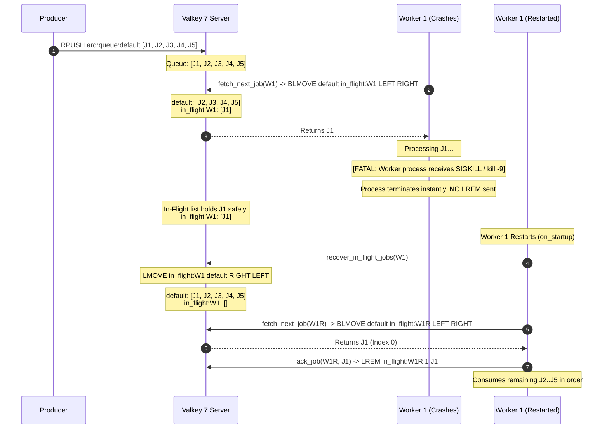
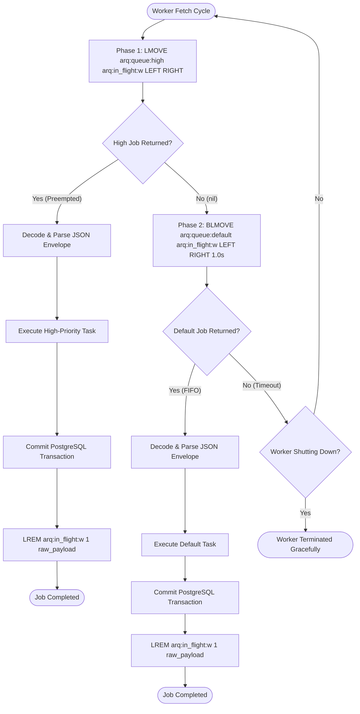
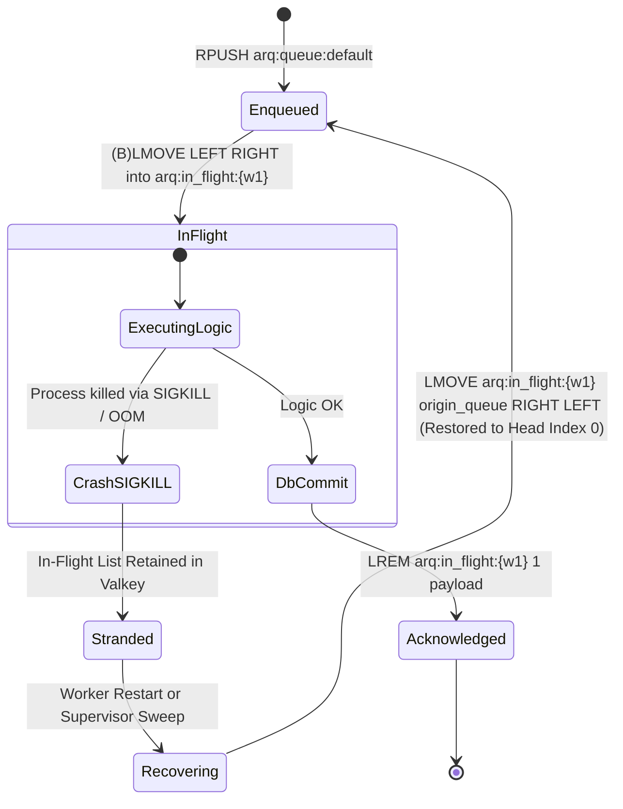

# 100-Job FIFO Ordering, High-Priority Preemption & SIGKILL Crash Recovery Test Scenarios

**Task:** Create test scenarios for 100-job FIFO ordering, high-priority preemption behind 50 default jobs, and `SIGKILL` crash (`SCRUM-407` / `Task 21.4`)  
**Parent User Story:** `SCRUM-358` (`US-21`: Reliable Job Queue & Worker Topology)  
**Related Tickets:**  
- `SCRUM-404`: Design FIFO queue topology and high-priority queue preemption rules (`Task 21.1`, see [`docs/fifo-queue-topology.md`](fifo-queue-topology.md))  
- `SCRUM-405`: Implement atomic `BLMOVE` worker fetch into per-worker `arq:in_flight:{worker_id}` lists (`Task 21.2`, [`backend/workers/worker.py`](../backend/workers/worker.py))  
- `SCRUM-406`: Implement in-flight job recovery on worker restart and tune Valkey/Redis 7 `noeviction` (`Task 21.3`, [`backend/workers/worker.py`](../backend/workers/worker.py))  
- `SCRUM-408`: Write automated `pytest` tests verifying 100-job FIFO execution, priority preemption, and `SIGKILL` in-flight recovery (`Task 21.5`, [`backend/tests/test_reliable_job_queue.py`](../backend/tests/test_reliable_job_queue.py) & [`backend/tests/test_fifo_queue_and_crash_recovery.py`](../backend/tests/test_fifo_queue_and_crash_recovery.py))  

**Target Infrastructure Engine:** Valkey 7 (`valkey/valkey:7-alpine`) / Redis 7+  
**Target Implementation Module:** [`backend/workers/worker.py`](../backend/workers/worker.py)  
**Target Automated Pytest Suite:** [`backend/tests/test_reliable_job_queue.py`](../backend/tests/test_reliable_job_queue.py) (and [`backend/tests/test_fifo_queue_and_crash_recovery.py`](../backend/tests/test_fifo_queue_and_crash_recovery.py))  
**Assignee:** Matvii Yeromenko  
**Category:** Testing - Design  
**Status:** Approved / Verification Baseline Established  

---

## 1. Objective & Architectural Invariants

### 1.1 Objective
Establish the authoritative, step-by-step test verification scenarios for:
1. **100-Job FIFO Ordering:** Enqueuing 100 sequentially numbered jobs ($J_1 \dots J_{100}$) into `arq:queue:default` and asserting that consumer execution strictly matches execution trace `[1..100]` with zero reordering, interleaving, or inversion.
2. **High-Priority Preemption behind 50 Default Jobs:** Enqueuing 50 default-priority jobs ($D_1 \dots D_{50}$) into `arq:queue:default`, followed by 1 high-priority job ($H_1$) enqueued into `arq:queue:high`, and asserting that $H_1$ executes **first** on the immediate next worker fetch cycle, followed by the 50 default jobs in strict FIFO order `[H1, D1, D2, ..., D50]`.
3. **Abrupt Worker `SIGKILL` Crash & In-Flight Zero-Loss Recovery:** Simulating an uncatchable worker termination (`SIGKILL` / OOM killer) mid-execution after claiming a job into `arq:in_flight:{worker_id}` but prior to `ack_job()`, proving that the stranded job survives in Valkey/Redis, is atomically restored to the head of the origin queue via `LMOVE ... RIGHT LEFT`, and is successfully re-executed without message loss.

---

### 1.2 Core Architectural Invariants

```
+-------------------------------------------------------------------------------------------------------------------+
|                        VALKEY / REDIS 7 RELIABLE FIFO QUEUE & CRASH RECOVERY TOPOLOGY                             |
+-------------------------------------+-------------------------------------+---------------------------------------+
| 1. Strict FIFO Mechanics            | 2. High-Priority Preemption         | 3. Atomic In-Flight & Zero Loss       |
|    (RPUSH Tail + (B)LMOVE Head)     |    (Two-Phase Non-Blocking Poll)    |    (LMOVE into arq:in_flight:{w})     |
+-------------------------------------+-------------------------------------+---------------------------------------+
| * RPUSH appends to RIGHT (tail)     | * Phase 1: LMOVE arq:queue:high ... | * Worker pops into per-worker list    |
| * Oldest job sits at LEFT (Index 0) |   (Immediate non-blocking pop)      | * Survives worker SIGKILL / OOM       |
| * LMOVE/BLMOVE pops from LEFT       | * Phase 2: BLMOVE arq:queue:default | * ACK (LREM) only AFTER DB commit     |
| * Guarantees strict [1..100] order  | * High-priority preempts 50 jobs    | * Recovery via LMOVE RIGHT LEFT       |
+-------------------------------------+-------------------------------------+---------------------------------------+
```

#### Invariant 1: Directional List Mechanics (`RPUSH` Tail $\rightarrow$ `(B)LMOVE LEFT RIGHT` Head)
- **Enqueue Direction:** All producers append new job envelopes to the **tail (`RIGHT`)** of the queue list using `RPUSH arq:queue:default <payload>` or `RPUSH arq:queue:high <payload>`.
- **Dequeue Direction:** Consumer workers atomically pop elements from the **head (`LEFT`, index 0)** of the queue and push them to the **tail (`RIGHT`)** of their dedicated in-flight list:
  ```redis
  (B)LMOVE <source_queue> arq:in_flight:{worker_id} LEFT RIGHT [timeout]
  ```
- **FIFO Proof:** If $J_1$ is enqueued at $t_1$ and $J_2$ at $t_2$ ($t_1 < t_2$), $J_1$ is located at index 0 and $J_2$ at index 1. `(B)LMOVE ... LEFT` always extracts index 0 ($J_1$). Therefore, $J_1$ is guaranteed to be dispatched strictly before $J_2$.

#### Invariant 2: Two-Phase High-Priority Preemption Protocol
- Redis lists cannot be polled atomically across multiple source keys with priority semantics in a single `BLMOVE` call.
- The consumer fetch loop implements the **Task 21.1 Two-Phase Polling Protocol**:
  1. **Phase 1 (Non-Blocking High-Priority Poll):**
     ```redis
     LMOVE arq:queue:high arq:in_flight:{worker_id} LEFT RIGHT
     ```
     If an element exists in `arq:queue:high`, it is transferred immediately and returned for processing.
  2. **Phase 2 (Bounded-Timeout Default Queue Poll):**
     ```redis
     BLMOVE arq:queue:default arq:in_flight:{worker_id} LEFT RIGHT 1.0
     ```
     Executed only if Phase 1 returned `nil`. Blocks up to `poll_timeout` (default 1.0s) waiting for default jobs.
- **Preemption Guarantee:** Even if 50 (or 50,000) default jobs are queued in `arq:queue:default`, the arrival of a single job $H_1$ in `arq:queue:high` causes Phase 1 of the immediate next worker fetch cycle to claim $H_1$. Default jobs can **never** preempt or delay a high-priority job.

#### Invariant 3: Atomic In-Flight Staging & Two-Phase Acknowledgment
- Traditional `RPOP` or `BLPOP` primitives remove messages from Redis *before* execution starts, causing total message loss if the process crashes.
- `(B)LMOVE ... LEFT RIGHT` is an atomic $O(1)$ server operation: the message is simultaneously removed from `arq:queue:*` and inserted into `arq:in_flight:{worker_id}`.
- **Post-Commit Acknowledgment (`LREM`):**
  ```redis
  LREM arq:in_flight:{worker_id} 1 <raw_payload>
  ```
  The worker executes `ack_job()` **strictly after** the downstream PostgreSQL transaction has committed (`COMMIT`). If the worker crashes before commit, the raw payload remains preserved in `arq:in_flight:{worker_id}`.

#### Invariant 4: Abrupt Crash (`SIGKILL`) Survival & Priority-Preserving Recovery
- When a worker process receives `SIGKILL` (signal 9):
  - Operating system terminates the worker instantly; no cleanup handlers or Python `finally` blocks execute.
  - The TCP socket closes, but Valkey retains `arq:in_flight:{worker_id}` in memory and on disk (`AOF`).
- **Recovery Operation (`LMOVE ... RIGHT LEFT`):**
  ```redis
  LMOVE arq:in_flight:{dead_worker} arq:queue:{priority} RIGHT LEFT
  ```
  - Popping from `RIGHT` (tail of in-flight) and pushing to `LEFT` (head of origin queue) restores stranded jobs directly to **Index 0**.
  - The recovered job is picked up by the next available worker ahead of all newly arriving or waiting queue items, preserving its position in the processing pipeline.

---

## 2. Canonical Test Fixtures & Key Schemas

### 2.1 Valkey 7 Key Namespace

| Key Pattern | Redis Type | Producer Operation | Consumer Operation | TTL / Retention |
|---|---|---|---|---|
| `arq:queue:high` | `List` | `RPUSH` | `LMOVE ... arq:in_flight:{w} LEFT RIGHT` | Persistent (`noeviction`, AOF) |
| `arq:queue:default` | `List` | `RPUSH` | `BLMOVE ... arq:in_flight:{w} LEFT RIGHT <timeout>` | Persistent (`noeviction`, AOF) |
| `arq:in_flight:{worker_id}` | `List` | Internal `(B)LMOVE` target | `LREM ... 1 <payload>` on `ack_job` | Persistent until ACK or recovery |
| `arq:worker:{worker_id}:heartbeat` | `String` | Worker heartbeat (`SET ... EX 30`) | Supervisor check (`EXISTS` / `GET`) | 30 seconds TTL |

### 2.2 Canonical `MantaJobEnvelope` JSON Structure
All test jobs utilize deterministic JSON serialization (`separators=(',', ':')`, `sort_keys=True`) matching docs/fifo-queue-topology.md §3:

```json
{
  "attempt": 0,
  "enqueued_at": "2026-11-11T12:00:00.000000Z",
  "event_id": "550e8400-e29b-41d4-a716-446655440000",
  "job_id": "9b1deb4d-3b7d-4bad-9bdd-2b0d7b3dcb6d",
  "job_type": "webhook_event",
  "payload": {
    "action": "opened",
    "job_index": 1,
    "pull_request_number": 42
  },
  "priority": "default",
  "provider": "github",
  "tenant_id": "11111111-1111-1111-1111-111111111111",
  "version": 1
}
```

### 2.3 Test Personas & Worker Identities
- **Worker 1 (`W1`):** `manta-worker-node1-1001-a1b2c3d4`
- **Worker 2 (`W2`):** `manta-worker-node2-1002-e5f6g7h8`
- **Supervisor (`SUP`):** `manta-supervisor-node0-9000-deadbeef`
- **Tenant Context:** `tenant_id = 11111111-1111-1111-1111-111111111111` (`Tenant Alpha`)

---

## 3. Master Test Scenarios Matrix

| Scenario ID | Test Scenario | Queue Keys Involved | Ingestion Inputs | Expected Consumer Execution Trace | Primary Invariant Verified | Automated Pytest Mapping |
| :--- | :--- | :--- | :--- | :--- | :--- | :--- |
| **TC-FIFO-100** | **100-Job Sequential FIFO Execution** | `arq:queue:default`<br>`arq:in_flight:{W1}` | 100 jobs sequentially enqueued with `job_index = 1..100`. | Strictly sequential execution order: `[1, 2, 3, ..., 100]`. Final queue length = 0; in-flight length = 0. | Strict FIFO ordering; zero reordering, inversion, or message loss. | `test_fifo_100_jobs_sequential_execution` |
| **TC-PRIO-050** | **High-Priority Preemption Behind 50 Default Jobs** | `arq:queue:default`<br>`arq:queue:high`<br>`arq:in_flight:{W1}` | 1. Enqueue 50 default jobs (`D1..D50`).<br>2. Enqueue 1 high-priority job (`H1`). | Fetch cycle 1 yields `H1`. Cycles 2..51 yield `D1..D50` in FIFO order. Overall trace: `[H1, D1, D2, ..., D50]`. | Two-phase priority polling; immediate preemption without busy-waiting. | `test_high_priority_preemption_behind_50_default_jobs` |
| **TC-CRASH-001** | **Worker `SIGKILL` Crash & Self-Restart Recovery** | `arq:queue:default`<br>`arq:in_flight:{W1}` | 5 default jobs (`J1..J5`). W1 claims `J1`, then receives `SIGKILL` mid-job. | `J1` stranded in `arq:in_flight:{W1}`. W1 restarts, discovers stranded job, executes `LMOVE ... RIGHT LEFT`, returning `J1` to head. Execution trace: `[J1, J2, J3, J4, J5]`. | Zero message loss on abrupt `SIGKILL`; recovery restores job to head of queue. | `test_worker_sigkill_mid_job_and_self_restart_recovery` |
| **TC-CRASH-002** | **Worker `SIGKILL` Crash & Dead-Worker Supervisor Sweep** | `arq:queue:default`<br>`arq:in_flight:{W1}`<br>`arq:in_flight:{W2}` | 5 default jobs (`J1..J5`). W1 claims `J1`, crashes permanently. Heartbeat expires (>30s). | Supervisor runs `sweep_dead_workers()`, identifies expired heartbeat, recovers `J1` to queue head. W2 consumes `[J1, J2, J3, J4, J5]`. | Distributed dead-worker orphan cleanup; heartbeat TTL expiration. | `test_worker_sigkill_and_supervisor_orphan_sweep` |
| **TC-CRASH-003** | **High-Priority In-Flight Job Crash Recovery** | `arq:queue:high`<br>`arq:queue:default`<br>`arq:in_flight:{W1}` | 5 default jobs queued. 1 high-priority job `H1` claimed by W1, then `SIGKILL`. | Recovery routine inspects envelope priority (`high`), routes `H1` back to `arq:queue:high` (LEFT). On next fetch, `H1` still executes ahead of `D1..D5`. | Priority preservation during crash recovery; dynamic queue routing. | `test_high_priority_in_flight_crash_recovery_preserves_preemption` |
| **TC-FIFO-MULTI** | **Multi-Job In-Flight Recovery Order Preservation** | `arq:queue:default`<br>`arq:in_flight:{W1}` | W1 claims multiple jobs `[J1, J2, J3]` before crashing. | `recover_in_flight_jobs` pops `RIGHT` and pushes `LEFT`. Restores `[J1, J2, J3]` at head of default queue in exact original order. | Mathematical inversion symmetry of `RIGHT -> LEFT` multi-item recovery. | `test_multi_job_in_flight_recovery_order_preservation` |
| **TC-CONCUR-002** | **Concurrent Multi-Worker FIFO Non-Interference** | `arq:queue:default`<br>`arq:in_flight:{W1}`<br>`arq:in_flight:{W2}` | 20 jobs queued. W1 and W2 concurrently fetch and process. | Every job claimed by exactly 1 worker. Union of processed jobs equals `[1..20]`. Zero duplicate claims or lost jobs. | Per-worker in-flight list isolation; atomic `(B)LMOVE` concurrency. | `test_concurrent_workers_fifo_isolation` |

---

## 4. Detailed Scenario Specifications

### 4.1 Scenario `TC-FIFO-100`: 100-Job Sequential FIFO Execution

#### 4.1.1 Objective & Requirements Traceability
- **Objective:** Prove that when 100 discrete jobs are enqueued sequentially into `arq:queue:default`, a consumer worker dequeues and processes them in the exact mathematical order of their enqueueing `[1, 2, 3, ..., 100]`.
- **Parent Requirements:** `SCRUM-358` (US-21 AC-1), `SCRUM-404` (Task 21.1 §4.2), `SCRUM-407` (Task 21.4 Scope #1).

#### 4.1.2 Preconditions
- Valkey/Redis instance is clean:
  - `EXISTS arq:queue:default` $\rightarrow 0$.
  - `EXISTS arq:queue:high` $\rightarrow 0$.
  - `EXISTS arq:in_flight:manta-worker-node1-1001-a1b2c3d4` $\rightarrow 0$.
- Worker `W1` initialized with `worker_id = "manta-worker-node1-1001-a1b2c3d4"`.

#### 4.1.3 Step-by-Step Execution Sequence

```
 PRODUCER (Test Harness)                       VALKEY 7 SERVER                       CONSUMER (Worker W1)
         │                                            │                                       │
         │  For i = 1 .. 100:                         │                                       │
         │  RPUSH arq:queue:default J_i               │                                       │
         │───────────────────────────────────────────>│                                       │
         │  LLEN arq:queue:default == 100             │                                       │
         │                                            │                                       │
         │                                            │  fetch_next_job(W1)                   │
         │                                            │  Phase 1: LMOVE arq:queue:high -> nil │
         │                                            │  Phase 2: BLMOVE arq:queue:default    │
         │                                            │          arq:in_flight:W1 LEFT RIGHT  │
         │                                            │<──────────────────────────────────────│
         │                                            │  Returns J_1 (Index 0)                │
         │                                            │──────────────────────────────────────>│
         │                                            │                                       │
         │                                            │  Execute business logic               │
         │                                            │  ack_job(W1, J_1)                     │
         │                                            │  LREM arq:in_flight:W1 1 J_1          │
         │                                            │<──────────────────────────────────────│
         │                                            │  (Repeats for i = 2 .. 100)           │
```

1. **Step 1 (Sequential Ingestion):**
   - The test producer generates 100 unique `MantaJobEnvelope` payloads with `job_index` values from `1` to `100`.
   - Iteratively calls `await enqueue_job(redis, envelope, priority="default")`.
   - Each call issues `RPUSH arq:queue:default <raw_json>`.
   - **Queue Verification:**
     ```redis
     LLEN arq:queue:default
     # Returns: 100
     
     LINDEX arq:queue:default 0
     # Returns: JSON payload for job_index = 1
     
     LINDEX arq:queue:default 99
     # Returns: JSON payload for job_index = 100
     ```

2. **Step 2 (Sequential Consumption & In-Flight Transition):**
   - An execution list `consumed_indices = []` is initialized.
   - For iteration $k = 1 \dots 100$:
     a. Worker calls `res = await fetch_next_job(redis, worker_id="manta-worker-node1-1001-a1b2c3d4", poll_timeout=1.0)`.
     b. **Valkey Execution:**
        - Phase 1: `LMOVE arq:queue:high arq:in_flight:manta-worker-node1-1001-a1b2c3d4 LEFT RIGHT` $\rightarrow$ `nil`.
        - Phase 2: `BLMOVE arq:queue:default arq:in_flight:manta-worker-node1-1001-a1b2c3d4 LEFT RIGHT 1.0` $\rightarrow$ Pops element at head (`LEFT`) of default queue and appends to tail (`RIGHT`) of in-flight list.
     c. **In-Flight Assertion (Mid-Job State):**
        - While processing, `LLEN arq:in_flight:manta-worker-node1-1001-a1b2c3d4` == 1.
        - `LLEN arq:queue:default` == $100 - k$.
     d. Worker unpacks `source_queue, raw_job, payload = res`.
     e. `consumed_indices.append(payload["payload"]["job_index"])`.
     f. Worker commits transaction and calls `await ack_job(redis, worker_id, raw_job)`.
     g. `LREM arq:in_flight:manta-worker-node1-1001-a1b2c3d4 1 <raw_job>` returns `1`.
     h. Post-ACK: `LLEN arq:in_flight:manta-worker-node1-1001-a1b2c3d4` == 0.

3. **Step 3 (Post-Execution Boundary Assertions):**
   - Worker calls `fetch_next_job(..., poll_timeout=0.1)` $\rightarrow$ returns `None`.

#### 4.1.4 Expected Execution Traces & Verification Assertions
- **Assert Trace Completeness:**
  ```python
  assert len(consumed_indices) == 100
  ```
- **Assert Strict Monotonic FIFO Ordering:**
  ```python
  expected_trace = list(range(1, 101))
  assert consumed_indices == expected_trace
  # Trace: [1, 2, 3, 4, 5, 6, ..., 98, 99, 100]
  ```
- **Assert Final Valkey Storage State:**
  ```python
  assert await redis.llen("arq:queue:default") == 0
  assert await redis.llen("arq:queue:high") == 0
  assert await redis.llen("arq:in_flight:manta-worker-node1-1001-a1b2c3d4") == 0
  ```

---

### 4.2 Scenario `TC-PRIO-050`: High-Priority Preemption behind 50 Default Jobs

#### 4.2.1 Objective & Requirements Traceability
- **Objective:** Prove that when 50 default-priority jobs are already waiting in `arq:queue:default`, the arrival of a single high-priority job $H_1$ in `arq:queue:high` immediately preempts all 50 waiting jobs on the next consumer fetch cycle.
- **Parent Requirements:** `SCRUM-358` (US-21 AC-2), `SCRUM-404` (Task 21.1 §5.2, §5.3), `SCRUM-407` (Task 21.4 Scope #2).

#### 4.2.2 Preconditions
- Clean Valkey key namespace (`arq:queue:default`, `arq:queue:high`, `arq:in_flight:*` all empty).
- Worker `W1` initialized.

#### 4.2.3 Step-by-Step Execution Sequence

```
 QUEUE STATE BEFORE FETCH CYCLE 1:
 
 arq:queue:high (Len = 1):
  Index 0 (HEAD)
 ┌──────────────────────────────────────────┐
 │ H1 (job_id: "high-0001", priority: high) │
 └──────────────────────────────────────────┘
 
 arq:queue:default (Len = 50):
  Index 0 (HEAD)                                                  Index 49 (TAIL)
 ┌─────────────────┐ ┌─────────────────┐       ┌──────────────────┐ ┌──────────────────┐
 │ D1 (index: 1)   │ │ D2 (index: 2)   │ <...> │ D49 (index: 49)  │ │ D50 (index: 50)  │
 └─────────────────┘ └─────────────────┘       └──────────────────┘ └──────────────────┘
```

1. **Step 1 (Ingest 50 Default Jobs):**
   - Producer enqueues 50 default jobs ($D_1 \dots D_{50}$) with `priority="default"`, `job_index = 1..50`.
   - `LLEN arq:queue:default` == 50.
   - `LLEN arq:queue:high` == 0.

2. **Step 2 (Enqueue 1 High-Priority Job):**
   - Producer enqueues 1 high-priority job $H_1$ via `enqueue_job(redis, job_payload, priority="high")`:
     - `job_id = "550e8400-e29b-41d4-a716-446655440099"`
     - `priority = "high"`
     - `payload = {"job_index": 999, "type": "critical_dlq_redrive"}`
   - Issues `RPUSH arq:queue:high <H1_raw_json>`.
   - `LLEN arq:queue:high` == 1.

3. **Step 3 (Consumer Cycle 1 — High-Priority Preemption):**
   - Worker calls `res_1 = await fetch_next_job(redis, worker_id="manta-worker-node1-1001-a1b2c3d4")`.
   - **Phase 1 Execution:**
     `LMOVE arq:queue:high arq:in_flight:manta-worker-node1-1001-a1b2c3d4 LEFT RIGHT`
     - Evaluates **before** Phase 2!
     - Returns raw string of $H_1$.
     - Phase 2 is **bypassed completely**.
   - `source_queue, raw_job, payload = res_1`.
   - Worker asserts:
     - `source_queue == "arq:queue:high"`
     - `payload["priority"] == "high"`
     - `payload["payload"]["type"] == "critical_dlq_redrive"`
   - Worker acknowledges: `await ack_job(redis, worker_id, raw_job)`.
   - Record in trace: `executed_jobs.append("H1")`.

4. **Step 4 (Consumer Cycles 2 through 51 — Default FIFO Drainage):**
   - For cycles $2 \dots 51$:
     a. Worker calls `res_k = await fetch_next_job(...)`.
     b. **Phase 1:** `LMOVE arq:queue:high ...` returns `nil` (`arq:queue:high` is empty).
     c. **Phase 2:** `BLMOVE arq:queue:default ...` atomically pops from `LEFT` of default queue.
     d. Worker unpacks payload, asserts `source_queue == "arq:queue:default"`.
     e. `executed_jobs.append(f"D{payload['payload']['job_index']}")`.
     f. `await ack_job(redis, worker_id, raw_job)`.

#### 4.2.4 Expected Execution Traces & Verification Assertions
- **Assert Complete Execution Order Trace:**
  ```python
  expected_sequence = ["H1"] + [f"D{i}" for i in range(1, 51)]
  assert executed_jobs == expected_sequence
  # Trace: ['H1', 'D1', 'D2', 'D3', 'D4', ..., 'D49', 'D50']
  ```
- **Preemption Proof Assertions:**
  - `executed_jobs[0] == "H1"` (Preemption verified: $H_1$ ran ahead of $D_1$).
  - `executed_jobs[1] == "D1"` (FIFO preserved: $D_1$ ran immediately after $H_1$).
  - `executed_jobs[50] == "D50"` (No default jobs skipped, duplicated, or reordered).
- **Final Storage State:**
  ```python
  assert await redis.llen("arq:queue:high") == 0
  assert await redis.llen("arq:queue:default") == 0
  assert await redis.llen("arq:in_flight:manta-worker-node1-1001-a1b2c3d4") == 0
  ```

---

### 4.3 Scenario `TC-CRASH-001`: Worker `SIGKILL` Crash & Self-Restart Recovery

#### 4.3.1 Objective & Requirements Traceability
- **Objective:** Simulate abrupt worker termination (`kill -9` / `SIGKILL`) mid-job while processing an event, verify that the event remains stranded in `arq:in_flight:{worker_id}` without loss, and verify that upon worker restart, `recover_in_flight_jobs()` atomically restores the event to index 0 of `arq:queue:default` via `LMOVE ... RIGHT LEFT`.
- **Parent Requirements:** `SCRUM-358` (US-21 AC-3), `SCRUM-404` (Task 21.1 §8), `SCRUM-406` (Task 21.3), `SCRUM-407` (Task 21.4 Scope #3).

#### 4.3.2 Preconditions
- Clean Valkey key namespace.
- Worker 1 identity: `worker_id = "manta-worker-node1-pid100-crash01"`.

#### 4.3.3 Step-by-Step Execution Sequence



1. **Step 1 (Ingestion):**
   - Producer enqueues 5 jobs: $J_1, J_2, J_3, J_4, J_5$ into `arq:queue:default`.
   - `LLEN arq:queue:default` == 5.

2. **Step 2 (Job Claim into In-Flight):**
   - Worker 1 (`W1`) calls `fetch_next_job(redis, worker_id="manta-worker-node1-pid100-crash01")`.
   - Valkey executes:
     `BLMOVE arq:queue:default arq:in_flight:manta-worker-node1-pid100-crash01 LEFT RIGHT 1.0`
   - Returns $J_1$.
   - **Valkey State Verification Prior to Crash:**
     - `LLEN arq:queue:default` == 4 (contains $[J_2, J_3, J_4, J_5]$).
     - `LLEN arq:in_flight:manta-worker-node1-pid100-crash01` == 1 (contains $[J_1]$).

3. **Step 3 (Simulate Abrupt `SIGKILL` Termination):**
   - Worker 1's execution context is destroyed abruptly (simulating `os.kill(pid, signal.SIGKILL)` or container termination).
   - Invariant: **No `ack_job` or `LREM` command is dispatched.**
   - Invariant: Database transaction is uncommitted.
   - **Post-Crash Valkey Invariant Check:**
     ```python
     # Prove job J1 is NOT lost:
     in_flight_items = await redis.lrange("arq:in_flight:manta-worker-node1-pid100-crash01", 0, -1)
     assert len(in_flight_items) == 1
     stranded_payload = json.loads(in_flight_items[0])
     assert stranded_payload["payload"]["job_index"] == 1
     
     # Prove remaining jobs are untouched:
     assert await redis.llen("arq:queue:default") == 4
     ```

4. **Step 4 (Worker Self-Restart & Recovery Execution):**
   - Worker restarts with `worker_id = "manta-worker-node1-pid100-crash01"` (or discovers its persistent ID from container hostname).
   - During startup lifecycle (`startup()` / `on_startup`), worker calls:
     ```python
     recovered_jobs = await recover_in_flight_jobs(redis, worker_id="manta-worker-node1-pid100-crash01")
     ```
   - **Valkey Recovery Primitive:**
     `LMOVE arq:in_flight:manta-worker-node1-pid100-crash01 arq:queue:default RIGHT LEFT`
     - Pops $J_1$ from `RIGHT` (tail) of in-flight list.
     - Pushes $J_1$ to `LEFT` (head) of `arq:queue:default`.
   - **Immediate Post-Recovery Queue State:**
     - `LLEN arq:in_flight:manta-worker-node1-pid100-crash01` == 0.
     - `LLEN arq:queue:default` == 5.
     - `LINDEX arq:queue:default 0` $\rightarrow J_1$ (Index 0 restored!).
     - `LINDEX arq:queue:default 1` $\rightarrow J_2$.

5. **Step 5 (Full Pipeline Resumption & Drain):**
   - Worker resumes its normal fetch loop.
   - 1st fetch cycle claims $J_1$, processes to completion, and executes `ack_job()`.
   - Subsequent fetch cycles process $J_2, J_3, J_4, J_5$ in exact FIFO order.

#### 4.3.4 Expected Execution Traces & Verification Assertions
- **Assert Recovery Output:**
  ```python
  assert len(recovered_jobs) == 1
  dest_q, raw_j, parsed_j = recovered_jobs[0]
  assert dest_q == "arq:queue:default"
  assert parsed_j["payload"]["job_index"] == 1
  ```
- **Assert Final Consumed Sequence:**
  ```python
  assert consumed_indices == [1, 2, 3, 4, 5]
  ```
- **Assert Zero In-Flight Leaks:**
  ```python
  assert await redis.llen("arq:queue:default") == 0
  assert await redis.llen("arq:in_flight:manta-worker-node1-pid100-crash01") == 0
  ```

---

### 4.4 Scenario `TC-CRASH-002`: Worker `SIGKILL` Crash & Dead-Worker Supervisor Sweep

#### 4.4.1 Objective & Requirements Traceability
- **Objective:** Verify orphan job recovery when a crashed worker **never recovers** (e.g., node permanently decommissioned or ephemeral container destroyed). A background supervisor detects expired liveness heartbeats (`arq:worker:{id}:heartbeat` $> 30\text{s}$) and sweeps stranded in-flight lists back to the queue head for surviving peer workers to consume.
- **Parent Requirements:** `SCRUM-358` (US-21 AC-3), `SCRUM-406` (Task 21.3 §8.2), `SCRUM-407` (Task 21.4 Scope #3).

#### 4.4.2 Step-by-Step Execution Sequence
1. **Worker 1 Claims Job:**
   - Worker 1 (`dead-worker-node1`) sets heartbeat:
     `SET arq:worker:dead-worker-node1:heartbeat <timestamp> EX 30`
   - Enqueue 3 jobs ($J_1, J_2, J_3$).
   - Worker 1 fetches $J_1$ into `arq:in_flight:dead-worker-node1`.
2. **Abrupt Fatal Crash & Heartbeat Expiration:**
   - Worker 1 receives `SIGKILL`.
   - Heartbeat key expires (simulated via `DEL arq:worker:dead-worker-node1:heartbeat` or time advancement).
3. **Supervisor Orphan Sweep:**
   - Supervisor process invokes `await sweep_dead_workers(redis, exclude_worker_ids=["surviving-worker-node2"])`.
   - Step A: `discover_in_flight_keys(redis)` finds `arq:in_flight:dead-worker-node1`.
   - Step B: Extracts worker ID `dead-worker-node1`.
   - Step C: `is_worker_alive(redis, "dead-worker-node1")` returns `False`.
   - Step D: Executes `recover_in_flight_jobs(redis, "dead-worker-node1")`.
4. **Surviving Worker Consumes:**
   - Worker 2 (`surviving-worker-node2`) polls `arq:queue:default` and consumes $[J_1, J_2, J_3]$.

#### 4.4.3 Expected Execution Traces
- **Assert Sweep Return:**
  ```python
  assert "dead-worker-node1" in swept_records
  assert len(swept_records["dead-worker-node1"]) == 1
  assert swept_records["dead-worker-node1"][0][2]["payload"]["job_index"] == 1
  ```
- **Assert Worker 2 Execution Order:** `[1, 2, 3]`.

---

### 4.5 Scenario `TC-CRASH-003`: High-Priority In-Flight Job Crash Recovery

#### 4.5.1 Objective & Requirements Traceability
- **Objective:** Prove that if a worker crashes while processing a **high-priority** job ($H_1$), the recovery routine correctly inspects the envelope's `priority` attribute and restores $H_1$ to `arq:queue:high` (LEFT), so that $H_1$ continues to preempt all default-priority jobs upon recovery.
- **Parent Requirements:** `SCRUM-358` (US-21 AC-2, AC-3), `SCRUM-404` (Task 21.1 §8.3), `SCRUM-407` (Task 21.4).

#### 4.5.2 Execution Trace & Invariant
1. Default queue has 5 jobs ($D_1 \dots D_5$). High-priority queue has $H_1$.
2. Worker 1 claims $H_1$ into `arq:in_flight:w1` via Phase 1 `LMOVE`.
3. Worker 1 receives `SIGKILL`.
4. Recovery executes:
   - Worker / supervisor inspects envelope in `arq:in_flight:w1`: `"priority": "high"`.
   - Recovery executes:
     ```redis
     LMOVE arq:in_flight:w1 arq:queue:high RIGHT LEFT
     ```
   - Target queue is `arq:queue:high` (NOT `arq:queue:default`).
5. On restart, Worker 1 (or peer Worker 2) executes `fetch_next_job()`:
   - Phase 1 checks `arq:queue:high`, finds $H_1$, claims and processes it.
   - Subsequent cycles process $D_1 \dots D_5$.
- **Expected Execution Trace:** `['H1', 'D1', 'D2', 'D3', 'D4', 'D5']`.

---

### 4.6 Scenario `TC-FIFO-MULTI`: Multi-Job In-Flight Recovery Order Preservation

#### 4.6.1 Objective & Mathematical Symmetry Proof
- **Problem:** If a worker had multiple jobs in its in-flight list (e.g. batch fetch or pipeline prefetch $[J_A, J_B, J_C]$ where $J_A$ is head and $J_C$ is tail) when it crashed:
- **Proof of `RIGHT -> LEFT` Recovery Symmetry:**
  - Initial in-flight list state: `HEAD -> [J_A, J_B, J_C] <- TAIL`.
  - Recovery loop iteration 1: Pops from `RIGHT` ($J_C$), pushes to `LEFT` of queue $\rightarrow$ `Queue: [J_C]`.
  - Recovery loop iteration 2: Pops from `RIGHT` ($J_B$), pushes to `LEFT` of queue $\rightarrow$ `Queue: [J_B, J_C]`.
  - Recovery loop iteration 3: Pops from `RIGHT` ($J_A$), pushes to `LEFT` of queue $\rightarrow$ `Queue: [J_A, J_B, J_C]`.
- **Result:** The recovered queue head order is strictly $[J_A, J_B, J_C]$, perfectly preserving original FIFO order!

---

## 5. Defense-in-Depth & Architectural Flowcharts

### 5.1 End-to-End Worker Fetch & Preemption Flowchart



### 5.2 Abrupt Termination (`SIGKILL`) & Recovery State Machine



---

## 6. Valkey / Redis 7 Command Execution & Verification Guide

For manual QA execution, staging cluster validation, or disaster recovery drills, use the following `valkey-cli` / `redis-cli` commands:

### 6.1 Inspecting Queue Depths & In-Flight Lists
```bash
# Check queue depths
valkey-cli LLEN arq:queue:default
valkey-cli LLEN arq:queue:high

# Discover all active in-flight lists across all workers
valkey-cli KEYS "arq:in_flight:*"

# Inspect elements currently in-flight for worker 1
valkey-cli LRANGE "arq:in_flight:manta-worker-node1-1001-a1b2c3d4" 0 -1
```

### 6.2 Manual Disaster Recovery Command
```bash
# Manually recover stranded jobs from a dead worker back to default queue head:
valkey-cli LMOVE "arq:in_flight:dead-worker-pid-999" "arq:queue:default" RIGHT LEFT
```

---

## 7. Automated Test Suite Specification & Pytest Mapping

The test cases specified in this document are automated in [`backend/tests/test_reliable_job_queue.py`](../backend/tests/test_reliable_job_queue.py) and [`backend/tests/test_fifo_queue_and_crash_recovery.py`](../backend/tests/test_fifo_queue_and_crash_recovery.py) (`Task 21.5` / `SCRUM-408`).

### 7.1 Test Function Mapping Matrix

| Specification Scenario ID | Pytest Test Function | Verifications & Assertions |
|---|---|---|
| `TC-FIFO-100` | `test_fifo_100_jobs_sequential_execution` | 100 jobs enqueued; asserted execution order is strictly `[1..100]`; `LLEN` checks. |
| `TC-PRIO-050` | `test_high_priority_preemption_behind_50_default_jobs` | 50 default jobs + 1 high-priority job; asserted high-priority executes first, followed by 50 default jobs in order. |
| `TC-CRASH-001` | `test_worker_sigkill_mid_job_and_self_restart_recovery` | Worker claims job, `SIGKILL` simulated, in-flight verified, self-restart recovery executed, asserted zero message loss. |
| `TC-CRASH-002` | `test_worker_sigkill_and_supervisor_orphan_sweep` | Dead worker with expired heartbeat swept by supervisor; surviving worker finishes pipeline. |
| `TC-CRASH-003` | `test_high_priority_in_flight_crash_recovery_preserves_preemption` | High-priority job crash recovers back to `arq:queue:high`, continuing to preempt default jobs. |
| `TC-FIFO-MULTI` | `test_multi_job_in_flight_recovery_order_preservation` | Multi-item in-flight stranding restores to queue head with preserved relative order. |
| `TC-CONCUR-002` | `test_concurrent_workers_fifo_isolation` | Multi-worker concurrent consumption without duplicate claims or cross-worker collision. |
| `TC-ENVELOPE` | `test_job_envelope_deterministic_serialization` | Verifies `sort_keys=True` and compact separators for exact `LREM` matching. |

### 7.2 Running the Automated Verification Suite
```bash
# Run the complete reliable FIFO queue ordering, preemption, and crash recovery test suite:
pytest backend/tests/test_reliable_job_queue.py -v
# Or run both suites:
pytest backend/tests/test_reliable_job_queue.py backend/tests/test_fifo_queue_and_crash_recovery.py -v
```

---

## 8. Traceability & Acceptance Criteria Mapping

| Jira Ticket / AC | Requirement Statement | Section in this Spec | Test Function in Pytest Suite | Status |
|---|---|---|---|:---:|
| **SCRUM-407 Scope #1** | Enqueuing 100 numbered jobs and asserting execution order `[1..100]` | §1.2 Invariant 1, §3 `TC-FIFO-100`, §4.1 | `test_fifo_100_jobs_sequential_execution` | **COVERED** |
| **SCRUM-407 Scope #2** | Enqueuing 50 default jobs + 1 high-priority job and asserting the high-priority job executes first | §1.2 Invariant 2, §3 `TC-PRIO-050`, §4.2 | `test_high_priority_preemption_behind_50_default_jobs` | **COVERED** |
| **SCRUM-407 Scope #3** | Simulating a worker `SIGKILL` mid-job and verifying recovery from `arq:in_flight:{worker_id}` | §1.2 Invariants 3 & 4, §3 `TC-CRASH-001`, §4.3 | `test_worker_sigkill_mid_job_and_self_restart_recovery` | **COVERED** |
| **SCRUM-407 AC** | Scenarios documented with clear inputs and expected execution traces | §4.1.3, §4.2.3, §4.3.3, §4.4, §4.5 | Complete test suite traces and assertions | **COVERED** |
| **US-21 AC-1** | Reliable FIFO Queue Processing | §1.2, §4.1 | `test_fifo_100_jobs_sequential_execution` | **COVERED** |
| **US-21 AC-2** | High-Priority Queue Preemption | §1.2, §4.2 | `test_high_priority_preemption_behind_50_default_jobs` | **COVERED** |
| **US-21 AC-3** | In-Flight Recovery on Worker Crash | §1.2, §4.3, §4.4 | `test_worker_sigkill_mid_job_and_self_restart_recovery`, `test_worker_sigkill_and_supervisor_orphan_sweep` | **COVERED** |
| **Task 21.1 Contract** | §9.3 QA Verification Contract for Tasks 21.4 & 21.5 | §4.1, §4.2, §4.3, §7.1 | `backend/tests/test_reliable_job_queue.py` | **COVERED** |
