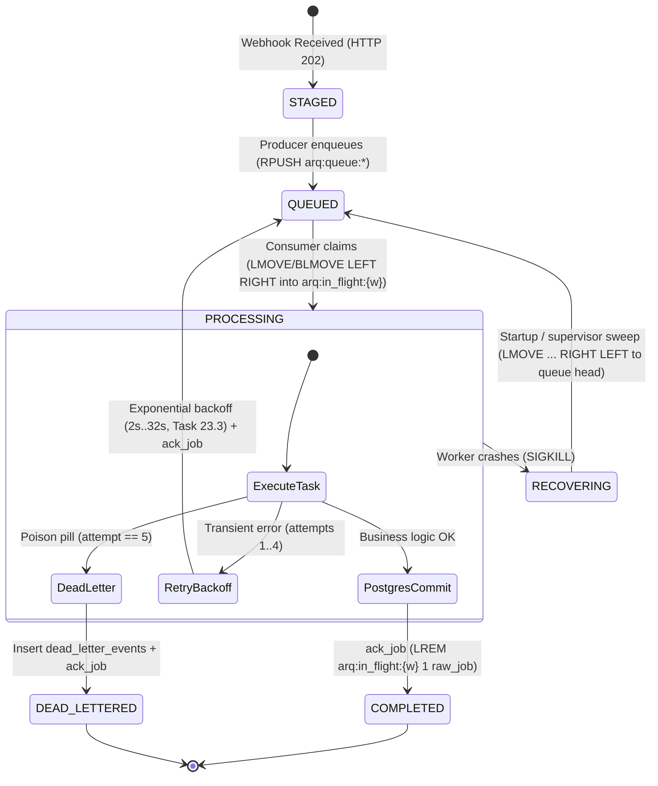

# Valkey / Redis 7 Reliable FIFO Queue Topology & High-Priority Preemption Specification

**Parent User Story:** `SCRUM-358` (`US-21` Reliable job queue)  
**Task:** `SCRUM-404` (`Task 21.1` Design FIFO queue topology and high-priority queue preemption rules)  
**Category:** Design  
**Assignee:** Dmytro Hontarenko  
**Status:** Approved / Design Baseline Established  
**Architecture Reference:** AI-Augmented Engineering Intelligence Platform Blueprint v3.0, §2.2, §6.4, §15.1, §15.2  
**Target Infrastructure Engine:** Valkey 7 (`valkey/valkey:7-alpine`) / Redis 7+  
**Target Implementation Module:** [`backend/workers/worker.py`](../backend/workers/worker.py)  
**Dependencies:**
- **Is Blocked By:** `SCRUM-237` (`US-1` CI/CD Pipeline & Core Infrastructure)
- **Blocks / Enables:**
  - `SCRUM-405` (`Task 21.2` Implement atomic `BLMOVE` worker fetch into per-worker `arq:in_flight:{worker_id}` lists with high-priority precedence)
  - `SCRUM-406` (`Task 21.3` Implement in-flight job recovery on worker restart and tune Valkey/Redis 7 `noeviction` queue settings)
  - `SCRUM-407` (`Task 21.4` [Create test scenarios for 100-job FIFO ordering, high-priority preemption behind 50 default jobs, and `SIGKILL` crash](./fifo-ordering-priority-preemption-and-sigkill-crash-test-scenarios.md))
  - `SCRUM-408` (`Task 21.5` Write automated `pytest` tests verifying 100-job FIFO execution, priority preemption, and `SIGKILL` in-flight recovery)
  - `SCRUM-409` (`Task 22.1` [Design monotonic `owner_token` sequence, 30s lease contract, and PostgreSQL optimistic fencing assertion](./fencing-lease-contract.md))
  - `SCRUM-419` (`Task 23.5` [Create test scenarios for poison payload 5x retry, navigation badge increment, re-drive and Developer HTTP 403](./poison-payload-5x-retry-dlq-navigation-badge-and-redrive-test-scenarios.md))

---

## 1. Executive Summary & Problem Statement

The M.A.N.T.A. Engineering Intelligence Platform relies on asynchronous background processing for high-volume, multi-tenant engineering signals: incoming provider webhooks (GitHub push/PR, Jira issue transitions, Slack blocker threads), DORA metrics rollups, and AI refactoring analysis pipelines.

In distributed event ingestion, two failure modes pose severe risks:
1. **Out-of-Order Execution (FIFO Inversion):** If webhook events (e.g. PR `opened` $\rightarrow$ `review_requested` $\rightarrow$ `closed` $\rightarrow$ `merged`) are processed out of order, downstream entity state machines and DORA Lead Time calculations produce corrupted metrics.
2. **Message Loss on Worker Crash (`SIGKILL` / Out-of-Memory / Power Outage):** Traditional `RPOP` or `BLPOP` primitives remove messages from the queue *before* the consumer successfully processes them. If a worker process receives `SIGKILL` or crashes mid-computation, the popped job is permanently lost.

To resolve these challenges, this specification defines an **atomic, dual-queue FIFO topology** backed by Valkey 7 / Redis 7 list primitives:
- **`RPUSH` Producer Enqueue:** Jobs are always appended to the tail (`RIGHT`) of the list.
- **`LMOVE` / `BLMOVE LEFT RIGHT` Consumer Pop:** Oldest items at the head (`LEFT`) are atomically popped from the queue and appended to the tail (`RIGHT`) of a per-worker in-flight list (`arq:in_flight:{worker_id}`) in a single, atomic $O(1)$ server operation.
- **Two-Phase Priority Preemption Polling:** Non-blocking check on high-priority queue (`arq:queue:high`) followed by bounded-timeout blocking pop on default queue (`arq:queue:default`), guaranteeing immediate preemption of default jobs without busy-waiting.
- **Explicit Acknowledgment (`LREM`):** Completed jobs are removed from `arq:in_flight:{worker_id}` only after the PostgreSQL transaction successfully commits.
- **Zero Job Drop on `SIGKILL`:** Stranded in-flight items survive worker crashes and are safely recovered to the head of the queue (`LMOVE ... RIGHT LEFT`) by worker restart routines or a supervisor process.

---

## 2. Valkey / Redis 7 Key Architecture & Data Structures

```
                             VALKEY 7 KEY NAMESPACE
 ┌─────────────────────────────────────────────────────────────────────────────┐
 │                                                                             │
 │  1. High-Priority FIFO Queue                                                │
 │     Key:    arq:queue:high                                                  │
 │     Type:   List                                                            │
 │     Role:   Urgent jobs (DLQ re-drives, alerts, user-triggered operations)  │
 │     Alias:  queue:high_priority (conceptual specification alias)            │
 │                                                                             │
 │  2. Default-Priority FIFO Queue                                             │
 │     Key:    arq:queue:default                                               │
 │     Type:   List                                                            │
 │     Role:   Standard webhook ingestion, routine metric aggregation          │
 │     Alias:  queue:default (conceptual specification alias)                  │
 │                                                                             │
 │  3. Per-Worker In-Flight Lists                                              │
 │     Key:    arq:in_flight:{worker_id}                                       │
 │     Type:   List                                                            │
 │     Role:   Crash-safe atomic staging of currently executing jobs           │
 │                                                                             │
 │  4. Worker Liveness & Heartbeat (Task 21.3 / US-21)                         │
 │     Key:    arq:worker:{worker_id}:heartbeat                                │
 │     Type:   String (Epoch ms timestamp with 30s TTL)                        │
 │     Role:   Liveness tracking for dead-worker supervisor sweep              │
 │                                                                             │
 │  5. Monotonic Fencing Sequence & Per-Job Lease (US-22 / Tasks 22.1–22.2)   │
 │     Keys:   arq:fencing_seq (Integer counter via INCR)                      │
 │             arq:lease:{job_id} (Worker lease with PX 30000 / 30s TTL)       │
 │     Role:   Split-brain prevention & monotonic lease fencing token          │
 │                                                                             │
 └─────────────────────────────────────────────────────────────────────────────┘
```

### 2.1 Key Definitions Table

| Key Pattern | Redis Type | Producer Operation | Consumer Operation | TTL / Persistence |
|---|---|---|---|---|
| `arq:queue:high` | `List` | `RPUSH` | `LMOVE ... arq:in_flight:{worker_id} LEFT RIGHT` | Persistent (`noeviction`, AOF) |
| `arq:queue:default` | `List` | `RPUSH` | `BLMOVE ... arq:in_flight:{worker_id} LEFT RIGHT <timeout>` | Persistent (`noeviction`, AOF) |
| `arq:in_flight:{worker_id}` | `List` | Internal `(B)LMOVE` target | `LREM ... 1 <payload>` on `ack_job` | Persistent until ACKed or recovered |
| `arq:worker:{worker_id}:heartbeat` | `String` | Worker background task (`SET ... EX 30`) | Supervisor reader (`EXISTS` / `GET`) | 30 seconds TTL |
| `arq:fencing_seq` | `String` (Int) | Worker lease acquisition (`INCR`) | Validated against `job_leases.owner_token` | Persistent counter |
| `arq:lease:{job_id}` | `String` | Lua lease script (`SET ... PX 30000`) | Renewed every 10s (`PEXPIRE 30000`) / deleted on ACK | 30 seconds TTL (`PX 30000`) |

### 2.2 Worker Identity Naming Contract (`{worker_id}`)

To guarantee isolation between concurrent worker instances and prevent cross-worker in-flight list collisions:
1. **Canonical Format:**
   ```text
   {worker_id} = <hostname>-<pid>-<uuid_hex[:8]>
   ```
   *Example:* `manta-worker-node1-4192-a1b2c3d4`
2. **Environment Override:**
   If `WORKER_ID` is set via container environment variables (e.g. in Kubernetes StatefulSets: `manta-worker-0`, `manta-worker-1`), that explicit identifier is used directly.
3. **Immutability:**
   A worker retains its unique `worker_id` for the entire duration of its process lifecycle.

---

## 3. Canonical Job Payload Schema (Serialized Envelope)

To guarantee that acknowledgment (`LREM`) matches the exact in-flight string without re-serialization discrepancies, jobs are serialized as **compact, deterministic JSON strings** (`separators=(',', ':')`, `sort_keys=True`).

### 3.1 JSON Schema Specification

```json
{
  "$schema": "https://json-schema.org/draft/2020-12/schema",
  "title": "MantaJobEnvelope",
  "type": "object",
  "required": [
    "job_id",
    "tenant_id",
    "priority",
    "job_type",
    "enqueued_at",
    "attempt",
    "payload"
  ],
  "properties": {
    "job_id": {
      "type": "string",
      "format": "uuid",
      "description": "Unique UUID identifying this job execution unit"
    },
    "tenant_id": {
      "type": "string",
      "format": "uuid",
      "description": "Tenant UUID for PostgreSQL RLS boundary enforcement"
    },
    "priority": {
      "type": "string",
      "enum": ["default", "high"],
      "description": "Queue tier assigned to the job"
    },
    "job_type": {
      "type": "string",
      "description": "Job classification, e.g. webhook_event, dlq_redrive, dora_aggregation"
    },
    "event_id": {
      "type": ["string", "null"],
      "format": "uuid",
      "description": "Foreign key reference to webhook_events.id in PostgreSQL"
    },
    "provider": {
      "type": ["string", "null"],
      "enum": ["github", "jira", "slack", "generic", null],
      "description": "Originating webhook provider"
    },
    "enqueued_at": {
      "type": "string",
      "format": "date-time",
      "description": "ISO-8601 UTC timestamp of enqueue operation"
    },
    "attempt": {
      "type": "integer",
      "minimum": 0,
      "description": "Execution attempt index (0 on initial push, incremented on retry)"
    },
    "payload": {
      "type": "object",
      "description": "Arbitrary task-specific structured payload data"
    },
    "version": {
      "type": "integer",
      "default": 1,
      "description": "Envelope schema version for backward compatibility"
    }
  },
  "additionalProperties": false
}
```

### 3.2 Canonical JSON Example

```json
{"attempt":0,"enqueued_at":"2026-11-11T10:45:00.000000Z","event_id":"550e8400-e29b-41d4-a716-446655440000","job_id":"9b1deb4d-3b7d-4bad-9bdd-2b0d7b3dcb6d","job_type":"webhook_event","payload":{"action":"opened","pull_request_number":42},"priority":"default","provider":"github","tenant_id":"11111111-1111-1111-1111-111111111111","version":1}
```

> [!IMPORTANT]
> **Deterministic Serialization Invariant:**  
> Python's `json.dumps(obj, separators=(",", ":"), sort_keys=True)` guarantees exact key ordering and zero extraneous whitespace. The consumer worker MUST retain the verbatim decoded raw string from Redis so that `LREM` performs an exact $O(N)$ string equality match.

---

## 4. Strict FIFO Ordering Semantics

### 4.1 Direction Mechanics (`RPUSH` + `(B)LMOVE LEFT RIGHT`)

A Redis/Valkey list is a doubly linked list indexed from `0` at the `LEFT` (head) to `-1` at the `RIGHT` (tail):

```
       Index 0                                                 Index -1
        HEAD                                                     TAIL
        LEFT                                                     RIGHT
     ┌───────────┐       ┌───────────┐       ┌───────────┐   ▲ ┌───────────┐
     │   Job 1   │ <---> │   Job 2   │ <---> │   Job 3   │...│ │   Job N   │
     │  (Oldest) │       │           │       │           │   │ │ (Newest)  │
     └───────────┘       └───────────┘       └───────────┘   │ └───────────┘
           │                                                 │
           ▼                                                 │
     [LMOVE / BLMOVE]                                    [RPUSH]
       Popped from                                      Appended to
        HEAD (LEFT)                                      TAIL (RIGHT)
           │
           ▼
     ┌─────────────────────────────────────────────────────────────┐
     │  arq:in_flight:{worker_id}                                  │
     │  Index 0 (Head/Left)               Index -1 (Tail/Right)    │
     │  ┌───────────────────────┐         ┌─────────────────────┐  │
     │  │ Existing In-Flight Job│ <-----> │ Newly Claimed Job 1 │  │
     │  └───────────────────────┘         └─────────────────────┘  │
     └─────────────────────────────────────────────────────────────┘
```

### 4.2 Step-by-Step FIFO Proof

1. **Producer Enqueues Job 1:**
   `RPUSH arq:queue:default Job1`  
   $\rightarrow$ List contains: `[Job1]` (Index 0 = `Job1`).
2. **Producer Enqueues Job 2:**
   `RPUSH arq:queue:default Job2`  
   $\rightarrow$ List contains: `[Job1, Job2]` (Index 0 = `Job1`, Index 1 = `Job2`).
3. **Producer Enqueues Job 3:**
   `RPUSH arq:queue:default Job3`  
   $\rightarrow$ List contains: `[Job1, Job2, Job3]`.
4. **Worker Dequeues via `LMOVE arq:queue:default arq:in_flight:{w1} LEFT RIGHT`:**
   - Server pops the element at `LEFT` (Index 0), which is **`Job1`**.
   - Server pushes **`Job1`** onto the `RIGHT` of `arq:in_flight:{w1}`.
   - Remaining list in `arq:queue:default`: `[Job2, Job3]`.
5. **Next Worker Dequeues via `LMOVE ... LEFT RIGHT`:**
   - Server pops the element at `LEFT` (Index 0), which is **`Job2`**.
   - Remaining list in `arq:queue:default`: `[Job3]`.
6. **Conclusion:**  
   Jobs are dispatched in the exact sequence `Job1` $\rightarrow$ `Job2` $\rightarrow$ `Job3`, satisfying **100% strict FIFO ordering** with $O(1)$ time complexity per operation.

---

## 5. High-Priority Preemption Polling Rules

### 5.1 The Redis / Valkey Constraint: Why Not Multi-Source `BLPOP`?
In Redis / Valkey:
- `BLPOP arq:queue:high arq:queue:default 0` can pop from the first non-empty list. However, **`BLPOP` is non-transactional and non-atomic regarding in-flight tracking**: the element is removed from Redis immediately. If the worker crashes a microsecond later, the job is permanently lost.
- `BLMOVE source destination LEFT|RIGHT LEFT|RIGHT timeout` provides atomic in-flight movement, but **takes exactly ONE source key and ONE destination key**.

### 5.2 The Two-Phase Polling Protocol

To achieve both **atomic in-flight tracking** AND **strict high-priority preemption**, the worker fetch loop (`fetch_next_job`) implements a two-phase protocol:

```
  ┌────────────────────────────────────────────────────────┐
  │                   fetch_next_job()                     │
  └───────────────────────────┬────────────────────────────┘
                              │
                              ▼
  ┌────────────────────────────────────────────────────────┐
  │ Phase 1: Non-Blocking High-Priority Poll               │
  │ LMOVE arq:queue:high arq:in_flight:{w1} LEFT RIGHT     │
  └───────────────────────────┬────────────────────────────┘
                              │
               Has Job? ──────┴────── No (returns nil)
                 │                           │
                Yes                          ▼
                 │        ┌──────────────────────────────────────────────────────┐
                 │        │ Phase 2: Bounded-Timeout Default Queue Pop           │
                 │        │ BLMOVE arq:queue:default arq:in_flight:{w1}          │
                 │        │        LEFT RIGHT <poll_timeout>                     │
                 │        └──────────────────┬───────────────────────────────────┘
                 │                           │
                 │            Has Job? ──────┴────── No (Timed out / nil)
                 │              │                           │
                 ▼              ▼                           ▼
          ┌─────────────┐┌─────────────┐             ┌─────────────┐
          │ Return High ││Return Deflt │             │ Return None │
          │ Priority Job││Priority Job │             │ (Next cycle)│
          └─────────────┘└─────────────┘             └─────────────┘
```

### 5.3 Mathematical Preemption Guarantee

Let:
- $Q_{\text{default}}$ have $N$ waiting jobs: $[D_1, D_2, \dots, D_N]$ where $N \ge 1$ (e.g. $N = 50$).
- A high-priority job $H_1$ be pushed to $Q_{\text{high}}$ via `RPUSH arq:queue:high H1`.

**Execution Sequence:**
1. If the worker is currently idle and waiting on Phase 2 (`BLMOVE` on $Q_{\text{default}}$):
   - As soon as Phase 2's bounded timeout expires (configurable, default $\tau = 1.0\text{ s}$), or immediately after the current default job completes, the worker initiates the next fetch cycle.
2. At the start of the next cycle, Phase 1 (`LMOVE arq:queue:high ...`) executes **first**.
3. Phase 1 finds $H_1$ in $Q_{\text{high}}$ and atomically moves it to `arq:in_flight:{worker_id}`.
4. $H_1$ is returned and processed **before** $D_1, D_2, \dots, D_N$.

**Result:**  
$H_1$ preempts all remaining 50 default jobs on the immediate next worker fetch cycle. Default queue jobs can never preempt or delay high-priority jobs.

---

## 6. Complete Job Lifecycle & State Transitions

The reliable queue operates in synchronization with PostgreSQL's [`webhook_events`](../backend/app/db/models/models.py#L343-L377) table and the Task 19.1 state machine (`staged` $\rightarrow$ `recovering` $\rightarrow$ `queued` $\rightarrow$ `processing` $\rightarrow$ `completed` / `dead_lettered`).



### 6.1 State Transition Protocol

| State | Storage Location | Owning Process | Invariant & Transition Trigger |
|---|---|---|---|
| `STAGED` | PostgreSQL `webhook_events` (`status='staged'`) | FastAPI HTTP Gateway | Staged idempotently via `ON CONFLICT DO NOTHING`. |
| `QUEUED` | Valkey `arq:queue:default` or `arq:queue:high` | Producer / Enqueue Service | Enqueued via `RPUSH`. Oldest items sit at head (`LEFT`). |
| `PROCESSING` | Valkey `arq:in_flight:{worker_id}` + PG `status='processing'` | Worker Consumer | Moved atomically via `LMOVE` / `BLMOVE LEFT RIGHT`. |
| `COMPLETED` | PostgreSQL `status='completed'` | Worker Consumer | Removed from Valkey via `LREM arq:in_flight:{worker_id} 1 <raw_payload>` **after** PG commit. |
| `RECOVERING` | Valkey `arq:in_flight:{dead_worker_id}` | Recovery Supervisor | Worker process died; heartbeat expired. |
| `DEAD_LETTERED` | PostgreSQL `dead_letter_events` | Worker / DLQ Service | Max retries exceeded; quarantined with stack trace; ACKed from Valkey. |

---

## 7. Acknowledgment Contract (`ack_job`)

Job completion acknowledgment MUST adhere strictly to the following invariant:

> [!CAUTION]
> **PostgreSQL Commit Precedes Redis Acknowledgment:**  
> The worker MUST NOT acknowledge or remove a job from `arq:in_flight:{worker_id}` until the underlying database transaction has executed `COMMIT`. If Redis removes the job before the database commits and the database crashes or disconnects during `COMMIT`, the event is permanently lost.

### 7.1 Redis Acknowledgment Command

```redis
LREM arq:in_flight:{worker_id} 1 <raw_payload>
```

- **Arguments:**
  - `key`: `arq:in_flight:{worker_id}`
  - `count`: `1` (removes the first occurrence searching from head `LEFT` to tail `RIGHT`).
  - `element`: `<raw_payload>` (the exact raw string returned during the dequeue step).
- **Return Value:**
  - `1`: Successfully acknowledged and pruned.
  - `0`: Warning — element not found (e.g. already recovered by supervisor due to lease expiration).

---

## 8. Abrupt Termination (`SIGKILL`) & Zero-Loss Recovery Contract

### 8.1 The Crash Invariant

When a worker process crashes abruptly (`SIGKILL`, OOM killer, power failure, host crash):
1. **Network Disconnect:** The TCP socket between the worker and Valkey terminates.
2. **In-Flight Preservation:** Because `LMOVE` atomically placed the job payload into `arq:in_flight:{worker_id}`, the payload **remains safely preserved in Valkey**.
3. **Queue Independence:** Other workers continue pulling from `arq:queue:default` and `arq:queue:high` without disruption.

### 8.2 Recovery Handshake (Task 21.3 Interface)

Stranded jobs are recovered in one of two ways:
1. **Worker Self-Restart:** When worker `{worker_id}` restarts, its `on_startup` routine checks its own `arq:in_flight:{worker_id}` list.
2. **Supervisor Dead-Worker Sweep:** A supervisor process checks for in-flight lists where `arq:worker:{worker_id}:heartbeat` has expired ($>30\text{s}$).

### 8.3 Atomic Re-Queue Command

To preserve FIFO priority for recovered items so they are retried immediately before newly arriving jobs:

```redis
LMOVE arq:in_flight:{dead_worker_id} arq:queue:{target_priority} RIGHT LEFT
```

- `RIGHT`: Pops the most recent unacknowledged item from the tail of the in-flight list.
- `LEFT`: Appends the item to the **head (`LEFT`)** of the origin queue (`arq:queue:high` or `arq:queue:default`).
- **Result:** The recovered job is positioned at index 0 and will be picked up by the next available worker ahead of waiting jobs.

---

## 9. Downstream Implementation Contracts & Interfaces

### 9.1 Python Interface for Task 21.2 (`backend/workers/worker.py`)

Downstream development ticket `SCRUM-405` (`Task 21.2`) MUST implement the following function contracts matching this specification:

```python
"""
Reference interface specification for backend/workers/worker.py (Task 21.2).
"""

from typing import Any, Tuple, Optional
import json
import uuid
from datetime import datetime, timezone

QUEUE_HIGH = "arq:queue:high"
QUEUE_DEFAULT = "arq:queue:default"
IN_FLIGHT_PREFIX = "arq:in_flight:"
WORKER_HEARTBEAT_PREFIX = "arq:worker:"
DEFAULT_POLL_TIMEOUT = 1.0


def serialize_job_payload(
    job_id: uuid.UUID,
    tenant_id: uuid.UUID,
    priority: str,
    job_type: str,
    payload: dict[str, Any],
    event_id: uuid.UUID | None = None,
    provider: str | None = None,
    attempt: int = 0,
) -> str:
    """Serializes canonical job envelope into deterministic compact JSON."""
    envelope = {
        "attempt": attempt,
        "enqueued_at": datetime.now(timezone.utc).isoformat(),
        "event_id": str(event_id) if event_id else None,
        "job_id": str(job_id),
        "job_type": job_type,
        "payload": payload,
        "priority": priority,
        "provider": provider,
        "tenant_id": str(tenant_id),
        "version": 1,
    }
    return json.dumps(envelope, separators=(",", ":"), sort_keys=True)


async def enqueue_job(
    redis: Any,
    job_payload: dict[str, Any] | str,
    priority: str = "default",
    queue_name: str | None = None,
) -> str:
    """
    Enqueues a job into Valkey/Redis via RPUSH.

    Args:
        redis: Async redis client connection (redis.asyncio.Redis / ArqRedis)
        job_payload: Raw JSON string or dictionary envelope
        priority: "high" or "default"
        queue_name: Optional explicit queue key override

    Returns:
        The raw enqueued payload string.
    """
    if queue_name is None and priority not in {"default", "high"}:
        raise ValueError(f"Unsupported queue priority: {priority!r} (expected 'default' or 'high')")
    target_queue = queue_name or (QUEUE_HIGH if priority == "high" else QUEUE_DEFAULT)
    raw_str = (
        job_payload
        if isinstance(job_payload, str)
        else json.dumps(job_payload, separators=(",", ":"), sort_keys=True)
    )
    await redis.rpush(target_queue, raw_str)
    return raw_str


async def fetch_next_job(
    redis: Any,
    worker_id: str,
    poll_timeout: float = DEFAULT_POLL_TIMEOUT,
) -> Optional[Tuple[str, str, dict[str, Any]]]:
    """
    Atomically fetches next job using priority preemption rules:
    Phase 1: LMOVE arq:queue:high arq:in_flight:{worker_id} LEFT RIGHT
    Phase 2: BLMOVE arq:queue:default arq:in_flight:{worker_id} LEFT RIGHT <timeout>

    Returns:
        Tuple of (source_queue, raw_payload_str, parsed_payload_dict) or None if timed out.
    """
    in_flight_key = f"{IN_FLIGHT_PREFIX}{worker_id}"

    # Phase 1: Check high-priority queue (non-blocking)
    high_job = await redis.lmove(QUEUE_HIGH, in_flight_key, src="LEFT", dest="RIGHT")
    if high_job is not None:
        raw = high_job.decode("utf-8") if isinstance(high_job, bytes) else str(high_job)
        return (QUEUE_HIGH, raw, json.loads(raw))

    # Phase 2: Fallback to default queue (bounded blocking)
    default_job = await redis.blmove(
        QUEUE_DEFAULT,
        in_flight_key,
        timeout=poll_timeout,
        src="LEFT",
        dest="RIGHT",
    )
    if default_job is not None:
        raw = default_job.decode("utf-8") if isinstance(default_job, bytes) else str(default_job)
        return (QUEUE_DEFAULT, raw, json.loads(raw))

    return None


async def ack_job(
    redis: Any,
    worker_id: str,
    raw_job: str | bytes | dict[str, Any],
) -> int:
    """
    Acknowledges completed job by removing it from arq:in_flight:{worker_id}.
    MUST be called strictly after database transaction commits.

    Returns:
        Number of removed elements (1 if success, 0 if missing).
    """
    in_flight_key = f"{IN_FLIGHT_PREFIX}{worker_id}"
    if isinstance(raw_job, bytes):
        payload_val: str | bytes = raw_job.decode("utf-8")
    elif isinstance(raw_job, dict):
        payload_val = json.dumps(raw_job, separators=(",", ":"), sort_keys=True)
    else:
        payload_val = raw_job
    return await redis.lrem(in_flight_key, 1, payload_val)
```

### 9.2 DevOps Contract for Task 21.3 (`backend/docker-compose.yml`)

Downstream DevOps ticket `SCRUM-406` (`Task 21.3`) MUST tune Valkey 7 with:
```yaml
valkey:
  image: valkey/valkey:7-alpine
  container_name: manta_valkey
  command: >
    valkey-server
    --maxmemory 512mb
    --maxmemory-policy noeviction
    --appendonly yes
    --appendfsync everysec
```
- **`maxmemory-policy noeviction`:** Under memory saturation, Valkey returns errors on writes (`OOM command not allowed`) rather than silently evicting queue list keys or in-flight items.
- **`appendonly yes`:** Persists list mutations to disk every second so queue state survives container restarts.

### 9.3 QA Verification Contract for Tasks 21.4 & 21.5

Downstream testing tickets `SCRUM-407` (`Task 21.4` [Test Scenarios](./fifo-ordering-priority-preemption-and-sigkill-crash-test-scenarios.md)) and `SCRUM-408` (`Task 21.5` Automated Pytest) MUST verify:
1. **Scenario 1 (100-Job FIFO Ordering):**
   Enqueue jobs $J_1, \dots, J_{100}$ sequentially into `arq:queue:default`. Single consumer pops all 100 jobs. Assert consumed list is strictly $[J_1, \dots, J_{100}]$.
2. **Scenario 2 (High-Priority Preemption behind 50 Default Jobs):**
   Enqueue 50 jobs into `arq:queue:default`. Enqueue 1 job $H_1$ into `arq:queue:high`. Consumer calls `fetch_next_job()`. Assert the first popped job is $H_1$, followed by the 50 default jobs in order.
3. **Scenario 3 (SIGKILL In-Flight Recovery):**
   Worker claims job $J_1$ into `arq:in_flight:{worker_id}`. Simulate abrupt termination (`SIGKILL`). Verify $J_1$ remains in `arq:in_flight:{worker_id}`. Run recovery routine (`LMOVE ... RIGHT LEFT`). Verify $J_1$ returns to the head of `arq:queue:default` and is consumed without loss.

---

## 10. Traceability & Acceptance Criteria Verification Matrix

| Requirement / Criterion | Source Ticket | Design Section | Verification Mechanism | Status |
|---|---|---|---|:---:|
| Dual Queue Keys (`arq:queue:high`, `arq:queue:default`) | `SCRUM-404`, `SCRUM-358` | §2.1, §2.2 | Namespace contract & constants definition | **SATISFIED** |
| `RPUSH` Producer Enqueue | `SCRUM-404`, `SCRUM-405` | §4.1, §9.1 | Appends to tail (`RIGHT`) | **SATISFIED** |
| `LMOVE` / `BLMOVE LEFT RIGHT` Consumer Pop | `SCRUM-404`, `SCRUM-405` | §4.1, §4.2, §5.2 | Atomic transfer to `arq:in_flight:{worker_id}` | **SATISFIED** |
| Strict FIFO Execution Guarantee | `SCRUM-404`, `SCRUM-407` | §4.2, §9.3 | Formal mathematical proof & index trace | **SATISFIED** |
| High-Priority Preemption Ahead of Waiting Default Jobs | `SCRUM-404`, `SCRUM-405` | §5.2, §5.3 | Two-phase non-blocking check precedes default pop | **SATISFIED** |
| `LREM ... 1 <payload>` Acknowledgment | `SCRUM-404`, `SCRUM-405` | §7.1, §9.1 | Verbatim string removal after PostgreSQL commit | **SATISFIED** |
| Zero Lost Jobs on Abrupt Worker Termination (`SIGKILL`) | `SCRUM-404`, `SCRUM-406` | §8.1, §8.2, §8.3 | Atomic in-flight persistence & `RIGHT LEFT` recovery | **SATISFIED** |
| Fencing Leases & Monotonic Tokens Unblocked | `SCRUM-404`, `SCRUM-409` | §2.1, §6.1 | Keys & status transitions aligned with `JobLease` | **SATISFIED** |
