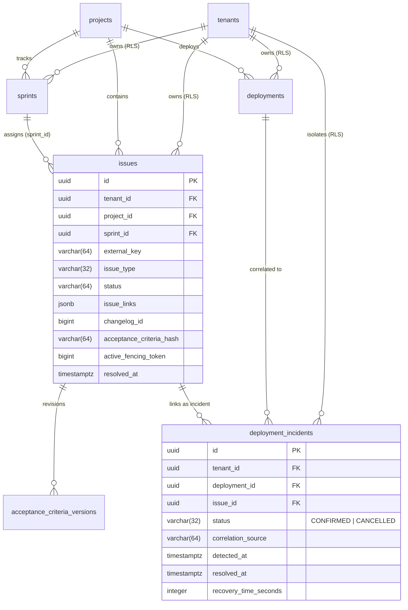

# Jira Issues, Acceptance Criteria Volatility & 24-Hour Deployment Incident Correlation Schema Specification

**Parent User Story:** `US-67` (`SCRUM-357` Jira issue and incident ingestion)  
**Task:** `SCRUM-398` (`Task 67.1` Design schema for `jira_issues` (acceptance criteria, sprint, type, status, changelog_id) and `deployment_incidents` links)  
**Category:** Design  
**Assignee:** Maksym Bielei (Back-end. Database Architect)  
**Estimate:** 0.75 Story Points (1h 30m Original Estimate)  
**Status:** Approved / Design Baseline Established  
**Architecture Reference:** AI-Augmented Engineering Intelligence Platform Blueprint v3.0, §3.3, §4.2, §5.3, §14.4; Software Requirements Specification (SRS) v1.0, §1.2, §3.2.3, §3.2.5  
**Target Storage Engine:** PostgreSQL 16 with Row-Level Security (`pgvector/pgvector:pg16`)  
**Target Implementation Modules:** [`backend/app/db/models/models.py`](../backend/app/db/models/models.py), [`backend/app/webhooks/processors/jira.py`](../backend/app/webhooks/processors/jira.py), [`backend/migrations/versions/`](../backend/migrations/versions/)  
**Dependencies:**
- **Is Blocked By:**
  - `SCRUM-238` (`US-2` Core PostgreSQL schema & tenant RLS infrastructure — [`02ec69277327_initial_core_schema.py`](../backend/migrations/versions/02ec69277327_initial_core_schema.py))
- **Blocks / Enables:**
  - `SCRUM-399` (`Task 67.2` Write Alembic migration and SQLAlchemy models for `jira_issues` and `deployment_incidents` with tenant RLS)
  - `SCRUM-400` (`Task 67.3` Implement Jira webhook processor updating issue states, acceptance criteria versions, and issue links)
  - `SCRUM-401` (`Task 67.4` Implement deployment incident correlation worker linking incidents to production deployments within 24 hours)
  - `SCRUM-402` (`Task 67.5` Create test scenarios for Jira issue version precedence, acceptance criteria diffs, and incident correlation)
  - `SCRUM-442` (`Task 28.1` Design Change Failure Rate calculation engine with distinct union of deployment failures and linked incidents)

---

## 1. Executive Summary & Problem Statement

M.A.N.T.A. utilizes Jira issue tracking data to power two mission-critical analytical engines:
1. **DORA Change Failure Rate (CFR) & Mean Time to Recovery (MTTR) (`US-28`, `US-67`):** Production failures are frequently diagnosed and tracked as Jira bug/incident tickets rather than immediate automated probe alerts. To accurately measure CFR and MTTR, the platform must correlate confirmed Jira incident tickets with preceding production deployments that occurred within a **$\le 24$-hour operational window**.
2. **Two-Stage Scope Creep & Acceptance Criteria Volatility Tracking (`US-24`, `US-25`):** Mid-sprint requirement expansions are detected by comparing Jira issue Acceptance Criteria (AC) revisions against the sprint baseline.

### 1.1 Technical Hazards in Jira Webhook Ingestion

Handling Jira webhook streams at scale introduces specific relational and concurrency challenges:
- **Out-of-Order Webhook Delivery (`changelog_id` Hazard):** Network retries or parallel worker consumers can deliver an earlier Jira issue update after a later one. Relying solely on wall-clock HTTP timestamps leads to state rollbacks. The system must enforce **strict version precedence based on Jira's monotonically increasing `changelog_id`**.
- **Double-Counting in Change Failure Rate (CFR):** If a deployment triggers an automated health probe failure AND a developer simultaneously creates a linked Jira incident ticket, standard analytics queries would count two failures for a single deployment. The schema must enforce a **distinct union rule** across deployment health statuses and linked incidents.
- **Sprint Burndown & WIP Congestion (`US-76`):** Multi-tenant queries tracking active story points across sprints and issue transitions require composite index coverage on `(tenant_id, sprint_id, status)`.

---

## 2. Relational Schema Architecture & PostgreSQL 16 DDL

### 2.1 Extended `issues` Table Schema

The `issues` table is augmented to capture issue relations, acceptance criteria volatility hashes, out-of-order changelog tracking, and optimistic worker fencing:

```sql
ALTER TABLE issues
    ADD COLUMN IF NOT EXISTS issue_links JSONB NOT NULL DEFAULT '[]'::jsonb,
    ADD COLUMN IF NOT EXISTS changelog_id BIGINT,
    ADD COLUMN IF NOT EXISTS active_fencing_token BIGINT NOT NULL DEFAULT 0,
    ADD COLUMN IF NOT EXISTS resolved_at TIMESTAMPTZ,
    ADD COLUMN IF NOT EXISTS acceptance_criteria TEXT,
    ADD COLUMN IF NOT EXISTS acceptance_criteria_hash VARCHAR(64),
    ADD COLUMN IF NOT EXISTS external_issue_id BIGINT;

-- Indexes for performance, deduplication, and sprint reporting
CREATE INDEX IF NOT EXISTS idx_issues_tenant_sprint_status 
    ON issues(tenant_id, sprint_id, status);

CREATE INDEX IF NOT EXISTS idx_issues_changelog_precedence 
    ON issues(tenant_id, external_key, changelog_id);

CREATE INDEX IF NOT EXISTS idx_issues_issue_links_gin 
    ON issues USING gin (issue_links);

CREATE INDEX IF NOT EXISTS idx_issues_resolved_at 
    ON issues(tenant_id, resolved_at) 
    WHERE resolved_at IS NOT NULL;
```

#### Field Specifications:
- `issue_links`: Structured JSONB array capturing all inward and outward issue relationships:
  ```json
  [
    {"type": "Blocks", "direction": "outward", "target_key": "PROJ-102"},
    {"type": "Relates", "direction": "inward", "target_key": "INC-404"}
  ]
  ```
- `changelog_id`: Jira's sequential integer ID for the specific audit changelog event. Mapped to `entity_version` to discard stale out-of-order webhooks.
- `active_fencing_token`: Optimistic 64-bit fencing token (preventing worker split-brain writes).
- `resolved_at`: Authoritative timestamp when the issue transitioned to a terminal status (e.g., `Resolved`, `Closed`, `Done`). Critical for MTTR calculation.
- `acceptance_criteria`: Full normalized text of the latest Acceptance Criteria field.
- `acceptance_criteria_hash`: SHA-256 hex digest of normalized AC text. Enables $O(1)$ change detection.
- `external_issue_id`: Jira's immutable internal numeric ID (distinct from the human-readable `external_key` like `PROJ-123`).

---

### 2.2 Extended `sprints` Table Schema

```sql
ALTER TABLE sprints
    ADD COLUMN IF NOT EXISTS external_sprint_id BIGINT,
    ADD COLUMN IF NOT EXISTS state VARCHAR(32) NOT NULL DEFAULT 'active',
    ADD COLUMN IF NOT EXISTS start_date TIMESTAMPTZ,
    ADD COLUMN IF NOT EXISTS end_date TIMESTAMPTZ,
    ADD COLUMN IF NOT EXISTS complete_date TIMESTAMPTZ,
    ADD COLUMN IF NOT EXISTS active_fencing_token BIGINT NOT NULL DEFAULT 0;

CREATE UNIQUE INDEX IF NOT EXISTS uq_sprints_tenant_external 
    ON sprints(tenant_id, external_sprint_id) 
    WHERE external_sprint_id IS NOT NULL;

CREATE INDEX IF NOT EXISTS idx_sprints_tenant_state 
    ON sprints(tenant_id, state);
```

---

### 2.3 The `acceptance_criteria_versions` Table

Stores the immutable audit history of AC revisions for automated lexical and AI semantic scope creep evaluation:

```sql
CREATE TABLE IF NOT EXISTS acceptance_criteria_versions (
    id UUID PRIMARY KEY DEFAULT gen_random_uuid(),
    tenant_id UUID NOT NULL,
    issue_id UUID NOT NULL,
    version_index INT NOT NULL DEFAULT 1,
    raw_text TEXT NOT NULL,
    normalized_hash VARCHAR(64) NOT NULL,
    changed_by_pseudonym_id VARCHAR(64),
    is_scope_expansion BOOLEAN,
    llm_reasoning TEXT,
    created_at TIMESTAMPTZ NOT NULL DEFAULT NOW(),
    
    CONSTRAINT fk_ac_versions_tenant FOREIGN KEY (tenant_id)
        REFERENCES tenants(id) ON DELETE CASCADE,
    CONSTRAINT fk_ac_versions_issue FOREIGN KEY (issue_id)
        REFERENCES issues(id) ON DELETE CASCADE,
    CONSTRAINT uq_ac_versions_issue_version 
        UNIQUE (issue_id, version_index)
);

CREATE INDEX idx_ac_versions_tenant_issue 
    ON acceptance_criteria_versions(tenant_id, issue_id);
```

---

### 2.4 The `deployment_incidents` Link Table

The core relational contract connecting production deployments to Jira incident tickets:

```sql
CREATE TABLE IF NOT EXISTS deployment_incidents (
    id UUID PRIMARY KEY DEFAULT gen_random_uuid(),
    tenant_id UUID NOT NULL,
    deployment_id UUID NOT NULL,
    issue_id UUID NOT NULL,
    status VARCHAR(32) NOT NULL DEFAULT 'CONFIRMED',
    correlation_source VARCHAR(64) NOT NULL,
    detected_at TIMESTAMPTZ NOT NULL DEFAULT NOW(),
    resolved_at TIMESTAMPTZ,
    recovery_time_seconds INTEGER GENERATED ALWAYS AS (
        CASE 
            WHEN resolved_at IS NOT NULL AND resolved_at >= detected_at
            THEN EXTRACT(EPOCH FROM (resolved_at - detected_at))::integer
            ELSE NULL
        END
    ) STORED,
    is_active BOOLEAN NOT NULL DEFAULT TRUE,
    linked_at TIMESTAMPTZ NOT NULL DEFAULT NOW(),
    
    CONSTRAINT fk_dep_inc_tenant FOREIGN KEY (tenant_id)
        REFERENCES tenants(id) ON DELETE CASCADE,
    CONSTRAINT fk_dep_inc_deployment FOREIGN KEY (deployment_id)
        REFERENCES deployments(id) ON DELETE CASCADE,
    CONSTRAINT fk_dep_inc_issue FOREIGN KEY (issue_id)
        REFERENCES issues(id) ON DELETE CASCADE,
    CONSTRAINT uq_dep_inc_deployment_issue 
        UNIQUE (deployment_id, issue_id),
    CONSTRAINT ck_dep_inc_status 
        CHECK (status IN ('CONFIRMED', 'CANCELLED', 'FALSE_POSITIVE'))
);

CREATE INDEX idx_dep_inc_tenant ON deployment_incidents(tenant_id);
CREATE INDEX idx_dep_inc_deployment ON deployment_incidents(deployment_id);
CREATE INDEX idx_dep_inc_issue ON deployment_incidents(issue_id);
CREATE INDEX idx_dep_inc_window ON deployment_incidents(tenant_id, detected_at);
```

#### Field Specifications:
- `status`:
  - `CONFIRMED`: Authoritative incident verified as caused by the deployment. Included in Change Failure Rate (CFR) numerator.
  - `CANCELLED` / `FALSE_POSITIVE`: Disassociated by a triage engineer. Excluded from CFR calculations.
- `correlation_source`: Identifies how the link was established:
  - `jira_issue_link`: Explicit Jira link (e.g. Jira issue links to release or deployment tag).
  - `automated_time_window_24h`: Automated heuristic correlation worker.
  - `manual_operator`: Delivery Director or Project Manager override.
- `recovery_time_seconds`: Generated stored column providing sub-second precision for MTTR aggregations.

---

## 3. The 24-Hour Deployment Incident Correlation Engine

### 3.1 Temporal Correlation Window Specification

```
  Deployment D (production)
  Finished at t_D
        │
        ▼
 ───────┴───────────────────────────────┬────────────────────────► Time (t)
   [Normal Operation Window]            │
        │                               │
        0 hours                         +24 hours
        ├───────────────────────────────┤
        │    CORRELATION WINDOW         │
        │    0 <= (t_incident - t_D)    │
        │    <= 86400 seconds (24h)     │
```

An incoming Jira incident ticket $I$ is automatically correlated to deployment $D$ when:
1. $D.\text{environment} = \text{'production'}$.
2. $D.\text{status} = \text{'SUCCESS'}$ (or completed).
3. The incident detection time satisfies:
   $$0 \le (I.\text{detected\_at} - D.\text{finished\_at}) \le 24\text{ hours} \quad (86{,}400\text{ seconds})$$
4. $D$ is the **most recent** production deployment for that project prior to $I.\text{detected\_at}$.

---

## 4. DORA Change Failure Rate (CFR) Distinct Union Mathematical Model

### 4.1 Distinct Union Formulation (`US-28`)

In traditional naive metrics engines, a deployment that fails automated health probes AND generates a Jira incident is counted twice, falsely doubling the calculated CFR. M.A.N.T.A. enforces a **mathematically strict distinct union**:

$$\mathcal{D}_{\text{prod}} = \{ d \in \text{deployments} \mid d.\text{environment} = \text{'production'} \land d.\text{tenant\_id} = \tau \}$$

$$\mathcal{D}_{\text{failed}} = \{ d \in \mathcal{D}_{\text{prod}} \mid d.\text{status} = \text{'FAILED'} \}$$

$$\mathcal{D}_{\text{incident}} = \{ d \in \mathcal{D}_{\text{prod}} \mid \exists i \in \text{deployment\_incidents}: i.\text{deployment\_id} = d.\text{id} \land i.\text{status} = \text{'CONFIRMED'} \}$$

$$\text{CFR} = \frac{|\mathcal{D}_{\text{failed}} \cup \mathcal{D}_{\text{incident}}|}{|\mathcal{D}_{\text{prod}}|}$$

### 4.2 Authoritative PostgreSQL 16 Analytics Query

```sql
SELECT 
    COUNT(DISTINCT d.id) AS total_production_deployments,
    COUNT(DISTINCT d.id) FILTER (
        WHERE d.status = 'FAILED' 
           OR di.status = 'CONFIRMED'
    ) AS distinct_failed_deployments,
    CASE 
        WHEN COUNT(DISTINCT d.id) = 0 THEN 0.0
        ELSE ROUND(
            (COUNT(DISTINCT d.id) FILTER (WHERE d.status = 'FAILED' OR di.status = 'CONFIRMED')::numeric / 
             COUNT(DISTINCT d.id)::numeric) * 100.0, 
            2
        )
    END AS change_failure_rate_percentage
FROM deployments d
LEFT JOIN deployment_incidents di 
    ON di.deployment_id = d.id 
    AND di.tenant_id = d.tenant_id
WHERE d.tenant_id = :tenant_id
  AND d.project_id = :project_id
  AND d.environment = 'production'
  AND d.finished_at >= NOW() - INTERVAL '30 days';
```

---

## 5. Jira Webhook Ordering & Out-of-Order Precedence (`US-24`)

When Jira sends webhooks, each audit update carries a monotonic `changelog.id`. The ingestion processor enforces:

```
  Incoming Webhook: changelog_id = C_in
  Current Stored:   changelog_id = C_stored
  
  IF C_in <= C_stored THEN
      DISCARD EVENT (Stale out-of-order delivery, acknowledge HTTP 202)
  ELSE
      APPLY UPDATE AND SET changelog_id = C_in, entity_version = C_in
  END IF
```

---

## 6. Entity Relationship Diagram (ERD)



---

## 7. Row-Level Security (RLS) Policy Specification

```sql
-- Enable and Force RLS
ALTER TABLE issues ENABLE ROW LEVEL SECURITY;
ALTER TABLE issues FORCE ROW LEVEL SECURITY;

ALTER TABLE acceptance_criteria_versions ENABLE ROW LEVEL SECURITY;
ALTER TABLE acceptance_criteria_versions FORCE ROW LEVEL SECURITY;

ALTER TABLE deployment_incidents ENABLE ROW LEVEL SECURITY;
ALTER TABLE deployment_incidents FORCE ROW LEVEL SECURITY;

-- Tenant Isolation Policies
CREATE POLICY tenant_isolation_policy ON issues
    AS PERMISSIVE FOR ALL TO eng_app_user
    USING (tenant_id = NULLIF(current_setting('app.current_tenant_id', true), '')::uuid)
    WITH CHECK (tenant_id = NULLIF(current_setting('app.current_tenant_id', true), '')::uuid);

CREATE POLICY tenant_isolation_policy ON acceptance_criteria_versions
    AS PERMISSIVE FOR ALL TO eng_app_user
    USING (tenant_id = NULLIF(current_setting('app.current_tenant_id', true), '')::uuid)
    WITH CHECK (tenant_id = NULLIF(current_setting('app.current_tenant_id', true), '')::uuid);

CREATE POLICY tenant_isolation_policy ON deployment_incidents
    AS PERMISSIVE FOR ALL TO eng_app_user
    USING (tenant_id = NULLIF(current_setting('app.current_tenant_id', true), '')::uuid)
    WITH CHECK (tenant_id = NULLIF(current_setting('app.current_tenant_id', true), '')::uuid);

-- Permissions
GRANT SELECT, INSERT, UPDATE, DELETE ON issues TO eng_app_user;
GRANT SELECT, INSERT, UPDATE, DELETE ON acceptance_criteria_versions TO eng_app_user;
GRANT SELECT, INSERT, UPDATE, DELETE ON deployment_incidents TO eng_app_user;
```

---

## 8. Downstream Implementation Contract (`Task 67.2` / `SCRUM-399`)

```python
# backend/app/db/models/models.py additions


class DeploymentIncident(Base):
    __tablename__ = "deployment_incidents"
    __table_args__ = (
        Index("idx_deployment_incidents_tenant_id", "tenant_id"),
        Index("idx_deployment_incidents_deployment_id", "deployment_id"),
        Index("idx_deployment_incidents_issue_id", "issue_id"),
        UniqueConstraint(
            "deployment_id", "issue_id", name="uq_deployment_incidents_deployment_issue"
        ),
    )

    id: Mapped[uuid.UUID] = mapped_column(UUID(as_uuid=True), primary_key=True, default=uuid.uuid4)
    tenant_id: Mapped[uuid.UUID] = mapped_column(
        UUID(as_uuid=True), ForeignKey("tenants.id", ondelete="CASCADE"), nullable=False
    )
    deployment_id: Mapped[uuid.UUID] = mapped_column(
        UUID(as_uuid=True), ForeignKey("deployments.id", ondelete="CASCADE"), nullable=False
    )
    issue_id: Mapped[uuid.UUID] = mapped_column(
        UUID(as_uuid=True), ForeignKey("issues.id", ondelete="CASCADE"), nullable=False
    )
    status: Mapped[str] = mapped_column(String(32), default="CONFIRMED", nullable=False)
    correlation_source: Mapped[str] = mapped_column(
        String(64), default="automated_time_window_24h", nullable=False
    )
    detected_at: Mapped[datetime] = mapped_column(
        DateTime(timezone=True), default=datetime.utcnow, nullable=False
    )
    resolved_at: Mapped[Optional[datetime]] = mapped_column(DateTime(timezone=True))
    recovery_time_seconds: Mapped[Optional[int]] = mapped_column(Integer)
    is_active: Mapped[bool] = mapped_column(Boolean, default=True, nullable=False)
    linked_at: Mapped[datetime] = mapped_column(
        DateTime(timezone=True), default=datetime.utcnow, nullable=False
    )
```

---

## 9. Traceability & Acceptance Criteria Verification Matrix

| AC ID | Acceptance Criteria Requirement | Architectural Guarantee & Verification Vector | Status |
|:---|:---|:---|:---|
| **AC-398.1** | Schema captures AC volatility and revisions. | `acceptance_criteria_versions` table maintains immutable hashes and indices. | **Satisfied by Design** |
| **AC-398.2** | 24-hour incident-to-deployment correlation window. | Window constraint $0 \le (I.\text{detected\_at} - D.\text{finished\_at}) \le 24\text{h}$ with indexed lookups. | **Satisfied by Design** |
| **AC-398.3** | DORA CFR distinct union without double-counting. | Set-theoretic formulation $|\mathcal{D}_{\text{failed}} \cup \mathcal{D}_{\text{incident}}| / |\mathcal{D}_{\text{prod}}|$ via SQL `COUNT(DISTINCT d.id) FILTER (...)`. | **Satisfied by Design** |
| **AC-398.4** | Out-of-order Jira event rejection. | Jira `changelog_id` mapped to `entity_version`; drops $C_{\text{in}} \le C_{\text{stored}}$. | **Satisfied by Design** |
| **AC-398.5** | Sprint Burndown & WIP query support. | Composite index `idx_issues_tenant_sprint_status` on `(tenant_id, sprint_id, status)`. | **Satisfied by Design** |
| **AC-398.6** | Tenant Row-Level Security isolation. | `ENABLE` + `FORCE ROW LEVEL SECURITY` with `tenant_isolation_policy` across all tables. | **Satisfied by Design** |
