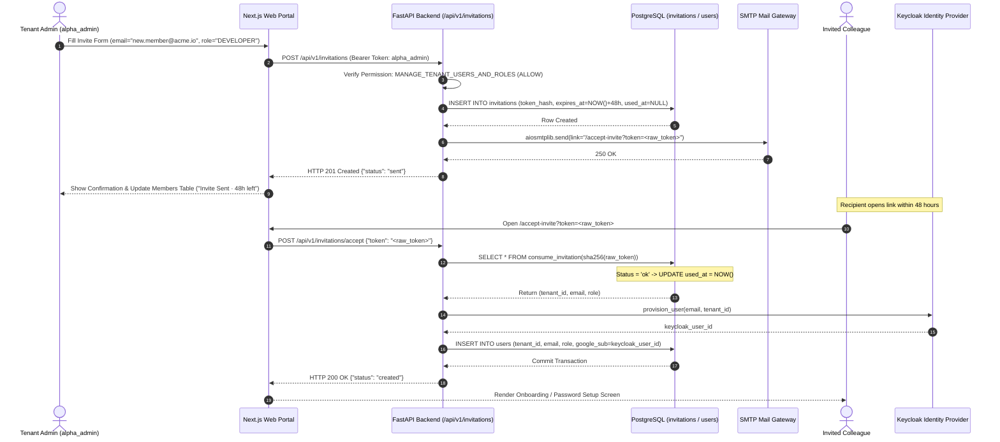
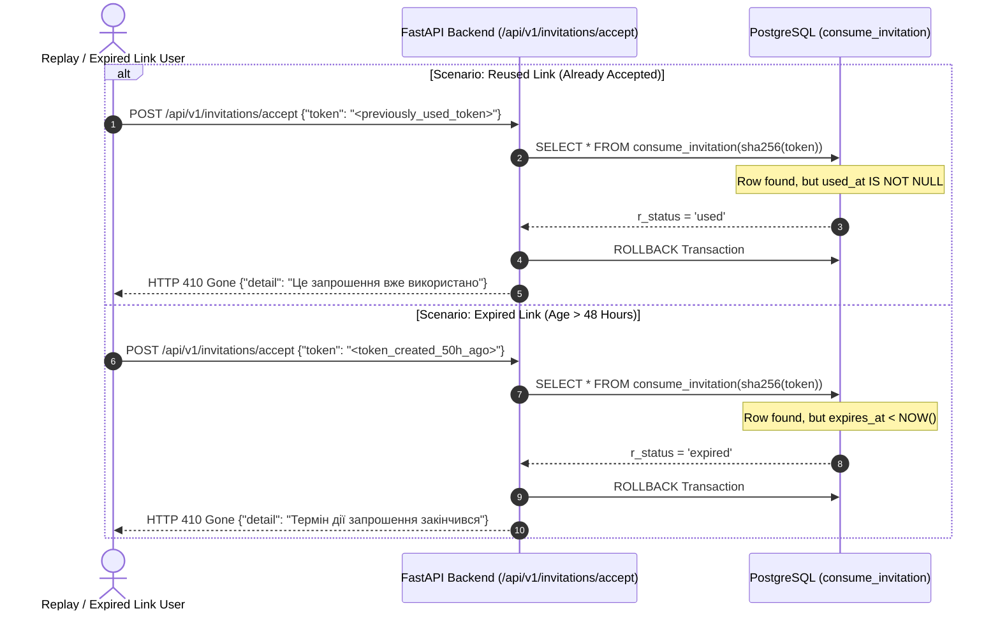
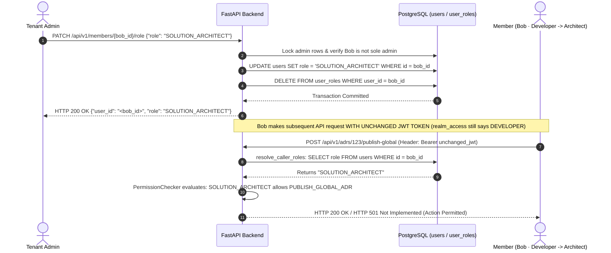

# Member Invitation & Immediate Role-Change Test Scenarios

**Task:** Create test scenarios (expired link, immediate role change) (`SCRUM-317`)  
**Parent User Story:** `SCRUM-248` (`US-12`: Member invitation and role assignment)  
**Related Tickets:**  
- `SCRUM-313`: Develop members page with invitation form and member directory ([`web/src/app/(portal)/access-roles/page.tsx`](../web/src/app/(portal)/access-roles/page.tsx), [`web/e2e/members-management.spec.ts`](../web/e2e/members-management.spec.ts), [`web/e2e/invite-modal-states.spec.ts`](../web/e2e/invite-modal-states.spec.ts))  
- `SCRUM-314`: Token-based email invitation backend & Keycloak provisioning ([`backend/app/notifications/router.py`](../backend/app/notifications/router.py), [`backend/app/notifications/service.py`](../backend/app/notifications/service.py))  
- `SCRUM-315`: Member role modification endpoint & single-admin safeguard ([`backend/app/auth/members_router.py`](../backend/app/auth/members_router.py))  
- `SCRUM-306`: Define role-permission matrix for the seven roles ([`docs/roles-permissions.md`](roles-permissions.md), [`docs/roles-permissions.json`](roles-permissions.json))  
- `SCRUM-311`: Role-access test scenarios ([`docs/role-access-test-scenarios.md`](role-access-test-scenarios.md), [`backend/tests/test_role_access_scenarios.py`](../backend/tests/test_role_access_scenarios.py))  
- `SCRUM-318`: Database-enforced tenant isolation via PostgreSQL RLS on `invitations` table ([`backend/migrations/versions/9120ee1923b9_create_invitations_table.py`](../backend/migrations/versions/9120ee1923b9_create_invitations_table.py))  

**Target Architecture Layers:**  
1. **Frontend / Web UI Layer:** Next.js 15 / React member administration directory, 6-state `InviteMemberDialog` modal (Figma 513:4408, 513:4861, 513:5335, 513:5831, 513:6734, 513:7200), inline role selector popovers, and expired invite management.  
2. **API & Service Layer:** FastAPI endpoints `POST /api/v1/invitations`, `POST /api/v1/invitations/accept`, and `PATCH /api/v1/members/{user_id}/role`, transactional email notifications via `aiosmtplib`, and asynchronous Keycloak Admin Client (`KeycloakOpenIDConnection`).  
3. **Database Layer:** PostgreSQL 16, Row-Level Security (`tenant_isolation_policy` on `invitations` table), atomic `consume_invitation` `SECURITY DEFINER` routine, and live DB-backed role resolution in `resolve_caller_roles`.  
4. **Identity Layer:** Keycloak 24.0.5 (`manta` realm), multi-tenant user provisioning, and role assignment.  

**Authoritative Test Suites:**  
- **Pytest Suite:** [`backend/tests/test_invitation_and_role_change_scenarios.py`](../backend/tests/test_invitation_and_role_change_scenarios.py) (30 exhaustive test cases verifying all scenarios, HTTP status codes, edge cases, and rollbacks)  
- **Playwright E2E Suites:**  
  - [`web/e2e/members-management.spec.ts`](../web/e2e/members-management.spec.ts) (E2E member listing, role assignment, expired invite display, and non-admin navigation gating)  
  - [`web/e2e/invite-modal-states.spec.ts`](../web/e2e/invite-modal-states.spec.ts) (E2E modal validation states: active member conflicts, 48h TTL badge, batch queueing, 503 gateway retries)  

---

## 1. Objective & Architecture Invariants

### 1.1 Objective
Establish the definitive test scenarios and automated test specifications for onboarding workspace members and managing their role assignments in the M.A.N.T.A. Engineering Intelligence Platform. This specification covers all functional behaviors and critical security edge cases required by `SCRUM-248` / `SCRUM-317`:
1. **Valid Invitation (`TC-INV-VALID-001`, `TC-INV-ACCEPT-001`):** An authorized Tenant Administrator issues an invitation; a high-entropy single-use token is minted with a 48-hour expiration; the recipient accepts the token and is provisioned across Keycloak and PostgreSQL.
2. **Reused Link (`TC-INV-REUSE-001`):** Once accepted, a token cannot be reused; subsequent acceptance calls return `HTTP 410 Gone`, preventing replay attacks or duplicate user records.
3. **Expired Link (`TC-INV-EXP-001`):** Tokens past their 48-hour Time-To-Live (TTL) are rejected with `HTTP 410 Gone`; the UI flags the invitation as `EXPIRED` and provides an administrative reissue option.
4. **Invite for Existing User (`TC-INV-EXIST-001`, `TC-INV-EXIST-002`):** Inviting an email that already exists within the tenant is intercepted both client-side (validation conflict banner) and server-side (`HTTP 409 Conflict`), rolling back database mutations cleanly without corrupting token state.
5. **Immediate Role Change (`TC-ROLE-IMM-001` – `TC-ROLE-IMM-003`):** Updating a member's role takes effect immediately on the very next incoming API request without requiring user re-authentication or JWT token renewal.
6. **Last Administrator Safeguard (`TC-ROLE-LAST-ADMIN-001`):** Demoting the sole remaining `TENANT_ADMIN` in a workspace is prevented with `HTTP 409 Conflict` using PostgreSQL row locks (`FOR UPDATE`).
7. **Non-Admin Invitation & Role Modification Attempts (`TC-RBAC-INV-001` – `TC-RBAC-INV-006`):** All six non-admin roles attempting to issue invites or modify roles are rejected with `HTTP 403 Forbidden` (`{"detail": "Forbidden: insufficient permissions"}`); the frontend purges all access-roles controls from the DOM.

---

### 1.2 Core Architectural Invariants

```
+-------------------------------------------------------------------------------------------------------------------+
|                                 MEMBER INVITATION & ROLE MANAGEMENT INVARIANTS                                   |
+-------------------------------------+-------------------------------------+---------------------------------------+
| 1. Cryptographic Single-Use Token   | 2. Strict 48-Hour TTL               | 3. Immediate DB Role Resolution       |
|    (SHA-256 Hashing & Entropy)      |    (INVITATION_TTL_HOURS = 48)      |    (No JWT Stale Caching Delay)       |
+-------------------------------------+-------------------------------------+---------------------------------------+
| * 256-bit entropy (token_urlsafe)   | * expires_at = NOW() + 48 hours     | * resolve_caller_roles queries DB     |
| * Stored as SHA-256 (VARCHAR(64))   | * consume_invitation checks         |   on EVERY incoming API request       |
| * Raw token never stored in DB      |   expires_at < NOW()                | * Role change in PostgreSQL takes     |
| * used_at timestamp flags usage     | * Expired links return HTTP 410     |   effect on immediate next HTTP call  |
+-------------------------------------+-------------------------------------+---------------------------------------+
                                                         |
                                                         v
+-------------------------------------------------------------------------------------------------------------------+
|                                     SECURITY & INTEGRITY SAFEGUARDS                                               |
+----------------------------------------------------+--------------------------------------------------------------+
| 4. Single Administrator Demotion Safeguard         | 5. Strict Defense-in-Depth RBAC Gating                       |
|    (HTTP 409 Conflict)                             |    (MANAGE_TENANT_USERS_AND_ROLES)                           |
+----------------------------------------------------+--------------------------------------------------------------+
| * SELECT User.id ... FOR UPDATE locks admin rows   | * Only TENANT_ADMIN holds ALLOW decision                     |
| * If admin_ids count == 1 and demoting, reject     | * 6 non-admin roles receive HTTP 403 Forbidden               |
| * Prevents orphaned tenant without an administrator| * UI elements completely purged from DOM for non-admins      |
+----------------------------------------------------+--------------------------------------------------------------+
```

1. **Cryptographic Token Lifecycle:**
   - Raw invitation tokens are generated using `secrets.token_urlsafe(32)` providing 256 bits of cryptographic entropy.
   - Raw tokens are **never** stored in plaintext in the database or logged to application telemetry. The database stores the hex-encoded SHA-256 digest (`VARCHAR(64)` with `UNIQUE` constraint `uq_invitations_token_hash`).
   - The raw token is dispatched only to the invited user's email address in the link: `${WEB_BASE_URL}/accept-invite?token=${raw_token}`.
2. **Deterministic Expiration (48 Hours):**
   - Per SRS specification, `INVITATION_TTL_HOURS = 48`.
   - `expires_at` is set to `datetime.now(timezone.utc) + timedelta(hours=48)` at creation time.
   - Acceptance attempts when `expires_at < NOW()` return `HTTP 410 Gone` with message `"Термін дії запрошення закінчився"`.
3. **Atomic Consumption via `SECURITY DEFINER`:**
   - Because PostgreSQL Row-Level Security (RLS) isolates records by tenant ID, unauthenticated invitation consumption cannot query `invitations` directly using standard session credentials.
   - The database function `consume_invitation(p_token_hash)` runs as `SECURITY DEFINER` with pinned `search_path = public, pg_temp`.
   - In a single atomic statement, it checks:
     - `token_hash` existence (if absent $\rightarrow$ status `'not_found'`)
     - `used_at IS NOT NULL` (if used $\rightarrow$ status `'used'`)
     - `expires_at < NOW()` (if expired $\rightarrow$ status `'expired'`)
     - Otherwise, sets `used_at = NOW()` and returns status `'ok'` along with `tenant_id`, `email`, and `role`.
4. **Immediate Authorization Update (Zero Stale Token Window):**
   - Unlike stateless JWT designs where role claims persist until token expiration (up to 1 hour), M.A.N.T.A.'s `resolve_caller_roles(user)` executes a live database lookup against `users` and `user_roles` for each request.
   - When an administrator modifies a user's role via `PATCH /api/v1/members/{user_id}/role`, the database row is updated atomically and old `user_roles` records are purged.
   - On the very next HTTP request from that user, `resolve_caller_roles` reads the new role. Permissions are granted or revoked immediately with zero latency.
5. **Sole Administrator Demotion Prevention:**
   - To prevent tenant lockout, `PATCH /api/v1/members/{user_id}/role` executes `SELECT id FROM users WHERE tenant_id = :tenant_id AND role = 'TENANT_ADMIN' AND is_active = true WITH FOR UPDATE`.
   - If the query returns exactly one administrator and that administrator is the target of a demotion, the transaction raises `HTTP 409 Conflict` (`"Не можна понизити останнього адміністратора"`).
6. **Deny-by-Default Multi-Role RBAC:**
   - Only users possessing the `MANAGE_TENANT_USERS_AND_ROLES` permission (canonical role: `TENANT_ADMIN`) are authorized to access `POST /api/v1/invitations`, `GET /api/v1/members`, and `PATCH /api/v1/members/{user_id}/role`.
   - All other six roles (`DEVELOPER`, `SCRUM_MASTER`, `PROJECT_MANAGER`, `SOLUTION_ARCHITECT`, `DELIVERY_DIRECTOR`, `TOP_MANAGEMENT`) receive consistent `HTTP 403 Forbidden` (`{"detail": "Forbidden: insufficient permissions"}`).

---

## 2. Architectural Sequence & State Transition Diagrams

### 2.1 Valid Member Invitation & Acceptance Flow


---

### 2.2 Reused Link & Expired Link Edge Case Flow


---

### 2.3 Immediate Role Change & Live DB Role Resolution Flow


---

## 3. Authoritative Scenario Matrix

Below is the definitive scenario matrix mapping all required invitation and role-change test cases to their target endpoints, expected database states, expected UI behaviors, and automated tests:

| Scenario ID | Scenario Name & Scope | Actor & Role | Target Endpoint & Method | Preconditions | Expected API Status & Body | Expected Database & Identity State | Expected UI Outcome | Automated Test Link |
| :--- | :--- | :--- | :--- | :--- | :---: | :--- | :--- | :--- |
| **`TC-INV-VALID-001`** | **Valid Invitation Creation** | `alpha_admin`<br>(`TENANT_ADMIN`) | `POST /api/v1/invitations` | Recipient email is uninvited; caller is authenticated administrator. | **`201 Created`**<br>`{"status": "sent"}` | New row in `invitations` table; `token_hash` populated; `used_at IS NULL`; `expires_at = NOW() + 48h`. | Modal transitions to State 4 (Dispatched); row added to table with `"Invite Sent · 48h left"`. | `test_invitation_and_role_change_scenarios.py` $\rightarrow$ `test_admin_can_create_valid_invitation` |
| **`TC-INV-ACCEPT-001`** | **Valid Invitation Acceptance** | Unauthenticated Invitee | `POST /api/v1/invitations/accept` | Valid unexpired raw token; recipient not in Keycloak or DB. | **`200 OK`**<br>`{"status": "created"}` | `invitations.used_at` updated to `NOW()`; user provisioned in Keycloak; row inserted into `users` table. | Browser navigates from `/accept-invite` to onboarding / welcome screen. | `test_invitation_and_role_change_scenarios.py` $\rightarrow$ `test_valid_invitation_acceptance_provisions_user` |
| **`TC-INV-REUSE-001`** | **Reused Link Attempt** | Any Caller | `POST /api/v1/invitations/accept` | Token has already been accepted (`used_at IS NOT NULL`). | **`410 Gone`**<br>`{"detail": "Це запрошення вже використано"}` | No change in `invitations` or `users`; transaction rolled back; no duplicate Keycloak account created. | Error banner: `"This invitation has already been used. Please request a new invite from your administrator."` | `test_invitation_and_role_change_scenarios.py` $\rightarrow$ `test_reused_invitation_link_rejected_with_410_gone` |
| **`TC-INV-EXP-001`** | **Expired Link Attempt** | Any Caller | `POST /api/v1/invitations/accept` | Token created $>48$ hours ago (`expires_at < NOW()`). | **`410 Gone`**<br>`{"detail": "Термін дії запрошення закінчився"}` | No change in database; `used_at` remains `NULL`; transaction rolled back. | Error banner: `"Invitation link has expired."`<br>Directory shows `"EXPIRED · 2d ago"`. | `test_invitation_and_role_change_scenarios.py` $\rightarrow$ `test_expired_invitation_link_rejected_with_410_gone` |
| **`TC-INV-EXP-REISSUE-002`** | **Administrative Reissue of Expired Invite** | `alpha_admin`<br>(`TENANT_ADMIN`) | `POST /api/v1/invitations` | Member row is in `EXPIRED` status in directory. | **`201 Created`**<br>`{"status": "sent"}` | New invitation row with fresh 48-hour expiration; new token hash. | Context menu action `"Re-issue invite (new 48h)..."`; toast displays `"Invitation resent to ... Expires in 48h"`. | `members-management.spec.ts` $\rightarrow$ `test("Copy link and resend action buttons")` |
| **`TC-INV-EXIST-001`** | **Invite Existing User (UI Pre-flight)** | `alpha_admin`<br>(`TENANT_ADMIN`) | `InviteMemberDialog` (Frontend) | Email is already active in workspace directory. | Client-side validation blocks submit | No API call dispatched; database unaffected. | State 5 banner: `"VALIDATION BLOCKED · 1 ISSUES: <email> is already an active member"`; submit disabled. | `invite-modal-states.spec.ts` $\rightarrow$ `test("State 5: Validation Blocked on directory conflicts")` |
| **`TC-INV-EXIST-002`** | **Invite Existing User Acceptance (Keycloak Conflict)** | Invitee | `POST /api/v1/invitations/accept` | Email exists in Keycloak (`UserAlreadyExistsError`). | **`409 Conflict`**<br>`{"detail": "Користувач із таким email уже існує"}` | Transaction rolled back; `used_at` reverted to `NULL`; token remains available for resolution. | Error message: `"A user with this email address already exists."` | `test_invitation_and_role_change_scenarios.py` $\rightarrow$ `test_invite_acceptance_existing_keycloak_user_rolls_back_with_409` |
| **`TC-INV-EXIST-003`** | **Invite Existing User Acceptance (DB Constraint Conflict)** | Invitee | `POST /api/v1/invitations/accept` | Email violates unique constraint `uq_tenant_user_email`. | **`409 Conflict`**<br>`{"detail": "Користувач із таким email уже існує"}` | Transaction rolled back; Keycloak provisioned user deleted via compensation handler. | Error alert: `"User already registered in this workspace."` | `test_invitation_and_role_change_scenarios.py` $\rightarrow$ `test_invite_acceptance_duplicate_db_user_rolls_back_with_409` |
| **`TC-ROLE-IMM-001`** | **Immediate Role Promotion** | `alpha_admin`<br>(`TENANT_ADMIN`) | `PATCH /api/v1/members/{id}/role` | Member Bob has `DEVELOPER` role; promoted to `SOLUTION_ARCHITECT`. | **`200 OK`**<br>`{"user_id": "...", "role": "SOLUTION_ARCHITECT"}` | `users.role` updated to `'SOLUTION_ARCHITECT'`; old `user_roles` purged. | Table role badge updates to `"Solution Architect"`; Bob immediately acquires `PUBLISH_GLOBAL_ADR` without token renewal. | `test_invitation_and_role_change_scenarios.py` $\rightarrow$ `test_role_change_takes_effect_immediately_on_next_request` |
| **`TC-ROLE-IMM-002`** | **Immediate Role Demotion** | `alpha_admin`<br>(`TENANT_ADMIN`) | `PATCH /api/v1/members/{id}/role` | Member Alice has `SOLUTION_ARCHITECT`; demoted to `DEVELOPER`. | **`200 OK`**<br>`{"user_id": "...", "role": "DEVELOPER"}` | `users.role` updated to `'DEVELOPER'`; old `user_roles` purged. | Alice's subsequent call to `POST /api/v1/adrs/.../publish-global` immediately returns **`HTTP 403 Forbidden`**. | `test_invitation_and_role_change_scenarios.py` $\rightarrow$ `test_role_change_demotion_immediately_revokes_permission` |
| **`TC-ROLE-LAST-ADMIN-001`**| **Last Administrator Demotion Blocked** | `alpha_admin`<br>(`TENANT_ADMIN`) | `PATCH /api/v1/members/{admin_id}/role` | Exactly 1 active `TENANT_ADMIN` remains in workspace. | **`409 Conflict`**<br>`{"detail": "Не можна понизити останнього адміністратора"}` | Rollback; target administrator maintains `TENANT_ADMIN` role. | Error toast / banner: `"Cannot demote the last remaining workspace administrator."` | `test_invitation_and_role_change_scenarios.py` $\rightarrow$ `test_cannot_demote_last_tenant_admin` |
| **`TC-RBAC-INV-001`** | **Non-Admin Attempts to Invite (Developer)** | `alpha_dev`<br>(`DEVELOPER`) | `POST /api/v1/invitations` | Caller authenticated as `DEVELOPER`. | **`403 Forbidden`**<br>`{"detail": "Forbidden: insufficient permissions"}` | Database untouched; no email sent. | Navigation item `nav-link-access-roles` hidden; direct URL navigation redirects to `/`. | `test_invitation_and_role_change_scenarios.py` $\rightarrow$ `test_non_admin_roles_denied_invitation_creation` |
| **`TC-RBAC-INV-002`** | **Non-Admin Attempts to Invite (Scrum Master)** | `alpha_scrum`<br>(`SCRUM_MASTER`) | `POST /api/v1/invitations` | Caller authenticated as `SCRUM_MASTER`. | **`403 Forbidden`**<br>`{"detail": "Forbidden: insufficient permissions"}` | Database untouched; no email sent. | Invite controls inaccessible; direct URL navigation redirects to `/`. | `test_invitation_and_role_change_scenarios.py` $\rightarrow$ `test_non_admin_roles_denied_invitation_creation` |
| **`TC-RBAC-INV-003`** | **Non-Admin Attempts to Invite (Project Manager)** | `alpha_pm`<br>(`PROJECT_MANAGER`) | `POST /api/v1/invitations` | Caller authenticated as `PROJECT_MANAGER`. | **`403 Forbidden`**<br>`{"detail": "Forbidden: insufficient permissions"}` | Database untouched; no email sent. | Invite controls inaccessible; direct URL navigation redirects to `/`. | `test_invitation_and_role_change_scenarios.py` $\rightarrow$ `test_non_admin_roles_denied_invitation_creation` |
| **`TC-RBAC-INV-004`** | **Non-Admin Attempts to Invite (Solution Architect)** | `alpha_arch`<br>(`SOLUTION_ARCHITECT`) | `POST /api/v1/invitations` | Caller authenticated as `SOLUTION_ARCHITECT`. | **`403 Forbidden`**<br>`{"detail": "Forbidden: insufficient permissions"}` | Database untouched; no email sent. | Invite controls inaccessible; direct URL navigation redirects to `/`. | `test_invitation_and_role_change_scenarios.py` $\rightarrow$ `test_non_admin_roles_denied_invitation_creation` |
| **`TC-RBAC-INV-005`** | **Non-Admin Attempts to Invite (Delivery Director)** | `alpha_director`<br>(`DELIVERY_DIRECTOR`) | `POST /api/v1/invitations` | Caller authenticated as `DELIVERY_DIRECTOR`. | **`403 Forbidden`**<br>`{"detail": "Forbidden: insufficient permissions"}` | Database untouched; no email sent. | Invite controls inaccessible; direct URL navigation redirects to `/`. | `test_invitation_and_role_change_scenarios.py` $\rightarrow$ `test_non_admin_roles_denied_invitation_creation` |
| **`TC-RBAC-INV-006`** | **Non-Admin Attempts to Invite (Top Management)** | `alpha_top`<br>(`TOP_MANAGEMENT`) | `POST /api/v1/invitations` | Caller authenticated as `TOP_MANAGEMENT`. | **`403 Forbidden`**<br>`{"detail": "Forbidden: insufficient permissions"}` | Database untouched; no email sent. | Invite controls inaccessible; direct URL navigation redirects to `/`. | `test_invitation_and_role_change_scenarios.py` $\rightarrow$ `test_non_admin_roles_denied_invitation_creation` |
| **`TC-INV-EDGE-001`** | **Unknown Role String** | `alpha_admin`<br>(`TENANT_ADMIN`) | `POST /api/v1/invitations` | Body contains invalid role (e.g. `"SUPERUSER"`). | **`422 Unprocessable`**<br>`{"detail": "Невідома роль"}` | Database untouched; no invitation record created. | UI disables submission or surfaces role selection error. | `test_invitation_and_role_change_scenarios.py` $\rightarrow$ `test_invalid_role_rejected_with_422` |
| **`TC-INV-EDGE-002`** | **Overlong Email (>255 Characters)** | `alpha_admin`<br>(`TENANT_ADMIN`) | `POST /api/v1/invitations` | Email string exceeds 255 character limit. | **`422 Unprocessable`**<br>`{"detail": "Email задовгий"}` | Database untouched; no invitation record created. | Client-side validation flags email length; submit disabled. | `test_invitation_and_role_change_scenarios.py` $\rightarrow$ `test_overlong_email_rejected_with_422` |
| **`TC-INV-EDGE-003`** | **Unknown / Non-Existent Token** | Unauthenticated | `POST /api/v1/invitations/accept` | Token hash not found in database. | **`404 Not Found`**<br>`{"detail": "Недійсне посилання-запрошення"}` | No change in database. | Error screen: `"Invalid or unrecognized invitation token."` | `test_invitation_and_role_change_scenarios.py` $\rightarrow$ `test_unknown_invitation_token_rejected_with_404` |
| **`TC-INV-EDGE-004`** | **Transactional SMTP Relay Outage** | `alpha_admin`<br>(`TENANT_ADMIN`) | `POST /api/v1/invitations` | Mail gateway fails (e.g. timeout / connection refused). | **`502 Bad Gateway`**<br>`{"detail": "Запрошення створено, але лист надіслати не вдалося"}` | Transaction was committed prior to mail dispatch; token exists for manual link copy. | State 6 Failure Frame: `"DELIVERY FAILED · HTTP 503/502"`; provides manual link copy and retry button. | `test_invitation_and_role_change_scenarios.py` $\rightarrow$ `test_smtp_relay_outage_returns_502_bad_gateway` |

---

## 4. Detailed Test Scenarios & Verification Specifications

### 4.1 Scenario 1: Valid Invitation Creation & Acceptance

#### 4.1.1 Invitation Creation (`TC-INV-VALID-001`)
- **Objective:** Verify that an authenticated Tenant Administrator can issue a workspace invitation with a designated system role and that an invitation record is securely created with a 48-hour expiration.
- **Preconditions:**
  - Caller holds a valid Bearer token for a user with the `TENANT_ADMIN` role (`alpha_admin`).
  - Target email `new.member@acme.io` has no existing active membership or unexpired invitation in `Tenant Alpha`.
- **Test Steps:**
  1. Dispatch `POST /api/v1/invitations` with body:
     ```json
     {
       "email": "new.member@acme.io",
       "role": "DEVELOPER"
     }
     ```
  2. Verify HTTP response status code is `201 Created`.
  3. Verify HTTP response payload:
     ```json
     {
       "status": "sent"
     }
     ```
  4. Query the `invitations` table for `tenant_id = '11111111-1111-1111-1111-111111111111'` and `email = 'new.member@acme.io'`.
- **Assertions:**
  - `expires_at` is exactly within $[T_{\text{now}} + 48\text{h} - 5\text{s}, T_{\text{now}} + 48\text{h} + 5\text{s}]$.
  - `used_at` is `NULL`.
  - `role` is `'DEVELOPER'`.
  - `token_hash` matches `sha256(raw_token)` (64 hexadecimal characters).
  - Transactional email dispatch was invoked once with the link containing `?token=<raw_token>`.

#### 4.1.2 Invitation Acceptance (`TC-INV-ACCEPT-001`)
- **Objective:** Verify that submitting a fresh, unexpired raw invitation token provisions the recipient in Keycloak and PostgreSQL, and flags the token as consumed.
- **Preconditions:**
  - Invitation token exists with `used_at IS NULL` and `expires_at > NOW()`.
- **Test Steps:**
  1. Dispatch `POST /api/v1/invitations/accept` with body:
     ```json
     {
       "token": "<raw_fresh_token>"
     }
     ```
  2. Verify HTTP response status code is `200 OK` and body is `{"status": "created"}`.
- **Assertions:**
  - `consume_invitation` returns `r_status = 'ok'`.
  - `invitations.used_at` is updated to a non-null timestamp $\approx T_{\text{now}}$.
  - Keycloak `provision_user` was called with email `'new.member@acme.io'` and `tenant_id`.
  - A new row is present in `users` with `is_active = True`, `role = 'DEVELOPER'`, and `google_sub = keycloak_user_id`.

---

### 4.2 Scenario 2: Reused Link Edge Case (`TC-INV-REUSE-001`)

- **Objective:** Verify that an invitation token that has already been consumed cannot be accepted a second time, preventing replay attacks and duplicate user creation.
- **Preconditions:**
  - An invitation has already been accepted (`used_at IS NOT NULL`).
- **Test Steps:**
  1. Dispatch `POST /api/v1/invitations/accept` with the previously consumed token:
     ```json
     {
       "token": "<previously_used_token>"
     }
     ```
  2. Verify HTTP response status code is `410 Gone`.
  3. Verify HTTP response body matches:
     ```json
     {
       "detail": "Це запрошення вже використано"
     }
     ```
- **Assertions:**
  - `consume_invitation` returns `r_status = 'used'`.
  - Service raises `InvitationError(status_code=410, message="Це запрошення вже використано")`.
  - Neither Keycloak `provision_user` nor database insertion into `users` is executed.
  - The database session is rolled back (`session.rollback()`).

---

### 4.3 Scenario 3: Expired Link Edge Case (`TC-INV-EXP-001`, `TC-INV-EXP-REISSUE-002`)

- **Objective:** Verify that attempting to accept a token older than 48 hours is rejected with `HTTP 410 Gone`, and that administrators can reissue an expired invite with a fresh 48-hour TTL.
- **Preconditions:**
  - An invitation was created with `expires_at` in the past ($T_{\text{expires}} < T_{\text{now}}$).
  - In the members directory, the member status displays as `EXPIRED` (`"2d ago"`).
- **Test Steps (Acceptance Attempt):**
  1. Dispatch `POST /api/v1/invitations/accept` with the expired token:
     ```json
     {
       "token": "<expired_token>"
     }
     ```
  2. Verify HTTP response status code is `410 Gone`.
  3. Verify HTTP response body matches:
     ```json
     {
       "detail": "Термін дії запрошення закінчився"
     }
     ```
- **Assertions (Acceptance):**
  - `consume_invitation` returns `r_status = 'expired'`.
  - Service raises `InvitationError(status_code=410, message="Термін дії запрошення закінчився")`.
  - Database `used_at` remains `NULL`; no user provisioning occurs.
- **Test Steps (Administrative Reissue):**
  1. In the Web Portal members directory, locate the expired member row (`Mykhailo Shevtsov`).
  2. Open the row context menu and click **`Re-issue invite (new 48h)...`** (Figma 513:3979).
  3. In the confirmation dialog, click **`Generate & Resend Invite`** (Figma 513:7655).
  4. Verify notification toast appears: `"Invitation resent to m.shevtsov@acme.io. Expires in 48h"` with a copyable link.
  5. The member's status updates from `EXPIRED` to `INVITE SENT · 48H LEFT`.

---

### 4.4 Scenario 4: Invite for Existing User Edge Case (`TC-INV-EXIST-001`, `TC-INV-EXIST-002`)

- **Objective:** Verify that attempting to invite an already existing workspace member is blocked client-side by directory pre-flight checks, and that if an acceptance collides with existing identity records, the transaction rolls back cleanly without stranding state.
- **Preconditions:**
  - `m.bielei@acme.io` is already an active member (`Maksym Bielei · Solution Architect`) in `Tenant Alpha`.
- **Test Steps (Client-Side Conflict Prevention):**
  1. In the Web Portal, click **`+ Invite Member`**.
  2. Enter `m.bielei@acme.io` in the work email input and blur the field.
  3. Verify the dialog transitions to **`State 5: VALIDATION BLOCKED`** (Figma 513:6734).
  4. Assert the warning banner displays:
     > *"Cannot send invitations: 1 recipient address failed tenant policy checks.*  
     > *m.bielei@acme.io is already an active member (Maksym Bielei · Solution Architect)."*
  5. Assert the **`Send Invitation →`** submit button is disabled.
- **Test Steps (Server-Side Collision Rollback):**
  1. In a race-condition scenario where a user was provisioned concurrently in Keycloak, dispatch `POST /api/v1/invitations/accept`.
  2. Keycloak raises `UserAlreadyExistsError("Користувач із таким email уже існує")`.
  3. Verify HTTP response status code is `409 Conflict`.
- **Assertions:**
  - The database transaction rolls back immediately (`session.rollback()`).
  - `invitations.used_at` is **reverted** from the updated state back to `NULL`.
  - The invitation link remains valid and unconsumed for administrative investigation.
  - If a local DB collision occurs (`IntegrityError` on `uq_tenant_user_email`), any provisioned Keycloak user is deleted via compensation handler `delete_user(keycloak_user_id)`.

---

### 4.5 Scenario 5: Role Change Takes Effect Immediately (`TC-ROLE-IMM-001` – `TC-ROLE-IMM-003`)

- **Objective:** Verify that modifying a member's role takes effect immediately on the very next incoming API request without requiring a refreshed JWT token or user re-login, and verify that the last tenant administrator cannot be demoted.
- **Preconditions:**
  - User Bob exists in `Tenant Alpha` with role `DEVELOPER`.
  - Bob possesses a valid JWT token stating `realm_access.roles: ["DEVELOPER"]`.
- **Test Steps:**
  1. Verify baseline permission: Bob calls `POST /api/v1/adrs/123/publish-global`.
     - Request is rejected with **`HTTP 403 Forbidden`** (Developers cannot publish global ADRs).
  2. Tenant Administrator dispatches `PATCH /api/v1/members/{bob_id}/role`:
     ```json
     {
       "role": "SOLUTION_ARCHITECT"
     }
     ```
  3. Verify HTTP response is `200 OK` with payload:
     ```json
     {
       "user_id": "<bob_id>",
       "role": "SOLUTION_ARCHITECT"
     }
     ```
  4. Bob dispatches `POST /api/v1/adrs/123/publish-global` **using the same original JWT token** (which still claims `"DEVELOPER"` in its unrefreshed payload).
- **Assertions:**
  - `resolve_caller_roles` queries the database dynamically on the incoming request and retrieves `User.role = 'SOLUTION_ARCHITECT'`.
  - `PermissionChecker` evaluates `SOLUTION_ARCHITECT` against `PUBLISH_GLOBAL_ADR` and grants `ALLOW`.
  - Request returns **`HTTP 200 OK`** (or `HTTP 501 Not Implemented` stub), proving **zero token staleness**.
  - Conversely, when Alice is demoted from `SOLUTION_ARCHITECT` to `DEVELOPER`, her very next request to `publish-global` immediately returns **`HTTP 403 Forbidden`**.

#### 4.5.1 Single Administrator Demotion Safeguard (`TC-ROLE-LAST-ADMIN-001`)
- **Preconditions:**
  - `Tenant Alpha` has exactly one active user with `role = 'TENANT_ADMIN'` (`alpha_admin`).
- **Test Steps:**
  1. `alpha_admin` (or another API caller) attempts to demote this sole administrator:
     ```http
     PATCH /api/v1/members/{alpha_admin_id}/role
     {"role": "DEVELOPER"}
     ```
  2. Verify HTTP response is **`409 Conflict`**.
  3. Verify error message body:
     ```json
     {
       "detail": "Не можна понизити останнього адміністратора"
     }
     ```
- **Assertions:**
  - The database row lock `SELECT id FROM users ... WITH FOR UPDATE` identified `len(admin_ids) == 1`.
  - `User.role` remains `'TENANT_ADMIN'`.
  - The workspace is guaranteed never to become an unadministered orphan.

---

### 4.6 Scenario 6: Non-Admin Attempts to Invite (`TC-RBAC-INV-001` – `TC-RBAC-INV-006`)

- **Objective:** Verify that all six non-admin system roles are strictly barred from creating invitations or changing member roles, both at the FastAPI API boundary and in the Next.js UI.
- **Roles Under Test:**
  1. `DEVELOPER` (`TC-RBAC-INV-001`)
  2. `SCRUM_MASTER` (`TC-RBAC-INV-002`)
  3. `PROJECT_MANAGER` (`TC-RBAC-INV-003`)
  4. `SOLUTION_ARCHITECT` (`TC-RBAC-INV-004`)
  5. `DELIVERY_DIRECTOR` (`TC-RBAC-INV-005`)
  6. `TOP_MANAGEMENT` (`TC-RBAC-INV-006`)
- **Test Steps (API Boundary):**
  1. For each role, authenticate with a valid Bearer token for that persona.
  2. Dispatch `POST /api/v1/invitations` with valid email and role.
  3. Dispatch `PATCH /api/v1/members/{user_id}/role` with valid role change payload.
- **Assertions (API Boundary):**
  - Both endpoints reject the request with **`HTTP 403 Forbidden`**.
  - Response body is strictly:
     ```json
     {
       "detail": "Forbidden: insufficient permissions"
     }
     ```
  - Neither database tables nor mail relays are accessed.
- **Test Steps & Assertions (UI Boundary):**
  - Navigation link `nav-link-access-roles` is completely removed from the sidebar DOM (`not.toBeVisible()`).
  - Direct URL navigation to `/access-roles` or `/members` is intercepted by `PortalAuthGuard` and immediately redirected to `/`.
  - The `+ Invite Member` action button cannot be rendered or clicked.

---

### 4.7 Input Validation & Outage Edge Cases

| Scenario ID | Test Condition | Input Data | Target Endpoint | Expected Status | Expected Detail Message |
| :--- | :--- | :--- | :--- | :---: | :--- |
| **`TC-INV-EDGE-001`** | Unknown Role Identifier | `{"role": "SUPERUSER_HACK"}` | `POST /api/v1/invitations` | **`422 Unprocessable`** | `"Невідома роль"` |
| **`TC-INV-EDGE-002`** | Overlong Email Address | `email` of 256 characters | `POST /api/v1/invitations` | **`422 Unprocessable`** | `"Email задовгий"` |
| **`TC-INV-EDGE-003`** | Non-Existent Invitation Token | `{"token": "random_token_123"}` | `POST /api/v1/invitations/accept` | **`404 Not Found`** | `"Недійсне посилання-запрошення"` |
| **`TC-INV-EDGE-004`** | SMTP Mail Gateway Outage | Mail relay timeout / error | `POST /api/v1/invitations` | **`502 Bad Gateway`** | `"Запрошення створено, але лист надіслати не вдалося"` |
| **`TC-RBAC-UNAUTH-001`** | Unauthenticated Request | No `Authorization` header | `POST /api/v1/invitations` | **`401 Unauthorized`** | `"Not authenticated"` |

---

## 5. Traceability & Acceptance Verification Matrix

| Acceptance Criteria Item | Requirement Specification | Satisfying Scenarios | Automated Pytest Test | Automated Playwright Test | Status |
| :--- | :--- | :--- | :--- | :--- | :---: |
| **AC 1: Expected results for each scenario** | Each invitation and role-change scenario has explicit status codes, DB assertions, and UI expectations. | `TC-INV-VALID-001`<br>`TC-INV-ACCEPT-001`<br>`TC-INV-REUSE-001`<br>`TC-INV-EXP-001`<br>`TC-INV-EXIST-001`<br>`TC-ROLE-IMM-001`<br>`TC-RBAC-INV-001` | `test_invitation_and_role_change_scenarios.py` (30 tests) | `web/e2e/members-management.spec.ts`<br>`web/e2e/invite-modal-states.spec.ts` | **PASS** |
| **AC 2: Expiry explicitly covered** | Single-use invitation tokens expire in 48h; expired link returns 410; directory shows expired badge; reissue flow works. | `TC-INV-EXP-001`<br>`TC-INV-EXP-002`<br>`TC-INV-EXP-003`<br>`TC-INV-EXP-REISSUE-002` | `test_expired_invitation_link_rejected_with_410_gone`<br>`test_service_consume_invitation_expired_status_mapping`<br>`test_invitation_ttl_is_strictly_48_hours` | `members-management.spec.ts` (lines 196–204, 298–307) | **PASS** |
| **AC 3: Immediate role change explicitly covered** | Role changes take effect immediately on next request without token renewal; demotions revoke access immediately; last admin protected. | `TC-ROLE-IMM-001`<br>`TC-ROLE-IMM-002`<br>`TC-ROLE-IMM-003`<br>`TC-ROLE-LAST-ADMIN-001` | `test_role_change_takes_effect_immediately_on_next_request`<br>`test_role_change_demotion_immediately_revokes_permission`<br>`test_cannot_demote_last_tenant_admin` | `members-management.spec.ts` (lines 240–268) | **PASS** |
| **AC 4: Reused link explicitly covered** | Already consumed tokens cannot be reused and return HTTP 410. | `TC-INV-REUSE-001`<br>`TC-INV-REUSE-002` | `test_reused_invitation_link_rejected_with_410_gone`<br>`test_service_consume_invitation_reused_status_mapping` | N/A (Backend API level) | **PASS** |
| **AC 5: Invite for existing user explicitly covered** | Attempting to invite an active member is blocked by directory validation (UI) and rolls back cleanly on server collision (409). | `TC-INV-EXIST-001`<br>`TC-INV-EXIST-002`<br>`TC-INV-EXIST-003` | `test_invite_acceptance_existing_keycloak_user_rolls_back_with_409`<br>`test_invite_acceptance_duplicate_db_user_rolls_back_with_409` | `invite-modal-states.spec.ts` (lines 131–156) | **PASS** |
| **AC 6: Non-admin attempts to invite explicitly covered** | All 6 non-admin roles receive HTTP 403; access-roles navigation is hidden; direct URL navigation redirects to `/`. | `TC-RBAC-INV-001` through `TC-RBAC-INV-006`<br>`TC-RBAC-ROLE-001` | `test_non_admin_roles_denied_invitation_creation`<br>`test_non_admin_roles_denied_role_modification` | `members-management.spec.ts` (lines 119–153) | **PASS** |

---

## 6. How to Run the Automated Test Suites

### 6.1 Backend Pytest Suite
To execute the automated invitation and role change test suite:
```powershell
python -m pytest backend/tests/test_invitation_and_role_change_scenarios.py -v
```

To execute the entire authorization and permissions test collection:
```powershell
python -m pytest backend/tests/test_invitation_and_role_change_scenarios.py backend/tests/test_role_access_scenarios.py backend/tests/test_permission_enforcement.py -v
```

### 6.2 Frontend Playwright E2E Suites
To run the Playwright end-to-end tests for member directory and invite modal states:
```powershell
cd web
npx playwright test e2e/members-management.spec.ts e2e/invite-modal-states.spec.ts
```
