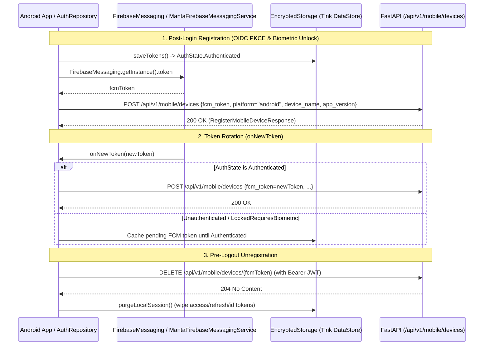

# Mobile FCM Device Registration API Contract & Lifecycle Specification (`US-72` / `SCRUM-494` & `SCRUM-495`)

**Parent User Story:** `SCRUM-375` (`US-72`: Push device registration)  
**Tasks Covered:**
- `SCRUM-494` (`Task 72.1`): Design `POST /api/v1/mobile/devices` and `DELETE /api/v1/mobile/devices/{token}` API contract, `mobile_devices` schema, and Android FCM lifecycle hooks.
- `SCRUM-495` (`Task 72.2`): Alembic migration (`f3b9c8d2a1e4`) for `mobile_devices` with `FORCE ROW LEVEL SECURITY` and FastAPI endpoint implementation.

**Blocks / Enables:**
- `SCRUM-496` (`Task 72.3`): Automatic FCM device registration after mobile sign-in and unregistration prior to sign-out in Kotlin.
- `SCRUM-497` (`Task 72.4`): Test scenarios for FCM token registration on sign-in and device deactivation on sign-out.
- `SCRUM-498` (`Task 72.5`): Automated Kotlin and `pytest` verification.

**Authoritative Backend Modules:**
- Router: [`backend/app/mobile/router.py`](../backend/app/mobile/router.py)
- Schemas: [`backend/app/mobile/schemas.py`](../backend/app/mobile/schemas.py)
- Persistence Service: [`backend/app/mobile/service.py`](../backend/app/mobile/service.py)
- ORM Model: [`backend/app/db/models/models.py`](../backend/app/db/models/models.py) (`MobileDevice`)
- Migration: [`backend/migrations/versions/f3b9c8d2a1e4_create_mobile_devices_table.py`](../backend/migrations/versions/f3b9c8d2a1e4_create_mobile_devices_table.py)

---

## 1. Objective & Security Invariants

1. **Authenticated Session Binding:** `tenant_id` and `user_id` are **never** accepted from the client request body. Both are derived strictly from validated OIDC RS256 JWT claims (`TokenClaims.tenant_uuid`, `TokenClaims.user_id`) and enforced at the database layer via PostgreSQL `FORCE ROW LEVEL SECURITY` (`app.current_tenant_id`).
2. **RBAC Permission (`MANAGE_OWN_MOBILE_DEVICES`):** Both endpoints require `Permission.MANAGE_OWN_MOBILE_DEVICES`, explicitly granted to all 7 canonical roles in [`docs/roles-permissions.json`](roles-permissions.json) and scoped to the caller's own `(tenant_id, user_id)` registrations.
3. **Non-Disclosure of Secret Tokens:** Response payloads return non-sensitive device metadata (`id`, `platform`, `device_name`, `app_version`, `is_active`, `last_seen_at`, `created_at`, `updated_at`) and **omit** `fcm_token`, `tenant_id`, and `user_id`.
4. **Idempotency:** Repeated `POST /api/v1/mobile/devices` calls for the same `(tenant_id, user_id, fcm_token)` upsert the single row in place, refresh `last_seen_at` / `updated_at` and device metadata, and reactivate `is_active = true`. Repeated `DELETE /api/v1/mobile/devices/{token}` calls return `204 No Content`.

---

## 2. REST API Contract

### 2.1 `POST /api/v1/mobile/devices` — Register or Refresh an FCM Device

- **Authentication & Authorization:** Bearer RS256 JWT (`JWTAuthMiddleware`), permission `MANAGE_OWN_MOBILE_DEVICES`.
- **Content-Type:** `application/json`
- **Success Status:** `200 OK`

#### Request Body (`RegisterMobileDeviceRequest`, `extra="forbid"`)

| Field | Type | Required | Default | Constraints & Normalization |
| :--- | :--- | :---: | :---: | :--- |
| `fcm_token` | `string` | Yes | — | `1..512` chars; must not be blank or contain leading/trailing whitespace. |
| `platform` | `string` | No | `"android"` | `1..32` chars; trimmed and lowercased before validation; must not be blank. |
| `device_name` | `string \| null` | No | `null` | `1..128` chars when provided; trimmed; blank string rejected with `422`. |
| `app_version` | `string \| null` | No | `null` | `1..32` chars when provided; trimmed; blank string rejected with `422`. |

#### Response Body (`RegisterMobileDeviceResponse`, `200 OK`)

```json
{
  "id": "550e8400-e29b-41d4-a716-446655440000",
  "platform": "android",
  "device_name": "Pixel 8 Pro",
  "app_version": "1.0.0",
  "is_active": true,
  "last_seen_at": "2026-11-19T15:30:00Z",
  "created_at": "2026-11-19T15:30:00Z",
  "updated_at": "2026-11-19T15:30:00Z"
}
```

#### Error Responses

| Status | Condition |
| :---: | :--- |
| `400 Bad Request` | Valid JWT lacks any usable user identity claim (`sub`, `email`, `user_id`). |
| `401 Unauthorized` | Missing, expired, or invalid Bearer JWT (`{"detail": "Not authenticated"}`). |
| `403 Forbidden` | Caller holds no recognized role or lacks `MANAGE_OWN_MOBILE_DEVICES`. |
| `404 Not Found` | Authenticated user has no active provisioned row in the tenant's `users` table. |
| `422 Unprocessable Entity` | Extra/unknown fields (e.g. client-supplied `tenant_id`), blank strings, leading/trailing whitespace on `fcm_token`, or length bounds exceeded. |

---

### 2.2 `DELETE /api/v1/mobile/devices/{token}` — Unregister an FCM Device

- **Authentication & Authorization:** Bearer RS256 JWT (`JWTAuthMiddleware`), permission `MANAGE_OWN_MOBILE_DEVICES`.
- **Path Parameter:** `token` (`string`) — the FCM registration token to remove for `(tenant_uuid, user_id)`.
- **Behavior:** Executes a tenant- and user-scoped `DELETE` on `mobile_devices` matching `(tenant_id, user_id, fcm_token)`. Idempotent: returns `204 No Content` whether or not a matching row existed.

#### Error Responses

| Status | Condition |
| :---: | :--- |
| `400 Bad Request` | Valid JWT lacks any usable user identity claim (`sub`, `email`, `user_id`), or `token` path parameter is blank after trimming. |
| `401 Unauthorized` | Missing, expired, or invalid Bearer JWT. |
| `403 Forbidden` | Caller lacks `MANAGE_OWN_MOBILE_DEVICES`. |

---

## 3. PostgreSQL `mobile_devices` Table Schema & RLS

Defined in [`MobileDevice`](../backend/app/db/models/models.py) and provisioned by Alembic revision [`f3b9c8d2a1e4`](../backend/migrations/versions/f3b9c8d2a1e4_create_mobile_devices_table.py):

| Column | PostgreSQL Type | Nullable | Default | Constraints / Notes |
| :--- | :--- | :---: | :--- | :--- |
| `id` | `UUID` | No | `gen_random_uuid()` | Primary key (`PRIMARY KEY (id)`). |
| `tenant_id` | `UUID` | No | — | `FK -> tenants.id ON DELETE CASCADE`; indexed (`idx_mobile_devices_tenant_id`). |
| `user_id` | `UUID` | No | — | `FK -> users.id ON DELETE CASCADE`. |
| `fcm_token` | `VARCHAR(512)` | No | — | Device FCM registration token. |
| `platform` | `VARCHAR(32)` | No | `'android'` | Client platform identifier. |
| `device_name` | `VARCHAR(128)` | Yes | `NULL` | Human-readable device model/name. |
| `app_version` | `VARCHAR(32)` | Yes | `NULL` | Mobile app semantic version. |
| `is_active` | `BOOLEAN` | No | `true` | Active push eligibility flag. |
| `last_seen_at` | `TIMESTAMPTZ` | No | `now()` | Updated on every upsert/refresh. |
| `created_at` | `TIMESTAMPTZ` | No | `now()` | Initial registration timestamp. |
| `updated_at` | `TIMESTAMPTZ` | No | `now()` | Updated on every upsert/refresh. |

- **Unique Constraint:** `uq_tenant_user_fcm_token` on `(tenant_id, user_id, fcm_token)` — enables atomic `INSERT ... ON CONFLICT ON CONSTRAINT uq_tenant_user_fcm_token DO UPDATE`.
- **Tenant Isolation (RLS):**
  - `ALTER TABLE mobile_devices ENABLE ROW LEVEL SECURITY;`
  - `ALTER TABLE mobile_devices FORCE ROW LEVEL SECURITY;`
  - Policy `tenant_isolation_policy` (`AS PERMISSIVE FOR ALL TO eng_app_user`) enforces `tenant_id = NULLIF(current_setting('app.current_tenant_id', true), '')::uuid` in both `USING` and `WITH CHECK`.
  - Grants: `GRANT SELECT, INSERT, UPDATE, DELETE ON mobile_devices TO eng_app_user;`

---

## 4. Android FCM Token Lifecycle Hooks (`SCRUM-496`)



### Lifecycle Rules for Kotlin (`SCRUM-496`)

1. **Retrofit Contract (`DeviceApiService`):**
   - `@POST("v1/mobile/devices")` (or `mobile/devices` relative to versioned `API_URL`) taking `RegisterMobileDeviceRequest(fcmToken, platform, deviceName, appVersion)` and returning `Response<RegisterMobileDeviceResponse>`.
   - `@DELETE("mobile/devices/{token}")` (`unregisterDevice(@Path("token") token: String): Response<Unit>`).
2. **Post-Login Registration:**
   - Immediately after `AuthRepository.saveTokens(...)` transitions `authState` to `AuthState.Authenticated` (and on biometric session unlock if a rotated/pending token is present), fetch the current FCM token via `FirebaseMessaging.getInstance().token` and call `POST /api/v1/mobile/devices`.
3. **`MantaFirebaseMessagingService.onNewToken(token)`:**
   - When Firebase rotates the registration token while the user holds an active `AuthState.Authenticated` session, dispatch `POST /api/v1/mobile/devices` with the new token. If unauthenticated or locked behind biometrics, persist/defer the token so it is registered as soon as `AuthState.Authenticated` is reached.
4. **Pre-Logout Unregistration:**
   - In `AuthRepository.signOut(fcmToken)`, invoke `DELETE /api/v1/mobile/devices/{fcmToken}` **while the Bearer access token (and `TokenAuthenticator` refresh flow) is still valid**, **before** calling `purgeLocalSession()` to wipe Tink/DataStore credentials.
