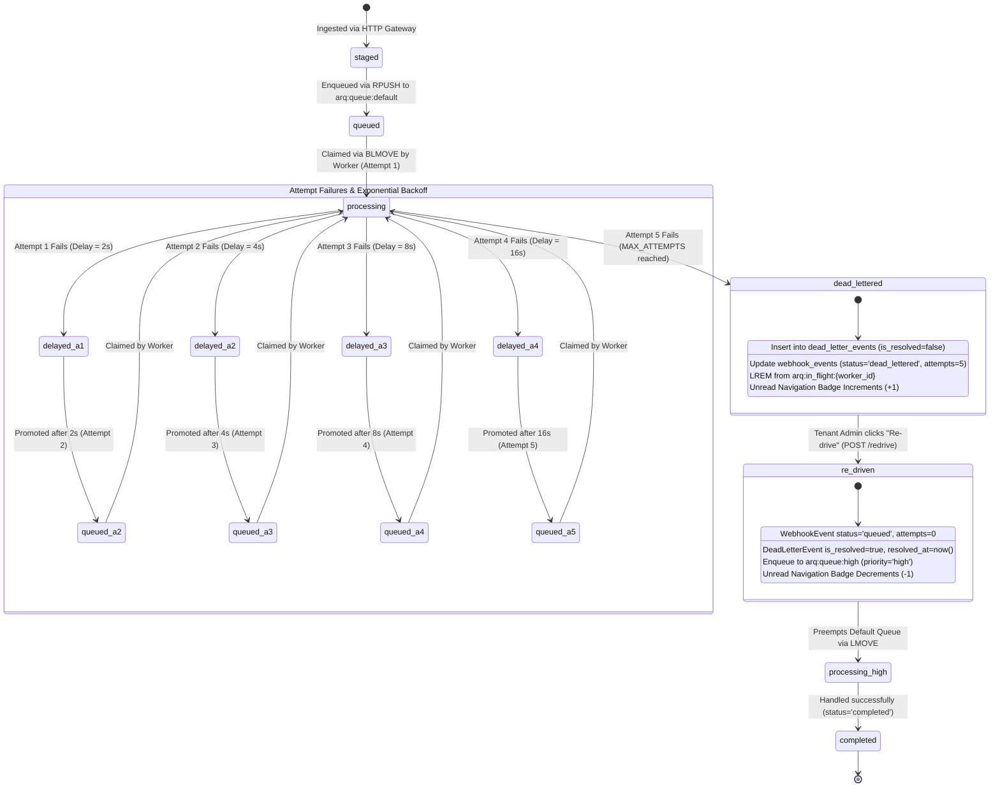

# US-23: Poison Payload 5x Retry, Navigation Badge Increment, DLQ Quarantine & One-Click Re-drive Test Scenarios

**Task:** `SCRUM-419` (`Task 23.5`: Create test scenarios for poison payload 5x retry, navigation badge increment, re-drive and Developer HTTP 403)  
**Parent User Story:** `SCRUM-360` (`US-23`: Dead-Letter Queue (DLQ) & Poison Message Quarantine / Recovery)  
**Related Tickets:**  
- `SCRUM-415` / `Task 23.1`: Design DLQ schema, 5-attempt retry backoff, quarantine mechanism, and re-drive API  
- `SCRUM-416` / `Task 23.2`: Write migration for `dead_letter_events` table and tenant RLS policies ([`backend/migrations/versions/02ec69277327_initial_core_schema.py`](../backend/migrations/versions/02ec69277327_initial_core_schema.py))  
- `SCRUM-417` / `Task 23.3`: Write migration for `dead_letter_events` composite index and implement 5-attempt exponential backoff router ([`backend/migrations/versions/b3e9f2a6d4c1_dead_letter_events_unresolved_index.py`](../backend/migrations/versions/b3e9f2a6d4c1_dead_letter_events_unresolved_index.py), [`backend/workers/retry.py`](../backend/workers/retry.py))  
- `SCRUM-418` / `Task 23.4`: Implement `GET /api/v1/dead-letters` and `POST /api/v1/dead-letters/{id}/redrive` enforcing RBAC (`HTTP 403` for Developer) ([`backend/app/dead_letters/router.py`](../backend/app/dead_letters/router.py), [`backend/app/dead_letters/service.py`](../backend/app/dead_letters/service.py), [`backend/app/dead_letters/schemas.py`](../backend/app/dead_letters/schemas.py))  
- `SCRUM-419` / `Task 23.5`: Create test scenarios for poison payload 5x retry, navigation badge increment, re-drive and Developer HTTP 403 (this document)  
- `SCRUM-420` / `Task 23.6`: Write automated pytest test verifying poison payload 5x retry, `dead_letter_events` row and queue unblocked ([`backend/tests/test_retry_backoff_and_quarantine.py`](../backend/tests/test_retry_backoff_and_quarantine.py))  
- `SCRUM-421` / `Task 23.7`: Write automated E2E / integration test verifying DLQ UI inspection, one-click re-drive, and Developer HTTP 403 ([`backend/tests/test_dead_letters_api.py`](../backend/tests/test_dead_letters_api.py), [`web/e2e/integration-role-access.spec.ts`](../web/e2e/integration-role-access.spec.ts))  
- `SCRUM-404` / `SCRUM-407`: Valkey / Redis 7 reliable FIFO queue topology, two-phase priority preemption (`arq:queue:high` over `arq:queue:default`), and crash-safe in-flight lists ([`docs/fifo-queue-topology.md`](fifo-queue-topology.md), [`docs/fifo-ordering-priority-preemption-and-sigkill-crash-test-scenarios.md`](fifo-ordering-priority-preemption-and-sigkill-crash-test-scenarios.md))  
- `SCRUM-306` / `SCRUM-311`: Authoritative Role-Permission Matrix (`MANAGE_WEBHOOK_INTEGRATIONS` allowed exclusively for `TENANT_ADMIN`, denied for `DEVELOPER`) ([`docs/roles-permissions.md`](roles-permissions.md), [`docs/role-access-test-scenarios.md`](role-access-test-scenarios.md))  

**Target Infrastructure Engines:** PostgreSQL 16 with Row-Level Security (`pgvector/pgvector:pg16`) & Valkey 7 / Redis 7+ (`valkey/valkey:7-alpine`)  
**Target Implementation Modules:** [`backend/workers/retry.py`](../backend/workers/retry.py), [`backend/workers/worker.py`](../backend/workers/worker.py), [`backend/app/dead_letters/router.py`](../backend/app/dead_letters/router.py), [`backend/app/dead_letters/service.py`](../backend/app/dead_letters/service.py), [`backend/app/dead_letters/schemas.py`](../backend/app/dead_letters/schemas.py), [`web/src/components/layout/sidebar.tsx`](../web/src/components/layout/sidebar.tsx), [`web/src/config/navigation.ts`](../web/src/config/navigation.ts), [`web/src/app/(portal)/integrations/page.tsx`](../web/src/app/(portal)/integrations/page.tsx)  
**Authoritative Automated Pytest Suites:** [`backend/tests/test_retry_backoff_and_quarantine.py`](../backend/tests/test_retry_backoff_and_quarantine.py), [`backend/tests/test_dead_letters_api.py`](../backend/tests/test_dead_letters_api.py)  
**Specification Location in Test Suite:** [`backend/tests/scenarios/test_us23_poison_payload_retry_and_dlq_scenarios.md`](../backend/tests/scenarios/test_us23_poison_payload_retry_and_dlq_scenarios.md)  
**Assignee:** Matvii Yeromenko  
**Category:** Testing - Design  
**Estimate:** 0.25 Story Points (0h 30m Original Estimate)  
**Status:** Approved / Verification Baseline Established  

---

## 1. Executive Summary & Objective

### 1.1 Objective

Design and formalize the definitive verification scenarios for **poison webhook message quarantine, exponential backoff retries, navigation badge unread increment, Dead-Letter Queue (DLQ) UI inspection, one-click high-priority re-drive, multi-tenant isolation, and strict server/UI Role-Based Access Control (RBAC)** in `US-23` (`SCRUM-360`).

In distributed event-driven architectures, incoming webhook signals (GitHub push/PR, Jira issue transitions, Slack delivery threads) can carry malformed JSON payloads, schema drifts, circular references, or trigger unhandled downstream edge-case bugs. If a worker consumer encounters such a "poison payload," naive immediate retries result in tight failure loops that monopolize worker threads, cause CPU starvation, block thousands of healthy waiting events, and overwhelm logging infrastructure.

This specification establishes the exhaustive end-to-end verification baseline ensuring:
1. **Non-Blocking Exponential Backoff:** Transient handler exceptions are delayed according to a strict mathematical backoff schedule ($2^a$ seconds for attempts $1 \le a \le 4$: $2\text{s}, 4\text{s}, 8\text{s}, 16\text{s}$), parked in the Valkey/Redis sorted set `arq:queue:delayed`, freeing workers immediately to process subsequent valid jobs without head-of-line blocking.
2. **Deterministic Terminal Quarantine ($a = 5$):** Upon the 5th consecutive failure, the poison event transitions permanently out of the active queue lifecycle and is committed to PostgreSQL `dead_letter_events` with full diagnostic metadata (fully qualified `error_class`, verbatim Python `stack_trace`, total attempts count, and original JSONB payload). Concurrently, `webhook_events.status` updates to `'dead_lettered'` and the message is positively acknowledged (`ack_job`) to clear the worker's in-flight list.
3. **Reactive Navigation Badge Counter Increment:** Quarantining an unresolved poison event dynamically increments the tenant's unread DLQ counter ($C_{\text{unresolved}} = \text{COUNT}(*) \text{ WHERE is\_resolved = false}$), which surfaces immediately in the web portal sidebar navigation under `ADMINISTRATION` $\rightarrow$ `Integrations` / DLQ badge.
4. **Rich Diagnostic DLQ UI Inspection:** Authorized Tenant Administrators can inspect quarantined events, view formatted tracebacks and offending payload structures, and understand root-cause failures before remediating.
5. **One-Click High-Priority Re-drive (`arq:queue:high`):** Clicking "Re-drive" atomically resets `webhook_events` (`status = 'queued'`, `attempts = 0`, `error_message = NULL`), marks the DLQ item resolved (`is_resolved = true`, `resolved_by = user_id`, `resolved_at = now()`), and pushes the execution envelope to `arq:queue:high` with `priority = 'high'`, guaranteeing immediate preemption ahead of default queue backlogs.
6. **Multi-Tenant Row-Level Security (RLS) Containment:** PostgreSQL RLS (`eng_app_user`) guarantees that Tenant B can never query, observe, inspect, or re-drive Tenant A's quarantined messages, returning `0` rows and `HTTP 404 Not Found` without information leakage.
7. **Strict RBAC Enforcement (`DEVELOPER` $\rightarrow$ `HTTP 403`):** Endpoints require the `MANAGE_WEBHOOK_INTEGRATIONS` permission. Unprivileged roles (`DEVELOPER`, `SCRUM_MASTER`, `PROJECT_MANAGER`, etc.) receive `HTTP 403 Forbidden` across all DLQ endpoints, while the web portal dynamically hides administration links and redirects direct route access to `/`.

---

## 2. Core Architectural Invariants & Mathematical Formulations

```
+-------------------------------------------------------------------------------------------------------------------+
|                           POISON PAYLOAD QUARANTINE & DLQ RE-DRIVE TOPOLOGY (US-23)                               |
+-------------------------------------+-------------------------------------+---------------------------------------+
| 1. Exponential Backoff Schedule     | 2. Terminal Quarantine (a = 5)      | 3. High-Priority Re-Drive Preemption  |
|    (delay = 2^attempt seconds)      |    (INSERT dead_letter_events)      |    (RPUSH arq:queue:high)             |
+-------------------------------------+-------------------------------------+---------------------------------------+
| * Attempt 1: 2s (due = now + 2s)    | * 5th failure triggers quarantine   | * One-click resolution resets event   |
| * Attempt 2: 4s (due = now + 4s)    | * Stores: error_class, stack_trace, | * status = 'queued', attempts = 0     |
| * Attempt 3: 8s (due = now + 8s)    |   payload JSONB, total_attempts=5   | * DLQ marked is_resolved = true       |
| * Attempt 4: 16s (due = now + 16s)  | * webhook_events.status='dead_letter| * Pushed to arq:queue:high (priority) |
| * Parked in Redis arq:queue:delayed | * Prompts unread badge increment:   | * Two-phase worker fetch preempts     |
| * Worker unblocked for valid jobs   |   unresolved_count: N -> N + 1      |   standard arq:queue:default backlog  |
+-------------------------------------+-------------------------------------+---------------------------------------+
                                                         |
                                                         v
+-------------------------------------------------------------------------------------------------------------------+
|                                MULTI-TENANT RLS BOUNDARY & RBAC PERMISSION GATES                                  |
+----------------------------------------------------+--------------------------------------------------------------+
| 4. Tenant Row-Level Security (RLS Isolation)       | 5. RBAC Gate: MANAGE_WEBHOOK_INTEGRATIONS                    |
+----------------------------------------------------+--------------------------------------------------------------+
| * Table dead_letter_events enforces FORCE RLS      | * TENANT_ADMIN holds permission -> HTTP 200 / 202 Allowed    |
| * Session bound to app.current_tenant_id           | * DEVELOPER lacks permission -> HTTP 403 Forbidden           |
| * Tenant B cannot read or re-drive Tenant A DLQ    | * UI suppresses navigation menu and redirects /integrations  |
| * Anti-enumeration defense: cross-tenant DLQ = 404 | * Unauthenticated requests rejected with HTTP 401            |
+----------------------------------------------------+--------------------------------------------------------------+
```

### Invariant 1: Mathematical Exponential Backoff Schedule

For any failed execution attempt $a \in \{1, 2, 3, 4, 5\}$, the backoff duration $D(a)$ in seconds is governed by:

$$D(a) = 2^a \quad \text{for } 1 \le a \le 5$$

The discrete backoff progression is strictly deterministic:
- $\mathbf{a = 1:}$ $D(1) = 2^1 = \mathbf{2\text{ seconds}}$. Failed envelope is updated with `attempt: 1`, parked in Redis `arq:queue:delayed` at score $t_{\text{due}} = t_{\text{now}} + 2.0$. `webhook_events.attempts` updated to $1$.
- $\mathbf{a = 2:}$ $D(2) = 2^2 = \mathbf{4\text{ seconds}}$. Envelope updated with `attempt: 2`, parked at $t_{\text{due}} = t_{\text{now}} + 4.0$. `webhook_events.attempts` updated to $2$.
- $\mathbf{a = 3:}$ $D(3) = 2^3 = \mathbf{8\text{ seconds}}$. Envelope updated with `attempt: 3`, parked at $t_{\text{due}} = t_{\text{now}} + 8.0$. `webhook_events.attempts` updated to $3$.
- $\mathbf{a = 4:}$ $D(4) = 2^4 = \mathbf{16\text{ seconds}}$. Envelope updated with `attempt: 4`, parked at $t_{\text{due}} = t_{\text{now}} + 16.0$. `webhook_events.attempts` updated to $4$.
- $\mathbf{a = 5:}$ $D(5) = 2^5 = \mathbf{32\text{ seconds}}$. Attempt 5 represents the **maximum retry limit** ($\text{MAX\_ATTEMPTS} = 5$). Instead of scheduling a 6th retry, the router triggers **immediate terminal quarantine**.

#### Non-Blocking Queue Guarantee
Failed jobs are moved to the Redis ZSET `arq:queue:delayed` via `ZADD`. Workers immediately acknowledge and drop the current execution cycle without sleeping or blocking worker threads:

$$\text{Worker Processing Latency on Failure} \le 15\text{ ms} \ll D(a)$$

Concurrently waiting valid jobs in `arq:queue:high` and `arq:queue:default` continue executing with zero pipeline stalls.

### Invariant 2: Terminal Quarantine & Relational Atomicity

When attempt $a \ge \text{MAX\_ATTEMPTS} = 5$ fails, the router invokes `quarantine_event()` within a tenant-scoped database transaction:

```sql
-- 1. Insert diagnostic record into dead_letter_events
INSERT INTO dead_letter_events (
    id, original_event_id, tenant_id, provider, error_class, stack_trace,
    total_attempts, payload, quarantined_at, is_resolved
) VALUES (
    :dl_id, :event_id, :tenant_id, :provider, :error_class, :stack_trace,
    5, CAST(:payload AS jsonb), NOW(), false
);

-- 2. Mark parent webhook_events row as dead_lettered
UPDATE webhook_events
SET attempts = GREATEST(attempts, 5),
    status = 'dead_lettered',
    error_message = :error_message
WHERE id = :event_id;

-- 3. Commit transaction atomically
COMMIT;
```

Following database commit, the worker invokes `ack_job(redis, worker_id, raw_job)` to remove the poison job from `arq:in_flight:{worker_id}` via `LREM`. Zero traces remain in Redis active queues.

### Invariant 3: Unread DLQ Count & Dynamic Navigation Badge Formula

The unread badge count $B_{\text{unread}}$ rendered in the portal sidebar navigation is defined by the count of unresolved quarantine events belonging to the authenticated tenant:

$$B_{\text{unread}}(\tau) = \sum_{e \in \mathcal{E}_{\text{DLQ}}} \mathbb{I}\left(e.\text{tenant\_id} = \tau \;\land\; e.\text{is\_resolved} = \mathbf{FALSE}\right)$$

This count is served with $O(1)$ index efficiency via the composite partial index:
$$\text{idx\_dead\_letter\_events\_unresolved ON dead\_letter\_events (tenant\_id, is\_resolved, quarantined\_at DESC)}$$

Upon insertion of a quarantined poison event:
$$B_{\text{unread}} \longrightarrow B_{\text{unread}} + 1$$

Upon successful re-drive resolution of a DLQ event:
$$B_{\text{unread}} \longrightarrow \max(0, B_{\text{unread}} - 1)$$

### Invariant 4: Diagnostic Stack Trace & Verbatim Payload Preservation

To allow effective SRE and engineering root-cause debugging:
1. `error_class`: Preserves the fully qualified exception type (e.g. `builtins.ValueError`, `json.decoder.JSONDecodeError`, `app.webhooks.exceptions.SignatureVerificationError`).
2. `stack_trace`: Formatted Python traceback containing file paths, line numbers, function call chains, and exception messages verbatim.
3. `payload`: Original JSONB webhook payload preserved without truncation or mutation.

### Invariant 5: One-Click Re-drive & High-Priority Preemption

Re-driving a quarantined event executes under a strict two-phase atomic protocol:

1. **Phase 1: Database State Reset (ACID Transaction):**
   - Locks the DLQ record via `SELECT ... FROM dead_letter_events WHERE id = :id FOR UPDATE`.
   - Asserts `is_resolved == False` (returns `HTTP 409 Conflict` if already resolved).
   - Resets `webhook_events`: `status = 'queued'`, `attempts = 0`, `error_message = NULL`.
   - Marks `dead_letter_events`: `is_resolved = true`, `resolved_by = :resolver_user_id`, `resolved_at = NOW()`.
   - Commits transaction strictly prior to enqueuing into Redis.
2. **Phase 2: High-Priority Queue Injection (`arq:queue:high`):**
   - Serializes a fresh canonical job envelope with `priority = 'high'`, `attempt = 0`, `job_type = 'webhook_event'`.
   - Appends to Valkey/Redis list: `RPUSH arq:queue:high <envelope>`.
3. **Preemption Enforcement:**
   - Worker polling protocol checks `arq:queue:high` via non-blocking `LMOVE ... arq:in_flight:{worker_id} LEFT RIGHT` *before* polling `arq:queue:default`.
   - The re-driven job is processed immediately by the next available worker ahead of all standard jobs in `arq:queue:default`.

### Invariant 6: Multi-Tenant Row-Level Security & Anti-Enumeration Isolation

- Table `dead_letter_events` enforces `ENABLE ROW LEVEL SECURITY` and `FORCE ROW LEVEL SECURITY`.
- Unprivileged database role `eng_app_user` evaluates policy:
  ```sql
  CREATE POLICY tenant_isolation_policy ON dead_letter_events
      AS PERMISSIVE FOR ALL TO eng_app_user
      USING (tenant_id = NULLIF(current_setting('app.current_tenant_id', true), '')::uuid)
      WITH CHECK (tenant_id = NULLIF(current_setting('app.current_tenant_id', true), '')::uuid);
  ```
- Cross-tenant lookups (`SELECT` or `UPDATE` where `tenant_id != app.current_tenant_id`) return `0` rows.
- Re-drive attempts by Tenant B targeting Tenant A's `dead_letter_id` return `HTTP 404 Not Found` (anti-enumeration defense: does not leak whether the ID exists).

### Invariant 7: RBAC Server-Side & UI Gate Enforcement

- The DLQ router enforces `require_permission(Permission.MANAGE_WEBHOOK_INTEGRATIONS)`.
- **`TENANT_ADMIN`:** Holds permission $\rightarrow$ Granted (`HTTP 200 OK` on GET, `HTTP 202 Accepted` on POST).
- **`DEVELOPER` & Other Roles:** Lack permission $\rightarrow$ Rejected with `HTTP 403 Forbidden`:
  ```json
  { "detail": "Operation not permitted: requires permission MANAGE_WEBHOOK_INTEGRATIONS" }
  ```
- **Web UI:** Client evaluates `can("MANAGE_WEBHOOK_INTEGRATIONS")`. For `DEVELOPER`, the `ADMINISTRATION` sidebar section and `Integrations` link are suppressed from the DOM; direct navigation to `/integrations` triggers redirect to `/`.

---

## 3. Relational Schemas, State Machines & Sequence Flows

### 3.1 Relational DDL Specifications

```sql
-- 1. Dead Letter Events Table (PostgreSQL 16)
CREATE TABLE IF NOT EXISTS dead_letter_events (
    id UUID PRIMARY KEY,
    original_event_id UUID NOT NULL REFERENCES webhook_events(id) ON DELETE CASCADE,
    tenant_id UUID NOT NULL REFERENCES tenants(id) ON DELETE CASCADE,
    provider VARCHAR(32) NOT NULL,
    error_class TEXT NOT NULL,
    stack_trace TEXT NOT NULL,
    total_attempts INTEGER NOT NULL,
    payload JSONB NOT NULL,
    quarantined_at TIMESTAMPTZ NOT NULL DEFAULT NOW(),
    is_resolved BOOLEAN NOT NULL DEFAULT FALSE,
    resolved_by UUID REFERENCES users(id) ON DELETE SET NULL,
    resolved_at TIMESTAMPTZ NULL
);

-- 2. Indexes for O(1) Tenant Filtering and Unresolved Count Lookups
CREATE INDEX IF NOT EXISTS idx_dead_letter_events_tenant_id 
    ON dead_letter_events (tenant_id);

CREATE INDEX IF NOT EXISTS idx_dead_letter_events_unresolved 
    ON dead_letter_events (tenant_id, is_resolved, quarantined_at DESC);

-- 3. Row-Level Security Enforcement
ALTER TABLE dead_letter_events ENABLE ROW LEVEL SECURITY;
ALTER TABLE dead_letter_events FORCE ROW LEVEL SECURITY;
```

### 3.2 Webhook Lifecycle & Poison Quarantine State Machine



### 3.3 End-to-End Sequence Diagram: Quarantine, Navigation Badge, Inspection, Re-drive & RBAC

```mermaid
sequenceDiagram
    autonumber
    actor Dev as Developer (Unprivileged)
    actor Admin as Tenant Admin (Authorized)
    participant Portal as Web Portal (Next.js 15)
    participant API as FastAPI Backend (/api/v1/dead-letters)
    participant Worker as Background Worker Loop
    participant Redis as Valkey 7 / Redis Broker
    participant DB as PostgreSQL 16 (RLS Context)

    Note over Worker, Redis: 1. Poison Event Retries (Attempts 1 to 4)
    Worker->>Redis: fetch_next_job() claims job (Attempt 1)
    Worker--xWorker: Exception raised! (Handler fails)
    Worker->>DB: UPDATE webhook_events SET attempts=1, status='queued'
    Worker->>Redis: ZADD arq:queue:delayed (score = now + 2s)
    Worker->>Redis: ack_job() -> LREM arq:in_flight
    Note over Worker: Worker continues without delay; valid jobs flow!

    Note over Worker, DB: 2. Attempt 5 Terminal Quarantine
    Worker->>Redis: fetch_next_job() claims job (Attempt 5)
    Worker--xWorker: Exception raised! (5th consecutive failure)
    Worker->>DB: INSERT INTO dead_letter_events (payload, stack_trace, total_attempts=5, is_resolved=false)
    Worker->>DB: UPDATE webhook_events SET status='dead_lettered', attempts=5
    Worker->>DB: COMMIT
    Worker->>Redis: ack_job() -> LREM arq:in_flight

    Note over Portal, API: 3. Dynamic Navigation Badge Increment
    Portal->>API: GET /api/v1/dead-letters?status=unresolved
    API->>DB: SELECT COUNT(*) FROM dead_letter_events WHERE tenant_id=:t AND is_resolved=false
    DB-->>API: Returns unresolved_count = 1
    API-->>Portal: HTTP 200 { items: [...], unresolved_count: 1 }
    Portal->>Portal: Sidebar badge updates to "1" (Red / Highlight)

    Note over Dev, API: 4. RBAC Enforcement: Developer HTTP 403
    Dev->>API: GET /api/v1/dead-letters (JWT roles: ["DEVELOPER"])
    API->>API: Check MANAGE_WEBHOOK_INTEGRATIONS permission
    API-->>Dev: HTTP 403 Forbidden { detail: "Operation not permitted" }
    Dev->>Portal: Navigate directly to /integrations
    Portal->>Portal: PortalAuthGuard intercepts -> Redirects to /

    Note over Admin, Portal: 5. DLQ Inspection & Stack Trace Analysis
    Admin->>Portal: Clicks Integrations -> DLQ Quarantine Tab
    Portal->>API: GET /api/v1/dead-letters?status=unresolved
    API-->>Portal: HTTP 200 { items: [ { id, error_class, stack_trace, payload, total_attempts: 5 } ] }
    Portal->>Admin: Displays Diagnostic Drawer with formatted Traceback & Payload

    Note over Admin, Worker: 6. One-Click Re-drive into arq:queue:high
    Admin->>Portal: Clicks "Re-drive" button
    Portal->>API: POST /api/v1/dead-letters/{id}/redrive
    API->>DB: BEGIN TX -> SELECT ... FOR UPDATE -> Assert is_resolved == false
    API->>DB: UPDATE webhook_events SET status='queued', attempts=0, error_message=NULL
    API->>DB: UPDATE dead_letter_events SET is_resolved=true, resolved_by=:admin_id, resolved_at=NOW()
    API->>DB: COMMIT
    API->>Redis: RPUSH arq:queue:high <canonical envelope with priority='high'>
    API-->>Portal: HTTP 202 Accepted { id, event_id, status: 'queued', queue: 'arq:queue:high', enqueued: true }
    Portal->>Portal: Badge decrements (1 -> 0); Item removed from unresolved view
    Worker->>Redis: Phase 1 LMOVE arq:queue:high -> Claim re-driven job ahead of default queue!
```

---

## 4. Master Test Scenarios Matrix

| Scenario ID | Test Scenario Summary | Category | Target Component | Injected Condition / Input | Expected API / Worker / UI Result | Verified Invariant | Target Test Suite |
| :--- | :--- | :--- | :--- | :--- | :--- | :--- | :--- |
| **TC-DLQ-001** | **5-Attempt Exponential Backoff Progression & Non-Blocking Worker Flow** | Functional / Chaos | `workers.retry`, `workers.worker` | Poison webhook payload causing repeated unhandled exception; 4 consecutive worker fetch loop cycles. | Attempts 1..4 scheduled in `arq:queue:delayed` at $t + 2\text{s}, 4\text{s}, 8\text{s}, 16\text{s}$; `webhook_events.attempts` increments; subsequent valid jobs execute without delay. | Invariant 1 (Backoff Schedule) | Pytest: `test_retry_backoff_and_quarantine.py` |
| **TC-DLQ-002** | **Terminal Poison Payload Quarantine on 5th Failure** | Functional / Storage | `workers.retry`, PostgreSQL | Poison job fails on attempt 5 (`attempt == 5`). | `dead_letter_events` row created with `total_attempts=5`, `is_resolved=false`, full `stack_trace`, and `payload`; `webhook_events.status='dead_lettered'`; job ACKed from in-flight list. | Invariant 2 & 4 (Terminal Quarantine & Traceback) | Pytest: `test_retry_backoff_and_quarantine.py` |
| **TC-DLQ-003** | **Unread Navigation Badge Dynamic Increment upon Quarantine** | Integration / UI | Web Portal Navigation, DLQ API | Tenant has 0 unresolved DLQ items. Poison event is quarantined. Portal polls/refreshes navigation. | `GET /api/v1/dead-letters` returns `unresolved_count=1`; portal sidebar navigation renders unread indicator / badge `"1"` under `Integrations`. | Invariant 3 (Unread Count & Navigation Badge) | Playwright: `dlq-navigation-badge.spec.ts` |
| **TC-DLQ-004** | **Quarantined Event Stack Trace & Payload Diagnostic Inspection** | Functional / UI | `app.dead_letters`, Web Portal | `TENANT_ADMIN` opens DLQ inspection drawer for quarantined event. | UI renders formatted `error_class`, expandable monospace Python `stack_trace`, syntax-highlighted JSONB `payload`, and `total_attempts = 5`. | Invariant 4 (Diagnostics & Payload Preservation) | Playwright: `dlq-inspection.spec.ts` |
| **TC-DLQ-005** | **One-Click Re-drive: Atomic State Reset & High-Priority Enqueue** | Functional / API | `app.dead_letters.router`, Valkey 7 | `TENANT_ADMIN` issues `POST /api/v1/dead-letters/{id}/redrive`. | Database commits `is_resolved=true`, resets `webhook_events` (`status='queued'`, `attempts=0`), enqueues envelope to `arq:queue:high` with `priority='high'`; returns `HTTP 202 Accepted`. | Invariant 5 (Atomic Re-drive) | Pytest: `test_dead_letters_api.py` |
| **TC-DLQ-006** | **High-Priority Queue Preemption of Re-driven Event Ahead of Backlog** | Concurrency / Queue | `workers.worker`, Valkey 7 | 50 standard jobs in `arq:queue:default`; 1 re-driven DLQ event pushed to `arq:queue:high`. | Worker fetch loop pops `arq:queue:high` via Phase 1 non-blocking `LMOVE`; re-driven job completes *before* any of the 50 default jobs. | Invariant 5 (Two-Phase Preemption) | Pytest: `test_fifo_queue_and_crash_recovery.py` |
| **TC-DLQ-007** | **Safe Degradation on Broker Outage During Re-drive** | Resilience / Broker | `app.dead_letters.router` | Redis broker down / network disconnected during re-drive execution. | DB transaction commits (`is_resolved=true`, `webhook_events.status='queued'`); returns `HTTP 202 Accepted` with `enqueued=false`; recovery sweeper recovers queued event. | Invariant 5 (Safe Broker Degradation) | Pytest: `test_dead_letters_api.py` |
| **TC-DLQ-008** | **Re-drive Rejection for Already Resolved DLQ Event (Conflict)** | Functional / API | `app.dead_letters.service` | `TENANT_ADMIN` invokes `POST /redrive` on a DLQ event where `is_resolved == true`. | Backend rejects operation with `HTTP 409 Conflict` (`"Dead-letter event already resolved"`); zero duplicate Redis pushes. | Invariant 5 (Re-drive Idempotency & Conflict Guard) | Pytest: `test_dead_letters_api.py` |
| **TC-DLQ-009** | **Cross-Tenant Row-Level Security Read Isolation on DLQ Queries** | Security / RLS | PostgreSQL RLS, `eng_app_user` | Tenant A has 3 quarantined items; Tenant B has 0 items. Tenant B queries `GET /api/v1/dead-letters`. | Tenant B receives `items: []`, `unresolved_count: 0`, `total: 0`; zero rows from Tenant A leaked; direct SQL queries return 0 rows. | Invariant 6 (RLS Read Containment) | Pytest: `test_dead_letters_api.py` |
| **TC-DLQ-010** | **Cross-Tenant Anti-Enumeration on Re-drive Execution** | Security / RLS | `app.dead_letters.router`, RLS | Tenant B attempts `POST /api/v1/dead-letters/{tenant_a_dl_id}/redrive`. | Endpoint returns `HTTP 404 Not Found` (`"Dead-letter event not found"`); Tenant B cannot determine existence of Tenant A records. | Invariant 6 (Anti-Enumeration Defense) | Pytest: `test_dead_letters_api.py` |
| **TC-DLQ-011** | **RBAC Enforcement: DEVELOPER Role Receives HTTP 403 on DLQ API** | Security / RBAC | `app.dead_letters.router` | Authenticated user with role `DEVELOPER` invokes `GET /api/v1/dead-letters` and `POST /redrive`. | Server responds with `HTTP 403 Forbidden` (`{"detail": "Operation not permitted"}`); requests blocked before DB access. | Invariant 7 (Server RBAC Gate) | Pytest: `test_dead_letters_api.py` |
| **TC-DLQ-012** | **UI RBAC Enforcement: DEVELOPER Menu Suppression & Route Interception** | Security / UI | Web Portal (`sidebar.tsx`, Next.js) | User logged in with `DEVELOPER` role visits portal. | `ADMINISTRATION` header and `Integrations` navigation link hidden; navigating directly to `/integrations` redirects to `/`. | Invariant 7 (UI RBAC & Route Guard) | Playwright: `integration-role-access.spec.ts` |
| **TC-DLQ-013** | **Non-Admin System Roles Evaluation (All Non-Admins Receive HTTP 403)** | Security / RBAC | `app.dead_letters.router` | Iterating through `SCRUM_MASTER`, `PROJECT_MANAGER`, `SOLUTION_ARCHITECT`, `DELIVERY_DIRECTOR`, `TOP_MANAGEMENT`. | Every non-admin role receives `HTTP 403 Forbidden` on all DLQ routes; permission matrix test validates 100% denial. | Invariant 7 (Role-Permission Matrix Completeness) | Pytest: `test_dead_letters_api.py` |
| **TC-DLQ-014** | **Unauthenticated Request Rejection on DLQ Endpoints** | Security / Auth | FastAPI Auth Middleware | Request sent without `Authorization: Bearer <token>` header or with expired/invalid signature. | Backend returns `HTTP 401 Unauthorized`; zero internal endpoint logic executed. | Invariant 7 (Authentication Gate) | Pytest: `test_dead_letters_api.py` |

---

## 5. Detailed Test Scenario Specifications

### 5.1 Scenario `TC-DLQ-001`: 5-Attempt Exponential Backoff Progression & Non-Blocking Worker Flow

#### 5.1.1 Objective & Traceability
- **Objective:** Verify that when a webhook job repeatedly raises unhandled exceptions, the router calculates the exact $2^a$-second exponential backoff delay, parks the envelope in `arq:queue:delayed`, updates `webhook_events.attempts`, and unblocks the worker loop so subsequent valid jobs execute without latency degradation.
- **Traceability:** `US-23`, `Task 23.3` (`SCRUM-417`), `Task 23.5` (`SCRUM-419`), Acceptance Criteria Scope #1.

#### 5.1.2 Preconditions
- Tenant registered with UUID $\tau_1$.
- PostgreSQL and Valkey 7 running with zero queued jobs.
- Webhook event $E_1$ staged in PostgreSQL:
  - `id`: $e_1 = \text{UUID()}$
  - `tenant_id`: $\tau_1$
  - `status`: `'queued'`
  - `attempts`: $0$
- Ingested envelope $J_{\text{poison}}$ placed in `arq:queue:default`.
- Concurrently, 5 valid webhook jobs $V_1 \dots V_5$ are placed behind $J_{\text{poison}}$ in `arq:queue:default`.

#### 5.1.3 Execution Sequence & Concrete Inputs
1. **Cycle 1 (Attempt 1):**
   - Worker fetches $J_{\text{poison}}$ via `fetch_next_job()`.
   - Handler raises `ValueError("Malformed payload AST parsing failed")`.
   - Router evaluates `_current_attempt(envelope)` $\rightarrow a = 1$.
   - Router calculates delay: $D(1) = 2^1 = 2\text{s}$.
   - Router records: `UPDATE webhook_events SET attempts=1, status='queued', error_message='ValueError: Malformed payload AST parsing failed' WHERE id = e_1`.
   - Envelope serialized with `"attempt": 1` and pushed to `arq:queue:delayed` with score $t_{\text{due}} = t_0 + 2.0$.
   - Worker removes $J_{\text{poison}}$ from `arq:in_flight:{worker_id}`.
2. **Immediate Valid Jobs Processing:**
   - Worker immediately fetches next job from `arq:queue:default`.
   - Worker completes valid jobs $V_1, V_2, V_3, V_4, V_5$ sequentially without waiting for the 2-second backoff delay.
3. **Cycle 2 (Attempt 2):**
   - At $t_0 + 2.1\text{s}$, `promote_due_retries()` promotes $J_{\text{poison}}$ to the tail of `arq:queue:default`.
   - Worker claims $J_{\text{poison}}$, raises exception $\rightarrow a = 2$.
   - Delay: $D(2) = 2^2 = 4\text{s}$. Parked in `arq:queue:delayed` at $t_0 + 2.1 + 4.0 = t_0 + 6.1\text{s}$. `attempts = 2`.
4. **Cycle 3 (Attempt 3):**
   - Promoted at $t_0 + 6.2\text{s}$, fails $\rightarrow a = 3$.
   - Delay: $D(3) = 2^3 = 8\text{s}$. Parked at $t_0 + 14.2\text{s}$. `attempts = 3`.
5. **Cycle 4 (Attempt 4):**
   - Promoted at $t_0 + 14.3\text{s}$, fails $\rightarrow a = 4$.
   - Delay: $D(4) = 2^4 = 16\text{s}$. Parked at $t_0 + 30.3\text{s}$. `attempts = 4`.

#### 5.1.4 Verification Assertions
```python
# 1. Backoff formula assertion
assert compute_backoff(1) == 2
assert compute_backoff(2) == 4
assert compute_backoff(3) == 8
assert compute_backoff(4) == 16
assert compute_backoff(5) == 32

# 2. Database attempt tracking
row = await db.fetch_one("SELECT attempts, status FROM webhook_events WHERE id = :id", {"id": e_1})
assert row["attempts"] == 4
assert row["status"] == "queued"

# 3. Non-blocking queue assertion
assert len(processed_valid_jobs) == 5
assert max(v_completion_times) < (
    t_0 + 1.0
)  # Valid jobs completed in < 1s, never blocked by 2s delay
```

---

### 5.2 Scenario `TC-DLQ-002`: Terminal Poison Payload Quarantine on 5th Failure

#### 5.2.1 Objective & Traceability
- **Objective:** Verify that on the 5th failure attempt ($a = 5 = \text{MAX\_ATTEMPTS}$), the router terminates retries, commits a diagnostic row into `dead_letter_events`, sets `webhook_events.status = 'dead_lettered'`, and positively acknowledges the job from Redis.
- **Traceability:** `US-23`, `Task 23.3`, `Task 23.5`, Acceptance Criteria Scope #1 & #2.

#### 5.2.2 Preconditions
- Envelope $J_{\text{poison}}$ has failed 4 times (`envelope["attempt"] = 4`).
- Promoted from `arq:queue:delayed` into `arq:queue:default`.
- Worker fetch loop claims $J_{\text{poison}}$.

#### 5.2.3 Step-by-Step Execution Sequence
1. Worker claims $J_{\text{poison}}$ into `arq:in_flight:{worker_id}`.
2. Handler raises `ZeroDivisionError("division by zero in metric normalization")`.
3. Router evaluates `attempt = _current_attempt(envelope)` $\rightarrow 4 + 1 = 5$.
4. Check `attempt >= MAX_ATTEMPTS` ($5 \ge 5$) evaluates to $\mathbf{TRUE}$.
5. Router invokes `quarantine_event(db, parsed_payload, exc, attempt=5)`.
6. Generates new UUID $d_1 = \text{UUID()}$.
7. Executes SQL:
   ```sql
   INSERT INTO dead_letter_events (
       id, original_event_id, tenant_id, provider, error_class, stack_trace,
       total_attempts, payload, quarantined_at, is_resolved
   ) VALUES (
       :d1, :event_id, :tenant_id, 'github', 'builtins.ZeroDivisionError',
       :stack_trace, 5, :payload, NOW(), false
   );
   UPDATE webhook_events 
   SET attempts = 5, status = 'dead_lettered', error_message = 'builtins.ZeroDivisionError: division by zero in metric normalization'
   WHERE id = :event_id;
   ```
8. Commits database transaction.
9. Router returns `FailureOutcome(action='dead_lettered', attempt=5, dead_letter_id=d1)`.
10. Worker invokes `ack_job(redis, worker_id, raw_job)`, removing the job from `arq:in_flight:{worker_id}` via `LREM`.

#### 5.2.4 Expected Relational & Redis State
```sql
-- Assert dead_letter_events row
SELECT id, original_event_id, tenant_id, provider, error_class, total_attempts, is_resolved, resolved_by, resolved_at
FROM dead_letter_events WHERE id = :d1;
-- Outcome:
-- id: d1
-- original_event_id: e1
-- tenant_id: tau1
-- provider: 'github'
-- error_class: 'builtins.ZeroDivisionError'
-- total_attempts: 5
-- is_resolved: FALSE
-- resolved_by: NULL
-- resolved_at: NULL

-- Assert parent webhook_events row
SELECT status, attempts, error_message FROM webhook_events WHERE id = :e1;
-- Outcome:
-- status: 'dead_lettered'
-- attempts: 5
-- error_message: 'builtins.ZeroDivisionError: division by zero in metric normalization'
```
```text
Redis Queue Keys:
- arq:queue:delayed -> Does NOT contain J_poison (Score removed)
- arq:queue:default -> 0 elements
- arq:queue:high    -> 0 elements
- arq:in_flight:{worker_id} -> 0 elements (ACK confirmed)
```

---

### 5.3 Scenario `TC-DLQ-003`: Unread Navigation Badge Dynamic Increment upon Quarantine

#### 5.3.1 Objective & Traceability
- **Objective:** Verify that quarantining an unresolved poison event dynamically increments the tenant's unread DLQ counter, and that the Next.js web portal sidebar navigation displays the incremented badge count under `Integrations`.
- **Traceability:** `US-23`, `Task 23.4`, `Task 23.5`, Acceptance Criteria Scope #3.

#### 5.3.2 Preconditions
- Tenant $\tau_1$ has 0 existing DLQ events ($B_{\text{unread}} = 0$).
- Web portal loaded in browser for an authenticated `TENANT_ADMIN` user.
- Sidebar renders `Integrations` navigation item without an alert badge or with count `0`.

#### 5.3.3 Execution Sequence & UI Interactivity
1. Backend worker finishes quarantine of poison event $E_1$ (Scenario `TC-DLQ-002`).
2. Client portal issues periodic SWR or background polling request:
   ```http
   GET /api/v1/dead-letters?status=unresolved HTTP/1.1
   Host: api.manta.ai
   Authorization: Bearer <tenant_admin_jwt>
   ```
3. Backend executes:
   ```sql
   SELECT count(*) FROM dead_letter_events 
   WHERE tenant_id = :tenant_id AND is_resolved = false;
   ```
4. Backend responds:
   ```json
   {
     "items": [
       {
         "id": "c1f7b0a2-9e2b-4e4b-b0b2-8b8d4f0a1c2e",
         "original_event_id": "a1b2c3d4-e5f6-7890-abcd-ef1234567890",
         "provider": "github",
         "error_class": "builtins.ZeroDivisionError",
         "stack_trace": "Traceback (most recent call last): ...",
         "total_attempts": 5,
         "payload": { "repository": "org/repo", "action": "push" },
         "quarantined_at": "2026-11-14T10:30:00.000000Z",
         "is_resolved": false,
         "resolved_by": null,
         "resolved_at": null
       }
     ],
     "unresolved_count": 1,
     "total": 1,
     "limit": 50,
     "offset": 0
   }
   ```
5. Frontend navigation component (`web/src/components/layout/sidebar.tsx`) receives `unresolved_count: 1`.
6. Navigation badge next to `Integrations` increments from `0` (or hidden) to `"1"` with alert styling (e.g. amber/red badge indicator).

#### 5.3.4 Verification Assertions
```typescript
// Playwright E2E Assertion
const integrationsNav = page.getByTestId("nav-link-integrations");
await expect(integrationsNav).toBeVisible();

const dlqBadge = page.getByTestId("nav-badge-integrations-dlq");
await expect(dlqBadge).toBeVisible();
await expect(dlqBadge).toHaveText("1");
```

---

### 5.4 Scenario `TC-DLQ-004`: Quarantined Event Stack Trace & Payload Diagnostic Inspection

#### 5.4.1 Objective & Traceability
- **Objective:** Verify that the DLQ user interface allows Tenant Administrators to open a quarantined item, view the exact error classification, inspect the complete formatted Python traceback, and examine the original JSON payload.
- **Traceability:** `US-23`, `Task 23.4`, `Task 23.5`, Acceptance Criteria Scope #4.

#### 5.4.2 Preconditions
- Quarantined dead letter item $d_1$ exists for tenant $\tau_1$ with `error_class = 'builtins.KeyError'` and stack trace detailing missing key `'head_commit'`.
- Tenant Admin navigates to `/integrations` and selects the "Dead-Letter Queue" inspection panel.

#### 5.4.3 Step-by-Step UI Inspection Flow
1. Admin clicks on the quarantined event row in the DLQ table.
2. The UI opens an inspection slide-over drawer or expanded card.
3. UI asserts the presence of the following diagnostic elements:
   - **Header:** Provider badge (`GitHub` icon), Event ID `$e_1$`, Quarantined timestamp.
   - **Attempts Badge:** `"5 / 5 Attempts Exhausted"`.
   - **Error Class Pill:** `"builtins.KeyError: 'head_commit'"` rendered in monospace red font.
   - **Stack Trace Viewer:** Scrollable code container rendering:
     ```text
     Traceback (most recent call last):
       File "/app/workers/worker.py", line 798, in _invoke_job_handler
         await job_handler(source_queue, raw_job, parsed_payload, lease_handle=lease_handle)
       File "/app/app/webhooks/processor.py", line 142, in process_webhook_event
         commit_sha = payload["head_commit"]["id"]
     KeyError: 'head_commit'
     ```
   - **Action Button:** "Copy Stack Trace" copies the text to clipboard.
   - **Payload Inspector:** JSON syntax-highlighted viewer displaying:
     ```json
     {
       "action": "push",
       "ref": "refs/heads/main",
       "repository": { "full_name": "manta-ai/core" }
     }
     ```
   - **Remediation Action:** Primary button `"Re-drive Event"`.

---

### 5.5 Scenario `TC-DLQ-005`: One-Click Re-drive: Atomic State Reset & High-Priority Enqueue

#### 5.5.1 Objective & Traceability
- **Objective:** Verify that executing a one-click re-drive atomically marks the DLQ item resolved, resets the original webhook event to `queued` with `attempts = 0`, and pushes the job envelope to `arq:queue:high` with `priority = 'high'`.
- **Traceability:** `US-23`, `Task 23.4`, `Task 23.5`, Acceptance Criteria Scope #5.

#### 5.5.2 Preconditions
- DLQ event $d_1$ exists with `is_resolved = false`.
- Original webhook event $e_1$ has `status = 'dead_lettered'`, `attempts = 5`.
- Admin user has resolved ID $u_1 = \text{UUID()}$ in `users` table.

#### 5.5.3 Step-by-Step API Request & Database Flow
1. Client issues:
   ```http
   POST /api/v1/dead-letters/c1f7b0a2-9e2b-4e4b-b0b2-8b8d4f0a1c2e/redrive HTTP/1.1
   Host: api.manta.ai
   Authorization: Bearer <tenant_admin_jwt>
   ```
2. Router opens tenant database transaction:
   ```python
   async with get_tenant_db_context(tenant_id) as session:
       resolver_id = await service.resolve_user_id(session, tenant_id, user.sub, user.email)
       result = await service.redrive_dead_letter(session, tenant_id, id, resolver_id)
   ```
3. Inside `redrive_dead_letter()`:
   - Selects with row lock: `SELECT * FROM dead_letter_events WHERE id = :id AND tenant_id = :tenant_id FOR UPDATE`.
   - Asserts `is_resolved == False`.
   - Updates `webhook_events`:
     ```sql
     UPDATE webhook_events
     SET attempts = 0, status = 'queued', error_message = NULL
     WHERE id = :original_event_id AND tenant_id = :tenant_id
     RETURNING event_type;
     ```
   - Updates `dead_letter_events`:
     ```sql
     UPDATE dead_letter_events
     SET is_resolved = TRUE, resolved_by = :resolver_id, resolved_at = NOW()
     WHERE id = :dl_id;
     ```
4. Transaction commits cleanly.
5. Outside the database transaction, router enqueues the job to Redis:
   ```python
   envelope = serialize_job_payload(
       job_id=uuid.uuid4(),
       tenant_id=tenant_id,
       priority="high",
       job_type="webhook_event",
       payload=result.payload,
       event_id=result.event_id,
       provider=result.provider,
       attempt=0,
   )
   await enqueue_job(redis, envelope, priority="high")
   ```
6. Backend responds with `HTTP 202 Accepted`:
   ```json
   {
     "id": "c1f7b0a2-9e2b-4e4b-b0b2-8b8d4f0a1c2e",
     "event_id": "a1b2c3d4-e5f6-7890-abcd-ef1234567890",
     "status": "queued",
     "queue": "arq:queue:high",
     "enqueued": true,
     "resolved_at": "2026-11-14T10:35:00.000000Z"
   }
   ```
7. In the web portal:
   - The DLQ item is marked resolved or removed from the active view.
   - The unread badge count updates: $1 \longrightarrow 0$.
   - A success notification is displayed: `"Webhook event successfully re-driven to high-priority queue"`.

---

### 5.6 Scenario `TC-DLQ-006`: High-Priority Queue Preemption of Re-driven Event Ahead of Backlog

#### 5.6.1 Objective & Traceability
- **Objective:** Prove that re-driving a DLQ event pushes it to `arq:queue:high`, which is polled ahead of `arq:queue:default` by workers, preempting any waiting backlog of standard jobs.
- **Traceability:** `US-23`, `SCRUM-404`, `SCRUM-407`, `Task 23.5`.

#### 5.6.2 Preconditions
- Valkey 7 queue contains 50 pending default jobs in `arq:queue:default`: $[J_1, J_2, \dots, J_{50}]$.
- `arq:queue:high` is currently empty.
- Worker is running `run_worker_fetch_loop()`.

#### 5.6.3 Execution Sequence
1. Re-drive endpoint is triggered for DLQ item $d_1$.
2. Job envelope $H_{\text{redrive}}$ is pushed via `RPUSH arq:queue:high`.
3. Worker calls `fetch_next_job(redis, worker_id)`:
   - **Phase 1 (Non-blocking):** `LMOVE arq:queue:high arq:in_flight:{w} LEFT RIGHT`.
   - Redis pops $H_{\text{redrive}}$ from `arq:queue:high`.
   - Returns $( \text{"arq:queue:high"}, H_{\text{redrive}} )$.
4. Worker immediately processes $H_{\text{redrive}}$.
5. None of the 50 default jobs in `arq:queue:default` were touched prior to $H_{\text{redrive}}$.

#### 5.6.4 Verification Assertion
```python
# Assert execution sequence
assert executed_jobs[0]["job_id"] == str(h_redrive_job_id)
assert executed_jobs[0]["priority"] == "high"
assert [j["job_id"] for j in executed_jobs[1:51]] == [j["job_id"] for j in default_jobs]
```

---

### 5.7 Scenario `TC-DLQ-007`: Safe Degradation on Broker Outage During Re-drive

#### 5.7.1 Objective & Traceability
- **Objective:** Verify that if the Valkey/Redis broker is temporarily down during a re-drive operation, the database transaction commits safely, the event remains in `status = 'queued'`, and the API returns `enqueued = false` with `HTTP 202 Accepted` so background recovery sweeper can pick it up.
- **Traceability:** `US-23`, `Task 23.4`, `Task 23.5`.

#### 5.7.2 Preconditions
- DLQ event $d_1$ exists unresolved.
- Redis client mock configured to raise `redis.exceptions.ConnectionError("Connection refused")`.

#### 5.7.3 Execution & Verification
1. `POST /api/v1/dead-letters/{d1}/redrive` is called.
2. Database transaction commits:
   - `webhook_events.status` is set to `'queued'`.
   - `dead_letter_events.is_resolved` is set to `TRUE`.
3. `enqueue_job()` catches `RedisError`.
4. Endpoint completes and returns `HTTP 202 Accepted`:
   ```json
   {
     "id": "c1f7b0a2-9e2b-4e4b-b0b2-8b8d4f0a1c2e",
     "event_id": "a1b2c3d4-e5f6-7890-abcd-ef1234567890",
     "status": "queued",
     "queue": "arq:queue:high",
     "enqueued": false,
     "resolved_at": "2026-11-14T10:35:00.000000Z"
   }
   ```
5. Assert in database: `webhook_events.status == 'queued'`. Background sweeper will safely claim and enqueue it upon Redis restoration.

---

### 5.8 Scenario `TC-DLQ-008`: Re-drive Rejection for Already Resolved DLQ Event (Conflict)

#### 5.8.1 Objective & Traceability
- **Objective:** Verify that attempting to re-drive an already resolved DLQ item is rejected with `HTTP 409 Conflict`, preventing duplicate job creation.
- **Traceability:** `US-23`, `Task 23.4`, `Task 23.5`.

#### 5.8.2 Execution & Assertions
1. DLQ item $d_1$ has `is_resolved = true`.
2. Admin sends `POST /api/v1/dead-letters/{d1}/redrive`.
3. Service checks `dl.is_resolved` and raises `DeadLetterAlreadyResolvedError`.
4. Router maps exception to `HTTP 409 Conflict`:
   ```json
   { "detail": "Dead-letter event already resolved" }
   ```
5. Assert 0 jobs enqueued to `arq:queue:high`.

---

### 5.9 Scenario `TC-DLQ-009`: Cross-Tenant Row-Level Security Read Isolation

#### 5.9.1 Objective & Traceability
- **Objective:** Verify that PostgreSQL Row-Level Security (`tenant_isolation_policy`) guarantees that Tenant B cannot see Tenant A's quarantined dead-letter events.
- **Traceability:** `US-23`, `Task 23.2`, `Task 23.4`, `Task 23.5`, Acceptance Criteria Scope #6.

#### 5.9.2 Preconditions
- Tenant A ($\tau_A$) has 3 quarantined DLQ events.
- Tenant B ($\tau_B$) has 0 quarantined DLQ events.
- Authenticated user belongs to Tenant B (`tenant_id = tau_B`, role `TENANT_ADMIN`).

#### 5.9.3 Step-by-Step API Request Sequence
1. Tenant B user requests:
   ```http
   GET /api/v1/dead-letters?status=unresolved HTTP/1.1
   Host: api.manta.ai
   Authorization: Bearer <tenant_b_admin_jwt>
   ```
2. Session sets `SET LOCAL app.current_tenant_id = 'tau_B'`.
3. Database executes query under `eng_app_user`.
4. RLS filter `USING (tenant_id = 'tau_B')` excludes all Tenant A rows.
5. Backend responds with `HTTP 200 OK`:
   ```json
   {
     "items": [],
     "unresolved_count": 0,
     "total": 0,
     "limit": 50,
     "offset": 0
   }
   ```
6. Direct SQL query: `SELECT count(*) FROM dead_letter_events` executed under Tenant B context returns strictly `0`.

---

### 5.10 Scenario `TC-DLQ-010`: Cross-Tenant Anti-Enumeration on Re-drive Execution

#### 5.10.1 Objective & Traceability
- **Objective:** Verify that if Tenant B attempts to re-drive a DLQ event ID belonging to Tenant A, the system returns `HTTP 404 Not Found` without disclosing the existence of Tenant A's record.
- **Traceability:** `US-23`, `Task 23.4`, `Task 23.5`, Acceptance Criteria Scope #6.

#### 5.10.2 Execution & Verification
1. Known Tenant A DLQ event ID: $d_A = \text{"c1f7b0a2-9e2b-4e4b-b0b2-8b8d4f0a1c2e"}$.
2. Tenant B issues:
   ```http
   POST /api/v1/dead-letters/c1f7b0a2-9e2b-4e4b-b0b2-8b8d4f0a1c2e/redrive HTTP/1.1
   Host: api.manta.ai
   Authorization: Bearer <tenant_b_admin_jwt>
   ```
3. Database query executes:
   ```sql
   SELECT * FROM dead_letter_events 
   WHERE id = 'c1f7b0a2-9e2b-4e4b-b0b2-8b8d4f0a1c2e' AND tenant_id = 'tau_B'
   FOR UPDATE;
   ```
4. Query returns `0` rows (filtered by RLS and tenant filter).
5. Service raises `DeadLetterNotFoundError`.
6. Router responds with `HTTP 404 Not Found`:
   ```json
   { "detail": "Dead-letter event not found" }
   ```
7. Assert Tenant A's record remains untouched (`is_resolved = false`).

---

### 5.11 Scenario `TC-DLQ-011`: RBAC Enforcement: DEVELOPER Role Receives HTTP 403 on DLQ API

#### 5.11.1 Objective & Traceability
- **Objective:** Verify that API requests to `GET /api/v1/dead-letters` and `POST /api/v1/dead-letters/{id}/redrive` with a JWT containing role `DEVELOPER` are rejected with `HTTP 403 Forbidden`.
- **Traceability:** `US-23`, `Task 23.4`, `Task 23.5`, Acceptance Criteria Scope #7.

#### 5.11.2 Preconditions
- JWT minted with:
  - `sub`: `"developer-user-uuid"`
  - `tenant_id`: $\tau_1$
  - `roles`: `["DEVELOPER"]`
- No `MANAGE_WEBHOOK_INTEGRATIONS` permission granted.

#### 5.11.3 Step-by-Step Execution Sequence
1. **Developer GET Request:**
   ```http
   GET /api/v1/dead-letters HTTP/1.1
   Host: api.manta.ai
   Authorization: Bearer <developer_jwt>
   ```
2. Dependency `require_permission(Permission.MANAGE_WEBHOOK_INTEGRATIONS)` evaluates claims.
3. Permission check fails (`DEVELOPER` does not hold `MANAGE_WEBHOOK_INTEGRATIONS`).
4. Endpoint short-circuits and returns `HTTP 403 Forbidden`:
   ```json
   { "detail": "Forbidden" }
   ```
5. **Developer POST Re-drive Request:**
   ```http
   POST /api/v1/dead-letters/c1f7b0a2-9e2b-4e4b-b0b2-8b8d4f0a1c2e/redrive HTTP/1.1
   Host: api.manta.ai
   Authorization: Bearer <developer_jwt>
   ```
6. Check fails $\rightarrow$ Returns `HTTP 403 Forbidden`.
7. Zero database queries executed; zero changes to DLQ or Redis state.

---

### 5.12 Scenario `TC-DLQ-012`: UI RBAC Enforcement: DEVELOPER Menu Suppression & Route Interception

#### 5.12.1 Objective & Traceability
- **Objective:** Verify that for users logged in with role `DEVELOPER`, the Next.js portal hides the `ADMINISTRATION` section and `Integrations` link from the sidebar, and direct URL navigation to `/integrations` is redirected to `/`.
- **Traceability:** `US-23`, `Task 23.5`, Acceptance Criteria Scope #7.

#### 5.12.2 Preconditions
- Playwright browser test initialized.
- User session initialized with mock roles: `["DEVELOPER"]`.

#### 5.12.3 Execution Flow & Assertions
1. User navigates to `page.goto("/")`.
2. Portal evaluates permissions: `can("MANAGE_WEBHOOK_INTEGRATIONS") == false`.
3. **Sidebar Assertions:**
   ```typescript
   // 1. Navigation items must NOT be present
   await expect(page.getByTestId("nav-link-integrations")).not.toBeVisible();
   await expect(page.getByText("ADMINISTRATION", { exact: true })).not.toBeVisible();
   ```
4. **Direct Route Interception:**
   User navigates directly to `page.goto("/integrations")`.
   `PortalAuthGuard` detects lack of required action `MANAGE_WEBHOOK_INTEGRATIONS`.
   Page intercepts navigation and executes `router.replace("/")`.
5. **URL Assertion:**
   ```typescript
   await expect(page).toHaveURL("/");
   ```

---

### 5.13 Scenario `TC-DLQ-013`: Comprehensive Role Evaluation Across All Seven System Roles

#### 5.13.1 Objective & Traceability
- **Objective:** Verify that across all 7 system roles defined in `docs/roles-permissions.md`, only `TENANT_ADMIN` is permitted access to DLQ operations, while all other 6 roles receive `HTTP 403 Forbidden`.
- **Traceability:** `US-23`, `SCRUM-306`, `SCRUM-311`, `Task 23.5`.

#### 5.13.2 Evaluation Table & Test Matrix

| System Role | `GET /api/v1/dead-letters` | `POST /api/v1/dead-letters/{id}/redrive` | UI Navigation Link | Direct Route `/integrations` |
| :--- | :---: | :---: | :---: | :---: |
| `DEVELOPER` | **HTTP 403 Forbidden** | **HTTP 403 Forbidden** | Hidden | Redirect to `/` |
| `SCRUM_MASTER` | **HTTP 403 Forbidden** | **HTTP 403 Forbidden** | Hidden | Redirect to `/` |
| `PROJECT_MANAGER` | **HTTP 403 Forbidden** | **HTTP 403 Forbidden** | Hidden | Redirect to `/` |
| `SOLUTION_ARCHITECT` | **HTTP 403 Forbidden** | **HTTP 403 Forbidden** | Hidden | Redirect to `/` |
| `DELIVERY_DIRECTOR` | **HTTP 403 Forbidden** | **HTTP 403 Forbidden** | Hidden | Redirect to `/` |
| `TOP_MANAGEMENT` | **HTTP 403 Forbidden** | **HTTP 403 Forbidden** | Hidden | Redirect to `/` |
| `TENANT_ADMIN` | **HTTP 200 OK** | **HTTP 202 Accepted** | **Visible** | **Allowed** |

#### 5.13.3 Automated Pytest Parametrization
```python
@pytest.mark.parametrize(
    "role",
    [
        "DEVELOPER",
        "SCRUM_MASTER",
        "PROJECT_MANAGER",
        "SOLUTION_ARCHITECT",
        "DELIVERY_DIRECTOR",
        "TOP_MANAGEMENT",
    ],
)
async def test_dlq_endpoints_forbidden_for_all_non_admins(auth_context, role: str):
    headers = {"Authorization": f"Bearer {mint_jwt(auth_context, TENANT_A, roles=[role])}"}
    fake_id = uuid.uuid4()
    async with AsyncClient(transport=ASGITransport(app=app), base_url="http://test") as ac:
        res_get = await ac.get("/api/v1/dead-letters", headers=headers)
        assert res_get.status_code == 403
        assert res_get.json()["detail"] == "Forbidden"

        res_post = await ac.post(f"/api/v1/dead-letters/{fake_id}/redrive", headers=headers)
        assert res_post.status_code == 403
        assert res_post.json()["detail"] == "Forbidden"
```

---

### 5.14 Scenario `TC-DLQ-014`: Unauthenticated Request Rejection

#### 5.14.1 Objective & Traceability
- **Objective:** Verify that requests without a valid Bearer token are rejected with `HTTP 401 Unauthorized` before any route logic or database query executes.
- **Traceability:** `US-23`, `Task 23.4`, `Task 23.5`.

#### 5.14.2 Execution & Verification
1. Send `GET /api/v1/dead-letters` with no `Authorization` header $\rightarrow$ Returns `HTTP 401 Unauthorized`.
2. Send `POST /api/v1/dead-letters/{uuid}/redrive` with no header $\rightarrow$ Returns `HTTP 401 Unauthorized`.
3. Send request with expired JWT $\rightarrow$ Returns `HTTP 401 Unauthorized`.
4. Send request with invalid RS256 signature $\rightarrow$ Returns `HTTP 401 Unauthorized`.

---

## 6. Downstream Automation Enablement & Traceability Matrix

### 6.1 Mapping to Downstream Tasks

| Downstream Task | Ticket ID | Scope / Target Implementation | Primary Verified Scenarios |
| :--- | :--- | :--- | :--- |
| **Task 23.6** | `SCRUM-420` | Automated Pytest Suite: Worker retry backoff (2..32s), delayed queue parking, 5th failure quarantine into `dead_letter_events`, queue unblocking. | `TC-DLQ-001`, `TC-DLQ-002`, `TC-DLQ-006` |
| **Task 23.7** | `SCRUM-421` | Automated E2E / Integration Suite: DLQ API endpoints, navigation badge dynamic increment, UI inspection drawer, one-click re-drive, Developer `HTTP 403`. | `TC-DLQ-003`, `TC-DLQ-004`, `TC-DLQ-005`, `TC-DLQ-007`, `TC-DLQ-008`, `TC-DLQ-009`, `TC-DLQ-010`, `TC-DLQ-011`, `TC-DLQ-012`, `TC-DLQ-013`, `TC-DLQ-014` |

### 6.2 Verification Command Reference

```bash
# 1. Run worker backoff & quarantine pytest suite (Task 23.6)
python -m pytest backend/tests/test_retry_backoff_and_quarantine.py -v

# 2. Run DLQ API & RBAC permissions pytest suite (Task 23.7)
python -m pytest backend/tests/test_dead_letters_api.py -v

# 3. Run Playwright E2E integration role-access suite (Task 23.7)
cd web && npx playwright test e2e/integration-role-access.spec.ts
```
