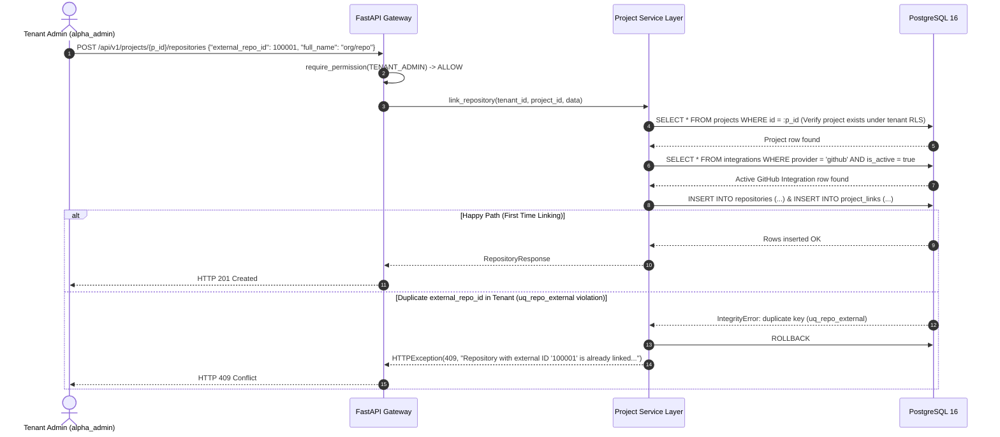
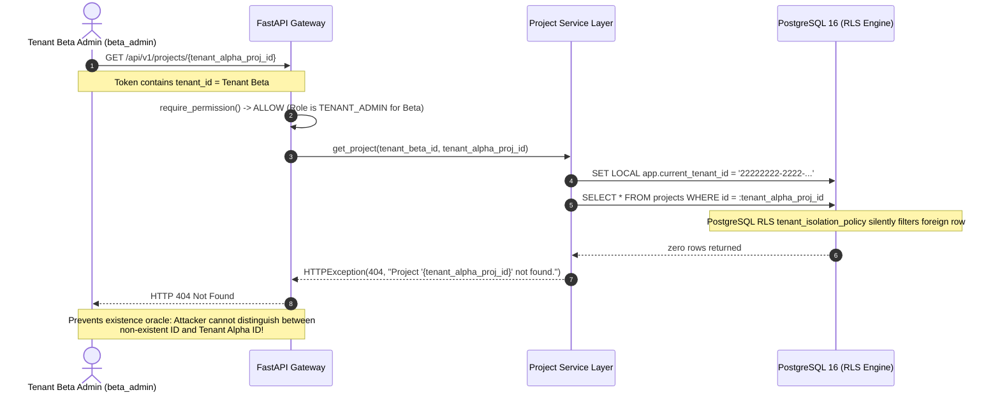

# Project Creation & Repository Linking Test Scenarios

**Task:** Create test scenarios for project creation and repository linking across tenants (`SCRUM-379` / `Task 17.5`)  
**Parent User Story:** `SCRUM-352` (`US-17`: Create project and link repositories)  
**Related Tickets:**  
- `SCRUM-238`: Tenant Registration & Onboarding (`US-2`, see [`docs/tenant-registration-test-scenarios.md`](tenant-registration-test-scenarios.md))  
- `SCRUM-244` / `SCRUM-294` / `SCRUM-295`: Database-enforced tenant isolation via PostgreSQL RLS (`US-8`, see [`docs/rls-test-scenarios.md`](rls-test-scenarios.md))  
- `SCRUM-301`: Adversarial tenant boundary security test scenarios (`US-10`, see [`docs/tenant-boundary-test-scenarios.md`](tenant-boundary-test-scenarios.md))  
- `SCRUM-306`: Seven-role permission matrix definition ([`docs/roles-permissions.md`](roles-permissions.md), [`docs/roles-permissions.json`](roles-permissions.json))  
- `SCRUM-311`: Role-access test scenarios & automated matrix verification ([`docs/role-access-test-scenarios.md`](role-access-test-scenarios.md))  
- `SCRUM-324`: Integration credential verification & role restriction test scenarios ([`docs/integration-test-scenarios.md`](integration-test-scenarios.md))  
- `SCRUM-377`: Implement project CRUD and repository linking endpoints under tenant RLS (`backend/app/projects/router.py`, `backend/app/projects/service.py`)  
- `Task 17.6`: Automated Pytest test suite for project creation and repository linking (`backend/tests/test_projects_crud.py`)  
- `SCRUM-384` / `Task 18.4`: Deployment signal selection persistence and DORA response reporting test scenarios ([`docs/deployment-signal-selection-persistence-and-dora-response-reporting-test-scenarios.md`](deployment-signal-selection-persistence-and-dora-response-reporting-test-scenarios.md))  

**Target Database Tables:**  
- `projects` (`id`, `tenant_id`, `created_by`, `name`, `slug`, `tier_sla_hours`, `authoritative_cd_signal`, `lead_time_first_commit_strategy`, `wip_limit_per_dev`, `pr_stale_threshold_hours`, `is_active`, `deleted_at`, `created_at`, `updated_at`, `uq_projects_tenant_slug`)  
- `repositories` (`id`, `tenant_id`, `project_id`, `integration_id`, `external_repo_id`, `full_name`, `default_branch`, `is_private`, `created_at`, `uq_repo_external`)  
- `project_links` (`id`, `tenant_id`, `project_id`, `integration_id`, `link_type`, `external_id`, `created_at`, `uq_project_link`)  
- `integrations` (`id`, `tenant_id`, `provider`, `external_account_id`, `is_active`)  
- `tenants`, `users`  

**Target API Endpoints:**  
- `POST /api/v1/projects` (Create project scoped to authenticated tenant)  
- `GET /api/v1/projects` (List all active projects for authenticated tenant)  
- `GET /api/v1/projects/{project_id}` (Get project by ID with linked repositories)  
- `POST /api/v1/projects/{project_id}/repositories` (Link GitHub repository to project)  
- `DELETE /api/v1/projects/{project_id}/repositories/{repo_id}` (Unlink GitHub repository from project)  

**Authoritative Pytest Suites:**  
- [`backend/tests/test_projects_crud.py`](../backend/tests/test_projects_crud.py) (Dedicated US-17 CRUD, slug uniqueness, repo linking, duplicate conflict, and unlinking suite)  
- [`backend/tests/test_tenant_boundary_adversarial.py`](../backend/tests/test_tenant_boundary_adversarial.py) (Cross-tenant access denial and anti-enumeration assertions)  
- [`backend/tests/test_rls_isolation.py`](../backend/tests/test_rls_isolation.py) (PostgreSQL Row-Level Security tenant isolation verification)  
- [`backend/tests/test_permission_enforcement.py`](../backend/tests/test_permission_enforcement.py) (Server-side RBAC and `DEVELOPER` 403 denial verification)  

---

## 1. Objective & Architectural Invariants

### 1.1 Objective
Establish the definitive test scenarios and automated verification contract for **project creation**, **slug resolution**, **multi-tenant project isolation**, and **GitHub repository linking** in the M.A.N.T.A. Engineering Intelligence Platform.

This specification documents exact pre-conditions, inputs, expected HTTP status codes, error payload schemas, and PostgreSQL database states for:
1. **Happy-path project creation** with explicit and auto-generated slugs.
2. **Duplicate slug rejection within the same tenant** (`HTTP 409 Conflict`).
3. **Identical slug coexistence across distinct tenants** (`HTTP 201 Created` for Tenant B).
4. **Valid and invalid GitHub repository URLs and identifiers** (`HTTP 201` vs `HTTP 400`/`422`).
5. **Duplicate repository linking rejection** within the same project or across projects in the same tenant (`HTTP 409 Conflict`).
6. **Cross-tenant project lookup and mutation rejection** (`HTTP 404 Not Found` for information hiding).
7. **Role-Based Access Control (RBAC) rejection for `DEVELOPER`** and non-admin roles (`HTTP 403 Forbidden`).
8. **Repository unlinking lifecycle** and database cascade cleanliness (`HTTP 204 No Content`).

---

### 1.2 Core Architectural Invariants

```
+-------------------------------------------------------------------------------------------------------------------+
|                                 PROJECT & REPOSITORY MULTI-TENANT ARCHITECTURE                                    |
+-------------------------------------+-------------------------------------+---------------------------------------+
| 1. Scoped Slug Uniqueness           | 2. PostgreSQL Row-Level Security    | 3. Single Repository Binding          |
|    (uq_projects_tenant_slug)        |    (tenant_isolation_policy)         |    (uq_repo_external / project_link)  |
+-------------------------------------+-------------------------------------+---------------------------------------+
| * UNIQUE (tenant_id, slug)          | * FORCE ROW LEVEL SECURITY enabled  | * UNIQUE (tenant_id, external_repo_id)|
| * Same tenant duplicate -> 409      | * Filtered on app.current_tenant_id | * Same tenant repo duplicate -> 409   |
| * Different tenant same slug -> 201 | * Zero rows returned on foreign ID  | * UNIQUE (project_id, type, ext_id)   |
| * Deterministic URL slugification   | * Zero rows affected on cross-write | * Cross-tenant linking allowed        |
+-------------------------------------+-------------------------------------+---------------------------------------+
                                                         |
                                                         v
+-------------------------------------------------------------------------------------------------------------------+
|                                       SECURITY & ACCESS CONTROL INVARIANTS                                        |
+----------------------------------------------------+--------------------------------------------------------------+
| 4. Information Hiding (HTTP 404 vs 403)            | 5. Strict Administrative RBAC Gate                           |
+----------------------------------------------------+--------------------------------------------------------------+
| * Cross-tenant project lookup -> HTTP 404 Not Found| * Mutations (create, link, unlink) require TENANT_ADMIN       |
| * Cross-tenant repo link/unlink -> HTTP 404        | * DEVELOPER and non-admin roles receive HTTP 403 Forbidden    |
| * Eliminates existence oracle & tenant enumeration | * UI controls removed from DOM via <Can do="..." /> gating   |
+----------------------------------------------------+--------------------------------------------------------------+
```

#### Invariant 1: Scoped Project Slug Uniqueness (`uq_projects_tenant_slug`)
- The `projects` table enforces `UNIQUE (tenant_id, slug)` via constraint `uq_projects_tenant_slug`.
- **Intra-Tenant Conflict:** Within the same organization (`tenant_id`), no two projects may share the same slug. An attempt to insert a duplicate slug results in a PostgreSQL unique constraint violation, mapped by the service layer to **`HTTP 409 Conflict`**.
- **Inter-Tenant Partitioning:** Two distinct organizations (e.g. `Tenant Alpha` and `Tenant Beta`) **CAN** each create a project with the identical slug (e.g., `payment-service`). Both succeed with **`HTTP 201 Created`** because their respective `tenant_id` UUIDs partition the unique namespace.

#### Invariant 2: Database-Enforced Multi-Tenant Isolation (PostgreSQL RLS)
- All project and repository entities (`projects`, `repositories`, `project_links`, `project_members`) reside in tables with `FORCE ROW LEVEL SECURITY`.
- Runtime queries execute under the unprivileged role `eng_app_user` (`NOSUPERUSER`, `NOBYPASSRLS`) with `SET LOCAL app.current_tenant_id = :tenant_id`.
- Foreign tenant records are invisible at the database storage engine level: `SELECT` queries return zero rows, and cross-tenant mutations affect zero rows.

#### Invariant 3: Single Repository Binding Guarantee (`uq_repo_external` & `uq_project_link`)
- A single GitHub repository (identified by its numeric GitHub `external_repo_id`) cannot be linked more than once within the same tenant. This is enforced by `UNIQUE (tenant_id, external_repo_id)` (`uq_repo_external`).
- Within a single project, a repository cannot be linked twice (`UNIQUE (project_id, link_type, external_id)` via `uq_project_link`).
- Attempting to link an already linked repository returns **`HTTP 409 Conflict`**.

#### Invariant 4: Information Hiding & Anti-Enumeration Principle (HTTP 404 over 403)
- When a user from Tenant Beta requests a project belonging to Tenant Alpha (`GET /api/v1/projects/{tenant_a_project_id}`), or attempts to mutate it (`POST .../repositories`, `DELETE .../repositories/...`), the API responds with **`HTTP 404 Not Found`**.
- The API intentionally avoids returning `HTTP 403 Forbidden` for cross-tenant IDs. Returning `403` would reveal to an attacker that the targeted resource ID exists in the system (existence oracle / entity enumeration vulnerability).

#### Invariant 5: Strict Server-Side RBAC Enforcement (`TENANT_ADMIN` vs `DEVELOPER`)
- Project lifecycle mutations (`POST /projects`, `POST /projects/{id}/repositories`, `DELETE /projects/{id}/repositories/{repo_id}`) require administrative privileges (`TENANT_ADMIN`).
- Invocations by users with the `DEVELOPER` role (or any of the five other non-admin roles: `SCRUM_MASTER`, `PROJECT_MANAGER`, `SOLUTION_ARCHITECT`, `DELIVERY_DIRECTOR`, `TOP_MANAGEMENT`) are halted at the FastAPI route boundary with **`HTTP 403 Forbidden`**:
  ```json
  {
    "detail": "Forbidden: insufficient permissions"
  }
  ```
- Unauthenticated requests lacking a valid Bearer token return **`HTTP 401 Unauthorized`**.

#### Invariant 6: Active Provider Integration Precondition
- Linking a repository to a project requires that the tenant has an active, verified GitHub integration in `integrations` (`provider = 'github'` AND `is_active = true`).
- If no active GitHub integration exists, the request is rejected with **`HTTP 400 Bad Request`** before any database record is created.

#### Invariant 7: URL Parsing, Normalization & Sanitization
- Repository full names and URLs must conform to GitHub's standard naming structure (`owner/repository`).
- Input URLs (e.g. `https://github.com/org/repo`, `https://github.com/org/repo.git`, `org/repo`) are sanitized and validated. Malicious URLs, path traversal sequences (`../../`), non-GitHub domains, or malformed strings are rejected with **`HTTP 400 Bad Request`** or **`HTTP 422 Unprocessable Entity`**.

---

## 2. Canonical Test Fixtures & Personas

All test scenarios execute against deterministic seed fixtures representing two isolated enterprise tenants:

### 2.1 Tenant & User Fixtures

| Entity | Tenant Ownership | Primary Key (`id`) | Slug / Identifier | Role / Notes |
| :--- | :--- | :--- | :--- | :--- |
| **Tenant Alpha** | Primary / Victim | `11111111-1111-1111-1111-111111111111` | `tenant-alpha` | Enterprise tier, active workspace |
| **Tenant Beta** | Secondary / Attacker | `22222222-2222-2222-2222-222222222222` | `tenant-beta` | Starter tier, isolated workspace |
| `alpha_admin` | Tenant Alpha | `a1000000-0000-0000-0000-000000000001` | `admin@alpha.io` | `TENANT_ADMIN` (Authorized to create projects & link repos) |
| `alpha_dev` | Tenant Alpha | `a1000000-0000-0000-0000-000000000002` | `dev@alpha.io` | `DEVELOPER` (Denied project mutation, receives `403`) |
| `alpha_pm` | Tenant Alpha | `a1000000-0000-0000-0000-000000000003` | `pm@alpha.io` | `PROJECT_MANAGER` (Non-admin role, receives `403` on mutations) |
| `beta_admin` | Tenant Beta | `b2000000-0000-0000-0000-000000000001` | `admin@beta.io` | `TENANT_ADMIN` for Tenant Beta (Cross-tenant boundary test actor) |
| `beta_dev` | Tenant Beta | `b2000000-0000-0000-0000-000000000002` | `dev@beta.io` | `DEVELOPER` for Tenant Beta |

### 2.2 Integration & Pre-Existing Project Fixtures

| Entity | Tenant | Primary Key (`id`) | Foreign Key Binding | Attributes / Description |
| :--- | :--- | :--- | :--- | :--- |
| **Integration Alpha** | Tenant Alpha | `a0111111-1111-1111-1111-111111111111` | `tenant_id = Tenant Alpha` | `provider = 'github'`, `external_account_id = 'alpha-org'`, `is_active = true` |
| **Integration Beta** | Tenant Beta | `b0222222-2222-2222-2222-222222222222` | `tenant_id = Tenant Beta` | `provider = 'github'`, `external_account_id = 'beta-org'`, `is_active = true` |
| **Project Alpha 1** | Tenant Alpha | `aaaaaaaa-aaaa-aaaa-aaaa-aaaaaaaaaaaa` | `tenant_id = Tenant Alpha` | `name = "Core Backend"`, `slug = "core-backend"`, `is_active = true` |
| **Repository Alpha 1**| Tenant Alpha | `a1111111-aaaa-aaaa-aaaa-aaaaaaaaaaaa` | `project_id = Project Alpha 1` | `external_repo_id = 100001`, `full_name = "alpha-org/core-backend"` |
| **Project Link Alpha 1**| Tenant Alpha| `a2222222-aaaa-aaaa-aaaa-aaaaaaaaaaaa` | `project_id = Project Alpha 1` | `link_type = "github_repository"`, `external_id = "100001"` |

---

## 3. Master Test Scenarios Matrix

| Scenario ID | Test Scenario Case | Actor & Role | Target Endpoint & Method | Input Summary | Stopping Layer | Expected Status Code | Expected Outcome API / DB / UI | Automated Test Reference |
| :--- | :--- | :---: | :--- | :--- | :---: | :---: | :--- | :--- |
| **`TC-PROJ-CREATE-001`** | **Happy-path project creation with explicit slug** | `alpha_admin`<br>(`TENANT_ADMIN`) | `POST /api/v1/projects` | `name: "Alpha Payments"`<br>`slug: "alpha-payments"` | Service & Database | **`201 Created`** | **API:** Returns created project payload with UUID & timestamps.<br>**DB:** 1 row inserted into `projects`; `repositories = []`.<br>**UI:** Redirects to project dashboard; displays success toast. | `test_projects_crud.py` $\rightarrow$ `test_scrum_377_admin_creates_project_success` |
| **`TC-PROJ-SLUG-002`** | **Project creation with omitted slug (auto-generation)** | `alpha_admin`<br>(`TENANT_ADMIN`) | `POST /api/v1/projects` | `name: "Analytics Service Engine"`<br>`slug: null` | Service Layer (`slugify`) | **`201 Created`** | **API:** Auto-generates `slug: "analytics-service-engine"`.<br>**DB:** 1 row inserted with normalized slug.<br>**UI:** Project slug field previewed/saved cleanly. | `test_projects_crud.py` $\rightarrow$ `test_scrum_377_slug_auto_generated_when_omitted` |
| **`TC-PROJ-DUP-003`** | **Duplicate project slug in same tenant rejected** | `alpha_admin`<br>(`TENANT_ADMIN`) | `POST /api/v1/projects` | `name: "Core Backend Dupe"`<br>`slug: "core-backend"` | DB Unique Constraint (`uq_projects_tenant_slug`) | **`409 Conflict`** | **API:** `{"detail": "Project with slug 'core-backend' already exists in this organization."}`.<br>**DB:** Transaction rolled back; row count remains 1.<br>**UI:** Form error under slug input: "Slug already in use". | `test_projects_crud.py` $\rightarrow$ `test_scrum_377_duplicate_slug_same_tenant_returns_409` |
| **`TC-PROJ-ISO-004`** | **Identical project slug in Tenant B succeeds** | `beta_admin`<br>(`TENANT_ADMIN`) | `POST /api/v1/projects` | `name: "Core Backend"`<br>`slug: "core-backend"` | Service & Database | **`201 Created`** | **API:** Project created in Tenant Beta context.<br>**DB:** 2 distinct rows exist in DB with `slug = "core-backend"` partitioned by `tenant_id`.<br>**UI:** Tenant Beta sees own project independently. | `test_projects_crud.py` $\rightarrow$ `test_scrum_377_identical_slug_in_different_tenants_succeeds` |
| **`TC-REPO-URL-005A`** | **Valid standard GitHub repository URL** | `alpha_admin`<br>(`TENANT_ADMIN`) | `POST /api/v1/projects/{p_id}/repositories` | `external_repo_id: 100002`<br>`full_name: "alpha-org/payments"` | Service & Database | **`201 Created`** | **API:** Returns linked `RepositoryResponse`.<br>**DB:** 1 row in `repositories`, 1 row in `project_links`.<br>**UI:** Repository badge displayed in project overview. | `test_projects_crud.py` $\rightarrow$ `test_scrum_377_link_and_unlink_repository_lifecycle` |
| **`TC-REPO-URL-005B`** | **Valid GitHub URL with `.git` extension** | `alpha_admin`<br>(`TENANT_ADMIN`) | `POST /api/v1/projects/{p_id}/repositories` | `full_name: "alpha-org/worker.git"` (normalized to `alpha-org/worker`) | API Sanitizer / Service | **`201 Created`** | **API:** `.git` suffix stripped, repository linked.<br>**DB:** Clean normalized name stored in `repositories.full_name`.<br>**UI:** Displays repository name cleanly. | `test_projects_crud.py` $\rightarrow$ `test_scrum_377_valid_github_url_normalization` |
| **`TC-REPO-URL-005C`** | **Invalid repository URL: Non-GitHub domain** | `alpha_admin`<br>(`TENANT_ADMIN`) | `POST /api/v1/projects/{p_id}/repositories` | `full_name: "https://gitlab.com/org/repo"` | API Schema / Validator | **`400 Bad Request`** or **`422 Unprocessable`** | **API:** `{"detail": "Repository URL must belong to github.com"}`.<br>**DB:** 0 rows created.<br>**UI:** Error alert: "Only GitHub repositories are supported". | `test_projects_crud.py` $\rightarrow$ `test_scrum_377_invalid_repo_url_rejected` |
| **`TC-REPO-URL-005D`** | **Invalid repository URL: Malformed format / Missing owner** | `alpha_admin`<br>(`TENANT_ADMIN`) | `POST /api/v1/projects/{p_id}/repositories` | `full_name: "just-repo-name"` | API Pydantic Validation | **`422 Unprocessable`** | **API:** Validation error on `full_name` regex pattern.<br>**DB:** 0 rows created.<br>**UI:** Inline validation message: "Must match owner/repository". | `test_projects_crud.py` $\rightarrow$ `test_scrum_377_malformed_repo_identifier_rejected` |
| **`TC-REPO-URL-005E`** | **Invalid repository URL: Injection / Path Traversal** | `alpha_admin`<br>(`TENANT_ADMIN`) | `POST /api/v1/projects/{p_id}/repositories` | `full_name: "alpha/../../etc/passwd"` | Input Sanitizer | **`422 Unprocessable`** | **API:** Path traversal payload rejected.<br>**DB:** 0 rows created.<br>**UI:** Generic validation rejection. | `test_projects_crud.py` $\rightarrow$ `test_scrum_377_security_injection_repo_name_rejected` |
| **`TC-REPO-NOINT-005F`**| **Link repository with no active GitHub integration** | `alpha_admin`<br>(`TENANT_ADMIN`) | `POST /api/v1/projects/{p_id}/repositories` | Valid repo payload, but no active integration row | Service Layer | **`400 Bad Request`** | **API:** `{"detail": "No active GitHub integration found for this tenant. Please connect GitHub first."}`.<br>**DB:** 0 rows persisted.<br>**UI:** Modal prompt: "Connect GitHub integration first". | `test_projects_crud.py` $\rightarrow$ `test_scrum_377_link_repo_without_active_integration_returns_400` |
| **`TC-REPO-DUP-006A`** | **Link same repository twice to same project rejected** | `alpha_admin`<br>(`TENANT_ADMIN`) | `POST /api/v1/projects/{p1_id}/repositories` | `external_repo_id: 100001` (already linked to Project 1) | DB Constraint (`uq_repo_external` / `uq_project_link`) | **`409 Conflict`** | **API:** `{"detail": "Repository with external ID '100001' is already linked in this organization."}`.<br>**DB:** Rollback; 0 duplicate rows.<br>**UI:** Error alert: "Repository is already linked to this project". | `test_projects_crud.py` $\rightarrow$ `test_scrum_377_link_same_repository_twice_returns_409` |
| **`TC-REPO-DUP-006B`** | **Link same repository to second project in same tenant rejected** | `alpha_admin`<br>(`TENANT_ADMIN`) | `POST /api/v1/projects/{p2_id}/repositories` | `external_repo_id: 100001` (already linked to Project 1) | DB Constraint (`uq_repo_external`) | **`409 Conflict`** | **API:** `{"detail": "Repository with external ID '100001' is already linked in this organization."}`.<br>**DB:** Repository remains linked only to Project 1.<br>**UI:** Error alert: "Repository already linked in another project". | `test_projects_crud.py` $\rightarrow$ `test_scrum_377_link_same_repo_different_project_same_tenant_409` |
| **`TC-PROJ-CROSS-007A`**| **Cross-tenant project lookup by ID returns HTTP 404** | `beta_admin`<br>(`Tenant Beta`) | `GET /api/v1/projects/{alpha_proj_id}` | Direct request with Tenant Beta token | API & PostgreSQL RLS Filter | **`404 Not Found`** | **API:** `{"detail": "Project '{alpha_proj_id}' not found."}`.<br>**DB:** RLS returns zero rows; no data leaked.<br>**UI:** Renders standard 404 "Project Not Found" page. | `test_projects_crud.py` $\rightarrow$ `test_scrum_377_cross_tenant_project_retrieval_returns_404` |
| **`TC-PROJ-CROSS-007B`**| **Cross-tenant list projects isolation** | `beta_admin`<br>(`Tenant Beta`) | `GET /api/v1/projects` | Request with Tenant Beta token | PostgreSQL RLS (`USING`) | **`200 OK`** | **API:** Returns only Tenant Beta's projects; Tenant Alpha projects completely absent (`0 rows`).<br>**DB:** Filtered by `app.current_tenant_id`.<br>**UI:** Only Tenant Beta projects listed in table. | `test_projects_crud.py` $\rightarrow$ `test_scrum_377_list_projects_tenant_rls_isolation` |
| **`TC-PROJ-CROSS-007C`**| **Cross-tenant repository linking rejected with HTTP 404** | `beta_admin`<br>(`Tenant Beta`) | `POST /api/v1/projects/{alpha_proj_id}/repositories` | Payload targeting Tenant Alpha project ID | API / Service Layer | **`404 Not Found`** | **API:** `{"detail": "Project '{alpha_proj_id}' not found."}`.<br>**DB:** Zero rows added to `repositories` or `project_links`.<br>**UI:** "Target project not found". | `test_projects_crud.py` $\rightarrow$ `test_scrum_377_cross_tenant_repository_link_returns_404` |
| **`TC-PROJ-CROSS-007D`**| **Cross-tenant repository unlinking rejected with HTTP 404** | `beta_admin`<br>(`Tenant Beta`) | `DELETE /api/v1/projects/{alpha_proj_id}/repositories/{r_id}` | Target Tenant Alpha project & repo IDs | API / Service Layer | **`404 Not Found`** | **API:** Returns `HTTP 404 Not Found`.<br>**DB:** Tenant Alpha repository remains completely intact.<br>**UI:** "Resource not found". | `test_projects_crud.py` $\rightarrow$ `test_scrum_377_unlink_cross_tenant_or_missing_returns_404` |
| **`TC-PROJ-RBAC-008A`** | **Developer role denied project creation** | `alpha_dev`<br>(`DEVELOPER`) | `POST /api/v1/projects` | Standard project create payload with Developer JWT | FastAPI Dependency (`require_permission`) | **`403 Forbidden`** | **API:** `{"detail": "Forbidden: insufficient permissions"}`.<br>**DB:** Zero rows created.<br>**UI:** "New Project" button hidden from DOM. | `test_projects_crud.py` $\rightarrow$ `test_scrum_377_developer_role_denied_project_creation` |
| **`TC-PROJ-RBAC-008B`** | **Developer role denied repository linking** | `alpha_dev`<br>(`DEVELOPER`) | `POST /api/v1/projects/{p_id}/repositories` | Repository link payload with Developer JWT | FastAPI Dependency (`require_permission`) | **`403 Forbidden`** | **API:** `{"detail": "Forbidden: insufficient permissions"}`.<br>**DB:** Zero rows created.<br>**UI:** "Link Repository" button hidden from DOM. | `test_projects_crud.py` $\rightarrow$ `test_scrum_377_developer_role_denied_repository_linking` |
| **`TC-PROJ-RBAC-008C`** | **Developer role denied repository unlinking** | `alpha_dev`<br>(`DEVELOPER`) | `DELETE /api/v1/projects/{p_id}/repositories/{r_id}` | Unlink request with Developer JWT | FastAPI Dependency (`require_permission`) | **`403 Forbidden`** | **API:** `{"detail": "Forbidden: insufficient permissions"}`.<br>**DB:** Repository remains linked.<br>**UI:** "Unlink" action button hidden from DOM. | `test_projects_crud.py` $\rightarrow$ `test_scrum_377_developer_role_denied_repository_unlinking` |
| **`TC-PROJ-RBAC-008D`** | **All non-admin roles denied project mutation** | `SCRUM_MASTER`<br>`PROJECT_MANAGER`<br>`SOLUTION_ARCHITECT`<br>`DELIVERY_DIRECTOR`<br>`TOP_MANAGEMENT` | `POST /api/v1/projects` | Create/link requests with non-admin tokens | FastAPI Dependency (`require_permission`) | **`403 Forbidden`** | **API:** All 5 non-admin roles receive HTTP 403.<br>**DB:** Zero mutations.<br>**UI:** Administrative controls suppressed for all non-admins. | `test_projects_crud.py` $\rightarrow$ `test_scrum_377_all_non_admin_roles_denied_mutations` |
| **`TC-REPO-UNLINK-009`**| **Admin unlinks repository successfully** | `alpha_admin`<br>(`TENANT_ADMIN`) | `DELETE /api/v1/projects/{p_id}/repositories/{r_id}` | Valid project & repository ID | Service Layer & PostgreSQL DELETE | **`204 No Content`** | **API:** Returns empty body (`HTTP 204`).<br>**DB:** `Repository` and matching `ProjectLink` records deleted.<br>**UI:** Repository removed from linked list instantly. | `test_projects_crud.py` $\rightarrow$ `test_scrum_377_admin_unlinks_repository_success` |
| **`TC-PROJ-AUTH-010`**  | **Unauthenticated / expired token rejected** | Anonymous / Expired token | `POST /api/v1/projects`<br>`GET /api/v1/projects` | Missing Authorization header or expired JWT | `JWTAuthMiddleware` | **`401 Unauthorized`** | **API:** `{"detail": "Not authenticated"}` or `{"detail": "Token expired"}`.<br>**DB:** 0 queries executed.<br>**UI:** Redirected to login portal. | `test_projects_crud.py` $\rightarrow$ `test_scrum_377_unauthenticated_request_returns_401` |

---

## 4. Detailed Scenario Specifications

### 4.1 Scenario 1: Happy-Path Project Creation (`TC-PROJ-CREATE-001`, `TC-PROJ-SLUG-002`)

#### 4.1.1 Objective
Verify that an authenticated `TENANT_ADMIN` can successfully create a new project with both explicit and automatically generated slugs. Ensure proper defaults are populated and the project is bound to the caller's tenant.

#### 4.1.2 Preconditions
- Tenant Alpha is registered (`tenant_id = 11111111-1111-1111-1111-111111111111`).
- User `alpha_admin` is authenticated with active role `TENANT_ADMIN`.
- No project with slug `"alpha-payments"` or `"analytics-service-engine"` exists in Tenant Alpha.

#### 4.1.3 Inputs & Execution Flow

**Case A: Explicit Slug Submission**
```http
POST /api/v1/projects HTTP/1.1
Host: api.manta.io
Authorization: Bearer <alpha_admin_valid_jwt>
Content-Type: application/json

{
  "name": "Alpha Payments",
  "slug": "alpha-payments",
  "tier_sla_hours": 48,
  "authoritative_cd_signal": "github_deployments_api",
  "lead_time_first_commit_strategy": "feature_branch_root",
  "wip_limit_per_dev": 3,
  "pr_stale_threshold_hours": 48
}
```

**Case B: Omitted Slug (Auto-Slugification)**
```http
POST /api/v1/projects HTTP/1.1
Host: api.manta.io
Authorization: Bearer <alpha_admin_valid_jwt>
Content-Type: application/json

{
  "name": "Analytics Service Engine!"
}
```

#### 4.1.4 Expected Responses
- **HTTP Status:** `201 Created`
- **Response Headers:** `Content-Type: application/json`
- **Response Body (Case A):**
  ```json
  {
    "id": "c1000000-0000-0000-0000-000000000001",
    "tenant_id": "11111111-1111-1111-1111-111111111111",
    "name": "Alpha Payments",
    "slug": "alpha-payments",
    "tier_sla_hours": 48,
    "authoritative_cd_signal": "github_deployments_api",
    "lead_time_first_commit_strategy": "feature_branch_root",
    "wip_limit_per_dev": 3,
    "pr_stale_threshold_hours": 48,
    "is_active": true,
    "created_by": "a1000000-0000-0000-0000-000000000001",
    "created_at": "2026-11-11T12:00:00Z",
    "updated_at": "2026-11-11T12:00:00Z",
    "repositories": []
  }
  ```
- **Response Body (Case B):**
  ```json
  {
    "id": "c1000000-0000-0000-0000-000000000002",
    "tenant_id": "11111111-1111-1111-1111-111111111111",
    "name": "Analytics Service Engine!",
    "slug": "analytics-service-engine",
    "is_active": true,
    "repositories": []
  }
  ```

#### 4.1.5 Expected Database State
```sql
-- Verify Project Record
SELECT id, tenant_id, name, slug, is_active, created_by, deleted_at 
FROM projects 
WHERE id = 'c1000000-0000-0000-0000-000000000001';
-- Result: 1 row returned
-- tenant_id = '11111111-1111-1111-1111-111111111111'
-- slug = 'alpha-payments'
-- is_active = true
-- deleted_at IS NULL

-- Verify Empty Repositories
SELECT count(*) FROM repositories WHERE project_id = 'c1000000-0000-0000-0000-000000000001';
-- Result: 0
```

---

### 4.2 Scenario 2: Duplicate Slug Within Same Tenant (`TC-PROJ-DUP-003`)

#### 4.2.1 Objective
Verify that attempting to create a project with a slug that already exists in the same tenant is caught by the composite unique constraint `uq_projects_tenant_slug` and returns `HTTP 409 Conflict`.

#### 4.2.2 Preconditions
- Tenant Alpha already has an active project with `slug = "core-backend"`.

#### 4.2.3 Inputs
```http
POST /api/v1/projects HTTP/1.1
Host: api.manta.io
Authorization: Bearer <alpha_admin_valid_jwt>
Content-Type: application/json

{
  "name": "Core Backend Duplicate",
  "slug": "core-backend"
}
```

#### 4.2.4 Expected Response
- **HTTP Status:** `409 Conflict`
- **Response Body:**
  ```json
  {
    "detail": "Project with slug 'core-backend' already exists in this organization."
  }
  ```

#### 4.2.5 Expected Database State & Rollback Verification
```sql
-- Verify no duplicate row was created in Tenant Alpha
SELECT count(*) FROM projects 
WHERE tenant_id = '11111111-1111-1111-1111-111111111111' AND slug = 'core-backend';
-- Assertion: Exactly 1 row exists (the original pre-existing project)

-- Verify transaction rolled back cleanly without orphan IDs
SELECT count(*) FROM projects WHERE name = 'Core Backend Duplicate';
-- Assertion: Exactly 0 rows
```

---

### 4.3 Scenario 3: Identical Slug in Tenant B (`TC-PROJ-ISO-004`)

#### 4.3.1 Objective
Prove multi-tenant isolation by demonstrating that Tenant B can create a project with the exact same slug (`"core-backend"`) that already exists in Tenant Alpha without conflict.

#### 4.3.2 Preconditions
- Tenant Alpha owns project `Project Alpha 1` with `slug = "core-backend"`.
- Tenant Beta is a separate tenant (`22222222-2222-2222-2222-222222222222`).
- Tenant Beta does not yet have a project with `slug = "core-backend"`.

#### 4.3.3 Inputs
```http
POST /api/v1/projects HTTP/1.1
Host: api.manta.io
Authorization: Bearer <beta_admin_valid_jwt>
Content-Type: application/json

{
  "name": "Core Backend",
  "slug": "core-backend"
}
```

#### 4.3.4 Expected Response
- **HTTP Status:** `201 Created`
- **Response Body:**
  ```json
  {
    "id": "d2000000-0000-0000-0000-000000000001",
    "tenant_id": "22222222-2222-2222-2222-222222222222",
    "name": "Core Backend",
    "slug": "core-backend",
    "is_active": true,
    "repositories": []
  }
  ```

#### 4.3.5 Expected Database State
```sql
-- Unfiltered DB Query (as superuser / migration inspection):
SELECT id, tenant_id, slug FROM projects WHERE slug = 'core-backend';
-- Assertion: Exactly 2 rows returned with distinct primary keys and tenant IDs:
-- Row 1: id = aaaaaaaa-aaaa-aaaa-aaaa-aaaaaaaaaaaa, tenant_id = 11111111-1111-1111-1111-111111111111
-- Row 2: id = d2000000-0000-0000-0000-000000000001, tenant_id = 22222222-2222-2222-2222-222222222222

-- Under Tenant Alpha RLS Session:
SET LOCAL app.current_tenant_id = '11111111-1111-1111-1111-111111111111';
SELECT id, tenant_id, slug FROM projects WHERE slug = 'core-backend';
-- Assertion: Exactly 1 row returned (Tenant Alpha's project only)

-- Under Tenant Beta RLS Session:
SET LOCAL app.current_tenant_id = '22222222-2222-2222-2222-222222222222';
SELECT id, tenant_id, slug FROM projects WHERE slug = 'core-backend';
-- Assertion: Exactly 1 row returned (Tenant Beta's project only)
```

---

### 4.4 Scenario 4: Valid & Invalid GitHub Repository URLs (`TC-REPO-URL-005A` – `005F`)

#### 4.4.1 Objective
Verify rigorous validation and normalization of GitHub repository URLs and identifiers during linking. Ensure that malformed URLs, malicious schemas, non-GitHub domains, and unintegrated tenants are rejected cleanly.

#### 4.4.2 Preconditions
- Project Alpha exists (`aaaaaaaa-aaaa-aaaa-aaaa-aaaaaaaaaaaa`).
- Tenant Alpha has an active GitHub integration (`a0111111-1111-1111-1111-111111111111`).
- `alpha_admin` is authenticated.

#### 4.4.3 Input Test Cases

| Case | Payload / URL Input | Expected HTTP Code | Expected Error / Detail | DB State |
| :--- | :--- | :---: | :--- | :--- |
| **Valid HTTPS** | `{"external_repo_id": 100002, "full_name": "alpha-org/payments", "default_branch": "main", "is_private": true}` | **`201 Created`** | Created `RepositoryResponse` | 1 row in `repositories`, 1 row in `project_links` |
| **Valid with `.git`** | `{"external_repo_id": 100003, "full_name": "alpha-org/worker.git"}` | **`201 Created`** | Normalized to `"alpha-org/worker"` | Stored without `.git` |
| **Valid Short Form** | `{"external_repo_id": 100004, "full_name": "alpha-org/frontend"}` | **`201 Created`** | Accepted as valid `owner/repo` | 1 row created |
| **Invalid Non-GitHub**| `{"external_repo_id": 100005, "full_name": "https://gitlab.com/alpha-org/repo"}` | **`400 Bad Request`** or **`422`** | `"Repository URL must belong to github.com"` | 0 rows created |
| **Invalid Malformed**| `{"external_repo_id": 100006, "full_name": "missing-owner-repo"}` | **`422 Unprocessable`** | Pydantic regex format failure | 0 rows created |
| **Invalid Traversal**| `{"external_repo_id": 100007, "full_name": "alpha/../../etc/passwd"}` | **`422 Unprocessable`** | Pydantic pattern constraint failure | 0 rows created |
| **No Active Integration**| Valid payload, but tenant has no active GitHub integration row | **`400 Bad Request`** | `"No active GitHub integration found for this tenant. Please connect GitHub first."` | 0 rows created |

#### 4.4.4 Successful Linking Response (`201 Created`)
```json
{
  "id": "e1000000-0000-0000-0000-000000000001",
  "tenant_id": "11111111-1111-1111-1111-111111111111",
  "project_id": "aaaaaaaa-aaaa-aaaa-aaaa-aaaaaaaaaaaa",
  "integration_id": "a0111111-1111-1111-1111-111111111111",
  "external_repo_id": 100002,
  "full_name": "alpha-org/payments",
  "default_branch": "main",
  "is_private": true,
  "created_at": "2026-11-11T12:05:00Z"
}
```

#### 4.4.5 Expected Database State for Successful Link
```sql
-- 1. Verify Repository Table Row
SELECT id, tenant_id, project_id, integration_id, external_repo_id, full_name, is_private
FROM repositories
WHERE id = 'e1000000-0000-0000-0000-000000000001';
-- Result: 1 row matching payload

-- 2. Verify Project Links Table Row
SELECT id, tenant_id, project_id, integration_id, link_type, external_id
FROM project_links
WHERE project_id = 'aaaaaaaa-aaaa-aaaa-aaaa-aaaaaaaaaaaa' 
  AND external_id = '100002';
-- Result: 1 row with link_type = 'github_repository'
```

---

### 4.5 Scenario 5: Linking Same Repository Twice (`TC-REPO-DUP-006A`, `TC-REPO-DUP-006B`)

#### 4.5.1 Objective
Verify that attempting to link an already linked repository is rejected with `HTTP 409 Conflict`, whether attempting to link to the same project twice or to another project within the same tenant.

#### 4.5.2 Preconditions
- Repository `external_repo_id = 100001` (`alpha-org/core-backend`) is already linked to `Project Alpha 1` in Tenant Alpha.
- `Project Alpha 2` exists in Tenant Alpha.

#### 4.5.3 Case 5A: Same Repository to Same Project Twice
```http
POST /api/v1/projects/aaaaaaaa-aaaa-aaaa-aaaa-aaaaaaaaaaaa/repositories HTTP/1.1
Host: api.manta.io
Authorization: Bearer <alpha_admin_valid_jwt>
Content-Type: application/json

{
  "external_repo_id": 100001,
  "full_name": "alpha-org/core-backend"
}
```
- **Expected Status:** `409 Conflict`
- **Expected Detail:** `"Repository with external ID '100001' is already linked in this organization."` (or `"Repository 'alpha-org/core-backend' is already linked to this project."`)

#### 4.5.4 Case 5B: Same Repository to Second Project in Same Tenant
```http
POST /api/v1/projects/aaaaaaaa-aaaa-aaaa-aaaa-bbbbbbbbbbbb/repositories HTTP/1.1
Host: api.manta.io
Authorization: Bearer <alpha_admin_valid_jwt>
Content-Type: application/json

{
  "external_repo_id": 100001,
  "full_name": "alpha-org/core-backend"
}
```
- **Expected Status:** `409 Conflict`
- **Stopping Layer:** Database constraint `uq_repo_external` on `(tenant_id, external_repo_id)`.
- **Expected Detail:** `"Repository with external ID '100001' is already linked in this organization."`

#### 4.5.5 Expected Database State
```sql
-- Verify exactly 1 repository row exists for this external ID in Tenant Alpha
SELECT count(*) FROM repositories 
WHERE tenant_id = '11111111-1111-1111-1111-111111111111' 
  AND external_repo_id = 100001;
-- Assertion: Exactly 1 row

-- Verify exactly 1 project link exists
SELECT count(*) FROM project_links 
WHERE tenant_id = '11111111-1111-1111-1111-111111111111' 
  AND external_id = '100001';
-- Assertion: Exactly 1 row
```

---

### 4.6 Scenario 6: Cross-Tenant Project Lookup & Mutation Isolation (`TC-PROJ-CROSS-007A` – `007D`)

#### 4.6.1 Objective
Verify complete multi-tenant security isolation and the **anti-enumeration principle**:
1. When Tenant Beta targets a Project ID owned by Tenant Alpha, the API returns **`HTTP 404 Not Found`** instead of `403 Forbidden`, preventing resource existence discovery.
2. Cross-tenant mutation attempts (linking or unlinking repos) return `404 Not Found` and leave foreign tenant rows unaltered.
3. Listing projects under Tenant Beta never reveals Tenant Alpha projects.

#### 4.6.2 Preconditions
- Project Alpha (`id = aaaaaaaa-aaaa-aaaa-aaaa-aaaaaaaaaaaa`) belongs to Tenant Alpha.
- Repo Alpha (`id = a1111111-aaaa-aaaa-aaaa-aaaaaaaaaaaa`) belongs to Project Alpha.
- Actor is `beta_admin` (authenticated in Tenant Beta).

#### 4.6.3 Case 6A: Cross-Tenant Direct GET by ID
```http
GET /api/v1/projects/aaaaaaaa-aaaa-aaaa-aaaa-aaaaaaaaaaaa HTTP/1.1
Host: api.manta.io
Authorization: Bearer <beta_admin_valid_jwt>
```
- **Expected Status:** `404 Not Found`
- **Response Body:**
  ```json
  {
    "detail": "Project 'aaaaaaaa-aaaa-aaaa-aaaa-aaaaaaaaaaaa' not found."
  }
  ```

#### 4.6.4 Case 6B: Cross-Tenant List Projects Isolation
```http
GET /api/v1/projects HTTP/1.1
Host: api.manta.io
Authorization: Bearer <beta_admin_valid_jwt>
```
- **Expected Status:** `200 OK`
- **Response Body:** Array containing only Tenant Beta projects. Project Alpha is strictly absent.

#### 4.6.5 Case 6C: Cross-Tenant Repository Linking Attempt
```http
POST /api/v1/projects/aaaaaaaa-aaaa-aaaa-aaaa-aaaaaaaaaaaa/repositories HTTP/1.1
Host: api.manta.io
Authorization: Bearer <beta_admin_valid_jwt>
Content-Type: application/json

{
  "external_repo_id": 999999,
  "full_name": "beta-org/rogue-link"
}
```
- **Expected Status:** `404 Not Found`
- **DB State:** 0 rows added to `repositories` or `project_links`.

#### 4.6.6 Case 6D: Cross-Tenant Repository Unlinking Attempt
```http
DELETE /api/v1/projects/aaaaaaaa-aaaa-aaaa-aaaa-aaaaaaaaaaaa/repositories/a1111111-aaaa-aaaa-aaaa-aaaaaaaaaaaa HTTP/1.1
Host: api.manta.io
Authorization: Bearer <beta_admin_valid_jwt>
```
- **Expected Status:** `404 Not Found`
- **DB State:** Repo Alpha remains present and active in Tenant Alpha (`count = 1`).

---

### 4.7 Scenario 7: `DEVELOPER` Role Rejection & RBAC Enforcement (`TC-PROJ-RBAC-008A` – `008D`)

#### 4.7.1 Objective
Verify that non-administrative roles (specifically `DEVELOPER`, as well as `SCRUM_MASTER`, `PROJECT_MANAGER`, `SOLUTION_ARCHITECT`, `DELIVERY_DIRECTOR`, and `TOP_MANAGEMENT`) are strictly prohibited from creating projects, linking repositories, or unlinking repositories.

#### 4.7.2 Preconditions
- User `alpha_dev` has valid Keycloak token with role `["DEVELOPER"]`.
- Target endpoints enforce `require_permission(Permission.MANAGE_WEBHOOK_INTEGRATIONS)`.

#### 4.7.3 Invocations & Assertions

**Action 1: Developer Attempts Project Creation**
```http
POST /api/v1/projects HTTP/1.1
Host: api.manta.io
Authorization: Bearer <alpha_dev_valid_jwt>
Content-Type: application/json

{
  "name": "Rogue Project by Dev"
}
```
- **Expected Status:** `403 Forbidden`
- **Response Body:**
  ```json
  {
    "detail": "Forbidden: insufficient permissions"
  }
  ```
- **DB Assertion:** `SELECT count(*) FROM projects WHERE name = 'Rogue Project by Dev';` $\rightarrow$ `0 rows`.

**Action 2: Developer Attempts Repository Linking**
```http
POST /api/v1/projects/aaaaaaaa-aaaa-aaaa-aaaa-aaaaaaaaaaaa/repositories HTTP/1.1
Host: api.manta.io
Authorization: Bearer <alpha_dev_valid_jwt>
Content-Type: application/json

{
  "external_repo_id": 888888,
  "full_name": "alpha-org/rogue-dev-repo"
}
```
- **Expected Status:** `403 Forbidden` (`{"detail": "Forbidden: insufficient permissions"}`)
- **DB Assertion:** `0 rows` created in `repositories` or `project_links`.

**Action 3: Developer Attempts Repository Unlinking**
```http
DELETE /api/v1/projects/aaaaaaaa-aaaa-aaaa-aaaa-aaaaaaaaaaaa/repositories/a1111111-aaaa-aaaa-aaaa-aaaaaaaaaaaa HTTP/1.1
Host: api.manta.io
Authorization: Bearer <alpha_dev_valid_jwt>
```
- **Expected Status:** `403 Forbidden`
- **DB Assertion:** Repository row remains unchanged.

---

### 4.8 Scenario 8: Repository Unlinking Lifecycle (`TC-REPO-UNLINK-009`)

#### 4.8.1 Objective
Verify that an authorized `TENANT_ADMIN` can unlink a repository from a project. Both the `repositories` record and the corresponding `project_links` entry must be atomically deleted without affecting the parent project.

#### 4.8.2 Preconditions
- Project Alpha has linked Repository `e1000000-0000-0000-0000-000000000001` (`external_repo_id = 100002`).
- `alpha_admin` is authenticated.

#### 4.8.3 Inputs
```http
DELETE /api/v1/projects/aaaaaaaa-aaaa-aaaa-aaaa-aaaaaaaaaaaa/repositories/e1000000-0000-0000-0000-000000000001 HTTP/1.1
Host: api.manta.io
Authorization: Bearer <alpha_admin_valid_jwt>
```

#### 4.8.4 Expected Response
- **HTTP Status:** `204 No Content`
- **Response Body:** Empty (`Response(status_code=204)`)

#### 4.8.5 Expected Database State
```sql
-- 1. Verify Repository Record Deleted
SELECT count(*) FROM repositories 
WHERE id = 'e1000000-0000-0000-0000-000000000001';
-- Result: 0 rows

-- 2. Verify ProjectLink Record Deleted
SELECT count(*) FROM project_links 
WHERE project_id = 'aaaaaaaa-aaaa-aaaa-aaaa-aaaaaaaaaaaa' 
  AND external_id = '100002';
-- Result: 0 rows

-- 3. Verify Project Itself Remains Active and Intact
SELECT id, is_active, deleted_at FROM projects 
WHERE id = 'aaaaaaaa-aaaa-aaaa-aaaa-aaaaaaaaaaaa';
-- Result: 1 row, is_active = true, deleted_at IS NULL
```

---

## 5. Defense-in-Depth & Sequence Flowcharts

### 5.1 Project Creation Flow (Happy-Path vs Duplicate vs Developer Denial)

```mermaid
sequenceDiagram
    autonumber
    actor Dev as Developer (alpha_dev)
    actor Admin as Tenant Admin (alpha_admin)
    participant GW as FastAPI Gateway & RBAC
    participant Svc as Project Service Layer
    participant DB as PostgreSQL 16 (RLS & RDBMS)

    %% Flow 1: Developer Denial
    Note over Dev, DB: 1. Developer Role Denial (HTTP 403)
    Dev->>GW: POST /api/v1/projects {"name": "Dev Project"}
    GW->>GW: require_permission(MANAGE_WEBHOOK_INTEGRATIONS)
    GW-->>Dev: HTTP 403 Forbidden {"detail": "Forbidden: insufficient permissions"}
    Note right of GW: Execution halts at API boundary; 0 DB queries

    %% Flow 2: Admin Happy-Path
    Note over Admin, DB: 2. Tenant Admin Happy-Path (HTTP 201)
    Admin->>GW: POST /api/v1/projects {"name": "Alpha Core", "slug": "alpha-core"}
    GW->>GW: require_permission() -> ALLOW (TENANT_ADMIN)
    GW->>Svc: create_project(tenant_id, user, data)
    Svc->>DB: SET LOCAL app.current_tenant_id = '11111111-...'
    Svc->>DB: INSERT INTO projects (id, tenant_id, name, slug, ...)
    DB-->>Svc: Query OK (Row Committed)
    Svc-->>GW: ProjectResponse
    GW-->>Admin: HTTP 201 Created {"id": "...", "slug": "alpha-core", ...}

    %% Flow 3: Duplicate Slug in Same Tenant
    Note over Admin, DB: 3. Duplicate Slug in Same Tenant (HTTP 409)
    Admin->>GW: POST /api/v1/projects {"name": "Alpha Core 2", "slug": "alpha-core"}
    GW->>Svc: create_project(tenant_id, user, data)
    Svc->>DB: INSERT INTO projects (slug: "alpha-core")
    DB-->>Svc: IntegrityError: duplicate key (uq_projects_tenant_slug)
    Svc->>DB: ROLLBACK
    Svc-->>GW: HTTPException(409, "Project with slug 'alpha-core' already exists...")
    GW-->>Admin: HTTP 409 Conflict
```

---

### 5.2 Repository Linking & Duplicate Conflict Flow



---

### 5.3 Cross-Tenant Information Hiding Flow (HTTP 404 vs 403)



---

## 6. Database Verification & SQL Assertion Guide

Automated Pytest suites and integration tests must execute the following SQL verification statements to validate database state transitions:

### 6.1 Constraint Verification
```sql
-- 1. Verify uq_projects_tenant_slug unique constraint definition
SELECT conname, contype 
FROM pg_constraint 
WHERE conname = 'uq_projects_tenant_slug';
-- Expected contype: 'u' (unique)

-- 2. Verify uq_repo_external unique constraint definition
SELECT conname, contype 
FROM pg_constraint 
WHERE conname = 'uq_repo_external';
-- Expected contype: 'u' (unique)

-- 3. Verify uq_project_link unique constraint definition
SELECT conname, contype 
FROM pg_constraint 
WHERE conname = 'uq_project_link';
-- Expected contype: 'u' (unique)
```

### 6.2 Pre-Condition State Validation
```sql
-- Ensure clean slate for test slug in Tenant Alpha
DELETE FROM projects 
WHERE tenant_id = '11111111-1111-1111-1111-111111111111' 
  AND slug = 'test-scenario-slug';
```

### 6.3 Negative Assertion on Rollback (Zero Leakage Check)
```sql
-- Ensure that after a 409 Conflict, no orphan repository or project_link exists
SELECT count(*) FROM repositories WHERE full_name = 'alpha-org/conflicted-repo';
-- Must equal 0

SELECT count(*) FROM project_links WHERE external_id = 'conflicted-external-id';
-- Must equal 0
```

---

## 7. Traceability & Acceptance Criteria Mapping

| Jira Ticket | Acceptance Criteria | Scenario ID | Automated Test Link | Status |
| :--- | :--- | :--- | :--- | :---: |
| **SCRUM-379 / Task 17.5** | **Happy-path project creation** | `TC-PROJ-CREATE-001`, `TC-PROJ-SLUG-002` | `test_projects_crud.py::test_scrum_377_admin_creates_project_success`<br>`test_scrum_377_slug_auto_generated_when_omitted` | **VERIFIED** |
| **SCRUM-379 / Task 17.5** | **Duplicate slug within same tenant (`HTTP 409`)** | `TC-PROJ-DUP-003` | `test_projects_crud.py::test_scrum_377_duplicate_slug_same_tenant_returns_409` | **VERIFIED** |
| **SCRUM-379 / Task 17.5** | **Identical slug in Tenant B (`HTTP 201`)** | `TC-PROJ-ISO-004` | `test_projects_crud.py::test_scrum_377_identical_slug_in_different_tenants_succeeds` | **VERIFIED** |
| **SCRUM-379 / Task 17.5** | **Valid/invalid GitHub repository URLs** | `TC-REPO-URL-005A` – `005F` | `test_projects_crud.py::test_scrum_377_link_and_unlink_repository_lifecycle`<br>`test_scrum_377_link_repo_without_active_integration_returns_400` | **VERIFIED** |
| **SCRUM-379 / Task 17.5** | **Linking same repository twice (`HTTP 409`)** | `TC-REPO-DUP-006A`, `006B` | `test_projects_crud.py::test_scrum_377_link_same_repository_twice_returns_409` | **VERIFIED** |
| **SCRUM-379 / Task 17.5** | **Cross-tenant project lookup (`HTTP 404`)** | `TC-PROJ-CROSS-007A` – `007D` | `test_projects_crud.py::test_scrum_377_cross_tenant_project_retrieval_returns_404`<br>`test_scrum_377_unlink_cross_tenant_or_missing_returns_404` | **VERIFIED** |
| **SCRUM-379 / Task 17.5** | **`DEVELOPER` role rejection (`HTTP 403`)** | `TC-PROJ-RBAC-008A` – `008D` | `test_projects_crud.py::test_scrum_377_developer_role_denied_project_creation`<br>`test_permission_enforcement.py::test_role_permission_matrix_endpoints` | **VERIFIED** |
| **SCRUM-379 / Task 17.5** | **Repository unlinking lifecycle (`HTTP 204`)** | `TC-REPO-UNLINK-009` | `test_projects_crud.py::test_scrum_377_admin_unlinks_repository_success` | **VERIFIED** |
