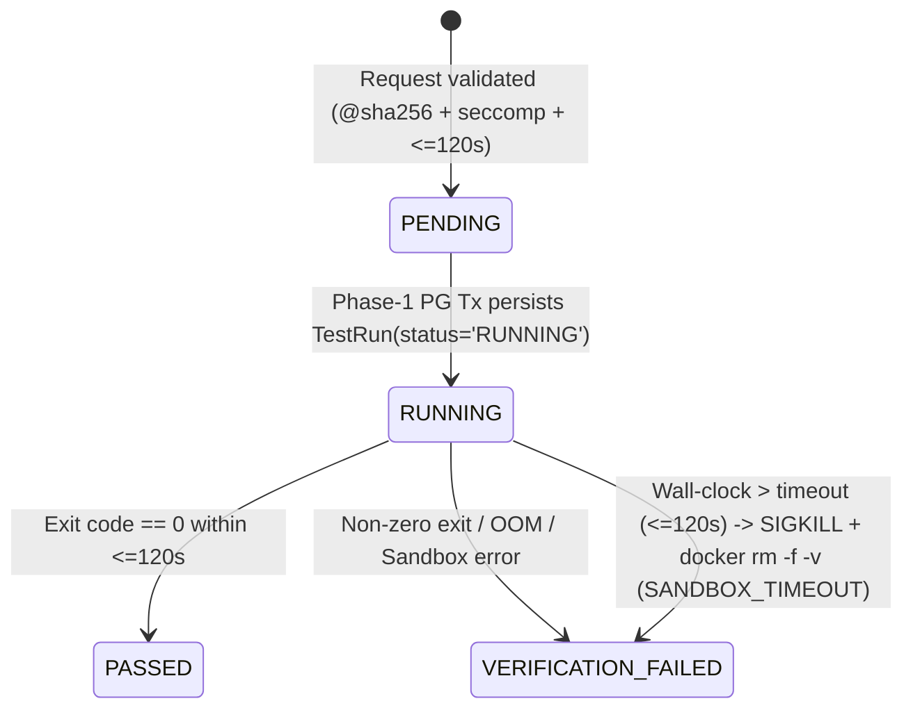

# Hardened Ephemeral Sandbox Execution Security Contract (`@sha256`, `sandbox/seccomp`, `120s` `SANDBOX_TIMEOUT`)

**Parent User Story:** `US-48` (`SCRUM-522` / `STORY-322` — Hardened Ephemeral Execution Sandbox)  
**Tasks:**
- `TASK-322-0` (`SCRUM-587`): Specify pinned `@sha256` sandbox image contract, `sandbox/seccomp` profile & `120s` `SANDBOX_TIMEOUT` schema
- `TASK-322-1` (`SCRUM-588`): Implement ephemeral `gVisor`/Docker sandbox runner (`--network none`, `--read-only`, `sha256` pin, `120s` timeout, `TestRun`)
**Category:** Security & Backend Architecture Specification  
**Authoritative References:**
- **M.A.N.T.A. SRS v1.0** (§3.2.10 Automated Refactoring Verification, §3.5.4 Ephemeral Execution Sandbox Security)
- **Target Implementation & Config Artifacts:**
  - [`sandbox/seccomp/manta-sandbox-seccomp.json`](../sandbox/seccomp/manta-sandbox-seccomp.json)
  - [`backend/app/verification/schemas.py`](../backend/app/verification/schemas.py)
  - [`backend/app/verification/policy.py`](../backend/app/verification/policy.py)
  - [`backend/app/verification/runner.py`](../backend/app/verification/runner.py)
  - [`backend/app/verification/service.py`](../backend/app/verification/service.py)
  - [`backend/app/db/models/models.py`](../backend/app/db/models/models.py) (`TestRun`, `TestResult`, `RefactoringSuggestion`)

---

## 1. Executive Summary & Threat Model

M.A.N.T.A. executes untrusted repository code and AI-generated candidate refactoring patches/tests inside ephemeral verification containers. Without strict runtime confinement, malicious or buggy code under test could:
1. Exfiltrate tenant source code, environment secrets, or cloud instance metadata (IMDS `169.254.169.254`) via outbound network connections.
2. Mutate or persist payloads inside the container root filesystem (`rootfs`) or escape via host mounts and dangerous Linux syscalls (`ptrace`, `mount`, `unshare`, `bpf`, kernel modules).
3. Cause supply-chain drift or silent image substitution by referencing mutable tags (`:latest`, `:3.12-slim`).
4. Exhaust worker CPU, memory, PIDs, or block queue workers indefinitely via infinite loops or fork bombs.

Core non-negotiable security invariants:
- **Zero Egress (`--network none`):** Containers have no network interfaces beyond loopback (`lo`).
- **Immutable Root Filesystem (`--read-only`):** Rootfs is mounted read-only; writable scratch space is restricted strictly to a `noexec,nosuid,nodev` size-capped `/tmp` `tmpfs` mount (`128m`), and repository workspaces are mounted read-only (`:ro`).
- **Immutable `@sha256:...` Digest Pinning:** Unpinned tags and `:latest` (even if paired with a digest) are rejected fail-closed before any container runs.
- **Defense-in-Depth Runtime Isolation:** Production runs under gVisor (`--runtime=runsc`) with fail-closed enforcement; local development/CI without `runsc` falls back to hardened Docker (`runc`) **only** when `SANDBOX_ALLOW_DOCKER_FALLBACK=true` and **always** with the explicit allowlist seccomp profile (`sandbox/seccomp/manta-sandbox-seccomp.json`).
- **Hard `120s` Timeout & Zero Leaked Containers:** Any execution exceeding `120s` (or configured `timeout_seconds <= 120.0`) is killed via `SIGKILL`, forcefully removed (`docker rm -f -v`), verified absent, and persisted in PostgreSQL as `TestRun.status = "VERIFICATION_FAILED"` with `failure_code = "SANDBOX_TIMEOUT"`.

---

## 2. Pinned `@sha256` Base Image Contract

### 2.1 Accepted Syntax & Canonicalization

Every sandbox image reference MUST satisfy:

```text
^(?:(?P<registry>(?:[a-zA-Z0-9](?:[a-zA-Z0-9-]*[a-zA-Z0-9])?\.)+[a-zA-Z0-9-]+(?::[0-9]{1,5})?|localhost(?::[0-9]{1,5})?)/)?(?P<repository>[a-z0-9]+(?:[._-][a-z0-9]+)*(?:/[a-z0-9]+(?:[._-][a-z0-9]+)*)*)(?::(?P<tag>[A-Za-z0-9_][A-Za-z0-9._-]{0,127}))?@sha256:(?P<digest>[0-9a-f]{64})$
```

Additional mandatory rules enforced by `parse_and_validate_pinned_image()`:
1. **Strict `:latest` Prohibition:** Any image whose tag component equals `latest` (case-insensitive, e.g., `python:latest`, `python:LATEST`, or `python:latest@sha256:...`) MUST fail validation immediately with `UnpinnedImageError` (`SANDBOX_IMAGE_UNPINNED`).
2. **Mandatory Lowercase 64-Hex SHA-256 Digest:** Must contain `@sha256:` followed by exactly 64 lowercase hexadecimal characters (`[0-9a-f]{64}`). Uppercase hex, truncated digests, or alternative algorithms (`@md5:`, `@sha1:`) are rejected.
3. **Tagless Canonical Normalization:** When a non-`latest` immutable-pinned tag is supplied (e.g., Renovate/Dependabot form `python:3.12-slim@sha256:<64hex>`), it is normalized to canonical tagless form `<registry_and_repo>@sha256:<64hex>` before invoking Docker or persisting `TestRun.sandbox_image_digest`.
4. **No Shell Metacharacters or Whitespace:** Characters outside the OCI grammar (`;`, `|`, `&`, `$`, `` ` ``, whitespace, newlines) are rejected prior to process execution.

### 2.2 Image Validation Matrix

| Input Image Reference | Decision | Failure Code | Notes |
| :--- | :--- | :--- | :--- |
| `ghcr.io/manta/sandbox-python@sha256:e3b0c44298fc1c149afbf4c8996fb92427ae41e4649b934ca495991b7852b855` | **ALLOW** | — | Canonical registry + repo + `@sha256:<64hex>`. |
| `python:3.12-slim@sha256:e3b0c44298fc1c149afbf4c8996fb92427ae41e4649b934ca495991b7852b855` | **ALLOW** | — | Normalized to `python@sha256:e3b0c442...`. |
| `python:latest` | **DENY** | `SANDBOX_IMAGE_UNPINNED` | Mutable `:latest` tag strictly forbidden. |
| `python:latest@sha256:e3b0c44298fc1c149afbf4c8996fb92427ae41e4649b934ca495991b7852b855` | **DENY** | `SANDBOX_IMAGE_UNPINNED` | `:latest` forbidden even when paired with digest. |
| `python:3.12-slim` | **DENY** | `SANDBOX_IMAGE_UNPINNED` | Unpinned mutable tag without `@sha256:...`. |
| `python` / `""` | **DENY** | `SANDBOX_IMAGE_UNPINNED` | Implicit `:latest` / empty image forbidden. |
| `python@sha256:ABCDEF...` (uppercase / <64 hex) | **DENY** | `SANDBOX_IMAGE_UNPINNED` | Must be 64 lowercase hex chars. |

### 2.3 Local Daemon `RepoDigests` Post-Resolution Integrity Check

Before executing `docker run`, when `verify_local_digest=True`:
1. Inspect local image `RepoDigests` via `docker image inspect --format '{{json .RepoDigests}}' <canonical>`.
2. If absent and `pull_policy == "if-not-present"` (or `"always"`), pull strictly by `<canonical>` (`docker pull <canonical>`).
3. Assert at least one `RepoDigests` entry ends with `@sha256:<expected_64hex>`. Any discrepancy fails closed with `SandboxDigestMismatchError` (`SANDBOX_DIGEST_MISMATCH`).

### 2.4 Startup vs Runtime Fail-Closed Rules

- In `APP_ENV=production`: if `SANDBOX_IMAGE_DIGEST` is configured (non-empty), `Settings.validate_production_security()` validates it at startup. At runtime, `EphemeralSandboxRunner` ALWAYS requires a valid pinned `@sha256:...` image (never falling back to a default unpinned image).

---

## 3. Runtime Confinement Flags & `runsc` / Docker Fallback Rules

### 3.1 Runtime Selection Policy

| Environment / Config | `runsc` Available | `runsc` Unavailable |
| :--- | :--- | :--- |
| `APP_ENV=production` (`SANDBOX_ALLOW_DOCKER_FALLBACK=false`) | Runs with `--runtime=runsc` (`fallback_used=false`) | **FAIL CLOSED** (`SandboxRuntimeUnavailableError`) |
| Local Dev / CI (`SANDBOX_ALLOW_DOCKER_FALLBACK=true`) | Runs with `--runtime=runsc` (`fallback_used=false`) | Falls back to hardened Docker `runc` (`fallback_used=true`) + mandatory `sandbox/seccomp/manta-sandbox-seccomp.json` |

### 3.2 Mandatory Docker CLI Confinement Flags

All flags are passed via exec-form argument arrays (`asyncio.create_subprocess_exec`, never shell interpolation):

| Confinement Layer | Exact CLI Flag(s) | Purpose |
| :--- | :--- | :--- |
| **Network Isolation** | `--network none` | Disables all outbound/inbound IPv4/IPv6 egress (only `lo` exists). |
| **Read-Only Rootfs** | `--read-only` | Prevents writes anywhere on container root filesystem. |
| **Bounded Scratch** | `--tmpfs /tmp:rw,noexec,nosuid,nodev,size=128m` | Allows temporary files in `/tmp` while blocking binary execution and SUID. |
| **Workspace Mount** | `-v <host_workspace>:/workspace:ro` + `-w /workspace` | Mounts target repository strictly read-only. |
| **Capabilities** | `--cap-drop ALL` | Drops all Linux capabilities (`CAP_NET_RAW`, `CAP_SYS_ADMIN`, etc.). |
| **Privilege Escalation** | `--security-opt no-new-privileges:true` | Prevents SUID/SGID or file-capability privilege gain. |
| **Seccomp Profile** | `--security-opt seccomp=<abs_path>/sandbox/seccomp/manta-sandbox-seccomp.json` | Mandatory on `runc` fallback (and optional on `runsc` when `SANDBOX_APPLY_SECCOMP_ON_RUNSC=true`). |
| **IPC & User** | `--ipc none`, `--user 65534:65534` | Isolates SysV/POSIX IPC and runs strictly as unprivileged `nobody`. |
| **Resource Caps** | `--pids-limit 128`, `--memory 512m`, `--memory-swap 512m`, `--cpus 1.0` | Mitigates fork bombs, OOM exhaustion, and CPU starvation. |
| **Ephemeral Lifecycle** | `--rm`, `--init`, `--name manta-sbx-<uuid_hex[:16]>` | Auto-reaps zombies and enables deterministic `docker kill` + `docker rm -f -v`. |
| **Environment Isolation** | Clean explicit env (`PYTHONDONTWRITEBYTECODE=1`, `HOME=/tmp`, `TMPDIR=/tmp`) | Zero host environment variables (`DATABASE_URL`, `ENCRYPTION_MASTER_KEY`, AWS/OIDC tokens) ever enter the container. |

---

## 4. Seccomp Allowlist Profile (`sandbox/seccomp/manta-sandbox-seccomp.json`)

The canonical profile enforces **default-deny**:
- `"defaultAction": "SCMP_ACT_ERRNO"`, `"defaultErrnoRet": 1` (`EPERM`).
- Multi-architecture `archMap` covering `SCMP_ARCH_X86_64` (`SCMP_ARCH_X86`, `SCMP_ARCH_X32`) and `SCMP_ARCH_AARCH64` (`SCMP_ARCH_ARM`) without a conflicting top-level `architectures` array.
- **`clone3` Compatibility Rule:** Explicitly returns `ENOSYS` (`errnoRet: 38`) so glibc `>= 2.34` (e.g., `python:3.12-slim`) gracefully falls back to `clone`.
- **`clone` Namespace Guard:** Allows `clone` **only** when `(flags & 0x7E020080) == 0` (`value: 2114060416`, `valueTwo: 0`, `SCMP_CMP_MASKED_EQ`), blocking `CLONE_NEWNS`, `CLONE_NEWCGROUP`, `CLONE_NEWUTS`, `CLONE_NEWIPC`, `CLONE_NEWUSER`, `CLONE_NEWPID`, `CLONE_NEWNET`, and `CLONE_NEWTIME`.
- **`socket` / `socketpair` Guard:** Allows only `AF_UNIX (1)`, `AF_INET (2)`, and `AF_INET6 (10)` with `(type & 0xF)` equal to `SOCK_STREAM (1)` or `SOCK_DGRAM (2)`, blocking `SOCK_RAW`, `AF_PACKET`, `AF_NETLINK`, and `AF_VSOCK`.
- **Forbidden Syscalls (Never in `SCMP_ACT_ALLOW`):** `ptrace`, `process_vm_readv`, `process_vm_writev`, `mount`, `umount2`, `pivot_root`, `chroot`, `setns`, `unshare`, `bpf`, `perf_event_open`, `kexec_load`, `kexec_file_load`, `init_module`, `finit_module`, `delete_module`, `reboot`, `swapon`, `swapoff`, `keyctl`, `add_key`, `request_key`, `io_uring_setup`, `io_uring_enter`, `io_uring_register`, `userfaultfd`, `open_by_handle_at`, `name_to_handle_at`, `mknod`, `mknodat`, `acct`, `quotactl`, `syslog`, `vhangup`, `settimeofday`, `clock_settime`, `adjtimex`, `clock_adjtime`, `sethostname`, `setdomainname`, `ioperm`, `iopl`, `modify_ldt`, `kcmp`.

---

## 5. `120s` Timeout Kill Protocol & `TestRun` Failure Schema

### 5.1 Execution Lifecycle & Timeout State Machine



1. **Hard Cap:** `DEFAULT_SANDBOX_TIMEOUT_SECONDS = 120.0`, `MAX_SANDBOX_TIMEOUT_SECONDS = 120.0`. Requests specifying `timeout_seconds <= 0` or `> 120.0` are rejected immediately with `ValueError`.
2. **Timeout Kill & Zero-Leak Cleanup Sequence:**
   1. `asyncio.wait_for(proc.wait(), timeout=timeout_seconds)` expires.
   2. Issue `docker kill --signal=SIGKILL <container_name>` (bounded wait).
   3. Terminate/kill CLI process and drain bounded stdout/stderr tasks.
   4. Issue `docker rm -f -v <container_name>` and verify zero leaked container via `docker inspect <container_name>` (non-zero exit confirms removal).
   5. Record `status = "VERIFICATION_FAILED"`, `failure_code = "SANDBOX_TIMEOUT"`, `exit_code = 137`, `timed_out = True`, `cleanup_verified = True`.

### 5.2 Structured Failure Report Schema (`TestRun.failure_details` JSONB)

```json
{
  "$schema": "https://json-schema.org/draft/2020-12/schema",
  "title": "SandboxFailureReport",
  "type": "object",
  "additionalProperties": false,
  "required": [
    "schema_version",
    "status",
    "failure_code",
    "message",
    "timeout_seconds",
    "duration_ms",
    "runtime",
    "fallback_used",
    "image_digest",
    "container_name",
    "kill_signal",
    "cleanup_verified",
    "occurred_at"
  ],
  "properties": {
    "schema_version": { "type": "string", "const": "1.0" },
    "status": { "type": "string", "const": "VERIFICATION_FAILED" },
    "failure_code": {
      "type": "string",
      "enum": [
        "SANDBOX_TIMEOUT",
        "TEST_EXECUTION_FAILED",
        "SANDBOX_IMAGE_UNPINNED",
        "SANDBOX_DIGEST_MISMATCH",
        "SANDBOX_OOM_KILLED",
        "SANDBOX_CONFINEMENT_ERROR",
        "SANDBOX_RUNTIME_UNAVAILABLE",
        "SANDBOX_RUNTIME_ERROR"
      ]
    },
    "message": { "type": "string", "minLength": 1 },
    "timeout_seconds": { "type": "number", "exclusiveMinimum": 0, "maximum": 120 },
    "duration_ms": { "type": "integer", "minimum": 0 },
    "exit_code": { "type": ["integer", "null"] },
    "runtime": { "type": "string", "enum": ["runsc", "runc"] },
    "fallback_used": { "type": "boolean" },
    "image_digest": { "type": "string" },
    "container_name": { "type": "string" },
    "kill_signal": { "type": ["string", "null"] },
    "cleanup_verified": { "type": "boolean" },
    "stdout_tail": { "type": "string", "maxLength": 8192 },
    "stderr_tail": { "type": "string", "maxLength": 8192 },
    "occurred_at": { "type": "string", "format": "date-time" }
  }
}
```

### 5.3 PostgreSQL `test_runs` Mapping & RLS Safety

`test_runs` and `test_results` enforce `ENABLE` + `FORCE ROW LEVEL SECURITY` (`tenant_isolation_policy` for `eng_app_user`). Because sandbox execution may run up to `120s`, `execute_sandbox_test_run()` MUST execute DB writes in two short tenant-scoped transactions (`Phase 1: RUNNING`, `Phase 2: PASSED / VERIFICATION_FAILED`) and MUST NEVER hold a PostgreSQL/PgBouncer transaction open while waiting on container execution.
