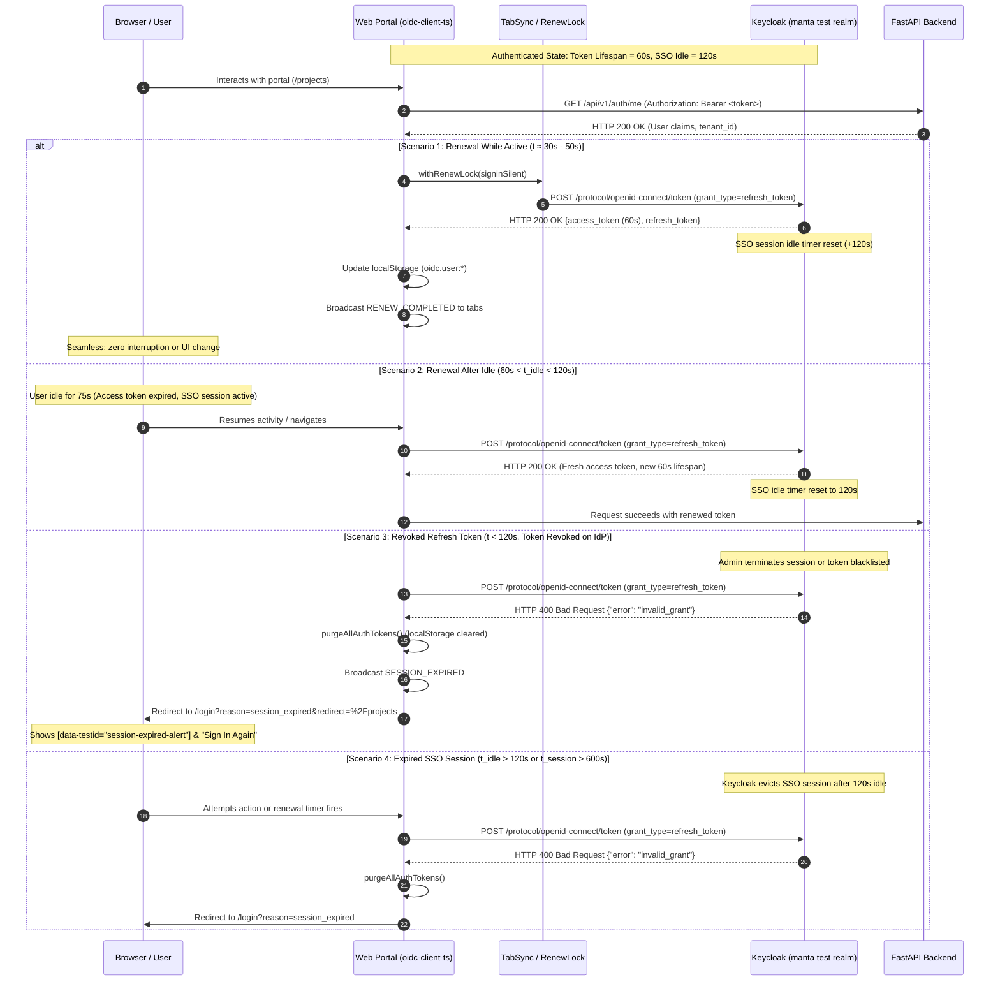

# Silent Session Renewal & Expiration Test Scenarios

**Parent User Story:** `SCRUM-242` (US-6: Silent session renewal)  
**Tasks:**  
- `SCRUM-284`: Shorten token lifetime in the test realm and create test scenarios  
- `SCRUM-285`: Write Playwright tests for silent renewal and revoked refresh token  
**Related Tickets:**  
- `SCRUM-283`: Handle failed renewal and prompt user to sign in again  
- `SCRUM-240` / `SCRUM-277`: US-4 Sign in via the organization's identity provider  
- `SCRUM-241` / `SCRUM-280`: US-5 RS256 token validation & claims enforcement  
**Identity Provider:** Keycloak 24.0.5 (`manta` test realm — [`infra/keycloak/realm-export.json`](../infra/keycloak/realm-export.json))  
**Frontend Client:** Next.js Web Portal (`manta-portal`, public client PKCE S256, `oidc-client-ts`)  
**Backend API:** FastAPI (`manta-backend`, bearer-only token verification)  
**Automated Pytest Suite:** [`backend/tests/test_keycloak_realm.py`](../backend/tests/test_keycloak_realm.py)  
**Automated E2E Suite:** [`web/e2e/auth-session-renewal.spec.ts`](../web/e2e/auth-session-renewal.spec.ts)

---

## 1. Objective

Make silent session renewal and token expiration testable **in seconds instead of minutes or hours**.

In production environments, access tokens typically live for 15 minutes (`900s`), and SSO sessions stay active for 30 minutes of idle time (`1,800s`) or up to 10 hours (`36,000s`). Testing renewal timers, idle boundaries, token refresh failures, and session terminations against production timeouts introduces prohibitive delays in automated CI pipelines and local developer workflows.

By configuring short, calibrated lifetimes in the test realm export (`infra/keycloak/realm-export.json`), token renewal, idle expiration, revocation handling, and UI session state transitions can be thoroughly verified within seconds.

> **Environment Isolation Policy:**  
> These short lifetimes are configured **strictly for the test realm (`manta`)** in [`infra/keycloak/realm-export.json`](../infra/keycloak/realm-export.json). They must **never** be applied to staging, UAT, or production environments.

---

## 2. Test Realm Token & Session Lifetimes (`infra/keycloak/realm-export.json`)

The test realm export configures short lifetimes adhering to the lifecycle ordering invariant:  
$$\text{accessTokenLifespan} < \text{ssoSessionIdleTimeout} \le \text{ssoSessionMaxLifespan}$$

| Configuration Parameter | Test Realm Value | Production Benchmark | Rationale & Test Benefit |
| :--- | :--- | :--- | :--- |
| **`accessTokenLifespan`** | **`60` seconds** (1 min) | `900` seconds (15 min) | Access tokens expire in 60s, triggering silent renewal checks and allowing tests to verify renewal cycles in seconds. |
| **`accessTokenLifespanForImplicitFlow`** | **`60` seconds** (1 min) | `900` seconds (15 min) | Aligns implicit/hybrid token lifespans with standard flow. |
| **`ssoSessionIdleTimeout`** | **`120` seconds** (2 min) | `1,800` seconds (30 min) | Idle timeout boundary is reached in 2 minutes instead of 30 minutes, enabling rapid testing of expired SSO sessions. |
| **`ssoSessionIdleTimeoutRememberMe`** | **`120` seconds** (2 min) | `1,800` seconds (30 min) | Consistent idle timeout regardless of remember-me preference. |
| **`ssoSessionMaxLifespan`** | **`600` seconds** (10 min) | `36,000` seconds (10 hours) | Absolute session expiration boundary testable in 10 minutes rather than 10 hours. |
| **`ssoSessionMaxLifespanRememberMe`** | **`600` seconds** (10 min) | `36,000` seconds (10 hours) | Aligns remember-me session cap. |
| **`clientSessionIdleTimeout`** | **`120` seconds** (2 min) | `1,800` seconds (30 min) | Ensures client-level session eviction matches realm idle timeout. |
| **`clientSessionMaxLifespan`** | **`600` seconds** (10 min) | `36,000` seconds (10 hours) | Aligns client session cap with realm maximum lifespan. |
| **`accessCodeLifespan`** | **`60` seconds** (1 min) | `60` seconds (1 min) | Authorization code exchange window for PKCE flow. |

---

## 3. Silent Renewal Architecture & Timing Lifecycle



---

## 4. Scenario Matrix

| Scenario ID | Test Scenario | Timing Window / Preconditions | Trigger & Protocol Exchange | Expected Outcome (Auth State, Tokens, Storage & UI) | Automated Test Coverage |
| :--- | :--- | :--- | :--- | :--- | :--- |
| **TC-RENEW-001** | **Renewal While Active** | User signed in (`alpha_dev`); active browser interaction; remaining access token lifespan $< 30\text{s}$; SSO session active ($t < 120\text{s}$). | Client background timer or navigation executes `UserManager.signinSilent()`; sends `grant_type=refresh_token` to `/protocol/openid-connect/token`. | 1. IdP responds `200 OK` with fresh 60s access token.<br>2. IdP resets SSO session idle timer.<br>3. `localStorage` updated with new token.<br>4. Cross-tab `RENEW_COMPLETED` broadcast.<br>5. No UI interruption or redirect.<br>6. Subsequent API requests return `200 OK`. | `backend/tests/test_keycloak_realm.py`<br>`web/e2e/auth-session-renewal.spec.ts` |
| **TC-RENEW-002** | **Renewal After Idle** | User signed in; tab idle for $> 60\text{s}$ but $< 120\text{s}$; access token is expired ($exp < now$), but SSO session remains active on IdP. | User returns to tab, clicks a link, or triggers API request; client checks expiration and issues silent refresh token request before API call. | 1. IdP validates refresh token and returns fresh token (`200 OK`, `expires_in: 60`).<br>2. SSO session idle timeout reset to 120s.<br>3. Local token store updated.<br>4. User action completes transparently without re-prompt or login screen.<br>5. Navigation succeeds without session loss. | `backend/tests/test_keycloak_realm.py`<br>`web/e2e/auth-session-renewal.spec.ts` |
| **TC-RENEW-003** | **Revoked Refresh Token** | User signed in; refresh token revoked or invalidated on IdP (admin session termination, logout elsewhere, or token revocation event). | Renewal attempt triggered (scheduled or user-initiated); client sends `grant_type=refresh_token` to Keycloak token endpoint. | 1. IdP returns `HTTP 400 Bad Request` with `error=invalid_grant`.<br>2. Terminal error recognized (no retry loop).<br>3. `purgeAllAuthTokens()` wipes `oidc.user:*` and `manta.*` from `localStorage`.<br>4. `SESSION_EXPIRED` broadcast across all tabs.<br>5. Redirect to `/login?reason=session_expired&redirect=<returnPath>`.<br>6. Displays `[data-testid="session-expired-alert"]`.<br>7. Clicking "Sign In Again" initiates fresh PKCE login and restores `<returnPath>`. | `web/e2e/auth-session-renewal.spec.ts` $\rightarrow$ `AC 1 & 2`, `Scope 3` |
| **TC-RENEW-004** | **Expired SSO Session** | User completely idle for $> 120\text{s}$ (`ssoSessionIdleTimeout`), OR total session duration $> 600\text{s}$ (`ssoSessionMaxLifespan`). | Renewal timer or user action contacts IdP after SSO session has been evicted from Keycloak memory. | 1. IdP rejects request with `HTTP 400 Bad Request` (`invalid_grant: Session not active`).<br>2. If iframe `prompt=none` is used, returns `error=login_required`.<br>3. Tokens purged from `localStorage`.<br>4. Navigation guards block protected routes (`/dashboard`, `/projects`).<br>5. User redirected to `/login?reason=session_expired`.<br>6. Re-authentication via IdP required to access protected routes. | `backend/tests/test_keycloak_realm.py`<br>`web/e2e/auth-session-renewal.spec.ts` |

---

## 5. Detailed Scenario Specifications

### Scenario 1: Renewal While Active (`TC-RENEW-001`)

- **Objective:**  
  Verify that when an authenticated user is actively using the platform, the frontend silently renews the short-lived access token before it expires, without disrupting the user's workflow or navigating away from the current page.

- **Preconditions:**  
  1. Keycloak test realm is running with `accessTokenLifespan = 60` and `ssoSessionIdleTimeout = 120`.
  2. User is signed in as `alpha_dev` with an active access token and refresh token in `localStorage`.
  3. User is actively viewing a portal page (e.g. `/projects`).

- **Step-by-Step Trigger:**  
  1. The client-side `UserManager` tracks token lifespan ($60\text{s}$) and schedules silent renewal.
  2. As the token nears expiration ($t \approx 30\text{s}-50\text{s}$), `signinSilent()` acquires the cross-tab lock (`withRenewLock`).
  3. Client dispatches `POST /realms/manta/protocol/openid-connect/token` with payload:
     ```
     grant_type=refresh_token&client_id=manta-portal&refresh_token=<active_refresh_token>
     ```
  4. Keycloak validates the refresh token against the active SSO session.

- **Expected Outcomes:**  
  - **IdP Response:** `HTTP 200 OK` with JSON body:
    ```json
    {
      "access_token": "eyJhbGciOiJSUzI1NiIsIn...",
      "expires_in": 60,
      "refresh_expires_in": 120,
      "refresh_token": "eyJhbGciOiJSUzI1NiIsIn...",
      "token_type": "Bearer",
      "id_token": "eyJhbGciOiJSUzI1NiIsIn...",
      "scope": "openid profile email"
    }
    ```
  - **SSO Session State:** Keycloak resets the SSO session idle timer, extending session validity by another 120 seconds.
  - **Client Storage:** `localStorage` key `oidc.user:http://localhost:8080/realms/manta:manta-portal` is updated with fresh access and refresh tokens.
  - **Multi-Tab Sync:** `BroadcastChannel("manta_auth_sync")` emits message `{ type: "RENEW_COMPLETED", tabId: "<id>" }`.
  - **UI / User Experience:** No modal prompt, no page reload, no navigation change. Active page state and uncommitted input forms are fully preserved.
  - **Backend API:** Subsequent requests to FastAPI (`/api/v1/auth/me`) succeed with `HTTP 200 OK`.

---

### Scenario 2: Renewal After Idle (`TC-RENEW-002`)

- **Objective:**  
  Verify that if a user leaves the application inactive for longer than the access token lifespan ($> 60\text{s}$) but within the SSO session idle window ($< 120\text{s}$), resuming activity triggers a transparent token renewal rather than terminating the session.

- **Preconditions:**  
  1. User is authenticated as `alpha_dev`.
  2. User leaves the browser idle for 75 seconds ($60\text{s} < 75\text{s} < 120\text{s}$).
  3. Access token has expired ($exp < now$), but Keycloak SSO session is still active (idle timeout has not elapsed).

- **Step-by-Step Trigger:**  
  1. User returns to the tab and clicks a navigation item (e.g., `/refactoring-verification`) or triggers a data fetch.
  2. The portal client checks `user.expired`. Finding the token expired, it automatically invokes `signinSilent()` prior to executing the backend request.
  3. The request sends the valid refresh token to Keycloak's token endpoint.

- **Expected Outcomes:**  
  - **IdP Response:** `HTTP 200 OK` issuing a new access token valid for 60 seconds.
  - **IdP Session:** Keycloak resets the idle timer back to 120 seconds from the refresh timestamp.
  - **Storage:** Local user state is refreshed with new cryptographic tokens.
  - **Navigation & API:** The user's intended navigation and backend API requests succeed without error.
  - **User Experience:** Seamless continuation of the session without requiring user re-authentication.

---

### Scenario 3: Revoked Refresh Token (`TC-RENEW-003`)

- **Objective:**  
  Verify that when a refresh token has been explicitly revoked or invalidated on the identity provider, the client cleanly purges local credentials, avoids infinite retry loops, and transitions the user to the session-expired state with a clear re-authentication path.

- **Preconditions:**  
  1. User was authenticated as `alpha_dev`.
  2. The refresh token or underlying session is revoked (e.g., via Keycloak Admin Console session termination, concurrent sign-out, or credential change).

- **Step-by-Step Trigger:**  
  1. Silent renewal is initiated (via timer, focus event, or manual trigger).
  2. Client submits the revoked refresh token:
     ```
     grant_type=refresh_token&client_id=manta-portal&refresh_token=<revoked_refresh_token>
     ```

- **Expected Outcomes:**  
  - **IdP Response:** `HTTP 400 Bad Request` with payload:
    ```json
    {
      "error": "invalid_grant",
      "error_description": "Session not active"
    }
    ```
  - **Retry Suppression:** The client classifies `invalid_grant` as terminal (`isTemporaryNetworkError() === false`) and suppresses retries.
  - **Credential Purge:** `purgeAllAuthTokens()` executes, removing all `oidc.*` and `manta.*` entries from `localStorage`.
  - **Multi-Tab Broadcast:** Emits `{ type: "SESSION_EXPIRED" }` and `{ type: "RENEW_FAILED" }` on `manta_auth_sync`, prompting sibling tabs to clear state simultaneously.
  - **Redirection & Route Preservation:** Browser is redirected to:
    ```
    /login?reason=session_expired&redirect=%2Fprojects
    ```
  - **UI Indicators:**
    - `[data-testid="session-expired-badge"]` displays `SESSION EXPIRED`.
    - `[data-testid="session-expired-alert"]` displays descriptive warning message.
    - `[data-testid="sign-in-again-button"]` is visible and actionable.
  - **Re-Authentication:** Clicking "Sign In Again" initiates fresh Authorization Code Flow with PKCE and returns the user to `/projects` upon completion.

---

### Scenario 4: Expired SSO Session (`TC-RENEW-004`)

- **Objective:**  
  Verify that when a user has been idle beyond the SSO session idle timeout ($t_{\text{idle}} > 120\text{s}$) or has exceeded the maximum session lifespan ($t_{\text{session}} > 600\text{s}$), Keycloak terminates the session and the portal forces a complete re-authentication cycle.

- **Preconditions:**  
  1. User authenticated in the `manta` test realm.
  2. Tab remains idle with no requests for $> 120$ seconds (or session reaches $> 600$ seconds).
  3. Keycloak session reaper evicts the user session from the realm active session cache.

- **Step-by-Step Trigger:**  
  1. User returns after $> 120\text{s}$ of inactivity and attempts an action, or a scheduled renewal fires.
  2. Client attempts token renewal with the stored refresh token.

- **Expected Outcomes:**  
  - **IdP Response:** Keycloak returns `HTTP 400 Bad Request` (`invalid_grant: Session not active` or `Session expired`).
  - **Session State:** Client sets `sessionStorage.setItem("manta_session_expired", "true")`.
  - **Storage Purge:** All tokens purged from `localStorage`.
  - **Route Protection:** Protected route guards intercept navigation and redirect to `/login?reason=session_expired`.
  - **No Security Leakage:** Unauthenticated browser state cannot access `/dashboard`, `/projects`, or `/access-roles`.
  - **Clean Re-Login:** User must re-authenticate through Keycloak SSO credentials before accessing protected resources.

---

## 6. Traceability to Automated Test Suites

| Scenario ID | Test Scenario | Automated Verification Suite | Test Implementation Method |
| :--- | :--- | :--- | :--- |
| **`TC-RENEW-001`** | Renewal While Active | `backend/tests/test_keycloak_realm.py`<br>`web/e2e/auth-session-renewal.spec.ts` | `test_short_token_and_sso_session_lifetimes`<br>`AC 3: Temporary network errors are retried before prompting`<br>`SCRUM-285 Test 1: Session stays alive past the short token lifetime with silent renewal` |
| **`TC-RENEW-002`** | Renewal After Idle | `backend/tests/test_keycloak_realm.py`<br>`web/e2e/auth-session-renewal.spec.ts` | `test_token_and_sso_lifetimes_ordering_invariants`<br>`SCRUM-285 Test 1: Session stays alive past the short token lifetime with silent renewal` |
| **`TC-RENEW-003`** | Revoked Refresh Token | `web/e2e/auth-session-renewal.spec.ts` | `SCRUM-283 AC 1 & 2: Revoked refresh token leads to session expired prompt, no stale tokens remain, no endless loop`<br>`SCRUM-285 Test 2: Revoke session through Keycloak admin API and assert re-authentication prompt appears` |
| **`TC-RENEW-004`** | Expired SSO Session | `backend/tests/test_keycloak_realm.py`<br>`web/e2e/auth-session-renewal.spec.ts` | `test_short_token_and_sso_session_lifetimes`<br>`Multi-tab sync: SESSION_EXPIRED message purges tokens and prompts login`<br>`SCRUM-285 Test 2: Revoke session through Keycloak admin API and assert re-authentication prompt appears` |

---

## 7. Running the Verification Suites

### 1. Backend Keycloak Realm Export Lifespan Tests
```bash
python -m pytest backend/tests/test_keycloak_realm.py -v
```

### 2. Frontend Silent Renewal & Expiration E2E Suite
```bash
cd web
npx playwright test e2e/auth-session-renewal.spec.ts
```

### 3. Direct Access Grant Verification (Direct Keycloak CLI)
```bash
# Request short-lived token from test realm (returns expires_in: 60)
curl -s -X POST http://localhost:8080/realms/manta/protocol/openid-connect/token \
  -d "client_id=manta-portal" \
  -d "grant_type=password" \
  -d "username=alpha_dev" \
  -d "password=dev123" | jq '{expires_in, refresh_expires_in, token_type}'
```
Expected output:
```json
{
  "expires_in": 60,
  "refresh_expires_in": 120,
  "token_type": "Bearer"
}
```
