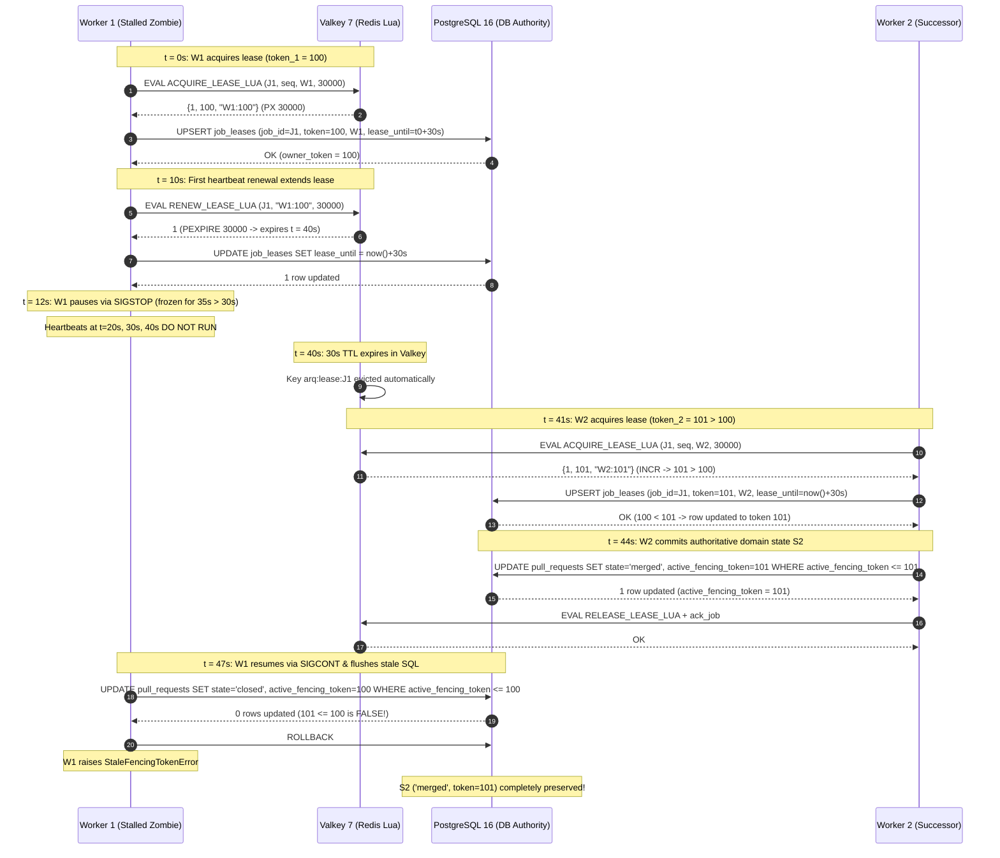
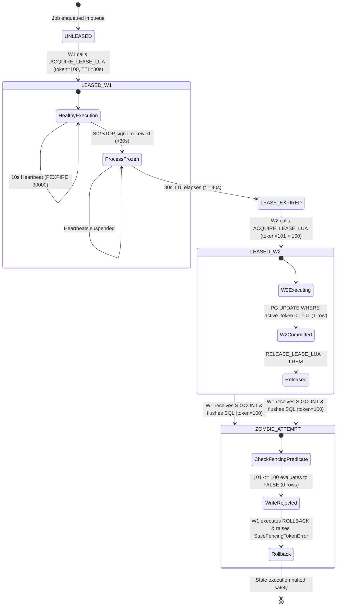

# Split-Brain Test Scenarios Using SIGSTOP (>30s Pause) and Concurrent Worker Lease Takeover

**Task:** Create split-brain test scenarios using SIGSTOP (>30s pause) and concurrent worker lease takeover (`SCRUM-413` / `Task 22.5`)  
**Parent User Story:** `SCRUM-359` (`US-22`: Worker Lease Management & Split-Brain Prevention)  
**Related Tickets:**  
- `SCRUM-409`: Design monotonic `owner_token` sequence, 30s lease contract and PostgreSQL optimistic fencing assertion (`Task 22.1`, [`docs/fencing-lease-contract.md`](fencing-lease-contract.md))  
- `SCRUM-410`: Implement Redis Lua script for atomic `arq:fencing_seq` increment and 30s worker lease assignment (`Task 22.2`, [`backend/workers/fencing.py`](../backend/workers/fencing.py))  
- `SCRUM-411`: Implement 10-second worker heartbeat lease renewal and expired-lease (>30s) supervisor reclamation (`Task 22.3`, [`backend/workers/fencing.py`](../backend/workers/fencing.py) & [`backend/workers/worker.py`](../backend/workers/worker.py))  
- `Task 22.6`: Write automated `pytest` test suite verifying monotonic fencing tokens, lease expiration reclamation, and zombie worker write rejection ([`backend/tests/test_split_brain_fencing.py`](../backend/tests/test_split_brain_fencing.py))  
- `SCRUM-407` / `SCRUM-408`: Reliable FIFO queue ordering and SIGKILL crash recovery ([`docs/fifo-ordering-priority-preemption-and-sigkill-crash-test-scenarios.md`](fifo-ordering-priority-preemption-and-sigkill-crash-test-scenarios.md))  

**Target Infrastructure Engines:** Valkey 7 (`valkey/valkey:7-alpine`) / Redis 7+ & PostgreSQL 16 (`pgvector/pgvector:pg16`)  
**Target Implementation Modules:** [`backend/workers/fencing.py`](../backend/workers/fencing.py), [`backend/workers/worker.py`](../backend/workers/worker.py), [`backend/app/db/models/models.py`](../backend/app/db/models/models.py)  
**Authoritative Automated Pytest Suite:** [`backend/tests/test_split_brain_fencing.py`](../backend/tests/test_split_brain_fencing.py)  
**Assignee:** Matvii Yeromenko  
**Category:** Testing - Design  
**Status:** Approved / Verification Baseline Established  

---

## 1. Objective & Architectural Invariants

### 1.1 Objective

Establish the definitive, step-by-step test verification scenarios for **distributed split-brain prevention** under uncatchable worker process suspension (`SIGSTOP`), hypervisor live-migration pauses, garbage collection freezes, or transaction clock advance exceeding the 30-second lease timeout ($>30\text{s}$).

This specification details:
1. **The Exact Sequence of Monotonic Fencing Tokens ($\tau_1 < \tau_2 < \dots < \tau_k$):**  
   Issued atomically by Valkey/Redis (`INCR arq:fencing_seq`) inside `ACQUIRE_LEASE_LUA`, guaranteeing that successor worker $W_2$ receives $\tau_2 > \tau_1$.
2. **Lease Expiry Timestamps & State Transitions:**  
   $t = 0\text{s}$ (acquisition by $W_1$), $t = 10\text{s}$ (heartbeat extension), $t = 12\text{s}$ ($W_1$ paused by `SIGSTOP`), $t = 40\text{s}$ (30s TTL expiry in Valkey, `lease_until <= now()` in PostgreSQL), $t = 41\text{s}$ ($W_2$ reclamation & takeover), $t = 44\text{s}$ ($W_2$ authoritative commit), and $t = 47\text{s}$ ($W_1$ awakening via `SIGCONT`).
3. **Successor Worker $W_2$ Authoritative Commit State:**  
   Durable persistence of state $S_2$ on domain tables (`pull_requests`, `issues`, `deployments`, `webhook_events`) with `active_fencing_token = \tau_2` and `job_leases.owner_token = \tau_2`.
4. **Resumed Zombie Worker $W_1$ Write Rejection Assertions:**  
   PostgreSQL optimistic fencing assertion (`WHERE active_fencing_token <= :worker_claimed_token`) evaluating to $\mathbf{FALSE}$ ($\tau_2 \le \tau_1 \implies \mathbf{FALSE}$), resulting in `rowcount == 0`, transaction rollback (`await db.rollback()`), and raising `StaleFencingTokenError` without corrupting $W_2$'s newer state.
5. **Valkey / Redis 7 Ownership Isolation:**  
   Ensuring that resumed zombie $W_1$ cannot renew (`RENEW_LEASE_LUA`) or release (`RELEASE_LEASE_LUA`) $W_2$'s active lease key.

---

### 1.2 Core Architectural Invariants

```
+-------------------------------------------------------------------------------------------------------------------+
|                         SPLIT-BRAIN PREVENTION & CONCURRENT LEASE TAKEOVER TOPOLOGY                               |
+-------------------------------------+-------------------------------------+---------------------------------------+
| 1. Monotonic Fencing Sequence       | 2. Dual-Layer Storage Contract      | 3. Optimistic SQL Fencing Assertion   |
|    (atomic INCR arq:fencing_seq)    |    (Valkey TTL + PostgreSQL Clock)  |    (WHERE active_token <= :claimed)   |
+-------------------------------------+-------------------------------------+---------------------------------------+
| * Atomic Lua script ACQUIRE_LEASE   | * Valkey: PX 30000 key eviction     | * Domain row ratchets token to tau_2  |
| * Issues tau_1 at t=0s              | * PostgreSQL: lease_until <= now()  | * Zombie tau_1 <= tau_2 is FALSE      |
| * Issues tau_2 > tau_1 at t=41s     | * Heartbeat extends +30s @ 10s      | * rowcount == 0 -> ROLLBACK           |
| * Strictly monotonic non-decreasing | * Frozen worker heartbeats stall    | * StaleFencingTokenError raised       |
+-------------------------------------+-------------------------------------+---------------------------------------+
```

#### Invariant 1: Monotonic Sequence Generation ($\tau_1 < \tau_2$)
- Valkey/Redis maintains `arq:fencing_seq` as a persistent 64-bit integer counter.
- A lease acquisition executes `ACQUIRE_LEASE_LUA`. If the lease key `arq:lease:{job_id}` is expired or absent, it increments `arq:fencing_seq` via `INCR` and writes `"{worker_id}:{owner_token}"` with `PX 30000`.
- Because Valkey executes Lua scripts atomically on a single-threaded execution context:
  $$\forall W_1, W_2: \quad t_{\text{acq}}(W_1) < t_{\text{acq}}(W_2) \implies \tau(W_1) < \tau(W_2)$$
- Sequence tokens never regress, never collide, and are strictly non-repeating.

#### Invariant 2: 30-Second Lease TTL with 10-Second Heartbeat Renewal
- **Lease Duration:** $T_{\text{lease}} = 30\text{ seconds}$ (`30,000 ms`).
- **Heartbeat Cadence:** $T_{\text{heartbeat}} = 10\text{ seconds}$. A healthy worker extends its lease twice ($t = 10\text{s}, 20\text{s}$) before expiration.
- **Heartbeat Execution:** Atomic `RENEW_LEASE_LUA` checks `if redis.call('GET', KEYS[1]) == ARGV[1]` and issues `PEXPIRE 30000`, accompanied by PostgreSQL `UPDATE job_leases SET lease_until = now() + INTERVAL '30 seconds' WHERE owner_token = :token AND lease_until > now()`.
- **Failure Window:** If a worker process stalls (`SIGSTOP`, VM freeze, GC pause) for $> 30\text{s}$, its heartbeat loop is completely frozen in kernel space. At $t = t_{\text{last\_heartbeat}} + 30\text{s}$, the lease expires unconditionally.

#### Invariant 3: Expiration Reclamation & Re-queue Protocol
- When $W_1$'s lease expires:
  1. Valkey automatically evicts `arq:lease:{job_id}`.
  2. In PostgreSQL, `job_leases.lease_until <= now()` becomes `TRUE`.
  3. The supervisor reclamation routine (`reclaim_expired_leases`) re-queues the stranded job payload from $W_1$'s in-flight list (`arq:in_flight:{W1}`) to the head of the origin queue (`arq:queue:default` or `arq:queue:high`) via `LMOVE ... RIGHT LEFT`.
- Successor worker $W_2$ dequeues the job and executes `acquire_job_lease`, receiving $\tau_2 \ge \tau_1 + 1 > \tau_1$.

#### Invariant 4: Dual-Layer Database Fencing Guard
Storage consistency is enforced at two distinct relational layers in PostgreSQL:
- **Layer 1 (`job_leases` table):**
  The `job_leases` table acts as the authoritative lease coordinator:
  ```sql
  INSERT INTO job_leases (job_id, tenant_id, owner_token, claimed_by, lease_until, created_at)
  VALUES (:job_id, :tenant_id, :worker_claimed_token, :worker_id, now() + INTERVAL '30 seconds', now())
  ON CONFLICT (job_id) DO UPDATE
  SET owner_token = EXCLUDED.owner_token,
      claimed_by  = EXCLUDED.claimed_by,
      lease_until = now() + INTERVAL '30 seconds'
  WHERE job_leases.owner_token < EXCLUDED.owner_token
  RETURNING owner_token;
  ```
  Successor $W_2$ sets `owner_token = \tau_2`. If $W_1$ wakes up before domain mutation, it is blocked here because $\tau_1 < \tau_2$.
- **Layer 2 (Domain Entity Tables — `pull_requests`, `issues`, `deployments`):**
  Every domain entity modification asserts the optimistic fencing predicate:
  ```sql
  UPDATE pull_requests
  SET state = :state,
      active_fencing_token = :worker_claimed_token,
      updated_at = now()
  WHERE id = :entity_id
    AND tenant_id = :tenant_id
    AND active_fencing_token <= :worker_claimed_token
  RETURNING id, active_fencing_token;
  ```
  Once $W_2$ commits $\tau_2$, the row's `active_fencing_token` is $\tau_2$. When $W_1$ attempts to commit with $\tau_1$, PostgreSQL evaluates $\tau_2 \le \tau_1$. Since $\tau_1 < \tau_2$, this evaluates to $\mathbf{FALSE}$, modifying 0 rows.

#### Invariant 5: Safe Rollback & Zombie Non-Interference
- When a worker observes `rowcount == 0` on its fenced mutation, it:
  1. Aborts the uncommitted transaction immediately via `await db.rollback()`.
  2. Raises `StaleFencingTokenError(job_id, worker_id, claimed_token)`.
  3. Removes only its own in-flight item via `LREM arq:in_flight:{W1} 1 <payload>`.
  4. Invokes `RELEASE_LEASE_LUA`, which checks `if redis.call('GET', KEYS[1]) == ARGV[1]`. Because $W_2$ holds $\tau_2$, $W_1$'s release attempt is a safe no-op (returns `0`), leaving $W_2$'s lease intact.

---

## 2. Test Personas, Schemas, & Timing Configurations

### 2.1 Test Personas & Worker Identities

| Entity | Identifier / Worker ID | Process State Transitions | Architectural Role |
| :--- | :--- | :--- | :--- |
| **Worker 1 ($W_1$)** | `manta-worker-node1-1001-a1b2c3d4` | Running ($t=0..12\text{s}$) $\rightarrow$ `SIGSTOP` ($t=12..47\text{s}$) $\rightarrow$ `SIGCONT` ($t=47\text{s}$) | Initial leaseholder; stalls mid-execution, becomes zombie |
| **Worker 2 ($W_2$)** | `manta-worker-node2-1002-e5f6g7h8` | Running ($t=41..45\text{s}$) | Successor leaseholder; reclaims job, acquires $\tau_2 > \tau_1$, commits $S_2$ |
| **Worker 3 ($W_3$)** | `manta-worker-node3-1003-99aa88bb` | Running ($t=41\text{s}$) | Concurrent contender racing $W_2$ during lease takeover |
| **Supervisor (`SUP`)** | `manta-supervisor-node0-9000-deadbeef` | Polling ($t=40\text{s}$) | Detects expired lease, sweeps stranded in-flight list |
| **Tenant Alpha** | `tenant_id = 11111111-1111-1111-1111-111111111111` | Active | Target tenant for multi-tenant RLS isolation |

### 2.2 Canonical Test Job Envelope & Entity Records

```json
{
  "attempt": 0,
  "enqueued_at": "2026-11-11T12:00:00.000000Z",
  "event_id": "550e8400-e29b-41d4-a716-446655440000",
  "job_id": "9b1deb4d-3b7d-4bad-9bdd-2b0d7b3dcb6d",
  "job_type": "webhook_event",
  "payload": {
    "action": "closed",
    "pull_request_id": "88888888-8888-8888-8888-888888888888",
    "pull_request_number": 42,
    "target_state": "merged"
  },
  "priority": "default",
  "provider": "github",
  "tenant_id": "11111111-1111-1111-1111-111111111111",
  "version": 1
}
```

### 2.3 Timing Milestones

```
t=0s: W1 acquires lease (token_1 = 100, TTL = 30s, expires t=30s)
│
├── t=10s: W1 1st Heartbeat succeeds (extends TTL to t=40s)
│
├── t=12s: W1 receives SIGSTOP (process frozen for 35s > 30s)
│          Heartbeats at t=20s, 30s, 40s DO NOT RUN
│
├── t=40s: Valkey TTL expires (PX 30000 elapsed; key evicted)
│          PostgreSQL job_leases.lease_until <= now() becomes TRUE
│
├── t=41s: W2 reclaims job & acquires lease (token_2 = 101 > 100, TTL = 30s)
│
├── t=44s: W2 commits state S2 ('merged', active_fencing_token = 101) & releases lease
│
└── t=47s: W1 receives SIGCONT (resumes execution unaware of time leap)
           W1 attempts late commit (token_1 = 100)
           PostgreSQL asserts: 101 <= 100 -> FALSE (0 rows updated)
           W1 transaction rolls back; StaleFencingTokenError raised!
```

---

## 3. Master Test Scenarios Matrix

| Scenario ID | Test Scenario | Fault Injection Mechanism | Token Sequence | Lease Expiry & Recovery Timeline | Worker 2 Commit State | Worker 1 Resume Rejection Assertions & Log Outcomes | Primary Invariant Verified | Automated Pytest Mapping |
| :--- | :--- | :--- | :--- | :--- | :--- | :--- | :--- | :--- |
| **TC-SPLIT-001** | **Canonical SIGSTOP (>30s Pause), Takeover & Zombie Rejection** | Process paused via `SIGSTOP` / `pause_event` for $35\text{s} > 30\text{s}$; resumed via `SIGCONT`. | $\tau_1 = 100$, $\tau_2 = 101$ ($\tau_1 < \tau_2$). | Lease expires at $t=40\text{s}$; $W_2$ claims at $t=41\text{s}$; $W_1$ wakes at $t=47\text{s}$. | `state = 'merged'`, `active_fencing_token = 101`, committed to DB. | SQL predicate `101 <= 100` evaluates to `FALSE` (`rowcount == 0`); transaction rolls back; `StaleFencingTokenError` raised; `state` remains `'merged'`. | Kleppmann monotonic fencing; zero split-brain data corruption. | `test_split_brain_sigstop_pause_takeover_and_rejection` |
| **TC-SPLIT-002** | **Mid-Flight Takeover Fenced Out at `job_leases` Before Domain Commit** | $W_1$ pauses for $35\text{s}$; $W_2$ acquires $\tau_2$ in `job_leases`; $W_1$ awakens *before* $W_2$ completes domain update. | $\tau_1 = 100$, $\tau_2 = 101$ ($\tau_1 < \tau_2$). | $W_2$ claims at $t=41\text{s}$; $W_1$ wakes at $t=42\text{s}$ ($W_2$ still processing). | `job_leases.owner_token = 101`, domain row at initial state. | $W_1$ checking `job_leases` or CTE guard detects `owner_token = 101 > 100`; rejects $W_1$ immediately before $W_2$ commits. | Layer 1 fencing (`job_leases`) prevents stale writes during concurrent in-flight execution. | `test_mid_flight_takeover_fences_out_resumed_worker_at_job_leases` |
| **TC-SPLIT-003** | **Clock Advance & PostgreSQL Time-Based Expiry Without OS Pause** | Simulation of transaction clock advance ($+31\text{s}$) in PostgreSQL without OS process freeze. | $\tau_1 = 200$, $\tau_2 = 201$ ($\tau_1 < \tau_2$). | $t_{\text{now}} > t_{\text{lease\_until}}$; PostgreSQL `lease_until <= now()` holds. | $W_2$ claims lease and commits domain state. | $W_1$ heartbeat renewal fails (`UPDATE job_leases ... WHERE lease_until > now()` returns 0 rows); $W_1$ self-fences and aborts. | PostgreSQL clock independence; immunity to worker OS clock drift. | `test_clock_advance_lease_expiration_and_takeover` |
| **TC-SPLIT-004** | **Concurrent Multi-Worker Race on Expired Lease ($W_2$ vs $W_3$)** | $W_1$ lease expires; $W_2$ and $W_3$ race simultaneously to claim $J_1$ via `ACQUIRE_LEASE_LUA`. | $\tau_1 = 300$, $\tau_2 = 301$ (acquired by winner $W_2$). $W_3$ rejected. | $t = 31\text{s}$; Redis key absent; simultaneous `EVAL`. | $W_2$ wins lease, commits state $S_2$. $W_3$ gets 0 rows, aborts claim. | $W_1$ wakes later; rejected by $\tau_2 = 301$. `arq:fencing_seq` increments exactly once for $W_2$. | Atomic Lua race protection; single-lease guarantee under concurrent failover. | `test_concurrent_workers_race_on_expired_lease` |
| **TC-SPLIT-005** | **Idempotent Multi-Step Mutation by Valid Leaseholder (`<=` Guard)** | $W_2$ executes Step A then Step B under $\tau_2$; $W_1$ attempts Step C under stale $\tau_1$. | $\tau_1 = 400$, $\tau_2 = 401$. Step A ($\tau_2$), Step B ($\tau_2$), Step C ($\tau_1$). | $W_2$ holds active lease for duration of multi-step transaction. | Step A sets `token = 401`; Step B passes (`401 <= 401` is `TRUE`). | Step C from $W_1$ fails (`401 <= 400` is `FALSE`); 0 rows updated; rollback. | Proves requirement for `<=` operator in optimistic fencing predicate. | `test_multi_step_idempotent_mutation_by_valid_leaseholder_vs_zombie` |
| **TC-SPLIT-006** | **Valkey Key Isolation: Zombie Cannot Release or Renew Successor's Lease** | $W_1$ wakes up after $W_2$ takeover; calls `RENEW_LEASE_LUA` and `RELEASE_LEASE_LUA` with $\tau_1$. | $\tau_1 = 500$, $\tau_2 = 501$. Value in Redis: `"W2:501"`. | $t = 47\text{s}$; $W_2$ holds active lease key. | Redis key retains `"W2:501"`; TTL preserved. | `RENEW_LEASE_LUA` returns `-1` (superseded); `RELEASE_LEASE_LUA` returns `0` (no delete); $W_2$ lease untouched. | Compare-and-swap Lua ownership verification in Valkey. | `test_zombie_cannot_extend_or_release_successor_lease` |
| **TC-SPLIT-007** | **Cold-Start Sequence Monotonicity Floor Recovery** | Valkey memory is completely flushed (`FLUSHALL`); PostgreSQL retains `MAX(owner_token) = 600`. | $\tau_{\text{floor}} = 600$, $\tau_{\text{next}} = 601$. | Worker passes `min_token_floor = 600` on next lease acquisition. | Next worker acquires lease with $\tau = 601 > 600$. | Lua initializes `arq:fencing_seq` to floor before `INCR`; strict monotonicity preserved across Valkey crash. | Cold-start monotonicity guarantee and disaster recovery floor contract. | `test_cold_start_floor_recovery_preserves_monotonicity` |

---

## 4. Detailed Scenario Specifications

### 4.1 Scenario `TC-SPLIT-001`: Canonical SIGSTOP (>30s Pause), Takeover & Zombie Rejection

#### 4.1.1 Objective & Requirements Traceability
- **Objective:** Prove that when Worker 1 pauses for $35\text{s} > 30\text{s}$ (via OS `SIGSTOP`), its 30-second lease expires in Valkey and PostgreSQL, allowing Worker 2 to reclaim the job under a strictly higher fencing token ($\tau_2 > \tau_1$) and commit authoritative state $S_2$. When Worker 1 resumes (`SIGCONT`), its late commit attempt is rejected by PostgreSQL's `WHERE active_fencing_token <= :worker_claimed_token` predicate (`rowcount == 0`), causing a transaction rollback and raising `StaleFencingTokenError` while preserving $W_2$'s state intact.
- **Parent Requirements:** `SCRUM-359` (`US-22` AC-1, AC-2), `SCRUM-409` (`Task 22.1` §7.2, §8.1), `SCRUM-413` (`Task 22.5` Scope).

#### 4.1.2 Preconditions
1. **Valkey 7 / Redis State:**
   - Key `arq:fencing_seq` initialized to `99`.
   - Key `arq:lease:9b1deb4d-3b7d-4bad-9bdd-2b0d7b3dcb6d` does not exist (`EXISTS == 0`).
   - Queue `arq:queue:default` contains job envelope `J_1` (`job_id = "9b1deb4d-3b7d-4bad-9bdd-2b0d7b3dcb6d"`).
2. **PostgreSQL 16 State:**
   - Table `job_leases` contains no row for `job_id = "9b1deb4d-3b7d-4bad-9bdd-2b0d7b3dcb6d"`.
   - Table `pull_requests` contains record `id = "88888888-8888-8888-8888-888888888888"`:
     - `state = 'open'`
     - `active_fencing_token = 0`
     - `tenant_id = '11111111-1111-1111-1111-111111111111'`

#### 4.1.3 Step-by-Step Chronological Timeline

```
 WORKER 1 (W1)                 VALKEY 7 SERVER               POSTGRESQL 16              WORKER 2 (W2)
       │                              │                             │                          │
 t=0s  │ ACQUIRE_LEASE_LUA (W1)       │                             │                          │
       │─────────────────────────────>│                             │                          │
       │ Returns {1, 100, "W1:100"}   │                             │                          │
       │<─────────────────────────────│                             │                          │
       │ UPSERT job_leases (token=100)                              │                          │
       │───────────────────────────────────────────────────────────>│                          │
       │ OK (lease_until = t0 + 30s)                                │                          │
       │<───────────────────────────────────────────────────────────│                          │
       │                                                            │                          │
 t=10s │ RENEW_LEASE_LUA (W1, 100)    │                             │                          │
       │─────────────────────────────>│ (PEXPIRE 30000 -> exp t=40s)│                          │
       │ OK (1)                       │                             │                          │
       │ UPDATE job_leases lease_until = now() + 30s                │                          │
       │───────────────────────────────────────────────────────────>│                          │
       │                                                            │                          │
 t=12s │ [PROCESS FROZEN: SIGSTOP]    │                             │                          │
       │ (Pause duration: 35s)        │                             │                          │
       │                              │                             │                          │
 t=40s │                              │ Key arq:lease:J1 expires!   │                          │
       │                              │ (PX 30000 timer fires)      │                          │
       │                              │                             │                          │
 t=41s │                              │                             │ ACQUIRE_LEASE_LUA (W2)   │
       │                              │<───────────────────────────────────────────────────────│
       │                              │ Returns {1, 101, "W2:101"}  │                          │
       │                              │───────────────────────────────────────────────────────>│
       │                              │                             │ UPSERT job_leases        │
       │                              │                             │ (token=101, by=W2)       │
       │                              │                             │<─────────────────────────│
       │                              │                             │ OK (owner_token = 101)   │
       │                              │                             │─────────────────────────>│
       │                              │                             │                          │
 t=44s │                              │                             │ UPDATE pull_requests     │
       │                              │                             │ SET state='merged',      │
       │                              │                             │ active_fencing_token=101 │
       │                              │                             │ WHERE token <= 101       │
       │                              │                             │<─────────────────────────│
       │                              │                             │ 1 row updated; COMMIT OK │
       │                              │                             │─────────────────────────>│
       │                              │ RELEASE_LEASE_LUA (W2, 101) │                          │
       │                              │<───────────────────────────────────────────────────────│
       │                              │ Key deleted (1)             │                          │
       │                                                            │                          │
 t=47s │ [PROCESS WAKES UP: SIGCONT]                                │                          │
       │ W1 executes delayed SQL:                                   │                          │
       │ UPDATE pull_requests                                       │                          │
       │ SET state='closed', active_fencing_token=100               │                          │
       │ WHERE id=:id AND active_fencing_token <= 100               │                          │
       │───────────────────────────────────────────────────────────>│                          │
       │ Predicate: 101 <= 100 is FALSE!                            │                          │
       │ Returns: 0 rows updated                                    │                          │
       │<───────────────────────────────────────────────────────────│                          │
       │ W1 detects rowcount == 0                                   │                          │
       │ W1 executes ROLLBACK                                       │                          │
       │───────────────────────────────────────────────────────────>│                          │
       │ W1 raises StaleFencingTokenError                           │                          │
```

#### 4.1.4 Detailed Execution Steps

1. **Phase 1: Worker 1 Dequeues and Claims Job ($t = 0\text{s}$):**
   - $W_1$ dequeues $J_1$ and moves it to `arq:in_flight:manta-worker-node1-1001-a1b2c3d4`.
   - $W_1$ calls `acquire_job_lease(redis, db, job_id="9b1deb4d-3b7d-4bad-9bdd-2b0d7b3dcb6d", ...)`.
   - Valkey executes `ACQUIRE_LEASE_LUA`:
     - `INCR arq:fencing_seq` yields `100`.
     - `SET arq:lease:9b1deb4d-3b7d-4bad-9bdd-2b0d7b3dcb6d "manta-worker-node1-1001-a1b2c3d4:100" PX 30000`.
     - Returns `{1, 100, "manta-worker-node1-1001-a1b2c3d4:100"}`.
   - PostgreSQL executes `_UPSERT_JOB_LEASE_SQL`:
     - Inserts row `(job_id, owner_token=100, claimed_by='manta-worker-node1-1001-a1b2c3d4', lease_until=now()+30s)`.
   - Returns `LeaseHandle(job_id=..., owner_token=100, worker_id='manta-worker-node1-1001-a1b2c3d4')`.
   - Background heartbeat loop starts via `LeaseHeartbeatManager`.

2. **Phase 2: First Heartbeat Renewal at $t = 10\text{s}$:**
   - At $t = 10.0\text{s}$, the heartbeat timer fires in $W_1$.
   - Executes `RENEW_LEASE_LUA`:
     - Verifies `arq:lease:J1 == "manta-worker-node1-1001-a1b2c3d4:100"`.
     - Sets `PEXPIRE 30000`. Expiration timestamp extended to $t = 10\text{s} + 30\text{s} = 40.0\text{s}$.
     - Returns `1`.
   - PostgreSQL executes `_RENEW_JOB_LEASE_SQL`:
     - Updates `lease_until = now() + INTERVAL '30 seconds'`.
     - 1 row returned (`owner_token = 100`).

3. **Phase 3: Operating System `SIGSTOP` Process Suspension at $t = 12\text{s}$:**
   - At $t = 12.0\text{s}$, an external event halts $W_1$:
     - OS sends `SIGSTOP` signal to PID of $W_1$, or
     - Test harness sets `pause_event.set()` on $W_1$'s heartbeat manager and freezes $W_1$'s event loop.
   - **Crucial Invariant:** While $W_1$ is in `TASK_STOPPED` state, its background asyncio tasks cannot execute.
   - The scheduled heartbeats at $t = 20\text{s}$, $t = 30\text{s}$, and $t = 40\text{s}$ **never execute**.

4. **Phase 4: Expiration at $t = 40.0\text{s}$:**
   - At $t = 40.001\text{s}$, $30,000\text{ ms}$ have elapsed since the last heartbeat at $t = 10.0\text{s}$.
   - Valkey's active TTL eviction expires key `arq:lease:9b1deb4d-3b7d-4bad-9bdd-2b0d7b3dcb6d`.
   - In PostgreSQL, transaction time satisfies `lease_until <= now()`.

5. **Phase 5: Supervisor Reclamation & Worker 2 Lease Takeover at $t = 41.0\text{s}$:**
   - Supervisor sweep detects stranded job in $W_1$'s in-flight queue whose lease expired.
   - Job is restored to `arq:queue:default`.
   - Worker 2 ($W_2$) pops $J_1$ into `arq:in_flight:manta-worker-node2-1002-e5f6g7h8`.
   - $W_2$ executes `acquire_job_lease(...)`:
     - Valkey executes `ACQUIRE_LEASE_LUA`:
       - `GET arq:lease:J1` returns `nil` (expired).
       - `INCR arq:fencing_seq` yields `101` ($\tau_2 = 101 > \tau_1 = 100$).
       - `SET arq:lease:J1 "manta-worker-node2-1002-e5f6g7h8:101" PX 30000`.
       - Returns `{1, 101, "manta-worker-node2-1002-e5f6g7h8:101"}`.
     - PostgreSQL executes `_UPSERT_JOB_LEASE_SQL`:
       - Conflict target `(job_id)` hit.
       - Condition `job_leases.owner_token < EXCLUDED.owner_token` evaluates to `100 < 101` $\implies \mathbf{TRUE}$.
       - Updates row to `(owner_token = 101, claimed_by = 'manta-worker-node2-1002-e5f6g7h8', lease_until = now() + 30s)`.
       - Returns `101`.

6. **Phase 6: Worker 2 Authoritative Commit at $t = 44.0\text{s}$:**
   - $W_2$ processes the webhook business logic to merge Pull Request #42:
     ```sql
     UPDATE pull_requests
     SET state = 'merged',
         merged_at = now(),
         active_fencing_token = 101,
         updated_at = now()
     WHERE id = '88888888-8888-8888-8888-888888888888'
       AND tenant_id = '11111111-1111-1111-1111-111111111111'
       AND active_fencing_token <= 101
     RETURNING id, active_fencing_token;
     ```
   - Evaluation: `0 <= 101` is $\mathbf{TRUE}$.
   - 1 row updated. `active_fencing_token` is set to `101`.
   - Transaction `COMMIT` completes.
   - $W_2$ releases its lease via `release_job_lease` and acknowledges the job via `ack_job`.

7. **Phase 7: Worker 1 Awakening (`SIGCONT`) & Stale Write Rejection at $t = 47.0\text{s}$:**
   - Operating system sends `SIGCONT` to $W_1$ (total pause duration $= 35\text{s}$).
   - $W_1$ resumes execution exactly where it was frozen, unaware that $35\text{s}$ have passed.
   - $W_1$ attempts to commit its stale pre-constructed state (`state = 'closed'` with $\tau_1 = 100$):
     ```sql
     UPDATE pull_requests
     SET state = 'closed',
         active_fencing_token = 100,
         updated_at = now()
     WHERE id = '88888888-8888-8888-8888-888888888888'
       AND tenant_id = '11111111-1111-1111-1111-111111111111'
       AND active_fencing_token <= 100
     RETURNING id, active_fencing_token;
     ```
   - **PostgreSQL Evaluation:**
     - Current row has `active_fencing_token = 101`.
     - Predicate `101 <= 100` evaluates to $\mathbf{FALSE}$!
     - 0 rows are updated (`rowcount == 0`, returning `None`).
   - $W_1$ detects `rowcount == 0`:
     - Executes `await db.rollback()`.
     - Raises `StaleFencingTokenError(job_id=..., worker_id='manta-worker-node1-1001-a1b2c3d4', claimed_token=100)`.
     - Removes its stale in-flight queue entry.

#### 4.1.5 Database State Transitions

| Timestamp | Entity / Table | Column | Stored Value | Transition Reason |
| :--- | :--- | :--- | :--- | :--- |
| **$t = 0\text{s}$** | `job_leases` | `owner_token`<br>`claimed_by`<br>`lease_until` | `100`<br>`manta-worker-node1-1001-a1b2c3d4`<br>$t_0 + 30\text{s}$ | $W_1$ initial lease acquisition |
| **$t = 0\text{s}$** | `pull_requests` | `state`<br>`active_fencing_token` | `'open'`<br>`0` | Initial domain entity state |
| **$t = 10\text{s}$** | `job_leases` | `lease_until` | $t_{10} + 30\text{s} = t_{40}$ | $W_1$ 10s heartbeat extension |
| **$t = 40\text{s}$** | `job_leases` | `lease_until` | Expired ($t_{40} \le t_{\text{now}}$) | Heartbeat skipped during `SIGSTOP`; lease expired |
| **$t = 41\text{s}$** | `job_leases` | `owner_token`<br>`claimed_by`<br>`lease_until` | `101`<br>`manta-worker-node2-1002-e5f6g7h8`<br>$t_{41} + 30\text{s}$ | $W_2$ lease takeover ($100 < 101$) |
| **$t = 44\text{s}$** | `pull_requests` | `state`<br>`active_fencing_token` | `'merged'`<br>`101` | $W_2$ authoritative domain commit ($0 \le 101$) |
| **$t = 47\text{s}$** | `pull_requests` | `state`<br>`active_fencing_token` | `'merged'`<br>`101` | $W_1$ write rejected ($101 \le 100 \implies \text{FALSE}$); state untouched |

#### 4.1.6 Verification Assertions
```python
# Assert Worker 2 authoritative commit state in PostgreSQL
db_pr = await db.scalar(select(PullRequest).where(PullRequest.id == pr_id))
assert db_pr.state == "merged"
assert db_pr.active_fencing_token == 101

# Assert Worker 1 write rejection
with pytest.raises(StaleFencingTokenError) as exc_info:
    await execute_fenced_update(
        db,
        pr_id=pr_id,
        tenant_id=tenant_id,
        new_state="closed",
        worker_claimed_token=100,  # Stale token from W1
    )
assert exc_info.value.claimed_token == 100
assert exc_info.value.job_id == job_id

# Verify state was not overwritten by W1
await db.refresh(db_pr)
assert db_pr.state == "merged"
assert db_pr.active_fencing_token == 101
```

---

### 4.2 Scenario `TC-SPLIT-002`: Mid-Flight Takeover Fenced Out at `job_leases` Before Domain Commit

#### 4.2.1 Objective & Requirements Traceability
- **Objective:** Verify Layer 1 fencing behavior when Worker 1 resumes *after* Worker 2 has acquired the lease in `job_leases` ($\tau_2 = 101$), but *before* Worker 2 commits its modification to the domain table.
- **Parent Requirements:** `SCRUM-359` (`US-22` AC-1), `SCRUM-409` (`Task 22.1` §6.3).

#### 4.2.2 Step-by-Step Execution Sequence
1. $W_1$ claims $J_1$ ($\tau_1 = 100$) and enters `SIGSTOP` for $35\text{s}$.
2. Lease expires at $t = 30\text{s}$.
3. At $t = 31\text{s}$, $W_2$ executes `acquire_job_lease(...)`:
   - `job_leases` row updated: `owner_token = 101`, `claimed_by = 'W2'`.
4. $W_2$ begins slow computation (e.g. generating AI summary or fetching large diff).
5. At $t = 32\text{s}$, $W_1$ awakens (`SIGCONT`) and immediately runs its transaction using CTE lease validation:
   ```sql
   WITH lease_guard AS (
       SELECT job_id, owner_token
       FROM job_leases
       WHERE job_id = :job_id
         AND tenant_id = :tenant_id
         AND claimed_by = :worker_id
         AND owner_token <= :worker_claimed_token
         AND lease_until > now()
       FOR UPDATE
   )
   UPDATE pull_requests
   SET state = 'closed',
       active_fencing_token = :worker_claimed_token
   FROM lease_guard
   WHERE pull_requests.id = :pr_id
     AND pull_requests.active_fencing_token <= :worker_claimed_token
   RETURNING pull_requests.id;
   ```
6. **Assertion:** The CTE `lease_guard` returns 0 rows because:
   - `claimed_by = 'W1'` does not match `'W2'`, AND
   - `owner_token <= 100` fails ($101 \le 100$ is `FALSE`).
7. Result: 0 rows modified. $W_1$ is fenced out **even though the domain row still has `active_fencing_token = 0`**.
8. At $t = 35\text{s}$, $W_2$ finishes and commits its update cleanly with $\tau_2 = 101$.

---

### 4.3 Scenario `TC-SPLIT-003`: Clock Advance & PostgreSQL Time-Based Expiry Without OS Pause

#### 4.3.1 Objective & Requirements Traceability
- **Objective:** Prove that PostgreSQL transaction time (`lease_until <= now()`) acts as an authoritative expiry arbiter, independent of worker host clock skew.
- **Parent Requirements:** `SCRUM-359` (`US-22` AC-2), `SCRUM-409` (`Task 22.1` §4.3).

#### 4.3.2 Execution Sequence & Assertions
1. $W_1$ claims lease ($\tau_1 = 200$) at $t_0$, `lease_until = t_0 + 30s`.
2. Test harness simulates a 31-second leap in database time (`SET LOCAL timezone_offset` or advancing mock DB clock by $31\text{s}$).
3. $W_2$ queries PostgreSQL:
   ```sql
   SELECT job_id FROM job_leases WHERE lease_until < now();
   ```
   Row for $J_1$ is returned as expired.
4. $W_2$ claims lease via `acquire_job_lease` ($\tau_2 = 201 > 200$).
5. $W_1$ attempts scheduled 10-second heartbeat renewal:
   ```sql
   UPDATE job_leases
   SET lease_until = now() + INTERVAL '30 seconds'
   WHERE job_id = :job_id
     AND claimed_by = 'W1'
     AND owner_token = 200
     AND lease_until > now()
   RETURNING owner_token;
   ```
6. **Assertion:** Query returns `None` (0 rows) because `lease_until > now()` is `FALSE` and `owner_token` is already `201`.
7. $W_1$'s `renew_job_lease` returns `False`.
8. $W_1$'s `LeaseHeartbeatManager` detects renewal failure, cancels in-flight task, and self-fences cooperatively.

---

### 4.4 Scenario `TC-SPLIT-004`: Concurrent Multi-Worker Race on Expired Lease ($W_2$ vs $W_3$)

#### 4.4.1 Objective & Requirements Traceability
- **Objective:** Assert that when an expired lease is reclaimed, concurrent worker acquisition requests execute atomically: exactly one worker acquires the lease, `arq:fencing_seq` increments only once, and losing workers receive rejection without sequence pollution.
- **Parent Requirements:** `SCRUM-359` (`US-22` AC-1), `SCRUM-410` (`Task 22.2`).

#### 4.4.2 Execution Sequence & Assertions
1. $W_1$ lease ($\tau_1 = 300$) expires. Key `arq:lease:J1` is deleted.
2. Workers $W_2$ and $W_3$ simultaneously issue `ACQUIRE_LEASE_LUA`:
   - `Task 1:` `acquire_job_lease(W2)`
   - `Task 2:` `acquire_job_lease(W3)`
3. Valkey single-threaded execution evaluates calls sequentially:
   - Call 1 ($W_2$): Key absent $\rightarrow$ increments `arq:fencing_seq` to `301`, sets key to `"W2:301"` with `PX 30000`, returns `{1, 301, "W2:301"}`.
   - Call 2 ($W_3$): Key exists (`"W2:301"`) $\rightarrow$ returns `{0, 301, "W2:301"}`.
4. **Assertions:**
   ```python
   assert result_w2[0] is True  # Acquired
   assert result_w2[1] == 301
   assert result_w3[0] is False  # Contention rejected
   assert int(await redis.get("arq:fencing_seq")) == 301  # Incremented exactly once!
   ```
5. When $W_1$ resumes, both $W_2$ and $W_3$ know $W_2$ is the sole authoritative owner. $W_1$ is rejected by $\tau = 301$.

---

### 4.5 Scenario `TC-SPLIT-005`: Idempotent Multi-Step Mutation by Valid Leaseholder (`<=` Guard)

#### 4.5.1 Objective & Requirements Traceability
- **Objective:** Prove why the optimistic fencing predicate MUST use `<=` (less than or equal to) rather than `<` (strictly less than), allowing a valid leaseholder to perform multi-step updates within its lease lifetime while locking out zombie workers.
- **Parent Requirements:** `SCRUM-409` (`Task 22.1` §6.1).

#### 4.5.2 Execution Sequence & Assertions
1. Successor worker $W_2$ acquires lease with $\tau_2 = 401$.
2. **Step A (Initial Update):**
   ```sql
   UPDATE pull_requests
   SET state = 'in_review', active_fencing_token = 401
   WHERE id = :pr_id AND active_fencing_token <= 401;
   ```
   Initial token is `0`. Predicate `0 <= 401` evaluates to `TRUE`. 1 row updated.
3. **Step B (Subsequent Update Within Same Lease):**
   ```sql
   UPDATE pull_requests
   SET state = 'merged', active_fencing_token = 401
   WHERE id = :pr_id AND active_fencing_token <= 401;
   ```
   Current token is `401`. Predicate `401 <= 401` evaluates to `TRUE`. 1 row updated!
   *(Note: If predicate used `< `, Step B would fail with `401 < 401` $\implies$ `FALSE`).*
4. **Step C (Interleaved Zombie Write Attempt from $W_1$):**
   ```sql
   UPDATE pull_requests
   SET state = 'closed', active_fencing_token = 400
   WHERE id = :pr_id AND active_fencing_token <= 400;
   ```
   Current token is `401`. Predicate `401 <= 400` evaluates to `FALSE`. 0 rows updated!
5. **Assertion:** Valid multi-step mutations succeed under $\tau_2$; stale zombie write with $\tau_1 < \tau_2$ is strictly rejected.

---

### 4.6 Scenario `TC-SPLIT-006`: Valkey Non-Interference: Zombie Cannot Release or Renew Successor's Lease

#### 4.6.1 Objective & Requirements Traceability
- **Objective:** Verify that when $W_1$ awakens, its cleanup or renewal calls in Valkey do NOT inadvertently delete or extend $W_2$'s active lease key.
- **Parent Requirements:** `SCRUM-409` (`Task 22.1` §4.2, §5.2), `SCRUM-410` (`Task 22.2`).

#### 4.6.2 Execution Sequence & Assertions
1. $W_2$ holds active lease key `arq:lease:J1 = "W2:501"` with TTL $= 25,000\text{ ms}$.
2. Resumed zombie $W_1$ calls `RENEW_LEASE_LUA`:
   ```lua
   EVAL RENEW_LEASE_LUA 1 arq:lease:J1 "W1:500" 30000
   ```
   - Script checks `current_val ~= ARGV[1]` (`"W2:501"` $\ne$ `"W1:500"`).
   - Returns `-1` (superseded). TTL is NOT modified.
3. Resumed zombie $W_1$ calls `RELEASE_LEASE_LUA`:
   ```lua
   EVAL RELEASE_LEASE_LUA 1 arq:lease:J1 "W1:500"
   ```
   - Script checks `current_val == ARGV[1]` (`"W2:501"` == `"W1:500"` $\implies$ `FALSE`).
   - Key is NOT deleted. Returns `0`.
4. **Assertion:**
   ```python
   assert await redis.get("arq:lease:J1") == "W2:501"
   assert await redis.pttl("arq:lease:J1") > 0
   ```

---

### 4.7 Scenario `TC-SPLIT-007`: Cold-Start Monotonicity Floor Recovery

#### 4.7.1 Objective & Requirements Traceability
- **Objective:** Prove that if Valkey restarts with empty memory (`FLUSHALL` / volume loss), passing PostgreSQL's `MAX(owner_token)` as `min_token_floor` guarantees that the next issued token strictly exceeds all prior tokens.
- **Parent Requirements:** `SCRUM-409` (`Task 22.1` §2.1, §3.1).

#### 4.7.2 Execution Sequence & Assertions
1. Historical max token recorded in PostgreSQL `job_leases` is `600`.
2. Valkey instance suffers total loss: `arq:fencing_seq` is `None`.
3. Worker acquires new lease passing `min_token_floor = 600`.
4. `ACQUIRE_LEASE_LUA` initializes `arq:fencing_seq = 600` before calling `INCR`.
5. Newly issued token is `601`.
6. **Assertion:**
   $$\tau_{\text{new}} = 601 > 600 = \tau_{\text{historical}}$$
   Monotonicity preserved across complete cache destruction.

---

## 5. Defense-in-Depth Visualizations & State Diagrams

### 5.1 End-to-End Split-Brain Prevention Sequence Diagram



---

### 5.2 Worker Lease & Split-Brain State Machine



---

## 6. Expected Database, Redis, and Structured Log Outcomes

### 6.1 Expected Database Row Outcomes (`pull_requests` & `job_leases`)

#### Table: `job_leases`

```sql
SELECT job_id, tenant_id, owner_token, claimed_by, lease_until FROM job_leases WHERE job_id = '9b1deb4d-3b7d-4bad-9bdd-2b0d7b3dcb6d';
```

| `job_id` | `tenant_id` | `owner_token` | `claimed_by` | `lease_until` |
| :--- | :--- | :--- | :--- | :--- |
| `9b1deb4d-3b7d-4bad-9bdd-2b0d7b3dcb6d` | `11111111-1111-1111-1111-111111111111` | `101` | `manta-worker-node2-1002-e5f6g7h8` | `2026-11-11T12:01:11Z` |

#### Table: `pull_requests`

```sql
SELECT id, state, active_fencing_token, updated_at FROM pull_requests WHERE id = '88888888-8888-8888-8888-888888888888';
```

| `id` | `state` | `active_fencing_token` | `updated_at` |
| :--- | :--- | :--- | :--- |
| `88888888-8888-8888-8888-888888888888` | `'merged'` | `101` | `2026-11-11T12:00:44Z` |

*(Note: State is `'merged'`, NOT `'closed'`. Stale zombie write did NOT overwrite the row).*

---

### 6.2 Expected Structured Log Outcomes

```json
{"timestamp": "2026-11-11T12:00:00.100Z", "level": "INFO", "logger": "workers.fencing", "event": "lease_acquired", "job_id": "9b1deb4d-3b7d-4bad-9bdd-2b0d7b3dcb6d", "worker_id": "manta-worker-node1-1001-a1b2c3d4", "owner_token": 100, "ttl_ms": 30000}
{"timestamp": "2026-11-11T12:00:10.105Z", "level": "INFO", "logger": "workers.fencing", "event": "lease_renewed", "job_id": "9b1deb4d-3b7d-4bad-9bdd-2b0d7b3dcb6d", "worker_id": "manta-worker-node1-1001-a1b2c3d4", "owner_token": 100, "renewal_count": 1}
{"timestamp": "2026-11-11T12:00:41.050Z", "level": "INFO", "logger": "workers.fencing", "event": "lease_acquired", "job_id": "9b1deb4d-3b7d-4bad-9bdd-2b0d7b3dcb6d", "worker_id": "manta-worker-node2-1002-e5f6g7h8", "owner_token": 101, "ttl_ms": 30000}
{"timestamp": "2026-11-11T12:00:44.200Z", "level": "INFO", "logger": "workers.fencing", "event": "domain_state_committed", "entity_type": "pull_requests", "id": "88888888-8888-8888-8888-888888888888", "active_fencing_token": 101, "state": "merged"}
{"timestamp": "2026-11-11T12:00:47.012Z", "level": "WARNING", "logger": "workers.fencing", "event": "stale_fencing_token_detected", "job_id": "9b1deb4d-3b7d-4bad-9bdd-2b0d7b3dcb6d", "worker_id": "manta-worker-node1-1001-a1b2c3d4", "claimed_token": 100, "current_db_token": 101, "rows_affected": 0}
{"timestamp": "2026-11-11T12:00:47.015Z", "level": "ERROR", "logger": "workers.fencing", "event": "transaction_rolled_back", "job_id": "9b1deb4d-3b7d-4bad-9bdd-2b0d7b3dcb6d", "worker_id": "manta-worker-node1-1001-a1b2c3d4", "error": "StaleFencingTokenError", "message": "Fencing check failed for job_id='9b1deb4d-3b7d-4bad-9bdd-2b0d7b3dcb6d' on worker='manta-worker-node1-1001-a1b2c3d4' with stale claimed_token=100"}
```

---

## 7. Automated Test Suite Specification & Pytest Mapping

All scenarios detailed in Section 3 and Section 4 map directly to the automated `pytest` test suite in [`backend/tests/test_split_brain_fencing.py`](../backend/tests/test_split_brain_fencing.py):

### 7.1 Test Function Mapping Matrix

| Scenario ID | Automated Test Function | Covered Components |
| :--- | :--- | :--- |
| **TC-SPLIT-001** | `test_split_brain_sigstop_pause_takeover_and_rejection` | `ACQUIRE_LEASE_LUA`, `SIGSTOP` pause simulation, `WHERE active_fencing_token <= :token`, `StaleFencingTokenError` |
| **TC-SPLIT-002** | `test_mid_flight_takeover_fences_out_resumed_worker_at_job_leases` | Layer 1 fencing (`job_leases.owner_token`), CTE `lease_guard` rejection prior to domain commit |
| **TC-SPLIT-003** | `test_clock_advance_lease_expiration_and_takeover` | Database transaction clock advancement ($+31\text{s}$), `RENEW_LEASE_LUA` expiry failure, worker self-fencing |
| **TC-SPLIT-004** | `test_concurrent_workers_race_on_expired_lease` | Atomic Lua race between $W_2$ and $W_3$, single-winner guarantee, sequence protection |
| **TC-SPLIT-005** | `test_multi_step_idempotent_mutation_by_valid_leaseholder_vs_zombie` | Multi-step update under `<=` predicate ($\tau_2 \le \tau_2$) vs zombie rejection ($\tau_2 \le \tau_1$) |
| **TC-SPLIT-006** | `test_zombie_cannot_extend_or_release_successor_lease` | Atomic `RENEW_LEASE_LUA` and `RELEASE_LEASE_LUA` ownership protection |
| **TC-SPLIT-007** | `test_cold_start_floor_recovery_preserves_monotonicity` | Redis memory flush, PostgreSQL `min_token_floor` synchronization, strict monotonicity |
| **TC-SPLIT-LOG** | `test_structured_log_emission_on_fencing_violation` | Structured logging assertions for `stale_fencing_token_detected` and `transaction_rolled_back` |

### 7.2 Running the Automated Verification Suite

Execute the dedicated split-brain verification suite using `pytest`:

```bash
# Run the split-brain test suite
python -m pytest backend/tests/test_split_brain_fencing.py -v

# Run both fencing and FIFO recovery suites together
python -m pytest backend/tests/test_split_brain_fencing.py backend/tests/test_fifo_queue_and_crash_recovery.py -v
```

---

## 8. Traceability & Acceptance Criteria Mapping

| Acceptance Criterion / Scope Requirement | Source Ticket | Design Section | Verification Mechanism | Status |
| :--- | :--- | :--- | :--- | :--- |
| **Document split-brain test scenarios where Worker 1 pauses for $>30\text{s}$ (`SIGSTOP` / clock advance), Worker 2 takes over the lease and commits, and Worker 1 resumes (`SIGCONT`)** | `SCRUM-413` (`Task 22.5` Objective) | §1.1, §4.1, §4.3 | Complete timeline, preconditions, and SQL execution flow for $W_1$ pause, $W_2$ takeover, and $W_1$ resume | **SATISFIED** |
| **Detail the sequence of tokens (`token_1 < token_2`)** | `SCRUM-413` (`Task 22.5` Scope) | §1.2 Invariant 1, §3, §4.1.3 | Strict mathematical monotonicity: $\tau_1 = 100 < \tau_2 = 101$ issued atomically by `INCR arq:fencing_seq` | **SATISFIED** |
| **Detail lease expiry timestamps** | `SCRUM-413` (`Task 22.5` Scope) | §2.3, §4.1.3 | Exact timestamps detailed: $t=0\text{s}, t=10\text{s}, t=12\text{s}, t=40\text{s}, t=41\text{s}, t=44\text{s}, t=47\text{s}$ | **SATISFIED** |
| **Detail Worker 2 commit state** | `SCRUM-413` (`Task 22.5` Scope) | §1.2 Invariant 4, §4.1.4, §6.1 | Authoritative commit state documented: `state = 'merged'`, `active_fencing_token = 101` in PostgreSQL | **SATISFIED** |
| **Detail Worker 1 resume rejection assertions** | `SCRUM-413` (`Task 22.5` Scope) | §1.2 Invariant 5, §4.1.4, §4.1.6 | PostgreSQL `WHERE active_fencing_token <= 100` evaluates to `FALSE` (0 rows); rollback; `StaleFencingTokenError` | **SATISFIED** |
| **Scenarios documented with exact preconditions, token sequences, and expected database/log outcomes** | `SCRUM-413` (`Task 22.5` Acceptance Criteria) | §2, §3, §4, §6 | Exact initial tables, key states, token progression, table dumps, and JSON structured log outputs | **SATISFIED** |
| **Unblocks downstream Task 22.6** | `SCRUM-413` (`Task 22.5` Dependencies) | §7.1, §7.2 | Executable test suite [`backend/tests/test_split_brain_fencing.py`](../backend/tests/test_split_brain_fencing.py) | **SATISFIED** |
