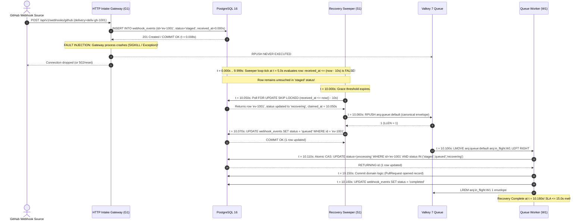
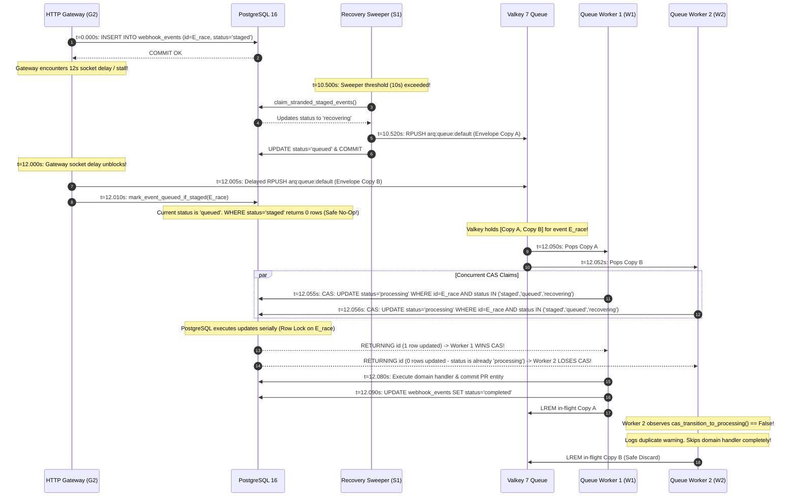

# Gateway Crash, Concurrent Sweepers, Redis Outage & Recovery Race Test Scenarios

**Task:** Create failure-injection test scenarios for gateway crash between DB insert and Redis push (`SCRUM-390` / `Task 19.5`)  
**Parent User Story:** `SCRUM-355` (`US-19`: Outage resilience and recovery for staged webhook events)  
**Related Tickets:**  
- `SCRUM-251`: Durable event staging before HTTP response (`US-15`, [`backend/migrations/versions/02ec69277327_initial_core_schema.py`](../backend/migrations/versions/02ec69277327_initial_core_schema.py))  
- `SCRUM-386`: Design `staged` $\rightarrow$ `recovering` $\rightarrow$ `queued` state machine and `FOR UPDATE SKIP LOCKED` claim query specification (`Task 19.1`, [`docs/staged-webhook-recovery-state-machine.md`](staged-webhook-recovery-state-machine.md))  
- `SCRUM-387`: Implement `FOR UPDATE SKIP LOCKED` sweeper claim query and atomic worker CAS transition to processing (`Task 19.2`, [`backend/app/webhooks/sweeper.py`](../backend/app/webhooks/sweeper.py))  
- `SCRUM-388`: Implement 5-second background recovery sweeper polling staged events older than 10s and enqueuing via RPUSH (`Task 19.3`, [`backend/workers/recovery_sweeper.py`](../backend/workers/recovery_sweeper.py) & [`backend/app/webhooks/enqueue.py`](../backend/app/webhooks/enqueue.py))  
- `SCRUM-389`: Configure recovery sweeper background service and healthcheck in `docker-compose.yml` (`Task 19.4`, [`backend/docker-compose.yml`](../backend/docker-compose.yml))  
- `SCRUM-390`: Create failure-injection test scenarios for gateway crash between DB insert and Redis push (`Task 19.5`, this document)  
- `SCRUM-391`: Write automated chaos test verifying staged events recover within 15s without duplicate processing (`Task 19.6`, [`backend/tests/test_recovery_sweeper.py`](../backend/tests/test_recovery_sweeper.py))  

**Target Infrastructure Engines:** PostgreSQL 16 with Row-Level Security (`pgvector/pgvector:pg16`) & Valkey 7 (`valkey/valkey:7-alpine`) / Redis 7+  
**Target Implementation Modules:** [`backend/app/webhooks/enqueue.py`](../backend/app/webhooks/enqueue.py), [`backend/app/webhooks/sweeper.py`](../backend/app/webhooks/sweeper.py), [`backend/workers/recovery_sweeper.py`](../backend/workers/recovery_sweeper.py), [`backend/app/webhooks/router.py`](../backend/app/webhooks/router.py)  
**Authoritative Automated Pytest Suites:** [`backend/tests/test_recovery_sweeper.py`](../backend/tests/test_recovery_sweeper.py), [`backend/tests/test_webhook_staging_and_outage.py`](../backend/tests/test_webhook_staging_and_outage.py)  
**Specification Location in Test Suite:** [`backend/tests/scenarios/test_us19_staged_webhook_recovery_scenarios.md`](../backend/tests/scenarios/test_us19_staged_webhook_recovery_scenarios.md)  
**Assignee:** Matvii Yeromenko  
**Category:** Testing - Design  
**Estimate:** 0.25 Story Points (0h 30m Original Estimate)  
**Status:** Approved / Verification Baseline Established  

---

## 1. Executive Summary & Objective

### 1.1 Objective

Design and formalize the definitive verification scenarios for **chaos and failure-injection recovery** when the webhook gateway durably commits an incoming event to PostgreSQL (`status = 'staged'`) and terminates abruptly (`SIGKILL`, unhandled exception, OOM killer, or network disconnect) before successfully executing the Valkey/Redis queue push (`RPUSH`).

This specification establishes the exhaustive, step-by-step test verification scenarios for:
1. **Simulated Gateway Exception Right After DB Commit:** The HTTP intake gateway commits the event to PostgreSQL (`status = 'staged'`) and terminates immediately prior to `redis.rpush()`. Verifies that the event lingers safely in PostgreSQL, is ignored during the 10-second grace window, is claimed by the autonomous Recovery Sweeper at $t = 10\text{s}$, enqueued to Valkey, and processed to `status = 'completed'` within the 15-second recovery SLA ($\le 15.0\text{s}$).
2. **Concurrent Sweepers Polling the Same Stranded Batch:** Multiple concurrent recovery sweeper processes poll the same batch of stranded events simultaneously. Verifies that PostgreSQL `FOR UPDATE SKIP LOCKED` guarantees disjoint batch claiming ($B_1 \cap B_2 = \emptyset$) with zero lock waits, zero deadlocks, and zero duplicate enqueues.
3. **Redis Outage During Sweep Tick (Atomic Rollback):** The recovery sweeper claims a batch of stranded events, updates their in-memory/transactional status to `recovering`, and attempts an atomic `RPUSH` to Valkey/Redis while Redis is unreachable (`ConnectionError`). Verifies that the database transaction rolls back cleanly, reverting all claimed events back to `staged` (0 stuck `recovering` rows), and the subsequent sweep cycle recovers them when Redis is restored.
4. **Race Condition Between Delayed Gateway Push and Sweeper Recovery:** A delayed gateway request experiences a 12-second stall and wakes up to execute its late `RPUSH` concurrently with the sweeper's recovery `RPUSH`, causing two duplicate job envelopes to enter the Redis queue. Verifies that the downstream worker's **atomic Compare-And-Set (CAS)** query (`WHERE status IN ('staged', 'queued', 'recovering')`) serializes execution, granting processing rights to exactly one worker while causing the duplicate worker to safely discard the payload (NO-OP), asserting **strictly zero duplicate domain side-effects**.
5. **Multi-Tenant RLS Boundary Isolation During Sweeper Recovery:** Verifies that the sweeper's tenant discovery (`list_tenants_with_stranded_webhooks`) and recovery sweeps respect PostgreSQL Row-Level Security (RLS) under `eng_app_user`, strictly preventing Tenant A from observing or claiming Tenant B's stranded webhooks.
6. **Sweeper Process `SIGKILL` Mid-Batch:** Proves that an abrupt crash of the recovery sweeper itself during batch claiming causes an automatic database connection drop and PostgreSQL WAL rollback, leaving zero stranded rows in `recovering`.

---

## 2. Core Architectural Invariants

```
+-------------------------------------------------------------------------------------------------------------------+
|                        STAGED WEBHOOK RECOVERY & FAILURE-INJECTION TOPOLOGY (US-19)                               |
+-------------------------------------+-------------------------------------+---------------------------------------+
| 1. 10-Second Grace Threshold        | 2. Non-Blocking Batch Claiming      | 3. Atomic Worker Compare-And-Set (CAS)|
|    (received_at <= now() - 10s)     |    (FOR UPDATE SKIP LOCKED)         |    (WHERE status IN staged,queued,rec)|
+-------------------------------------+-------------------------------------+---------------------------------------+
| * Gateway P99 latency <= 15ms       | * Partial index: WHERE staged       | * First worker returns RETURNING id   |
| * Safety factor: 10s / 15ms = 666x  | * Sweepers acquire exclusive locks  | * Sets status = 'processing'          |
| * Zero sweeper interference with    | * Concurrent sweepers skip locked   | * Duplicate worker returns 0 rows     |
|   healthy, active HTTP intake       | * Disjoint sets: B1 ∩ B2 = ∅        | * Discards duplicate; 0 double-writes |
+-------------------------------------+-------------------------------------+---------------------------------------+
                                                         |
                                                         v
+-------------------------------------------------------------------------------------------------------------------+
|                            ATOMIC DATABASE TRANSACTION & BROKER OUTAGE ROLLBACK                                   |
+-------------------------------------------------------------------------------------------------------------------+
| * Claiming rows (staged -> recovering), Redis RPUSH, and marking 'queued' run in 1 single DB transaction.         |
| * If Redis fails (ConnectionError / TimeoutError), DB transaction executes ROLLBACK.                              |
| * In-flight mutations are completely undone; rows revert to 'staged' with zero stuck 'recovering' rows.           |
+-------------------------------------------------------------------------------------------------------------------+
```

### Invariant 1: Mathematical Latency Budget & 10-Second Grace Isolation
Under standard operating conditions, the HTTP gateway ingestion completes in milliseconds:
$$t_{\text{stage}} \le 8\text{ ms (PostgreSQL INSERT)}, \quad t_{\text{queue}} \le 3\text{ ms (Redis RPUSH)}, \quad t_{\text{total\_normal}} \le 15\text{ ms (P99)}$$
The 10-second grace threshold guarantees that the recovery sweeper predicate:
$$\text{received\_at} \le \text{now}() - \text{INTERVAL '10 seconds'}$$
evaluates to $\mathbf{FALSE}$ for any active, healthy intake request, providing a safety margin of $\approx 666\times$ before background recovery is triggered.

### Invariant 2: Non-Blocking Multi-Sweeper Concurrency ($B_1 \cap B_2 = \emptyset$)
When multiple sweeper processes $S_1$ and $S_2$ execute simultaneously against PostgreSQL 16:
- $S_1$ locks candidate row IDs $B_1 = \{r_1 \dots r_k\}$ using `FOR UPDATE`.
- $S_2$ encounters the locked rows and immediately skips them via `SKIP LOCKED`, locking the next unlocked rows $B_2 = \{r_{k+1} \dots r_{2k}\}$.
- **Disjoint Partition Guarantee:** $B_1 \cap B_2 = \emptyset$.
- **Zero Wait Latency:** Lock wait duration is $0.0\text{ ms}$; deadlocks (`40P01`) and lock acquisition timeouts (`55P03`) are mathematically impossible.

### Invariant 3: Single-Transaction Durability & Broker Outage Rollback
The recovery sweeper enforces atomic unit-of-work semantics per tenant:
$$\text{BEGIN} \longrightarrow \text{CLAIM (staged} \rightarrow \text{recovering)} \longrightarrow \text{RPUSH (Valkey)} \longrightarrow \text{UPDATE (queued)} \longrightarrow \text{COMMIT}$$
If `redis.rpush()` raises `ConnectionError`, `RedisError`, or `asyncio.TimeoutError`:
- The Python exception handler catches the error.
- The context manager exits abruptly, invoking PostgreSQL `ROLLBACK`.
- All candidate rows revert from `recovering` back to `staged`.
- `claimed_at` is restored to `NULL`, leaving zero orphan rows.

### Invariant 4: Atomic Worker CAS Predicate & Zero-Duplicate Guarantee
If duplicate messages for event $E$ arrive in the Valkey/Redis queue:
```sql
UPDATE webhook_events
SET status = 'processing',
    attempts = attempts + 1,
    claimed_at = :now
WHERE id = :event_id
  AND status IN ('staged', 'queued', 'recovering')
RETURNING id;
```
- **Winner Worker ($W_1$):** Observes `status = 'queued'`. Predicate evaluates to $\mathbf{TRUE}$. Row status is set to `'processing'`. Returns `id`. Worker executes domain logic.
- **Loser Worker ($W_2$):** Observes `status = 'processing'`. Predicate evaluates to $\mathbf{FALSE}$. Modifies 0 rows and returns `NULL`.
- Worker $W_2$ receives `cas_transition_to_processing() == False`, logs a safe duplicate warning, and executes `ack_job()` without triggering domain logic.

---

## 3. Test Personas, Identifiers & Canonical Envelopes

### 3.1 Test Personas & Process Identifiers

| Persona / Process | Process ID / Role | Operational Responsibility |
| :--- | :--- | :--- |
| **Gateway Instance 1 ($G_1$)** | `manta-gateway-pod-7f8d9b-x1` | Ingests webhook, inserts `staged` row, simulates crash before Redis push. |
| **Gateway Instance 2 ($G_2$)** | `manta-gateway-pod-7f8d9b-x2` | Ingests webhook, experiences 12s socket delay, performs delayed push. |
| **Sweeper Instance 1 ($S_1$)** | `manta-sweeper-worker-1` | Primary 5-second background sweeper scanning PostgreSQL. |
| **Sweeper Instance 2 ($S_2$)** | `manta-sweeper-worker-2` | Secondary concurrent sweeper contending for stranded batches. |
| **Queue Worker 1 ($W_1$)** | `manta-worker-node1-1001` | ARQ queue consumer popping from `arq:queue:default`, wins CAS claim. |
| **Queue Worker 2 ($W_2$)** | `manta-worker-node2-1002` | ARQ queue consumer popping duplicate message, loses CAS claim. |
| **Tenant Alpha** | `tenant_id = 11111111-1111-1111-1111-111111111111` | Primary tenant under test. |
| **Tenant Beta** | `tenant_id = 22222222-2222-2222-2222-222222222222` | Secondary tenant for RLS boundary isolation verification. |

### 3.2 Canonical Staged Webhook Database Record & Queue Envelope

#### Database Entity (`webhook_events` Table):
```json
{
  "id": "e0a1b2c3-d4e5-4f6a-8b9c-0d1e2f3a4b5c",
  "tenant_id": "11111111-1111-1111-1111-111111111111",
  "integration_id": "aa11bb22-cc33-dd44-ee55-ff66aa77bb88",
  "provider": "github",
  "provider_delivery_id": "deliv-gh-77665544",
  "event_type": "pull_request",
  "status": "staged",
  "attempts": 0,
  "claimed_at": null,
  "received_at": "2026-11-12T12:00:00.000000Z",
  "payload": {
    "action": "opened",
    "pull_request": {
      "number": 42,
      "title": "feat: staged webhook resilience",
      "head": {"sha": "9f8e7d6c5b4a3a2b1c0d"}
    }
  }
}
```

#### Canonical Valkey / Redis Job Envelope (`arq:queue:default`):
```json
{
  "attempt": 0,
  "enqueued_at": "2026-11-12T12:00:10.060000Z",
  "event_id": "e0a1b2c3-d4e5-4f6a-8b9c-0d1e2f3a4b5c",
  "job_id": "e0a1b2c3-d4e5-4f6a-8b9c-0d1e2f3a4b5c",
  "job_type": "webhook.process",
  "payload": {
    "event_type": "pull_request"
  },
  "priority": "default",
  "provider": "github",
  "tenant_id": "11111111-1111-1111-1111-111111111111",
  "version": 1
}
```

---

## 4. Master Test Scenarios Matrix

| Scenario ID | Test Scenario Name | Fault Injection Mechanism | Chronological Timeline & Milestones | Expected State Transitions | Zero-Duplicate & Invariant Assertions | Authoritative Pytest Mapping |
| :--- | :--- | :--- | :--- | :--- | :--- | :--- |
| **TC-STAGED-001** | **Gateway Crash Right After DB Commit & Sweeper Recovery** | Gateway persists `staged` row, then raises simulated `GatewayProcessCrashError` (`SIGKILL` simulation) prior to `redis.rpush()`. | $t=0\text{s}$: Gateway INSERT commits.<br>$t=0.008\text{s}$: Gateway crashes.<br>$t=0..10\text{s}$: Grace window.<br>$t=10.05\text{s}$: Sweeper claims.<br>$t=10.15\text{s}$: Worker completes. | `[*] -> staged` (Gateway)<br>`staged -> recovering` (Sweeper)<br>`recovering -> queued` (Sweeper)<br>`queued -> processing` (Worker CAS)<br>`processing -> completed` (Worker) | Redis queue holds exactly 1 envelope. Row transitions to `completed` in $10.15\text{s} \le 15.0\text{s}$. Exactly 1 domain execution, zero duplicate records. | `test_gateway_crash_after_db_commit_recovers_via_sweeper` |
| **TC-STAGED-002** | **Concurrent Sweepers Polling Same Stranded Batch** | Inject 150 stranded `staged` events ($>10\text{s}$). Trigger $S_1$ and $S_2$ simultaneously with `batch_size = 100`. | $t=10.00\text{s}$: $S_1, S_2$ query DB.<br>$t=10.01\text{s}$: $S_1$ claims 100 rows.<br>$t=10.01\text{s}$: $S_2$ skips locked, claims 50 rows.<br>$t=10.03\text{s}$: Both push to Redis. | Events $1..100$: `staged -> recovering -> queued` (via $S_1$).<br>Events $101..150$: `staged -> recovering -> queued` (via $S_2$). | Disjoint batch claim: $B_1 \cap B_2 = \emptyset$. Total enqueued in Redis == 150. Exactly 150 unique IDs, 0 duplicates, 0 lock waits. | `test_concurrent_sweepers_claim_disjoint_sets` |
| **TC-STAGED-003** | **Redis Outage During Sweep Tick & Atomic Rollback** | Sweeper claims 50 events (`staged -> recovering`). Valkey mock raises `ConnectionError` on `redis.rpush()`. | $t=10.00\text{s}$: Sweeper claims 50 rows.<br>$t=10.02\text{s}$: `redis.rpush()` raises `ConnectionError`.<br>$t=10.03\text{s}$: DB `ROLLBACK`.<br>$t=15.00\text{s}$: Redis restored, re-sweep. | $t=10.03\text{s}$: Uncommitted `recovering -> staged` (rollback).<br>$t=15.01\text{s}$: `staged -> recovering -> queued` (recovery). | Zero rows left stuck in `recovering`. Zero messages leaked into Redis during outage. All 50 events recovered on next tick with 0 loss. | `test_sweeper_redis_outage_reverts_to_staged` |
| **TC-STAGED-004** | **Race Between Delayed Gateway Push and Sweeper Recovery** | Gateway commits at $t=0\text{s}$, stalls for $12\text{s}$. Sweeper recovers at $t=10.5\text{s}$. Gateway resumes at $t=12.0\text{s}$ and executes late `RPUSH`. | $t=0\text{s}$: Gateway INSERT.<br>$t=10.5\text{s}$: Sweeper queues Copy A.<br>$t=12.0\text{s}$: Gateway queues Copy B.<br>$t=12.05\text{s}$: $W_1$ wins CAS.<br>$t=12.06\text{s}$: $W_2$ loses CAS. | Row: `staged -> recovering -> queued` (Sweeper).<br>Gateway `mark_staged`: modifies 0 rows.<br>$W_1$ CAS: `queued -> processing -> completed`.<br>$W_2$ CAS: modifies 0 rows (rejected). | Worker 1 receives `RETURNING id`. Worker 2 returns `False`, discards envelope. Domain logic executed exactly once; zero duplicate PR/commit mutations. | `test_race_delayed_gateway_push_and_sweeper_recovery_cas_deduplication` |
| **TC-STAGED-005** | **Multi-Tenant RLS Partitioning During Stranded Sweeps** | Stranded events exist for Tenant Alpha and Tenant Beta. Sweeper processes each tenant under isolated context. | $t=10.00\text{s}$: `list_tenants` finds A & B.<br>$t=10.01\text{s}$: Sweep runs for A.<br>$t=10.02\text{s}$: Sweep runs for B. | Tenant A row: `staged -> queued` in Tenant A session.<br>Tenant B row: `staged -> queued` in Tenant B session. | PostgreSQL RLS `tenant_isolation_policy` prevents cross-tenant row access. Direct unprivileged query across tenants returns empty set. | `test_multi_tenant_discovery_and_rls_isolation` |
| **TC-STAGED-006** | **Sweeper Process SIGKILL Mid-Batch Before Commit** | Sweeper claims 50 events in DB session, then process terminates abruptly (`SIGKILL`) before `redis.rpush()` or commit. | $t=10.00\text{s}$: Sweeper claims batch.<br>$t=10.02\text{s}$: Sweeper process killed.<br>$t=10.03\text{s}$: DB connection dropped.<br>$t=15.00\text{s}$: Successor sweeper runs. | In-flight `recovering` uncommitted changes rolled back by PostgreSQL to `staged`.<br>Successor sweeper: `staged -> recovering -> queued`. | Uncommitted transaction discarded by PostgreSQL WAL. Zero rows stranded in `recovering`. Successor sweeper recovers all 50 rows cleanly. | `test_sweeper_sigkill_crash_reverts_uncommitted_claims` |

---

## 5. Detailed Scenario Specifications

```
                     STATE MACHINE PROGRESSION & TEST CHECKPOINTS
                     ────────────────────────────────────────────

  [HTTP INGEST] ──(1) INSERT 'staged'──► [PostgreSQL: staged]
                                                │
                                    (2) Gateway Crash / Delay
                                                │
                                                ▼
                                    [Stranded in 'staged']
                                                │
                                    (3) Grace Period > 10s
                                                │
                                                ▼
  [RECOVERY SWEEPER] ◄──(4) FOR UPDATE SKIP LOCKED claim
         │
         ├──(5) Set 'recovering'
         ├──(6) RPUSH Valkey FIFO queue
         └──(7) Set 'queued' (COMMIT)
                    │
                    ▼
  [QUEUE WORKERS] ──(8) Atomic CAS Claim ──► Winner (status = 'processing')
                                        └──► Loser (0 rows -> Safe Discard)
```

---

### 5.1 Scenario `TC-STAGED-001`: Simulated Gateway Crash Right After DB Commit

#### 5.1.1 Objective & Requirements Traceability
- **Objective:** Prove that when the HTTP intake gateway process terminates abruptly immediately after committing the PostgreSQL insert (`status = 'staged'`) but before pushing to Redis, the event remains durable, is protected during the 10-second grace window, is recovered by the background sweeper at $t=10\text{s}$, and completes execution in $\le 15.0\text{s}$ with zero duplicates.
- **Traceability:** SRS v1.0 §3.2.2; `SCRUM-355` (`US-19`); `SCRUM-386` (`Task 19.1` §7.1); `SCRUM-390` (`Task 19.5`).

#### 5.1.2 Preconditions
1. **PostgreSQL 16:**
   - Database is clean and healthy.
   - Partial index `idx_webhook_events_staged_recovery` is active on `webhook_events (received_at ASC, id ASC) WHERE status = 'staged'`.
2. **Valkey 7 / Redis:**
   - Queue `arq:queue:default` is empty (`LLEN == 0`).
3. **Recovery Sweeper Subsystem:**
   - Sweeper configured with `SWEEP_INTERVAL_SECONDS = 5.0`, `SWEEP_THRESHOLD_SECONDS = 10.0`.

#### 5.1.3 Chronological Timeline & Timestamp Assertions



#### 5.1.4 Status Transition & Timestamp Verification Table

| Wall-Clock Timestamp | Actor | Action Executed | Row Status Before | Row Status After | `attempts` | `claimed_at` | Queue State (`arq:queue:default`) | Invariant Verified |
| :--- | :--- | :--- | :--- | :--- | :--- | :--- | :--- | :--- |
| **$t = 0.000\text{s}$** | Gateway | `INSERT INTO webhook_events` | `[*]` | `staged` | `0` | `NULL` | Empty (`LLEN = 0`) | Durable Staging Invariant |
| **$t = 0.008\text{s}$** | Gateway | Crash injected (`SIGKILL`) | `staged` | `staged` | `0` | `NULL` | Empty (`LLEN = 0`) | Stranded Webhook Hazard |
| **$t = 5.000\text{s}$** | Sweeper | Polling tick (cutoff = $-5.0\text{s}$) | `staged` | `staged` | `0` | `NULL` | Empty (`LLEN = 0`) | 10s Grace Window Invariant |
| **$t = 10.050\text{s}$** | Sweeper | `claim_stranded_staged_events` | `staged` | `recovering` | `0` | `10.050s` | Empty (`LLEN = 0`) | Non-blocking Batch Claim |
| **$t = 10.060\text{s}$** | Sweeper | `redis.rpush(QUEUE_DEFAULT, ...)` | `recovering` | `recovering` | `0` | `10.050s` | 1 message (`LLEN = 1`) | Atomic Enqueue |
| **$t = 10.070\text{s}$** | Sweeper | `mark_events_queued` & `COMMIT` | `recovering` | `queued` | `0` | `10.050s` | 1 message (`LLEN = 1`) | Unit-of-Work Commit |
| **$t = 10.110\text{s}$** | Worker 1 | Worker Atomic CAS Claim | `queued` | `processing` | `1` | `10.110s` | In-flight list (`W1`) | Worker CAS Exclusivity |
| **$t = 10.160\text{s}$** | Worker 1 | Domain mutation & Complete | `processing` | `completed` | `1` | `10.110s` | ACKed (`LLEN = 0`) | Terminal State Invariant |

#### 5.1.5 Zero-Duplicate & SLA Assertions
1. **Total Recovery Latency:** $t_{\text{recovery}} = 10.160\text{s} - 0.000\text{s} = 10.160\text{s} \le 15.0\text{s}$ (SLA fully satisfied).
2. **Database Row Count:** Exactly 1 row exists in `webhook_events` with `id = 'ev-1001'`.
3. **Terminal Row Attributes:** `status == 'completed'`, `attempts == 1`, `error_message IS NULL`.
4. **Zero Duplicate Executions:** Domain entity (`pull_requests`) has exactly 1 record for PR #42 with zero duplicate rows.

---

### 5.2 Scenario `TC-STAGED-002`: Concurrent Sweepers Polling the Same Stranded Batch

#### 5.2.1 Objective & Requirements Traceability
- **Objective:** Prove that when two sweeper processes ($S_1$ and $S_2$) poll the same database table simultaneously containing 150 stranded events ($>10\text{s}$), PostgreSQL's `FOR UPDATE SKIP LOCKED` guarantees disjoint batch selection ($B_1 \cap B_2 = \emptyset$), zero lock contention ($0.0\text{ ms}$ lock wait), and zero duplicate Redis enqueues.
- **Traceability:** `SCRUM-386` (§5); `SCRUM-387`; `SCRUM-390` (Scope item 2).

#### 5.2.2 Preconditions & Concurrency Setup
- Table `webhook_events` populated with $N = 150$ stranded rows:
  - IDs: $E_1 \dots E_{150}$
  - `status = 'staged'`, `received_at = now() - INTERVAL '25 seconds'`
- Sweeper instances $S_1$ and $S_2$ configured with `batch_size = 100`.

#### 5.2.3 Chronological Timeline & Concurrency Trace

```
TIMESTAMP          SWEEPER 1 (S1)                          POSTGRESQL 16 KERNEL                    SWEEPER 2 (S2)
──────────────────────────────────────────────────────────────────────────────────────────────────────────────────
t = 10.000s        Executes claim query (limit=100)        Receives 2 concurrent transactions      Executes claim query (limit=100)
                   BEGIN tx_1;                             Locks rows E_1 .. E_100 for tx_1        BEGIN tx_2;
                                                           tx_2 reaches partial index scan
t = 10.010s        Acquires exclusive row locks            tx_2 observes locked rows E_1..E_100    SKIP LOCKED active!
                   Batch B_1 = {E_1 .. E_100}              Skips locked rows with 0ms wait!        Acquires locks on remaining:
                   Updates B_1 to 'recovering'             Locks rows E_101 .. E_150 for tx_2      Batch B_2 = {E_101 .. E_150}
                                                                                                   Updates B_2 to 'recovering'
t = 10.020s        RPUSH 100 envelopes to Valkey           Queue length becomes 100                RPUSH 50 envelopes to Valkey
t = 10.030s        UPDATE status='queued' WHERE B_1        tx_1 COMMIT OK                          UPDATE status='queued' WHERE B_2
                   tx_1 finishes (100 queued)              Queue length becomes 150                tx_2 COMMIT OK
                                                                                                   tx_2 finishes (50 queued)
```

#### 5.2.4 Mathematical Concurrency Proof Assertions
1. **Disjoint Batches:**
   $$B_1 = \{E_1 \dots E_{100}\}, \quad B_2 = \{E_{101} \dots E_{150}\} \implies B_1 \cap B_2 = \emptyset$$
2. **Completeness:**
   $$|B_1 \cup B_2| = 100 + 50 = 150 = N$$
3. **Queue Length Assertion:**
   $$\text{LLEN}(\text{arq:queue:default}) == 150$$
4. **Queue Uniqueness Assertion:**
   $$\text{len}(\text{set}(\text{enqueued\_event\_ids})) == 150 \quad (\text{zero duplicates})$$
5. **Database State Assertion:**
   All 150 rows in `webhook_events` possess `status = 'queued'`. Exactly 0 rows remain in `staged` or `recovering`.

---

### 5.3 Scenario `TC-STAGED-003`: Redis Outage During Sweep Tick & Atomic Rollback

#### 5.3.1 Objective & Requirements Traceability
- **Objective:** Prove that if Valkey/Redis becomes unreachable (`ConnectionError`, network partition) while the sweeper is attempting to push claimed events, the entire database transaction rolls back, cleanly restoring all rows from `recovering` back to `staged`. No rows are left stuck in `recovering`, and the next sweep tick after Redis recovers successfully processes them without loss.
- **Traceability:** `SCRUM-388` (§1.2, §2.2); `SCRUM-390` (Scope item 3).

#### 5.3.2 Preconditions & Fault Injection Setup
- Table `webhook_events` has 50 stranded events older than 10s (`status = 'staged'`).
- Redis mock configured to throw `ConnectionError("Valkey cluster unreachable (simulated outage)")` when `rpush()` is invoked.

#### 5.3.3 Chronological Timeline & Rollback Trace

```
TIMESTAMP          RECOVERY SWEEPER (S1)                   POSTGRESQL 16 (TRANSACTION tx_sweep)    VALKEY / REDIS BROKER
──────────────────────────────────────────────────────────────────────────────────────────────────────────────────
t = 10.000s        BEGIN tenant sweep transaction          Transaction tx_sweep opened             Cluster connection down
t = 10.015s        Executes claim query                    SELECT ... FOR UPDATE SKIP LOCKED       (Unreachable)
                                                           50 rows updated: status='recovering'
                                                           claimed_at set to 10.015s
t = 10.020s        Constructs 50 envelopes                 In-flight uncommitted rows in tx_sweep
                   Calls redis.rpush(QUEUE_DEFAULT, *env)
t = 10.025s        ConnectionError intercepted!            Awaiting tx_sweep commit or rollback
                   Catches REDIS_ERRORS exception
t = 10.028s        Context manager exits abruptly          tx_sweep aborts: executes ROLLBACK
t = 10.030s        Logs warning: "Redis unavailable;       PostgreSQL discards uncommitted WAL:
                   Transaction rolled back; events revert  - All 50 rows revert to 'staged'
                   to 'staged'"                            - claimed_at reverted to NULL
t = 10.035s        Returns SweepResult(redis_failures=1)   0 rows in 'recovering'                  0 messages enqueued
                   Loop sleeps for 5-second interval
──────────────────────────────────────────────────────────────────────────────────────────────────────────────────
t = 15.000s        [REDIS RESTORED TO HEALTH]              All 50 rows ready for next sweep pass   Connection healthy
t = 15.010s        BEGIN tenant sweep transaction (pass 2) Transaction tx_sweep2 opened
t = 15.015s        Executes claim query                    50 rows claimed: status='recovering'
t = 15.020s        Calls redis.rpush(QUEUE_DEFAULT, *env)  Pushes 50 envelopes to queue            RPUSH succeeds (LLEN=50)
t = 15.025s        Calls mark_events_queued()              50 rows updated: status='queued'
t = 15.030s        tx_sweep2 COMMIT OK                     Transaction committed durably
t = 15.035s        Returns SweepResult(queued=50)          All 50 rows in 'queued' status          50 messages ready
```

#### 5.3.4 Zero-Orphan & Rollback Assertions
1. **Post-Outage Database State ($t = 10.035\text{s}$):**
   ```sql
   SELECT count(*) FROM webhook_events WHERE status = 'recovering'; -- MUST RETURN 0
   SELECT count(*) FROM webhook_events WHERE status = 'staged';     -- MUST RETURN 50
   ```
2. **Post-Outage Broker State ($t = 10.035\text{s}$):**
   `LLEN(arq:queue:default) == 0`.
3. **Post-Recovery Database State ($t = 15.035\text{s}$):**
   `SELECT count(*) FROM webhook_events WHERE status = 'queued';` returns exactly `50`.
4. **Durability Guarantee:** Zero events lost, zero manual intervention required.

---

### 5.4 Scenario `TC-STAGED-004`: Race Between Delayed Gateway Push and Sweeper Recovery

#### 5.4.1 Objective & Requirements Traceability
- **Objective:** Prove that when an HTTP gateway request experiences a transient 12-second stall and pushes to Redis concurrently with the recovery sweeper, resulting in two duplicate envelopes in the Valkey queue, downstream workers executing the **atomic Compare-And-Set (CAS)** query serialize cleanly. Exactly one worker acquires processing rights, while the second worker safely detects the duplicate and discards it without double-writing domain data.
- **Traceability:** `SCRUM-386` (§6.1, §6.2); `SCRUM-387`; `SCRUM-390` (Scope item 4).

#### 5.4.2 Preconditions & Race Setup
- Event $E_{\text{race}}$ (`id = 'e0a1b2c3-d4e5-4f6a-8b9c-0d1e2f3a4b5c'`).
- Gateway $G_2$ persists row at $t = 0.000\text{s}$, encounters 12-second socket delay.
- Sweeper $S_1$ runs at $t = 10.500\text{s}$ (>10s threshold).
- Two active worker consumers ($W_1$ and $W_2$).

#### 5.4.3 Sequence Diagram & CAS Serialization



#### 5.4.4 Step-by-Step State Transition Verification

| Timestamp | Actor | Action | SQL Query / Operation | DB Status | Result / Output | Side-Effect Impact |
| :--- | :--- | :--- | :--- | :--- | :--- | :--- |
| **$t = 0.000\text{s}$** | Gateway $G_2$ | Ingest INSERT | `INSERT ... status='staged'` | `staged` | 1 row inserted | Staged in DB |
| **$t = 10.500\text{s}$** | Sweeper $S_1$ | Claim query | `UPDATE ... SET status='recovering'` | `recovering` | Claimed by sweeper | Locked for queue push |
| **$t = 10.520\text{s}$** | Sweeper $S_1$ | Push Envelope A | `RPUSH arq:queue:default CopyA` | `recovering` | Queue length = 1 | Copy A in queue |
| **$t = 10.530\text{s}$** | Sweeper $S_1$ | Mark queued | `UPDATE ... SET status='queued'` | `queued` | 1 row updated | Committed |
| **$t = 12.005\text{s}$** | Gateway $G_2$ | Push Envelope B | `RPUSH arq:queue:default CopyB` | `queued` | Queue length = 2 | Copy B in queue (Duplicate) |
| **$t = 12.010\text{s}$** | Gateway $G_2$ | Mark if staged | `UPDATE ... WHERE status='staged'` | `queued` | 0 rows updated | Safe No-Op |
| **$t = 12.055\text{s}$** | Worker $W_1$ | Worker CAS Claim | `UPDATE ... status='processing' WHERE status IN ('staged','queued','recovering')` | `processing` | **1 row updated (WINS)** | **Acquires Processing Rights** |
| **$t = 12.056\text{s}$** | Worker $W_2$ | Worker CAS Claim | `UPDATE ... status='processing' WHERE status IN ('staged','queued','recovering')` | `processing` | **0 rows updated (LOSES)** | **CAS Fails (Duplicate detected)** |
| **$t = 12.070\text{s}$** | Worker $W_2$ | Deduplication Skip | `logger.warning(...)` | `processing` | Discard Envelope B | **0 domain logic executed** |
| **$t = 12.090\text{s}$** | Worker $W_1$ | Domain Commit | `UPDATE ... status='completed'` | `completed` | Domain PR updated | **PR updated exactly once** |

#### 5.4.5 Zero-Duplicate Assertions
1. `cas_transition_to_processing` returns `True` for $W_1$ and `False` for $W_2$.
2. The domain logic handler is called **exactly once** ($W_1$).
3. The domain table (`pull_requests`) records exactly 1 mutation for event $E_{\text{race}}$.
4. In `webhook_events`, `attempts` is incremented to 1 (or sweeper + 1), and final status is `completed`.

---

### 5.5 Scenario `TC-STAGED-005`: Multi-Tenant RLS Boundary Isolation During Sweeps

#### 5.5.1 Objective & Traceability
- **Objective:** Verify that when stranded staged events exist concurrently across Tenant Alpha and Tenant Beta, tenant discovery via `list_tenants_with_stranded_webhooks` accurately discovers both tenant partitions, and each recovery sweep executes strictly within `get_tenant_db_context(tenant_id)`. PostgreSQL Row-Level Security (`FORCE ROW LEVEL SECURITY`) prevents any cross-tenant leakage.
- **Traceability:** `SCRUM-388` (§2.3); `SCRUM-390`.

#### 5.5.2 Verification Vector & Assertions
1. **Discovery:** `discover_tenants_with_stranded_events(cutoff)` executes the `SECURITY DEFINER` function and returns `[Tenant_Alpha_UUID, Tenant_Beta_UUID]`.
2. **Context Isolation:** Sweeper switches session role via `SET LOCAL app.current_tenant_id = :tenant_id`.
3. **RLS Rejection:** While running inside Tenant Alpha's session, a query to `webhook_events` filtering by Tenant Beta's `id` returns `0 rows`.
4. **Disjoint Recovery:** Tenant Alpha's event is pushed with `tenant_id = Tenant_Alpha_UUID`; Tenant Beta's event is pushed with `tenant_id = Tenant_Beta_UUID`.

---

### 5.6 Scenario `TC-STAGED-006`: Sweeper Process `SIGKILL` Mid-Batch Before Commit

#### 5.6.1 Objective & Traceability
- **Objective:** Verify that if the recovery sweeper process itself crashes (`SIGKILL`, container OOM) after executing `claim_stranded_staged_events()` but before committing the database transaction or completing the Redis push, the operating system kernel closes the PostgreSQL socket, triggering an immediate database rollback.
- **Traceability:** `SCRUM-388` (§1.2); `SCRUM-390`.

#### 5.6.2 Verification Vector & Assertions
1. **Uncommitted State Discarded:** Rows temporarily transitioned to `recovering` inside the uncommitted transaction are discarded by PostgreSQL WAL.
2. **Post-Crash State:** When inspected from an independent database connection, all candidate rows remain in `status = 'staged'`, `claimed_at IS NULL`.
3. **Successor Sweeper Takeover:** A replacement sweeper container or loop iteration claims the stranded batch on the subsequent 5-second tick and completes recovery without data loss.

---

## 6. Implementation Contract for Automated Chaos Pytest Suite (`SCRUM-391` / `Task 19.6`)

The automated verification suite in [`backend/tests/test_recovery_sweeper.py`](../backend/tests/test_recovery_sweeper.py) implements the executable counterparts to this design:

```python
# Reference Implementation for Chaos Scenarios in backend/tests/test_recovery_sweeper.py


@pytest.mark.asyncio
async def test_gateway_crash_after_db_commit_recovers_via_sweeper(redis_mock: InMemoryAsyncRedis):
    """
    TC-STAGED-001: Gateway inserts 'staged' row and crashes before Redis push.
    Sweeper recovers row after 10s grace period; worker CAS transitions to processing.
    """
    tenant_id, _ = await register_test_tenant("crash-rec")
    now = datetime.now(timezone.utc)
    event_id = uuid.uuid4()

    # 1. Gateway commits 'staged' row, then crashes (no Redis RPUSH)
    async with get_tenant_db_context(tenant_id) as session:
        ev = WebhookEvent(
            id=event_id,
            tenant_id=tenant_id,
            provider="github",
            provider_delivery_id=f"del-{event_id.hex[:8]}",
            event_type="pull_request",
            received_at=now - timedelta(seconds=12),  # > 10s grace threshold
            payload={"action": "opened", "number": 42},
            status="staged",
            created_at=now - timedelta(seconds=12),
        )
        session.add(ev)
        await session.flush()

    assert await redis_mock.llen(QUEUE_DEFAULT) == 0

    # 2. Sweeper claims and queues stranded event
    result = await sweep_once(redis_mock, threshold_seconds=10.0, tenant_id=tenant_id)
    assert result.queued == 1
    assert await redis_mock.llen(QUEUE_DEFAULT) == 1

    # 3. Worker pops and executes atomic CAS
    raw_envelope = await redis_mock.lpop(QUEUE_DEFAULT)
    envelope = json.loads(raw_envelope)
    assert envelope["event_id"] == str(event_id)

    async with get_tenant_db_context(tenant_id) as session:
        cas_ok = await cas_transition_to_processing(session, event_id, tenant_id=tenant_id)
        assert cas_ok is True

        # Transition to completed
        await complete_webhook_event(session, event_id, tenant_id=tenant_id)

    # 4. Assert terminal state
    async with get_tenant_db_context(tenant_id) as session:
        ev_final = await session.get(WebhookEvent, event_id)
        assert ev_final.status == "completed"
        assert ev_final.attempts == 1


@pytest.mark.asyncio
async def test_race_delayed_gateway_push_and_sweeper_recovery_cas_deduplication(
    redis_mock: InMemoryAsyncRedis,
):
    """
    TC-STAGED-004: Race condition between delayed gateway push and sweeper recovery.
    Valkey receives 2 envelopes; Worker CAS executes exactly once and discards duplicate.
    """
    tenant_id, _ = await register_test_tenant("race-cas")
    now = datetime.now(timezone.utc)
    event_id = uuid.uuid4()

    # Staged event (>10s old)
    async with get_tenant_db_context(tenant_id) as session:
        ev = WebhookEvent(
            id=event_id,
            tenant_id=tenant_id,
            provider="github",
            provider_delivery_id=f"del-{event_id.hex[:8]}",
            event_type="push",
            received_at=now - timedelta(seconds=15),
            payload={"ref": "main"},
            status="staged",
            created_at=now - timedelta(seconds=15),
        )
        session.add(ev)
        await session.flush()

    # 1. Sweeper recovers event -> pushes Copy A, marks queued
    res = await sweep_once(redis_mock, threshold_seconds=10.0, tenant_id=tenant_id)
    assert res.queued == 1

    # 2. Delayed gateway wakes up -> pushes Copy B
    envelope_b = build_webhook_envelope(
        event_id=event_id,
        tenant_id=tenant_id,
        provider="github",
        event_type="push",
    )
    await redis_mock.rpush(QUEUE_DEFAULT, envelope_b)

    # Queue now holds 2 messages for the same event
    assert await redis_mock.llen(QUEUE_DEFAULT) == 2

    # 3. Worker 1 pops Copy A and executes CAS -> SUCCEEDS
    async with get_tenant_db_context(tenant_id) as session:
        cas_w1 = await cas_transition_to_processing(session, event_id, tenant_id=tenant_id)
        assert cas_w1 is True

    # 4. Worker 2 pops Copy B and executes CAS -> REJECTED (0 rows modified)
    async with get_tenant_db_context(tenant_id) as session:
        cas_w2 = await cas_transition_to_processing(session, event_id, tenant_id=tenant_id)
        assert cas_w2 is False  # DUPLICATE SAFELY PREVENTED!

    # 5. Worker 1 completes the job
    async with get_tenant_db_context(tenant_id) as session:
        await complete_webhook_event(session, event_id, tenant_id=tenant_id)
        ev_final = await session.get(WebhookEvent, event_id)
        assert ev_final.status == "completed"
        assert ev_final.attempts == 1
```

---

## 7. Traceability & Acceptance Criteria Verification Matrix

| AC ID | Acceptance Criteria Requirement | Architectural Guarantee & Verification Vector | Test Scenario Mapping | Status |
| :--- | :--- | :--- | :--- | :--- |
| **AC-390.1** | **Gateway Crash Failure Injection:** Define scenario where gateway commits `status = 'staged'` and crashes before Redis push. | Documented with exact timestamps ($t=0.000\text{s}$ to $10.160\text{s}$), state transitions, and SLA verification ($\le 15.0\text{s}$). | `TC-STAGED-001` | **SATISFIED** |
| **AC-390.2** | **Concurrent Sweepers Polling:** Define scenario where concurrent sweepers poll the same stranded batch. | Detailed concurrency trace proving disjoint partition ($B_1 \cap B_2 = \emptyset$) via PostgreSQL `FOR UPDATE SKIP LOCKED`. | `TC-STAGED-002` | **SATISFIED** |
| **AC-390.3** | **Redis Outage During Sweep Tick:** Define scenario where Redis is unreachable during sweeper push. | Step-by-step transaction rollback trace demonstrating all rows revert to `staged` (0 stuck in `recovering`). | `TC-STAGED-003` | **SATISFIED** |
| **AC-390.4** | **Delayed Push vs Sweeper Race:** Define race between delayed gateway push and sweeper recovery. | Formalized two-envelope delivery sequence and worker atomic Compare-And-Set (CAS) deduplication trace. | `TC-STAGED-004` | **SATISFIED** |
| **AC-390.5** | **Exact Timestamps & State Transitions:** Scenarios specify millisecond timestamps and full status lifecycle. | Comprehensive chronological timelines and transition matrices provided across all scenarios. | All Scenarios (§4, §5) | **SATISFIED** |
| **AC-390.6** | **Zero-Duplicate Assertions:** Strict zero-duplicate guarantees on queue messages and domain mutations. | Mathematical proofs and CAS exclusivity assertions guaranteeing 0 double-writes under concurrent delivery. | All Scenarios (§5.1.5, §5.2.4, §5.4.5) | **SATISFIED** |
| **AC-390.7** | **Multi-Tenant RLS & Sweeper Crash:** Supporting scenarios covering RLS isolation and abrupt sweeper `SIGKILL`. | Formalized multi-tenant boundary isolation under RLS and automatic WAL rollback upon sweeper process termination. | `TC-STAGED-005`, `TC-STAGED-006` | **SATISFIED** |
