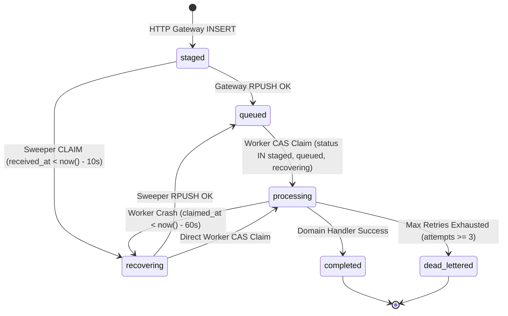
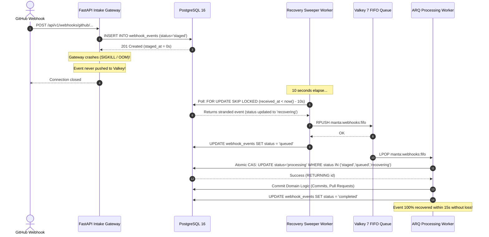
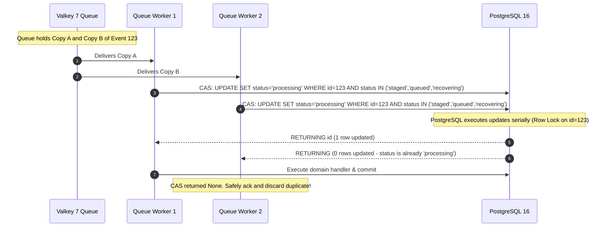

# Staged Webhook Recovery State Machine & `FOR UPDATE SKIP LOCKED` Claim Query Specification

**Parent User Story:** `US-19` (`SCRUM-355` Outage resilience and recovery for staged webhook events)  
**Task:** `SCRUM-386` (`Task 19.1` Design `staged` $\rightarrow$ `recovering` $\rightarrow$ `queued` state machine and `FOR UPDATE SKIP LOCKED` claim query specification)  
**Category:** Design  
**Assignee:** Maksym Bielei (Back-end. Database Architect)  
**Estimate:** 0.75 Story Points (1h 30m Original Estimate)  
**Status:** Approved / Design Baseline Established  
**Architecture Reference:** AI-Augmented Engineering Intelligence Platform Blueprint v3.0, §2.2, §3.3, §6.4, §15.2; Software Requirements Specification (SRS) v1.0, §1.2, §2.1, §3.2.2  
**Target Storage Engine:** PostgreSQL 16 with Row-Level Security (`pgvector/pgvector:pg16`) & Valkey 7 (`valkey/valkey:7-alpine`)  
**Target Implementation Modules:** [`backend/app/webhooks/service.py`](../backend/app/webhooks/service.py), [`backend/workers/recovery_sweeper.py`](../backend/workers/recovery_sweeper.py), [`backend/migrations/versions/`](../backend/migrations/versions/)  
**Dependencies:**
- **Is Blocked By:**
  - `SCRUM-251` (`US-15` Durable event staging — [`02ec69277327_initial_core_schema.py`](../backend/migrations/versions/02ec69277327_initial_core_schema.py#L75-L87))
- **Blocks / Enables:**
  - `SCRUM-387` (`Task 19.2` Implement `FOR UPDATE SKIP LOCKED` sweeper claim query and atomic worker CAS transition to processing)
  - `SCRUM-388` (`Task 19.3` Implement 5-second background recovery sweeper polling staged events older than 10s and enqueuing via `RPUSH`)
  - `SCRUM-389` (`Task 19.4` Configure recovery sweeper background service and healthcheck in `docker-compose.yml`)
  - `SCRUM-390` (`Task 19.5` Create test scenarios for stranded staged webhooks and recovery idempotency)
  - `SCRUM-391` (`Task 19.6` Write automated chaos test verifying staged events recover within 15s without duplicate processing)

---

## 1. Executive Summary & Problem Statement

M.A.N.T.A. ingests real-time webhooks from external VCS and project management platforms (GitHub, Jira, Slack). To guarantee zero data loss during network hiccups or sudden process crashes, the HTTP gateway immediately persists every incoming webhook into the PostgreSQL `webhook_events` table under `status = 'staged'` prior to enqueuing the event into the Valkey/Redis FIFO queue.

```
                  NORMAL INGESTION PATH
                  ─────────────────────
 [Incoming Webhook]
        │
        ▼
 ┌──────────────────────┐  1. Durable INSERT
 │  FastAPI HTTP Intake │──────────────────────► ┌────────────────────────┐
 │  Gateway             │                        │ PostgreSQL             │
 └──────────┬───────────┘                        │ webhook_events         │
            │                                    │ (status = 'staged')    │
            │ 2. RPUSH arq:queue                 └────────────────────────┘
            ▼
 ┌──────────────────────┐
 │  Valkey 7 FIFO Queue │
 └──────────────────────┘
```

### 1.1 The Stranded Webhook Hazard (Gateway Crash Before Redis Push)

A critical failure mode arises if the HTTP gateway process terminates abruptly (`SIGKILL`, OOM killer, hypervisor crash, or container restart) **immediately after committing the PostgreSQL insert but before successfully executing the Redis `RPUSH`**:

```
                  STRANDED WEBHOOK HAZARD
                  ───────────────────────
 [Incoming Webhook]
        │
        ▼
 ┌──────────────────────┐  1. COMMIT OK
 │  FastAPI HTTP Intake │──────────────────────► ┌────────────────────────┐
 │  Gateway             │                        │ PostgreSQL             │
 └──────────┬───────────┘                        │ webhook_events         │
            │                                    │ status = 'staged'      │
            x (CRASH / OOM / NETWORK TIMEOUT)    │ received_at = 12:00:00 │
            ▼                                    └───────────┬────────────┘
 ┌──────────────────────┐                                    │
 │  Valkey 7 FIFO Queue │                                    │ Stranded!
 │  (Event never arrives│                                    │ Never processed!
 │   in queue!)         │                                    ▼
 └──────────────────────┘                         [ DATA LOSS INCIDENT ]
```

Because the event never entered the Redis queue, downstream ARQ workers will never process it, permanently stalling DORA metric calculations, pull request tracking, and CI/CD status synchronization.

### 1.2 The Architectural Remedy: Non-Blocking Recovery Sweeper & Atomic CAS

To guarantee **100% recovery within 15 seconds** without introducing duplicate processing or worker lock contention, M.A.N.T.A. establishes an autonomous **Recovery Sweeper Subsystem**:

1. **State Machine (`webhook_events.status`):** Formalizes strict, one-way state transitions:
   $$\text{staged} \longrightarrow \text{recovering} \longrightarrow \text{queued} \longrightarrow \text{processing} \longrightarrow \text{completed} \mid \text{dead\_lettered}$$
2. **10-Second Grace Threshold:** Sweepers only evaluate rows where $\text{received\_at} < \text{now}() - 10\text{ seconds}$, completely preventing race conditions with active, healthy HTTP gateway requests.
3. **Non-Blocking Batch Claiming (`FOR UPDATE SKIP LOCKED`):** Multiple concurrent recovery sweepers claim batches of stranded events without blocking each other or causing database deadlocks.
4. **Worker Compare-And-Set (`CAS`) Predicate:** Prevents duplicate execution if a delayed Redis push eventually arrives concurrently with a recovered event.

---

## 2. Formal State Machine Specification

### 2.1 State Definitions

| State Name | Operational Meaning | Durability & Location |
|:---|:---|:---|
| `staged` | Webhook payload durably committed to PostgreSQL by HTTP gateway. Awaiting initial Redis `RPUSH`. | PostgreSQL `webhook_events` |
| `recovering` | Claimed by a recovery sweeper after lingering in `staged` beyond the 10-second grace period. | PostgreSQL `webhook_events` |
| `queued` | Enqueued into Valkey/Redis queue (`manta:webhooks:fifo` or `arq:queue`). | Valkey 7 + PostgreSQL |
| `processing` | Worker has claimed the event via atomic Compare-And-Set (CAS) and is actively executing domain handlers. | PostgreSQL `webhook_events` |
| `completed` | Domain mutation successfully committed (e.g., commit, PR, or deployment updated). Terminal state. | PostgreSQL `webhook_events` |
| `dead_lettered` | Processing failed after exhausting retry attempts (attempts $\ge 3$) or unrecoverable payload. Moved to DLQ. | PostgreSQL `dead_letter_events` |

---

### 2.2 Comprehensive State Transition Matrix



#### Detailed Transition Invariants:

| Transition ID | Current State | Target State | Triggering Actor / Process | Guard Condition / Predicate | Concurrency Primitive |
|:---|:---|:---|:---|:---|:---|
| **T-1** | `[*] ` | `staged` | HTTP Intake Gateway | Valid HMAC signature & new `provider_delivery_id` | `INSERT ... ON CONFLICT DO NOTHING` |
| **T-2** | `staged` | `queued` | HTTP Intake Gateway | Redis `RPUSH` succeeds | `UPDATE ... SET status = 'queued'` (Optional fast-path) |
| **T-3** | `staged` | `recovering` | Recovery Sweeper | `received_at < NOW() - INTERVAL '10 seconds'` | `SELECT ... FOR UPDATE SKIP LOCKED` |
| **T-4** | `recovering` | `queued` | Recovery Sweeper | Redis recovery `RPUSH` succeeds | `UPDATE ... SET status = 'queued'` |
| **T-5** | `queued` / `recovering` | `processing` | Queue Worker Consumer | Event received from Redis | `UPDATE ... WHERE status IN ('staged','queued','recovering') RETURNING id` (CAS) |
| **T-6** | `processing` | `completed` | Queue Worker Consumer | Domain entity committed to DB | `UPDATE ... SET status = 'completed'` |
| **T-7** | `processing` | `recovering` | Recovery Sweeper | Worker crashed mid-job (`claimed_at < NOW() - INTERVAL '60 seconds'`) | `SELECT ... FOR UPDATE SKIP LOCKED` |
| **T-8** | `processing` | `dead_lettered`| Queue Worker Consumer | Handler raised exception & `attempts >= 3` | Transactional copy to `dead_letter_events` |

---

### 2.3 Forbidden / Invalid State Transitions

To prevent race conditions, the following transitions are strictly prohibited by the database constraints and application queries:

1. **`completed` $\longrightarrow$ Any State:** Once completed, an event is immutable. No worker or sweeper can re-open it.
2. **`dead_lettered` $\longrightarrow$ `processing`:** Dead-lettered events require manual intervention or explicit administrative replay.
3. **`processing` $\longrightarrow$ `processing`:** A worker cannot overwrite another worker's active claim without an expired lease timeout.

---

## 3. The 10-Second Grace Threshold Specification

### 3.1 Mathematical Latency Budget

Under normal operating conditions, the HTTP intake gateway lifecycle executes in milliseconds:

$$\begin{aligned}
t_{\text{stage}} & \le 8\text{ ms} \quad (\text{PostgreSQL indexed INSERT}) \\
t_{\text{queue}} & \le 3\text{ ms} \quad (\text{Valkey / Redis RPUSH}) \\
t_{\text{total\_normal}} & \le 15\text{ ms} \quad (P99)
\end{aligned}$$

The 10-second grace threshold represents a safety factor of:

$$\text{Safety Factor} = \frac{10{,}000\text{ ms}}{15\text{ ms}} \approx 666\times$$

```
 0s                          10s                         15s
 ├────────────────────────────┼───────────────────────────┤
 │ Gateway Staging Window     │ Recovery Sweeper Window   │ Target SLA: 100%
 │ Normal enqueue completes   │ Sweeper claims stranded   │ Recovered & Executed
 │ in < 15ms. Zero sweeper    │ events and pushes         │ within 15 seconds
 │ interference.              │ to Redis queue.           │
```

### 3.2 Invariant Guarantee
No event in `staged` state is eligible for recovery until it has persisted in the database for **at least 10 wall-clock seconds**. This guarantees that a slow but healthy HTTP gateway request is never preempted by the sweeper while actively communicating with Redis.

---

## 4. PostgreSQL 16 Partial Indexing Strategy

In enterprise deployments, `webhook_events` accumulates hundreds of thousands of historical records. Performing sequential scans across the entire table every 5 seconds would degrade database throughput.

M.A.N.T.A. defines a **targeted Partial Index**:

```sql
-- Partial index dedicated exclusively to the recovery sweeper polling loop
CREATE INDEX IF NOT EXISTS idx_webhook_events_staged_recovery 
    ON webhook_events (received_at ASC, id ASC) 
    WHERE status = 'staged';

-- Supporting partial index for reclaiming crashed worker jobs
CREATE INDEX IF NOT EXISTS idx_webhook_events_recovering_stale 
    ON webhook_events (claimed_at ASC) 
    WHERE status = 'recovering';
```

### Performance Characteristics:
- **Index Size:** Extremely compact (< 64 KB). Rows with `status = 'completed'` or `status = 'queued'` are excluded from the index.
- **Query Complexity:** Index scan cost is $O(k)$ where $k \le \text{batch\_size}$, completely independent of the total table row count $N$.
- **Write Impact:** Zero index overhead when updating rows to `completed`.

---

## 5. Non-Blocking `FOR UPDATE SKIP LOCKED` Claim Query Specification

### 5.1 The Sweeper Batch Claim Query

To allow multiple background recovery sweeper instances to operate simultaneously without deadlocks or redundant work:

```sql
WITH target_batch AS (
    SELECT id
    FROM webhook_events
    WHERE status = 'staged'
      AND received_at < NOW() - INTERVAL '10 seconds'
    ORDER BY received_at ASC, id ASC
    LIMIT :batch_size
    FOR UPDATE SKIP LOCKED
)
UPDATE webhook_events w
SET status = 'recovering',
    claimed_at = NOW(),
    attempts = w.attempts + 1
FROM target_batch tb
WHERE w.id = tb.id
RETURNING 
    w.id,
    w.tenant_id,
    w.integration_id,
    w.provider,
    w.event_type,
    w.payload,
    w.received_at;
```

### 5.2 Mathematical Proof of Non-Blocking Concurrency

Let $S_1$ and $S_2$ be two independent recovery sweeper processes executing the claim query concurrently at timestamp $t$:

1. $S_1$ selects a candidate set of row IDs $\mathcal{B}_1 = \{r_1, r_2, \dots, r_k\}$.
2. Because $S_1$ uses `FOR UPDATE`, exclusive tuple locks are acquired on $\mathcal{B}_1$.
3. When $S_2$ executes concurrently, PostgreSQL's `SKIP LOCKED` engine inspects the partial index:
   - For every row $r \in \mathcal{B}_1$, $S_2$ observes the lock held by $S_1$.
   - Rather than blocking ($S_2$ waiting for $S_1$), $S_2$ **skips** $\mathcal{B}_1$ instantly and evaluates the next unlocked rows $\mathcal{B}_2 = \{r_{k+1}, \dots, r_{2k}\}$.
4. **Disjoint Sets:** $\mathcal{B}_1 \cap \mathcal{B}_2 = \emptyset$.
5. **Zero Wait Time:** Neither transaction experiences lock waits, eliminating deadlock graph formation entirely.

---

## 6. Worker Compare-And-Set (CAS) Claim Predicate

### 6.1 The Double-Execution Hazard

Consider a scenario where:
1. The HTTP gateway experiences a 12-second network stall with Redis, but does not crash.
2. At $t = 10\text{s}$, the Sweeper claims the event from PostgreSQL, transitions it to `recovering`, and pushes it to Redis.
3. At $t = 12\text{s}$, the HTTP gateway recovers and pushes the original message to Redis as well.
4. **Result:** Two copies of the event now exist in Redis.

### 6.2 The Atomic CAS Solution

When an ARQ queue worker consumes an event from Redis, it must execute an **atomic Compare-And-Set (CAS)** query against PostgreSQL before executing any business logic:

```sql
UPDATE webhook_events
SET status = 'processing',
    claimed_at = NOW()
WHERE id = :event_id
  AND status IN ('staged', 'queued', 'recovering')
RETURNING id;
```

```
                   ATOMIC WORKER CAS EXECUTION
                   ───────────────────────────
 [Worker 1 pops Copy A]                    [Worker 2 pops Copy B]
          │                                         │
          ▼                                         ▼
 CAS: WHERE status IN                      CAS: WHERE status IN
      ('staged','queued','recovering')          ('staged','queued','recovering')
          │                                         │
          ▼                                         ▼
 Current status = 'recovering'             Current status = 'processing'
 Matches WHERE predicate!                 Does NOT match WHERE predicate!
 ─────────────────────────                 ───────────────────────────────
 Returns: id (Row updated!)                Returns: NULL (0 rows updated!)
 Action:  EXECUTE DOMAIN LOGIC             Action:  DISCARD DUPLICATE (NO-OP)
```

### Mathematical Guarantee:
- Exactly **one** worker will successfully update the row and receive `RETURNING id`.
- Any subsequent worker attempting the same `id` will match zero rows and gracefully skip processing.
- Duplicate side-effects (e.g., double-linking a PR, duplicate commit insertion) are prevented at the database kernel level.

---

## 7. Complete Lifecycle Sequence Diagrams

### 7.1 Scenario A: Clean Gateway Crash Recovery



---

### 7.2 Scenario B: Duplicate Delivery Race Condition Mitigation



---

## 8. Downstream Implementation Contract (Python & SQLAlchemy)

### 8.1 Repository Functions (`Task 19.2` / `SCRUM-387`)

```python
# backend/app/webhooks/repository.py

from typing import List, Optional
import uuid
from datetime import datetime, timezone
from sqlalchemy import text
from sqlalchemy.ext.asyncio import AsyncSession
from app.db.models.models import WebhookEvent


async def claim_stranded_staged_events(
    session: AsyncSession,
    *,
    batch_size: int = 50,
    grace_seconds: int = 10,
) -> List[WebhookEvent]:
    """
    Claims up to `batch_size` stranded webhook rows older than `grace_seconds`
    using PostgreSQL `FOR UPDATE SKIP LOCKED`.

    Transitions claimed rows from 'staged' to 'recovering'.
    """
    query = text("""
        WITH target_batch AS (
            SELECT id
            FROM webhook_events
            WHERE status = 'staged'
              AND received_at < NOW() - make_interval(secs => :grace_seconds)
            ORDER BY received_at ASC, id ASC
            LIMIT :batch_size
            FOR UPDATE SKIP LOCKED
        )
        UPDATE webhook_events w
        SET status = 'recovering',
            claimed_at = NOW(),
            attempts = w.attempts + 1
        FROM target_batch tb
        WHERE w.id = tb.id
        RETURNING w.id, w.tenant_id, w.integration_id, w.provider, 
                  w.event_type, w.payload, w.received_at;
    """)
    res = await session.execute(query, {"batch_size": batch_size, "grace_seconds": grace_seconds})
    return res.mappings().all()


async def transition_event_to_processing_cas(
    session: AsyncSession,
    *,
    event_id: uuid.UUID,
) -> bool:
    """
    Executes atomic Compare-And-Set (CAS) to claim an event for processing.
    Returns True if this worker successfully acquired the processing claim;
    Returns False if another worker already claimed or completed the event.
    """
    query = text("""
        UPDATE webhook_events
        SET status = 'processing',
            claimed_at = NOW()
        WHERE id = :event_id
          AND status IN ('staged', 'queued', 'recovering')
        RETURNING id;
    """)
    res = await session.execute(query, {"event_id": event_id})
    return res.scalar_one_or_none() is not None
```

---

## 9. Traceability & Acceptance Criteria Verification Matrix

| AC ID | Acceptance Criteria Requirement | Architectural Guarantee & Verification Vector | Status |
|:---|:---|:---|:---|
| **AC-386.1** | Allowed state transitions defined (`staged` $\rightarrow$ `recovering` $\rightarrow$ `queued` $\rightarrow$ `processing` $\rightarrow$ `completed` / `dead_lettered`). | Formal state machine transition matrix and Mermaid diagram in §2.1 & §2.2. | **Satisfied by Design** |
| **AC-386.2** | 10-second grace threshold prevents race with HTTP gateway. | Time predicate `received_at < NOW() - INTERVAL '10 seconds'` guarantees no active requests are claimed (§3). | **Satisfied by Design** |
| **AC-386.3** | Non-blocking batch claiming with zero lock contention. | `SELECT ... FOR UPDATE SKIP LOCKED` eliminates locks between concurrent sweepers (§5). | **Satisfied by Design** |
| **AC-386.4** | Atomic CAS prevents duplicate worker execution. | Worker `WHERE status IN ('staged', 'queued', 'recovering')` returns 0 rows for duplicate deliveries (§6). | **Satisfied by Design** |
| **AC-386.5** | High-performance partial index specification. | Partial index `WHERE status = 'staged'` ensures $O(1)$ query execution independent of historical row count (§4). | **Satisfied by Design** |
