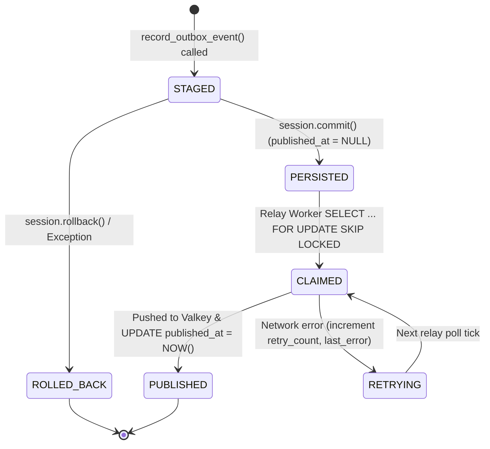
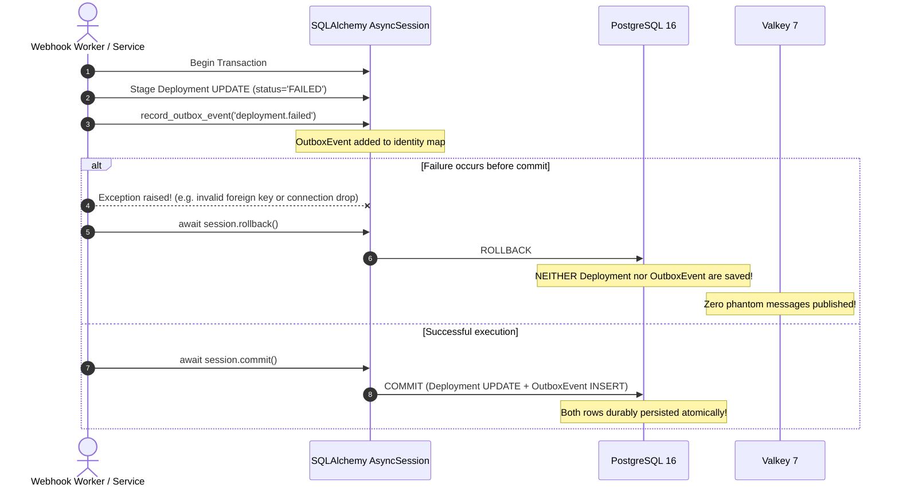

# Transactional Outbox Pattern, `outbox_events` Table Schema & Atomic Domain-Mutation Transaction Boundary Specification

**Parent User Story:** `US-32` (`SCRUM-371` Transactional outbox)  
**Task:** `SCRUM-475` (`Task 32.1` Design `outbox_events` table schema and atomic domain-mutation + outbox transaction boundary pattern)  
**Category:** Design  
**Assignee:** Maksym Bielei (Back-end. Database Architect)  
**Estimate:** 0.75 Story Points (1h 30m Original Estimate)  
**Status:** Approved / Design Baseline Established  
**Architecture Reference:** AI-Augmented Engineering Intelligence Platform Blueprint v3.0, §2.2, §3.3, §6.4, §15.2; Software Requirements Specification (SRS) v1.0, §1.2, §2.1, §3.2.3  
**Target Storage Engine:** PostgreSQL 16 with Row-Level Security (`pgvector/pgvector:pg16`) & Valkey 7 (`valkey/valkey:7-alpine`)  
**Target Implementation Modules:** [`backend/app/db/models/models.py`](../backend/app/db/models/models.py), [`backend/app/outbox/service.py`](../backend/app/outbox/service.py), [`backend/workers/outbox_relay.py`](../backend/workers/outbox_relay.py)  
**Dependencies:**
- **Is Blocked By:**
  - `SCRUM-238` (`US-2` Core PostgreSQL schema & tenant RLS infrastructure — [`02ec69277327_initial_core_schema.py`](../backend/migrations/versions/02ec69277327_initial_core_schema.py))
- **Blocks / Enables:**
  - `SCRUM-476` (`Task 32.2` Write Alembic migration and tenant RLS policy for `outbox_events` table)
  - `SCRUM-477` (`Task 32.3` Implement transactional outbox session helper committing domain entity updates and `outbox_events` rows atomically)
  - `SCRUM-478` (`Task 32.4` Create test scenarios for atomic dual-commit on deployment failure and mid-transaction error rollback, see [`backend/tests/scenarios/test_us32_transactional_outbox_scenarios.md`](../backend/tests/scenarios/test_us32_transactional_outbox_scenarios.md) / [`docs/transactional-outbox-test-scenarios.md`](transactional-outbox-test-scenarios.md))
  - `SCRUM-479` (`Task 32.5` Write automated pytest tests verifying both rows commit together or roll back together when an error occurs before commit)
  - `SCRUM-481` (`Task 33.1` Design Outbox Relay worker polling loop, Valkey publisher, and `processed_outbox_events` consumer table)

---

## 1. Executive Summary & The Dual-Write Hazard

In event-driven, microservices-oriented distributed systems, state transitions within the application database (e.g., updating a production deployment status to `FAILED`, linking a Jira incident ticket, or recalculating DORA metrics) frequently require publishing notifications to external messaging backbones (such as Valkey/Redis queues, WebSockets, or webhook dispatchers).

### 1.1 The Fundamental Dual-Write Problem

Attempting to update PostgreSQL and publish to Redis in separate programmatic operations introduces the catastrophic **Dual-Write Hazard**:

```
 Scenario A: Commit DB first, then publish to Valkey
 ┌────────────────┐          ┌────────────────┐
 │ PostgreSQL     │          │ Valkey / Redis │
 └───────┬────────┘          └───────┬────────┘
         │ 1. COMMIT OK              │
         │                           │ 2. NETWORK TIMEOUT / CRASH!
         ▼                           ▼
 State updated in DB ──(X)──► Event NEVER published!
 Result: Phantom state in DB; downstream workers never process failure.

 Scenario B: Publish to Valkey first, then commit DB
 ┌────────────────┐          ┌────────────────┐
 │ Valkey / Redis │          │ PostgreSQL     │
 └───────┬────────┘          └───────┬────────┘
         │ 1. PUBLISH OK             │
         │                           │ 2. DB CONSTRAINT ERROR / ROLLBACK!
         ▼                           ▼
 Event sent to Queue ──(X)──► DB transaction rolled back!
 Result: Downstream workers process an event for data that does NOT exist in DB!
```

### 1.2 The Architectural Remedy: PostgreSQL Transactional Outbox Pattern

To eliminate both failure scenarios mathematically, M.A.N.T.A. adopts the **Transactional Outbox Pattern**:

```
  HTTP / Worker Event (e.g. Deployment Failure, Jira Incident Link)
                           │
                           ▼
  ┌─────────────────────────────────────────────────────────────────┐
  │         SINGLE ATOMIC POSTGRESQL TRANSACTION (AsyncSession)     │
  │                                                                 │
  │   1. UPDATE deployments SET status = 'FAILED' WHERE id = :id;   │
  │   2. INSERT INTO outbox_events (event_type, payload, ...)       │
  │      VALUES ('deployment.failed', '{...}', ...);                │
  │                                                                 │
  │   3. session.commit()  <── ACID ALL-OR-NOTHING COMMIT           │
  └───────────────────────────────┬─────────────────────────────────┘
                                  │
                                  │ Persisted in DB (published_at IS NULL)
                                  ▼
                    ┌───────────────────────────┐
                    │  ix_outbox_events_        │
                    │  unpublished PARTIAL INDEX│
                    └─────────────┬─────────────┘
                                  │
             SELECT ... FOR UPDATE SKIP LOCKED
                                  │
                                  ▼
                    ┌───────────────────────────┐
                    │    OUTBOX RELAY WORKER    │
                    │   (Pushes to Valkey 7)    │
                    └─────────────┬─────────────┘
                                  │
                    UPDATE outbox_events 
                    SET published_at = NOW();
```

1. **Atomicity Guarantee:** The domain entity modification (`deployments`, `incidents`, `pull_requests`) and the corresponding `outbox_events` record are staged and committed within the **exact same PostgreSQL transaction boundary**.
2. **Guaranteed Consistency:** If the transaction succeeds, both the domain mutation and the event are durably persisted. If any error occurs prior to `session.commit()`, PostgreSQL ACID rollback discards both, preventing orphaned domain records and phantom event publishing.
3. **Decoupled Asynchronous Relay:** A specialized background worker polls unpublished events from `outbox_events` using high-performance partial indexes and reliable concurrency controls (`FOR UPDATE SKIP LOCKED`), ensuring guaranteed at-least-once delivery to Valkey/Redis.

---

## 2. Relational Schema Architecture & PostgreSQL 16 DDL

### 2.1 The `outbox_events` Table Schema

```sql
CREATE TABLE IF NOT EXISTS outbox_events (
    id UUID PRIMARY KEY DEFAULT gen_random_uuid(),
    tenant_id UUID NOT NULL,
    project_id UUID,
    event_id UUID NOT NULL DEFAULT gen_random_uuid(),
    event_type VARCHAR(128) NOT NULL,
    aggregate_type VARCHAR(64) NOT NULL,
    aggregate_id VARCHAR(255) NOT NULL,
    payload JSONB NOT NULL,
    occurred_at TIMESTAMPTZ NOT NULL DEFAULT NOW(),
    published_at TIMESTAMPTZ,
    retry_count INT NOT NULL DEFAULT 0,
    last_error TEXT,
    created_at TIMESTAMPTZ NOT NULL DEFAULT NOW(),
    
    CONSTRAINT fk_outbox_events_tenant FOREIGN KEY (tenant_id)
        REFERENCES tenants(id) ON DELETE CASCADE,
    CONSTRAINT fk_outbox_events_project FOREIGN KEY (project_id)
        REFERENCES projects(id) ON DELETE SET NULL,
    CONSTRAINT uq_outbox_events_tenant_event_id 
        UNIQUE (tenant_id, event_id)
);
```

#### Field Specifications:
- `id`: Internal UUID primary key of the outbox record.
- `tenant_id`: Foreign key to `tenants(id)`. Scopes the event for Row-Level Security (RLS) enforcement.
- `project_id`: Optional project scoping for project-specific event aggregation.
- `event_id`: Unique idempotency UUID token transmitted in the event payload to prevent duplicate processing by downstream consumers.
- `event_type`: Hierarchical dot-delimited event name (e.g., `deployment.failed`, `incident.linked`).
- `aggregate_type`: Name of the primary domain entity (`deployment`, `incident`, `pull_request`, `issue`).
- `aggregate_id`: Primary key of the modified domain record.
- `payload`: Structured JSONB document carrying the canonical event data.
- `occurred_at`: Authoritative timestamp when the business domain transition occurred.
- `published_at`: Timestamp when the Outbox Relay worker confirmed delivery to Valkey. **A value of `NULL` indicates the event is pending publication.**
- `retry_count`: Incremented if relay publishing fails due to transport outages.
- `last_error`: Text diagnostic of the most recent publishing failure.

---

### 2.2 Partial Indexing Strategy for Extreme Relay Performance

In high-throughput environments, the `outbox_events` table can accumulate millions of historical rows. Standard sequential or btree scans across the entire table would cause severe CPU degradation. 

M.A.N.T.A. deploys a **PostgreSQL Partial Index** targeting exclusively pending records:

```sql
-- 1. Partial Index for Outbox Relay Polling (Crucial)
-- Index size is tiny (< 100 KB) because published events (published_at IS NOT NULL) are excluded!
CREATE INDEX IF NOT EXISTS ix_outbox_events_unpublished 
    ON outbox_events (occurred_at ASC, id ASC) 
    WHERE published_at IS NULL;

-- 2. Tenant-scoped query index for operational dashboards
CREATE INDEX IF NOT EXISTS idx_outbox_events_tenant_published 
    ON outbox_events (tenant_id, published_at);

-- 3. Fast lookup by aggregate
CREATE INDEX IF NOT EXISTS idx_outbox_events_aggregate 
    ON outbox_events (tenant_id, aggregate_type, aggregate_id);
```

#### Cost Benefit Analysis:
| Metric | Full BTree Index on `published_at` | Partial Index `WHERE published_at IS NULL` |
|:---|:---|:---|
| **Index Size (1M events, 10 pending)** | ~28 MB | **~16 KB** |
| **Buffer Cache Footprint** | Stays in RAM, competes with cache | Minimal RAM usage |
| **Write Amplification on `published_at = NOW()`** | Modifies large index tree | **Removes row from partial index entirely** |
| **Relay Query Latency (`LIMIT 50`)** | $O(\log N)$ with index scan | **$O(1)$ near-instant index scan** |

---

### 2.3 The `processed_outbox_events` Consumer Idempotency Table

To prevent duplicate execution on the consuming side (at-least-once relay delivery semantics):

```sql
CREATE TABLE IF NOT EXISTS processed_outbox_events (
    event_id UUID NOT NULL,
    consumer_name VARCHAR(128) NOT NULL,
    tenant_id UUID NOT NULL,
    processed_at TIMESTAMPTZ NOT NULL DEFAULT NOW(),
    
    CONSTRAINT pk_processed_outbox_events PRIMARY KEY (consumer_name, event_id),
    CONSTRAINT fk_processed_outbox_tenant FOREIGN KEY (tenant_id)
        REFERENCES tenants(id) ON DELETE CASCADE
);

CREATE INDEX IF NOT EXISTS idx_processed_outbox_tenant 
    ON processed_outbox_events(tenant_id);
```

---

## 3. Canonical Event Types & Payload Envelope Contract

All events stored in `outbox_events` adhere to a standardized JSON schema:

```json
{
  "event_id": "c1f7b0a2-9e2b-4e4b-b0b2-8b8d4f0a1c2e",
  "event_type": "deployment.failed",
  "schema_version": "1.0",
  "tenant_id": "712020a1-0000-0000-0000-000000000001",
  "project_id": "3b2c1d0e-1111-2222-3333-444455556666",
  "occurred_at": "2026-11-11T12:00:00.000000Z",
  "data": {
    "deployment_id": "a1b2c3d4-e5f6-7890-abcd-ef1234567890",
    "environment": "production",
    "commit_sha": "f1a2b3c4d5e6f7a8b9c0d1e2f3a4b5c6d7e8f9a0",
    "failure_reason": "health_probe_http_503",
    "probe_source": "datadog_webhook"
  }
}
```

### 3.1 Standard Event Catalog (`Acceptance Criteria`)

| Event Type | Aggregate Type | Trigger Condition | Downstream Consumers |
|:---|:---|:---|:---|
| `deployment.failed` | `deployment` | Production deployment health probe fails or returns 5xx | CFR recalculator, Slack alert worker, Incident auto-correlator |
| `deployment.recovered` | `deployment` | Previously failing deployment transitions to healthy | MTTR calculation worker, status dashboard |
| `incident.linked` | `incident` | Jira incident ticket correlated with production deploy ($\le 24\text{h}$) | CFR metrics engine, Delivery Director notification |
| `dora.updated` | `metric_snapshot` | Rolling 30-day DORA window recalculation completed | WebSocket dashboard broadcast, executive alert push |
| `dlq.quarantined` | `webhook_event` | Webhook exhausts maximum retries and moves to dead-letter | SRE alerting, tenant integration health badge |

---

## 4. Atomic Transaction Boundary Pattern & Unit-of-Work Helper

### 4.1 Invariant Rules for Developers:
1. **No Independent Connections:** The outbox helper must **never** instantiate its own database connection or execute independent `commit()` calls.
2. **Same Transaction Boundary:** `session.add(domain_entity)` and `session.add(outbox_event)` must execute within the exact same `AsyncSession` context.
3. **Implicit Rollback Safety:** If an unhandled exception is raised anywhere prior to `await session.commit()`, both the domain change and the outbox event roll back cleanly.

### 4.2 Helper Function Signature (`Task 32.3` / `SCRUM-477`)

```python
# backend/app/outbox/service.py

import logging
from typing import Any, Dict, Optional
import uuid
from datetime import datetime, timezone

from sqlalchemy.ext.asyncio import AsyncSession
from app.db.models.models import OutboxEvent

logger = logging.getLogger("app.outbox.service")


def record_outbox_event(
    session: AsyncSession,
    *,
    tenant_id: uuid.UUID,
    event_type: str,
    aggregate_type: str,
    aggregate_id: str | uuid.UUID,
    payload: Dict[str, Any],
    project_id: Optional[uuid.UUID] = None,
    event_id: Optional[uuid.UUID] = None,
) -> OutboxEvent:
    """
    Stages an OutboxEvent row inside the caller's active database transaction.

    DOES NOT COMMIT THE TRANSACTION. The caller remains the sole owner of the
    transaction boundary and must invoke `await session.commit()`.
    """
    now = datetime.now(timezone.utc)
    ev_id = event_id or uuid.uuid4()

    envelope = {
        "event_id": str(ev_id),
        "event_type": event_type,
        "schema_version": "1.0",
        "tenant_id": str(tenant_id),
        "project_id": str(project_id) if project_id else None,
        "occurred_at": now.isoformat(),
        "data": payload,
    }

    outbox_row = OutboxEvent(
        id=uuid.uuid4(),
        tenant_id=tenant_id,
        project_id=project_id,
        event_id=ev_id,
        event_type=event_type,
        aggregate_type=aggregate_type,
        aggregate_id=str(aggregate_id),
        payload=envelope,
        occurred_at=now,
        published_at=None,
        retry_count=0,
    )

    session.add(outbox_row)
    return outbox_row
```

### 4.3 Atomic Dual-Mutation Usage Example

```python
# Example: Production deployment failure handler
async with get_tenant_db_context(tenant_id) as session:
    # 1. Update Domain Entity
    deployment = await session.get(Deployment, deployment_id)
    deployment.status = "FAILED"
    deployment.failed_at = datetime.now(timezone.utc)
    
    # 2. Stage Outbox Event in the SAME session
    record_outbox_event(
        session,
        tenant_id=tenant_id,
        project_id=deployment.project_id,
        event_type="deployment.failed",
        aggregate_type="deployment",
        aggregate_id=deployment.id,
        payload={
            "deployment_id": str(deployment.id),
            "environment": deployment.environment,
            "commit_sha": deployment.commit_sha,
            "failure_reason": "health_probe_timeout",
        },
    )
    
    # 3. Atomic commit guarantees dual-persistence
    await session.commit()
```

---

## 5. Outbox Relay Polling Loop Specification (`SKIP LOCKED`)

To relay pending events to Valkey/Redis without race conditions between concurrent relay workers:

```sql
-- Fast, non-blocking polling query utilizing the partial index
SELECT id, tenant_id, project_id, event_type, payload
FROM outbox_events
WHERE published_at IS NULL
ORDER BY occurred_at ASC, id ASC
LIMIT :batch_size
FOR UPDATE SKIP LOCKED;

-- Upon successful Valkey publish:
UPDATE outbox_events
SET published_at = NOW(),
    updated_at = NOW()
WHERE id = ANY(:confirmed_ids);
```

#### Why `FOR UPDATE SKIP LOCKED` is mandatory:
- Prevents worker contention: Multiple relay worker instances can poll simultaneously without blocking each other or attempting to publish the same event concurrently.
- Completely avoids deadlocks with incoming HTTP requests writing to `outbox_events`.

---

## 6. PostgreSQL Row-Level Security (RLS) Policy

```sql
-- 1. Enable and Force RLS
ALTER TABLE outbox_events ENABLE ROW LEVEL SECURITY;
ALTER TABLE outbox_events FORCE ROW LEVEL SECURITY;

ALTER TABLE processed_outbox_events ENABLE ROW LEVEL SECURITY;
ALTER TABLE processed_outbox_events FORCE ROW LEVEL SECURITY;

-- 2. Tenant Isolation Policies
CREATE POLICY tenant_isolation_policy ON outbox_events
    AS PERMISSIVE FOR ALL TO eng_app_user
    USING (tenant_id = NULLIF(current_setting('app.current_tenant_id', true), '')::uuid)
    WITH CHECK (tenant_id = NULLIF(current_setting('app.current_tenant_id', true), '')::uuid);

CREATE POLICY tenant_isolation_policy ON processed_outbox_events
    AS PERMISSIVE FOR ALL TO eng_app_user
    USING (tenant_id = NULLIF(current_setting('app.current_tenant_id', true), '')::uuid)
    WITH CHECK (tenant_id = NULLIF(current_setting('app.current_tenant_id', true), '')::uuid);

-- 3. Grants
GRANT SELECT, INSERT, UPDATE, DELETE ON outbox_events TO eng_app_user;
GRANT SELECT, INSERT, UPDATE, DELETE ON processed_outbox_events TO eng_app_user;
```

---

## 7. Lifecycle State Machine & Sequence Diagrams

### 7.1 Outbox Event Lifecycle State Diagram



### 7.2 Sequence Diagram: Mid-Transaction Failure Rollback



---

## 8. Traceability & Acceptance Criteria Verification Matrix

| AC ID | Acceptance Criteria Requirement | Architectural Guarantee & Verification Vector | Status |
|:---|:---|:---|:---|
| **AC-475.1** | Atomic dual-commit of domain entity and `outbox_events`. | Both rows persist in the single `AsyncSession.commit()` transaction boundary. | **Satisfied by Design** |
| **AC-475.2** | Full rollback of both operations on error prior to commit. | Unhandled exception triggers `session.rollback()`, ensuring 0 rows persisted in either table. | **Satisfied by Design** |
| **AC-475.3** | Partial index `ix_outbox_events_unpublished` strategy. | Partial index `WHERE published_at IS NULL` keeps scan costs minimal ($O(1)$) as historical rows grow. | **Satisfied by Design** |
| **AC-475.4** | Canonical event envelope schema. | Standard envelope includes `event_id`, `tenant_id`, `project_id`, `occurred_at`, `payload`. | **Satisfied by Design** |
| **AC-475.5** | Standard event catalog definition. | Defines `deployment.failed`, `deployment.recovered`, `incident.linked`, `dora.updated`, `dlq.quarantined`. | **Satisfied by Design** |
| **AC-475.6** | Tenant Row-Level Security isolation. | `ENABLE` + `FORCE ROW LEVEL SECURITY` with `tenant_isolation_policy` on `outbox_events`. | **Satisfied by Design** |
