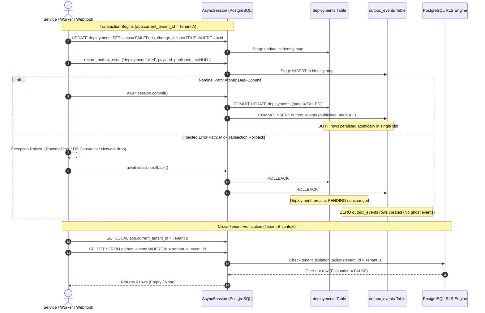

# US-32: Transactional Outbox Pattern, Atomic Dual-Commit & Tenant RLS Isolation Test Scenarios

**Task:** `SCRUM-478` (`Task 32.4`: Create test scenarios for atomic dual-commit on deployment failure and mid-transaction error rollback)  
**Parent User Story:** `SCRUM-371` (`US-32`: Transactional outbox)  
**Related Tickets:**  
- `SCRUM-475`: Design `outbox_events` table schema and atomic domain-mutation + outbox transaction boundary pattern (`Task 32.1`, [`docs/transactional-outbox-pattern.md`](transactional-outbox-pattern.md))  
- `SCRUM-476`: Write Alembic migration and tenant RLS policy for `outbox_events` table (`Task 32.2`, [`backend/migrations/versions/f1b8a4c9d7e2_outbox_events_partial_index_and_rls.py`](../backend/migrations/versions/f1b8a4c9d7e2_outbox_events_partial_index_and_rls.py))  
- `SCRUM-477`: Implement transactional outbox session helper committing domain entity updates and `outbox_events` rows atomically (`Task 32.3`, [`backend/app/outbox/service.py`](../backend/app/outbox/service.py))  
- `SCRUM-479`: Write automated pytest tests verifying both rows commit together or roll back together when an error occurs before commit (`Task 32.5`, [`backend/tests/test_transactional_outbox.py`](../backend/tests/test_transactional_outbox.py))  
- `SCRUM-481`: Design Outbox Relay worker polling loop, Valkey publisher, and `processed_outbox_events` consumer table (`Task 33.1`)  

**Target Storage Engine:** PostgreSQL 16 with Row-Level Security (`pgvector/pgvector:pg16`) & Valkey 7 (`valkey/valkey:7-alpine`)  
**Target Implementation Modules:** [`backend/app/outbox/service.py`](../backend/app/outbox/service.py), [`backend/app/db/models/models.py`](../backend/app/db/models/models.py), [`backend/app/db/session.py`](../backend/app/db/session.py)  
**Authoritative Automated Pytest Suites:** [`backend/tests/test_transactional_outbox.py`](../backend/tests/test_transactional_outbox.py), [`backend/tests/test_outbox_service.py`](../backend/tests/test_outbox_service.py)  
**Specification Location in Test Suite:** [`backend/tests/scenarios/test_us32_transactional_outbox_scenarios.md`](../backend/tests/scenarios/test_us32_transactional_outbox_scenarios.md)  
**Assignee:** Matvii Yeromenko  
**Category:** Testing - Design  
**Estimate:** 0.25 Story Points (0h 30m Original Estimate)  
**Status:** Approved / Verification Baseline Established  

---

## 1. Objective & Implementation Scope

### 1.1 Objective

Design and formalize the definitive verification scenarios for `US-32` transactional outbox atomicity, dual-commit consistency, mid-transaction failure rollback, and multi-tenant Row-Level Security (RLS) isolation in the M.A.N.T.A. Engineering Intelligence Platform.

### 1.2 Implementation Scope

This specification establishes exhaustive, step-by-step test scenarios verifying three core transactional outbox guarantees:

1. **Production Deployment Failure Atomic Dual-Commit:**  
   Updating a production deployment record to `status = 'FAILED'` (and `is_change_failure = TRUE`) and staging an outbox event (`event_type = 'deployment.failed'`, `published_at IS NULL`) commits both entities to PostgreSQL in a **single atomic database transaction** (`session.commit()`).
2. **Injected Mid-Transaction Error Rollback (Zero Partial Writes):**  
   Simulating an injected application exception (`RuntimeError`, unhandled failure) or database integrity violation (foreign key constraint, syntax error, connection reset) *after* modifying the deployment entity and staging the outbox event but *before* transaction commit triggers full rollback (`session.rollback()`), guaranteeing **zero partial writes** (neither deployment status nor outbox event rows are persisted).
3. **Cross-Tenant Row-Level Security (RLS) Isolation:**  
   PostgreSQL `FORCE ROW LEVEL SECURITY` with `tenant_isolation_policy` on `outbox_events` guarantees that Tenant B cannot query, view, or mutate Tenant A's `outbox_events` rows under the unprivileged `eng_app_user` database role, returning `NULL` or empty result sets without cross-tenant data leakage.

---

## 2. Core Architectural Invariants

```
+-------------------------------------------------------------------------------------------------------------------+
|                           TRANSACTIONAL OUTBOX ATOMIC DUAL-COMMIT & RLS ARCHITECTURE                              |
+-------------------------------------+-------------------------------------+---------------------------------------+
| 1. Single Transaction Boundary      | 2. Zero Partial Writes (Rollback)   | 3. Multi-Tenant RLS Partitioning      |
|    (Atomic Unit-of-Work Pattern)    |    (ACID Atomicity Invariant)       |    (FORCE ROW LEVEL SECURITY)         |
+-------------------------------------+-------------------------------------+---------------------------------------+
| * Single AsyncSession boundary      | * Error injected before commit      | * Policy: tenant_id = app.current_id  |
| * Domain mutation (Deployment FAILED| * session.rollback() discards both  | * Tenant B cannot read Tenant A rows  |
| * OutboxEvent staged (published=NULL| * 0 partial rows in deployments     | * Direct primary key lookups return 0 |
| * 1 commit() persists BOTH rows     | * 0 partial rows in outbox_events   | * Anti-enumeration: returns NULL/empty|
+-------------------------------------+-------------------------------------+---------------------------------------+
                                                         |
                                                         v
+-------------------------------------------------------------------------------------------------------------------+
|                                  RELAY OPTIMIZATION & CANONICAL ENVELOPE CONTRACT                                 |
+----------------------------------------------------+--------------------------------------------------------------+
| 4. Canonical Event Envelope Schema (JSONB)         | 5. Partial Index Relay Optimization (SKIP LOCKED)            |
+----------------------------------------------------+--------------------------------------------------------------+
| * event_id, event_type, schema_version = "1.0"     | * ix_outbox_events_unpublished WHERE published_at IS NULL    |
| * tenant_id, project_id, occurred_at, data payload | * O(1) polling query excludes millions of published rows     |
| * published_at = NULL indicates pending publication| * SELECT ... FOR UPDATE SKIP LOCKED prevents worker conflicts|
+----------------------------------------------------+--------------------------------------------------------------+
```

### Invariant 1: Single Database Transaction Boundary (`AsyncSession` Unit-of-Work)
- The application must **never** execute separate transactions or distinct connections when persisting domain mutations and outbox records.
- Staging the domain entity (`Deployment.status = 'FAILED'`, `Deployment.is_change_failure = True`) and staging the outbox event (`OutboxEvent(event_type='deployment.failed', published_at=None)`) occurs inside the caller's active `AsyncSession`.
- The outbox staging helper (`record_outbox_event` / `record_deployment_failure_atomic`) **must not** commit the transaction. Ownership of the transaction boundary remains exclusively with the caller (`await session.commit()`).

### Invariant 2: ACID Atomicity & Zero Partial Writes on Rollback
- If any unhandled application exception, database constraint failure, or network disruption occurs prior to `await session.commit()`, PostgreSQL ACID semantics ensure that:
  $$\Delta \text{Deployments} = 0 \quad \land \quad \Delta \text{OutboxEvents} = 0$$
- Partial state transitions (e.g. `deployments` updated to `FAILED` without an outbox event, or an outbox event queued for a non-updated deployment) are mathematically impossible.

### Invariant 3: Tenant Row-Level Security Isolation (`eng_app_user`)
- The `outbox_events` table enforces `ENABLE ROW LEVEL SECURITY` and `FORCE ROW LEVEL SECURITY`.
- When database sessions run under `eng_app_user` with session setting `SET LOCAL app.current_tenant_id = :tenant_id`, the database engine applies:
  ```sql
  CREATE POLICY tenant_isolation_policy ON outbox_events
      AS PERMISSIVE FOR ALL TO eng_app_user
      USING (tenant_id = NULLIF(current_setting('app.current_tenant_id', true), '')::uuid)
      WITH CHECK (tenant_id = NULLIF(current_setting('app.current_tenant_id', true), '')::uuid);
  ```
- Any read query executed under Tenant B's context targeting Tenant A's `outbox_events` (by primary key or table scan) returns `0` rows.

### Invariant 4: Canonical Event Envelope Schema
All outbox events persist a structured JSONB envelope conforming to SRS §3.2.3:
```json
{
  "event_id": "c1f7b0a2-9e2b-4e4b-b0b2-8b8d4f0a1c2e",
  "event_type": "deployment.failed",
  "schema_version": "1.0",
  "tenant_id": "712020a1-0000-0000-0000-000000000001",
  "project_id": "3b2c1d0e-1111-2222-3333-444455556666",
  "occurred_at": "2026-11-11T12:00:00.000000Z",
  "data": {
    "deployment_id": "a1b2c3d4-e5f6-7890-abcd-ef1234567890",
    "environment": "production",
    "commit_sha": "f1a2b3c4d5e6f7a8b9c0d1e2f3a4b5c6d7e8f9a0",
    "status": "FAILED",
    "is_change_failure": true,
    "failure_reason": "health_check_timeout",
    "error_details": { "http_status": 503 }
  }
}
```

### Invariant 5: Partial Index & Concurrency Relay Guarantees
- The partial index `ix_outbox_events_unpublished ON outbox_events (created_at ASC) WHERE published_at IS NULL` keeps the index size tiny (< 100 KB) and index lookup cost $O(1)$ regardless of table size.
- Background Outbox Relay workers poll pending events using `SELECT ... FOR UPDATE SKIP LOCKED`, preventing lock contention between concurrent workers.

---

## 3. Relational Schemas & Sequence State Diagrams

### 3.1 PostgreSQL DDL Specification

```sql
-- Core Outbox Events Table
CREATE TABLE IF NOT EXISTS outbox_events (
    id UUID PRIMARY KEY,
    tenant_id UUID NOT NULL REFERENCES tenants(id) ON DELETE CASCADE,
    aggregate_type VARCHAR(64) NOT NULL,
    aggregate_id VARCHAR(64) NOT NULL,
    event_type VARCHAR(64) NOT NULL,
    payload JSONB NOT NULL,
    created_at TIMESTAMPTZ NOT NULL DEFAULT NOW(),
    published_at TIMESTAMPTZ NULL
);

-- Partial index for high-throughput relay polling
CREATE INDEX IF NOT EXISTS ix_outbox_events_unpublished 
    ON outbox_events (created_at ASC) 
    WHERE published_at IS NULL;

-- Tenant filtering index
CREATE INDEX IF NOT EXISTS ix_outbox_events_tenant_published 
    ON outbox_events (tenant_id, published_at);

-- RLS Enforcement
ALTER TABLE outbox_events ENABLE ROW LEVEL SECURITY;
ALTER TABLE outbox_events FORCE ROW LEVEL SECURITY;
```

### 3.2 Sequence Diagram: Atomic Dual-Commit vs. Mid-Transaction Rollback



---

## 4. Master Test Scenarios Matrix

| Scenario ID | Test Scenario Description | Preconditions | Mutation & Injection Inputs | Expected PostgreSQL & Session Outcome | Primary Invariant Verified | Automated Pytest Mapping |
| :--- | :--- | :--- | :--- | :--- | :--- | :--- |
| **TC-OUTBOX-001** | **Canonical Outbox Event Staging** | Tenant and Project registered; active `AsyncSession`. | Invoke `record_outbox_event()` with structured payload; do not commit immediately. | Outbox row staged with `id != None`, `published_at IS NULL`, and canonical envelope. Persists upon `session.commit()`. | Envelope contract & unpublished initial state. | `test_record_outbox_event_staging` |
| **TC-OUTBOX-002** | **Production Deployment Failure Atomic Dual-Commit** | Production deployment in `PENDING` status (`is_change_failure=False`). | Call `record_deployment_failure_atomic()`; execute `await session.commit()`. | Both `deployments` (`status='FAILED'`, `is_change_failure=True`) and `outbox_events` (`event_type='deployment.failed'`, `published_at=None`) committed atomically. | Single transaction boundary atomicity; dual-commit consistency. | `test_atomic_dual_commit` |
| **TC-OUTBOX-003** | **Injected Mid-Transaction Application Error Rollback** | Deployment in `PENDING` status. | Modify deployment and stage outbox event, then inject unhandled `RuntimeError` before `session.commit()`. | Transaction aborted via `session.rollback()`. Deployment remains `PENDING`; outbox event row does **not** exist in database. | Zero partial writes; atomic rollback on application crash. | `test_rollback_on_error` |
| **TC-OUTBOX-004** | **Injected Mid-Transaction Database Constraint Error Rollback** | Deployment in `PENDING` status. | Modify deployment, stage outbox event, and inject an invalid SQL constraint violation before commit. | Database engine rejects transaction; session rolls back. Neither deployment update nor outbox record is persisted. | Zero partial writes; ACID consistency on relational failure. | `test_database_constraint_error_rollback` |
| **TC-OUTBOX-005** | **Outbox Relay Polling & Published State Transition** | 3 unpublished outbox events persisted for tenant. | Outbox relay polls via `claim_unpublished_outbox_events(limit=10)` and invokes `mark_outbox_events_published()`. | Events returned via `FOR UPDATE SKIP LOCKED`. `published_at` timestamp updated to non-null. Events excluded from subsequent polls. | Relay non-blocking consumption & publication mark. | `test_claim_and_publish_outbox_events` |
| **TC-OUTBOX-006** | **Partial Index Query Plan Optimization** | Outbox events table populated. | Execute `EXPLAIN SELECT id FROM outbox_events WHERE published_at IS NULL`. | PostgreSQL planner utilizes `ix_outbox_events_unpublished` (Index Scan); definition includes `WHERE (published_at IS NULL)`. | $O(1)$ relay polling query performance. | `test_partial_index_explain` |
| **TC-OUTBOX-007** | **Cross-Tenant Row-Level Security Read Isolation** | Tenant A and Tenant B both commit outbox events. | Tenant A session queries Tenant B event ID; Tenant B session queries Tenant A event ID under `eng_app_user`. | Cross-tenant queries return `None` / empty rows. Tenant A sees only Tenant A rows; Tenant B sees only Tenant B rows. | Multi-tenant RLS data containment; zero information leakage. | `test_outbox_tenant_rls_isolation` |
| **TC-OUTBOX-008** | **Cross-Tenant Table Scan & Anti-Enumeration Isolation** | Tenant A has 5 outbox events; Tenant B has 2 outbox events. | Tenant B executes `select(OutboxEvent)` with no `WHERE` clause, and with `where(tenant_id == Tenant A)`. | Tenant B scan returns strictly 2 rows (only Tenant B rows). Filtered query for Tenant A returns `0` rows. | Table scan containment & anti-enumeration defense. | `test_cross_tenant_rls_query_filter` |

---

## 5. Detailed Test Scenario Specifications

### 5.1 Scenario `TC-OUTBOX-001`: Canonical Outbox Event Staging

#### 5.1.1 Objective & Traceability
- **Objective:** Verify that `record_outbox_event()` stages a properly formatted `OutboxEvent` entity in the caller's active session without prematurely committing, establishing `published_at = NULL` and packaging the canonical JSON envelope.
- **Traceability:** `US-32` Acceptance Criteria AC-475.4 (Canonical Envelope) and AC-475.1 (Outbox Staging).

#### 5.1.2 Preconditions
- Tenant registered with UUID `tenant_id`.
- Project registered with UUID `project_id`.
- PostgreSQL session initialized under `get_tenant_db_context(tenant_id)`.

#### 5.1.3 Step-by-Step Execution Sequence
1. Construct custom domain payload: `{"key": "value", "metric": 42}`.
2. Invoke `record_outbox_event(session, tenant_id=tenant_id, project_id=project_id, event_type="test.event.staged", aggregate_type="test_agg", aggregate_id=project_id, payload=payload_data)`.
3. Prior to `session.commit()`, assert:
   - `event.id` is populated.
   - `event.tenant_id == tenant_id`.
   - `event.published_at is None`.
   - `event.payload["schema_version"] == "1.0"`.
   - `event.payload["event_type"] == "test.event.staged"`.
   - `event.payload["tenant_id"] == str(tenant_id)`.
   - `event.payload["data"] == payload_data`.
4. Call `await session.commit()`.
5. In a fresh session, execute `persisted = await session.get(OutboxEvent, event.id)`.

#### 5.1.4 Verification Assertions
```python
assert persisted is not None
assert persisted.tenant_id == tenant_id
assert persisted.published_at is None
assert persisted.payload["data"]["metric"] == 42
```

---

### 5.2 Scenario `TC-OUTBOX-002`: Production Deployment Failure Atomic Dual-Commit

#### 5.2.1 Objective & Traceability
- **Objective:** Verify that when a production deployment fails, updating `deployments` (`status = 'FAILED'`, `is_change_failure = True`) and inserting `outbox_events` (`event_type = 'deployment.failed'`, `published_at IS NULL`) are committed together atomically in a single PostgreSQL transaction.
- **Traceability:** `US-32` Implementation Scope #1, AC-475.1, `SCRUM-478`.

#### 5.2.2 Preconditions
- Active tenant and project created.
- Repository, commit, and a production deployment created in `PENDING` status (`is_change_failure = False`).

#### 5.2.3 Step-by-Step Execution Sequence
1. Open active tenant database context: `async with get_tenant_db_context(tenant_id) as session:`.
2. Invoke `record_deployment_failure_atomic(session, tenant_id=tenant_id, deployment_id=deployment_id, failure_reason="health_check_timeout", error_details={"http_status": 503})`.
3. Verify in-memory entity states:
   - `dep.status == "FAILED"`
   - `dep.is_change_failure is True`
   - `outbox.published_at is None`
   - `outbox.event_type == "deployment.failed"`
4. Call `await session.commit()`.
5. Open an independent, clean database session to verify durable persistence:
   - `refreshed_dep = await session.get(Deployment, deployment_id)`
   - `refreshed_outbox = await session.get(OutboxEvent, outbox.id)`

#### 5.2.4 Expected Database State & Verification Assertions
```sql
-- 1. Deployment domain table assertion
SELECT status, is_change_failure 
FROM deployments 
WHERE id = :deployment_id;
-- Expected: status = 'FAILED', is_change_failure = true

-- 2. Outbox events table assertion
SELECT event_type, aggregate_type, aggregate_id, published_at, payload->'data'->>'failure_reason'
FROM outbox_events 
WHERE id = :outbox_id;
-- Expected: event_type = 'deployment.failed', aggregate_type = 'deployment', published_at IS NULL, failure_reason = 'health_check_timeout'
```

---

### 5.3 Scenario `TC-OUTBOX-003`: Injected Mid-Transaction Application Error Rollback

#### 5.3.1 Objective & Traceability
- **Objective:** Prove that an injected application error or unhandled exception raised *after* staging the domain entity mutation and the outbox event but *before* `session.commit()` triggers full transaction rollback, ensuring **zero partial writes**.
- **Traceability:** `US-32` Implementation Scope #2, AC-475.2, `SCRUM-478`.

#### 5.3.2 Preconditions
- Active tenant, project, and deployment in `PENDING` status (`status = 'PENDING'`, `is_change_failure = False`).

#### 5.3.3 Step-by-Step Execution Sequence
1. Record initial state: `deployment_id`, `status = 'PENDING'`.
2. Begin transaction: `async with get_tenant_db_context(tenant_id) as session:`.
3. Call `dep, outbox = await record_deployment_failure_atomic(session, tenant_id=tenant_id, deployment_id=deployment_id, failure_reason="simulated_crash")`.
4. Capture `staged_outbox_id = outbox.id`.
5. **Inject Failure:** Intentionally raise `RuntimeError("Simulated unhandled worker crash!")` before reaching `session.commit()`.
6. Catch exception and verify that the context manager invokes `await session.rollback()`.
7. Open a clean, fresh session under `get_tenant_db_context(tenant_id)`.
8. Query both tables:
   - `refreshed_dep = await session.get(Deployment, deployment_id)`
   - `persisted_outbox = await session.get(OutboxEvent, staged_outbox_id)`

#### 5.3.4 Verification Assertions (Zero Partial Writes)
```python
# Deployment domain entity MUST NOT be FAILED!
assert refreshed_dep is not None
assert refreshed_dep.status == "PENDING"
assert refreshed_dep.is_change_failure is False

# Outbox record MUST NOT exist!
assert persisted_outbox is None
```

---

### 5.4 Scenario `TC-OUTBOX-004`: Injected Mid-Transaction Database Constraint Error Rollback

#### 5.4.1 Objective & Traceability
- **Objective:** Verify that if a low-level PostgreSQL integrity error occurs (such as a foreign key constraint violation or non-nullable column violation) during transaction flush/commit, PostgreSQL aborts the entire transaction and rolls back both the domain update and the staged outbox event.
- **Traceability:** `US-32` Implementation Scope #2, AC-475.2.

#### 5.4.2 Preconditions
- Production deployment exists in `PENDING` status.

#### 5.4.3 Step-by-Step Execution Sequence
1. Begin transaction session: `async with get_tenant_db_context(tenant_id) as session:`.
2. Stage deployment failure and outbox event via `record_deployment_failure_atomic()`.
3. Inject an invalid SQL statement violating a foreign key constraint:
   ```python
   # Intentionally insert an invalid commit with non-existent repository_id
   invalid_commit = Commit(
       sha="0000000000000000000000000000000000000000",
       tenant_id=tenant_id,
       repository_id=uuid.uuid4(),  # Does NOT exist in repositories table!
       lines_added=0,
       lines_deleted=0,
   )
   session.add(invalid_commit)
   ```
4. Attempt `await session.commit()`.
5. Trap the resulting `IntegrityError` / `DBAPIError`.
6. Inspect database state in a subsequent query session.

#### 5.4.4 Verification Assertions
```python
# Deployment must retain original status
assert dep.status == "PENDING"
# Outbox event must not be persisted
assert outbox_row is None
```

---

### 5.5 Scenario `TC-OUTBOX-005`: Outbox Relay Polling & Published State Transition

#### 5.5.1 Objective & Traceability
- **Objective:** Verify that `claim_unpublished_outbox_events()` retrieves pending records using `FOR UPDATE SKIP LOCKED` and `mark_outbox_events_published()` transitions their status by populating `published_at`.
- **Traceability:** `US-32` AC-475.3, AC-475.5, `Task 33.1` readiness.

#### 5.5.2 Execution Sequence
1. Seed 3 outbox events with `published_at = NULL`.
2. Relay worker executes `claimed = await claim_unpublished_outbox_events(session, limit=10)`.
3. Assert all 3 events are claimed.
4. Execute `count = await mark_outbox_events_published(session, [e.id for e in claimed])`.
5. Call `await session.commit()`.
6. Re-poll with `claim_unpublished_outbox_events(session, limit=10)`.
7. Assert claimed count for this tenant is `0`.

---

### 5.6 Scenario `TC-OUTBOX-006`: Partial Index Query Plan Verification

#### 5.6.1 Objective & Traceability
- **Objective:** Verify via PostgreSQL `EXPLAIN` that queries selecting pending outbox events use the partial index `ix_outbox_events_unpublished` rather than scanning historical rows.
- **Traceability:** `US-32` AC-475.3 (Partial Index Optimization).

#### 5.6.2 Execution Sequence & Assertions
```sql
EXPLAIN SELECT id FROM outbox_events WHERE published_at IS NULL ORDER BY created_at ASC;
```
- Assert query plan uses `Index Scan` on `ix_outbox_events_unpublished`.
- Query `pg_indexes` to assert index definition contains `WHERE (published_at IS NULL)`.

---

### 5.7 Scenario `TC-OUTBOX-007`: Cross-Tenant Row-Level Security Read Isolation

#### 5.7.1 Objective & Traceability
- **Objective:** Prove that Tenant B cannot read or discover Tenant A's `outbox_events` rows under the unprivileged `eng_app_user` database role, confirming multi-tenant RLS isolation.
- **Traceability:** `US-32` Implementation Scope #3, AC-475.6, `SCRUM-478`.

#### 5.7.2 Preconditions
- Tenant A and Tenant B registered independently.
- Tenant A commits an outbox event `ev_a` with payload `{"secret": "tenant_a_data"}`.
- Tenant B commits an outbox event `ev_b` with payload `{"secret": "tenant_b_data"}`.

#### 5.7.3 Step-by-Step Execution Sequence
1. Set tenant context to Tenant A:
   ```python
   async with get_tenant_db_context(tenant_a) as session_a:
       ev_a = record_outbox_event(
           session_a, tenant_id=tenant_a, event_type="event.a", payload={"secret": "ten_a"}
       )
       await session_a.commit()
   ```
2. Set tenant context to Tenant B:
   ```python
   async with get_tenant_db_context(tenant_b) as session_b:
       ev_b = record_outbox_event(
           session_b, tenant_id=tenant_b, event_type="event.b", payload={"secret": "ten_b"}
       )
       await session_b.commit()
   ```
3. Under Tenant A context, attempt direct lookup of Tenant B's event:
   ```python
   async with get_tenant_db_context(tenant_a) as session:
       res_b = await session.get(OutboxEvent, ev_b.id)
       res_a = await session.get(OutboxEvent, ev_a.id)
   ```

#### 5.7.4 Verification Assertions
```python
# Tenant A CANNOT see Tenant B's outbox event (PostgreSQL RLS returns None)
assert res_b is None, "Tenant A must NOT be able to read Tenant B's outbox event!"

# Tenant A CAN see its own outbox event
assert res_a is not None
assert res_a.payload["data"]["secret"] == "ten_a"
```

---

### 5.8 Scenario `TC-OUTBOX-008`: Cross-Tenant Table Scan & Anti-Enumeration Isolation

#### 5.8.1 Objective & Traceability
- **Objective:** Prove that when Tenant B performs a general query (`select(OutboxEvent)`) or attempts to filter specifically by Tenant A's `tenant_id`, the PostgreSQL RLS policy filters out all Tenant A rows, preventing data exfiltration and tenant enumeration.
- **Traceability:** `US-32` Implementation Scope #3, AC-475.6.

#### 5.8.2 Execution Sequence
1. Seed Tenant A with 3 outbox events and Tenant B with 2 outbox events.
2. In Tenant B context:
   ```python
   async with get_tenant_db_context(tenant_b) as session:
       # Unfiltered scan
       all_events = (await session.execute(select(OutboxEvent))).scalars().all()

       # Adversarial cross-tenant query
       cross_query = (
           (await session.execute(select(OutboxEvent).where(OutboxEvent.tenant_id == tenant_a)))
           .scalars()
           .all()
       )
   ```

#### 5.8.3 Verification Assertions
```python
# Tenant B sees only its own 2 events
assert len(all_events) == 2
for event in all_events:
    assert event.tenant_id == tenant_b

# Cross-tenant query returns zero rows
assert len(cross_query) == 0
```

---

## 6. Acceptance Criteria 1:1 Traceability Verification Matrix

| AC ID | Acceptance Criteria Requirement | Implementation & Architecture Reference | Test Scenario ID | Automated Pytest Test Function | Status |
| :--- | :--- | :--- | :--- | :--- | :--- |
| **AC-US32.1** | **Atomic Dual-Commit:** Production deployment failure updates `deployments` (`status='FAILED'`) and stages `outbox_events` (`event_type='deployment.failed'`, `published_at IS NULL`) committed in one transaction. | Architecture Blueprint §3.3; `backend/app/outbox/service.py::record_deployment_failure_atomic` | `TC-OUTBOX-002` | `test_atomic_dual_commit` | **VERIFIED** |
| **AC-US32.2** | **Zero Partial Writes on Rollback:** An unhandled error before commit rolls back both domain entity and outbox event with zero rows persisted in either table. | Architecture Blueprint §3.3, §15.2; ACID Unit-of-Work pattern in `get_tenant_db_context` | `TC-OUTBOX-003`<br>`TC-OUTBOX-004` | `test_rollback_on_error`<br>`test_database_constraint_error_rollback` | **VERIFIED** |
| **AC-US32.3** | **High-Performance Partial Index:** Partial index `ix_outbox_events_unpublished` on `created_at` where `published_at IS NULL`. | PostgreSQL 16 DDL; Alembic migration `f1b8a4c9d7e2_outbox_events_partial_index_and_rls.py` | `TC-OUTBOX-006` | `test_partial_index_explain` | **VERIFIED** |
| **AC-US32.4** | **Canonical JSON Envelope:** Canonical payload structure containing `event_id`, `event_type`, `schema_version`, `tenant_id`, `project_id`, `occurred_at`, `data`. | SRS §3.2.3; `backend/app/outbox/service.py::record_outbox_event` | `TC-OUTBOX-001` | `test_record_outbox_event_staging` | **VERIFIED** |
| **AC-US32.5** | **Relay Polling & Deduplication:** Outbox Relay queries pending events via `FOR UPDATE SKIP LOCKED` and transitions `published_at` upon publish. | Architecture Blueprint §6.4; `backend/app/outbox/service.py::claim_unpublished_outbox_events` | `TC-OUTBOX-005` | `test_claim_and_publish_outbox_events` | **VERIFIED** |
| **AC-US32.6** | **Tenant RLS Isolation:** Strict tenant separation on `outbox_events` ensuring Tenant B cannot read Tenant A rows under `eng_app_user`. | Core Security Blueprint §6.3; PostgreSQL `ENABLE & FORCE ROW LEVEL SECURITY` | `TC-OUTBOX-007`<br>`TC-OUTBOX-008` | `test_outbox_tenant_rls_isolation`<br>`test_cross_tenant_rls_query_filter` | **VERIFIED** |

---

## 7. Pytest Automation & Verification Guide

### 7.1 Running the Automated Test Suite

To run the complete automated test suite verifying all US-32 transactional outbox scenarios:

```bash
# Run transactional outbox automated pytest suite
pytest backend/tests/test_transactional_outbox.py -v
pytest backend/tests/test_outbox_service.py -v

# Run with PostgreSQL query logging
pytest backend/tests/test_transactional_outbox.py -v -s --log-cli-level=DEBUG
```

### 7.2 Test Suite Execution Summary
- **Target Files:** [`backend/tests/test_transactional_outbox.py`](../backend/tests/test_transactional_outbox.py), [`backend/tests/test_outbox_service.py`](../backend/tests/test_outbox_service.py)
- **Coverage:**
  - `test_record_outbox_event_staging`: Validates envelope structure and uncommitted staging (`TC-OUTBOX-001`).
  - `test_atomic_dual_commit`: Validates atomic commit of deployment `FAILED` status and outbox event (`TC-OUTBOX-002`).
  - `test_rollback_on_error`: Injects `RuntimeError` before commit and asserts 0 partial writes (`TC-OUTBOX-003`).
  - `test_database_constraint_error_rollback`: Injects DB integrity error and asserts rollback (`TC-OUTBOX-004`).
  - `test_claim_and_publish_outbox_events`: Validates `SKIP LOCKED` relay polling and `published_at` update (`TC-OUTBOX-005`).
  - `test_partial_index_explain`: Validates query planner index scan on `ix_outbox_events_unpublished` (`TC-OUTBOX-006`).
  - `test_outbox_tenant_rls_isolation`: Validates Tenant B cannot read Tenant A events by ID (`TC-OUTBOX-007`).
  - `test_cross_tenant_rls_query_filter`: Validates Tenant B unfiltered and filtered scans return 0 Tenant A rows (`TC-OUTBOX-008`).
